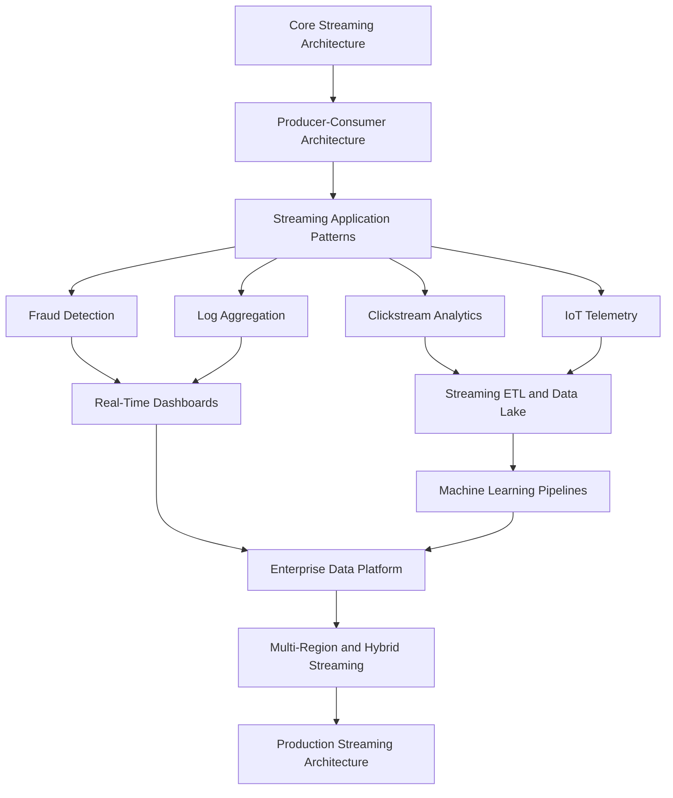
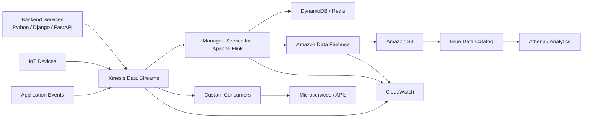

# README.md

## Overview

Amazon Kinesis is a collection of AWS services for ingesting, processing, and delivering streaming data in near real time. It supports architectures where applications continuously produce events and downstream systems consume, transform, analyze, or persist those events.

Kinesis is useful for backend systems that need to process high-volume event streams without coupling producers directly to consumers. Typical workloads include application telemetry, clickstream analytics, IoT data, financial transactions, security monitoring, and real-time data pipelines.

This directory covers Kinesis architecture, implementation patterns, and production operations, from core streaming concepts to enterprise-scale deployments.

## Documentation Structure

| File | Description |
|---|---|
| [01- Core Streaming Architecture](./01-%20Core%20Streaming%20Architecture.md) | Streaming fundamentals, Kinesis services, shards, producers, consumers, retention, and core architecture patterns. |
| [02- Producer-Consumer Architecture](./02-%20Producer-Consumer%20Architecture.md) | Producer and consumer responsibilities, partition-key design, publishing, checkpointing, and idempotent processing. |
| [03- Real-Time Clickstream Analytics](./03-%20Real-Time%20Clickstream%20Analytics.md) | Browser event collection, clickstream ingestion, session analytics, conversion metrics, and real-time aggregation. |
| [04- IoT Telemetry Processing Architecture](./04-%20IoT%20Telemetry%20Processing%20Architecture.md) | Device telemetry ingestion, event-time processing, device state, threshold alerts, and IoT integration. |
| [05- Fraud Detection and Financial Streaming](./05-%20Fraud%20Detection%20and%20Financial%20Streaming.md) | Financial event processing, velocity checks, anomaly detection, risk scoring, and reliable decision workflows. |
| [06- Log Aggregation and Security Monitoring](./06-%20Log%20Aggregation%20and%20Security%20Monitoring.md) | Centralized log ingestion, security event processing, threat detection, and operational analytics. |
| [07- Streaming ETL and Data Lake Architecture](./07-%20Streaming%20ETL%20and%20Data%20Lake%20Architecture.md) | Streaming transformations, S3 data lake zones, data quality, schema evolution, and analytical storage. |
| [08- Real-Time Dashboard Architecture](./08-%20Real-Time%20Dashboard%20Architecture.md) | Streaming metrics, aggregation, Redis and DynamoDB serving layers, and real-time dashboard delivery. |
| [09- Machine Learning Streaming Pipeline](./09-%20Machine%20Learning%20Streaming%20Pipeline.md) | Online feature engineering, model inference, prediction delivery, and batch-training integration. |
| [10- Enterprise Data Platform Architecture](./10-%20Enterprise%20Data%20Platform%20Architecture.md) | Enterprise streaming and batch data platforms, governance, orchestration, serving, and multi-team integration. |
| [11- Multi-Region and Hybrid Cloud Streaming](./11-%20Multi-Region%20and%20Hybrid%20Cloud%20Streaming.md) | Cross-Region replication, hybrid connectivity, failover strategies, and distributed streaming considerations. |
| [12- Production Streaming Architecture](./12-%20Production%20Streaming%20Architecture.md) | Production reference architecture covering SLOs, reliability, idempotency, observability, security, deployment, and disaster recovery. |

## Architecture Coverage

The documents progress from Kinesis fundamentals to production-grade streaming systems.



## Core AWS Services

| Service | Primary responsibility | Typical use |
|---|---|---|
| Amazon Kinesis Data Streams | Retained, ordered-per-shard event streaming | Custom producers and consumers, replayable event ingestion, real-time processing. |
| Amazon Data Firehose | Managed delivery of streaming data to supported destinations | Delivering events to Amazon S3 and other supported services. |
| Amazon Managed Service for Apache Flink | Stateful stream processing and analytics | Event-time windows, aggregations, enrichment, and anomaly detection. |
| Amazon S3 | Durable object storage | Raw event archives, historical data, and data lake storage. |
| AWS Glue Data Catalog | Metadata management | Cataloging datasets for analytical services. |
| Amazon Athena | SQL-based analytics over supported data sources | Querying historical streaming data stored in S3. |
| Amazon DynamoDB | Low-latency key-value and document storage | Serving device state, aggregates, and application lookup data. |
| Amazon ElastiCache for Redis | In-memory data serving and caching | Dashboard metrics, counters, and low-latency reads. |
| Amazon CloudWatch | Metrics, logs, and alarms | Stream health, consumer lag, processing errors, and operational alerting. |

## Common Streaming Architecture

A typical Kinesis architecture separates event production, stream ingestion, processing, and downstream delivery.



### Architecture Responsibilities

- **Producers:** Publish validated events with stable event identifiers and suitable partition keys.
- **Kinesis Data Streams:** Retain and distribute records across shards.
- **Consumers:** Read records, process them, and maintain durable progress.
- **Managed Service for Apache Flink:** Perform stateful transformations, aggregations, and event-time processing.
- **Amazon Data Firehose:** Deliver streaming records to configured destinations.
- **Amazon S3:** Preserve historical data for replay and analytical workloads.
- **Serving systems:** Expose processed results to APIs, dashboards, and downstream applications.
- **CloudWatch:** Provide operational visibility into ingestion, processing, and delivery.

## Important Engineering Concepts

| Concept | Engineering significance |
|---|---|
| Shards | Determine partition-level write capacity and read parallelism in provisioned streams. |
| Partition keys | Control record distribution and ordering boundaries. |
| Sequence numbers | Identify records within a shard and support consumer progress tracking. |
| Shard iterators | Define where a consumer begins reading records. |
| Checkpointing | Records durable consumer progress so processing can resume after failures. |
| Enhanced Fan-Out | Provides dedicated read throughput for registered consumers. |
| Retention | Determines how long records remain available for consumers and replay. |
| Event time | Represents when an event occurred, which can differ from ingestion and processing time. |
| Idempotency | Prevents duplicate processing from creating duplicate business effects. |
| Backpressure | Controls processing when downstream systems cannot keep up with incoming events. |
| Replay | Reprocesses retained events to recover from failures or rebuild derived data. |

## Production Design Principles

### Reliability

- Design consumers for at-least-once processing.
- Use stable event IDs and idempotent downstream operations.
- Persist checkpoints only after the corresponding processing work is safely completed.
- Handle partial failures in batch publishing and downstream delivery.
- Isolate malformed records and poison messages.
- Define explicit retention and replay strategies.
- Avoid treating stream checkpoints as a guarantee of exactly-once external side effects.

### Scalability

- Select partition keys based on expected traffic distribution and ordering requirements.
- Monitor shard utilization and hot partitions.
- Scale consumers according to processing capacity and incoming event volume.
- Use Enhanced Fan-Out when independent consumers need dedicated read throughput.
- Apply bounded concurrency and backpressure to protect downstream services.
- Aggregate events before distributing results to large numbers of dashboard clients.

### Security

- Apply least-privilege IAM policies to producers, consumers, and delivery services.
- Encrypt streams and downstream storage using appropriate AWS encryption options.
- Manage KMS key policies and service permissions explicitly.
- Protect credentials using IAM roles rather than hardcoded access keys.
- Avoid publishing sensitive data unless required by the event contract.
- Apply retention, access logging, and data deletion policies appropriate to the workload.

### Observability

Monitor the complete event lifecycle rather than only stream ingestion.

| Area | What to monitor |
|---|---|
| Producers | Publish latency, throttling, failed records, and retry counts. |
| Kinesis Data Streams | Incoming records and bytes, write throttling, read throttling, and shard utilization. |
| Consumers | Iterator age, processing latency, records processed, and checkpoint failures. |
| Flink | Checkpoint duration, failed checkpoints, backpressure, and application health. |
| Data Firehose | Delivery failures, data freshness, transformation errors, and destination errors. |
| Downstream systems | Database latency, connection pool saturation, queue depth, and API failures. |

### Disaster Recovery

- Define recovery point objectives (RPO) and recovery time objectives (RTO).
- Archive source events to durable storage when long-term replay is required.
- Document how to rebuild derived state from retained or archived events.
- Design cross-Region replication explicitly when required; Kinesis Data Streams is regional.
- Test failover, replay, checkpoint recovery, and duplicate handling.
- Keep encryption keys, IAM policies, schemas, and deployment configuration available in recovery environments.

## Repository Navigation

```text
01- Amazon Kinesis/
├── README.md
├── 01- Core Streaming Architecture.md
├── 02- Producer-Consumer Architecture.md
├── 03- Real-Time Clickstream Analytics.md
├── 04- IoT Telemetry Processing Architecture.md
├── 05- Fraud Detection and Financial Streaming.md
├── 06- Log Aggregation and Security Monitoring.md
├── 07- Streaming ETL and Data Lake Architecture.md
├── 08- Real-Time Dashboard Architecture.md
├── 09- Machine Learning Streaming Pipeline.md
├── 10- Enterprise Data Platform Architecture.md
├── 11- Multi-Region and Hybrid Cloud Streaming.md
└── 12- Production Streaming Architecture.md
```

## Key Takeaways

- Kinesis Data Streams provides retained, partitioned event streaming; ordering is guaranteed within a shard, not across the entire stream.
- Partition-key design directly affects distribution, throughput, ordering, and hot-shard risk.
- Consumers must handle retries, duplicate delivery, checkpoint recovery, and idempotent business operations.
- Managed Service for Apache Flink supports stateful stream processing, while Amazon Data Firehose simplifies managed delivery to supported destinations.
- Production streaming systems require end-to-end observability, explicit replay and disaster recovery strategies, least-privilege security, and capacity planning.