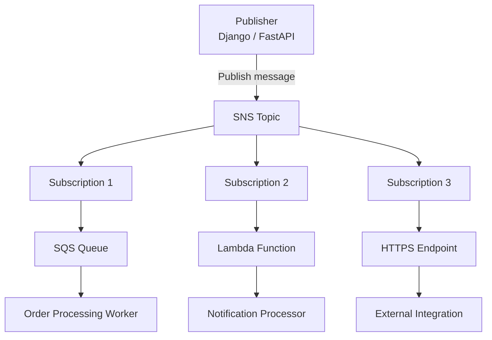
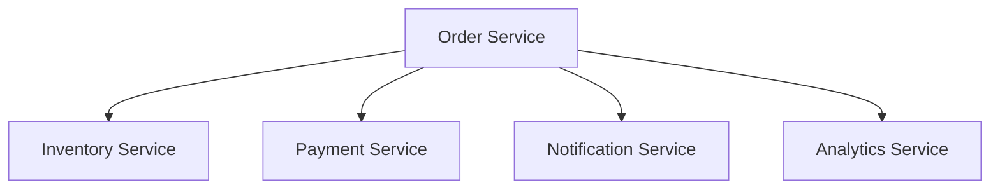
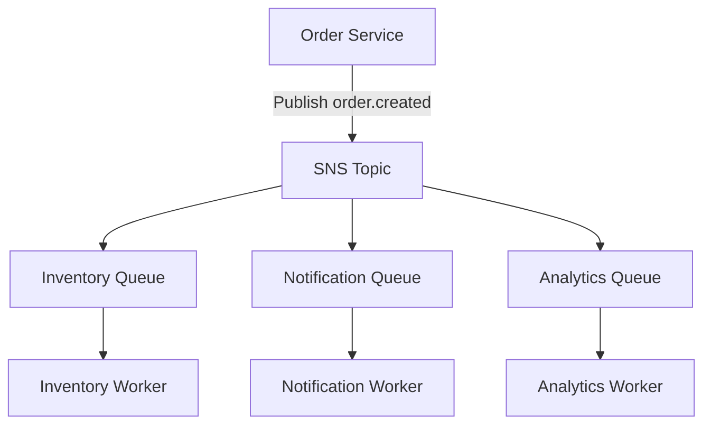
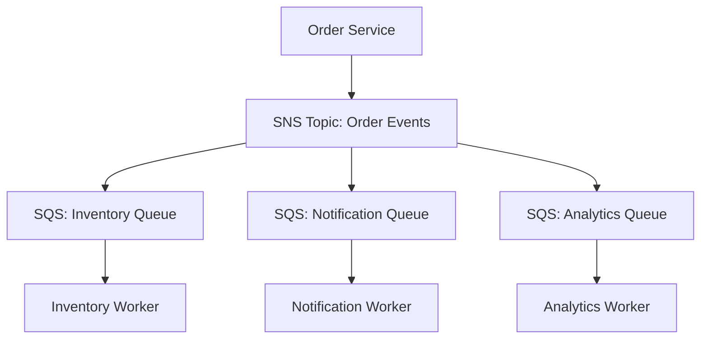
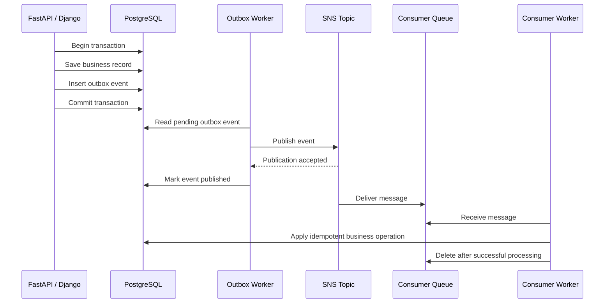

# 01- Publish-Subscribe Architecture

## Overview

Publish-subscribe (Pub/Sub) is a messaging architecture in which message producers publish events to a logical messaging destination, and multiple independent consumers receive those events through subscriptions.

Amazon Simple Notification Service (Amazon SNS) implements the Pub/Sub model as a fully managed messaging service. It enables backend services to communicate asynchronously without maintaining direct dependencies on every downstream consumer.

Instead of calling multiple services synchronously, a producer publishes one message to an SNS topic. SNS evaluates the topic's subscriptions and delivers the message to eligible endpoints.

This architecture is useful for:

- Microservice event distribution.
- Order, payment, and shipment notifications.
- Application alerts and operational notifications.
- Event-driven workflows.
- Fan-out processing through Amazon SQS.
- Decoupling backend services and external integrations.

## Core Components

The Pub/Sub model consists of three primary components: publishers, topics, and subscribers.

### Publishers

A publisher is an application or service that produces messages and sends them to an SNS topic.

Examples include:

- A Django application publishing an `order.created` event.
- A FastAPI payment service publishing a `payment.completed` event.
- A backend service publishing an operational alert.
- An AWS service publishing an event to SNS through an integration.

The publisher does not need to know which subscribers exist or how they process messages.

**Responsibilities:**

- Produce meaningful business events.
- Validate message structure before publishing.
- Include stable event identifiers.
- Use appropriate message attributes.
- Handle publication errors and retries.
- Avoid including unnecessary sensitive information.

### Topics

An SNS topic is a logical communication channel that receives published messages and distributes them to subscribed endpoints.

Topics provide an abstraction between publishers and subscribers.

A publisher sends a message to a topic ARN rather than addressing individual consumers.

SNS supports two main topic types:

| Topic type | Characteristics | Typical use |
|---|---|---|
| Standard | High-throughput messaging with best-effort ordering and at-least-once delivery | General application notifications and event distribution. |
| FIFO | Ordered messaging within message groups and deduplication support | Workflows requiring ordered publication and FIFO-compatible delivery. |

Topic configuration determines important messaging behavior, including access policies, encryption, delivery settings, and subscription configuration.

### Subscribers

Subscribers are endpoints registered with an SNS topic.

SNS delivers published messages to the configured subscriptions.

Supported subscription protocols include:

| Protocol | Destination | Typical use |
|---|---|---|
| Amazon SQS | Standard or FIFO queues, subject to topic compatibility | Durable asynchronous processing. |
| AWS Lambda | Lambda function | Serverless event processing. |
| HTTP/HTTPS | Web application endpoint | External service integration. |
| Email | Email address | Operational notifications. |
| Email-JSON | Email endpoint receiving JSON-formatted notifications | Automated email integrations. |
| SMS | Phone number | Text notifications. |
| Application | Supported mobile push application endpoint | Mobile notifications. |
| Firehose | Amazon Data Firehose delivery stream | Streaming data delivery. |

Not every protocol is supported by every topic type. For example, SNS FIFO topics do not directly support Lambda, HTTP/S, email, SMS, mobile push, or Firehose subscriptions.

## How Publish-Subscribe Messaging Works

The publisher sends a message to an SNS topic. SNS accepts the publication, evaluates the topic's subscriptions and applicable filter policies, and attempts delivery to eligible subscribers.

Each subscription has its own endpoint and delivery behavior.



### Message Flow

1. A backend service creates a business event.
2. The publisher sends the message to an SNS topic.
3. SNS accepts the publication if the request is valid and authorized.
4. SNS identifies the topic's subscriptions.
5. SNS evaluates subscription filter policies where configured.
6. SNS attempts to deliver the message to eligible endpoints.
7. Subscribers process messages according to their own execution and retry models.

The publisher is decoupled from subscriber implementation details. Adding another subscription generally does not require changing publisher code.

## Publisher-to-Subscriber Decoupling

A major advantage of Pub/Sub is that producers and consumers do not need direct knowledge of each other.

Consider an order management service that publishes an event after an order is created.

Without Pub/Sub, the service may need to call several downstream systems directly.



This creates several dependencies:

- The order service must know downstream service addresses.
- Changes in downstream APIs can affect the publisher.
- A slow downstream service can increase request latency.
- Failure handling becomes distributed across the publisher.
- Adding new consumers requires publisher modifications.

With SNS, the publisher sends one event to a topic.



The publisher no longer needs to know the internal implementation of each consumer.

### Benefits

- Reduced service-to-service coupling.
- Independent subscriber deployment.
- Easier addition of new consumers.
- Independent scaling of downstream processing.
- Better isolation of downstream workloads.
- Simplified event distribution.

### Limitations

Decoupling does not eliminate operational dependencies.

The system still needs to handle:

- Failed message delivery.
- Duplicate processing.
- Subscriber outages.
- Schema evolution.
- Event ordering requirements.
- Monitoring across the complete event lifecycle.

SNS also does not provide a general-purpose durable event log for arbitrary consumer replay. Use Kinesis Data Streams or another retained event-streaming system when consumers need independent replay over a configurable retention period.

## SNS Fan-Out Pattern

Fan-out is one of the most important SNS architectural patterns.

A single published message can be delivered to multiple independent subscriptions.

For example, an order-created event can trigger:

- Inventory reservation.
- Customer notification.
- Analytics ingestion.
- Fraud analysis.
- Audit processing.

Each subscriber receives the event independently and can process it according to its own requirements.

### SNS-to-SQS Fan-Out

For backend microservices, SNS combined with SQS is a common architecture.

SNS distributes messages, while SQS provides durable queue-based consumption and independent processing.



### Why Combine SNS and SQS?

SNS and SQS solve different problems.

| Capability | SNS | SQS |
|---|---|---|
| Primary role | Message distribution | Message buffering and consumption |
| Communication model | Publish-subscribe | Queue-based messaging |
| Multiple independent consumers | Through multiple subscriptions | Through separate queues or competing consumers |
| Message retention | No general-purpose subscriber replay log | Retains messages for configured periods |
| Consumer polling | SNS pushes to supported endpoints | Consumers poll the queue |
| Backpressure | Delivery and retry behavior depends on endpoint | Queue buffers messages for consumers |
| Dead-letter handling | Subscription delivery failure handling | Queue redrive policy and DLQ |
| Typical use | Distribute events | Process work asynchronously |

An SQS queue per logical consumer prevents one consumer's processing rate from directly controlling another consumer's queue.

### Production Recommendation

For independently deployed backend services, use separate SQS queues for separate logical subscribers.

This provides:

- Independent message retention.
- Independent visibility timeout configuration.
- Independent retry and DLQ policies.
- Independent consumer scaling.
- Isolation from downstream processing failures.

Do not use one shared SQS queue when multiple services must each receive every event. Multiple consumers polling the same queue compete for messages rather than receiving independent copies.

## Message Structure and Event Contracts

SNS messages should represent meaningful business events rather than arbitrary internal implementation details.

A consistent event envelope improves interoperability across services.

Example:

```json
{
  "event_id": "evt_01J9K8M2X7",
  "event_type": "order.created",
  "event_version": 1,
  "occurred_at": "2026-11-20T10:30:00Z",
  "producer": "order-service",
  "data": {
    "order_id": "ord_10045",
    "customer_id": "cus_501",
    "total_amount": 2499.00,
    "currency": "INR"
  }
}
```

### Recommended Event Fields

| Field | Purpose |
|---|---|
| `event_id` | Stable identifier for deduplication and tracing. |
| `event_type` | Identifies the business event. |
| `event_version` | Supports controlled schema evolution. |
| `occurred_at` | Records when the business event happened. |
| `producer` | Identifies the originating service. |
| `data` | Contains event-specific information. |

### Event Contract Considerations

- Treat event schemas as public contracts between services.
- Prefer additive, backward-compatible changes.
- Avoid renaming or removing fields without a migration strategy.
- Validate messages before publication.
- Define how consumers handle unknown fields and event versions.
- Avoid publishing database models directly.
- Avoid including credentials, access tokens, or unnecessary personal data.

SNS does not automatically enforce an application-level JSON schema. Schema validation should be implemented in the publisher, consumer, or a dedicated schema governance layer.

## Message Attributes

SNS message attributes provide metadata separate from the message body.

They can support subscription filtering and downstream processing.

Example attributes:

| Attribute | Example value |
|---|---|
| `event_type` | `order.created` |
| `environment` | `production` |
| `priority` | `high` |
| `tenant_id` | `tenant_123` |

Example Boto3 publication:

```python
import json

import boto3

sns = boto3.client("sns", region_name="ap-south-1")

response = sns.publish(
    TopicArn="arn:aws:sns:ap-south-1:123456789012:order-events",
    Message=json.dumps(
        {
            "event_id": "evt_01J9K8M2X7",
            "event_type": "order.created",
            "event_version": 1,
            "data": {
                "order_id": "ord_10045"
            }
        }
    ),
    MessageAttributes={
        "event_type": {
            "DataType": "String",
            "StringValue": "order.created"
        },
        "environment": {
            "DataType": "String",
            "StringValue": "production"
        }
    }
)

print(response["MessageId"])
```

Message attributes are useful for routing and metadata. They should not become a substitute for a well-defined event body.

For SNS content-based FIFO deduplication, the generated deduplication hash is based on the message body, not message attributes.

## Subscription Filtering

A topic can have many subscribers, but not every subscriber necessarily needs every event.

SNS subscription filter policies allow subscribers to receive only messages matching configured attributes or message-body fields.

For example:

- Inventory processing receives order-created events.
- Notification processing receives order-created and order-cancelled events.
- Fraud processing receives high-value payment events.

Example filter policy:

```json
{
  "event_type": [
    "payment.completed",
    "payment.failed"
  ],
  "environment": [
    "production"
  ]
}
```

Filter policies can operate on message attributes or message-body properties, depending on the subscription's filter policy scope.

### Advantages

- Reduces unnecessary deliveries.
- Simplifies consumer-side routing.
- Supports logical event distribution through shared topics.
- Reduces unnecessary downstream processing.

### Limitations

- Filtering does not replace authorization.
- Filter policies must match the actual message structure and attribute types.
- Changes to filter policies can change which events a subscriber receives.
- Filtered messages are not delivered to that subscription.

For SNS FIFO subscriptions, filtering changes delivery semantics: filtered messages can create sequence gaps, and filtered FIFO subscriptions have at-most-once delivery semantics.

## Delivery Semantics

SNS delivery behavior depends on the topic type and subscription protocol.

### Standard Topics

Standard topics provide at-least-once message delivery to supported endpoints.

This means:

- A subscriber can receive duplicate messages.
- Message ordering is not guaranteed.
- Consumers should be idempotent.
- Downstream processing should not assume exactly-once business execution.

### FIFO Topics

FIFO topics support ordered message delivery within message groups and deduplication during a five-minute deduplication interval.

They require a message group ID and support either explicit deduplication IDs or content-based deduplication.

However, FIFO behavior does not make arbitrary downstream side effects exactly once.

For example, a consumer that sends an email and crashes before recording completion may send the email again when the message is retried.

### Delivery Comparison

| Property | Standard | FIFO |
|---|---|---|
| Ordering | Best effort | Within message groups |
| Duplicate publication handling | No FIFO deduplication guarantee | Five-minute deduplication interval |
| Throughput | Designed for high throughput | Depends on FIFO throughput configuration and message groups |
| Message group ID | Not required | Required |
| Typical use | General event distribution | Ordered business workflows |

## Reliability and Failure Handling

A successful SNS publication means SNS accepted the message. It does not prove that every subscriber completed its business operation.

Production systems must distinguish between:

- Publication success.
- Subscription delivery success.
- Consumer receipt.
- Business processing success.
- Downstream side-effect completion.

### Publisher Reliability

A publisher should:

- Use a stable event ID.
- Validate the event before publication.
- Handle API throttling and transient failures.
- Use bounded retries with exponential backoff and jitter.
- Avoid generating a new logical event ID for every retry.
- Record publication outcomes for reconciliation.

For critical database-backed business events, use the transactional outbox pattern.

The business transaction writes both the domain change and an outbox record in the same PostgreSQL transaction. A separate publisher reads the outbox and publishes the event to SNS.

This prevents the database commit and message publication from becoming an unsafe dual-write operation.

### Subscriber Reliability

Subscribers should:

- Handle duplicate events.
- Validate incoming event schemas.
- Apply bounded retries.
- Isolate poison messages.
- Record processing outcomes.
- Use idempotency keys for business operations.
- Monitor delivery and processing failures independently.

For SQS subscribers, configure a suitable visibility timeout and dead-letter queue. For HTTP/S subscribers, configure delivery retry policies and failure handling appropriate to the endpoint.

## Python Backend Integration

A typical FastAPI or Django service can publish business events using Boto3.

A production implementation should separate event construction, publication, and business transaction handling.

Example publisher abstraction:

```python
import json
from typing import Any

import boto3
from botocore.config import Config


class SnsEventPublisher:
    def __init__(self, topic_arn: str, region: str) -> None:
        self.topic_arn = topic_arn
        self.client = boto3.client(
            "sns",
            region_name=region,
            config=Config(
                retries={
                    "mode": "standard",
                    "max_attempts": 5
                },
                connect_timeout=3,
                read_timeout=10
            )
        )

    def publish(
        self,
        event: dict[str, Any],
        event_type: str
    ) -> str:
        response = self.client.publish(
            TopicArn=self.topic_arn,
            Message=json.dumps(event),
            MessageAttributes={
                "event_type": {
                    "DataType": "String",
                    "StringValue": event_type
                }
            }
        )

        return response["MessageId"]
```

The example assumes the event has already been persisted or otherwise safely created. For critical business workflows, invoke this publisher from an outbox dispatcher rather than relying on a direct SNS call inside the database transaction.

### Integration Architecture



A dispatcher can crash after SNS accepts an event but before the outbox record is marked published. The event may then be published again. Stable event IDs and consumer-side idempotency are still required.

## Scalability and Performance

SNS is a managed service designed to distribute messages without requiring publishers to manage individual subscriber connections.

However, downstream capacity remains an important architectural constraint.

### Scaling Considerations

- Design subscriptions around independent business capabilities.
- Use SQS to absorb bursts and smooth consumer workloads.
- Scale queue consumers based on queue depth and processing latency.
- Keep message payloads reasonably small.
- Avoid publishing large documents or binary payloads directly.
- Use S3 object references for large payloads where appropriate.
- Apply filtering to avoid unnecessary deliveries.
- Monitor subscription delivery failures and downstream saturation.

### Cost Considerations

SNS costs depend on factors such as publication volume, delivery protocol, payload size, and regional pricing.

SNS-to-SQS fan-out introduces costs for both SNS message delivery and SQS operations.

For high-volume systems, evaluate:

- Number of subscriptions.
- Message size.
- Publication and delivery volume.
- SQS receive and delete operations.
- Retry traffic.
- Cross-Region transfer where applicable.
- Downstream processing costs.

## Security Considerations

SNS topics are security boundaries and should not be treated as unrestricted internal message channels.

### IAM Permissions

Use least-privilege permissions for publishers and administrators.

A publisher that only needs to send messages should generally receive `sns:Publish` permission on the specific topic ARN rather than broad SNS permissions.

### Topic Policies

Topic policies control which principals can access a topic.

For cross-account publishing, explicitly authorize the intended external account or principal.

Avoid wildcard principals unless the access requirement is deliberate and constrained.

### Encryption

SNS supports server-side encryption using AWS Key Management Service (AWS KMS).

When using a customer-managed KMS key:

- Configure the key policy for required principals and service access.
- Grant publishers and subscribers the permissions required by their workflows.
- Monitor key usage and access failures.
- Plan key rotation and recovery.
- Consider regional key dependencies.

Encryption at rest does not replace transport security or application-level data protection.

### Sensitive Data

Avoid placing credentials, authentication tokens, or unnecessary personal information in event payloads.

Prefer references to protected records when consumers can securely retrieve sensitive information from an authorized service.

## Common Mistakes

| Mistake | Why it is problematic | Recommended approach |
|---|---|---|
| Calling every consumer directly from the publisher | Creates tight coupling and increases request latency | Publish one event to SNS. |
| Using one SQS queue for independent subscribers | Consumers compete for messages instead of receiving independent copies | Create one queue per logical subscriber. |
| Assuming SNS guarantees exactly-once processing | Duplicate delivery and repeated side effects remain possible | Use stable event IDs and idempotent consumers. |
| Assuming Standard topics preserve ordering | Standard delivery is best effort | Use FIFO when ordering requirements justify it. |
| Treating publication success as business completion | SNS acceptance does not mean consumers completed processing | Track downstream processing independently. |
| Publishing database changes without an outbox | A database commit can succeed while message publication fails | Use a transactional outbox for critical events. |
| Using filtering as an authorization mechanism | Filtering controls routing, not access permissions | Enforce access with IAM and topic policies. |
| Publishing large payloads | Increases message size and delivery overhead | Store large objects in S3 and publish references. |
| Ignoring subscriber failure monitoring | Delivery problems can remain unnoticed | Monitor delivery status and downstream processing metrics. |

## Interview Considerations

**What is the primary purpose of Pub/Sub?**

To decouple publishers from subscribers and distribute events to multiple independent consumers.

**Why use SNS with SQS?**

SNS distributes events to multiple destinations, while separate SQS queues provide durable buffering and independent consumer processing.

**Does SNS guarantee exactly-once delivery?**

No general exactly-once business-processing guarantee exists. Standard topics use at-least-once delivery semantics, and FIFO deduplication is limited to its supported deduplication behavior and time window.

**What happens if one subscriber is unavailable?**

SNS handles delivery according to the subscription protocol's retry behavior. Persistent delivery failures require appropriate failure handling, such as subscription dead-letter queues where supported. Other subscriptions are independently managed.

**Does SNS provide message replay?**

SNS is not a general-purpose retained event log. For replayable streaming workloads, use Kinesis Data Streams or persist events in durable storage.

**Why create separate SQS queues for subscribers?**

Each queue provides independent retention, retries, visibility timeout, DLQ configuration, and consumer scaling.

## Key Takeaways

- Pub/Sub decouples message producers from subscribers through a logical SNS topic.
- SNS fan-out distributes one event to multiple independent destinations; SNS combined with separate SQS queues is a common microservice architecture.
- Standard topics provide at-least-once delivery with best-effort ordering, while FIFO topics provide ordering within message groups and limited deduplication.
- Reliable business event processing requires stable event IDs, transactional outbox patterns where appropriate, and idempotent consumers.
- Publication acceptance, subscriber delivery, and successful business processing are separate stages that must be monitored independently.