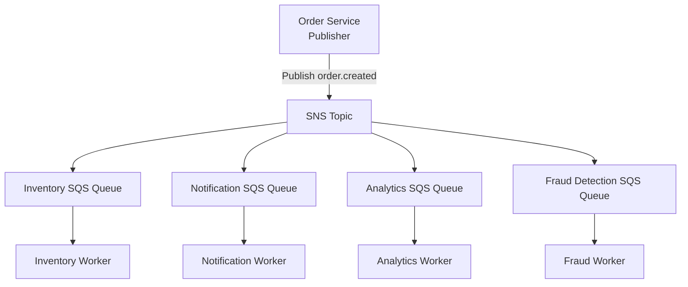
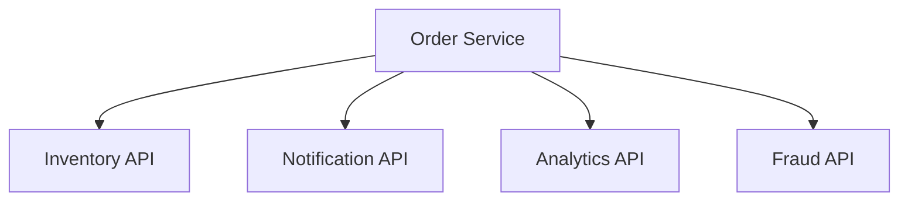
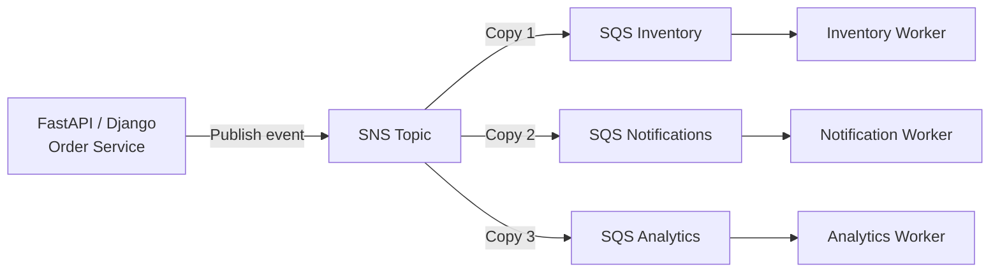
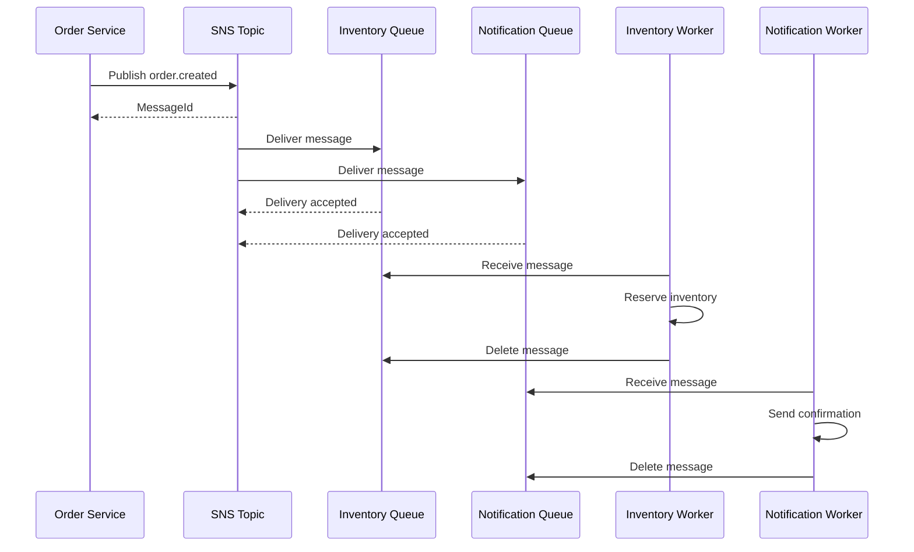
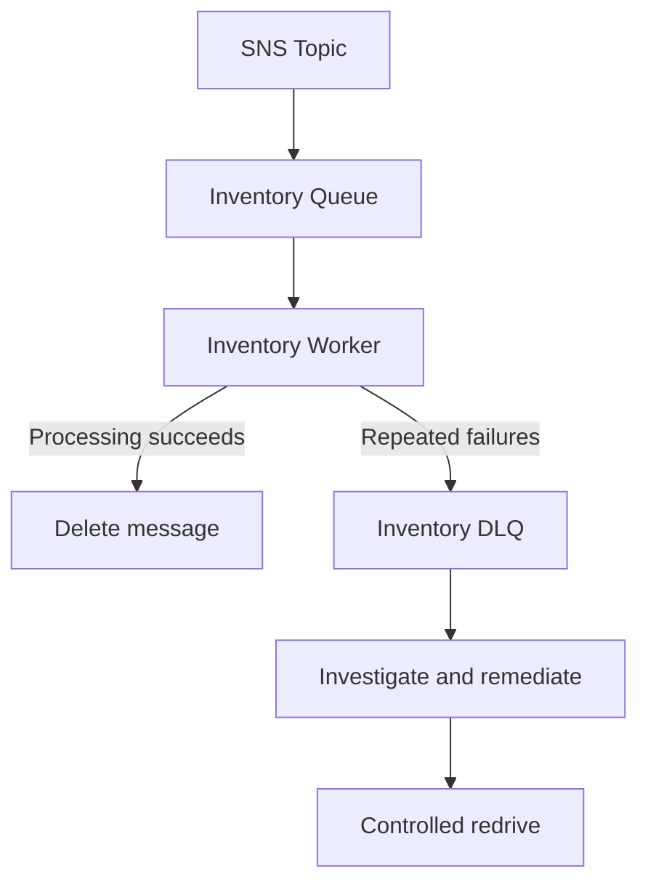

# 02- Fan-Out Architecture

## Overview

Fan-out is a messaging pattern in which a single published event is distributed to multiple independent consumers. In Amazon SNS, a publisher sends a message to a topic, and SNS delivers copies to its eligible subscriptions.

Fan-out is commonly used in event-driven microservices where one business event must trigger multiple independent workflows without coupling the originating service to downstream implementations.

For example, when an order is created, several services may need to react:

- Inventory service reserves stock.
- Notification service sends customer confirmation.
- Analytics service records the order event.
- Fraud service evaluates transaction risk.
- Audit service records the business activity.

The order service should not need to call each service directly. SNS provides the distribution layer, while subscribers independently process their messages.

## Fan-Out Architecture

A basic SNS fan-out architecture consists of:

- **Publisher:** Produces and publishes an event.
- **SNS topic:** Receives the event and distributes it to subscriptions.
- **Subscriptions:** Define the destination and delivery configuration.
- **Consumers:** Process delivered messages independently.



Each SQS queue receives an independent copy of the published message. Consumers do not compete for the same message across these separate queues.

## Why Fan-Out Is Needed

Without fan-out, a publisher often needs to invoke multiple downstream services directly.



This creates operational and architectural problems:

| Problem | Impact |
|---|---|
| Tight coupling | The publisher must know downstream service interfaces and addresses. |
| Synchronous dependencies | Slow consumers increase publisher request latency. |
| Failure propagation | A downstream outage can affect order creation. |
| Complex retries | The publisher must implement retry logic for every dependency. |
| Difficult extensibility | Adding a consumer requires changing publisher behavior. |
| Uneven scaling | Downstream processing capacity becomes coupled to request traffic. |

With SNS fan-out, the publisher only needs to publish to one topic.

### Architectural Benefits

- **Loose coupling:** Publishers do not need to know subscriber implementations.
- **Independent processing:** Subscribers execute their own workflows.
- **Independent scaling:** Each consumer can scale according to its workload.
- **Failure isolation:** A consumer outage does not require the publisher to call that consumer synchronously.
- **Extensibility:** New subscribers can be added without modifying publisher code.
- **Asynchronous execution:** Long-running work can happen outside the original API request.

Fan-out does not eliminate failures. It moves responsibility for delivery, buffering, retries, and processing into the messaging architecture.

## SNS-to-SQS Fan-Out

The SNS-to-SQS pattern is a common production implementation for backend microservices.

SNS distributes events, while SQS queues provide independent buffering and consumption.

### Architecture



### Why Use Separate Queues?

Each logical subscriber gets its own queue.

| Capability | Benefit |
|---|---|
| Independent retention | One consumer's backlog does not consume another consumer's queue retention window. |
| Independent visibility timeout | Processing time can be configured for each workload. |
| Independent retry policy | Consumers can have different failure-handling strategies. |
| Independent DLQ | Failed messages can be isolated per subscriber. |
| Independent scaling | Workers can scale according to their own queue depth. |
| Workload isolation | A slow analytics worker does not directly block inventory processing. |

A shared SQS queue is not equivalent to fan-out. Multiple workers polling the same queue compete for messages. Use separate queues when each service must receive every event.

## Message Delivery Lifecycle

SNS fan-out delivery is a separate operation from the publisher's original API request.



The publisher receives a successful response when SNS accepts the publication. It does not wait for all subscribers to complete their business operations.

For SQS subscriptions, successful delivery means the message has been accepted by the destination queue. It does not mean a worker has processed it.

This distinction is essential when defining business-level completion and monitoring.

## Implementing SNS Fan-Out

### Create an SNS Topic

Create a topic to represent a logical event category.

```bash
aws sns create-topic \
  --name order-events \
  --region ap-south-1
```

Example response:

```json
{
  "TopicArn": "arn:aws:sns:ap-south-1:123456789012:order-events"
}
```

### Create Subscriber Queues

Create one queue for each independent subscriber.

```bash
aws sqs create-queue \
  --queue-name inventory-order-events \
  --region ap-south-1

aws sqs create-queue \
  --queue-name notification-order-events \
  --region ap-south-1

aws sqs create-queue \
  --queue-name analytics-order-events \
  --region ap-south-1
```

Retrieve the queue URLs and ARNs using the relevant SQS APIs.

### Configure Queue Policies

SNS requires permission to send messages to each subscribed SQS queue.

A queue policy should authorize the SNS service principal and restrict access to the intended topic ARN.

Example policy for the inventory queue:

```json
{
  "Version": "2012-10-17",
  "Statement": [
    {
      "Sid": "AllowOrderEventsTopic",
      "Effect": "Allow",
      "Principal": {
        "Service": "sns.amazonaws.com"
      },
      "Action": "sqs:SendMessage",
      "Resource": "arn:aws:sqs:ap-south-1:123456789012:inventory-order-events",
      "Condition": {
        "ArnEquals": {
          "aws:SourceArn": "arn:aws:sns:ap-south-1:123456789012:order-events"
        }
      }
    }
  ]
}
```

Apply the policy to the queue using `SetQueueAttributes`.

Repeat with the appropriate queue ARN for each subscriber.

### Subscribe Queues to the Topic

Create one subscription for each queue.

```bash
aws sns subscribe \
  --topic-arn arn:aws:sns:ap-south-1:123456789012:order-events \
  --protocol sqs \
  --notification-endpoint arn:aws:sqs:ap-south-1:123456789012:inventory-order-events

aws sns subscribe \
  --topic-arn arn:aws:sns:ap-south-1:123456789012:order-events \
  --protocol sqs \
  --notification-endpoint arn:aws:sqs:ap-south-1:123456789012:notification-order-events

aws sns subscribe \
  --topic-arn arn:aws:sns:ap-south-1:123456789012:order-events \
  --protocol sqs \
  --notification-endpoint arn:aws:sqs:ap-south-1:123456789012:analytics-order-events
```

For SQS subscriptions, verify that the subscription is confirmed and that the queue policy allows the intended topic to send messages.

### Publish an Event

A publisher sends one message to the SNS topic.

```python
import json
import os

import boto3

sns = boto3.client(
    "sns",
    region_name=os.environ["AWS_REGION"]
)

topic_arn = os.environ["ORDER_EVENTS_TOPIC_ARN"]


def publish_order_created(order: dict) -> str:
    event = {
        "event_id": order["event_id"],
        "event_type": "order.created",
        "event_version": 1,
        "data": {
            "order_id": order["order_id"],
            "customer_id": order["customer_id"],
            "total_amount": order["total_amount"]
        }
    }

    response = sns.publish(
        TopicArn=topic_arn,
        Message=json.dumps(event),
        MessageAttributes={
            "event_type": {
                "DataType": "String",
                "StringValue": "order.created"
            }
        }
    )

    return response["MessageId"]
```

The same event is distributed to all eligible subscriptions. The publisher does not need separate calls for inventory, notifications, and analytics.

For critical business operations, publish through a transactional outbox dispatcher rather than making the SNS call part of an unprotected database dual-write workflow.

## Message Envelope and Consumer Independence

All subscribers receive the same logical event, but each subscriber should interpret only the fields relevant to its responsibility.

Example event:

```json
{
  "event_id": "evt_01J9K8M2X7",
  "event_type": "order.created",
  "event_version": 1,
  "occurred_at": "2026-11-20T10:30:00Z",
  "producer": "order-service",
  "data": {
    "order_id": "ord_10045",
    "customer_id": "cus_501",
    "total_amount": 2499.00,
    "currency": "INR"
  }
}
```

Consumer responsibilities might be:

| Consumer | Relevant data | Processing |
|---|---|---|
| Inventory | `order_id` and order items | Reserve inventory. |
| Notification | `order_id` and `customer_id` | Retrieve customer details and send confirmation. |
| Analytics | Event metadata and order totals | Update analytical records. |
| Fraud detection | Customer, amount, and transaction context | Evaluate risk signals. |

Consumers should not depend on undocumented fields or another consumer's internal processing state.

### Schema Evolution

A shared topic creates a shared event contract.

Use explicit event versions and backward-compatible changes.

Recommended practices:

- Add optional fields without breaking existing consumers.
- Avoid silently changing field meanings.
- Do not remove fields until all affected consumers have migrated.
- Validate event structure at producer and consumer boundaries.
- Maintain contract tests for important event types.
- Define behavior for unknown event versions.

SNS does not automatically validate application-level JSON schemas.

## Subscription Filtering

A topic may carry multiple event types, while individual subscribers only need selected events.

SNS subscription filter policies reduce unnecessary deliveries.

For example, an inventory subscriber may receive only order lifecycle events.

```json
{
  "event_type": [
    "order.created",
    "order.cancelled"
  ]
}
```

A notification subscriber may receive a different set:

```json
{
  "event_type": [
    "order.created",
    "order.shipped",
    "order.cancelled"
  ]
}
```

Filter policies can evaluate message attributes or message-body properties, depending on the configured filter policy scope.

### When to Use Filtering

Use filtering when:

- A topic carries multiple related event types.
- Subscribers have distinct event requirements.
- Reducing unnecessary deliveries is important.
- Consumers should not need to implement broad routing logic.

Filtering is not an authorization mechanism. IAM policies and topic policies must still control who can publish and subscribe.

For SNS FIFO subscriptions, filtering changes delivery semantics: filtered messages can create sequence gaps, and filtered FIFO subscriptions have at-most-once delivery semantics.

## Delivery Guarantees and Idempotency

Fan-out delivery does not mean every subscriber processes an event exactly once.

For Standard SNS topics:

- Delivery is at least once.
- Duplicate deliveries are possible.
- Ordering is best effort.
- Consumers must be idempotent.

SQS subscribers also need to account for duplicate message processing and visibility timeout expiration.

### Idempotent Consumer Pattern

A consumer can maintain a processed-event table in PostgreSQL.

Example schema:

```sql
CREATE TABLE processed_events (
    event_id VARCHAR(128) PRIMARY KEY,
    consumer_name VARCHAR(100) NOT NULL,
    processed_at TIMESTAMPTZ NOT NULL DEFAULT NOW(),
    UNIQUE (consumer_name, event_id)
);
```

A consumer should record the event and apply its business operation within the same database transaction.

```python
from sqlalchemy import text
from sqlalchemy.ext.asyncio import AsyncSession


async def process_order_event(
    session: AsyncSession,
    event: dict
) -> bool:
    event_id = event["event_id"]

    async with session.begin():
        result = await session.execute(
            text("""
                INSERT INTO processed_events (
                    event_id,
                    consumer_name
                )
                VALUES (
                    :event_id,
                    :consumer_name
                )
                ON CONFLICT (consumer_name, event_id)
                DO NOTHING
                RETURNING event_id
            """),
            {
                "event_id": event_id,
                "consumer_name": "inventory-service"
            }
        )

        inserted = result.scalar_one_or_none()

        if inserted is None:
            return False

        await session.execute(
            text("""
                UPDATE inventory_orders
                SET reservation_requested = TRUE
                WHERE order_id = :order_id
            """),
            {
                "order_id": event["data"]["order_id"]
            }
        )

    return True
```

The SQS message should be deleted only after successful processing. A failed transaction should leave the message available for retry.

For external side effects such as sending emails or invoking payment providers, database idempotency alone is insufficient. Use downstream idempotency keys, durable workflow state, or an additional outbox where required.

## Handling Subscriber Failures

Each subscriber has its own failure domain.

For example:

- Inventory processing may fail because PostgreSQL is unavailable.
- Notification processing may fail because an external email provider is unavailable.
- Analytics processing may be delayed by a large workload.

With separate SQS queues, each subscriber can accumulate and process its own backlog.

### Dead-Letter Queues

Configure a dead-letter queue for each SQS subscriber when failed messages must be isolated for investigation and controlled recovery.



A DLQ should have:

- A retention period suitable for investigation.
- Alarms for visible messages.
- Documented replay or redrive procedures.
- Access controls for sensitive payloads.
- A process for identifying and correcting poison messages.

A DLQ does not automatically repair failed business operations. Messages must be investigated and safely reprocessed.

### Delivery Failure Differences

| Failure location | Handling approach |
|---|---|
| Publisher cannot publish | Retry with bounded backoff and preserve the logical event ID. |
| SNS cannot deliver to SQS | Investigate subscription delivery failure and queue policy configuration. |
| SQS consumer fails | Allow message retry and eventual DLQ redrive. |
| External notification provider fails | Retry with bounded attempts and provider-specific idempotency where available. |
| Analytics consumer falls behind | Scale consumers and monitor queue age and depth. |

## Scaling and Backpressure

SNS fan-out can distribute events to many subscriptions, but downstream systems still have finite capacity.

Consider an order service publishing 5,000 events per second while the notification service can process only 1,000 messages per second.

The notification queue absorbs the backlog while inventory and analytics consumers continue at their own rates.

### Scaling Strategy

- Scale SQS consumers independently.
- Monitor queue depth and oldest-message age.
- Set worker concurrency according to database and external API capacity.
- Use bounded retries and avoid retry storms.
- Apply rate limits to downstream providers.
- Keep processing operations short enough to fit the visibility timeout.
- Extend visibility timeouts when legitimate processing requires more time.

### Backpressure

SQS provides buffering, but an unbounded backlog can still cause operational problems.

Monitor:

- `ApproximateNumberOfMessagesVisible`
- `ApproximateNumberOfMessagesNotVisible`
- `ApproximateAgeOfOldestMessage`

Use these metrics to detect growing backlogs and determine whether consumer scaling, downstream capacity, or producer traffic needs adjustment.

## Security Considerations

Fan-out creates multiple copies of business events, so access control must cover every subscription and destination.

### Topic Access

- Restrict `sns:Publish` to authorized publishers.
- Restrict subscription management to authorized administrators.
- Use topic policies for cross-account access.
- Avoid wildcard principals unless explicitly required.
- Separate production and non-production topics.

### Queue Access

For SNS-to-SQS subscriptions:

- Allow `sqs:SendMessage` from the SNS service principal.
- Restrict the policy using the exact topic ARN in `aws:SourceArn`.
- Restrict consumer permissions to the required queue.
- Avoid granting consumers unnecessary queue administration permissions.

### Encryption

- Enable SNS server-side encryption where required.
- Enable SQS encryption using appropriate AWS-managed or customer-managed KMS keys.
- Configure KMS key policies and service permissions.
- Review encryption and key access requirements across accounts and Regions.

### Payload Protection

- Avoid publishing credentials and authentication tokens.
- Minimize personal and financial data in events.
- Use protected S3 references for large or sensitive payloads.
- Apply retention and deletion policies to every destination.

## Infrastructure as Code

Terraform can provision the topic, queues, queue policies, and subscriptions consistently.

Example:

```hcl
resource "aws_sns_topic" "order_events" {
  name = "order-events"
}

resource "aws_sqs_queue" "inventory" {
  name                      = "inventory-order-events"
  message_retention_seconds = 345600
  visibility_timeout_seconds = 60
}

data "aws_iam_policy_document" "inventory_queue" {
  statement {
    sid    = "AllowOrderEventsTopic"
    effect = "Allow"

    principals {
      type        = "Service"
      identifiers = ["sns.amazonaws.com"]
    }

    actions   = ["sqs:SendMessage"]
    resources = [aws_sqs_queue.inventory.arn]

    condition {
      test     = "ArnEquals"
      variable = "aws:SourceArn"
      values   = [aws_sns_topic.order_events.arn]
    }
  }
}

resource "aws_sqs_queue_policy" "inventory" {
  queue_url = aws_sqs_queue.inventory.url
  policy    = data.aws_iam_policy_document.inventory_queue.json
}

resource "aws_sns_topic_subscription" "inventory" {
  topic_arn = aws_sns_topic.order_events.arn
  protocol  = "sqs"
  endpoint  = aws_sqs_queue.inventory.arn

  depends_on = [
    aws_sqs_queue_policy.inventory
  ]
}
```

Repeat the queue, policy, and subscription resources for each logical subscriber. In larger deployments, use Terraform modules or maps with `for_each` to avoid duplicating resource definitions.

For production, also define:

- Queue redrive policies and DLQs.
- Queue and topic encryption.
- Publisher and consumer IAM roles.
- CloudWatch alarms.
- Subscription filter policies where required.
- Retention and recovery settings.

## Monitoring and Operations

Monitor fan-out at both the SNS distribution layer and the individual subscriber layer.

| Component | Monitoring focus |
|---|---|
| Publisher | Publish request failures, latency, retries, and event creation failures. |
| SNS topic | Published messages, delivery attempts, failed deliveries, and throttling where applicable. |
| SNS subscription | Delivery failures, filter behavior, and endpoint configuration. |
| SQS queue | Visible messages, in-flight messages, oldest-message age, and DLQ depth. |
| Consumer | Processing duration, exceptions, duplicate events, and business operation failures. |
| Downstream dependency | Database latency, connection pool usage, API rate limits, and provider failures. |

Use structured logs containing:

- `event_id`
- `event_type`
- `producer`
- `consumer`
- `order_id` or another business correlation identifier
- `message_id`
- Processing outcome

Propagate correlation identifiers across services so an event can be traced from publication through every subscriber.

## Disaster Recovery

Fan-out recovery must account for each independent queue and consumer.

Recommended practices:

- Define RPO and RTO for each subscriber workflow.
- Configure queue retention according to recovery requirements.
- Use DLQs for messages that exceed normal retry limits.
- Document queue redrive and replay procedures.
- Keep infrastructure definitions in version control.
- Test recovery from subscriber outages and downstream dependency failures.
- Consider cross-Region topic and queue deployment when regional recovery is required.

SNS topics and SQS queues are regional resources. Cross-Region distribution must be designed explicitly, including permissions, encryption keys, replication behavior, and duplicate handling.

## Common Mistakes

| Mistake | Consequence | Recommended approach |
|---|---|---|
| Using one SQS queue for all subscribers | Consumers compete for messages | Create one queue per logical subscriber. |
| Assuming SNS delivery means business processing completed | Monitoring reports success while business work may still be pending | Track consumer processing separately. |
| Omitting SQS queue policies | SNS cannot deliver messages to the destination queue | Authorize the exact SNS topic ARN. |
| Ignoring duplicate delivery | Business operations may execute multiple times | Use stable event IDs and idempotent consumers. |
| Using synchronous API calls for every subscriber | Increases latency and failure coupling | Publish once and distribute asynchronously. |
| Ignoring queue backlog | Delayed business workflows go unnoticed | Alarm on queue age and depth. |
| Sharing one consumer's retry policy with every workflow | Different workloads cannot recover independently | Configure queue-level retry and DLQ behavior per subscriber. |
| Publishing incompatible event changes | Existing consumers may fail | Version and evolve event contracts carefully. |
| Treating a DLQ as automatic recovery | Failed messages remain unprocessed | Investigate, remediate, and redrive deliberately. |
| Assuming SNS provides long-term event replay | Historical messages cannot be replayed from SNS like a retained stream | Archive events or use a replayable streaming platform when needed. |

## Key Takeaways

- SNS fan-out distributes one published event to multiple independent subscriptions without requiring the publisher to know individual consumers.
- SNS combined with separate SQS queues provides independent buffering, retention, retries, DLQs, and consumer scaling.
- Each subscriber must handle duplicate delivery, processing failures, and downstream side effects using idempotency and appropriate recovery mechanisms.
- Queue policies, topic permissions, encryption, and payload protection must be configured across every fan-out destination.
- Monitor publication, delivery, queue backlog, and business processing as separate stages of the event lifecycle.