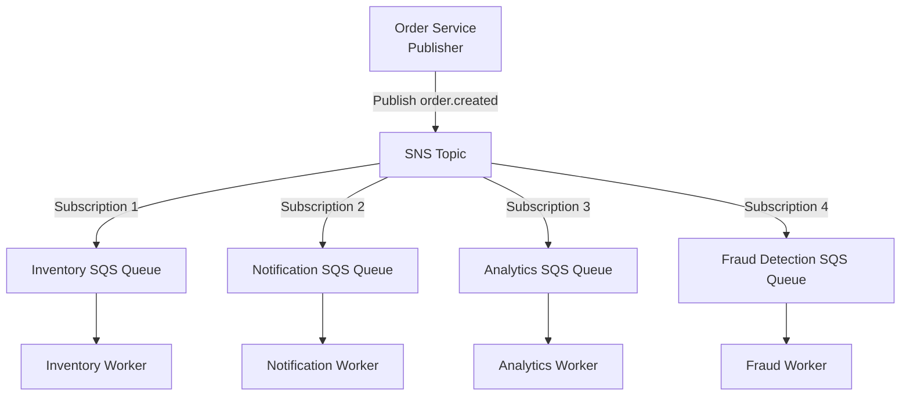
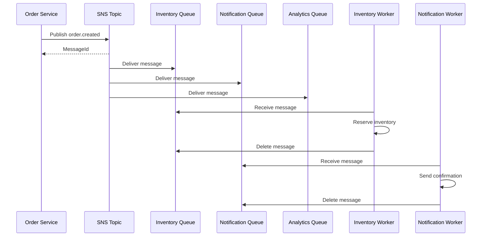
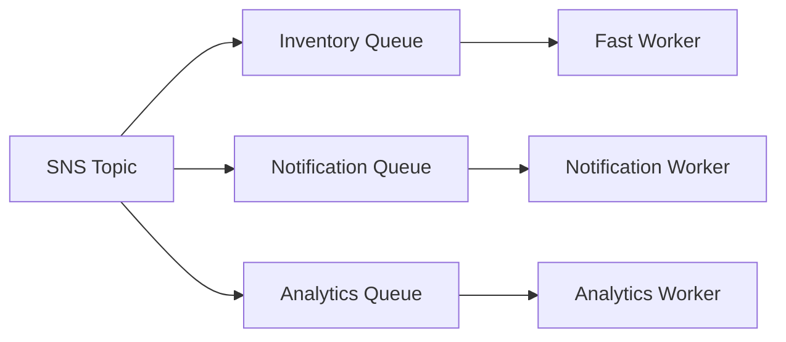
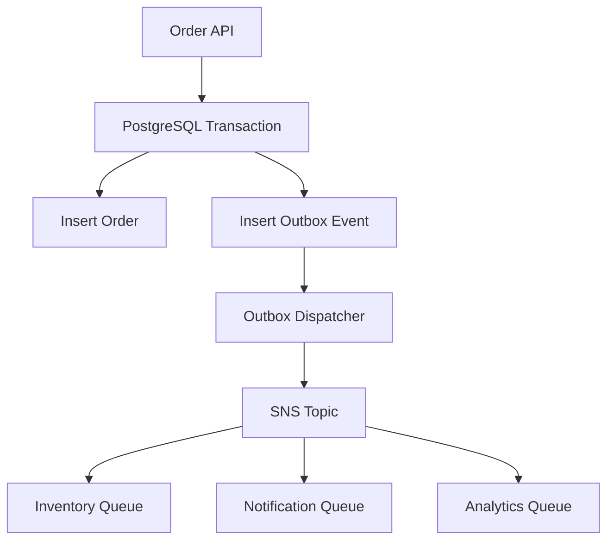
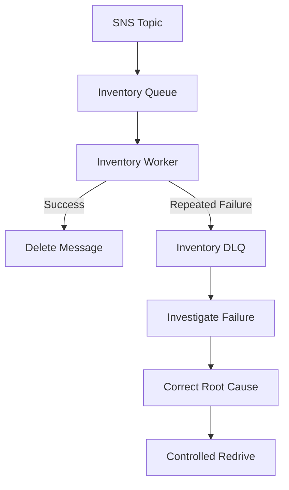

# 03- SNS and SQS Fan-Out Architecture

## Overview

SNS and SQS fan-out is a messaging architecture that combines Amazon Simple Notification Service (SNS) with Amazon Simple Queue Service (SQS) to distribute events to multiple independent backend services.

SNS provides message distribution through a publish-subscribe model. SQS provides durable message buffering and asynchronous consumption.

Together, they support loosely coupled microservices where one business event must trigger multiple independent workflows without requiring the publisher to manage individual consumers.

For example, when an order is created:

- Inventory service reserves stock.
- Notification service sends customer confirmation.
- Analytics service records the transaction.
- Fraud detection service evaluates risk.
- Audit service records the business event.

Each service receives its own copy of the event through a dedicated SQS queue.

## Architecture

The architecture consists of one SNS topic and multiple SQS queues.



### Component Responsibilities

| Component | Responsibility |
|---|---|
| Publisher | Creates and publishes business events. |
| SNS topic | Distributes published messages to eligible subscriptions. |
| SNS subscription | Connects a topic to a destination and defines delivery configuration. |
| SQS queue | Buffers messages independently for a subscriber. |
| Consumer worker | Retrieves and processes messages from its queue. |
| Dead-letter queue | Isolates messages that repeatedly fail processing. |

### Why Use Both SNS and SQS?

SNS and SQS solve different problems.

| Capability | SNS | SQS |
|---|---|---|
| Primary purpose | Event distribution | Message buffering and consumption |
| Communication model | Publish-subscribe | Queue-based |
| Message delivery | Pushes to supported subscription endpoints | Consumers poll for messages |
| Independent subscribers | Multiple subscriptions | Separate queues provide independent copies |
| Message retention | Not a general-purpose replayable event log | Configurable message retention |
| Consumer backpressure | Depends on destination and delivery behavior | Queue buffers messages while consumers catch up |
| Retry handling | Subscription delivery retry policies | Visibility timeout and redrive policies |
| Dead-letter handling | Subscription DLQ for supported delivery failures | Queue-level DLQ for processing failures |

SNS does not replace SQS, and SQS does not replace SNS in this architecture.

SNS distributes events. SQS decouples message delivery from consumer processing.

## End-to-End Message Flow

Consider an order service publishing an `order.created` event.

1. The order service creates the business event.
2. The publisher sends the event to the SNS topic.
3. SNS evaluates its subscriptions and applicable filter policies.
4. SNS attempts to deliver a copy to each eligible SQS queue.
5. Each SQS queue stores its own message.
6. Independent workers poll their respective queues.
7. Workers process messages and delete them after successful completion.
8. Failed messages become visible again after the visibility timeout and can eventually move to a DLQ.



The publisher receives confirmation that SNS accepted the publication. It does not wait for all consumers to complete processing.

Similarly, successful delivery to an SQS queue does not mean that a consumer has completed the business operation.

## Why Separate SQS Queues Matter

Each logical subscriber should normally have its own queue.

Consider three services consuming order events:

- Inventory processing takes approximately 200 milliseconds.
- Notification processing takes approximately 2 seconds.
- Analytics processing takes approximately 5 seconds.

If all workers consume from one SQS queue, they compete for messages. A message received by one worker is not independently delivered to the other workers.

With separate queues, every subscriber receives its own copy and processes it independently.

### Independent Processing



### Operational Benefits

| Feature | Engineering benefit |
|---|---|
| Independent retention | A backlog in one queue does not consume another queue's retention window. |
| Independent visibility timeout | Configure processing time according to each workload. |
| Independent retries | Each subscriber can have different failure-handling behavior. |
| Independent DLQs | Failed messages can be investigated separately. |
| Independent scaling | Workers scale according to their own processing requirements. |
| Failure isolation | A slow analytics consumer does not directly block inventory processing. |

## Message Structure and Event Contracts

All subscribers receive the same logical event, so the message contract must be stable and versioned.

Example:

```json
{
  "event_id": "evt_01J9K8M2X7",
  "event_type": "order.created",
  "event_version": 1,
  "occurred_at": "2026-11-20T10:30:00Z",
  "producer": "order-service",
  "data": {
    "order_id": "ord_10045",
    "customer_id": "cus_501",
    "total_amount": 2499.00,
    "currency": "INR"
  }
}
```

### Recommended Fields

| Field | Purpose |
|---|---|
| `event_id` | Stable identifier for deduplication and tracing. |
| `event_type` | Identifies the business event. |
| `event_version` | Supports controlled schema evolution. |
| `occurred_at` | Records when the event occurred. |
| `producer` | Identifies the originating service. |
| `data` | Contains event-specific information. |

### Consumer Responsibilities

Each subscriber should process only the information relevant to its business responsibility.

| Consumer | Processing responsibility |
|---|---|
| Inventory service | Reserve or release stock. |
| Notification service | Send customer notifications. |
| Analytics service | Update analytical records. |
| Fraud service | Evaluate transaction risk. |

Consumers should not depend on another consumer's internal database or processing state.

Use backward-compatible schema changes and contract tests to prevent a producer deployment from unexpectedly breaking existing subscribers.

SNS and SQS transport messages; they do not automatically enforce application-level JSON schemas.

## Implementing SNS-to-SQS Fan-Out

### Create an SNS Topic

```bash
aws sns create-topic \
  --name order-events \
  --region ap-south-1
```

Example response:

```json
{
  "TopicArn": "arn:aws:sns:ap-south-1:123456789012:order-events"
}
```

### Create SQS Queues

Create a separate queue for each logical subscriber.

```bash
aws sqs create-queue \
  --queue-name inventory-order-events \
  --region ap-south-1

aws sqs create-queue \
  --queue-name notification-order-events \
  --region ap-south-1

aws sqs create-queue \
  --queue-name analytics-order-events \
  --region ap-south-1
```

Retrieve the queue URLs and ARNs using the SQS APIs.

### Configure Queue Policies

SNS must have permission to send messages to each destination queue.

Example policy for the inventory queue:

```json
{
  "Version": "2012-10-17",
  "Statement": [
    {
      "Sid": "AllowOrderEventsTopic",
      "Effect": "Allow",
      "Principal": {
        "Service": "sns.amazonaws.com"
      },
      "Action": "sqs:SendMessage",
      "Resource": "arn:aws:sqs:ap-south-1:123456789012:inventory-order-events",
      "Condition": {
        "ArnEquals": {
          "aws:SourceArn": "arn:aws:sns:ap-south-1:123456789012:order-events"
        }
      }
    }
  ]
}
```

Apply the policy using `SetQueueAttributes`.

The `aws:SourceArn` condition restricts message delivery to the intended SNS topic rather than allowing arbitrary SNS topics to send messages.

Repeat the configuration for every subscriber queue.

### Subscribe Queues to SNS

```bash
aws sns subscribe \
  --topic-arn arn:aws:sns:ap-south-1:123456789012:order-events \
  --protocol sqs \
  --notification-endpoint arn:aws:sqs:ap-south-1:123456789012:inventory-order-events

aws sns subscribe \
  --topic-arn arn:aws:sns:ap-south-1:123456789012:order-events \
  --protocol sqs \
  --notification-endpoint arn:aws:sqs:ap-south-1:123456789012:notification-order-events

aws sns subscribe \
  --topic-arn arn:aws:sns:ap-south-1:123456789012:order-events \
  --protocol sqs \
  --notification-endpoint arn:aws:sqs:ap-south-1:123456789012:analytics-order-events
```

For SQS subscriptions, verify that:

- The subscription is confirmed.
- The topic ARN is correct.
- The queue policy permits the intended topic.
- The publisher can publish to the topic.
- The consumer can receive and delete messages from its queue.

## Publishing Events from Python

A Django or FastAPI backend can publish an event through Boto3.

```python
import json
import os

import boto3
from botocore.config import Config


sns = boto3.client(
    "sns",
    region_name=os.environ["AWS_REGION"],
    config=Config(
        retries={
            "mode": "standard",
            "max_attempts": 5
        },
        connect_timeout=3,
        read_timeout=10
    )
)

TOPIC_ARN = os.environ["ORDER_EVENTS_TOPIC_ARN"]


def publish_order_created(order: dict) -> str:
    event = {
        "event_id": order["event_id"],
        "event_type": "order.created",
        "event_version": 1,
        "data": {
            "order_id": order["order_id"],
            "customer_id": order["customer_id"],
            "total_amount": order["total_amount"]
        }
    }

    response = sns.publish(
        TopicArn=TOPIC_ARN,
        Message=json.dumps(event),
        MessageAttributes={
            "event_type": {
                "DataType": "String",
                "StringValue": "order.created"
            }
        }
    )

    return response["MessageId"]
```

This example assumes the event already exists and is safe to publish. For critical database-backed events, use a transactional outbox.

### Transactional Outbox Integration

A direct database write followed by an SNS publication creates a dual-write problem.

For example:

1. PostgreSQL commits an order.
2. The application attempts to publish `order.created`.
3. SNS publication fails.
4. The order exists, but downstream services never receive the event.

The transactional outbox pattern addresses this by writing the business record and an outbox event in the same database transaction.



The dispatcher publishes pending outbox events and marks them as published after SNS accepts the publication.

A dispatcher can crash after SNS accepts a message but before updating the outbox record. The event may be published again. Stable event IDs and consumer idempotency remain necessary.

## Consuming Messages from SQS

Each consumer polls only its own queue.

Example using Boto3:

```python
import json
import os

import boto3


sqs = boto3.client(
    "sqs",
    region_name=os.environ["AWS_REGION"]
)

QUEUE_URL = os.environ["INVENTORY_QUEUE_URL"]


def process_event(event: dict) -> None:
    event_type = event["event_type"]

    if event_type == "order.created":
        order_id = event["data"]["order_id"]
        print(f"Processing inventory reservation for {order_id}")


def consume_messages() -> None:
    while True:
        response = sqs.receive_message(
            QueueUrl=QUEUE_URL,
            MaxNumberOfMessages=10,
            WaitTimeSeconds=20,
            VisibilityTimeout=60,
            MessageSystemAttributeNames=[
                "ApproximateReceiveCount"
            ]
        )

        for message in response.get("Messages", []):
            try:
                sns_envelope = json.loads(message["Body"])
                event = json.loads(sns_envelope["Message"])

                process_event(event)

                sqs.delete_message(
                    QueueUrl=QUEUE_URL,
                    ReceiptHandle=message["ReceiptHandle"]
                )

            except Exception:
                # Leave the message undeleted for retry.
                raise
```

This is a basic consumption pattern. A production worker should also implement structured logging, idempotency, controlled exception handling, graceful shutdown, and DLQ monitoring.

### Raw Message Delivery

By default, SNS-to-SQS delivery wraps the published message in an SNS notification envelope.

The consumer receives an SQS body containing metadata such as:

- `Type`
- `MessageId`
- `TopicArn`
- `Timestamp`
- `Message`
- `MessageAttributes`

The application event is inside the `Message` field.

With raw message delivery enabled on the SNS subscription, SNS removes the outer notification envelope for supported endpoints, and the SQS message body contains the published message directly.

Enable raw delivery when consumers should receive the original payload without SNS-specific wrapping.

Important considerations:

- Raw delivery changes the consumer's parsing contract.
- SQS raw message delivery has a limit of 10 SNS message attributes.
- Consumers should not assume both wrapped and raw formats without explicitly supporting both.
- Coordinate subscription configuration changes with consumer deployments.

## Subscription Filtering

A shared topic can carry multiple event types.

SNS subscription filter policies allow each queue to receive only the events relevant to its consumer.

Example inventory subscription policy:

```json
{
  "event_type": [
    "order.created",
    "order.cancelled"
  ]
}
```

Example notification subscription policy:

```json
{
  "event_type": [
    "order.created",
    "order.shipped",
    "order.cancelled"
  ]
}
```

Filters can use message attributes or message-body properties, depending on the subscription's filter policy scope.

### When to Use Filtering

Use filtering when:

- Multiple event types share a logical topic.
- Subscribers have different event requirements.
- Unnecessary queue deliveries should be reduced.
- Consumer-side routing logic should remain simple.

Filtering is not an authorization boundary. Use IAM and resource policies to control access.

For SNS FIFO subscriptions, filtering changes delivery semantics: filtered messages can create sequence gaps, and filtered FIFO subscriptions have at-most-once delivery semantics.

## Reliability and Failure Handling

SNS-to-SQS fan-out has multiple independent delivery and processing stages.

| Stage | Success means | Failure handling |
|---|---|---|
| Publisher to SNS | SNS accepted the publication | Publisher retries and outbox reconciliation. |
| SNS to SQS | Destination queue accepted the message | SNS subscription delivery retry and configured subscription DLQ where supported. |
| SQS to consumer | Consumer received the message | Visibility timeout and redelivery. |
| Consumer processing | Business operation completed | Idempotency, retry, and poison-message handling. |
| Consumer to SQS deletion | Message was acknowledged by deletion | Message can reappear if deletion fails or visibility expires. |

### Visibility Timeout

When a consumer receives an SQS message, the message becomes temporarily invisible to other consumers.

If the worker does not delete the message before the visibility timeout expires, the message can become visible again.

Set the visibility timeout according to the expected processing duration and retry behavior.

For long-running processing, extend visibility using `ChangeMessageVisibility` when necessary.

Do not set an excessively long timeout without considering recovery time after worker crashes.

### Dead-Letter Queues

Configure a separate DLQ for each subscriber queue.



A DLQ isolates messages that exceed the configured `maxReceiveCount`.

The redrive policy should reflect the workload's failure characteristics. A malformed event should not be retried indefinitely, while a temporary database outage may recover through normal retries.

Monitor DLQ depth and document how messages are inspected, corrected, and redriven.

## Idempotency and Duplicate Processing

SNS Standard topics provide at-least-once delivery semantics. SQS Standard queues also provide at-least-once delivery.

Consequently, duplicate processing is possible.

Use the event ID as a stable idempotency key.

Example PostgreSQL table:

```sql
CREATE TABLE processed_events (
    event_id VARCHAR(128) NOT NULL,
    consumer_name VARCHAR(100) NOT NULL,
    processed_at TIMESTAMPTZ NOT NULL DEFAULT NOW(),
    PRIMARY KEY (consumer_name, event_id)
);
```

The consumer should record the event and apply its database changes in the same transaction.

```python
from sqlalchemy import text
from sqlalchemy.ext.asyncio import AsyncSession


async def process_inventory_event(
    session: AsyncSession,
    event: dict
) -> bool:
    async with session.begin():
        result = await session.execute(
            text("""
                INSERT INTO processed_events (
                    event_id,
                    consumer_name
                )
                VALUES (
                    :event_id,
                    :consumer_name
                )
                ON CONFLICT (consumer_name, event_id)
                DO NOTHING
                RETURNING event_id
            """),
            {
                "event_id": event["event_id"],
                "consumer_name": "inventory-service"
            }
        )

        inserted = result.scalar_one_or_none()

        if inserted is None:
            return False

        await session.execute(
            text("""
                UPDATE inventory_orders
                SET reservation_requested = TRUE
                WHERE order_id = :order_id
            """),
            {
                "order_id": event["data"]["order_id"]
            }
        )

    return True
```

Delete the SQS message only after the transaction completes successfully.

For external operations such as payment processing or email delivery, use the downstream provider's idempotency mechanism or a durable workflow/outbox design. A PostgreSQL transaction cannot make an external HTTP request exactly once.

## Scaling and Backpressure

Separate queues allow each consumer to scale independently.

For example, inventory processing may need more workers during a sales event, while analytics processing may tolerate a longer backlog.

### Scaling Strategy

- Scale workers based on queue depth and oldest-message age.
- Use bounded worker concurrency.
- Protect PostgreSQL connection pools from excessive parallelism.
- Apply rate limits to external APIs.
- Use long polling to reduce empty receive requests.
- Tune batch sizes according to processing cost.
- Avoid increasing concurrency beyond downstream capacity.

### Important SQS Metrics

| Metric | Purpose |
|---|---|
| `ApproximateNumberOfMessagesVisible` | Messages available for processing. |
| `ApproximateNumberOfMessagesNotVisible` | Messages currently being processed or hidden by visibility timeout. |
| `ApproximateAgeOfOldestMessage` | Age of the oldest message awaiting processing. |
| `NumberOfMessagesReceived` | Number of messages received. |
| `NumberOfMessagesDeleted` | Number of messages deleted after processing. |
| `NumberOfMessagesSent` | Number of messages sent to the queue. |

A growing queue depth or oldest-message age can indicate insufficient consumer capacity or a downstream dependency problem.

## Security Considerations

Fan-out creates multiple copies of business events, so security must be configured at every layer.

### SNS Topic

- Restrict `sns:Publish` to authorized publishers.
- Restrict subscription management to administrators.
- Use topic policies for cross-account access.
- Enable encryption where required.
- Separate production and non-production topics.

### SQS Queues

- Allow `sqs:SendMessage` from `sns.amazonaws.com`.
- Restrict the permission using the exact topic ARN.
- Grant consumers only the permissions needed for their queues.
- Restrict queue administration permissions.
- Configure encryption using SSE-SQS or SSE-KMS as required.

### KMS Considerations

When using customer-managed KMS keys:

- Configure key policies for required principals.
- Grant required service and application permissions.
- Verify cross-account access requirements.
- Monitor key usage and authorization failures.
- Plan key rotation and regional recovery dependencies.

### Payload Protection

- Do not publish credentials or authentication tokens.
- Minimize personal and financial information.
- Use protected S3 object references for large payloads.
- Apply appropriate retention and access controls to every queue.
- Treat message bodies and logs as potentially sensitive data.

## Terraform Implementation

Terraform can provision the SNS topic, SQS queue, queue policy, and subscription as a repeatable infrastructure unit.

```hcl
resource "aws_sns_topic" "order_events" {
  name = "order-events"
}

resource "aws_sqs_queue" "inventory" {
  name                       = "inventory-order-events"
  message_retention_seconds  = 345600
  visibility_timeout_seconds = 60
}

data "aws_iam_policy_document" "inventory_queue" {
  statement {
    sid    = "AllowOrderEventsTopic"
    effect = "Allow"

    principals {
      type        = "Service"
      identifiers = ["sns.amazonaws.com"]
    }

    actions   = ["sqs:SendMessage"]
    resources = [aws_sqs_queue.inventory.arn]

    condition {
      test     = "ArnEquals"
      variable = "aws:SourceArn"
      values   = [aws_sns_topic.order_events.arn]
    }
  }
}

resource "aws_sqs_queue_policy" "inventory" {
  queue_url = aws_sqs_queue.inventory.url
  policy    = data.aws_iam_policy_document.inventory_queue.json
}

resource "aws_sns_topic_subscription" "inventory" {
  topic_arn = aws_sns_topic.order_events.arn
  protocol  = "sqs"
  endpoint  = aws_sqs_queue.inventory.arn

  raw_message_delivery = true

  depends_on = [
    aws_sqs_queue_policy.inventory
  ]
}
```

Repeat the queue, policy, and subscription resources for each logical subscriber.

For larger systems, use Terraform modules or `for_each` to manage subscribers consistently.

A production implementation should additionally define:

- Queue DLQs and redrive policies.
- SNS and SQS encryption.
- Publisher and consumer IAM roles.
- Subscription filter policies.
- CloudWatch alarms.
- Retention and recovery configuration.
- Environment-specific resource naming.

## Monitoring and Observability

Monitoring must distinguish SNS publication, subscription delivery, queue health, and consumer processing.

| Layer | What to monitor |
|---|---|
| Publisher | Publish failures, retries, latency, and outbox backlog. |
| SNS | Published messages, delivery failures, and subscription health. |
| SQS | Queue depth, oldest-message age, in-flight messages, and DLQ depth. |
| Consumer | Processing latency, exceptions, duplicate events, and throughput. |
| Database | Query latency, connection pool saturation, and transaction failures. |
| External APIs | Rate limits, timeouts, provider errors, and retry volume. |

Use structured logs with:

- `event_id`
- `event_type`
- `producer`
- `consumer`
- `message_id`
- Business correlation identifiers
- Processing outcome

Propagate correlation IDs through the publisher, SNS message, SQS worker, and downstream operations.

## Cost Considerations

The SNS-to-SQS pattern introduces costs at both distribution and queue-processing layers.

Evaluate:

- SNS publication and delivery volume.
- Number of topic subscriptions.
- Message payload size.
- SQS API request volume.
- Receive, delete, and visibility-change operations.
- Retry and DLQ traffic.
- KMS request volume when using customer-managed encryption.
- Downstream compute and database costs.

Long polling and batch receive/delete operations can reduce SQS API request volume when implemented appropriately.

Do not reduce operational isolation merely to minimize the number of queues. Independent queues often provide important reliability and scaling benefits.

## High Availability and Disaster Recovery

SNS and SQS are managed regional services, but a complete application recovery strategy still requires explicit planning.

Recommended practices:

- Deploy topics and queues using infrastructure as code.
- Define RPO and RTO for each subscriber workflow.
- Configure queue retention to support expected recovery windows.
- Monitor DLQs and provide controlled redrive procedures.
- Ensure consumers can restart safely after failures.
- Test recovery from downstream outages.
- Plan cross-Region infrastructure explicitly when required.
- Account for regional KMS keys, IAM policies, and cross-account permissions.

Do not assume that an SNS topic automatically replicates its subscriptions or messages to another Region.

## Common Mistakes

| Mistake | Consequence | Recommended approach |
|---|---|---|
| Using one SQS queue for all subscribers | Consumers compete for messages | Create one queue per logical subscriber. |
| Missing queue policies | SNS cannot deliver to SQS | Allow the exact topic ARN through the queue policy. |
| Assuming publication means processing completed | Business operations may still be pending | Monitor consumer processing independently. |
| Ignoring duplicate delivery | Business side effects may repeat | Use stable event IDs and idempotent processing. |
| Setting visibility timeout too low | Messages can be processed concurrently after premature expiry | Set timeout according to processing duration and extend when necessary. |
| Setting visibility timeout excessively high | Recovery after worker failure becomes slow | Balance processing requirements and recovery time. |
| Ignoring DLQs | Poison messages remain unresolved | Monitor DLQs and define controlled redrive procedures. |
| Enabling raw delivery without updating consumers | Message parsing fails | Coordinate subscription and consumer changes. |
| Using filters as security controls | Unauthorized access remains possible | Use IAM and resource policies. |
| Ignoring queue age | Consumer backlogs remain unnoticed | Alarm on oldest-message age and queue depth. |

## Key Takeaways

- SNS distributes one published event to multiple SQS queues, giving each logical subscriber an independent copy.
- Separate queues provide independent buffering, retention, visibility timeouts, retries, DLQs, and scaling.
- SNS delivery acceptance, SQS message receipt, and successful business processing are distinct stages.
- At-least-once delivery requires stable event IDs, idempotent consumers, and transactional handling of business side effects.
- Production deployments need restrictive queue policies, encryption, backlog monitoring, DLQ procedures, and explicit disaster recovery plans.