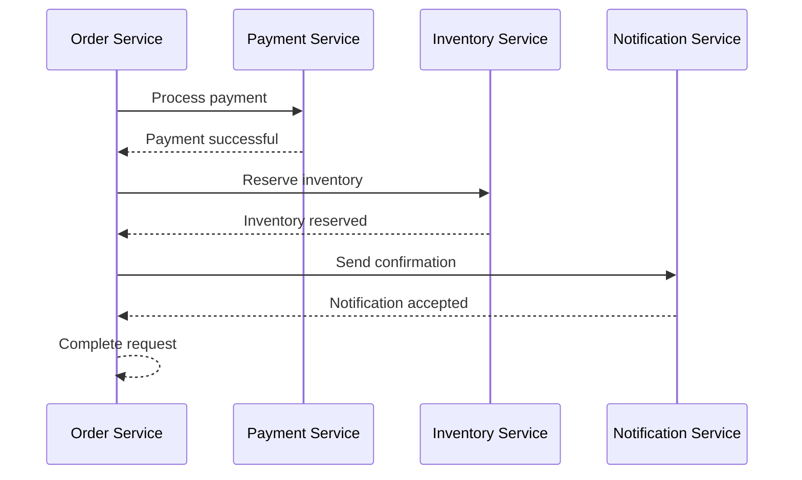
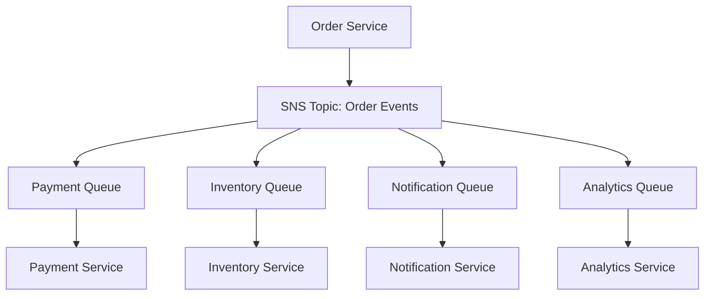
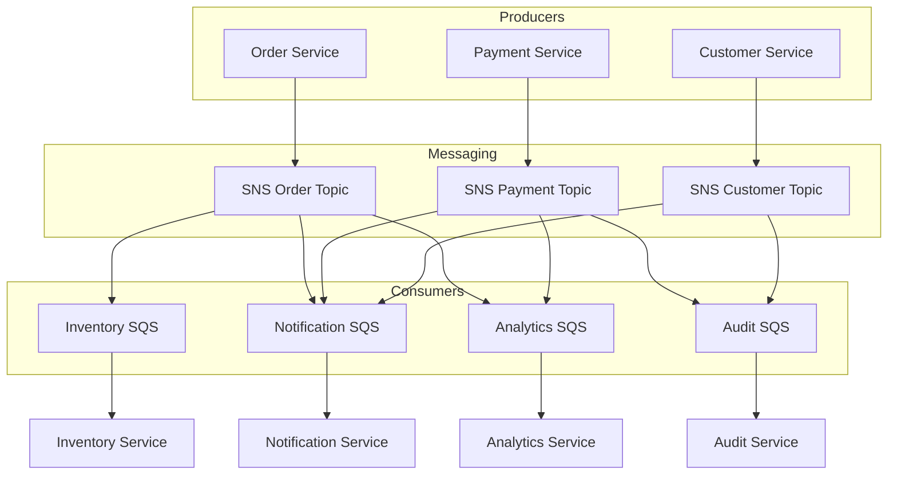
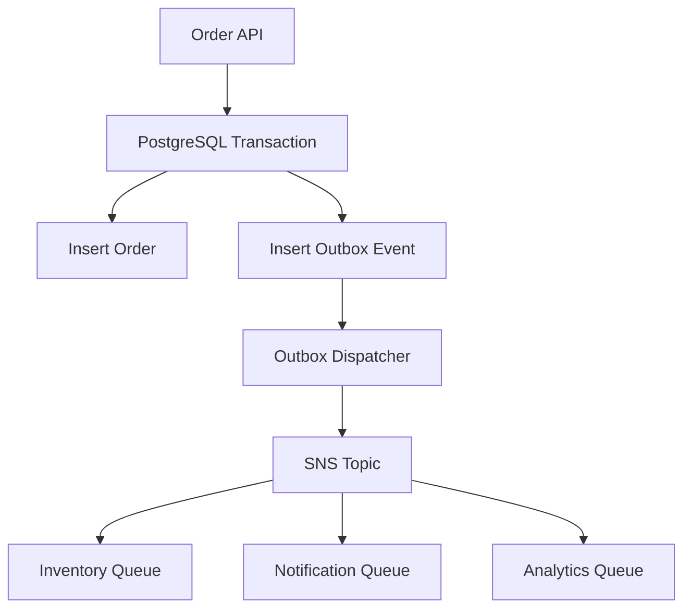
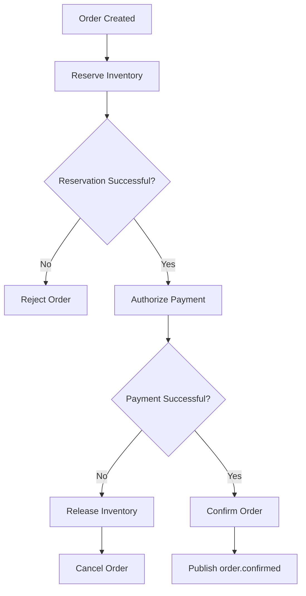
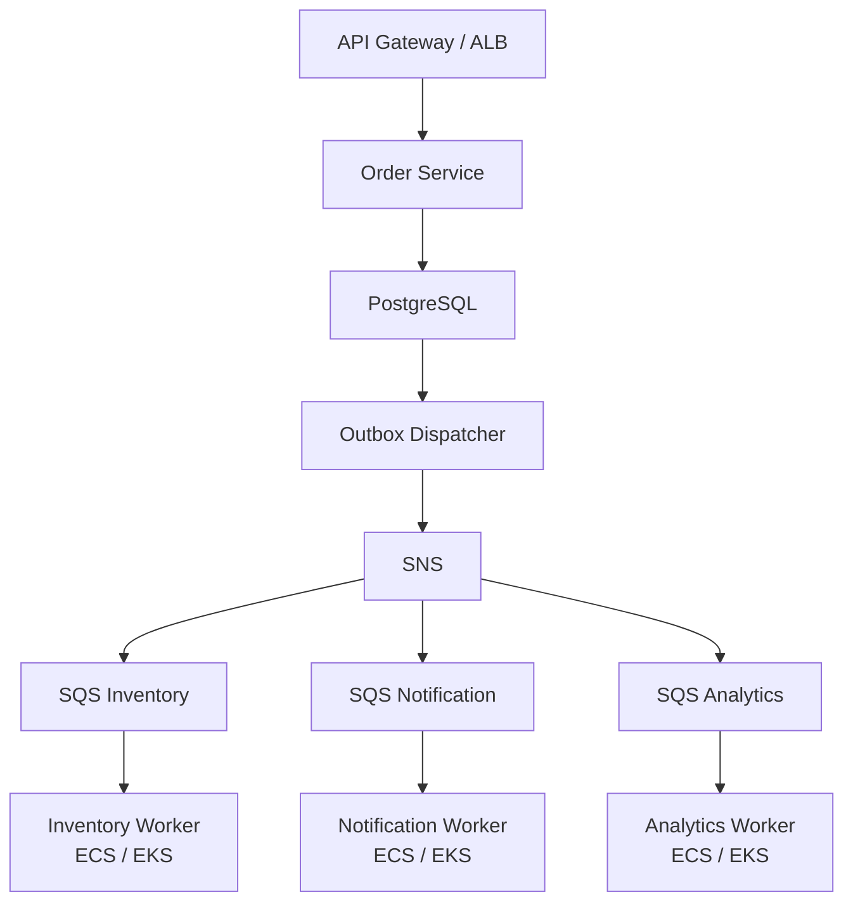

# 04- Event-Driven Microservices Architecture

## Overview

Event-driven microservices architecture (EDMA) is a design approach in which independent services communicate by publishing and consuming events rather than relying exclusively on synchronous API calls.

An event represents a significant business occurrence, such as:

- `order.created`
- `payment.completed`
- `payment.failed`
- `inventory.reserved`
- `shipment.dispatched`
- `customer.registered`

A service publishes an event when something meaningful happens. Other services subscribe to the event and independently execute their business responsibilities.

Amazon SNS provides event distribution through topics and subscriptions. Combined with Amazon SQS, it provides asynchronous message delivery, buffering, and independent consumer processing.

This architecture is particularly useful for backend systems where services must evolve, scale, and recover independently.

## Synchronous vs Event-Driven Communication

Microservices commonly communicate using synchronous APIs or asynchronous messaging.

### Synchronous Communication

In synchronous communication, one service directly invokes another service and waits for its response.



**Advantages:**

- Immediate response from downstream services.
- Straightforward request-response semantics.
- Suitable for operations requiring an immediate result.

**Limitations:**

- Increased request latency.
- Runtime dependency on downstream availability.
- Cascading failures when dependencies become unavailable.
- Tight coupling between service interfaces.
- Difficult coordination across multiple services.

### Event-Driven Communication

In event-driven communication, a service publishes an event and continues without waiting for every subscriber to finish processing it.



**Advantages:**

- Reduced runtime coupling.
- Independent consumer scaling.
- Better isolation of downstream processing failures.
- Easier integration of new services.
- Support for asynchronous workflows.

**Limitations:**

- Eventual consistency.
- Duplicate delivery and retry handling.
- More complex debugging and tracing.
- Event schema evolution requirements.
- Additional operational infrastructure.

### Communication Comparison

| Dimension | Synchronous APIs | Event-driven messaging |
|---|---|---|
| Communication | Request-response | Publish-subscribe |
| Coupling | Runtime dependency | Reduced runtime dependency |
| Response | Immediate response | Asynchronous processing |
| Failure handling | Request retries and timeouts | Delivery retries, buffering, and redrive |
| Consistency | Often immediate within the request workflow | Usually eventual across services |
| Scaling | Depends on request concurrency | Producers and consumers scale independently |
| Best suited for | Queries and immediate decisions | Business events and asynchronous workflows |

These approaches are complementary. A production microservice architecture commonly uses REST or gRPC for synchronous queries and commands, and messaging for asynchronous event propagation.

## Core Architectural Components

### Event Producer

An event producer is a service that publishes an event after a business operation occurs.

For example, an order service publishes `order.created` after successfully creating an order.

Responsibilities include:

- Defining business events.
- Generating stable event identifiers.
- Validating event payloads.
- Publishing events to the appropriate topic.
- Handling publication failures.
- Maintaining event compatibility.

A producer should publish business facts rather than exposing internal implementation details.

### Event Broker

The broker receives and distributes events.

In AWS, SNS provides the publish-subscribe distribution layer.

A topic acts as a logical destination for related events. Multiple subscriptions can receive copies of published messages.

### Event Consumer

A consumer subscribes to events and executes its own business logic.

Examples:

- Inventory service reserves stock.
- Notification service sends confirmation.
- Analytics service updates reporting data.
- Audit service records business activity.

Consumers should be independently deployable and should not depend on the internal implementation of the producer.

### Message Queue

SQS provides durable buffering between event delivery and consumer processing.

A separate queue for each logical subscriber allows:

- Independent message retention.
- Independent retry policies.
- Independent visibility timeouts.
- Independent dead-letter queues.
- Independent worker scaling.

## Reference Architecture Using SNS and SQS

A typical event-driven microservices architecture uses SNS for distribution and SQS for independent service consumption.



A service can publish to a topic and subscribe to other topics through its own queues. This supports independent event-driven workflows.

Avoid creating unnecessary topics and subscriptions. Organize topics around meaningful business event boundaries and subscription ownership.

## Event Design and Contracts

Events are contracts between independently developed services.

A well-designed event communicates what happened without exposing unnecessary internal details.

### Business Events vs Commands

These concepts should be distinguished.

| Concept | Meaning | Example |
|---|---|---|
| Event | A fact that has already occurred | `order.created` |
| Command | A request to perform an operation | `reserve.inventory` |
| Query | A request for information | `get.order.status` |

Events are generally expressed in past tense because they describe completed business occurrences.

Commands express requested actions and should have a clearly defined owner responsible for accepting or rejecting them.

Do not publish an event that claims an operation succeeded before the corresponding business transaction has committed.

### Event Envelope

Use a consistent envelope across services.

```json
{
  "event_id": "evt_01J9K8M2X7",
  "event_type": "order.created",
  "event_version": 1,
  "occurred_at": "2026-11-20T10:30:00Z",
  "producer": "order-service",
  "correlation_id": "corr_10045",
  "data": {
    "order_id": "ord_10045",
    "customer_id": "cus_501",
    "total_amount": 2499.00,
    "currency": "INR"
  }
}
```

| Field | Responsibility |
|---|---|
| `event_id` | Stable event identity for deduplication. |
| `event_type` | Identifies the business occurrence. |
| `event_version` | Supports schema evolution. |
| `occurred_at` | Records when the event occurred. |
| `producer` | Identifies the originating service. |
| `correlation_id` | Connects related operations across services. |
| `data` | Contains event-specific information. |

### Event Schema Evolution

Since producers and consumers deploy independently, schema changes must be managed carefully.

Recommended practices:

- Prefer additive changes.
- Keep existing field meanings stable.
- Avoid removing fields without a migration strategy.
- Use explicit event versions.
- Validate messages at service boundaries.
- Define behavior for unknown event types and versions.
- Maintain contract tests between producers and consumers.

SNS and SQS transport messages; they do not automatically enforce application-level JSON schemas.

## Implementing Event Publication in Python

A backend service can publish events using Boto3.

Example publisher abstraction:

```python
import json
import os
from typing import Any

import boto3
from botocore.config import Config


class EventPublisher:
    def __init__(self) -> None:
        self.client = boto3.client(
            "sns",
            region_name=os.environ["AWS_REGION"],
            config=Config(
                retries={
                    "mode": "standard",
                    "max_attempts": 5
                },
                connect_timeout=3,
                read_timeout=10
            )
        )

        self.topic_arn = os.environ["ORDER_EVENTS_TOPIC_ARN"]

    def publish(
        self,
        event: dict[str, Any]
    ) -> str:
        response = self.client.publish(
            TopicArn=self.topic_arn,
            Message=json.dumps(event),
            MessageAttributes={
                "event_type": {
                    "DataType": "String",
                    "StringValue": event["event_type"]
                }
            }
        )

        return response["MessageId"]
```

The publisher should receive an event that has already been constructed and validated.

For critical business events, avoid relying on a direct SNS call inside the same request that commits a database transaction. Use a transactional outbox.

## Transactional Outbox Pattern

A common failure in event-driven systems occurs when a service updates its database but fails to publish the corresponding event.

Consider:

1. Order service inserts an order into PostgreSQL.
2. PostgreSQL commits successfully.
3. SNS publication fails.
4. The order exists, but downstream services never receive `order.created`.

This is a dual-write problem.

### Architecture

The transactional outbox pattern stores the business change and its outgoing event in the same database transaction.



Example outbox table:

```sql
CREATE TABLE outbox_events (
    id BIGSERIAL PRIMARY KEY,
    event_id UUID NOT NULL UNIQUE,
    event_type VARCHAR(150) NOT NULL,
    payload JSONB NOT NULL,
    created_at TIMESTAMPTZ NOT NULL DEFAULT NOW(),
    published_at TIMESTAMPTZ,
    attempts INTEGER NOT NULL DEFAULT 0
);

CREATE INDEX idx_outbox_pending
ON outbox_events (created_at)
WHERE published_at IS NULL;
```

The business transaction inserts both the order and the outbox event.

A background dispatcher:

1. Retrieves unpublished events.
2. Publishes them to SNS.
3. Marks them published after SNS accepts the publication.
4. Retries transient failures.
5. Records attempts and operational errors.

For concurrent dispatchers, use a safe claiming mechanism such as `FOR UPDATE SKIP LOCKED` or a lease-based design.

A dispatcher may crash after SNS accepts an event but before updating `published_at`. The event can therefore be published more than once.

The transactional outbox prevents losing the event between the database transaction and publication process, but it does not eliminate duplicate publication. Consumers still need idempotency.

## Consumer Implementation

A consumer retrieves events from its dedicated SQS queue.

The worker should:

- Validate the event.
- Check whether it has already been processed.
- Execute its business operation.
- Persist processing state transactionally.
- Delete the SQS message only after successful processing.

Example PostgreSQL idempotency table:

```sql
CREATE TABLE processed_events (
    event_id UUID NOT NULL,
    consumer_name VARCHAR(100) NOT NULL,
    processed_at TIMESTAMPTZ NOT NULL DEFAULT NOW(),
    PRIMARY KEY (consumer_name, event_id)
);
```

Example processing function:

```python
from sqlalchemy import text
from sqlalchemy.ext.asyncio import AsyncSession


async def process_order_created(
    session: AsyncSession,
    event: dict
) -> bool:
    async with session.begin():
        result = await session.execute(
            text("""
                INSERT INTO processed_events (
                    event_id,
                    consumer_name
                )
                VALUES (
                    :event_id,
                    :consumer_name
                )
                ON CONFLICT (consumer_name, event_id)
                DO NOTHING
                RETURNING event_id
            """),
            {
                "event_id": event["event_id"],
                "consumer_name": "inventory-service"
            }
        )

        inserted = result.scalar_one_or_none()

        if inserted is None:
            return False

        await session.execute(
            text("""
                INSERT INTO inventory_reservations (
                    order_id,
                    status
                )
                VALUES (
                    :order_id,
                    'PENDING'
                )
                ON CONFLICT (order_id)
                DO NOTHING
            """),
            {
                "order_id": event["data"]["order_id"]
            }
        )

    return True
```

The event-processing record and business update are committed together.

External side effects such as email delivery or payment-provider calls require additional idempotency mechanisms. A database transaction cannot atomically commit an external HTTP request.

## Eventual Consistency

Event-driven microservices commonly operate with eventual consistency.

When an order is created, the order service may commit immediately while inventory, analytics, and notification services process the event asynchronously.

The system can temporarily contain different views of the same business workflow.

Example:

| Service | State immediately after order creation |
|---|---|
| Order service | Order created |
| Inventory service | Reservation pending |
| Notification service | Confirmation pending |
| Analytics service | Event not yet processed |

After consumers process their messages, the system converges toward the expected state.

### Managing Eventual Consistency

- Expose explicit processing states.
- Use pending and completed workflow statuses.
- Avoid assuming downstream updates are immediate.
- Define timeouts and escalation rules.
- Support reconciliation for missed or delayed workflows.
- Make APIs clear about whether a response represents acceptance or completion.

For example, an API can return `202 Accepted` when a workflow has been accepted for asynchronous processing rather than claiming that all downstream operations have completed.

## Saga Pattern for Distributed Transactions

A business workflow that spans multiple microservices cannot generally rely on one PostgreSQL transaction.

The Saga pattern coordinates a sequence of local transactions.

For example, order processing might involve:

1. Create order.
2. Reserve inventory.
3. Authorize payment.
4. Confirm order.
5. Arrange shipment.

If payment authorization fails after inventory reservation, the system may need to release the reserved stock.

### Saga Architecture



### Choreography vs Orchestration

| Approach | How it works | Advantages | Limitations |
|---|---|---|---|
| Choreography | Services react to events and publish subsequent events | Distributed ownership and fewer central dependencies | Workflow visibility and debugging become more difficult. |
| Orchestration | A coordinator directs the workflow and tracks progress | Centralized workflow state and explicit transitions | Introduces a coordinator and additional operational responsibility. |

Use choreography for relatively simple workflows with clear event ownership.

Use orchestration when workflows have complex branching, timeouts, compensation, and long-running state transitions.

SNS can distribute workflow events, while SQS provides buffering for each participant. Neither service automatically implements Saga state management or compensation logic.

## Error Handling and Retry Strategy

Distributed systems must expect transient failures, permanent failures, and duplicate events.

### Failure Categories

| Failure | Example | Handling |
|---|---|---|
| Transient | Temporary database outage | Retry with backoff. |
| Throttling | External API rate limit | Apply bounded retries and rate limiting. |
| Invalid event | Missing required field | Reject or quarantine. |
| Business rejection | Inventory unavailable | Publish an appropriate business outcome. |
| Poison message | Deterministic processing failure | Move to DLQ after configured attempts. |
| Consumer crash | Worker termination during processing | Allow SQS visibility timeout and redelivery. |

### Retry Principles

- Use exponential backoff with jitter.
- Set bounded retry attempts.
- Avoid retrying permanent validation failures indefinitely.
- Make handlers idempotent.
- Configure SQS visibility timeouts according to processing duration.
- Use DLQs for messages that exceed the configured receive threshold.
- Monitor retry volume and oldest-message age.

For SQS, the `maxReceiveCount` redrive setting controls when repeatedly received messages move to the DLQ. It counts receives, not successful business-processing attempts.

## Service Ownership and Boundaries

Event-driven systems work best when each service owns its business capabilities and data.

Example:

| Service | Data ownership | Published events |
|---|---|---|
| Order service | Orders and order lifecycle | `order.created`, `order.cancelled` |
| Payment service | Payments and authorization state | `payment.authorized`, `payment.failed` |
| Inventory service | Stock and reservations | `inventory.reserved`, `inventory.rejected` |
| Shipping service | Shipment and tracking state | `shipment.created`, `shipment.dispatched` |
| Notification service | Notification delivery state | `notification.sent`, `notification.failed` |

A service should not directly update another service's database.

Instead, services communicate through owned APIs or business events.

This preserves data ownership and reduces hidden coupling.

## Scaling and Performance

Event-driven architecture separates producer throughput from consumer processing capacity.

A producer can publish events while consumers process them at different rates.

### Scaling Consumers

For SQS-backed consumers:

- Scale worker replicas according to queue depth and message age.
- Use bounded concurrency.
- Tune `MaxNumberOfMessages` and long polling.
- Use batch processing when it improves throughput.
- Protect database connection pools.
- Apply downstream API rate limits.
- Keep processing within the configured visibility timeout.

### Backpressure

SQS provides buffering, but a queue backlog can grow indefinitely relative to the application's capacity.

Monitor:

- `ApproximateNumberOfMessagesVisible`
- `ApproximateNumberOfMessagesNotVisible`
- `ApproximateAgeOfOldestMessage`

Define alarms and scaling thresholds based on business latency requirements rather than queue depth alone.

### Message Size

Keep event payloads focused and reasonably small.

For large documents or binary data:

1. Store the object in S3.
2. Publish an event containing the object location and required metadata.
3. Grant consumers authorized access to retrieve it.

This reduces message size and avoids repeatedly transferring large payloads through the messaging layer.

## Security Architecture

Event-driven systems distribute data across multiple services, so access control must be applied at every boundary.

### IAM

- Grant publishers only the required `sns:Publish` permissions.
- Grant consumers access only to their own SQS queues.
- Restrict subscription management.
- Use IAM roles for workloads running on EC2, ECS, EKS, and Lambda.
- Avoid long-lived access keys in application configuration.

### Resource Policies

SQS queue policies should allow the SNS service principal to send messages only from the intended topic ARN.

For cross-account messaging, explicitly authorize the required principals and resources.

### Encryption

- Enable SNS encryption where required.
- Enable SQS SSE-SQS or SSE-KMS.
- Configure KMS key policies and service permissions.
- Review cross-account encryption requirements.
- Plan regional key dependencies for disaster recovery.

### Data Protection

- Minimize sensitive fields in events.
- Do not publish authentication tokens or credentials.
- Use protected references for sensitive documents.
- Apply retention and access controls to all message destinations.
- Avoid logging complete sensitive message payloads.

## Observability and Distributed Tracing

Traditional request tracing becomes more difficult when processing crosses asynchronous boundaries.

A single event may pass through multiple services at different times.

Use correlation IDs and distributed tracing metadata to connect related operations.

Example:

```json
{
  "event_id": "evt_01J9K8M2X7",
  "event_type": "order.created",
  "correlation_id": "corr_10045",
  "traceparent": "00-4bf92f3577b34da6a3ce929d0e0e4736-00f067aa0ba902b7-01",
  "data": {
    "order_id": "ord_10045"
  }
}
```

The trace context should be propagated deliberately through message attributes or the event envelope and extracted by consumers.

Avoid treating an SNS message ID as a replacement for a business event ID or distributed trace ID.

### Monitoring Areas

| Layer | Metrics and signals |
|---|---|
| Publisher | Publication failures, latency, outbox backlog. |
| SNS | Published messages and subscription delivery failures. |
| SQS | Queue depth, oldest-message age, in-flight messages, DLQ depth. |
| Consumers | Processing duration, exceptions, duplicate events, throughput. |
| Database | Query latency, transaction failures, connection saturation. |
| External services | API latency, throttling, timeouts, and provider errors. |

Define service-level objectives for event processing latency, workflow completion, and failure rates.

## Deployment Architecture

Event-driven microservices can be deployed independently using containers and orchestration platforms.

Example deployment model:



### Deployment Best Practices

- Deploy publishers and consumers independently.
- Version event contracts.
- Use backward-compatible changes during rolling deployments.
- Provision messaging infrastructure using Terraform or AWS CDK.
- Separate development, staging, and production resources.
- Use environment-specific IAM roles.
- Include queue policies, encryption, DLQs, and alarms in infrastructure definitions.
- Test event compatibility before deployment.

A producer should not publish a new incompatible event format before all affected consumers are ready to process it.

## Cost Considerations

Event-driven architectures introduce costs across the messaging and processing layers.

Evaluate:

- SNS publication and delivery volume.
- Number of subscriptions.
- SQS API request volume.
- Message payload size.
- Retry and DLQ traffic.
- KMS request volume.
- Worker compute costs.
- Database and external API costs.

Batch processing and long polling can reduce SQS request overhead. However, cost optimization should not compromise independent consumer isolation or recovery requirements.

## High Availability and Disaster Recovery

A production architecture must account for failures in individual services and entire AWS Regions.

Recommended practices:

- Deploy application workers across multiple Availability Zones where supported.
- Use managed regional messaging services with appropriate service configurations.
- Keep infrastructure definitions in version control.
- Define RPO and RTO for each business workflow.
- Configure retention according to recovery requirements.
- Monitor outbox backlogs and DLQs.
- Test worker restart and message redelivery.
- Document replay and reconciliation procedures.
- Design cross-Region messaging explicitly when required.

SNS topics and SQS queues are regional resources. Cross-Region recovery requires explicit infrastructure, permissions, encryption, and replication or republishing logic.

## Common Architectural Mistakes

| Mistake | Impact | Recommended approach |
|---|---|---|
| Using events for every service interaction | Creates unnecessary asynchronous complexity | Use synchronous APIs for immediate queries and decisions. |
| Publishing events before database commit | Consumers can observe events for changes that later roll back | Use transactional outbox. |
| Sharing one queue among independent subscribers | Consumers compete for messages | Use one queue per logical subscriber. |
| Assuming exactly-once business execution | Duplicate side effects can occur | Use idempotency and durable processing state. |
| Allowing consumers to access other service databases | Creates hidden data coupling | Enforce service-level data ownership. |
| Ignoring event versioning | Independent deployments become incompatible | Use explicit event contracts and compatibility testing. |
| Creating excessive event chains | Increases latency and makes workflows difficult to trace | Design clear business boundaries and correlation metadata. |
| Using choreography for every complex workflow | Workflow state becomes difficult to understand | Consider orchestration for complex long-running workflows. |
| Treating eventual consistency as immediate consistency | APIs expose misleading business state | Represent pending and completed states explicitly. |
| Ignoring DLQs and reconciliation | Failed workflows remain unresolved | Define operational ownership and recovery procedures. |

## Key Takeaways

- Event-driven microservices communicate through business events, reducing runtime coupling and allowing services to process work independently.
- SNS provides event distribution, while separate SQS queues provide durable buffering, independent retries, and consumer isolation.
- Transactional outbox, stable event IDs, idempotent consumers, and explicit event contracts are essential for reliable event propagation.
- Eventual consistency and distributed workflows require explicit state management, compensation logic, and reconciliation.
- Production event-driven systems need end-to-end observability, least-privilege security, independent scaling, and tested recovery procedures.