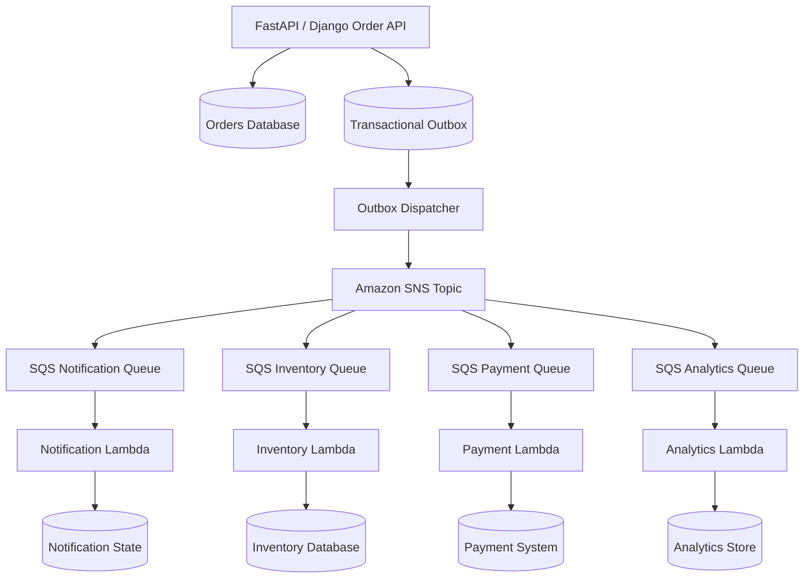
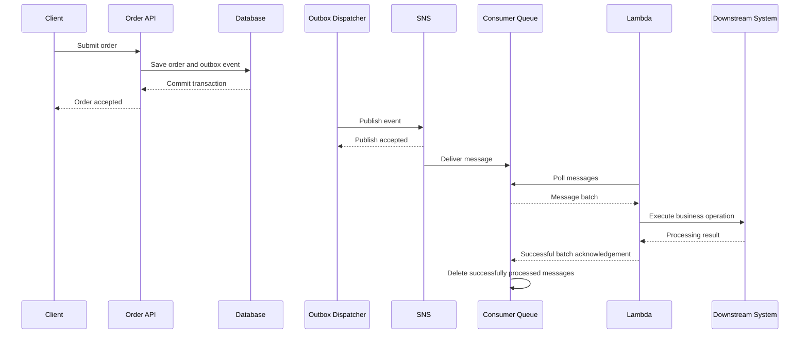
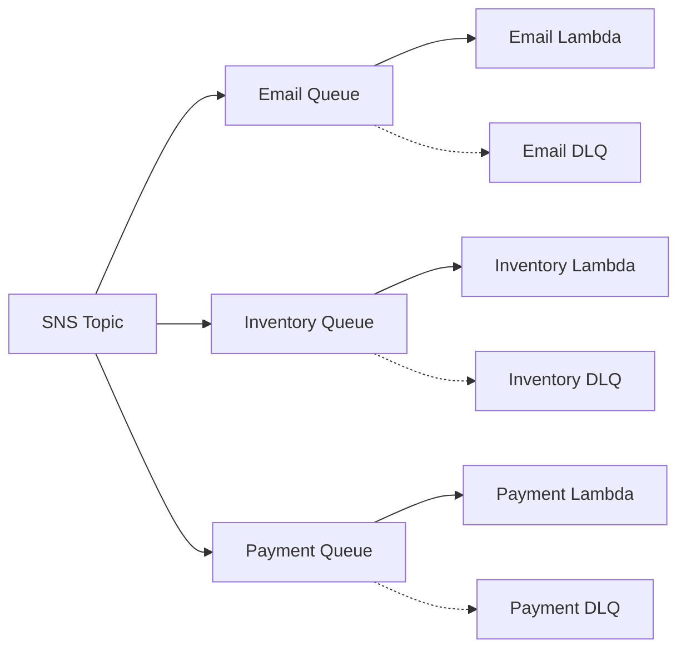
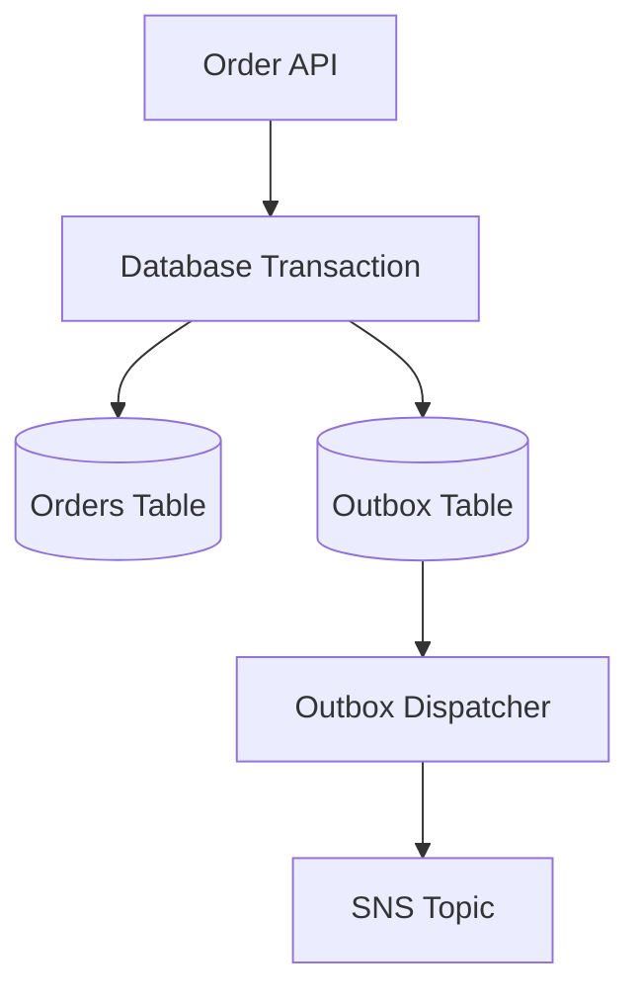
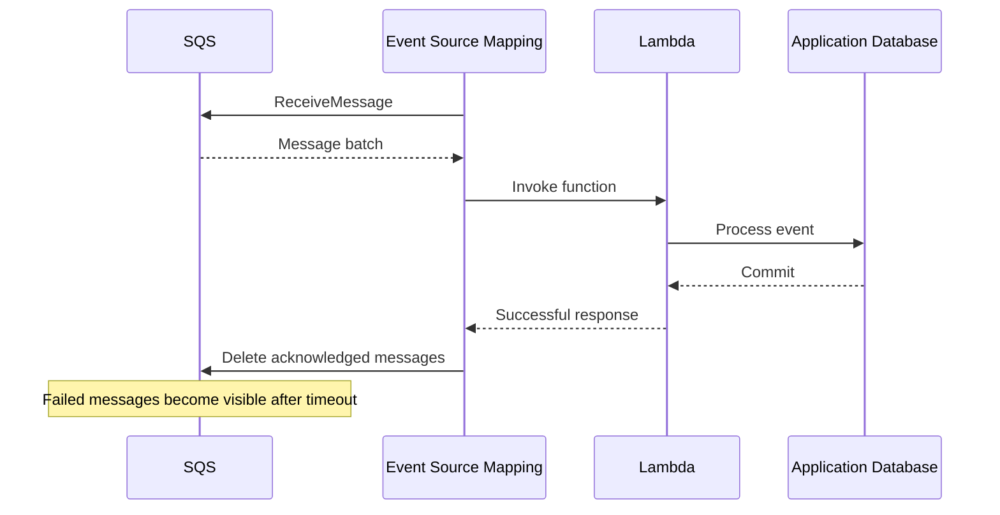
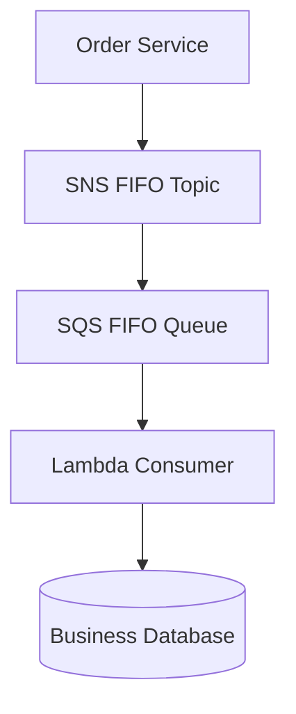
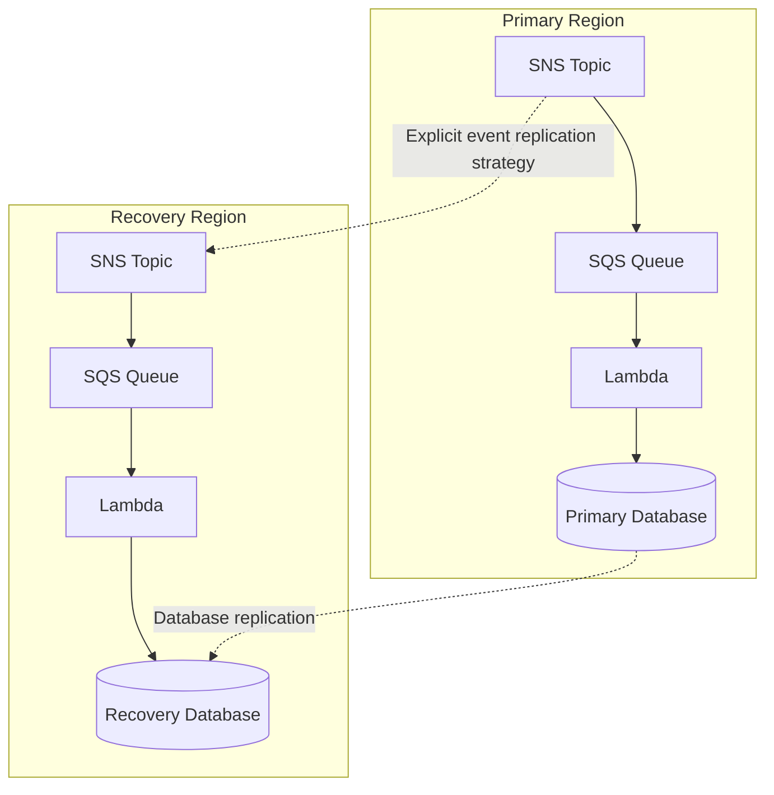

# 05- Serverless Event Processing Architecture

## Overview

Serverless event processing uses managed event-driven services to execute application logic in response to events without requiring teams to provision or manage application servers. In an AWS messaging architecture, Amazon SNS commonly acts as the event distribution layer, while Amazon SQS provides durable buffering and AWS Lambda executes event-processing logic.

This architecture is useful when multiple independent backend components need to react to business events without tightly coupling their deployment, runtime, or scaling characteristics.

A typical implementation combines:

- **Amazon SNS:** Publishes and distributes events to subscribed endpoints.
- **Amazon SQS:** Buffers messages independently for each consumer.
- **AWS Lambda:** Processes messages using event source mappings.
- **Amazon EventBridge:** Routes events using event patterns when broader event-bus capabilities are required.
- **Amazon S3:** Stores large payloads or processing artifacts.
- **Amazon DynamoDB or PostgreSQL:** Stores application state and idempotency records.
- **AWS CloudWatch:** Provides logs, metrics, alarms, and operational visibility.

SNS is particularly useful when one business event must trigger multiple independent serverless workflows.

## Reference Architecture

Consider an order-management platform where an order is successfully placed. Several independent workflows must execute:

- Send an order confirmation.
- Update inventory.
- Initiate payment processing.
- Generate an analytics record.
- Notify a fulfillment service.

The order service should not synchronously invoke every downstream service. Instead, it publishes an event to SNS, which distributes the event to separate SQS queues. Each queue triggers its own Lambda function.



Each consumer has an independent queue, retry policy, visibility timeout, dead-letter queue, and concurrency configuration.

This isolation prevents a slow analytics workflow from blocking inventory processing or notification delivery.

## Core Components and Responsibilities

| Component | Responsibility | Production consideration |
|---|---|---|
| SNS topic | Distributes published events | Use explicit event contracts and controlled access |
| SNS subscription | Connects a topic to a consumer endpoint | Configure filtering and delivery policies |
| SQS queue | Buffers events for an independent consumer | Configure retention, visibility timeout, and DLQ |
| Lambda | Executes business processing | Design for retries, duplicate delivery, and concurrency |
| Event source mapping | Polls SQS and invokes Lambda | Configure batch size and failure handling |
| DynamoDB/PostgreSQL | Stores processing state | Enforce idempotency and transactional boundaries |
| CloudWatch | Observability | Monitor queue age, failures, throttling, and duration |
| S3 | Stores large payloads and artifacts | Apply encryption, lifecycle, and access controls |

## Event Processing Lifecycle

The complete lifecycle starts with a business transaction and ends when the independent consumers successfully process the event.



The important boundaries are:

1. The order and outbox event are committed atomically.
2. The dispatcher publishes the event to SNS.
3. SNS delivers the event to each eligible subscription.
4. SQS retains the message until the consumer successfully processes it.
5. Lambda acknowledges successful processing through the event source mapping.
6. Failed messages become eligible for retry and may eventually move to a DLQ.

SNS accepting a publication does not mean that downstream business processing has completed.

## SNS-to-SQS-to-Lambda Integration

### Why Use SQS Between SNS and Lambda?

SNS can invoke Lambda directly through a subscription. This is appropriate for relatively simple event-processing workflows where direct invocation is sufficient.

However, introducing SQS provides an independent durable buffer between event distribution and execution.

| Capability | SNS to Lambda | SNS to SQS to Lambda |
|---|---|---|
| Event distribution | Direct invocation | Topic-based distribution |
| Durable consumer buffer | No independent SQS buffer | Yes |
| Consumer isolation | Limited to Lambda invocation behavior | Independent queue per consumer |
| Backpressure control | Lambda concurrency and service retries | Queue depth and Lambda concurrency |
| Consumer-specific retention | No independent queue retention | Configurable per queue |
| DLQ options | Lambda asynchronous invocation DLQ/destination | SQS processing DLQ |
| Replay and recovery | Depends on configured failure handling | Queue retention and controlled redrive |
| Independent consumer scaling | Lambda concurrency | Queue backlog and Lambda concurrency |

Use SNS-to-SQS-to-Lambda when consumers require independent buffering, retry policies, throughput control, or operational isolation.

### Subscription Architecture

A typical deployment creates one SQS queue for each independent processing responsibility.



Avoid sharing one queue between unrelated business consumers. A queue is a competing-consumer work distribution mechanism, not a broadcast mechanism.

### Configure SNS and SQS

The following Boto3 example creates a topic, queues, queue policies, and subscriptions.

```python
import json

import boto3

region = "ap-south-1"

sns = boto3.client("sns", region_name=region)
sqs = boto3.client("sqs", region_name=region)

topic_response = sns.create_topic(
    Name="order-events"
)

topic_arn = topic_response["TopicArn"]

consumers = [
    "notification",
    "inventory",
    "analytics",
]

for consumer in consumers:
    queue_response = sqs.create_queue(
        QueueName=f"order-{consumer}-queue",
        Attributes={
            "ReceiveMessageWaitTimeSeconds": "20",
            "VisibilityTimeout": "180",
            "MessageRetentionPeriod": "1209600",
        },
    )

    queue_url = queue_response["QueueUrl"]

    queue_attributes = sqs.get_queue_attributes(
        QueueUrl=queue_url,
        AttributeNames=["QueueArn"],
    )

    queue_arn = queue_attributes["Attributes"]["QueueArn"]

    policy = {
        "Version": "2012-10-17",
        "Statement": [
            {
                "Sid": "AllowSNSPublish",
                "Effect": "Allow",
                "Principal": {
                    "Service": "sns.amazonaws.com"
                },
                "Action": "sqs:SendMessage",
                "Resource": queue_arn,
                "Condition": {
                    "ArnEquals": {
                        "aws:SourceArn": topic_arn
                    }
                },
            }
        ],
    }

    sqs.set_queue_attributes(
        QueueUrl=queue_url,
        Attributes={
            "Policy": json.dumps(policy)
        },
    )

    sns.subscribe(
        TopicArn=topic_arn,
        Protocol="sqs",
        Endpoint=queue_arn,
    )
```

This is a deployment illustration. Production infrastructure should be managed through Terraform, CloudFormation, or AWS CDK rather than relying on application startup to create resources.

For encrypted queues, also configure the required KMS key policy and service permissions.

## Event Contract Design

Serverless consumers should receive a stable, versioned event contract.

An event should represent a business fact rather than expose an internal database row or framework-specific object.

Example:

```json
{
  "event_id": "evt_01JORDER8M4K",
  "event_type": "order.created",
  "event_version": 1,
  "occurred_at": "2026-11-20T08:30:00Z",
  "producer": "order-service",
  "correlation_id": "req_8f19c2",
  "data": {
    "order_id": "ord_10042",
    "customer_id": "cust_501",
    "total_amount": 2499.00,
    "currency": "INR"
  }
}
```

### Important Event Fields

| Field | Purpose |
|---|---|
| `event_id` | Stable business event identifier |
| `event_type` | Identifies the business event |
| `event_version` | Supports contract evolution |
| `occurred_at` | Records the business event timestamp |
| `producer` | Identifies the originating service |
| `correlation_id` | Connects related operations |
| `data` | Contains the event payload |

Use a stable `event_id` across retries and republishing of the same logical event.

Do not use the SNS message ID as the business event identifier. SNS message IDs identify individual SNS publications, while `event_id` identifies the logical business event.

### Schema Evolution

Consumers and producers may be deployed independently. Event contracts must therefore evolve without requiring coordinated releases.

Recommended practices:

- Add optional fields for backward-compatible changes.
- Avoid changing the meaning or data type of existing fields.
- Introduce a new event version for incompatible changes.
- Define explicit rules for unknown fields.
- Validate events before publishing and before processing.
- Maintain contract tests between producers and consumers.

For complex event ecosystems, use a schema registry or an equivalent contract-management process.

## Publishing Events from a Backend Service

### Python Publisher

A backend service can publish events using Boto3.

```python
import json
from datetime import UTC, datetime
from uuid import uuid4

import boto3


class OrderEventPublisher:
    def __init__(self, topic_arn: str, region: str) -> None:
        self.client = boto3.client(
            "sns",
            region_name=region,
        )
        self.topic_arn = topic_arn

    def publish_order_created(
        self,
        order_id: str,
        customer_id: str,
        amount: float,
        correlation_id: str,
    ) -> str:
        event = {
            "event_id": str(uuid4()),
            "event_type": "order.created",
            "event_version": 1,
            "occurred_at": datetime.now(UTC).isoformat(),
            "producer": "order-service",
            "correlation_id": correlation_id,
            "data": {
                "order_id": order_id,
                "customer_id": customer_id,
                "total_amount": amount,
                "currency": "INR",
            },
        }

        response = self.client.publish(
            TopicArn=self.topic_arn,
            Message=json.dumps(event),
            MessageAttributes={
                "event_type": {
                    "DataType": "String",
                    "StringValue": "order.created",
                }
            },
        )

        return response["MessageId"]
```

The publisher should be called from a reliable event-dispatching workflow rather than directly before a database transaction commits.

### The Dual-Write Problem

Consider this implementation:

```python
order = create_order(data)
publish_event(order)
```

There are two independent operations:

1. Commit the order to the database.
2. Publish the event to SNS.

If the database commits but SNS publication fails, the order exists without an event.

If the event is published but the database transaction later rolls back, consumers receive an event for an order that does not exist.

A normal database transaction cannot atomically commit both a PostgreSQL transaction and an SNS publication.

### Transactional Outbox Pattern

The transactional outbox pattern stores the business change and event record in the same database transaction.



Example table:

```sql
CREATE TABLE outbox_events (
    id UUID PRIMARY KEY,
    aggregate_id VARCHAR(100) NOT NULL,
    event_type VARCHAR(100) NOT NULL,
    payload JSONB NOT NULL,
    created_at TIMESTAMPTZ NOT NULL DEFAULT NOW(),
    published_at TIMESTAMPTZ,
    attempts INTEGER NOT NULL DEFAULT 0
);

CREATE INDEX idx_outbox_unpublished
    ON outbox_events (created_at)
    WHERE published_at IS NULL;
```

The application writes the order and event together:

```python
from uuid import uuid4

from sqlalchemy import text


def create_order(session, order_data: dict) -> str:
    order_id = str(uuid4())
    event_id = str(uuid4())

    event = {
        "event_id": event_id,
        "event_type": "order.created",
        "event_version": 1,
        "data": {
            "order_id": order_id,
            "customer_id": order_data["customer_id"],
        },
    }

    with session.begin():
        session.execute(
            text("""
                INSERT INTO orders (id, customer_id, status)
                VALUES (:id, :customer_id, :status)
            """),
            {
                "id": order_id,
                "customer_id": order_data["customer_id"],
                "status": "created",
            },
        )

        session.execute(
            text("""
                INSERT INTO outbox_events (
                    id,
                    aggregate_id,
                    event_type,
                    payload
                )
                VALUES (
                    :id,
                    :aggregate_id,
                    :event_type,
                    CAST(:payload AS JSONB)
                )
            """),
            {
                "id": event_id,
                "aggregate_id": order_id,
                "event_type": "order.created",
                "payload": json.dumps(event),
            },
        )

    return order_id
```

The dispatcher publishes unpublished records and marks them as published after SNS accepts the event.

Production dispatchers should use:

- Bounded batches.
- Row-level locking or safe claim mechanisms.
- Retry with exponential backoff and jitter.
- Publication attempt tracking.
- Stale-record monitoring.
- A controlled policy for permanently failing records.

A dispatcher can crash after SNS accepts a publication but before updating `published_at`. The event may then be published again. The outbox prevents event loss caused by the dual-write problem, but it does not provide exactly-once publication.

Consumers must therefore be idempotent.

## Lambda Event Processing

### How SQS Triggers Lambda

Lambda does not receive an unsolicited push from SQS. An event source mapping polls the queue and invokes the function with received messages.

The event source mapping manages polling, batching, invocation, and deletion of successfully processed messages.



The message remains invisible to other consumers during the visibility timeout. If processing fails or the function times out, the message can become visible again.

### Lambda Function Example

```python
import json
import logging

logger = logging.getLogger()
logger.setLevel(logging.INFO)


def process_order_created(event: dict) -> None:
    order_id = event["data"]["order_id"]

    logger.info(
        "Processing order.created",
        extra={
            "event_id": event["event_id"],
            "order_id": order_id,
            "correlation_id": event.get("correlation_id"),
        },
    )

    # Execute the consumer's business operation.
    # Persist processing state before acknowledging the message.


def lambda_handler(event: dict, context) -> dict:
    for record in event.get("Records", []):
        try:
            sns_envelope = json.loads(record["body"])

            message = sns_envelope.get(
                "Message",
                record["body"],
            )

            business_event = (
                json.loads(message)
                if isinstance(message, str)
                else message
            )

            process_order_created(business_event)

        except Exception:
            logger.exception(
                "Failed to process SQS record",
                extra={
                    "message_id": record.get("messageId"),
                },
            )
            raise

    return {"statusCode": 200}
```

This example uses SNS's default envelope format for SNS-to-SQS delivery.

If raw message delivery is enabled on the SNS subscription, the SQS body contains the published message directly. The consumer must be implemented for the configured delivery format.

For production batch processing, consider partial batch responses rather than raising an exception for the entire batch.

## Idempotent Lambda Processing

SQS Standard queues provide at-least-once delivery. A message can be delivered more than once, including when a consumer completes its business operation but fails before the message is deleted.

For example:

1. Lambda receives an order event.
2. The inventory database is updated.
3. Lambda times out before successful acknowledgement.
4. SQS makes the message visible again.
5. Lambda receives the same event again.

Without idempotency, inventory could be deducted twice.

### Idempotency Table

```sql
CREATE TABLE processed_events (
    event_id UUID PRIMARY KEY,
    processed_at TIMESTAMPTZ NOT NULL DEFAULT NOW()
);
```

The event record and business changes should be committed in the same database transaction.

```python
from sqlalchemy import text


def process_inventory_event(session, event: dict) -> bool:
    event_id = event["event_id"]
    order_id = event["data"]["order_id"]

    with session.begin():
        result = session.execute(
            text("""
                INSERT INTO processed_events (event_id)
                VALUES (:event_id)
                ON CONFLICT (event_id) DO NOTHING
                RETURNING event_id
            """),
            {"event_id": event_id},
        )

        if result.scalar_one_or_none() is None:
            return False

        session.execute(
            text("""
                UPDATE inventory
                SET reserved_quantity = reserved_quantity + 1
                WHERE product_id = :product_id
            """),
            {
                "product_id": event["data"]["product_id"],
            },
        )

    return True
```

The example assumes the event contains a valid `product_id` and that inventory reservation rules are handled by the surrounding business logic.

### Idempotency Design Considerations

- Use a stable business event ID.
- Enforce uniqueness at the database level.
- Store the idempotency record and business update atomically.
- Retain idempotency records for an appropriate period.
- Handle concurrent duplicate deliveries safely.
- Use provider-supported idempotency keys for external APIs where available.

A database transaction cannot make an external payment API, email provider, or HTTP service exactly-once. For external side effects, use provider idempotency keys, durable operation state, reconciliation, or a dedicated workflow.

## Partial Batch Failure Handling

Lambda normally treats an SQS batch as failed if the function reports an invocation failure. This can cause successfully processed records to be delivered again.

For batch processing, configure `ReportBatchItemFailures` on the event source mapping.

Example:

```python
import json
import logging

logger = logging.getLogger()
logger.setLevel(logging.INFO)


def lambda_handler(event: dict, context) -> dict:
    failures = []

    for record in event.get("Records", []):
        message_id = record["messageId"]

        try:
            sns_envelope = json.loads(record["body"])
            business_event = json.loads(
                sns_envelope["Message"]
            )

            process_order_created(business_event)

        except Exception:
            logger.exception(
                "Record processing failed",
                extra={"message_id": message_id},
            )

            failures.append({
                "itemIdentifier": message_id
            })

    return {
        "batchItemFailures": failures
    }
```

The event source mapping must have the appropriate `FunctionResponseTypes` configuration:

```bash
aws lambda update-event-source-mapping \
    --uuid "$EVENT_SOURCE_MAPPING_UUID" \
    --function-response-types ReportBatchItemFailures
```

Partial batch responses reduce unnecessary retries of successful records. They do not replace idempotency or DLQ configuration.

For FIFO queues, stop processing after the first failure and report the failed and unprocessed records as failures when preserving ordering is required.

## Event Filtering

SNS subscription filtering prevents irrelevant events from reaching a consumer.

For example, an inventory service may only need `order.created` and `order.cancelled` events.

Example subscription filter policy:

```json
{
  "event_type": [
    "order.created",
    "order.cancelled"
  ]
}
```

Apply the filter policy to the SNS subscription:

```bash
aws sns set-subscription-attributes \
    --subscription-arn "$SUBSCRIPTION_ARN" \
    --attribute-name FilterPolicy \
    --attribute-value '{
      "event_type": [
        "order.created",
        "order.cancelled"
      ]
    }'
```

SNS supports filtering based on message attributes or message body properties, depending on the subscription's filter policy scope.

Set the appropriate `FilterPolicyScope` when using body-based filtering.

Filtering reduces unnecessary message delivery and consumer invocation, but it is not an authorization mechanism. Consumers must still validate the event type, producer, schema, and business constraints.

## Retry and Failure Management

Serverless event processing is inherently retry-oriented. A reliable architecture must distinguish delivery failures from business-processing failures.

### Failure Categories

| Failure | Example | Recommended handling |
|---|---|---|
| Transient infrastructure failure | Database connection timeout | Retry with bounded backoff |
| Throttling | Downstream API rate limit | Backoff and limit concurrency |
| Invalid event | Missing required field | Quarantine or DLQ |
| Business rejection | Order already cancelled | Apply explicit business handling |
| External dependency failure | Payment provider unavailable | Retry with provider idempotency |
| Function timeout | Processing exceeds configured timeout | Optimize workload and adjust timeout |
| Poison message | Repeatedly fails due to malformed data | Isolate in DLQ and investigate |

### Configure a Processing DLQ

A processing DLQ captures messages that repeatedly fail consumption.

```bash
aws sqs create-queue \
    --queue-name order-inventory-dlq
```

Configure the source queue with a redrive policy:

```json
{
  "deadLetterTargetArn": "arn:aws:sqs:ap-south-1:123456789012:order-inventory-dlq",
  "maxReceiveCount": 5
}
```

Apply it to the source queue:

```bash
aws sqs set-queue-attributes \
    --queue-url "$QUEUE_URL" \
    --attributes '{
      "RedrivePolicy": "{\"deadLetterTargetArn\":\"arn:aws:sqs:ap-south-1:123456789012:order-inventory-dlq\",\"maxReceiveCount\":\"5\"}"
    }'
```

The queue's redrive policy determines when repeatedly received messages are moved to the DLQ. `maxReceiveCount` counts receives, not successful processing attempts.

### Distinguish the Two DLQ Stages

SNS and SQS have different failure boundaries.

| Failure stage | Mechanism | Purpose |
|---|---|---|
| SNS delivery to SQS fails | SNS subscription delivery retry policy and subscription DLQ | Captures messages SNS could not deliver to the subscription |
| Lambda repeatedly fails processing an SQS message | SQS redrive policy and processing DLQ | Captures messages that consumers could not process |

A subscription DLQ does not replace the SQS processing DLQ.

### Retry Strategy

Recommended retry behavior:

- Use bounded retries for transient failures.
- Use exponential backoff with jitter for external dependencies.
- Avoid immediate retry loops for persistent failures.
- Configure queue visibility timeout to accommodate realistic processing duration.
- Set an appropriate `maxReceiveCount`.
- Alert on DLQ growth and oldest-message age.
- Define an operational redrive process.

A DLQ should not become a permanent storage destination for uninvestigated failures.

## Lambda Concurrency and Backpressure

A queue absorbs bursts of messages, but Lambda can still overwhelm downstream systems if concurrency is unrestricted.

For example, a payment provider may support only a limited number of concurrent requests. If Lambda scales too quickly, the consumer can trigger provider throttling or service instability.

### Control Concurrency

Use:

- Reserved concurrency to cap the maximum concurrent executions of a Lambda function.
- Event source mapping maximum concurrency to control SQS polling and invocation concurrency.
- Batch size to control the number of messages processed per invocation.
- Provisioned concurrency when predictable startup latency is required.
- Downstream connection pools and rate limits.

Example:

```bash
aws lambda put-function-concurrency \
    --function-name order-inventory-processor \
    --reserved-concurrent-executions 20
```

For an SQS event source mapping, configure maximum concurrency:

```bash
aws lambda update-event-source-mapping \
    --uuid "$EVENT_SOURCE_MAPPING_UUID" \
    --scaling-config '{"MaximumConcurrency":10}'
```

Reserved concurrency and event source mapping maximum concurrency are different controls. Coordinate them across all event source mappings attached to the function.

### Capacity Planning

A simplified estimate for processing capacity is:

\[
\text{Throughput}
\approx
\frac{
\text{Concurrent Executions}
\times
\text{Batch Size}
}{
\text{Average Invocation Duration}
}
\]

For example, if:

- Maximum concurrency = 10
- Batch size = 10
- Average invocation duration = 2 seconds

Then the approximate processing capacity is:

\[
\frac{10 \times 10}{2} = 50
\]

messages per second.

This is a planning estimate, not a guaranteed throughput rate. Actual capacity depends on polling behavior, payload size, downstream latency, throttling, retries, and batch utilization.

### Visibility Timeout

The visibility timeout must be long enough for Lambda to process a batch and acknowledge it.

For SQS event source mappings, AWS recommends configuring the queue visibility timeout to at least six times the Lambda function timeout, plus the maximum batching window where applicable.

A short visibility timeout can cause duplicate concurrent processing while the original invocation is still running.

## Large Event Payloads

SNS and SQS have message-size limits. SNS supports messages up to 256 KiB, while SQS supports messages up to 1 MiB.

For larger payloads, store the data in S3 and publish a reference.

Example event:

```json
{
  "event_id": "evt_document_001",
  "event_type": "document.uploaded",
  "event_version": 1,
  "data": {
    "bucket": "application-documents",
    "key": "incoming/2026/11/document-001.pdf",
    "content_type": "application/pdf"
  }
}
```

The consumer retrieves the object from S3 using its IAM role.

```python
import boto3

s3 = boto3.client("s3")


def download_document(bucket: str, key: str) -> bytes:
    response = s3.get_object(
        Bucket=bucket,
        Key=key,
    )

    return response["Body"].read()
```

Production considerations:

- Use S3 object versioning where appropriate.
- Restrict access to the required bucket and prefixes.
- Encrypt objects with SSE-S3 or SSE-KMS.
- Validate object metadata and content.
- Define object lifecycle and retention policies.
- Ensure the object is available before publishing its reference.
- Handle missing or deleted objects as explicit processing failures.

The event should contain a durable object reference, not a temporary URL whose expiration may occur before processing.

## SNS FIFO and Serverless Processing

SNS FIFO and SQS FIFO can be used when event ordering and deduplication requirements justify the additional constraints.

A typical architecture is:



Important considerations:

- SNS FIFO requires a message group ID.
- SQS FIFO preserves order within a message group.
- Different message groups can be processed concurrently.
- FIFO deduplication operates within a five-minute deduplication interval.
- Content-based deduplication hashes the message body, not message attributes.
- SNS FIFO filtering changes subscription delivery semantics to at-most-once and can create sequence gaps.
- FIFO does not eliminate the need for idempotent consumers.
- SNS FIFO does not directly support Lambda subscriptions; use SQS FIFO between SNS FIFO and Lambda.

Choose message group IDs according to the entity whose events must be ordered, such as `order_id` or `account_id`.

A single message group can become a throughput bottleneck because messages within that group must be processed in order.

## Security Architecture

Serverless event processing involves multiple service-to-service permissions. Each component should have only the permissions required for its responsibility.

### IAM Responsibilities

| Principal | Required access |
|---|---|
| Publisher role | `sns:Publish` on the specific topic |
| SNS service principal | `sqs:SendMessage` on the subscribed queue |
| Lambda execution role | `sqs:ReceiveMessage`, `sqs:DeleteMessage`, `sqs:GetQueueAttributes` |
| Lambda business role | Required database, S3, or downstream service access |
| Deployment role | Infrastructure provisioning permissions |

For SNS-to-SQS delivery, the queue policy should restrict access to the intended topic ARN.

Example:

```json
{
  "Version": "2012-10-17",
  "Statement": [
    {
      "Sid": "AllowSpecificSNSTopic",
      "Effect": "Allow",
      "Principal": {
        "Service": "sns.amazonaws.com"
      },
      "Action": "sqs:SendMessage",
      "Resource": "arn:aws:sqs:ap-south-1:123456789012:order-inventory-queue",
      "Condition": {
        "ArnEquals": {
          "aws:SourceArn": "arn:aws:sns:ap-south-1:123456789012:order-events"
        }
      }
    }
  ]
}
```

### Security Best Practices

- Use separate IAM roles for publishers and consumers.
- Restrict SNS publication to authorized services.
- Restrict queue access using resource policies.
- Encrypt queues and topics where required.
- Configure KMS key policies for service access.
- Keep secrets in AWS Secrets Manager or Systems Manager Parameter Store.
- Validate event payloads before processing.
- Avoid placing credentials, payment details, or unnecessary personal data in messages.
- Use VPC endpoints where private service connectivity is required.
- Enable CloudTrail for auditing relevant AWS API activity.

A VPC-attached Lambda function may need NAT or appropriate VPC endpoints to reach external services. Attaching Lambda to a private subnet does not automatically provide internet connectivity.

## Observability and Monitoring

Serverless architectures distribute processing across multiple managed services. Operational visibility must therefore cover the entire event lifecycle.

### Important Metrics

| Component | Metric | Operational purpose |
|---|---|---|
| SNS | `NumberOfMessagesPublished` | Measures publication volume |
| SNS | `NumberOfNotificationsFailed` | Identifies subscription delivery failures |
| SQS | `ApproximateNumberOfMessagesVisible` | Measures pending backlog |
| SQS | `ApproximateAgeOfOldestMessage` | Identifies processing delays |
| SQS | `ApproximateNumberOfMessagesNotVisible` | Indicates in-flight messages |
| SQS | `NumberOfMessagesSent` | Measures queue ingress |
| Lambda | `Errors` | Measures invocation failures |
| Lambda | `Throttles` | Identifies concurrency pressure |
| Lambda | `Duration` | Tracks processing latency |
| Lambda | `ConcurrentExecutions` | Tracks scaling behavior |
| Lambda | `IteratorAge` | Not applicable to SQS event source mappings; used with stream-based sources |

Monitor DLQ message counts independently.

### Structured Logging

Use structured logs containing:

- `event_id`
- `event_type`
- `correlation_id`
- `order_id` or another business identifier
- SQS `messageId`
- SNS `MessageId`, when available
- Lambda request ID
- Processing duration
- Retry or failure classification

Do not confuse these identifiers. They describe different stages of the event lifecycle.

### Distributed Tracing

Propagate correlation and trace context across services.

A useful trace should connect:

1. API request.
2. Database transaction and outbox record.
3. Outbox dispatcher publication.
4. SNS delivery.
5. SQS consumption.
6. Lambda execution.
7. Downstream service operation.

Messaging introduces asynchronous boundaries, so tracing context must be propagated explicitly through event metadata and supported instrumentation.

### Alerting Recommendations

Configure alerts for:

- Increasing oldest-message age.
- Persistent queue backlog.
- DLQ messages greater than zero.
- SNS delivery failures.
- Lambda error-rate increases.
- Lambda throttling.
- Unexpected processing latency.
- Outbox records remaining unpublished beyond the expected interval.

A queue can be healthy from an infrastructure perspective while business processing is significantly delayed. Queue-age and end-to-end processing-latency metrics are therefore important.

## Deployment with Terraform

Infrastructure should be version-controlled and deployed through a repeatable CI/CD pipeline.

The following Terraform example defines an SNS topic, an SQS queue, a DLQ, a queue policy, a subscription, and a Lambda event source mapping.

```hcl
resource "aws_sns_topic" "order_events" {
  name = "order-events"
}

resource "aws_sqs_queue" "inventory_dlq" {
  name                      = "order-inventory-dlq"
  message_retention_seconds = 1209600
  sqs_managed_sse_enabled   = true
}

resource "aws_sqs_queue" "inventory" {
  name                       = "order-inventory-queue"
  visibility_timeout_seconds = 180
  message_retention_seconds  = 1209600
  receive_wait_time_seconds  = 20
  sqs_managed_sse_enabled    = true

  redrive_policy = jsonencode({
    deadLetterTargetArn = aws_sqs_queue.inventory_dlq.arn
    maxReceiveCount     = 5
  })
}

data "aws_iam_policy_document" "inventory_queue" {
  statement {
    sid    = "AllowOrderEventsTopic"
    effect = "Allow"

    principals {
      type        = "Service"
      identifiers = ["sns.amazonaws.com"]
    }

    actions   = ["sqs:SendMessage"]
    resources = [aws_sqs_queue.inventory.arn]

    condition {
      test     = "ArnEquals"
      variable = "aws:SourceArn"
      values   = [aws_sns_topic.order_events.arn]
    }
  }
}

resource "aws_sqs_queue_policy" "inventory" {
  queue_url = aws_sqs_queue.inventory.id
  policy    = data.aws_iam_policy_document.inventory_queue.json
}

resource "aws_sns_topic_subscription" "inventory" {
  topic_arn            = aws_sns_topic.order_events.arn
  protocol             = "sqs"
  endpoint             = aws_sqs_queue.inventory.arn
  raw_message_delivery = false

  depends_on = [
    aws_sqs_queue_policy.inventory
  ]
}

resource "aws_lambda_event_source_mapping" "inventory" {
  event_source_arn = aws_sqs_queue.inventory.arn
  function_name    = aws_lambda_function.inventory_processor.arn

  batch_size                         = 10
  function_response_types            = ["ReportBatchItemFailures"]
  maximum_batching_window_in_seconds = 5

  scaling_config {
    maximum_concurrency = 10
  }

  depends_on = [
    aws_iam_role_policy_attachment.lambda_sqs_access
  ]
}
```

The example assumes the Lambda function, execution role, and IAM policy attachment are defined elsewhere.

### Deployment Considerations

- Create the queue policy before relying on SNS subscription delivery.
- Ensure the Lambda role can consume from the queue.
- Ensure the Lambda timeout and queue visibility timeout are compatible.
- Configure a processing DLQ and monitoring alarms.
- Add encryption and KMS policies where required.
- Keep resource names and tags consistent across environments.
- Use remote Terraform state with locking.
- Validate infrastructure plans in CI/CD before applying changes.

## Cost Considerations

The cost of serverless event processing depends on event volume, payload size, consumer count, processing duration, and downstream service usage.

| Service | Main cost drivers |
|---|---|
| SNS | Publish requests and message delivery |
| SQS | API requests, including receive and delete operations |
| Lambda | Requests and execution duration, with applicable architecture and memory pricing |
| CloudWatch | Log ingestion, storage, metrics, and alarms |
| S3 | Storage, requests, retrieval, and data transfer |
| KMS | Key usage and applicable API requests |

Cost optimization practices:

- Use subscription filtering to avoid unnecessary deliveries.
- Batch SQS messages where processing semantics allow.
- Use long polling to reduce empty receives.
- Avoid excessive Lambda memory or execution time.
- Keep logs useful and apply retention policies.
- Avoid publishing large payloads repeatedly.
- Use S3 references for large objects.
- Monitor retries and duplicate processing because they increase both cost and operational load.

Do not optimize by removing reliability controls. A low-cost architecture that silently loses business events is not operationally efficient.

## High Availability and Disaster Recovery

SNS, SQS, and Lambda are regional AWS services. Their managed availability characteristics do not automatically provide cross-Region disaster recovery.

For critical event-processing systems, define:

- Recovery Time Objective (RTO).
- Recovery Point Objective (RPO).
- Event retention and replay requirements.
- Cross-Region data replication.
- Infrastructure recreation procedures.
- Idempotency behavior during recovery.
- Downstream dependency recovery.
- Operational ownership for failover.

### Regional Recovery Architecture



A production design must implement and test the replication mechanism. The diagram does not imply automatic SNS or SQS cross-Region replication.

For recovery:

- Replicate required business data independently.
- Decide whether events are replicated before or after primary-region processing.
- Preserve stable event IDs across regions.
- Prevent uncontrolled dual processing during failover.
- Use idempotency to tolerate replay.
- Test recovery with realistic backlog and dependency failures.

## Common Mistakes and Production Pitfalls

| Mistake | Why it causes problems | Recommended approach |
|---|---|---|
| Publishing directly after a database write | Creates a dual-write failure window | Use a transactional outbox |
| Using one queue for unrelated consumers | Consumers compete instead of receiving independent copies | Use one queue per logical consumer |
| Assuming Lambda executes once | SQS can redeliver messages | Implement idempotency |
| Setting visibility timeout too low | Messages can be processed concurrently more than once | Align visibility timeout with processing duration |
| Ignoring partial batch failures | Successful records can be retried unnecessarily | Enable partial batch responses |
| Using unlimited Lambda concurrency | Can overload databases and external APIs | Apply concurrency limits |
| Treating DLQs as permanent storage | Failed business events remain unresolved | Define alerting, investigation, and redrive procedures |
| Confusing SNS and SQS DLQs | Failures at different delivery stages are missed | Configure both where required |
| Ignoring SNS envelope format | Consumers parse the wrong message structure | Standardize raw or wrapped delivery |
| Assuming SNS publication means completion | Publication acceptance is not consumer acknowledgement | Track end-to-end processing state |
| Using temporary S3 URLs in events | URLs may expire before processing | Publish durable object references |
| Using FIFO without a partitioning strategy | A hot message group limits throughput | Choose message groups based on ordering boundaries |
| Relying only on logs | Backlog and latency may remain undetected | Monitor queue age, errors, and DLQs |
| Treating retries as exactly-once execution | External side effects can repeat | Use idempotency keys and reconciliation |

## Production Architecture Checklist

### Event Design

- [ ] Events represent business facts.
- [ ] Every event has a stable business event ID.
- [ ] Event contracts are versioned.
- [ ] Producers validate event payloads.
- [ ] Consumers handle unknown optional fields.
- [ ] Correlation and trace context are propagated.

### Messaging

- [ ] Each independent consumer has its own queue.
- [ ] Queue policies restrict SNS access to the intended topic.
- [ ] Subscription filtering is configured where appropriate.
- [ ] Raw message delivery behavior is documented.
- [ ] Message retention is aligned with recovery requirements.
- [ ] FIFO is used only when ordering requirements justify it.

### Lambda Processing

- [ ] Consumers are idempotent.
- [ ] Batch size is selected based on workload characteristics.
- [ ] Partial batch failure handling is configured where appropriate.
- [ ] Visibility timeout is compatible with Lambda execution.
- [ ] Reserved concurrency and event source mapping concurrency are controlled.
- [ ] Downstream timeouts and connection limits are configured.

### Reliability and Operations

- [ ] Transactional outbox is used where database-to-event consistency matters.
- [ ] Retry policies are bounded.
- [ ] Processing DLQs are configured.
- [ ] SNS subscription delivery failures are monitored.
- [ ] DLQ redrive procedures are tested.
- [ ] Queue age and end-to-end latency are monitored.
- [ ] Logs contain stable event and correlation identifiers.
- [ ] Disaster recovery procedures are documented and tested.

## Key Takeaways

- SNS distributes events, SQS provides durable consumer-specific buffering, and Lambda executes asynchronous processing.
- Use a transactional outbox to prevent database-to-event dual-write failures, and use idempotent consumers to handle duplicate delivery.
- Configure visibility timeouts, partial batch responses, DLQs, and concurrency limits according to actual processing behavior.
- Monitor the complete event lifecycle, including SNS delivery failures, queue age, Lambda errors, and business-processing latency.
- Serverless managed services do not eliminate the need for event contracts, security boundaries, replay strategies, and explicit disaster recovery design.