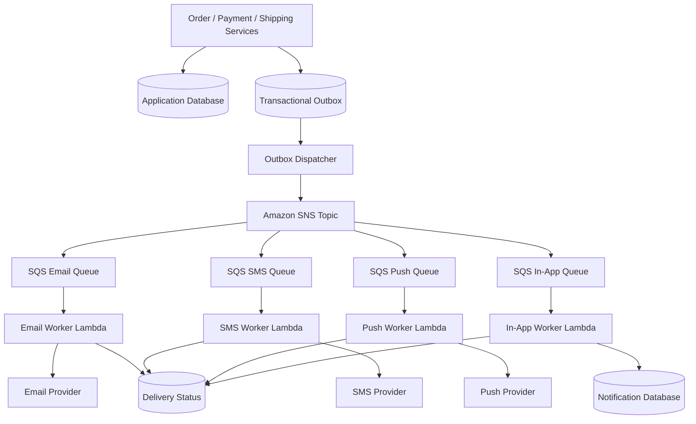
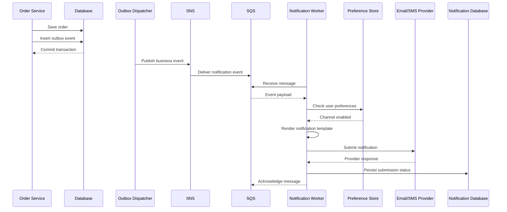
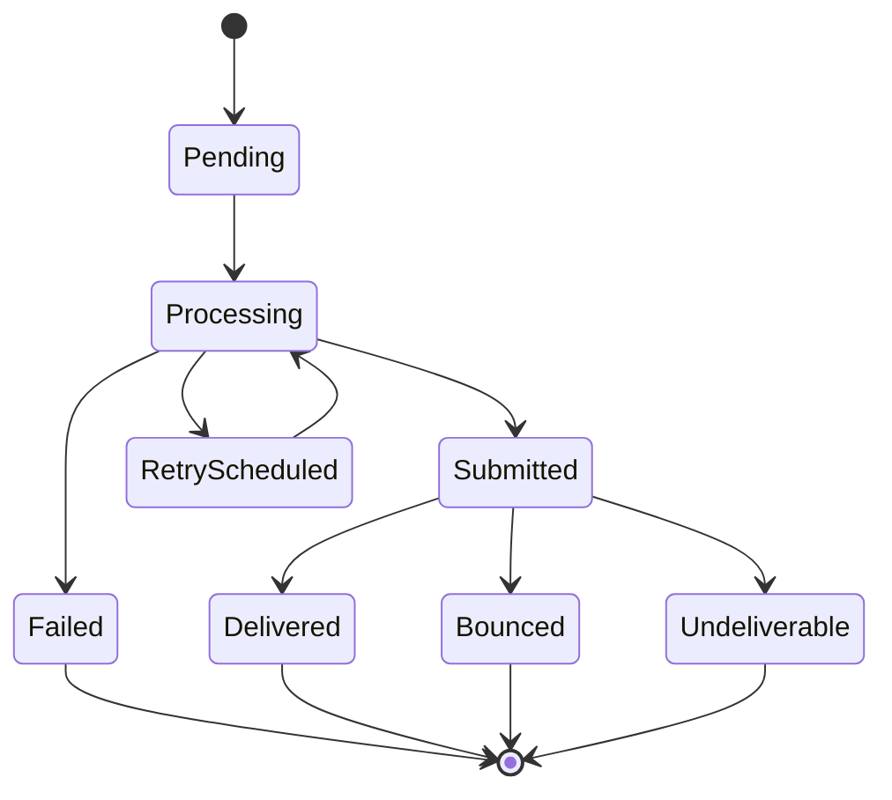

# 06- Notification System Architecture

## Overview

A notification system delivers application-generated messages to users through channels such as email, SMS, mobile push notifications, and in-app notifications.

In a production backend, notification delivery should be asynchronous, independently scalable, observable, and resilient to temporary failures in external providers.

Amazon SNS provides managed message distribution and supports several notification delivery protocols. It can distribute application events to multiple subscribers, including:

- Email and email-JSON endpoints.
- SMS recipients.
- Mobile push notification endpoints.
- Amazon SQS queues.
- AWS Lambda functions.
- HTTP/S endpoints.

A common architecture uses SNS to distribute notification events while application-specific workers handle templates, preferences, provider integrations, retries, and delivery tracking.

SNS should not automatically become the entire notification-management system. It provides distribution capabilities, but business requirements such as user preferences, notification scheduling, delivery history, template rendering, and provider failover generally require application-level components.

## Notification System Requirements

A production notification system should address both functional and operational requirements.

### Functional Requirements

- Deliver notifications through multiple channels.
- Support transactional and informational notifications.
- Maintain user notification preferences.
- Support reusable templates and localization.
- Prevent duplicate notifications where possible.
- Track delivery attempts and provider responses.
- Support scheduled and delayed notifications.
- Allow notification retries and failure recovery.
- Support priority-based notification handling.

### Non-Functional Requirements

| Requirement | Engineering consideration |
|---|---|
| Scalability | Process notification workloads independently of API traffic |
| Reliability | Buffer messages and retry transient failures |
| Availability | Avoid making user-facing API requests depend on notification providers |
| Security | Protect recipient information and message content |
| Observability | Track delivery attempts, failures, and latency |
| Extensibility | Add new providers and channels without changing business services |
| Cost efficiency | Avoid unnecessary provider requests and duplicate delivery |
| Consistency | Respect user preferences and notification state transitions |

## Reference Architecture

Consider an e-commerce platform that sends notifications when an order is placed, payment succeeds, or an order is shipped.

The order service should publish a business event rather than directly integrate with email, SMS, and push providers.

A dedicated notification service consumes relevant events, checks user preferences, renders templates, and dispatches messages through the appropriate channel.



The architecture separates business-event production from notification delivery.

Each channel has its own queue and processing configuration. A temporary email-provider outage should not prevent SMS or push notifications from being processed.

## Notification Architecture Components

| Component | Responsibility |
|---|---|
| Business services | Generate events that may require notifications |
| Transactional outbox | Persist events atomically with business transactions |
| SNS topic | Distribute notification events |
| SNS subscriptions | Route events to notification queues or endpoints |
| SQS queues | Buffer channel-specific workloads |
| Lambda workers | Process notification jobs |
| Notification service | Apply preferences, templates, and delivery policies |
| Template engine | Render channel-specific content |
| Provider adapters | Integrate with email, SMS, and push providers |
| Notification database | Store notification state and delivery history |
| CloudWatch | Monitor processing, failures, and delivery latency |

A dedicated notification service can run as Lambda functions, containerized workers on ECS or EKS, or a combination of these. The choice depends on workload duration, concurrency, dependencies, and operational requirements.

## Notification Event Design

Business services should publish events that describe completed business operations.

For example:

```json
{
  "event_id": "evt_order_10042",
  "event_type": "order.payment_succeeded",
  "event_version": 1,
  "occurred_at": "2026-11-20T09:15:00Z",
  "producer": "payment-service",
  "correlation_id": "req_82a1",
  "data": {
    "order_id": "ord_10042",
    "customer_id": "cust_501",
    "amount": 2499.00,
    "currency": "INR"
  }
}
```

The notification service uses the event to determine which notification workflows should execute.

Avoid publishing fully rendered email or SMS content from the business service. Business services should publish domain events, while notification infrastructure owns channel-specific formatting.

### Event Contract Guidelines

- Include a stable business event ID.
- Use explicit event types.
- Version event schemas.
- Include identifiers required to retrieve additional data.
- Propagate correlation and tracing metadata.
- Avoid unnecessary personal or sensitive information.
- Do not include credentials, provider API keys, or temporary access tokens.
- Define which service owns each event.

For example, `order.payment_succeeded` should be published by the payment domain after payment success is confirmed, not merely because a payment request was submitted.

## Notification Processing Lifecycle

A typical notification lifecycle consists of event publication, subscription delivery, preference evaluation, template rendering, provider dispatch, and status tracking.



The notification worker should acknowledge a queue message only after its required processing and durable state updates have completed.

A provider accepting a request does not necessarily mean the recipient received or read the notification.

## Notification Channels

Different channels have different delivery characteristics, costs, latency, and operational constraints.

| Channel | AWS integration | Typical use case | Important consideration |
|---|---|---|---|
| Email | SNS email subscriptions or application email provider | Receipts, reports, account notifications | Delivery and bounce handling |
| SMS | SNS SMS publishing | OTPs, alerts, transactional messages | Cost, regional restrictions, carrier filtering |
| Mobile push | SNS mobile push | Order updates, reminders | Device token lifecycle |
| HTTP/S webhook | SNS HTTP/S subscription | External integrations | Endpoint reliability and authentication |
| In-app | SNS to SQS and application worker | User activity and alerts | Application-owned persistence |
| Internal processing | SNS to SQS and Lambda | Notification workflows | Idempotency and retry behavior |

### Email Notifications

Email notifications are useful for receipts, invoices, account activity, and detailed transactional information.

SNS supports email and email-JSON subscriptions, but it is not a complete email campaign or transactional email management platform.

For production email delivery, evaluate services such as Amazon SES when requirements include:

- Template-based email delivery.
- Bounce and complaint processing.
- Sender identity management.
- Delivery event tracking.
- Suppression lists.
- Dedicated sending configuration.
- High-volume transactional email.

A notification service should hide provider-specific behavior behind an adapter interface.

### SMS Notifications

SNS supports SMS publishing to phone numbers.

Typical use cases include:

- OTP delivery.
- Security alerts.
- Payment notifications.
- Critical operational alerts.

SMS requires additional operational controls:

- Validate and normalize phone numbers.
- Respect user consent and regional messaging rules.
- Configure sender IDs and origination identities where required.
- Monitor spend and delivery failures.
- Apply rate limits to prevent abuse.
- Avoid sending sensitive information in message bodies.

Do not assume that a successful SNS publish response guarantees carrier delivery or handset receipt.

### Mobile Push Notifications

SNS supports mobile push through platform applications and platform endpoints.

The general flow is:

1. Register an application with the relevant push provider.
2. Create an SNS platform application.
3. Register a device token as a platform endpoint.
4. Store the endpoint ARN against the application user and device.
5. Publish push messages to the endpoint.
6. Handle invalid or expired device tokens.

A user can have multiple devices, so a single user-to-endpoint mapping is often insufficient.

Maintain device registration state and remove or disable endpoints that are no longer valid.

### In-App Notifications

In-app notifications usually require durable application-owned storage.

SNS can distribute an event to an in-app processing queue, but it does not provide a complete user notification inbox.

A typical in-app notification record contains:

| Field | Purpose |
|---|---|
| `id` | Notification identifier |
| `user_id` | Recipient |
| `event_id` | Source business event |
| `type` | Notification category |
| `title` | Display title |
| `body` | Display content |
| `is_read` | Read state |
| `created_at` | Creation timestamp |
| `read_at` | Read timestamp |

The frontend can retrieve notifications through REST APIs and receive real-time updates through WebSockets or Server-Sent Events.

## Notification Preferences

Users should control which notification categories and channels they receive, subject to mandatory transactional and legal requirements.

A preference model might include:

```sql
CREATE TABLE notification_preferences (
    user_id UUID NOT NULL,
    notification_type VARCHAR(100) NOT NULL,
    channel VARCHAR(30) NOT NULL,
    enabled BOOLEAN NOT NULL DEFAULT TRUE,
    updated_at TIMESTAMPTZ NOT NULL DEFAULT NOW(),

    PRIMARY KEY (user_id, notification_type, channel)
);
```

Example preferences:

| Notification type | Email | SMS | Push |
|---|---:|---:|---:|
| Order confirmation | Yes | No | Yes |
| Payment failure | Yes | Yes | Yes |
| Marketing campaign | No | No | No |
| Shipping update | Yes | No | Yes |
| Security alert | Yes | Yes | Yes |

### Preference Evaluation

The notification worker should evaluate preferences before sending a message.

```python
from dataclasses import dataclass


@dataclass(frozen=True)
class NotificationDecision:
    allowed: bool
    reason: str


def evaluate_notification(
    *,
    notification_type: str,
    channel: str,
    preferences: dict[tuple[str, str], bool],
) -> NotificationDecision:
    enabled = preferences.get(
        (notification_type, channel),
        False,
    )

    if not enabled:
        return NotificationDecision(
            allowed=False,
            reason="channel_disabled",
        )

    return NotificationDecision(
        allowed=True,
        reason="preference_enabled",
    )
```

This is a simplified policy example. Production systems should distinguish mandatory transactional or security notifications from optional notifications and implement consent and compliance rules explicitly.

Do not assume that a missing preference means permission to send. Define a documented default policy.

## Notification Templates

Templates separate notification content from business logic.

A template system should support:

- Channel-specific formatting.
- Localization.
- Template versioning.
- Variable validation.
- Safe output escaping.
- Preview and test rendering.
- Controlled publishing and rollback.

Example email template:

```html
<h2>Order Confirmation</h2>

<p>Hello {{ customer_name }},</p>

<p>
    Your order {{ order_id }} has been confirmed.
</p>

<p>
    Total amount: {{ total_amount }}
</p>
```

Use a template engine with automatic escaping where possible. Do not render untrusted values as raw HTML.

### Template Versioning

Store a template identifier and version with the notification record.

For example:

```json
{
  "template_id": "order_confirmation",
  "template_version": 3,
  "locale": "en-IN"
}
```

This helps reproduce historical notifications and investigate incorrect content.

Avoid modifying an existing template version when exact historical reproducibility is required. Publish a new version instead.

## Provider Abstraction

Notification business logic should not depend directly on a specific provider's SDK.

Define a common interface and implement provider-specific adapters.

```python
from dataclasses import dataclass
from typing import Protocol


@dataclass(frozen=True)
class DeliveryRequest:
    recipient: str
    subject: str | None
    body: str
    idempotency_key: str


@dataclass(frozen=True)
class DeliveryResult:
    accepted: bool
    provider_message_id: str | None
    error_code: str | None


class NotificationProvider(Protocol):
    def send(
        self,
        request: DeliveryRequest,
    ) -> DeliveryResult:
        ...
```

A provider adapter can then encapsulate SDK calls, authentication, response mapping, and provider-specific errors.

```python
import boto3


class SNSPublisher:
    def __init__(self, region: str) -> None:
        self.client = boto3.client(
            "sns",
            region_name=region,
        )

    def send_sms(
        self,
        phone_number: str,
        message: str,
    ) -> str:
        response = self.client.publish(
            PhoneNumber=phone_number,
            Message=message,
        )

        return response["MessageId"]
```

This adapter is intentionally narrow. A production provider abstraction should also define timeout behavior, error classification, retry policy, metrics, and delivery-status handling.

## Notification State Management

A notification system should distinguish between internal processing state and external provider delivery state.

Example state model:



Not every provider exposes every state. Some providers report only submission acceptance, while others provide asynchronous delivery, bounce, or failure events.

### Suggested Status Definitions

| Status | Meaning |
|---|---|
| `pending` | Notification created but not processed |
| `processing` | Worker currently handling the notification |
| `submitted` | Provider accepted the request |
| `retry_scheduled` | Transient failure requires another attempt |
| `delivered` | Provider reported delivery |
| `bounced` | Email delivery was rejected or bounced |
| `undeliverable` | Provider reported that delivery could not be completed |
| `failed` | Processing failed permanently or exhausted retry policy |
| `suppressed` | Notification was intentionally not sent due to policy or preferences |

Do not label a notification `delivered` merely because the provider API returned success. Use `submitted` until a provider delivery event confirms a later state.

## Database Design for Delivery Tracking

A separate delivery record per channel and recipient makes retries and status tracking easier.

```sql
CREATE TABLE notifications (
    id UUID PRIMARY KEY,
    event_id UUID NOT NULL,
    user_id UUID NOT NULL,
    notification_type VARCHAR(100) NOT NULL,
    template_id VARCHAR(100) NOT NULL,
    template_version INTEGER NOT NULL,
    status VARCHAR(30) NOT NULL,
    created_at TIMESTAMPTZ NOT NULL DEFAULT NOW(),
    updated_at TIMESTAMPTZ NOT NULL DEFAULT NOW(),

    UNIQUE (event_id, user_id, notification_type)
);

CREATE TABLE notification_deliveries (
    id UUID PRIMARY KEY,
    notification_id UUID NOT NULL
        REFERENCES notifications(id),
    channel VARCHAR(30) NOT NULL,
    provider VARCHAR(50) NOT NULL,
    recipient_reference VARCHAR(255) NOT NULL,
    provider_message_id VARCHAR(255),
    status VARCHAR(30) NOT NULL,
    attempts INTEGER NOT NULL DEFAULT 0,
    last_error_code VARCHAR(100),
    submitted_at TIMESTAMPTZ,
    delivered_at TIMESTAMPTZ,
    created_at TIMESTAMPTZ NOT NULL DEFAULT NOW(),

    UNIQUE (notification_id, channel)
);
```

The uniqueness constraints help prevent duplicate notification creation and duplicate channel delivery records.

The exact uniqueness policy depends on the product. For example, the same business event may legitimately generate multiple notifications for the same user if different notification categories or template versions are involved.

### Data Retention

Notification records can contain personal information and message content.

Define:

- Retention periods for delivery history.
- Retention periods for rendered content.
- Encryption requirements.
- Access-control policies.
- Data deletion and anonymization behavior.
- Audit requirements.
- Provider-side retention considerations.

Avoid storing complete message bodies indefinitely when a template identifier and delivery metadata are sufficient.

## Retry and Failure Handling

Notification providers can fail because of network issues, throttling, invalid recipients, authentication errors, and service outages.

Classify errors before deciding whether to retry.

| Failure | Retry? | Handling |
|---|---|---|
| Network timeout | Usually | Retry with bounded exponential backoff |
| Provider throttling | Yes | Backoff and reduce concurrency |
| Temporary provider outage | Yes | Retry and monitor provider health |
| Invalid phone number | No | Mark recipient invalid |
| Invalid email address | Usually no | Mark address invalid or suppressed |
| Authentication failure | No immediate retry | Alert and repair credentials |
| Template validation error | No | Fix template or event data |
| User preference disabled | No | Mark as suppressed |
| Permanent provider rejection | Usually no | Record reason and investigate |

### Exponential Backoff

A common retry delay strategy is:

\[
d_n = \min(d_{\max}, d_0 \times 2^n) + J
\]

Where:

- \(d_0\) is the initial delay.
- \(n\) is the retry attempt.
- \(d_{\max}\) is the maximum delay.
- \(J\) is random jitter.

Jitter reduces synchronized retries when many notifications fail at the same time.

For queue-driven processing, use SQS visibility timeout and redrive policies for message-level retries. For precise scheduling, use a durable retry scheduler or a dedicated retry queue with a delay strategy.

SQS delay queues and per-message timers support delays up to 15 minutes. Longer scheduling requirements need another mechanism, such as EventBridge Scheduler or an application-managed scheduling service.

## Idempotency and Duplicate Prevention

Duplicate notifications can occur when:

- The outbox dispatcher republishes after an ambiguous SNS response.
- SNS or SQS redelivers a message.
- Lambda completes provider submission but fails before acknowledging the SQS message.
- A provider request times out after the provider accepted it.
- An operator redrives a DLQ message.

Use a stable idempotency key for each logical notification delivery.

Example:

```text
event_id:user_id:notification_type:channel
```

Enforce uniqueness in the database before attempting delivery.

However, a database idempotency record alone cannot guarantee exactly-once external delivery.

Consider this sequence:

1. The worker submits an SMS request.
2. The provider accepts the request.
3. The network response is lost.
4. The worker cannot determine whether the SMS was accepted.
5. The message is retried.

If the provider supports idempotency keys, pass the stable key. Otherwise, use durable attempt state and reconciliation, while recognizing that duplicate delivery may remain possible.

## Notification Prioritization

Not all notifications have the same urgency.

| Priority | Examples | Processing approach |
|---|---|---|
| Critical | Security alerts, payment failures | Dedicated queue and controlled latency |
| High | OTPs, important account events | High-priority processing capacity |
| Normal | Order updates, receipts | Standard queue |
| Low | Marketing and informational messages | Separate queue with controlled throughput |

Avoid mixing high-priority transactional messages with large marketing campaigns in the same queue.

Separate queues allow independent concurrency limits, retention, retries, and monitoring.

Priority should also be enforced through application policy. Queue separation alone does not guarantee that a critical message is delivered within a particular time.

## Rate Limiting and Provider Quotas

External notification providers enforce account, sender, destination, and regional throughput limits.

A notification worker should not assume unlimited provider capacity.

Implement:

- Per-provider rate limits.
- Per-recipient rate limits.
- OTP resend restrictions.
- Channel-specific concurrency controls.
- Provider quota monitoring.
- Circuit breakers for persistent outages.
- Backpressure when provider capacity is exceeded.

Redis can be used for distributed rate limiting, while a durable database stores long-term notification and consent state.

Example Redis token-bucket implementation:

```python
import time

import redis


class NotificationRateLimiter:
    def __init__(
        self,
        client: redis.Redis,
        *,
        capacity: int,
        refill_per_second: float,
    ) -> None:
        self.client = client
        self.capacity = capacity
        self.refill_per_second = refill_per_second

    def allow(self, key: str) -> bool:
        now = time.time()

        script = """
        local tokens = tonumber(redis.call('HGET', KEYS[1], 'tokens'))
        local updated = tonumber(redis.call('HGET', KEYS[1], 'updated'))

        if tokens == nil then
            tokens = tonumber(ARGV[1])
            updated = tonumber(ARGV[2])
        end

        local elapsed = math.max(0, tonumber(ARGV[2]) - updated)
        tokens = math.min(
            tonumber(ARGV[1]),
            tokens + elapsed * tonumber(ARGV[3])
        )

        local allowed = 0

        if tokens >= 1 then
            tokens = tokens - 1
            allowed = 1
        end

        redis.call('HSET', KEYS[1],
            'tokens', tokens,
            'updated', tonumber(ARGV[2])
        )

        redis.call('EXPIRE', KEYS[1], 3600)

        return allowed
        """

        result = self.client.eval(
            script,
            1,
            f"notification-rate:{key}",
            self.capacity,
            now,
            self.refill_per_second,
        )

        return bool(result)
```

This is a single-key token bucket illustration. Production implementations should use an appropriate Redis deployment, atomic scripts, bounded key cardinality, and a consistent time source. The rate-limit key should represent the intended scope, such as provider, account, phone number, or user.

## Direct SNS Notifications vs Queue-Based Processing

SNS supports direct delivery to several notification protocols. Not every notification workflow requires SQS and Lambda.

| Architecture | Advantages | Limitations | Appropriate use |
|---|---|---|---|
| Application to SNS email/SMS | Simple integration | Limited workflow customization | Basic notification requirements |
| SNS to Lambda | Direct event-driven processing | No independent SQS buffer | Lightweight event handlers |
| SNS to SQS to Lambda | Durable buffering and consumer isolation | More infrastructure and operational configuration | Production notification pipelines |
| SNS to HTTP/S | Integrates external systems | Endpoint availability and delivery retries matter | Webhook integrations |
| Application to provider API | Full provider-specific control | More application integration and operational responsibility | Advanced email or SMS workflows |

A practical architecture often combines these approaches. For example, SNS can distribute business events to SQS queues, while a notification worker uses SES for email and SNS for SMS or mobile push.

## Security and Privacy

Notification systems process recipient addresses, phone numbers, device tokens, and potentially sensitive business information.

### Security Requirements

- Use separate IAM roles for publishers and workers.
- Restrict `sns:Publish` to authorized application components.
- Restrict SQS access to the intended SNS topic.
- Encrypt queues and topics where required.
- Protect provider credentials using Secrets Manager.
- Avoid logging complete notification bodies.
- Mask phone numbers and email addresses in logs.
- Validate recipient identity and event authorization.
- Enforce consent and unsubscribe rules.
- Apply rate limits to sensitive notifications.
- Audit changes to templates and preferences.

### Sensitive Notification Content

Avoid placing highly sensitive information in SMS, push notifications, or email subject lines.

For example, a payment notification should generally link the user to an authenticated application rather than include complete payment credentials or sensitive account data.

Mobile push notifications may be displayed on a locked device. Keep payloads minimal and avoid exposing private information in notification previews.

### Compliance

Notification requirements vary by country, provider, message category, and recipient type.

For production systems, define policies for:

- Marketing consent.
- Transactional messaging.
- Unsubscribe handling.
- SMS sender identity and registration.
- Data retention.
- Regional data protection requirements.
- Provider-specific acceptable-use policies.

Do not treat a technical delivery mechanism as proof of recipient consent.

## Monitoring and Observability

Notification operations require visibility into both message processing and provider delivery outcomes.

### Important Metrics

| Component | Metric | Purpose |
|---|---|---|
| SNS | `NumberOfMessagesPublished` | Tracks event publication |
| SNS | `NumberOfNotificationsFailed` | Tracks subscription delivery failures |
| SQS | `ApproximateNumberOfMessagesVisible` | Measures pending work |
| SQS | `ApproximateAgeOfOldestMessage` | Detects delayed processing |
| SQS | `ApproximateNumberOfMessagesNotVisible` | Tracks in-flight messages |
| Lambda | `Errors` | Measures processing failures |
| Lambda | `Throttles` | Detects concurrency pressure |
| Lambda | `Duration` | Measures execution latency |
| Provider | Accepted requests | Measures provider submission |
| Provider | Delivery failures | Measures provider-reported failures |
| Application | Suppressed notifications | Tracks preference and policy decisions |
| Application | Duplicate attempts | Identifies idempotency and retry behavior |

SNS metrics do not provide complete end-recipient delivery visibility for every protocol. Use provider delivery events and application records where available.

### Structured Logging

Include:

- `event_id`
- `notification_id`
- `delivery_id`
- `user_id` or a safe internal reference
- `notification_type`
- `channel`
- `provider`
- `provider_message_id`
- `correlation_id`
- `attempt`
- `status`
- `error_code`

Do not log API credentials, complete phone numbers, complete email addresses, OTP values, or sensitive message bodies.

### Alerting

Create alarms for:

- DLQ message count greater than zero.
- Oldest queue message exceeding the delivery SLO.
- Increasing Lambda error rates.
- Lambda throttling.
- SNS delivery failures.
- Provider rejection spikes.
- Unusually high SMS spend.
- High notification suppression or invalid-recipient rates.
- Outbox records remaining unpublished.
- Notifications stuck in `processing` or `submitted` beyond expected limits.

Measure end-to-end latency from business event creation to provider submission, and separately measure provider-reported delivery latency when available.

## Infrastructure Deployment with Terraform

The following example provisions an SNS topic, an SQS notification queue, a processing DLQ, a queue policy, and an SNS subscription.

```hcl
resource "aws_sns_topic" "notification_events" {
  name = "notification-events"
}

resource "aws_sqs_queue" "notification_dlq" {
  name                      = "notification-processing-dlq"
  message_retention_seconds = 1209600
  sqs_managed_sse_enabled   = true
}

resource "aws_sqs_queue" "notification_email" {
  name                       = "notification-email-queue"
  visibility_timeout_seconds = 180
  message_retention_seconds  = 1209600
  receive_wait_time_seconds  = 20
  sqs_managed_sse_enabled    = true

  redrive_policy = jsonencode({
    deadLetterTargetArn = aws_sqs_queue.notification_dlq.arn
    maxReceiveCount     = 5
  })
}

data "aws_iam_policy_document" "notification_queue" {
  statement {
    sid    = "AllowNotificationTopic"
    effect = "Allow"

    principals {
      type        = "Service"
      identifiers = ["sns.amazonaws.com"]
    }

    actions   = ["sqs:SendMessage"]
    resources = [aws_sqs_queue.notification_email.arn]

    condition {
      test     = "ArnEquals"
      variable = "aws:SourceArn"
      values   = [aws_sns_topic.notification_events.arn]
    }
  }
}

resource "aws_sqs_queue_policy" "notification_email" {
  queue_url = aws_sqs_queue.notification_email.id
  policy    = data.aws_iam_policy_document.notification_queue.json
}

resource "aws_sns_topic_subscription" "notification_email" {
  topic_arn            = aws_sns_topic.notification_events.arn
  protocol             = "sqs"
  endpoint             = aws_sqs_queue.notification_email.arn
  raw_message_delivery = false

  depends_on = [
    aws_sqs_queue_policy.notification_email
  ]
}

resource "aws_lambda_event_source_mapping" "notification_email" {
  event_source_arn = aws_sqs_queue.notification_email.arn
  function_name    = aws_lambda_function.email_notification_worker.arn

  batch_size                         = 10
  function_response_types            = ["ReportBatchItemFailures"]
  maximum_batching_window_in_seconds = 5

  scaling_config {
    maximum_concurrency = 10
  }
}
```

The example assumes that the Lambda function and its execution role are defined elsewhere. The role must have the required SQS permissions.

For production, create separate queues and DLQs for independently operated channels. A shared queue and DLQ can create operational coupling between otherwise independent workflows.

## Cost Optimization

Notification costs are driven by event volume, channel usage, provider pricing, retries, and infrastructure consumption.

| Service | Main cost drivers |
|---|---|
| SNS | Publish requests and notification deliveries |
| SQS | API requests and message volume |
| Lambda | Requests, memory allocation, and execution duration |
| SES | Email volume and applicable data or feature charges |
| SMS providers | Destination, message type, and message segments |
| CloudWatch | Log ingestion, retention, metrics, and alarms |
| DynamoDB/PostgreSQL | Notification records, reads, writes, and storage |
| Redis | Provisioned capacity and data usage |

Optimization practices:

- Filter irrelevant events at the SNS subscription.
- Use SQS batching where processing semantics permit.
- Use long polling to reduce unnecessary empty receives.
- Avoid repeated template rendering when safe to cache.
- Prevent duplicate provider submissions.
- Apply retention policies to logs and delivery records.
- Set SMS budgets and usage alarms.
- Separate marketing workloads from transactional workloads.
- Monitor provider retries and failed requests.

SMS messages may be billed by segment rather than by API request. Keep message length and encoding in mind when estimating cost.

## High Availability and Disaster Recovery

SNS and SQS are regional services. Their managed availability does not automatically provide cross-Region notification recovery.

For critical notification workflows:

- Define RTO and RPO.
- Replicate required notification state.
- Preserve stable event and notification IDs.
- Define provider failover behavior.
- Prevent duplicate processing during regional recovery.
- Retain enough event data for controlled replay.
- Document how pending notifications are recovered.
- Test recovery under provider and regional failure scenarios.

A secondary Region may require its own SNS topics, SQS queues, Lambda functions, IAM policies, encryption configuration, and monitoring.

Do not automatically send the same event from both Regions without a duplicate-prevention strategy. Cross-Region failover can otherwise produce duplicate email, SMS, or push notifications.

## Common Mistakes and Production Pitfalls

| Mistake | Why it causes problems | Recommended approach |
|---|---|---|
| Sending notifications directly from API requests | Provider latency increases API response time | Use asynchronous processing |
| Treating SNS as a complete notification platform | Preferences, templates, and delivery history remain unimplemented | Build an application-level notification service |
| Sending rendered content from business services | Couples domain logic to channel formatting | Publish domain events and render downstream |
| Using one queue for all channels | A slow provider can delay unrelated notifications | Use independent queues |
| Assuming provider acceptance means delivery | Provider submission is not recipient confirmation | Track provider delivery events |
| Ignoring user preferences | Causes unwanted messages and compliance issues | Evaluate consent and preferences before dispatch |
| Retrying permanent failures | Wastes resources and increases provider costs | Classify errors before retrying |
| Ignoring duplicate delivery | Users may receive repeated messages | Use stable idempotency keys and durable state |
| Storing complete message content indefinitely | Increases privacy and retention risk | Minimize stored sensitive content |
| Using SMS for all notification types | Increases cost and exposes content | Select channels according to urgency and content |
| Sharing marketing and transactional queues | Campaign bursts can delay critical messages | Isolate workloads |
| Ignoring provider quotas | Causes throttling and growing queue backlogs | Apply rate limits and concurrency controls |
| Marking notifications delivered after API success | Produces inaccurate delivery reporting | Distinguish submitted from delivered |
| Failing to handle invalid push tokens | Repeatedly sends to unusable endpoints | Maintain endpoint lifecycle state |

## Production Design Checklist

### Architecture

- [ ] Business services publish domain events rather than sending notifications directly.
- [ ] A transactional outbox protects database-to-event consistency.
- [ ] SNS distributes events to independent channel queues.
- [ ] Each channel has an independently scalable worker.
- [ ] Provider-specific code is isolated behind adapters.

### Notification Management

- [ ] Notification preferences and consent are enforced.
- [ ] Templates are versioned and validated.
- [ ] Localization is supported where required.
- [ ] Notification records and delivery attempts are persisted.
- [ ] Submission and delivery states are distinguished.
- [ ] Device tokens and invalid recipients are managed.

### Reliability

- [ ] Consumers are idempotent.
- [ ] Queue visibility timeouts are compatible with processing duration.
- [ ] Partial batch failures are handled correctly.
- [ ] Retry policies distinguish transient and permanent failures.
- [ ] Processing DLQs are configured.
- [ ] Provider idempotency keys are used where supported.
- [ ] Provider outages do not block unrelated channels.

### Security and Operations

- [ ] IAM permissions follow least privilege.
- [ ] Messages and queues are encrypted where required.
- [ ] Recipient data is protected in logs and storage.
- [ ] Provider credentials are stored securely.
- [ ] Queue age, DLQs, provider failures, and delivery latency are monitored.
- [ ] SMS spend and provider quotas are monitored.
- [ ] Retention and deletion policies are documented.
- [ ] Regional recovery and replay procedures are tested.

## Key Takeaways

- SNS provides event distribution, while SQS and Lambda provide independent buffering and asynchronous notification processing.
- A production notification system requires application-level preferences, templates, provider adapters, delivery state, and consent management.
- Provider acceptance is not proof of recipient delivery; track submission and delivery as separate states.
- Idempotency, bounded retries, DLQs, rate limits, and channel isolation protect notification workflows from duplicate delivery and provider failures.
- Monitor end-to-end notification latency, provider outcomes, queue backlogs, and cost independently for each channel.