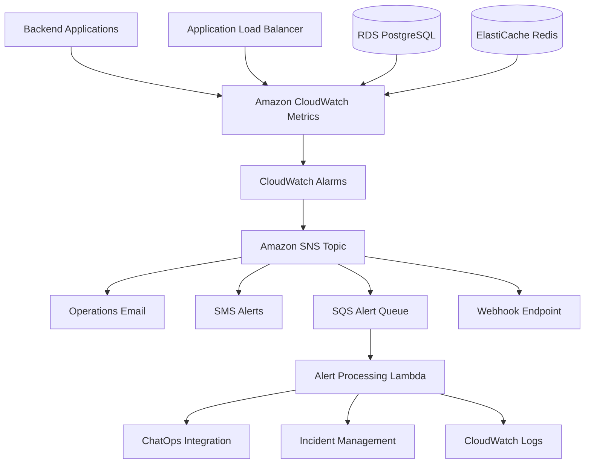
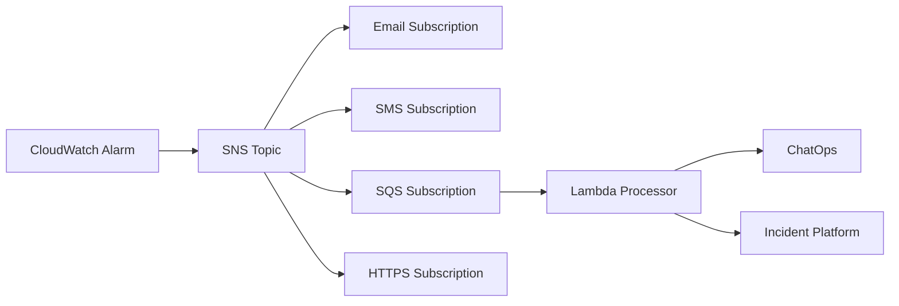
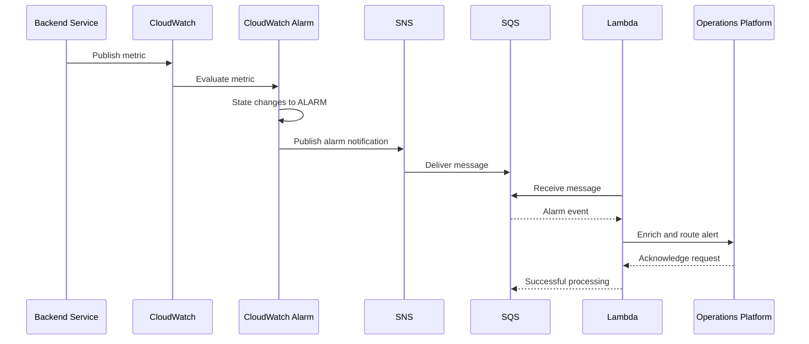

# 07- CloudWatch Alarm Notification Architecture

## Overview

CloudWatch alarm notification architecture connects AWS monitoring signals to notification and incident-response workflows. It allows engineering teams to detect infrastructure or application problems and distribute alerts through channels such as email, SMS, messaging platforms, and automated remediation systems.

Amazon CloudWatch evaluates metrics against configured thresholds. When an alarm changes state, it can publish notifications to an Amazon SNS topic. SNS then distributes the alert to subscribed endpoints.

A typical architecture is:

- **Amazon CloudWatch:** Collects metrics and evaluates alarm conditions.
- **CloudWatch Alarms:** Detect threshold violations and state transitions.
- **Amazon SNS:** Distributes alarm notifications.
- **Amazon SQS:** Buffers notifications for asynchronous processing.
- **AWS Lambda:** Processes alerts and integrates with external systems.
- **Amazon EventBridge:** Routes events to additional AWS services and workflows.
- **CloudWatch Logs:** Stores application and processing logs.

This architecture separates monitoring from notification delivery. CloudWatch determines when an alert condition occurs, while SNS and downstream consumers determine how the alert is distributed and handled.

## Reference Architecture

Consider a backend platform running Django and FastAPI services on AWS. The platform depends on:

- Application load balancers.
- ECS or EKS workloads.
- RDS PostgreSQL.
- ElastiCache Redis.
- SQS queues.
- Lambda functions.

If API latency increases or database connections are exhausted, CloudWatch detects the problem and changes the corresponding alarm state.

SNS distributes the alarm notification to operations teams and automated processing systems.



The architecture supports both direct notification and asynchronous alert processing.

Direct SNS subscriptions are useful for straightforward delivery. SQS and Lambda are useful when alerts require enrichment, routing, deduplication, persistence, or integration with external incident-management platforms.

## CloudWatch Alarm Fundamentals

A CloudWatch alarm evaluates a metric against a configured threshold over one or more evaluation periods.

An alarm can enter one of three states:

| State | Meaning |
|---|---|
| `OK` | The metric is within the configured threshold |
| `ALARM` | The configured alarm condition has been met |
| `INSUFFICIENT_DATA` | CloudWatch does not have enough data to determine the state |

For example, an API latency alarm may enter `ALARM` when the average request latency exceeds 2 seconds for three consecutive one-minute evaluation periods.

### Alarm Evaluation Components

| Component | Purpose |
|---|---|
| Metric | Measurement being monitored |
| Namespace | Logical grouping of metrics |
| Metric name | Identifies the measurement |
| Dimensions | Identify the resource or workload |
| Statistic | Aggregation such as Average, Sum, Minimum, or Maximum |
| Period | Time window used to aggregate metric data |
| Threshold | Value that triggers the condition |
| Evaluation periods | Number of periods considered |
| Datapoints to alarm | Number of breaching datapoints required |
| Missing data treatment | Defines how missing datapoints affect evaluation |

### Example: API Latency Alarm

Suppose an application publishes a custom metric:

```text
Namespace: Backend/API
Metric: RequestLatency
Unit: Milliseconds
Dimensions:
    Service = order-service
    Environment = production
```

An alarm can detect sustained latency degradation:

```bash
aws cloudwatch put-metric-alarm \
    --alarm-name production-order-api-high-latency \
    --namespace Backend/API \
    --metric-name RequestLatency \
    --dimensions \
        Name=Service,Value=order-service \
        Name=Environment,Value=production \
    --statistic Average \
    --period 60 \
    --evaluation-periods 3 \
    --datapoints-to-alarm 3 \
    --threshold 2000 \
    --comparison-operator GreaterThanThreshold \
    --treat-missing-data notBreaching \
    --alarm-actions "$SNS_TOPIC_ARN" \
    --ok-actions "$SNS_TOPIC_ARN"
```

This configuration evaluates one-minute average latency and enters `ALARM` after three consecutive breaching datapoints.

The missing-data policy must be chosen according to metric semantics. Treating missing data as non-breaching is not universally safe. For a metric that should always be emitted, missing data may indicate an application or telemetry failure.

## Alarm State Transitions

CloudWatch alarms can notify subscribers when their state changes.

```mermaid
stateDiagram-v2
    [*] --> INSUFFICIENT_DATA

    INSUFFICIENT_DATA --> OK
    INSUFFICIENT_DATA --> ALARM

    OK --> ALARM
    ALARM --> OK

    OK --> INSUFFICIENT_DATA
    ALARM --> INSUFFICIENT_DATA

    state ALARM {
    }
```

The three states are important for operational alerting:

- `ALARM`: A monitored condition has breached its configured threshold.
- `OK`: The monitored condition has recovered.
- `INSUFFICIENT_DATA`: The alarm cannot currently evaluate the condition reliably.

Use state transitions to distinguish incidents from recovery notifications.

An alarm notification should include enough context for an engineer to identify the affected resource, environment, metric, threshold, and alarm state.

## CloudWatch Alarm Actions

CloudWatch alarms support actions that execute when the alarm enters configured states.

Common actions include:

- Publishing notifications to SNS.
- Invoking supported EC2 actions.
- Executing Auto Scaling actions.
- Creating or updating supported operational workflows.

SNS is commonly used because it separates alarm evaluation from notification delivery.

### Alarm Action Configuration

| Alarm state | SNS action | Purpose |
|---|---|---|
| `ALARM` | Alarm action | Notify when a threshold is breached |
| `OK` | OK action | Notify when the condition recovers |
| `INSUFFICIENT_DATA` | Insufficient-data action | Notify when monitoring data is unavailable |

Example:

```bash
aws cloudwatch put-metric-alarm \
    --alarm-name production-api-error-rate \
    --namespace AWS/ApplicationELB \
    --metric-name HTTPCode_Target_5XX_Count \
    --dimensions \
        Name=LoadBalancer,Value=app/production-api/1234567890abcdef \
    --statistic Sum \
    --period 60 \
    --evaluation-periods 5 \
    --datapoints-to-alarm 3 \
    --threshold 50 \
    --comparison-operator GreaterThanThreshold \
    --treat-missing-data notBreaching \
    --alarm-actions "$SNS_TOPIC_ARN" \
    --ok-actions "$SNS_TOPIC_ARN"
```

This is an illustrative threshold. Production thresholds should be based on traffic volume, service SLOs, and historical behavior.

## SNS Notification Architecture

An SNS topic provides a central distribution point for alarm notifications.

A CloudWatch alarm publishes a notification to SNS when a configured state transition occurs. SNS then delivers the notification to its subscriptions.



### Direct SNS Subscriptions

Direct subscriptions are appropriate when no additional processing is required.

| Protocol | Example use |
|---|---|
| Email | Operations team notifications |
| SMS | Critical alerts |
| HTTPS | Webhook integrations |
| SQS | Durable asynchronous alert processing |
| Lambda | Lightweight event processing |
| Mobile push | Operational mobile notifications |

For operational systems, avoid relying exclusively on email or SMS. Direct notification channels do not provide the same durable processing and recovery controls as an SQS-backed workflow.

### Topic Separation

Use separate SNS topics when alert categories require different ownership, access controls, or delivery policies.

Example:

| SNS topic | Purpose |
|---|---|
| `production-critical-alerts` | Critical infrastructure and application incidents |
| `production-warning-alerts` | Non-critical operational warnings |
| `database-alerts` | Database-specific incidents |
| `security-alerts` | Security and compliance events |
| `deployment-alerts` | Deployment and release notifications |

Do not create an excessive number of topics without a clear ownership or policy boundary. Topic separation should simplify operations rather than create unnecessary infrastructure.

## CloudWatch to SNS Notification Flow

The notification lifecycle begins when CloudWatch evaluates a metric and detects an alarm-state transition.



CloudWatch alarm actions are associated with alarm state transitions. They should not be treated as a guaranteed notification for every datapoint that breaches a threshold.

For example, if an alarm remains in `ALARM`, additional breaching datapoints do not necessarily cause a new alarm-state transition and a new alarm action.

If recurring reminders are required while an incident remains unresolved, implement a separate incident-reminder workflow.

## Understanding CloudWatch Alarm Messages

A CloudWatch alarm notification contains information about the alarm and its state transition.

A representative notification payload is:

```json
{
  "AlarmName": "production-order-api-high-latency",
  "AlarmDescription": "Order API latency exceeded the threshold",
  "AWSAccountId": "123456789012",
  "NewStateValue": "ALARM",
  "NewStateReason": "Threshold Crossed",
  "StateChangeTime": "2026-11-20T09:30:00.000+0000",
  "Region": "ap-south-1",
  "OldStateValue": "OK",
  "Trigger": {
    "MetricName": "RequestLatency",
    "Namespace": "Backend/API",
    "StatisticType": "Statistic",
    "Statistic": "AVERAGE",
    "Unit": "Milliseconds",
    "Period": 60,
    "EvaluationPeriods": 3,
    "DatapointsToAlarm": 3,
    "Threshold": 2000,
    "ComparisonOperator": "GreaterThanThreshold"
  }
}
```

This illustrates the notification structure. Actual payload fields can vary depending on the alarm type and notification path.

A consumer should not assume every alarm notification contains identical fields. Validate the payload and handle optional fields.

## Processing Alarm Notifications with Lambda

For advanced workflows, subscribe an SQS queue to the SNS topic and configure Lambda to consume the queue.

This architecture supports:

- Alert enrichment.
- Deduplication.
- Severity classification.
- Incident creation.
- ChatOps integration.
- Alert persistence.
- Retry and failure recovery.

### Example Lambda Consumer

When SNS delivers to SQS using its default message format, the SQS body contains an SNS envelope. The actual CloudWatch alarm message is stored in the envelope's `Message` field.

```python
import json
import logging

logger = logging.getLogger()
logger.setLevel(logging.INFO)


def process_alarm(alarm: dict) -> None:
    alarm_name = alarm.get("AlarmName", "unknown")
    new_state = alarm.get("NewStateValue", "unknown")
    region = alarm.get("Region", "unknown")
    reason = alarm.get("NewStateReason", "No reason provided")

    logger.info(
        "CloudWatch alarm received",
        extra={
            "alarm_name": alarm_name,
            "new_state": new_state,
            "region": region,
            "reason": reason,
        },
    )

    if new_state == "ALARM":
        create_incident(alarm)

    elif new_state == "OK":
        resolve_incident(alarm)

    elif new_state == "INSUFFICIENT_DATA":
        handle_insufficient_data(alarm)


def create_incident(alarm: dict) -> None:
    logger.warning(
        "Incident creation requested",
        extra={"alarm_name": alarm.get("AlarmName")},
    )


def resolve_incident(alarm: dict) -> None:
    logger.info(
        "Incident resolution requested",
        extra={"alarm_name": alarm.get("AlarmName")},
    )


def handle_insufficient_data(alarm: dict) -> None:
    logger.warning(
        "Alarm entered INSUFFICIENT_DATA",
        extra={"alarm_name": alarm.get("AlarmName")},
    )


def lambda_handler(event: dict, context) -> dict:
    failures = []

    for record in event.get("Records", []):
        message_id = record["messageId"]

        try:
            envelope = json.loads(record["body"])
            alarm_message = json.loads(envelope["Message"])

            process_alarm(alarm_message)

        except Exception:
            logger.exception(
                "Failed to process CloudWatch alarm notification",
                extra={"message_id": message_id},
            )

            failures.append({
                "itemIdentifier": message_id
            })

    return {
        "batchItemFailures": failures
    }
```

Configure the Lambda event source mapping with `ReportBatchItemFailures` so successfully processed records do not need to be retried when another record in the same batch fails.

The incident functions are integration boundaries. A production implementation should use authenticated provider clients, bounded timeouts, idempotency, and durable incident state.

## Incident Deduplication

One operational problem is creating multiple incidents for the same underlying failure.

Several alarms may detect symptoms of a single infrastructure problem.

For example:

- API latency increases.
- Request timeouts increase.
- HTTP 5xx responses increase.
- Database connection utilization increases.

Creating a separate incident for every alarm can overwhelm the operations team.

### Deduplication Strategy

Use a stable incident key derived from the affected service and failure category.

Example:

```text
production:order-service:high-latency
```

Persist incident state:

```sql
CREATE TABLE alert_incidents (
    incident_key VARCHAR(255) PRIMARY KEY,
    service_name VARCHAR(100) NOT NULL,
    severity VARCHAR(30) NOT NULL,
    status VARCHAR(30) NOT NULL,
    first_seen_at TIMESTAMPTZ NOT NULL DEFAULT NOW(),
    last_seen_at TIMESTAMPTZ NOT NULL DEFAULT NOW(),
    resolved_at TIMESTAMPTZ
);
```

The alert processor should:

1. Derive the incident key.
2. Check whether an active incident exists.
3. Update the existing incident if appropriate.
4. Create a new incident only when no matching active incident exists.
5. Resolve the incident when recovery conditions are met.

Use database uniqueness constraints and transactional updates to protect against concurrent duplicate processing.

Do not deduplicate solely by SNS message ID. A single underlying incident can generate notifications with different SNS message IDs.

## Severity-Based Alert Routing

Not every alarm should trigger the same notification channel.

Define an explicit severity model.

| Severity | Example | Notification channel |
|---|---|---|
| Critical | Production service unavailable | Pager, SMS, and incident platform |
| High | Error rate above SLO threshold | Incident platform and ChatOps |
| Medium | Sustained queue backlog | ChatOps and email |
| Low | Non-critical resource warning | Dashboard or email |
| Informational | Recovery or deployment event | ChatOps or dashboard |

A routing function can map alarm metadata to a severity level.

```python
def classify_alarm(alarm: dict) -> str:
    alarm_name = alarm.get("AlarmName", "").lower()

    if "availability" in alarm_name or "service-down" in alarm_name:
        return "critical"

    if "error-rate" in alarm_name or "high-latency" in alarm_name:
        return "high"

    if "queue-backlog" in alarm_name:
        return "medium"

    return "low"
```

Name-based classification is only a basic example. Production systems should use explicit alarm metadata, tags, configuration, or a maintained routing registry rather than depending on naming conventions alone.

## CloudWatch Alarm Design for Backend Systems

Backend monitoring should focus on user-visible symptoms and service-level objectives rather than only infrastructure utilization.

### Recommended Metrics

| Service | Metric | Why it matters |
|---|---|---|
| Application Load Balancer | `HTTPCode_Target_5XX_Count` | Detects backend errors |
| Application Load Balancer | `TargetResponseTime` | Measures response latency |
| Application Load Balancer | `HealthyHostCount` | Detects unhealthy targets |
| Lambda | `Errors` | Detects function failures |
| Lambda | `Throttles` | Detects concurrency pressure |
| Lambda | `Duration` | Detects slow processing |
| SQS | `ApproximateAgeOfOldestMessage` | Detects delayed processing |
| SQS | `ApproximateNumberOfMessagesVisible` | Detects queue backlog |
| RDS | `DatabaseConnections` | Detects connection pressure |
| RDS | `FreeStorageSpace` | Detects storage exhaustion |
| ElastiCache | `EngineCPUUtilization` | Detects cache CPU pressure |
| Custom application metrics | Error rate and latency | Measures application behavior |

For queue-driven systems, monitor both queue depth and oldest-message age. A growing queue can indicate overload, while oldest-message age shows how long work has been waiting.

### Alarm Thresholds

Avoid choosing arbitrary thresholds.

For example, a threshold of 50 HTTP 5xx responses may be reasonable for a high-volume service but misleading for a low-volume service.

Consider:

- Request volume.
- Error rate rather than only absolute error count.
- Latency percentiles.
- Historical baselines.
- SLO error budgets.
- Expected traffic patterns.
- Metric publication intervals.
- Evaluation periods.

For latency-sensitive services, p95 or p99 latency is often more useful than average latency because averages can hide tail-latency problems.

## Missing Data and False Alarms

CloudWatch alarm evaluation depends on available datapoints. Missing metric data can lead to incorrect operational conclusions if the alarm's missing-data treatment is poorly selected.

CloudWatch supports these missing-data treatments:

| Setting | Behavior |
|---|---|
| `breaching` | Treat missing data as breaching |
| `notBreaching` | Treat missing data as not breaching |
| `ignore` | Maintain the current alarm state |
| `missing` | Treat missing data as missing |

Choose based on the metric's expected behavior.

Examples:

- A heartbeat metric should normally be present. Missing data may indicate a failed process.
- A traffic metric may legitimately be absent during periods with no requests.
- A sparse event metric may not emit datapoints when no events occur.

For heartbeat monitoring, use a dedicated metric or heartbeat alarm rather than assuming every application metric should continuously publish data.

## SNS Delivery Reliability

CloudWatch alarm notifications depend on SNS delivery and the availability of subscribed endpoints.

For direct email and SMS subscriptions, delivery behavior is different from queue-based processing. For critical workflows, use an SQS subscription to provide durable buffering and controlled consumer processing.

### Reliability Controls

- Configure an SQS queue for asynchronous alert processing.
- Restrict queue access to the intended SNS topic.
- Configure an SQS processing DLQ.
- Configure an SNS subscription DLQ where supported and required.
- Use idempotent consumers.
- Apply bounded retries.
- Monitor subscription delivery failures.
- Monitor queue age and DLQ depth.
- Define incident recovery procedures.

### Distinguish Delivery Failure Stages

| Failure | Recovery mechanism |
|---|---|
| CloudWatch cannot publish to SNS | Validate alarm action configuration and IAM permissions |
| SNS cannot deliver to an endpoint | SNS delivery retry policy and subscription DLQ where supported |
| Lambda cannot process an SQS message | SQS visibility timeout, redrive policy, and processing DLQ |
| External incident API is unavailable | Consumer retry policy and durable processing state |
| Notification endpoint is invalid | Correct subscription configuration or recipient information |

A subscription DLQ and an SQS processing DLQ serve different purposes. Configure both when the architecture requires recovery from both failure stages.

## SNS Topic Security

CloudWatch alarm notifications should be published only to authorized SNS topics.

Use IAM and SNS topic policies to control publication and subscription permissions.

### Example SNS Topic Policy

```json
{
  "Version": "2012-10-17",
  "Statement": [
    {
      "Sid": "AllowCloudWatchAlarmPublishing",
      "Effect": "Allow",
      "Principal": {
        "Service": "cloudwatch.amazonaws.com"
      },
      "Action": "sns:Publish",
      "Resource": "arn:aws:sns:ap-south-1:123456789012:production-alerts"
    }
  ]
}
```

For production, restrict the policy further using conditions such as the expected AWS account and source alarm ARN where supported by the integration.

### Security Best Practices

- Restrict `sns:Publish` permissions.
- Restrict subscription creation and modification.
- Use separate topics for different security boundaries.
- Enable encryption where required.
- Configure KMS key policies for service access.
- Avoid including secrets or sensitive customer information in alarm descriptions.
- Protect webhook endpoints with authentication and request validation.
- Store external integration credentials in Secrets Manager.
- Audit policy changes and subscription changes.

SNS topic encryption does not automatically secure every downstream destination or external notification provider. Apply appropriate protection at each integration boundary.

## Monitoring the Notification Pipeline

The alerting architecture itself must be monitored.

A system that detects failures but cannot deliver its alerts is an operational blind spot.

### CloudWatch and SNS Metrics

| Component | Metric | Purpose |
|---|---|---|
| CloudWatch alarm | Alarm state | Tracks current alarm condition |
| SNS | `NumberOfMessagesPublished` | Tracks publications |
| SNS | `NumberOfNotificationsFailed` | Detects failed subscription deliveries |
| SNS | `NumberOfNotificationsDelivered` | Tracks successful deliveries where supported |
| SQS | `ApproximateNumberOfMessagesVisible` | Tracks pending alerts |
| SQS | `ApproximateAgeOfOldestMessage` | Detects alert-processing delays |
| Lambda | `Errors` | Detects processing failures |
| Lambda | `Throttles` | Detects capacity limitations |
| Lambda | `Duration` | Measures processing latency |

Metric availability and dimensions vary by service and delivery protocol. Verify the metrics supported by the selected SNS subscription type.

### Alert on Alerting Failures

Create separate alarms for:

- SNS delivery failures.
- Alert queue backlog.
- Alert processing DLQ messages.
- Lambda processing errors.
- Lambda throttling.
- Excessive incident creation failures.
- External webhook failures.

Avoid using the same notification path as the only mechanism for reporting failure of that notification path.

For critical environments, maintain an independent escalation mechanism, such as a separate monitoring account, external uptime monitoring service, or independent paging integration.

## Terraform Deployment

Infrastructure as code provides repeatable configuration for alarm topics, queues, policies, subscriptions, and alarms.

The following example creates an SNS topic and an SQS-backed alert-processing pipeline.

```hcl
resource "aws_sns_topic" "production_alerts" {
  name = "production-alerts"
}

resource "aws_sqs_queue" "alert_dlq" {
  name                      = "production-alert-dlq"
  message_retention_seconds = 1209600
  sqs_managed_sse_enabled   = true
}

resource "aws_sqs_queue" "alert_processing" {
  name                       = "production-alert-processing"
  visibility_timeout_seconds = 180
  message_retention_seconds  = 1209600
  receive_wait_time_seconds  = 20
  sqs_managed_sse_enabled   = true

  redrive_policy = jsonencode({
    deadLetterTargetArn = aws_sqs_queue.alert_dlq.arn
    maxReceiveCount     = 5
  })
}

data "aws_iam_policy_document" "alert_queue" {
  statement {
    sid    = "AllowProductionAlertsTopic"
    effect = "Allow"

    principals {
      type        = "Service"
      identifiers = ["sns.amazonaws.com"]
    }

    actions   = ["sqs:SendMessage"]
    resources = [aws_sqs_queue.alert_processing.arn]

    condition {
      test     = "ArnEquals"
      variable = "aws:SourceArn"
      values   = [aws_sns_topic.production_alerts.arn]
    }
  }
}

resource "aws_sqs_queue_policy" "alert_processing" {
  queue_url = aws_sqs_queue.alert_processing.id
  policy    = data.aws_iam_policy_document.alert_queue.json
}

resource "aws_sns_topic_subscription" "alert_processing" {
  topic_arn            = aws_sns_topic.production_alerts.arn
  protocol             = "sqs"
  endpoint             = aws_sqs_queue.alert_processing.arn
  raw_message_delivery = false

  depends_on = [
    aws_sqs_queue_policy.alert_processing
  ]
}
```

The CloudWatch alarm can reference the topic:

```hcl
resource "aws_cloudwatch_metric_alarm" "api_high_latency" {
  alarm_name          = "production-api-high-latency"
  alarm_description   = "Production API latency exceeded the threshold"
  namespace           = "Backend/API"
  metric_name         = "RequestLatency"
  statistic           = "Average"
  period              = 60
  evaluation_periods  = 3
  datapoints_to_alarm = 3
  threshold           = 2000
  comparison_operator = "GreaterThanThreshold"
  treat_missing_data  = "notBreaching"

  dimensions = {
    Service     = "order-service"
    Environment = "production"
  }

  alarm_actions = [
    aws_sns_topic.production_alerts.arn
  ]

  ok_actions = [
    aws_sns_topic.production_alerts.arn
  ]
}
```

The custom metric must be published with matching namespace, metric name, dimensions, and unit. The Lambda event source mapping and its IAM permissions must also be deployed separately.

For production, add:

- SNS topic policies for CloudWatch publication.
- SQS queue policies.
- Lambda execution roles.
- Event source mappings.
- DLQ alarms.
- Queue-age alarms.
- Encryption and KMS policies.
- Subscription delivery failure monitoring.

## Cost Considerations

The notification pipeline introduces costs across monitoring, messaging, processing, and external delivery.

| Service | Main cost drivers |
|---|---|
| CloudWatch | Custom metrics, alarms, dashboards, logs, and metric queries |
| SNS | Publish requests and notification deliveries |
| SQS | API requests and message volume |
| Lambda | Requests and execution duration |
| KMS | Key usage and applicable API requests |
| External incident platform | API usage or subscription charges |
| SMS provider | Destination and message volume |

Optimization practices:

- Avoid creating redundant alarms for identical conditions.
- Use metric math where it simplifies monitoring logic.
- Select evaluation periods according to operational requirements.
- Use subscription filtering when a shared topic carries different alert categories.
- Batch SQS processing where appropriate.
- Keep Lambda execution time bounded.
- Apply log retention policies.
- Avoid excessive SMS notifications.
- Deduplicate related alarms into incidents.

Do not reduce alarm sensitivity solely to lower costs. Alert quality should be measured by its ability to detect actionable problems.

## High Availability and Disaster Recovery

SNS, SQS, and CloudWatch are regional services. A regional outage can affect alarm evaluation, notification publication, or downstream processing.

For critical production systems:

- Define RTO and RPO for the alerting platform.
- Deploy required alert-processing infrastructure in recovery Regions.
- Keep infrastructure definitions version-controlled.
- Maintain independent access to incident-management systems.
- Preserve alarm and incident state where required.
- Define cross-Region escalation behavior.
- Test notification recovery and failover.
- Avoid uncontrolled duplicate incident creation during regional recovery.

A secondary Region does not automatically receive all CloudWatch alarms, SNS messages, or SQS messages from the primary Region. Cross-Region monitoring and event replication must be explicitly designed.

For critical services, consider monitoring from an independent account or external monitoring platform so that a failure in the monitored workload's AWS environment does not also eliminate the only alerting path.

## Common Mistakes and Production Pitfalls

| Mistake | Why it causes problems | Recommended approach |
|---|---|---|
| Creating alarms without SNS actions | State changes are not delivered to the intended subscribers | Configure alarm actions |
| Monitoring only CPU utilization | User-facing failures may remain undetected | Monitor latency, errors, and availability |
| Using arbitrary thresholds | Causes noisy or missed alerts | Derive thresholds from SLOs and baselines |
| Ignoring `INSUFFICIENT_DATA` | Telemetry failures can remain invisible | Define missing-data behavior |
| Sending every alarm directly to email | Creates noisy and difficult-to-operate alerting | Use severity-based routing |
| Assuming every breaching datapoint sends a notification | Alarm actions are associated with state transitions | Implement reminders separately |
| Ignoring SNS delivery failures | Alerts can be lost at the delivery boundary | Monitor SNS delivery metrics |
| Processing alerts without idempotency | Duplicate incidents can be created | Use stable incident keys |
| Using one queue for all alert categories | Critical alerts can be delayed by lower-priority work | Separate queues by operational need |
| Ignoring queue age | Alert backlogs may remain unnoticed | Monitor oldest-message age |
| Reusing the same alert path to monitor itself | A broken notification path may hide its own failure | Maintain independent escalation |
| Treating SNS delivery as incident resolution | Notification delivery does not mean the issue is fixed | Track incident lifecycle separately |

## Production Design Checklist

### Alarm Configuration

- [ ] Alarm metrics represent meaningful operational conditions.
- [ ] Thresholds are aligned with service SLOs and historical baselines.
- [ ] Evaluation periods and datapoints-to-alarm are appropriate.
- [ ] Missing-data behavior is explicitly configured.
- [ ] `ALARM`, `OK`, and `INSUFFICIENT_DATA` actions are considered.
- [ ] Alarm descriptions include actionable context.

### Notification Delivery

- [ ] SNS topics have clear ownership and purpose.
- [ ] Required subscriptions are confirmed and monitored.
- [ ] SQS is used for workflows requiring durable buffering.
- [ ] Queue policies restrict access to intended SNS topics.
- [ ] Subscription delivery failures are monitored.
- [ ] Processing DLQs are configured.

### Alert Processing

- [ ] Consumers validate alarm payloads.
- [ ] Incident creation is idempotent.
- [ ] Severity-based routing is implemented.
- [ ] External API calls use bounded timeouts and retries.
- [ ] Partial batch failures are handled correctly.
- [ ] Recovery notifications update incident state.

### Operations and Security

- [ ] IAM policies follow least privilege.
- [ ] Topics and queues are encrypted where required.
- [ ] Alert processing has independent monitoring.
- [ ] Queue backlog and DLQ alarms are configured.
- [ ] External integration credentials are protected.
- [ ] Alert noise and duplicate incidents are measured.
- [ ] Regional recovery procedures are tested.

## Key Takeaways

- CloudWatch evaluates metrics and alarm conditions, while SNS distributes notifications to subscribed endpoints.
- Use SQS and Lambda when alarm notifications require durable buffering, enrichment, deduplication, or external incident-management integration.
- Alarm actions are associated with state transitions; recurring reminders and incident lifecycle management require separate application logic.
- Monitor the alerting pipeline itself, including SNS delivery failures, SQS backlog, Lambda errors, and DLQ messages.
- Design alerts around actionable service symptoms and SLOs rather than relying exclusively on infrastructure utilization thresholds.