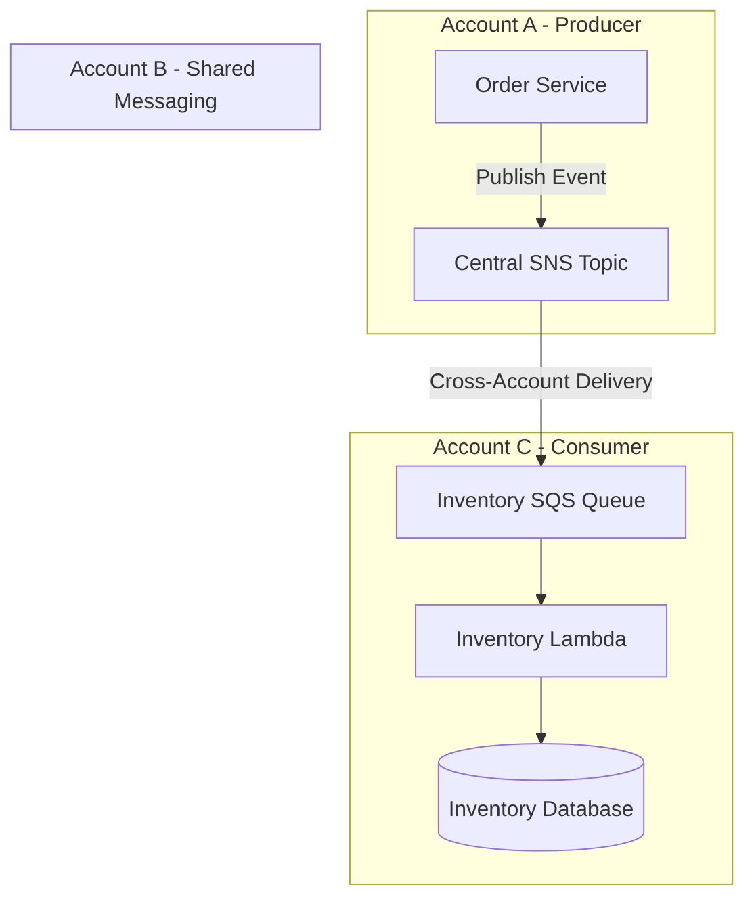
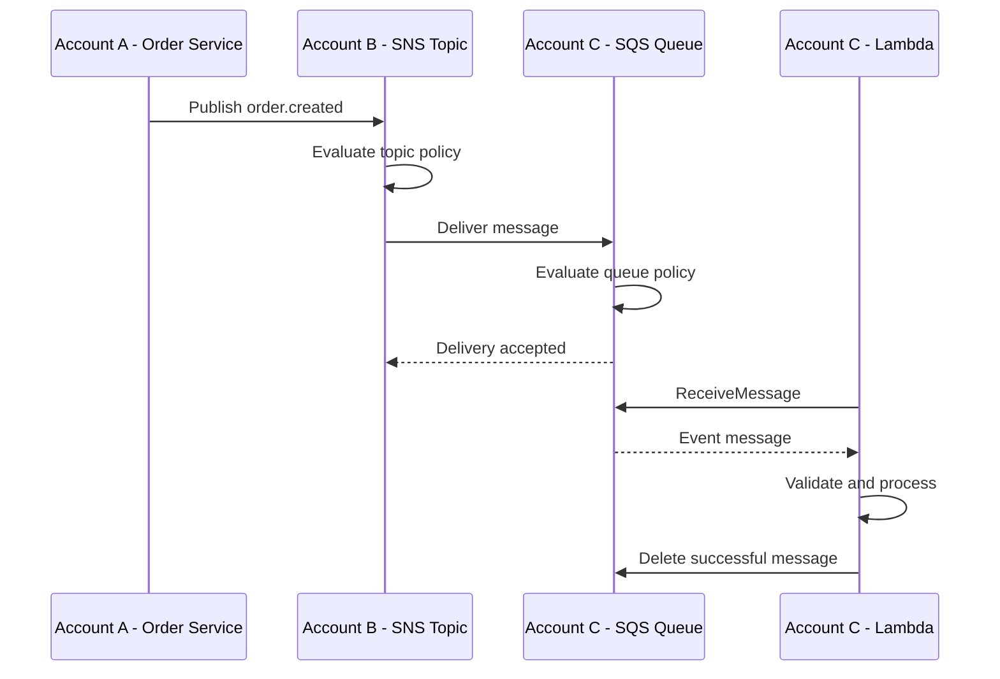
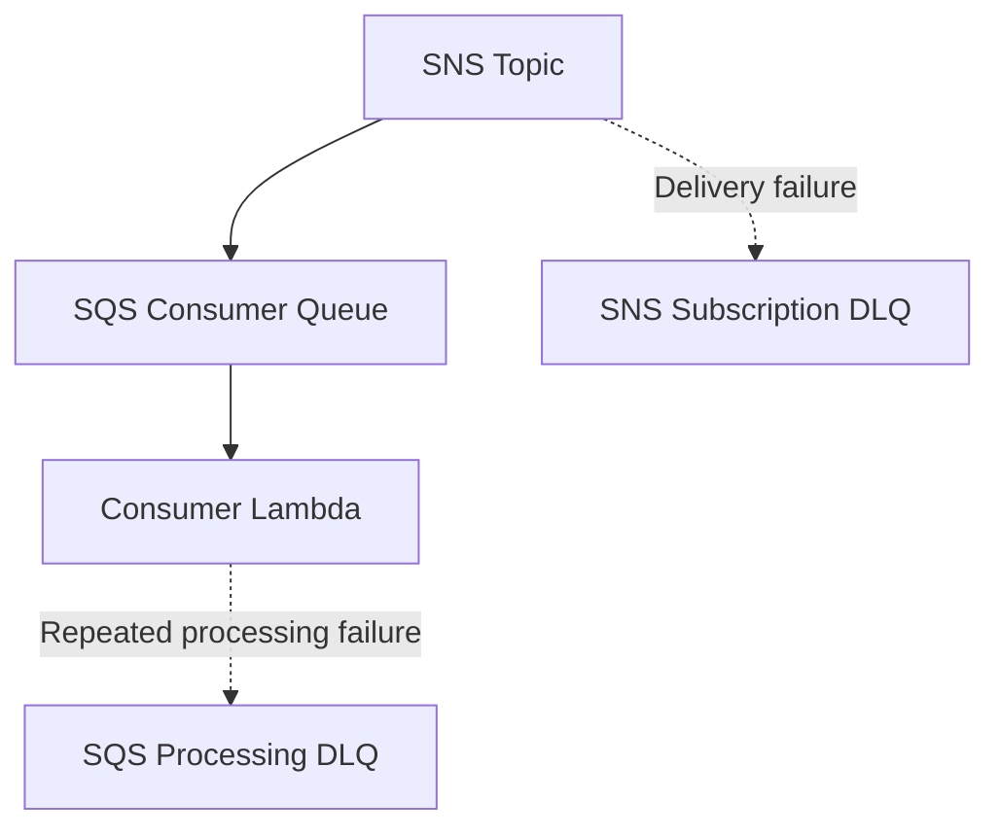
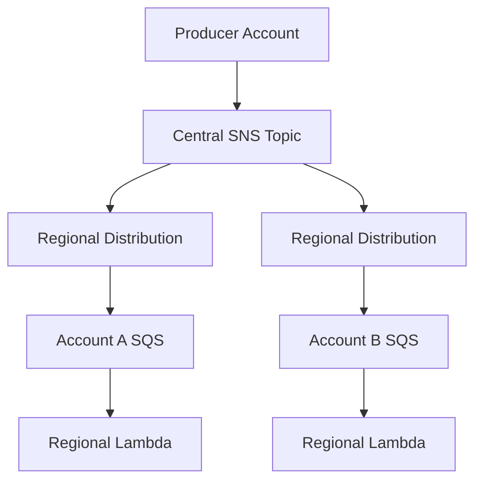

# 08- Cross-Account Event Distribution

## Overview

Cross-account event distribution allows AWS services and applications in one AWS account to publish events that are consumed by workloads in another account.

It is commonly used in multi-account environments where application teams, platform teams, security teams, and shared infrastructure operate independently.

Amazon SNS supports cross-account publishing and subscription patterns through topic policies, IAM permissions, and resource-based access control.

A typical architecture uses:

- **Producer account:** Owns the application that generates events.
- **SNS topic account:** Owns the topic that distributes events.
- **Consumer account:** Owns the queues, Lambda functions, or applications that process events.
- **AWS IAM:** Controls cross-account identities and permissions.
- **SNS topic policy:** Allows authorized external principals to publish or subscribe.
- **SQS queue policy:** Allows the SNS topic to deliver messages to a queue.
- **AWS KMS:** Controls encryption and decryption permissions when customer-managed keys are used.

Cross-account distribution is useful when services must exchange events without sharing AWS credentials or tightly coupling their deployment lifecycles.

## Why Cross-Account Event Distribution Matters

Large AWS environments commonly separate workloads into multiple accounts.

For example:

| Account | Responsibility |
|---|---|
| Shared Services | Owns central messaging infrastructure |
| Order Service | Publishes order events |
| Payment Service | Publishes payment events |
| Inventory Service | Consumes order events |
| Analytics | Consumes events for reporting |
| Security | Receives security-related events |

Without cross-account messaging, teams may create direct API integrations or duplicate messaging infrastructure in every account.

SNS provides a centralized distribution mechanism while preserving account-level isolation.

### Key Benefits

- Independent ownership of producers and consumers.
- Centralized event distribution.
- Reduced direct service dependencies.
- Account-level security boundaries.
- Independent deployment and scaling.
- Easier integration between organizational units.
- Consistent event-routing policies.

### Limitations

- Cross-account access requires explicit IAM and resource policies.
- KMS permissions introduce additional configuration.
- Cross-Region delivery requires separate design considerations.
- Organization-wide access must be carefully restricted.
- Debugging requires visibility across account boundaries.
- Cross-account messaging does not provide exactly-once business processing.

## Cross-Account SNS Architecture

Consider an organization with three AWS accounts:

- Account A owns the order service.
- Account B owns the shared SNS topic.
- Account C owns the inventory processing service.

The order service publishes events to the SNS topic in Account B. The inventory service subscribes an SQS queue in Account C to that topic.



The architecture separates event publication from event processing.

Account A requires permission to publish to the topic. Account C requires permission to subscribe its queue. The queue policy must also authorize SNS to deliver messages.

## Cross-Account Permission Model

Cross-account access requires authorization from the resource-owning account and, depending on the access pattern, the calling account.

The main security mechanisms are:

| Mechanism | Purpose |
|---|---|
| IAM identity policy | Grants an IAM principal permission to perform an action |
| SNS topic policy | Controls which principals can access the topic |
| SQS queue policy | Controls which principals can send messages to the queue |
| KMS key policy | Controls access to encrypted resources |
| AWS Organizations conditions | Restricts access to accounts in an organization |
| STS AssumeRole | Provides temporary credentials for an explicitly trusted role |

A common mistake is configuring only the producer's IAM policy while forgetting the SNS topic policy.

For cross-account access, the resource-owning account must explicitly authorize the external principal.

### Example Account Configuration

Assume:

```text
Producer Account: 111111111111
Messaging Account: 222222222222
Consumer Account: 333333333333

Region: ap-south-1

SNS Topic:
arn:aws:sns:ap-south-1:222222222222:central-order-events

SQS Queue:
arn:aws:sqs:ap-south-1:333333333333:inventory-order-queue
```

The examples use these identifiers consistently.

## Publishing Events Across Accounts

A producer can publish to an SNS topic owned by another account when the producer's IAM principal and the topic policy authorize the operation.

### Configure the SNS Topic Policy

In Account B, attach a resource policy to the topic that allows the producer role from Account A to publish.

Example topic policy:

```json
{
  "Version": "2012-10-17",
  "Statement": [
    {
      "Sid": "AllowProducerAccountToPublish",
      "Effect": "Allow",
      "Principal": {
        "AWS": "arn:aws:iam::111111111111:role/OrderServicePublisherRole"
      },
      "Action": "sns:Publish",
      "Resource": "arn:aws:sns:ap-south-1:222222222222:central-order-events"
    }
  ]
}
```

Apply the policy in Account B:

```bash
aws sns set-topic-attributes \
    --topic-arn arn:aws:sns:ap-south-1:222222222222:central-order-events \
    --attribute-name Policy \
    --attribute-value file://topic-policy.json
```

The policy should preserve any existing required statements, including topic-owner permissions and authorized service integrations.

### Configure the Producer IAM Policy

In Account A, attach an identity policy to the publisher role.

```json
{
  "Version": "2012-10-17",
  "Statement": [
    {
      "Sid": "PublishToCentralTopic",
      "Effect": "Allow",
      "Action": "sns:Publish",
      "Resource": "arn:aws:sns:ap-south-1:222222222222:central-order-events"
    }
  ]
}
```

The topic policy and the producer's identity policy must both permit the cross-account request.

### Publish from Python

The producer can use Boto3 without assuming a role when its current execution identity is directly authorized by the topic policy.

```python
import json
from datetime import UTC, datetime
from uuid import uuid4

import boto3


SNS_TOPIC_ARN = (
    "arn:aws:sns:ap-south-1:222222222222:"
    "central-order-events"
)


def publish_order_created(
    order_id: str,
    customer_id: str,
) -> str:
    client = boto3.client(
        "sns",
        region_name="ap-south-1",
    )

    event = {
        "event_id": str(uuid4()),
        "event_type": "order.created",
        "event_version": 1,
        "occurred_at": datetime.now(UTC).isoformat(),
        "producer": "order-service",
        "data": {
            "order_id": order_id,
            "customer_id": customer_id,
        },
    }

    response = client.publish(
        TopicArn=SNS_TOPIC_ARN,
        Message=json.dumps(event),
        MessageAttributes={
            "event_type": {
                "DataType": "String",
                "StringValue": "order.created",
            }
        },
    )

    return response["MessageId"]
```

The SNS message ID identifies the publication, not the logical business event. Keep a stable event ID in the event envelope so consumers can implement idempotency.

## Subscribing an SQS Queue from Another Account

A consumer account can subscribe its SQS queue to a topic owned by another account.

This pattern is useful because each consumer receives an independent durable copy of the published event.

### Configure the SQS Queue Policy

In Account C, allow the central SNS topic to send messages to the queue.

```json
{
  "Version": "2012-10-17",
  "Statement": [
    {
      "Sid": "AllowCentralSNSTopic",
      "Effect": "Allow",
      "Principal": {
        "Service": "sns.amazonaws.com"
      },
      "Action": "sqs:SendMessage",
      "Resource": "arn:aws:sqs:ap-south-1:333333333333:inventory-order-queue",
      "Condition": {
        "ArnEquals": {
          "aws:SourceArn": "arn:aws:sns:ap-south-1:222222222222:central-order-events"
        }
      }
    }
  ]
}
```

The `aws:SourceArn` condition restricts delivery to the intended SNS topic.

Apply the queue policy:

```bash
aws sqs set-queue-attributes \
    --queue-url https://sqs.ap-south-1.amazonaws.com/333333333333/inventory-order-queue \
    --attributes file://queue-policy.json
```

### Subscribe the Queue to SNS

Run the subscription operation using credentials authorized to create the subscription.

For a cross-account SQS endpoint, the queue owner must explicitly confirm the subscription unless the required confirmation behavior is handled by an authorized workflow.

A common operational approach is to create the subscription using the consumer account's credentials and confirm it using the subscription confirmation mechanism.

Example:

```bash
aws sns subscribe \
    --topic-arn arn:aws:sns:ap-south-1:222222222222:central-order-events \
    --protocol sqs \
    --notification-endpoint arn:aws:sqs:ap-south-1:333333333333:inventory-order-queue \
    --return-subscription-arn
```

The topic owner must authorize the consumer account or its principal to subscribe. The queue policy must also permit delivery.

Do not assume that successfully creating a subscription means message delivery is fully operational. Verify the subscription status and test an actual publication.

## Cross-Account Event Delivery Flow

The complete workflow involves permissions in both accounts.



The publisher's authorization and the SNS-to-SQS delivery authorization are separate checks.

A successful publisher request does not prove that every cross-account subscription has received or processed the event.

## Cross-Account Access with STS AssumeRole

An alternative design is to allow a producer in Account A to assume a role in Account B.

This is useful when:

- The producer needs access to several resources in another account.
- Centralized access policies are required.
- Temporary credentials are preferred.
- Resource access should be controlled through a dedicated role.

### Configure the Target Role Trust Policy

In Account B, create a role trusted by the producer role in Account A.

```json
{
  "Version": "2012-10-17",
  "Statement": [
    {
      "Sid": "TrustOrderServiceRole",
      "Effect": "Allow",
      "Principal": {
        "AWS": "arn:aws:iam::111111111111:role/OrderServicePublisherRole"
      },
      "Action": "sts:AssumeRole"
    }
  ]
}
```

Attach an SNS publishing policy to the target role:

```json
{
  "Version": "2012-10-17",
  "Statement": [
    {
      "Sid": "PublishToCentralOrderTopic",
      "Effect": "Allow",
      "Action": "sns:Publish",
      "Resource": "arn:aws:sns:ap-south-1:222222222222:central-order-events"
    }
  ]
}
```

The producer role also needs permission to call `sts:AssumeRole` on the target role.

### Assume the Role with Boto3

```python
import boto3


def create_cross_account_sns_client():
    sts = boto3.client("sts")

    response = sts.assume_role(
        RoleArn=(
            "arn:aws:iam::222222222222:"
            "role/CentralEventPublisherRole"
        ),
        RoleSessionName="order-service-publisher",
    )

    credentials = response["Credentials"]

    return boto3.client(
        "sns",
        region_name="ap-south-1",
        aws_access_key_id=credentials["AccessKeyId"],
        aws_secret_access_key=credentials["SecretAccessKey"],
        aws_session_token=credentials["SessionToken"],
    )
```

Use the returned client to publish to the central topic.

In production, prefer the AWS SDK credential provider chain and role-based workload identity. Do not hardcode credentials or persist temporary credentials.

### Direct Resource Access vs AssumeRole

| Consideration | Direct cross-account access | STS AssumeRole |
|---|---|---|
| Authorization | Producer identity policy and target resource policy | Source role permission, target trust policy, and target role permissions |
| Credential handling | Uses existing workload credentials | Uses temporary assumed-role credentials |
| Resource access | Resource-specific | Can cover multiple resources |
| Operational complexity | Lower for a narrow integration | Higher due to role assumption |
| Centralized permission management | Resource policies | Dedicated target role |
| Suitable use case | Publishing to a specific SNS topic | Accessing multiple resources in another account |

Choose the simplest model that satisfies the required security boundary. Do not introduce role assumption when a narrowly scoped resource policy is sufficient.

## Cross-Account Encryption with AWS KMS

Encryption introduces another authorization boundary.

SNS topics and SQS queues can use customer-managed KMS keys. Cross-account message delivery may require explicit KMS key policies and service permissions.

For example:

- Account B owns an encrypted SNS topic.
- Account C owns an encrypted SQS queue.
- SNS must be authorized to use the queue's KMS key for message delivery.
- The queue consumer must have the required permissions to decrypt messages.

### KMS Considerations

| Resource | Required consideration |
|---|---|
| SNS topic key | SNS service access and publisher authorization |
| SQS queue key | SNS delivery permissions and consumer decryption permissions |
| Producer role | Required encryption-related permissions for the operation |
| Consumer role | Required decryption permissions |
| KMS key policy | Must authorize the relevant principals and service usage |

For an encrypted SQS queue receiving SNS messages, the queue's KMS key policy must permit the SNS service principal to use the key as required by SQS server-side encryption.

Example key policy statement:

```json
{
  "Sid": "AllowSNSForSQSDelivery",
  "Effect": "Allow",
  "Principal": {
    "Service": "sns.amazonaws.com"
  },
  "Action": [
    "kms:Decrypt",
    "kms:GenerateDataKey"
  ],
  "Resource": "*",
  "Condition": {
    "ArnEquals": {
      "aws:SourceArn": "arn:aws:sns:ap-south-1:222222222222:central-order-events"
    }
  }
}
```

This is an illustrative statement, not a complete KMS key policy. Validate the required KMS actions and conditions for the selected encryption configuration, and preserve key-administration permissions.

Avoid replacing an existing key policy with a partial example. An incorrect key policy can prevent legitimate workloads or administrators from using the key.

### Cross-Account KMS Best Practices

- Prefer customer-managed keys when explicit cross-account key control is required.
- Use separate keys for unrelated security boundaries.
- Restrict key usage to required principals and services.
- Review key policies and IAM policies together.
- Monitor KMS access failures.
- Define key rotation and retirement procedures.
- Test encrypted delivery before production rollout.

AWS-managed service keys generally do not provide the same cross-account sharing flexibility as customer-managed keys. Validate service-specific encryption constraints before selecting a key strategy.

## Cross-Account SNS Filtering

SNS subscription filter policies can reduce unnecessary event delivery to consumers in other accounts.

For example, a consumer account may only require order events associated with a particular business unit.

Example filter policy:

```json
{
  "event_type": [
    "order.created",
    "order.cancelled"
  ],
  "business_unit": [
    "retail"
  ]
}
```

Apply the filter to the subscription:

```bash
aws sns set-subscription-attributes \
    --subscription-arn "$SUBSCRIPTION_ARN" \
    --attribute-name FilterPolicy \
    --attribute-value file://filter-policy.json
```

For message-attribute filtering, publishers must provide the corresponding attributes.

Filtering can reduce downstream processing and messaging costs, but it is not an authorization mechanism. Consumers must still validate incoming event data.

For cross-account integrations, coordinate event attribute names and filter-policy ownership between producer and consumer teams.

## Cross-Account Event Contracts

Cross-account systems are independently deployed. Event contracts must therefore be stable and backward-compatible.

A shared topic should publish well-defined business events rather than expose internal application database structures.

Example event:

```json
{
  "event_id": "evt_01JORDER8M4K",
  "event_type": "order.created",
  "event_version": 1,
  "occurred_at": "2026-11-20T08:30:00Z",
  "producer": "order-service",
  "correlation_id": "req_8f19c2",
  "data": {
    "order_id": "ord_10042",
    "customer_id": "cust_501",
    "total_amount": 2499.00,
    "currency": "INR"
  }
}
```

### Contract Management

Recommended practices:

- Define event schemas in a version-controlled repository.
- Use stable event identifiers.
- Document required and optional fields.
- Introduce new event versions for incompatible changes.
- Validate payloads before publication.
- Use contract tests between producer and consumer teams.
- Avoid exposing database-specific representations.
- Document event ownership and support contacts.

A shared topic should not become an undocumented integration point between unrelated teams.

## Reliability and Idempotency

Cross-account messaging retains the delivery characteristics of SNS and SQS.

For Standard SNS topics and Standard SQS queues:

- Delivery is at least once.
- Duplicate messages are possible.
- Ordering is not guaranteed.
- Consumer processing must be idempotent.

A stable business event ID should be included in every message.

Example consumer-side idempotency table:

```sql
CREATE TABLE processed_events (
    event_id UUID PRIMARY KEY,
    processed_at TIMESTAMPTZ NOT NULL DEFAULT NOW()
);
```

The consumer should persist the idempotency record in the same transaction as its business operation.

```python
from sqlalchemy import text


def process_order_event(session, event: dict) -> bool:
    with session.begin():
        result = session.execute(
            text("""
                INSERT INTO processed_events (event_id)
                VALUES (:event_id)
                ON CONFLICT (event_id) DO NOTHING
                RETURNING event_id
            """),
            {
                "event_id": event["event_id"],
            },
        )

        if result.scalar_one_or_none() is None:
            return False

        session.execute(
            text("""
                INSERT INTO inventory_order_events (
                    order_id,
                    event_type
                )
                VALUES (
                    :order_id,
                    :event_type
                )
            """),
            {
                "order_id": event["data"]["order_id"],
                "event_type": event["event_type"],
            },
        )

    return True
```

The event ID must remain stable across retries and republication of the same logical event.

For external side effects, use provider idempotency keys or durable operation state. A database transaction cannot guarantee exactly-once execution of an external HTTP request.

## Failure Handling and Dead-Letter Queues

Cross-account integrations introduce failures at multiple boundaries.

| Failure | Likely cause | Recovery |
|---|---|---|
| Publisher receives `AccessDenied` | Topic policy or IAM policy denies publication | Validate identity and resource policies |
| Subscription creation fails | Topic policy does not authorize subscriber | Review topic access permissions |
| Subscription remains pending | Confirmation has not completed | Confirm using the queue owner's authorized workflow |
| SNS cannot deliver to SQS | Queue policy or KMS permissions are incorrect | Validate queue policy and key policy |
| Lambda cannot receive messages | Execution role lacks SQS permissions | Correct the Lambda execution role |
| Messages repeatedly fail processing | Invalid event or downstream outage | Configure processing DLQ |
| Consumer receives duplicates | At-least-once delivery or retry | Implement idempotency |
| Cross-account KMS operation fails | Key policy or IAM permissions are incomplete | Review encryption authorization |

### Dead-Letter Queue Architecture

Use separate DLQs for distinct failure boundaries.



- An SNS subscription DLQ captures messages SNS could not deliver to a subscription.
- An SQS processing DLQ captures messages that repeatedly fail consumer processing.

Define ownership, alerting, investigation, and redrive procedures for both.

## Cross-Region and Cross-Account Distribution

Cross-account and cross-Region are separate architectural concerns.

Cross-account communication can occur within the same Region. Cross-Region distribution requires explicit regional resource configuration and a supported delivery or replication mechanism.

A common design is to publish in a central Region and distribute events to regional consumer accounts through separately configured topics and subscriptions.



The diagram represents a logical architecture. It does not imply automatic cross-Region SNS-to-SQS delivery. Configure supported regional subscriptions, forwarding components, or replication mechanisms explicitly.

Consider:

- Regional topic and queue ownership.
- Data residency requirements.
- Cross-Region data transfer costs.
- KMS key locality.
- Event duplication during failover.
- Regional failure recovery.
- Independent queue retention and DLQ policies.

## Infrastructure as Code with Terraform

Terraform can manage cross-account SNS and SQS resources using provider aliases.

This allows one deployment configuration to manage resources in multiple AWS accounts, provided the deployment identity is authorized in each account.

### Configure AWS Providers

```hcl
provider "aws" {
  alias  = "producer"
  region = "ap-south-1"

  assume_role {
    role_arn = "arn:aws:iam::111111111111:role/TerraformDeploymentRole"
  }
}

provider "aws" {
  alias  = "messaging"
  region = "ap-south-1"

  assume_role {
    role_arn = "arn:aws:iam::222222222222:role/TerraformDeploymentRole"
  }
}

provider "aws" {
  alias  = "consumer"
  region = "ap-south-1"

  assume_role {
    role_arn = "arn:aws:iam::333333333333:role/TerraformDeploymentRole"
  }
}
```

The deployment identity must be trusted by each target role and have the necessary permissions.

### Create the Central SNS Topic

```hcl
resource "aws_sns_topic" "central_events" {
  provider = aws.messaging

  name = "central-order-events"
}
```

### Configure the Topic Policy

```hcl
data "aws_iam_policy_document" "central_topic" {
  provider = aws.messaging

  statement {
    sid    = "AllowProducerAccount"
    effect = "Allow"

    principals {
      type        = "AWS"
      identifiers = [
        "arn:aws:iam::111111111111:role/OrderServicePublisherRole"
      ]
    }

    actions = [
      "sns:Publish"
    ]

    resources = [
      aws_sns_topic.central_events.arn
    ]
  }

  statement {
    sid    = "AllowConsumerAccountSubscription"
    effect = "Allow"

    principals {
      type        = "AWS"
      identifiers = [
        "arn:aws:iam::333333333333:root"
      ]
    }

    actions = [
      "sns:Subscribe"
    ]

    resources = [
      aws_sns_topic.central_events.arn
    ]
  }
}

resource "aws_sns_topic_policy" "central_events" {
  provider = aws.messaging

  arn    = aws_sns_topic.central_events.arn
  policy = data.aws_iam_policy_document.central_topic.json
}
```

The consumer account principal is authorized to subscribe, but the subscribing identity must also have the appropriate IAM permission. Keep the policy narrow and grant access only to intended consumer accounts.

### Create the Consumer Queue

```hcl
resource "aws_sqs_queue" "inventory_queue" {
  provider = aws.consumer

  name                       = "inventory-order-queue"
  visibility_timeout_seconds = 180
  message_retention_seconds  = 1209600
  receive_wait_time_seconds  = 20
  sqs_managed_sse_enabled    = true
}
```

### Configure the Queue Policy

```hcl
data "aws_iam_policy_document" "inventory_queue" {
  provider = aws.consumer

  statement {
    sid    = "AllowCentralTopicDelivery"
    effect = "Allow"

    principals {
      type        = "Service"
      identifiers = ["sns.amazonaws.com"]
    }

    actions = [
      "sqs:SendMessage"
    ]

    resources = [
      aws_sqs_queue.inventory_queue.arn
    ]

    condition {
      test     = "ArnEquals"
      variable = "aws:SourceArn"

      values = [
        aws_sns_topic.central_events.arn
      ]
    }
  }
}

resource "aws_sqs_queue_policy" "inventory_queue" {
  provider = aws.consumer

  queue_url = aws_sqs_queue.inventory_queue.id
  policy    = data.aws_iam_policy_document.inventory_queue.json
}
```

### Create the Cross-Account Subscription

```hcl
resource "aws_sns_topic_subscription" "inventory" {
  provider = aws.consumer

  topic_arn = aws_sns_topic.central_events.arn
  protocol  = "sqs"
  endpoint  = aws_sqs_queue.inventory_queue.arn

  raw_message_delivery = false

  depends_on = [
    aws_sns_topic_policy.central_events,
    aws_sqs_queue_policy.inventory_queue
  ]
}
```

This configuration uses the consumer account's provider to create the subscription. The consumer account must be authorized by the topic policy and its own IAM permissions.

For production, verify the subscription confirmation state and test delivery. Do not treat Terraform resource creation alone as proof that cross-account delivery is working.

The producer's identity policy granting `sns:Publish`, the consumer's subscription permissions, and the required Lambda execution role permissions should be managed separately.

## Observability and Auditing

Cross-account event distribution requires visibility across multiple AWS accounts.

### Monitoring Requirements

| Component | What to monitor |
|---|---|
| Producer service | Publication errors and retry counts |
| SNS topic | Published messages and delivery failures |
| SNS subscription | Subscription status and delivery metrics |
| SQS queue | Visible messages and oldest-message age |
| SQS DLQ | Failed delivery processing |
| Lambda | Errors, throttles, and duration |
| KMS | Authorization failures and key usage |
| Application | Duplicate events and business-processing failures |

Use CloudWatch dashboards and alarms in the accounts that own the relevant resources.

For organization-wide visibility, centralize operational metrics and logs through an approved cross-account observability design.

### Audit Requirements

Use AWS CloudTrail to audit relevant management and API activity, including:

- Topic policy changes.
- Subscription creation and deletion.
- Queue policy changes.
- IAM role and trust-policy changes.
- KMS key policy changes.
- SNS publication activity where applicable event logging is configured.

CloudTrail management events do not automatically provide a complete record of every message payload or business-processing outcome. Application-level event IDs and processing logs remain necessary.

### Correlation Identifiers

Include identifiers that connect activity across accounts:

- Business event ID.
- Producer service.
- Correlation ID.
- SNS message ID.
- SQS message ID.
- Consumer service.
- Processing timestamp.

These identifiers help investigate failures without relying on account-local logs alone.

## Scalability and Cost Considerations

Cross-account event distribution scales through SNS topic delivery and independently managed consumer queues.

However, capacity and cost should be evaluated across all accounts.

### Scalability Recommendations

- Use separate queues for independent consumers.
- Apply subscription filtering to reduce unnecessary delivery.
- Control Lambda concurrency to protect downstream systems.
- Use SQS long polling.
- Batch message processing where appropriate.
- Monitor queue age and backlog.
- Keep event payloads small.
- Store large payloads in S3 and publish object references.
- Avoid creating unnecessary cross-account subscriptions.

### Cost Factors

| Service | Cost drivers |
|---|---|
| SNS | Publish requests and subscription deliveries |
| SQS | API requests and message volume |
| Lambda | Invocation count and execution duration |
| KMS | Key usage and applicable API requests |
| CloudWatch | Metrics, logs, dashboards, and alarms |
| Data transfer | Cross-Region or other applicable data transfer |
| S3 | Payload storage and retrieval |

A central topic can reduce duplicated publisher integrations, but it may increase the operational importance of the shared messaging account.

Use account-level budgets, tagging, and cost allocation to identify which teams generate and consume messaging workloads.

## Common Mistakes and Production Pitfalls

| Mistake | Why it causes problems | Recommended approach |
|---|---|---|
| Configuring only the producer IAM policy | The topic may still deny publication | Configure the topic resource policy |
| Omitting the SQS queue policy | SNS cannot deliver to the queue | Authorize the exact topic ARN |
| Granting access to an entire account unnecessarily | Expands the trust boundary | Restrict access to specific roles |
| Ignoring subscription confirmation | The subscription may remain pending | Verify and complete confirmation |
| Forgetting KMS permissions | Encrypted delivery or consumption fails | Review key policies and IAM permissions |
| Using broad wildcard resource policies | Creates unnecessary cross-account exposure | Scope principals and resources |
| Assuming cross-account means cross-Region | Regional delivery constraints remain | Design regional distribution explicitly |
| Ignoring duplicate delivery | Business operations may execute repeatedly | Use stable event IDs and idempotency |
| Sharing one queue across unrelated consumers | Consumers compete for messages | Use separate queues |
| Treating subscription creation as delivery validation | Permissions or encryption may still block delivery | Publish and consume a test event |
| Using account root as the default principal | Grants broader account-level authorization than necessary | Prefer specific IAM roles |
| Treating SNS as a durable event archive | SNS does not provide a general replayable event log | Use SQS retention or an event archive |
| Managing all policies manually | Configuration drifts across accounts | Use Terraform or CloudFormation |
| Ignoring cross-account observability | Troubleshooting becomes fragmented | Centralize metrics and correlation identifiers |

## Production Design Checklist

### Account Architecture

- [ ] Producer, messaging, and consumer responsibilities are clearly defined.
- [ ] Account ownership and operational responsibility are documented.
- [ ] Topic and queue Regions are explicitly configured.
- [ ] Cross-account access is limited to required principals.

### IAM and Resource Policies

- [ ] Producer roles have narrowly scoped `sns:Publish` permissions.
- [ ] SNS topic policies authorize intended publishers and subscribers.
- [ ] SQS queue policies authorize the exact SNS topic.
- [ ] STS trust policies are restricted to required roles.
- [ ] KMS key policies support required cross-account operations.
- [ ] Organization-level conditions are used where appropriate.

### Messaging Reliability

- [ ] Event schemas are versioned.
- [ ] Business event IDs remain stable across retries.
- [ ] Consumers are idempotent.
- [ ] Each independent consumer has its own queue.
- [ ] SNS subscription and SQS processing failure paths are monitored.
- [ ] DLQ redrive procedures are tested.
- [ ] Large payloads use durable S3 references where appropriate.

### Operations and Governance

- [ ] CloudTrail auditing is enabled and reviewed.
- [ ] Cross-account metrics and logs are accessible to operators.
- [ ] Queue age and DLQ alarms are configured.
- [ ] Subscription confirmation is verified.
- [ ] Infrastructure is deployed through controlled CI/CD.
- [ ] Cost allocation and ownership are defined.
- [ ] Cross-account recovery procedures are documented and tested.

## Key Takeaways

- Cross-account SNS distribution enables independent AWS accounts to exchange events without sharing long-lived credentials or tightly coupling services.
- Successful delivery requires coordinated IAM identity policies, SNS topic policies, SQS queue policies, and KMS permissions where encryption is used.
- SNS-to-SQS subscriptions provide consumer-specific buffering, while idempotency and DLQs protect processing workflows against duplicate delivery and failures.
- Cross-account and cross-Region distribution are separate concerns; regional replication and recovery must be explicitly designed.
- Use least-privilege resource policies, versioned event contracts, centralized observability, and infrastructure as code to operate cross-account messaging reliably.