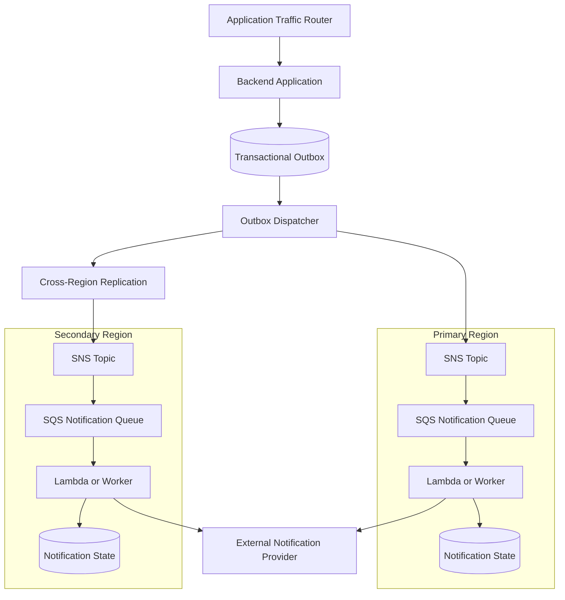
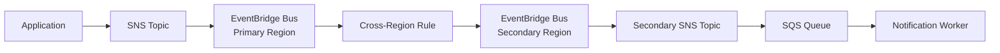
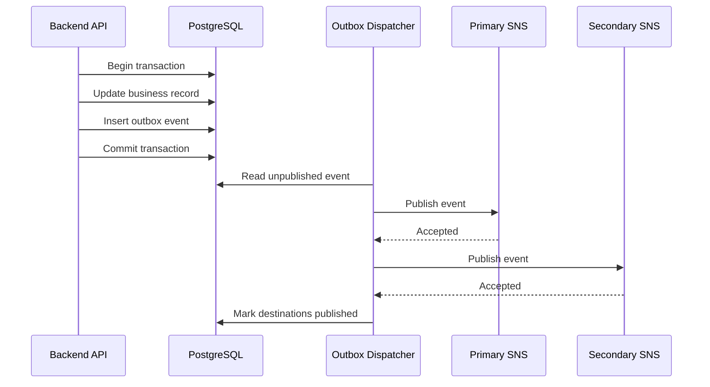
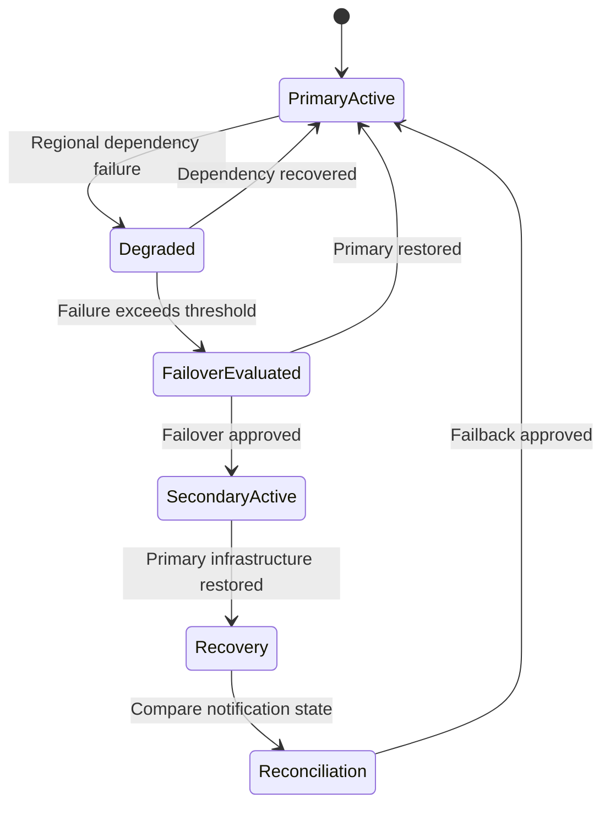

# 09- Multi-Region Notification Architecture

## Overview

A multi-Region notification architecture distributes notification workloads across multiple AWS Regions to improve availability, reduce regional dependency, support geographic requirements, and provide disaster recovery.

Amazon SNS is a regional service. An SNS topic exists in one AWS Region and does not automatically replicate its messages, subscriptions, or configuration to another Region. A production multi-Region design must explicitly address event replication, notification delivery, failover, duplicate suppression, routing, and recovery.

A typical architecture combines:

- **Amazon SNS** for publish-subscribe distribution within each Region.
- **Amazon SQS** for durable buffering and independent consumer processing.
- **AWS Lambda or containerized workers** for notification delivery.
- **Amazon EventBridge or application-level routing** for cross-Region event distribution.
- **Amazon S3** for durable event archives when replay or reconciliation is required.
- **Route 53 or application-level routing** for directing traffic to an active Region.

The architecture should distinguish between two separate goals:

1. **Regional resilience:** Continue processing notifications when a Region or a regional dependency becomes unavailable.
2. **Geographic distribution:** Deliver notifications through infrastructure closer to users or compliant with regional data-residency requirements.

These goals can overlap, but they require different routing and data-management decisions.

## Why Multi-Region Notification Architecture Matters

A single-Region notification system can become unavailable when its Region experiences a service disruption, networking failure, deployment issue, or dependency outage.

Even when the application remains operational in another Region, notification delivery may fail if the only SNS topic, SQS queues, or notification workers are unavailable.

A multi-Region architecture addresses these risks.

| Requirement | Single-Region limitation | Multi-Region approach |
|---|---|---|
| Regional availability | Depends on one Region | Deploy notification infrastructure in multiple Regions |
| Disaster recovery | Requires regional restoration | Activate an alternate Region |
| Geographic latency | Delivery infrastructure may be distant | Process notifications in a suitable Region |
| Regional isolation | Shared regional dependencies | Independent regional queues and workers |
| Capacity isolation | One Region handles all traffic | Distribute workloads |
| Data residency | Data may cross regional boundaries | Keep sensitive data within approved Regions |

Multi-Region deployment introduces additional complexity. Cross-Region replication, duplicate events, inconsistent configuration, failover coordination, and operational costs must be managed explicitly.

## Core Architecture Patterns

There are several ways to distribute notification workloads across Regions. The correct pattern depends on availability requirements, delivery semantics, data residency, and operational complexity.

### Active-Passive Architecture

In an active-passive architecture, one Region processes notifications during normal operation. A second Region contains a prepared but inactive or minimally active notification stack.

<AsyncImage query="AWS multi region active passive disaster recovery architecture SNS SQS Lambda primary secondary region diagram" aspectRatio="16:9" width="100%" />

**How it works:**

1. The application publishes notification events to the primary Region.
2. The primary SNS topic distributes events to regional SQS queues.
3. Lambda functions or containerized workers process notification requests.
4. Events are replicated or retained through a separate recovery mechanism.
5. If the primary Region becomes unavailable, traffic is redirected to the secondary Region.
6. The secondary Region processes new and recoverable notification events.

**Advantages**

- Lower operating cost than running two fully active notification systems.
- Simpler normal-operation routing.
- Clear primary ownership of notification processing.
- Suitable for workloads with defined recovery-time objectives.

**Limitations**

- Failover requires activation and validation.
- The secondary Region may have lower capacity or incomplete operational readiness.
- Events not replicated before failure may be lost unless another durable recovery mechanism exists.
- Recovery can create duplicate notifications.

Use this architecture when notification availability is important but operating two fully active processing stacks is not justified.

### Active-Active Architecture

In an active-active architecture, multiple Regions process notification events concurrently.

<AsyncImage query="AWS multi region active active event driven architecture SNS SQS Lambda two regions diagram" aspectRatio="16:9" width="100%" />

Each Region can have its own:

- SNS topics.
- SQS queues.
- Notification workers.
- Regional application endpoints.
- Monitoring and alerting resources.

Events are routed to one or more Regions based on application requirements.

**Advantages**

- Both Regions process production workloads.
- Regional failures do not necessarily require infrastructure activation.
- Traffic can be distributed geographically.
- Capacity can be shared across Regions.

**Limitations**

- Duplicate processing becomes more likely.
- Global notification ownership requires coordination.
- User preferences and delivery state may become inconsistent.
- Cross-Region replication increases network and operational costs.
- External notification providers may impose shared account-level rate limits.

Active-active designs require globally coordinated idempotency and explicit rules for deciding which Region owns a notification.

### Regional Isolation Architecture

Regional isolation keeps notification processing independent within each Region.

For example:

- An application in Asia publishes to an Asia SNS topic.
- An application in Europe publishes to a Europe SNS topic.
- Each topic delivers to regional SQS queues.
- Regional workers process notifications using approved regional providers and data stores.

This pattern is particularly useful when data residency or regional operational independence is required.

It does not automatically provide disaster recovery. If the regional application and its notification infrastructure fail together, an independent recovery path is still necessary.

## Reference Architecture

A production architecture can combine regional processing with an explicit cross-Region replication mechanism.

<AsyncImage query="AWS architecture diagram multi region SNS SQS EventBridge cross region event replication notification workers disaster recovery" aspectRatio="16:9" width="100%" />

The following logical architecture illustrates the main components.



The diagram represents a logical design, not an automatic SNS replication feature. The replication component must be implemented using an appropriate service or application-level mechanism.

For example, EventBridge can route events across Regions, or an application can publish to a remote regional endpoint. The selected mechanism must define retries, duplicate handling, authorization, and failure recovery.

## Regional Component Design

### SNS Topics

Each Region should have its own SNS topic.

Example:

| Region | Topic |
|---|---|
| Asia Pacific (Mumbai) | `notification-events-ap-south-1` |
| US East (N. Virginia) | `notification-events-us-east-1` |
| Europe (Ireland) | `notification-events-eu-west-1` |

A regional topic allows publishers and subscribers to operate independently.

Example topic creation:

```bash
aws sns create-topic \
  --name notification-events \
  --region ap-south-1
```

Create the corresponding topic in the secondary Region:

```bash
aws sns create-topic \
  --name notification-events \
  --region eu-west-1
```

The resulting topic ARNs are different because they contain different Regions.

A topic in one Region does not automatically deliver messages to a topic in another Region. Cross-Region publishing must be explicitly configured.

### SQS Queues

Use regional SQS queues to isolate processing workloads.

```text
ap-south-1
    notification-events
        notification-email-queue
        notification-sms-queue
        notification-push-queue

eu-west-1
    notification-events
        notification-email-queue
        notification-sms-queue
        notification-push-queue
```

Separate queues provide:

- Independent retry policies.
- Different visibility timeouts.
- Independent worker concurrency.
- Separate dead-letter queues.
- Regional processing isolation.

The queue should be owned by the Region responsible for processing its messages.

### Lambda and Worker Deployment

Notification workers should be deployed independently in each Region.

Possible execution models include:

- AWS Lambda with SQS event source mappings.
- ECS services consuming SQS messages.
- EKS workloads using SQS polling.
- EC2-based worker services.

Lambda is suitable for event-driven workloads with variable traffic. ECS or EKS can be preferable when workers require persistent connections, specialized runtimes, or more explicit concurrency management.

Regional worker configuration should be independently deployable and should not rely on resources that exist only in the primary Region.

## Cross-Region Event Distribution

SNS does not provide automatic cross-Region topic replication. Several mechanisms can distribute events between Regions.

### EventBridge Cross-Region Event Routing

Amazon EventBridge supports routing events to event buses in other AWS accounts and Regions.

A regional event bus can receive events and forward selected events to another Region through a configured rule and target.



This is a logical flow. EventBridge must be configured with supported source, target, permissions, and event transformation settings.

EventBridge can also receive application events directly. If the application already publishes to EventBridge, introducing SNS solely for cross-Region routing may add unnecessary complexity.

**Advantages**

- Managed event routing.
- Rule-based filtering.
- Integration with other AWS services.
- Cross-account and cross-Region distribution capabilities.

**Limitations**

- Additional service configuration and cost.
- EventBridge and target delivery have their own retry and failure behavior.
- It does not provide a global transaction across Regions.
- Duplicate events must still be handled by consumers.
- Cross-Region routing does not replace durable event archival or replay design.

Use EventBridge when routing rules, event-bus integration, or centralized event distribution are important requirements.

### Application-Level Cross-Region Publishing

An application can publish the same logical event to multiple regional SNS topics.

For example, a publisher may publish to the primary topic and then publish to the secondary topic.

```python
import json
import os
from datetime import UTC, datetime

import boto3
from botocore.config import Config

AWS_RETRIES = Config(
    retries={
        "mode": "standard",
        "total_max_attempts": 5,
    },
    connect_timeout=3,
    read_timeout=10,
)

primary_sns = boto3.client(
    "sns",
    region_name="ap-south-1",
    config=AWS_RETRIES,
)

secondary_sns = boto3.client(
    "sns",
    region_name="eu-west-1",
    config=AWS_RETRIES,
)

PRIMARY_TOPIC_ARN = os.environ["PRIMARY_TOPIC_ARN"]
SECONDARY_TOPIC_ARN = os.environ["SECONDARY_TOPIC_ARN"]


def publish_notification_event(event: dict) -> None:
    event_payload = {
        **event,
        "event_id": event["event_id"],
        "published_at": datetime.now(UTC).isoformat(),
    }

    message = json.dumps(event_payload)

    primary_sns.publish(
        TopicArn=PRIMARY_TOPIC_ARN,
        Message=message,
        MessageAttributes={
            "event_type": {
                "DataType": "String",
                "StringValue": event["event_type"],
            }
        },
    )

    secondary_sns.publish(
        TopicArn=SECONDARY_TOPIC_ARN,
        Message=message,
        MessageAttributes={
            "event_type": {
                "DataType": "String",
                "StringValue": event["event_type"],
            }
        },
    )
```

This example demonstrates the publishing API, but it is not a complete reliable dual-Region publishing implementation.

Consider the following failure:

1. The primary SNS publication succeeds.
2. The secondary SNS publication fails.
3. The application retries the operation.
4. The primary topic receives the event again.

This creates a partial-success problem.

A production implementation should use an outbox or durable replication workflow rather than treating two independent SNS calls as one atomic operation.

### Transactional Outbox for Cross-Region Publishing

The transactional outbox pattern stores the business change and its corresponding event in the same database transaction.

A dispatcher then publishes the event to the required regional destinations.



A simplified schema:

```sql
CREATE TABLE notification_outbox (
    event_id UUID PRIMARY KEY,
    event_type VARCHAR(150) NOT NULL,
    payload JSONB NOT NULL,
    created_at TIMESTAMPTZ NOT NULL DEFAULT NOW()
);

CREATE TABLE notification_outbox_delivery (
    event_id UUID NOT NULL
        REFERENCES notification_outbox(event_id),
    destination_region VARCHAR(30) NOT NULL,
    published_at TIMESTAMPTZ,
    attempts INTEGER NOT NULL DEFAULT 0,
    last_error TEXT,
    PRIMARY KEY (event_id, destination_region)
);
```

Each destination has independent delivery state.

The dispatcher should:

1. Claim unpublished destination records safely.
2. Publish to the corresponding regional topic.
3. Mark the destination as published only after SNS accepts the request.
4. Record failed attempts and retry with backoff.
5. Release or recover abandoned claims after worker failure.

The dispatcher can use PostgreSQL row locking with `FOR UPDATE SKIP LOCKED` to support multiple concurrent workers.

The outbox prevents a business transaction from committing without a corresponding event record. It does not provide exactly-once publication. A dispatcher can crash after SNS accepts a message but before the database records success.

Use stable event IDs and idempotent consumers to handle this ambiguity.

## Notification Event Contract

Cross-Region processing requires a stable event contract.

A notification event should contain enough information to identify the business event, determine its destination, and support idempotent processing.

Example:

```json
{
  "event_id": "e4f7f66d-3d21-4d12-9bb5-5d27cfe78e01",
  "event_type": "notification.email.requested",
  "schema_version": 1,
  "occurred_at": "2026-11-20T08:30:00Z",
  "source_region": "ap-south-1",
  "destination_region": "eu-west-1",
  "correlation_id": "order-12345",
  "tenant_id": "tenant-100",
  "data": {
    "notification_id": "notification-9001",
    "recipient_reference": "user-500",
    "template_id": "order-confirmation"
  }
}
```

Recommended fields:

| Field | Purpose |
|---|---|
| `event_id` | Stable business event identity |
| `event_type` | Identifies the event category |
| `schema_version` | Supports contract evolution |
| `occurred_at` | Original event time |
| `source_region` | Region where the event originated |
| `destination_region` | Intended processing Region |
| `correlation_id` | Connects related operations |
| `tenant_id` | Identifies the tenant when applicable |
| `data` | Event-specific information |

Avoid embedding unnecessary sensitive information in replicated events.

For example, an event can reference a notification record rather than carrying the recipient's full profile, phone number, or other personal information across Regions.

The receiving Region should retrieve permitted data from its authorized regional data source.

## Idempotency Across Regions

Duplicate delivery is a fundamental concern in multi-Region systems.

Duplicates can occur because of:

- SNS at-least-once delivery.
- SQS Standard duplicate delivery.
- Outbox dispatcher retries.
- EventBridge retries.
- Cross-Region replication retries.
- Failover replay.
- Ambiguous external provider responses.

A stable event ID should be used to identify the same logical notification across Regions.

### Idempotency Table

A notification worker can maintain an idempotency record.

```sql
CREATE TABLE processed_notifications (
    event_id UUID PRIMARY KEY,
    processed_region VARCHAR(30) NOT NULL,
    status VARCHAR(30) NOT NULL,
    processed_at TIMESTAMPTZ NOT NULL DEFAULT NOW()
);
```

A database transaction can claim an event before performing local state transitions.

```python
from sqlalchemy import text
from sqlalchemy.ext.asyncio import AsyncSession


async def claim_notification(
    session: AsyncSession,
    event_id: str,
    region: str,
) -> bool:
    result = await session.execute(
        text("""
            INSERT INTO processed_notifications (
                event_id,
                processed_region,
                status
            )
            VALUES (
                :event_id,
                :region,
                'processing'
            )
            ON CONFLICT (event_id) DO NOTHING
            RETURNING event_id
        """),
        {
            "event_id": event_id,
            "region": region,
        },
    )

    return result.scalar_one_or_none() is not None
```

The claim and related local database updates should be committed in a controlled transaction.

A production implementation also needs:

- Recovery of stale `processing` records.
- Explicit failure and retry states.
- Unique constraints for notification-level business identities.
- A strategy for events that may legitimately be processed in another Region.
- Provider idempotency keys where supported.

A local database table does not provide global idempotency if each Region has an independent database.

If both Regions can process the same notification concurrently, they need a shared coordination mechanism or a deterministic ownership strategy.

Possible approaches include:

| Strategy | Characteristics |
|---|---|
| Single active notification owner | One Region is authorized to send a notification |
| Globally shared idempotency store | Regions consult the same authoritative state |
| Provider idempotency key | External provider suppresses duplicate requests when supported |
| Deterministic partition ownership | A notification is assigned to one Region based on a stable key |
| Reconciliation workflow | Detects and resolves ambiguous or duplicate delivery states |

Do not assume that a database insert in one Region prevents a concurrent insert in another independent database.

## Global Notification Ownership

Active-active processing introduces an important design decision: which Region is allowed to send a specific notification?

Without an ownership model, two Regions may independently process the same event and send duplicate email or SMS messages.

A common approach is to assign a notification to a deterministic processing Region.

For example:

```python
def resolve_notification_region(
    user_region: str,
    available_regions: set[str],
) -> str:
    if user_region in available_regions:
        return user_region

    return sorted(available_regions)[0]
```

This is only a simplified routing example. A production router should account for service health, tenant configuration, residency requirements, and failover state.

For stronger ownership guarantees, maintain a notification ownership record with:

- Notification ID.
- Assigned Region.
- Ownership status.
- Lease expiration.
- Ownership generation or fencing token.
- Last state transition.

A fencing token helps prevent a former owner from continuing work after ownership has been reassigned.

External provider calls still require idempotency or reconciliation because a worker may successfully send a notification but fail before recording the result.

## Failover and Recovery

Failover should be an explicit operational process rather than an automatic reaction to every transient error.

A regional failure can affect different parts of the system independently:

- Application APIs.
- SNS topic publishing.
- SQS queue processing.
- Lambda execution.
- Database access.
- External notification providers.
- Cross-Region replication.

A failure in one component does not necessarily mean the entire Region is unavailable.

### Failover Lifecycle



### Failover Procedure

A production failover runbook should cover:

1. Detect and confirm the regional failure.
2. Determine whether the issue affects publishing, processing, or both.
3. Stop or isolate unsafe processing in the affected Region.
4. Activate the secondary Region if it is not already active.
5. Route new application traffic to the secondary Region.
6. Confirm SNS topic access and SQS queue health.
7. Verify worker concurrency and notification provider connectivity.
8. Resume or recover unpublished events.
9. Reconcile events with ambiguous delivery status.
10. Monitor duplicate rates and backlog growth.

Do not automatically fail over based only on a short-lived increase in API latency. Aggressive failover can cause both Regions to process the same workload.

### Recovery Time Objective and Recovery Point Objective

Define recovery objectives before selecting the architecture.

| Metric | Meaning | Example |
|---|---|---|
| RTO | Maximum acceptable recovery time | 15 minutes |
| RPO | Maximum acceptable data loss window | 1 minute |
| Notification backlog age | Age of the oldest pending notification | 5 minutes |
| Failover detection time | Time to identify a regional failure | 2 minutes |
| Failback duration | Time required to return to the primary Region | 30 minutes |

These are illustrative targets, not AWS service guarantees.

The RPO depends on the durability and replication design. An SNS publication accepted in one Region is not automatically present in another Region.

If the event is stored only in a primary regional database or queue, losing access to that Region can make the event temporarily or permanently unavailable.

## Notification Delivery State

Notification state should be modeled independently of SNS and SQS message state.

A message disappearing from an SQS queue does not prove that the recipient received the notification.

A useful application-level state model is:

| Status | Meaning |
|---|---|
| `pending` | Notification created but not yet processed |
| `queued` | Accepted for asynchronous processing |
| `processing` | A worker currently owns the processing attempt |
| `submitted` | Provider accepted the delivery request |
| `delivered` | Provider reported successful delivery, where supported |
| `failed` | Delivery permanently failed |
| `unknown` | Provider outcome is ambiguous |
| `cancelled` | Notification was cancelled before delivery |

The `unknown` state is important for external side effects.

For example, an SMS provider may accept a request but the network connection may fail before the response reaches the worker. Retrying without checking provider state or using an idempotency key may send a duplicate SMS.

Maintain notification state in an authoritative store and reconcile it using provider callbacks, delivery reports, or provider APIs where available.

## Cross-Region Security

Multi-Region messaging expands the security boundary. IAM policies, topic policies, queue policies, KMS keys, and network controls must be configured for each Region.

### IAM Permissions

Grant publishers permission to publish only to the required regional topics.

Example identity policy:

```json
{
  "Version": "2012-10-17",
  "Statement": [
    {
      "Effect": "Allow",
      "Action": [
        "sns:Publish"
      ],
      "Resource": [
        "arn:aws:sns:ap-south-1:111122223333:notification-events",
        "arn:aws:sns:eu-west-1:111122223333:notification-events"
      ]
    }
  ]
}
```

Avoid wildcard topic permissions unless they are justified by a documented operational requirement.

### SQS Queue Policies

When SNS delivers messages to SQS, the queue policy must authorize the SNS service principal.

Restrict the source to the exact topic ARN.

```json
{
  "Version": "2012-10-17",
  "Statement": [
    {
      "Sid": "AllowRegionalSnsDelivery",
      "Effect": "Allow",
      "Principal": {
        "Service": "sns.amazonaws.com"
      },
      "Action": "sqs:SendMessage",
      "Resource": "arn:aws:sqs:eu-west-1:111122223333:notification-queue",
      "Condition": {
        "ArnEquals": {
          "aws:SourceArn": "arn:aws:sns:eu-west-1:111122223333:notification-events"
        }
      }
    }
  ]
}
```

### KMS Encryption

SNS and SQS encryption should be configured independently in each Region.

KMS keys are regional resources. A key in one Region is not automatically available in another Region.

For a cross-Region workflow:

- Use an appropriate KMS key in each Region.
- Configure key policies for the required service and IAM principals.
- Grant producers and consumers only the required cryptographic permissions.
- Review encryption requirements for replicated payloads and archived events.
- Avoid copying sensitive plaintext into cross-Region logs or dead-letter queues.

A multi-Region KMS key can provide related key material across supported Regions, but each regional replica remains a regional KMS resource with its own policy and configuration requirements.

### Data Residency

Cross-Region replication can violate data-residency requirements if sensitive information is copied to an unauthorized Region.

Before enabling replication, classify event fields:

| Data category | Example | Consideration |
|---|---|---|
| Non-sensitive metadata | Event ID, event type | Usually suitable for routing |
| Operational metadata | Correlation ID, source Region | Review whether it reveals customer information |
| Personal information | Email address, phone number | Apply regional and privacy requirements |
| Financial information | Payment or account details | Avoid unnecessary replication |
| Authentication secrets | Tokens, credentials | Never embed in event payloads |

Prefer references to regional records over replicating complete customer profiles.

## Reliability and Failure Handling

A multi-Region architecture must handle failures at every stage.

| Failure | Recommended handling |
|---|---|
| Primary SNS publication failure | Retry from durable outbox |
| Secondary Region unavailable | Persist replication state and retry |
| SQS consumer failure | Use visibility timeout and retry |
| Poison message | Move to a processing DLQ |
| SNS subscription delivery failure | Configure a subscription DLQ where supported |
| Duplicate event | Apply idempotency checks |
| Provider timeout | Record ambiguous outcome and reconcile |
| Regional database failure | Activate approved recovery data source |
| Replication backlog | Monitor age and retry destination-specific deliveries |

### Distinguish Dead-Letter Queues

There are separate failure boundaries.

**SNS subscription DLQ**

Captures messages that SNS cannot successfully deliver to a subscription endpoint after its delivery retry policy is exhausted, where supported.

**SQS processing DLQ**

Captures messages that a consumer repeatedly receives but cannot process successfully, based on the source queue's redrive policy.

These queues solve different problems and should be monitored independently.

A DLQ in the primary Region is not automatically available in the secondary Region. Recovery requirements must include DLQ access, retention, redrive, and reconciliation.

### Backpressure

A regional outage may redirect a large amount of traffic to the surviving Region.

The surviving Region must have sufficient capacity for:

- SNS publication volume.
- SQS backlog growth.
- Lambda or worker concurrency.
- Database connections.
- External provider rate limits.
- KMS request volume.

Do not assume that deploying the same infrastructure in two Regions automatically doubles usable capacity during failover.

Capacity planning should model the surviving Region handling the expected failover workload.

## Infrastructure as Code

Terraform should manage regional resources independently.

Provider aliases allow resources to be deployed into multiple Regions from one configuration.

```hcl
provider "aws" {
  alias  = "primary"
  region = "ap-south-1"
}

provider "aws" {
  alias  = "secondary"
  region = "eu-west-1"
}

resource "aws_sns_topic" "primary_notifications" {
  provider = aws.primary
  name     = "notification-events"
}

resource "aws_sns_topic" "secondary_notifications" {
  provider = aws.secondary
  name     = "notification-events"
}

resource "aws_sqs_queue" "primary_notifications" {
  provider = aws.primary
  name     = "notification-queue"
}

resource "aws_sqs_queue" "secondary_notifications" {
  provider = aws.secondary
  name     = "notification-queue"
}
```

Configure the queue policies, subscriptions, encryption keys, dead-letter queues, and monitoring resources in each Region.

Example secondary subscription:

```hcl
resource "aws_sns_topic_subscription" "secondary_sqs" {
  provider = aws.secondary

  topic_arn = aws_sns_topic.secondary_notifications.arn
  protocol  = "sqs"
  endpoint  = aws_sqs_queue.secondary_notifications.arn

  raw_message_delivery = true
}
```

The queue policy must authorize the corresponding regional SNS topic before delivery can succeed.

A complete Terraform implementation should also include:

- SNS topic policies.
- SQS queue policies.
- SNS subscription DLQs where required.
- SQS processing DLQs.
- KMS key policies and encryption configuration.
- Lambda or worker deployment.
- EventBridge routing resources, if used.
- CloudWatch alarms and dashboards.
- IAM roles and least-privilege policies.

Provider aliases do not create cross-Region replication automatically. The replication mechanism must be provisioned separately.

## Monitoring and Observability

Monitoring must cover both regional processing and cross-Region replication.

### Important Metrics

| Metric | Purpose |
|---|---|
| SNS `NumberOfMessagesPublished` | Measures publishing activity |
| SNS `NumberOfNotificationsDelivered` | Measures successful subscription delivery |
| SNS `NumberOfNotificationsFailed` | Identifies delivery failures |
| SQS `ApproximateNumberOfMessagesVisible` | Measures pending backlog |
| SQS `ApproximateAgeOfOldestMessage` | Measures processing delay |
| SQS `ApproximateNumberOfMessagesNotVisible` | Indicates in-flight messages |
| SQS DLQ visible messages | Identifies failed processing |
| Lambda `Errors` | Measures execution failures |
| Lambda `Throttles` | Identifies concurrency or quota pressure |
| Lambda `Duration` | Tracks processing latency |
| Replication backlog age | Measures cross-Region delivery delay |
| Provider delivery failures | Measures external delivery problems |

Metric availability and dimensions vary by service and delivery protocol. SNS delivery metrics do not provide complete end-recipient visibility for every protocol.

### Correlation and Tracing

Carry stable identifiers across Regions:

- `event_id`
- `notification_id`
- `correlation_id`
- `trace_id`
- `source_region`
- `processing_region`

Use structured logs:

```json
{
  "event": "notification_processing_completed",
  "event_id": "e4f7f66d-3d21-4d12-9bb5-5d27cfe78e01",
  "notification_id": "notification-9001",
  "source_region": "ap-south-1",
  "processing_region": "eu-west-1",
  "status": "submitted",
  "duration_ms": 142
}
```

Use distributed tracing where supported, but do not assume trace context is automatically propagated across every SNS, SQS, EventBridge, and Lambda boundary.

## Cost Considerations

Multi-Region deployment increases costs beyond the basic SNS publishing charge.

Consider:

- SNS requests in each Region.
- SQS requests and long polling.
- Lambda invocations and execution duration.
- EventBridge event ingestion and cross-Region delivery.
- Cross-Region data transfer.
- KMS requests.
- CloudWatch metrics, logs, and alarms.
- S3 event archives and retention.
- Duplicate processing during retries or failover.
- Idle secondary infrastructure.

Active-active architectures usually have higher baseline costs because multiple Regions continuously process traffic.

Active-passive architectures can reduce normal-operation compute costs, but the secondary Region still needs enough provisioned capacity and operational readiness to meet recovery objectives.

Use AWS Cost Explorer and service-level cost allocation tags to measure regional spending.

## Disaster Recovery and Testing

A multi-Region design is incomplete until failover and recovery have been tested.

Recommended exercises include:

| Test | Expected result |
|---|---|
| Primary SNS publishing failure | Events remain in durable outbox for retry |
| Cross-Region routing failure | Replication backlog grows visibly and recovers |
| Primary SQS consumer failure | Messages remain available for retry |
| Worker deployment failure | Previous deployment or alternate workers can recover |
| Provider timeout | Ambiguous notification outcomes are reconciled |
| Duplicate event delivery | No duplicate business notification |
| Primary Region outage | Secondary Region accepts and processes eligible work |
| Failback | Notification state is reconciled before primary ownership resumes |

Test the full notification lifecycle, not only whether the secondary SNS topic accepts a message.

A useful recovery test verifies:

1. Event creation.
2. Durable event persistence.
3. Cross-Region distribution.
4. Queue delivery.
5. Worker execution.
6. Provider submission.
7. Application-level delivery state.
8. Duplicate suppression.
9. Recovery of failed or ambiguous events.

Run controlled failover exercises and document the observed RTO and RPO.

## Common Mistakes and Production Pitfalls

| Mistake | Why it is problematic | Better approach |
|---|---|---|
| Assuming SNS topics replicate automatically | SNS topics are regional | Implement explicit cross-Region routing |
| Publishing independently without durable state | One Region can succeed while another fails | Use an outbox with per-destination delivery state |
| Using local idempotency tables in active-active Regions | Independent databases cannot prevent concurrent duplicate processing | Define global ownership or shared coordination |
| Treating SNS acceptance as notification delivery | SNS acceptance does not prove consumer or recipient completion | Track application and provider delivery states |
| Failing over immediately on transient errors | Both Regions may process the same notification | Use health thresholds and controlled failover |
| Ignoring provider rate limits | Failover can overload a shared provider account | Apply global or coordinated rate limiting |
| Replicating all notification data | May violate data-residency and privacy requirements | Replicate minimal event metadata |
| Sharing one regional KMS key assumption | KMS resources are regional | Configure regional keys and policies |
| Ignoring DLQs during recovery | Failed messages may remain stranded in the failed Region | Include DLQ recovery in the runbook |
| Assuming active-active means exactly once | Distributed retries and ambiguous side effects remain | Use stable event IDs and provider idempotency |
| Failing back without reconciliation | Pending events may be processed twice or lost | Reconcile ownership and delivery state first |

## Production Best Practices

- Design regional infrastructure as independently deployable stacks.
- Use a transactional outbox for business-critical notification events.
- Track publication state independently for every destination Region.
- Use stable event IDs across all replication and retry paths.
- Define explicit notification ownership to prevent concurrent delivery.
- Use regional SNS topics and SQS queues for independent processing.
- Configure separate SNS subscription and SQS processing DLQs.
- Keep sensitive recipient information in approved regional data stores.
- Use regional KMS keys and narrowly scoped IAM policies.
- Model provider rate limits across Regions, not only per worker.
- Define RTO and RPO from business requirements.
- Test failover, failback, backlog recovery, and duplicate suppression.
- Monitor replication lag and notification delivery state.
- Archive events separately when long-term replay is required.
- Treat cross-Region delivery as an asynchronous distributed workflow, not an atomic operation.

## Key Takeaways

- SNS topics, SQS queues, and KMS keys are regional resources; multi-Region notification delivery requires explicit routing and recovery mechanisms.
- Active-passive designs simplify normal operations, while active-active designs improve regional utilization but require stronger ownership and coordination.
- Transactional outbox delivery, stable event IDs, and idempotent consumers are essential for handling cross-Region retries and partial failures.
- SNS acceptance and SQS processing do not prove recipient delivery; maintain application-level notification state and reconcile ambiguous provider outcomes.
- Production readiness requires tested failover and failback procedures, regional capacity planning, security controls, and monitoring of replication lag and delivery failures.