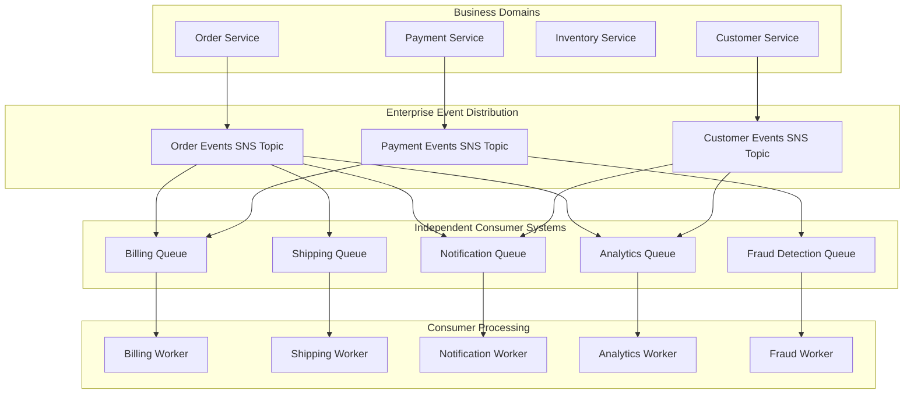
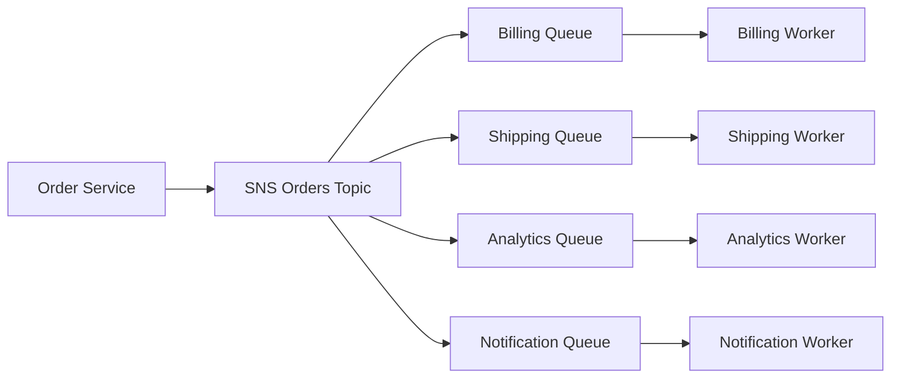
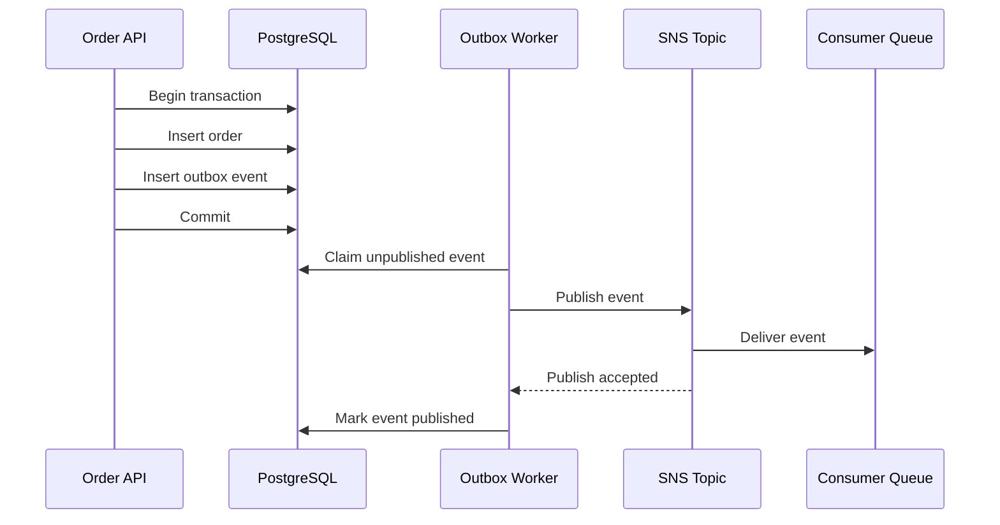

# 10- Enterprise Event Distribution Architecture

## Overview

Enterprise event distribution provides a standardized way to publish, route, and consume business events across multiple applications, microservices, teams, and AWS accounts.

In a small system, services can communicate directly through REST APIs or gRPC. As the organization grows, direct integrations create tight coupling, complex dependency management, and operational bottlenecks. A change in one service can affect several downstream systems.

An enterprise event distribution architecture introduces a shared event distribution capability while preserving service ownership and independent deployment.

Amazon SNS is useful for distributing events to multiple subscribers. Combined with Amazon SQS, EventBridge, Lambda, and durable event storage, it supports enterprise-scale asynchronous integration.

A typical enterprise architecture must address:

- Event publishing and distribution.
- Service and domain ownership.
- Cross-account and cross-Region communication.
- Event contracts and schema evolution.
- Filtering and routing.
- Consumer isolation and backpressure.
- Security and governance.
- Observability and operational ownership.
- Replay, reconciliation, and disaster recovery.

SNS should be treated as a distribution mechanism, not as a complete enterprise event platform. It does not independently provide a retained event history, global schema governance, or exactly-once business processing.

## Enterprise Event Distribution Requirements

An enterprise system commonly contains multiple business domains:

- Customer management.
- Order processing.
- Payments.
- Inventory.
- Billing.
- Shipping.
- Notifications.
- Analytics and reporting.
- Fraud detection.

Each domain owns its data and publishes events when relevant business state changes.

For example, when an order is placed, several independent systems may need to react:

- Inventory reserves stock.
- Payment processing initiates authorization.
- Notification services send an order confirmation.
- Analytics records the transaction.
- Shipping prepares fulfillment.

The order service should not need to know the internal implementation of every downstream consumer.

An event distribution layer provides this decoupling.

### Architectural Requirements

| Requirement | Engineering concern | Typical solution |
|---|---|---|
| Loose coupling | Publishers should not depend on consumer implementations | SNS topics |
| Consumer isolation | Slow consumers must not block others | Separate SQS queues |
| Selective routing | Consumers should receive relevant events | SNS filter policies or EventBridge rules |
| Cross-account integration | Services operate in separate AWS accounts | IAM and resource policies |
| Regional resilience | Regional failures must not permanently stop processing | Multi-Region architecture |
| Event governance | Producers and consumers need compatible contracts | Versioned schemas and contract testing |
| Durable processing | Consumers need recoverable messages | SQS, DLQs, and event archives |
| Auditability | Business events need traceability | Event IDs, structured logs, and durable storage |
| Replay | Historical events may need reprocessing | S3 event archives or an event streaming platform |

## Enterprise Reference Architecture

A practical enterprise design separates business domains, event distribution, and consumer processing.



The architecture has three primary layers.

| Layer | Responsibility |
|---|---|
| Business domains | Own business data and publish domain events |
| Distribution layer | Route events to interested subscribers |
| Consumer systems | Process events independently using their own queues and workers |

The distribution layer should not become the owner of business logic. Domain services remain responsible for defining the meaning of their events.

## Domain-Oriented Event Ownership

Enterprise event distribution should follow domain ownership rather than creating one unrestricted topic for every application.

For example:

```text
Enterprise Event Platform
|
+-- Orders
|   +-- order-events
|   +-- order-created
|   +-- order-cancelled
|   +-- order-completed
|
+-- Payments
|   +-- payment-events
|   +-- payment-authorized
|   +-- payment-failed
|   +-- payment-refunded
|
+-- Customers
|   +-- customer-events
|   +-- customer-created
|   +-- customer-updated
|
+-- Inventory
    +-- inventory-events
    +-- stock-reserved
    +-- stock-released
```

The event producer owns:

- Event semantics.
- Event naming.
- Event schema.
- Compatibility guarantees.
- Publication reliability.
- Documentation and lifecycle management.

Consumers own:

- Subscription configuration.
- Processing logic.
- Idempotency.
- Retry behavior.
- Dead-letter handling.
- Consumer-specific data models.

This ownership model prevents the event platform team from becoming a bottleneck for every business-domain change.

### Domain Events vs Integration Events

A domain event represents a business fact within a bounded context. An integration event is the externally published contract used to communicate that fact to other systems.

For example, an order service may internally use several domain events while publishing a stable integration event such as `order.created`.

| Event type | Purpose | Example |
|---|---|---|
| Domain event | Represents a fact inside a domain | `OrderValidated` |
| Integration event | Communicates a business fact across services | `order.created` |
| Command | Requests another component to perform an action | `payment.authorize` |
| Query | Requests information | `GetOrderDetails` |

Do not publish internal database models directly as integration contracts. Internal models change more frequently and may expose implementation details.

## SNS Topic Design

SNS topics provide logical distribution boundaries.

An enterprise can organize topics by domain, event category, or integration boundary.

### Domain-Based Topics

Example:

```text
arn:aws:sns:ap-south-1:111122223333:orders-events
arn:aws:sns:ap-south-1:111122223333:payments-events
arn:aws:sns:ap-south-1:111122223333:customers-events
arn:aws:sns:ap-south-1:111122223333:inventory-events
```

Advantages:

- Clear ownership.
- Independent access policies.
- Easier monitoring.
- Domain-level subscription management.
- Smaller security boundaries.

Limitations:

- More topics to manage.
- Requires naming and lifecycle governance.
- Consumers may need subscriptions across several topics.

### Central Enterprise Topic

A central topic can distribute events from multiple domains.

```text
enterprise-events
    |
    +-- Billing Queue
    +-- Analytics Queue
    +-- Notification Queue
    +-- Audit Queue
```

This simplifies subscription management for consumers that need many event types.

However, it can create a broad security boundary and make ownership unclear. A single central topic should not become an unrestricted channel through which every service publishes arbitrary events.

### Choosing a Topic Strategy

| Strategy | Advantages | Limitations | Suitable use |
|---|---|---|---|
| Domain-based topics | Clear ownership and isolation | More topic resources | Most enterprise domain integrations |
| Central topic | Simplified shared subscription | Broad access and governance boundary | Controlled enterprise integration layer |
| Topic per event type | Fine-grained permissions | Large resource count | Specialized high-isolation requirements |
| Topic per environment | Environment isolation | Requires deployment coordination | Development, staging, production |

A practical default is domain-based topics with explicit consumer subscriptions.

## Consumer Isolation with SNS and SQS

SNS distributes events to subscribers. SQS provides each consumer with an independent processing buffer.

This combination is particularly important in enterprise systems.

Consider an order event consumed by billing, shipping, analytics, and notifications.



Each consumer has an independent queue.

If the analytics system is unavailable, its queue accumulates messages while billing and shipping continue processing.

### Why Separate Queues Matter

Using one shared queue for multiple logical consumers creates competing-consumer behavior.

Each message is normally received by one consumer, not independently delivered to every application.

For independent event distribution, use one queue per logical subscriber.

| Consumer | Queue | Independent configuration |
|---|---|---|
| Billing | `billing-order-events` | Billing retry and DLQ |
| Shipping | `shipping-order-events` | Shipping visibility timeout |
| Analytics | `analytics-order-events` | Analytics processing concurrency |
| Notifications | `notification-order-events` | Notification provider retry policy |

This allows each team to control its processing capacity and failure handling.

### Subscription Filtering

SNS filter policies reduce unnecessary message delivery.

For example, a billing subscriber may only need payment-related order events.

```json
{
  "event_type": [
    "order.completed",
    "order.cancelled"
  ]
}
```

A subscription can filter using message attributes or supported message-body filtering.

Filtering should be designed carefully:

- Keep filter values stable.
- Version event contracts independently from filtering rules.
- Test changes against representative events.
- Monitor unexpected drops in consumer volume.
- Avoid using filters as a replacement for authorization.

Filtering is a routing mechanism, not a security boundary.

## Enterprise Event Contract

A stable event contract is essential when multiple teams consume the same event.

Example integration event:

```json
{
  "event_id": "e4f7f66d-3d21-4d12-9bb5-5d27cfe78e01",
  "event_type": "order.created",
  "schema_version": 2,
  "source": "orders-service",
  "occurred_at": "2026-11-20T08:30:00Z",
  "correlation_id": "checkout-12345",
  "tenant_id": "tenant-100",
  "data": {
    "order_id": "order-9001",
    "customer_id": "customer-500",
    "currency": "INR",
    "total_amount": 2499.00
  }
}
```

### Recommended Contract Fields

| Field | Purpose |
|---|---|
| `event_id` | Stable identifier for the logical event |
| `event_type` | Business event classification |
| `schema_version` | Contract version |
| `source` | Publishing service |
| `occurred_at` | Time the business event occurred |
| `correlation_id` | Connects related operations |
| `tenant_id` | Tenant context where applicable |
| `data` | Event-specific payload |

Use UTC timestamps and stable identifiers.

Avoid including:

- Database connection details.
- Internal ORM objects.
- Authentication tokens.
- Unnecessary personal information.
- Large binary payloads.
- Fields whose meaning changes without a schema-version change.

### Schema Evolution

Enterprise consumers may deploy independently. Producers cannot assume every consumer updates immediately.

Prefer backward-compatible changes.

Generally safe changes include:

- Adding optional fields.
- Adding new event types.
- Adding new optional metadata.
- Increasing supported enum values when consumers tolerate unknown values.

Potentially breaking changes include:

- Renaming fields.
- Changing field types.
- Removing required fields.
- Changing the meaning of an existing field.
- Reusing an event type for a different business meaning.

For incompatible changes, publish a new schema version or introduce a new event type.

Maintain contract tests to verify that producers and consumers agree on required fields and semantics.

SNS does not provide a complete enterprise schema registry. Use a dedicated schema governance mechanism when centralized discovery, compatibility checks, and schema lifecycle management are required.

## Reliable Event Publishing

A producer should not publish an integration event before its business transaction commits.

Consider an order service:

1. Insert an order.
2. Publish `order.created`.
3. Commit the database transaction.

If the database transaction rolls back after publication, downstream services may process an event for an order that does not exist.

Publishing after the database commit creates the opposite failure window: the database may commit successfully while SNS publishing fails.

### Transactional Outbox Pattern

The transactional outbox solves this dual-write problem.



Example schema:

```sql
CREATE TABLE event_outbox (
    event_id UUID PRIMARY KEY,
    aggregate_type VARCHAR(100) NOT NULL,
    aggregate_id VARCHAR(150) NOT NULL,
    event_type VARCHAR(150) NOT NULL,
    schema_version INTEGER NOT NULL,
    payload JSONB NOT NULL,
    created_at TIMESTAMPTZ NOT NULL DEFAULT NOW(),
    published_at TIMESTAMPTZ
);

CREATE INDEX idx_event_outbox_unpublished
    ON event_outbox (created_at)
    WHERE published_at IS NULL;
```

A dispatcher should:

- Claim events safely.
- Publish using a stable event ID.
- Retry transient failures.
- Record publication status.
- Recover abandoned claims.
- Monitor the age of unpublished events.

Use row locking such as `FOR UPDATE SKIP LOCKED` when multiple dispatchers operate concurrently.

A successful SNS publish means SNS accepted the publication. It does not mean every subscriber processed the event.

The outbox dispatcher may publish an event more than once if it crashes after SNS acceptance but before updating `published_at`. Consumers must therefore be idempotent.

## Enterprise Consumer Processing

Consumers should process events independently and maintain their own application state.

A typical consumer lifecycle is:

1. Receive an SQS message.
2. Validate the event envelope.
3. Check whether the event has already been processed.
4. Execute the business operation.
5. Persist the result.
6. Delete the message after successful processing.

### Idempotent Consumer

A consumer can use a unique event ID to prevent duplicate database updates.

```sql
CREATE TABLE processed_events (
    event_id UUID PRIMARY KEY,
    consumer_name VARCHAR(150) NOT NULL,
    processed_at TIMESTAMPTZ NOT NULL DEFAULT NOW()
);
```

If the same event is delivered again, the unique constraint prevents a second successful claim.

For multi-consumer systems, the idempotency key should include the consumer identity:

```sql
CREATE TABLE processed_events (
    consumer_name VARCHAR(150) NOT NULL,
    event_id UUID NOT NULL,
    processed_at TIMESTAMPTZ NOT NULL DEFAULT NOW(),
    PRIMARY KEY (consumer_name, event_id)
);
```

The idempotency record and business database changes should be committed in the same transaction.

This protects database operations from duplicate delivery. It does not guarantee exactly-once execution of external side effects such as sending email, charging a payment provider, or invoking another API.

Use provider idempotency keys or an additional durable workflow for those operations.

### Retry and Dead-Letter Handling

Configure retry behavior based on the failure type.

| Failure | Recommended action |
|---|---|
| Temporary database outage | Retry |
| Network timeout | Retry with backoff |
| Provider throttling | Retry with backoff |
| Invalid event schema | Quarantine or DLQ |
| Unsupported event version | Route for investigation |
| Permanent business rejection | Record terminal state |
| Repeated processing failure | Move to DLQ |

Use separate DLQs for independent consumers.

An analytics failure should not place a billing event into the billing DLQ.

For SNS-to-SQS delivery, distinguish between the SNS subscription DLQ and the SQS consumer processing DLQ. They capture failures at different stages.

## Enterprise Integration Across AWS Accounts

Large organizations often separate environments and business domains into multiple AWS accounts.

For example:

```text
AWS Organization
|
+-- Shared Services Account
|   +-- Enterprise Event Infrastructure
|
+-- Orders Account
|   +-- Orders Service
|
+-- Payments Account
|   +-- Payment Service
|
+-- Analytics Account
    +-- Analytics Consumers
```

A shared event infrastructure account can own centrally governed SNS topics, while domain accounts publish or subscribe through controlled cross-account permissions.

### Cross-Account Publishing

Cross-account access requires appropriate identity and resource permissions.

The publisher's IAM policy must allow `sns:Publish`, and the topic resource policy must authorize the publishing principal.

Example topic policy statement:

```json
{
  "Sid": "AllowOrdersAccountPublisher",
  "Effect": "Allow",
  "Principal": {
    "AWS": "arn:aws:iam::111122223333:root"
  },
  "Action": "sns:Publish",
  "Resource": "arn:aws:sns:ap-south-1:444455556666:enterprise-orders-events"
}
```

The account principal delegates access subject to its own IAM policies. For tighter control, specify an appropriate role ARN instead of granting access broadly to an account.

### Cross-Account SQS Subscription

For an SNS topic to deliver to an SQS queue in another account, configure:

- SNS subscription.
- SQS queue policy.
- Correct topic ARN.
- Required subscription authorization.
- KMS permissions if customer-managed encryption is used.

The SQS queue policy should restrict `sqs:SendMessage` to the exact SNS topic ARN using `aws:SourceArn`.

Do not assume that successful subscription creation proves message delivery. Validate the subscription state and test actual delivery.

## Enterprise Event Routing: SNS vs EventBridge

SNS and EventBridge solve related but different distribution problems.

| Capability | SNS | EventBridge |
|---|---|---|
| Primary model | Publish-subscribe | Event bus and rule-based routing |
| Routing | Topic subscriptions and filter policies | Event patterns and rules |
| Fan-out | Native | Multiple rule targets |
| SQS integration | Native subscription protocol | SQS target |
| Cross-account integration | Resource policies and subscriptions | Event bus permissions and targets |
| Cross-Region routing | Explicit publishing or supported integration | Supported cross-Region event-bus routing |
| Event archive and replay | Not a general event archive | Archive and replay capabilities |
| Schema discovery | Not a complete schema registry | Schema Registry integration |
| Direct notification protocols | Email, SMS, mobile push, HTTP/S, among others | Not a direct replacement for notification delivery protocols |

### When to Use SNS

Use SNS when:

- A publisher needs straightforward fan-out.
- Subscribers need independent SQS queues.
- Direct email, SMS, or mobile push integration is required.
- Topic-based access control is sufficient.
- Low-complexity publish-subscribe distribution is preferred.

### When to Use EventBridge

Use EventBridge when:

- Routing depends on structured event patterns.
- Multiple event sources need a common event bus.
- Cross-account or cross-Region event routing is required.
- Event archive and replay are useful.
- Schema discovery and event-driven integrations are important.

### Combining SNS and EventBridge

A system may use both services when their responsibilities are distinct.

For example:

- EventBridge receives domain integration events.
- EventBridge rules route selected events to an SNS topic.
- SNS distributes the notification event to several SQS queues.
- Each consumer processes messages independently.

Avoid adding both services simply because both support event distribution. Every additional hop introduces another delivery boundary, permission configuration, failure mode, and cost.

## SNS FIFO in Enterprise Workflows

Standard SNS topics are suitable for most independent event distribution workloads.

SNS FIFO is useful when ordering and deduplication requirements exist.

Examples:

- Ordered order-status transitions.
- Sequential inventory operations.
- Financial workflow events requiring per-entity ordering.

A FIFO topic requires a message group ID and supports deduplication through an explicit or content-based deduplication ID.

Important considerations:

- Ordering is maintained within a message group, not globally.
- The deduplication window is five minutes.
- Content-based deduplication hashes the message body, not message attributes.
- FIFO filtering changes delivery semantics and can result in sequence gaps.
- SNS FIFO has more limited subscription protocol support than Standard topics.
- For ordered consumer processing, use SQS FIFO subscriptions and preserve message-group semantics.

Do not select FIFO simply because the application publishes business events. Use it when ordering requirements are explicit and the message-group strategy is well defined.

## Large Event Payloads

SNS and SQS are intended for message distribution, not unrestricted binary or large document transport.

The SNS message size limit is 256 KiB. SQS supports messages up to 1 MiB.

For larger payloads, store the content in Amazon S3 and publish a reference.

Example:

```json
{
  "event_id": "e4f7f66d-3d21-4d12-9bb5-5d27cfe78e01",
  "event_type": "document.process.requested",
  "data": {
    "bucket": "enterprise-event-payloads",
    "key": "documents/2026/11/document-9001.json",
    "version_id": "3HL4kqtJlcpXroDTDmjVBH40Nrjfkd"
  }
}
```

The consumer retrieves the object using its own IAM permissions.

Production considerations:

- Use versioned S3 objects when immutable payload references are required.
- Restrict bucket access to authorized consumers.
- Encrypt objects with appropriate KMS keys.
- Define lifecycle and retention policies.
- Validate object ownership and expected content.
- Avoid exposing permanent public URLs.
- Use short-lived presigned URLs only when appropriate.

The event should contain enough metadata to identify the object without duplicating its contents.

## Security and Governance

Enterprise event distribution creates a shared integration boundary. Governance must prevent unauthorized publishing, uncontrolled subscriptions, and accidental exposure of sensitive information.

### Access Control

Apply least-privilege policies:

- Publishers should publish only to approved domain topics.
- Consumers should receive only from approved queues.
- Topic administrators should be separate from application publishers.
- Queue policies should authorize exact topic ARNs.
- Cross-account access should be explicitly reviewed.
- KMS permissions should be scoped to required resources.

### Encryption

Use encryption in transit and at rest.

- HTTPS for application-to-AWS API calls.
- SNS server-side encryption where required.
- SQS SSE-SQS or SSE-KMS.
- S3 encryption for archived payloads.
- Regional KMS policies for cross-Region deployments.

Encryption does not replace authorization. A principal with access to an encrypted queue may still be able to read its messages if it has the required permissions.

### Event Governance

Establish organization-wide standards for:

| Governance area | Standard |
|---|---|
| Topic naming | Domain and environment conventions |
| Event naming | Stable business event names |
| Schema versioning | Explicit compatibility policy |
| Ownership | Named producer and consumer teams |
| Retention | Defined event and DLQ retention |
| Access | Approved publishers and subscribers |
| Sensitive data | Classification and minimization |
| Lifecycle | Deprecation and migration process |
| Operational support | Defined on-call ownership |

Do not allow unrestricted topic creation and subscription management across every application account.

## Observability and Operations

Enterprise event distribution needs visibility across the entire event lifecycle.

Monitoring only SNS publication metrics is insufficient because the event may fail during subscription delivery or consumer processing.

### Key Metrics

| Service | Metric | Operational purpose |
|---|---|---|
| SNS | `NumberOfMessagesPublished` | Publishing volume |
| SNS | `NumberOfNotificationsDelivered` | Subscription delivery success |
| SNS | `NumberOfNotificationsFailed` | Subscription delivery failures |
| SQS | `ApproximateNumberOfMessagesVisible` | Queue backlog |
| SQS | `ApproximateAgeOfOldestMessage` | Processing delay |
| SQS | `ApproximateNumberOfMessagesNotVisible` | In-flight messages |
| SQS | DLQ visible messages | Failed consumer processing |
| Lambda | `Errors` | Worker failures |
| Lambda | `Throttles` | Concurrency pressure |
| Lambda | `Duration` | Processing latency |
| Application | Outbox backlog age | Publication delay |
| Application | Duplicate event count | Idempotency effectiveness |
| Application | End-to-end processing latency | Business event processing health |

Metric availability varies by service and subscription protocol. Use application-level metrics to measure business processing and recipient delivery.

### Correlation IDs

Every event should carry stable identifiers.

Recommended identifiers:

- `event_id`: identifies the logical event.
- `correlation_id`: connects related business operations.
- `causation_id`: identifies the event or command that caused this event.
- `trace_id`: connects distributed traces.
- `aggregate_id`: identifies the business entity.

Example structured log:

```json
{
  "event": "enterprise_event_processed",
  "event_id": "e4f7f66d-3d21-4d12-9bb5-5d27cfe78e01",
  "event_type": "order.created",
  "consumer": "billing-service",
  "correlation_id": "checkout-12345",
  "aggregate_id": "order-9001",
  "status": "success",
  "duration_ms": 84
}
```

Avoid logging full event payloads indiscriminately. Payloads may contain personal or financial information.

## Scalability and Backpressure

Enterprise event traffic can be uneven.

For example, a marketing campaign may generate a large number of orders, causing a sudden increase in downstream events.

SNS can distribute publications to subscribers, but each consumer still needs enough capacity to process its own backlog.

### Independent Consumer Scaling

Use queue depth and message age to scale workers.

For Lambda with SQS event source mappings, configure:

- Batch size.
- Maximum concurrency.
- Visibility timeout.
- Partial batch response handling.
- Appropriate retry and DLQ policies.

For ECS or EKS workers, scale based on queue backlog, message age, and processing capacity.

Do not scale only on queue depth. A large backlog of low-priority messages may be less urgent than a smaller queue containing time-sensitive work.

### Backpressure Strategy

A consumer should be able to slow its processing without affecting unrelated subscribers.

Useful controls include:

- Independent SQS queues.
- Worker concurrency limits.
- Provider rate limits.
- Bounded database connection pools.
- Retry backoff.
- Priority queues where justified.
- Queue-age alarms.
- Admission control for expensive downstream operations.

Do not allow unlimited retries or unbounded worker concurrency. Both can amplify an incident.

## Enterprise Reliability and Disaster Recovery

SNS and SQS are regional services. Enterprise systems that require regional resilience must explicitly deploy and configure their distribution infrastructure in multiple Regions.

A multi-Region strategy should define:

- Which Region owns normal event publishing.
- How events are replicated.
- Which Region processes notifications during failover.
- How duplicate events are suppressed.
- How event state is reconciled.
- How DLQs are recovered.
- How failback is performed.

For critical business events, retain a durable source of truth outside the transient messaging path.

Possible mechanisms include:

- Transactional outbox records.
- S3 event archives.
- EventBridge archives where appropriate.
- A dedicated event streaming platform when long-term retention and replay are core requirements.

SNS does not provide a general-purpose retained event log.

### Recovery Objectives

Define measurable recovery targets.

| Metric | Description |
|---|---|
| RTO | Maximum acceptable recovery time |
| RPO | Maximum acceptable event loss window |
| Queue age | Maximum acceptable processing delay |
| Replication lag | Maximum acceptable cross-Region delay |
| DLQ recovery time | Time to investigate and recover failed messages |
| Reconciliation time | Time to resolve ambiguous processing outcomes |

Run regular failure exercises. A successful infrastructure deployment does not prove that event recovery works.

## Cost Optimization

Enterprise event distribution costs depend on message volume, payload size, subscription count, consumer activity, and regional topology.

Important cost areas:

- SNS API requests.
- SQS requests and long polling.
- Lambda invocations and execution duration.
- EventBridge event ingestion and delivery.
- Cross-Region data transfer.
- KMS requests.
- CloudWatch metrics and logs.
- S3 event archives.
- DLQ storage and recovery operations.

Cost optimization techniques:

- Use message filtering to avoid unnecessary delivery.
- Use SQS long polling to reduce empty receives.
- Batch SQS operations where appropriate.
- Keep event payloads compact.
- Avoid unnecessary cross-Region replication.
- Apply retention policies to archives and DLQs.
- Scale consumers based on actual workload.
- Monitor cost by domain and environment.

Do not optimize costs by removing independent queues when consumer isolation is a requirement. The operational cost of coupling unrelated consumers can exceed the infrastructure savings.

## Deployment and CI/CD

Treat topics, subscriptions, queues, policies, encryption, and monitoring as version-controlled infrastructure.

A practical repository structure:

```text
enterprise-event-platform/
|
+-- infrastructure/
|   +-- terraform/
|       +-- modules/
|       |   +-- sns-topic/
|       |   +-- sqs-consumer/
|       |   +-- event-subscription/
|       |
|       +-- environments/
|           +-- development/
|           +-- staging/
|           +-- production/
|
+-- contracts/
|   +-- orders/
|   +-- payments/
|   +-- customers/
|
+-- publishers/
|   +-- orders-service/
|   +-- payments-service/
|
+-- consumers/
|   +-- billing-service/
|   +-- shipping-service/
|   +-- notification-service/
|
+-- tests/
    +-- contract/
    +-- integration/
    +-- failure/
```

A deployment pipeline should validate:

1. Terraform formatting and validation.
2. IAM and resource policy changes.
3. Event contract compatibility.
4. Producer and consumer contract tests.
5. Queue and DLQ configuration.
6. Subscription delivery.
7. Encryption configuration.
8. Monitoring and alarm configuration.
9. Failure and retry behavior.

Deploy infrastructure changes in a controlled order. A queue policy must authorize SNS delivery, and the required topic and queue resources must exist before a subscription can operate successfully.

For production, use staged deployment and verify actual message delivery rather than relying only on a successful infrastructure apply.

## Common Mistakes and Production Pitfalls

| Mistake | Why it causes problems | Better approach |
|---|---|---|
| One shared SQS queue for unrelated consumers | Consumers compete for messages instead of receiving independent copies | Create a separate queue per logical subscriber |
| One unrestricted enterprise SNS topic | Creates broad access and unclear ownership | Use domain-oriented topics and explicit governance |
| Publishing database models directly | Couples event contracts to internal implementation | Publish stable integration events |
| Assuming SNS provides event replay | SNS is a distribution service, not a retained event log | Use S3, EventBridge archives, or a streaming platform |
| Treating SNS publish success as business completion | Consumers may still fail or remain delayed | Track processing state independently |
| Ignoring duplicate delivery | Retries can repeat business operations | Use stable event IDs and idempotent consumers |
| Using filters for authorization | Filters are routing rules, not security controls | Enforce IAM and resource policies |
| Ignoring schema compatibility | Independently deployed consumers may break | Use versioned contracts and compatibility tests |
| Replicating every event to every Region | Increases cost and data exposure | Route only events required by each Region |
| Using FIFO without ordering requirements | Adds constraints without business value | Select FIFO only for explicit ordering needs |
| Retrying poison messages indefinitely | Consumes capacity and delays healthy work | Use bounded retries and DLQs |
| Monitoring only SNS publication | Hides downstream processing failures | Monitor queues, workers, and business outcomes |
| Treating DLQs as permanent archives | Retention and investigation workflows are limited | Archive important events separately |
| Allowing unrestricted subscriptions | Increases data exposure and operational risk | Apply subscription approval and ownership controls |

## Production Design Checklist

### Architecture

- [ ] Domain ownership is documented.
- [ ] Topic boundaries reflect business integration requirements.
- [ ] Each logical consumer has an independent queue.
- [ ] Event routing rules are documented.
- [ ] Cross-account and cross-Region flows are explicit.

### Event Contracts

- [ ] Every event has a stable event ID.
- [ ] Event types and schema versions are defined.
- [ ] Compatibility rules are documented.
- [ ] Sensitive fields are minimized.
- [ ] Producers and consumers have contract tests.

### Reliability

- [ ] Business transactions use a transactional outbox where required.
- [ ] Consumers implement idempotency.
- [ ] Retry policies are bounded.
- [ ] SNS subscription and SQS processing DLQs are configured where needed.
- [ ] Replay and reconciliation procedures exist.

### Security

- [ ] IAM permissions follow least privilege.
- [ ] Topic and queue policies restrict authorized principals.
- [ ] Encryption is configured.
- [ ] KMS permissions are reviewed.
- [ ] Event data classification is documented.

### Operations

- [ ] Queue age and backlog alarms exist.
- [ ] DLQs are monitored.
- [ ] Event correlation IDs are propagated.
- [ ] Consumer capacity and provider limits are documented.
- [ ] Incident response and recovery runbooks are tested.

## Key Takeaways

- Enterprise event distribution should follow domain ownership, stable event contracts, and independent consumer responsibilities.
- SNS provides publish-subscribe fan-out, while separate SQS queues provide durable buffering and failure isolation for each logical consumer.
- Transactional outbox publishing, idempotent consumers, bounded retries, and DLQs are essential for reliable asynchronous integration.
- EventBridge complements SNS when rule-based routing, cross-account or cross-Region integration, schema discovery, and archive/replay capabilities are required.
- Enterprise readiness depends on explicit security governance, observability, capacity planning, disaster recovery, and tested operational procedures.