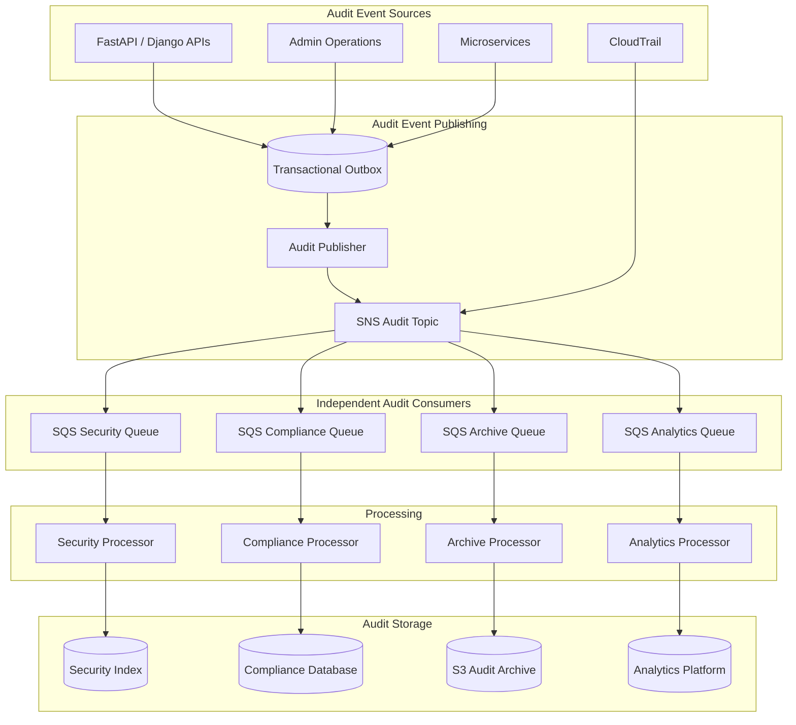
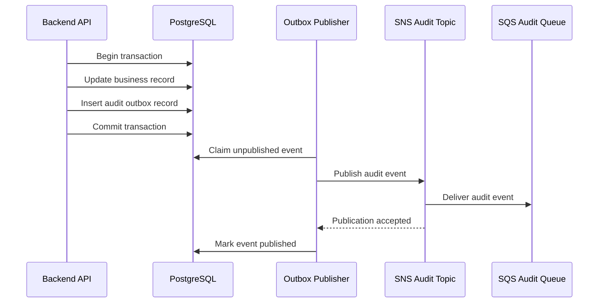
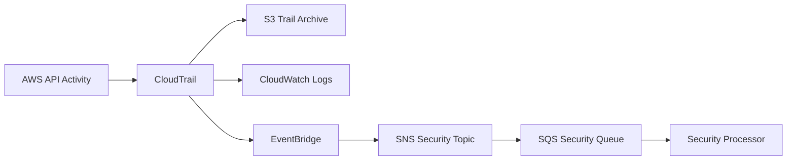
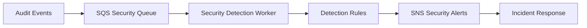

# 11- Audit Logging Architecture

## Overview

Audit logging provides a reliable record of security-sensitive operations, administrative activities, business transactions, and system-level changes.

In enterprise backend systems, audit records are required for:

- Security investigations.
- Regulatory compliance.
- User activity tracking.
- Administrative accountability.
- Financial transaction traceability.
- Incident response.
- Operational troubleshooting.
- Forensic analysis.

Amazon SNS can distribute audit events to multiple independent systems. Combined with Amazon SQS, Lambda, Amazon S3, CloudWatch, and AWS CloudTrail, it supports a scalable audit event processing architecture.

SNS should not be treated as the authoritative audit log. It provides asynchronous event distribution, not durable long-term event retention or tamper-proof archival.

A production audit architecture should separate:

1. **Audit event generation** — capturing significant application and infrastructure activities.
2. **Audit event distribution** — delivering events to independent consumers.
3. **Audit event processing** — validating, enriching, and indexing records.
4. **Audit event storage** — retaining records in durable storage.
5. **Audit event analysis** — supporting security investigations, compliance reporting, and operational monitoring.

## Audit Logging vs Application Logging

Application logs and audit logs serve different purposes.

Application logs primarily help engineers understand system behavior. Audit logs establish who performed an action, what changed, when it happened, and whether the operation succeeded.

| Characteristic | Application logs | Audit logs |
|---|---|---|
| Primary purpose | Debugging and operations | Accountability and traceability |
| Typical content | Errors, warnings, execution details | Actor, action, resource, outcome |
| Retention | Based on operational requirements | Based on compliance and audit policy |
| Modification | May be rotated or sampled | Must be protected against unauthorized alteration |
| Completeness | Sampling may be acceptable | Critical actions should be recorded reliably |
| Access | Engineering and operations teams | Restricted security, compliance, and authorized teams |
| Storage | CloudWatch Logs or log platforms | Controlled audit storage and indexing |

An application log might record:

```json
{
  "level": "INFO",
  "message": "User profile updated",
  "request_id": "req-12345"
}
```

An audit event should provide additional accountability:

```json
{
  "audit_id": "audit-9001",
  "event_type": "user.profile.updated",
  "actor": {
    "type": "user",
    "id": "user-500"
  },
  "resource": {
    "type": "user_profile",
    "id": "profile-500"
  },
  "action": "UPDATE",
  "outcome": "SUCCESS",
  "timestamp": "2026-11-20T08:30:00Z",
  "source_ip": "203.0.113.10",
  "correlation_id": "req-12345"
}
```

Audit records should be designed as structured business and security evidence rather than unstructured application messages.

## Audit Logging Architecture

A typical SNS-based audit architecture distributes audit events to multiple independent consumers.



The architecture separates event production from storage and analysis.

### Component Responsibilities

| Component | Responsibility |
|---|---|
| Application services | Generate business and user activity audit events |
| Transactional outbox | Persist audit events alongside business transactions |
| Audit publisher | Publish persisted events to SNS |
| SNS topic | Distribute audit events to subscribers |
| SQS queues | Buffer events independently for each consumer |
| Lambda or workers | Validate, enrich, and process events |
| Amazon S3 | Retain durable audit archives |
| Security platform | Detect suspicious activity |
| Compliance platform | Support reporting and evidence collection |
| Analytics platform | Analyze audit activity over time |

For infrastructure and AWS API activity, CloudTrail should remain the authoritative AWS API activity source. Application audit events and CloudTrail events serve complementary purposes.

## Audit Event Sources

Audit events can originate from several layers.

### Application-Level Events

Application audit events capture actions performed through business APIs and application interfaces.

Examples:

- User login and logout.
- Password or authentication-factor changes.
- Permission changes.
- Customer profile modifications.
- Financial transactions.
- Data exports.
- Administrative actions.
- Sensitive record access.

A Django or FastAPI application can generate audit events through service-layer instrumentation.

Avoid relying exclusively on HTTP middleware. Middleware can capture request metadata, but it often lacks the business context required to determine what changed and whether the operation committed successfully.

### Infrastructure-Level Events

Infrastructure audit events capture changes to AWS resources and API activity.

Examples:

- IAM policy changes.
- Security group modifications.
- S3 bucket policy changes.
- KMS key configuration changes.
- SNS topic policy modifications.
- SQS queue configuration changes.
- Cloud infrastructure deployment operations.

Use AWS CloudTrail for AWS account activity.

CloudTrail records AWS API activity and can deliver events to CloudWatch Logs, S3, and supported event-processing integrations.

Do not assume application audit records replace CloudTrail. A backend application may record that an administrator changed an application role, while CloudTrail records the AWS API call used to modify an IAM policy.

### Database-Level Events

Database audit events may capture:

- Sensitive table access.
- Privileged database operations.
- Schema changes.
- Data modification activity.
- Administrative database actions.

Use database-native auditing where database-level evidence is required.

Application audit events alone cannot reliably establish every operation performed directly against a database.

## Audit Event Design

A consistent event schema makes records easier to search, correlate, validate, and retain.

### Recommended Event Structure

```json
{
  "audit_id": "audit-9001",
  "event_type": "user.permission.updated",
  "schema_version": 1,
  "timestamp": "2026-11-20T08:30:00Z",
  "actor": {
    "type": "user",
    "id": "user-500"
  },
  "action": "UPDATE",
  "resource": {
    "type": "role",
    "id": "role-100"
  },
  "outcome": "SUCCESS",
  "source": {
    "service": "identity-service",
    "ip_address": "203.0.113.10"
  },
  "context": {
    "request_id": "req-12345",
    "correlation_id": "corr-9001",
    "tenant_id": "tenant-100"
  },
  "changes": {
    "before": {
      "permissions": ["read"]
    },
    "after": {
      "permissions": ["read", "write"]
    }
  }
}
```

### Important Fields

| Field | Purpose |
|---|---|
| `audit_id` | Unique audit record identifier |
| `event_type` | Categorizes the activity |
| `schema_version` | Supports schema evolution |
| `timestamp` | Time of the recorded activity |
| `actor` | Identity responsible for the action |
| `action` | Operation performed |
| `resource` | Target of the operation |
| `outcome` | Success, failure, or another defined result |
| `source` | Originating service and network context |
| `context` | Request, correlation, and tenant identifiers |
| `changes` | Relevant before-and-after values |

Use UTC timestamps and stable identifiers.

Do not include passwords, access tokens, session cookies, private keys, or unnecessary personal information in audit events.

For sensitive fields, record that a change occurred without storing the secret value.

### Audit Event Categories

A controlled event taxonomy improves reporting and access management.

| Category | Example events |
|---|---|
| Authentication | `user.login`, `user.logout`, `user.mfa.changed` |
| Authorization | `user.permission.updated`, `role.assigned` |
| Data access | `customer.record.viewed`, `report.exported` |
| Data modification | `customer.profile.updated`, `account.deleted` |
| Financial activity | `payment.initiated`, `payment.refunded` |
| Administration | `system.configuration.changed`, `admin.user.created` |
| Infrastructure | `iam.policy.updated`, `s3.bucket.policy.changed` |

Use stable event names and document their semantics.

## Publishing Audit Events Reliably

Audit logging has a stricter reliability requirement than ordinary diagnostic logging.

If an application successfully changes a sensitive record but fails to create the corresponding audit record, the system may lose important evidence.

### Transactional Outbox Pattern

When the audit event describes a business transaction, persist the event in the same database transaction as the business change.



Example schema:

```sql
CREATE TABLE audit_outbox (
    audit_id UUID PRIMARY KEY,
    event_type VARCHAR(150) NOT NULL,
    schema_version INTEGER NOT NULL,
    payload JSONB NOT NULL,
    created_at TIMESTAMPTZ NOT NULL DEFAULT NOW(),
    published_at TIMESTAMPTZ
);

CREATE INDEX idx_audit_outbox_unpublished
    ON audit_outbox (created_at)
    WHERE published_at IS NULL;
```

The business operation and audit outbox insertion should commit or roll back together.

A dispatcher can claim unpublished events using PostgreSQL row locking:

```sql
SELECT audit_id, event_type, schema_version, payload
FROM audit_outbox
WHERE published_at IS NULL
ORDER BY created_at
FOR UPDATE SKIP LOCKED
LIMIT 100;
```

The dispatcher should publish events outside long-running database transactions when practical, using a controlled claim or lease mechanism.

After SNS accepts a publication, the dispatcher records the publication state.

If the dispatcher crashes after SNS accepts the event but before updating PostgreSQL, it may publish the same event again.

Consumers must therefore deduplicate using `audit_id`.

### Audit Reliability Requirements

For critical audit events:

- Do not silently discard events when publication fails.
- Persist events before asynchronous publication.
- Monitor unpublished outbox records.
- Alert on excessive publication delay.
- Retry transient failures.
- Preserve failed records for investigation.
- Protect outbox data against unauthorized modification.
- Reconcile published and archived event counts.

The transactional outbox improves reliability but does not make SNS delivery or downstream processing exactly once.

## SNS Topic and SQS Queue Design

Use a dedicated SNS topic for audit event distribution.

Example:

```text
audit-events
    |
    +-- security-audit-queue
    +-- compliance-audit-queue
    +-- archive-audit-queue
    +-- analytics-audit-queue
```

Each consumer receives an independent copy of the published event.

### Why Separate Queues Matter

A compliance processor may require slower, controlled processing while a security detection processor may need near-real-time execution.

Separate queues provide:

- Independent retry policies.
- Independent visibility timeouts.
- Separate DLQs.
- Different processing concurrency.
- Consumer-specific retention.
- Failure isolation.

Do not place all audit consumers behind one shared SQS queue. A shared queue distributes messages among competing consumers rather than delivering a copy to every consumer.

### Subscription Filtering

SNS filter policies can route selected audit categories to particular consumers.

For example, a security processor may subscribe to authentication and authorization events:

```json
{
  "event_type": [
    "user.login",
    "user.permission.updated",
    "role.assigned"
  ]
}
```

A compliance processor may receive financial and administrative events.

Filtering reduces unnecessary processing, but it must not become the only control preventing unauthorized access to sensitive audit data.

Use IAM policies and queue policies to enforce access boundaries.

## Python Audit Event Publisher

A backend service can use a small publishing abstraction to keep AWS-specific logic out of business services.

```python
import json
from datetime import UTC, datetime
from typing import Any
from uuid import UUID

import boto3
from botocore.config import Config


class AuditEventPublisher:
    def __init__(self, topic_arn: str, region: str) -> None:
        self.topic_arn = topic_arn
        self.client = boto3.client(
            "sns",
            region_name=region,
            config=Config(
                retries={
                    "mode": "standard",
                    "total_max_attempts": 5,
                },
                connect_timeout=3,
                read_timeout=10,
            ),
        )

    def publish(
        self,
        audit_id: UUID,
        event_type: str,
        payload: dict[str, Any],
    ) -> str:
        event = {
            "audit_id": str(audit_id),
            "event_type": event_type,
            "schema_version": 1,
            "timestamp": datetime.now(UTC).isoformat(),
            **payload,
        }

        response = self.client.publish(
            TopicArn=self.topic_arn,
            Message=json.dumps(event),
            MessageAttributes={
                "event_type": {
                    "DataType": "String",
                    "StringValue": event_type,
                }
            },
        )

        return response["MessageId"]
```

This abstraction demonstrates SNS publishing. In a critical application workflow, call it from an outbox dispatcher rather than directly between a business database update and its commit.

The event timestamp should normally represent the actual business activity time. If the event is persisted in an outbox, capture that timestamp when the business operation occurs rather than generating a new business timestamp on every retry.

Also validate the event schema and prevent arbitrary payload fields from overriding reserved envelope fields.

## Audit Event Processing

Consumers should validate events before storing or analyzing them.

A typical processing lifecycle:

1. Receive an SQS message.
2. Parse the event envelope.
3. Validate required fields and schema version.
4. Verify event identity.
5. Check for duplicate processing.
6. Apply consumer-specific transformations.
7. Persist the audit record.
8. Delete the SQS message after successful processing.

### Idempotent Processing

A consumer should maintain a unique record for every processed audit event.

```sql
CREATE TABLE processed_audit_events (
    consumer_name VARCHAR(150) NOT NULL,
    audit_id UUID NOT NULL,
    processed_at TIMESTAMPTZ NOT NULL DEFAULT NOW(),
    PRIMARY KEY (consumer_name, audit_id)
);
```

Insert the idempotency record and the audit storage record in the same database transaction.

If the consumer crashes before committing, both operations roll back. If it commits but fails before deleting the SQS message, a redelivery can be safely recognized.

For S3 archival, use deterministic object keys based on the audit event identity or another stable partitioning scheme. Account for the possibility that a retry overwrites an existing object. Where immutability is required, use versioning, conditional writes where appropriate, and restrictive bucket controls.

## Audit Storage Architecture

Different audit consumers may need different storage models.

### Amazon S3 for Long-Term Retention

S3 is suitable for retaining large volumes of audit events at relatively low storage cost.

A practical layout:

```text
s3://enterprise-audit-archive/
|
+-- application/
|   +-- year=2026/
|       +-- month=11/
|           +-- day=20/
|               +-- part-0001.json.gz
|
+-- security/
|   +-- year=2026/
|
+-- infrastructure/
    +-- year=2026/
```

For analytics, consider converting records to Parquet and registering partitions in the AWS Glue Data Catalog for querying through Amazon Athena.

Avoid excessive partition cardinality. Partition on fields commonly used for filtering, such as date and event category, rather than high-cardinality identifiers such as individual user IDs.

### S3 Object Lock

S3 Object Lock can help protect audit archives against deletion or modification for a configured retention period.

It supports:

- Governance retention mode.
- Compliance retention mode.
- Legal holds.

Compliance mode provides stronger retention enforcement than governance mode. Retention settings must be designed carefully because objects protected by compliance mode cannot be deleted or have their retention period shortened during the retention period, including by the account root user.

Object Lock does not automatically make the entire audit architecture tamper-proof. Access policies, encryption, account administration, replication, and operational procedures must also be protected.

### Database and Search Storage

A database or search platform can support operational investigations.

| Storage | Suitable purpose |
|---|---|
| Amazon S3 | Long-term archive |
| Amazon Athena | SQL analysis over archived files |
| OpenSearch | Search and investigation |
| PostgreSQL | Structured audit queries and transactional metadata |
| CloudWatch Logs | Operational log investigation |

A search index should not automatically become the only audit record store. Search platforms may have different retention, deletion, and access characteristics from the authoritative archive.

## CloudTrail Integration

AWS CloudTrail captures AWS API activity across an AWS account.

It records activities such as:

- IAM role and policy changes.
- SNS topic configuration changes.
- SQS queue modifications.
- S3 bucket policy updates.
- KMS key operations.
- Resource creation and deletion.

A typical integration is:



This architecture supports both durable retention and event-driven security detection.

Important distinctions:

- CloudTrail records AWS API activity, not every application-level business operation.
- CloudTrail management events and data events have different coverage and configuration requirements.
- Not every CloudTrail event is delivered through the same integration path.
- CloudTrail delivery and downstream notification processing are asynchronous.
- CloudTrail log-file validation can help detect modification or deletion of delivered log files.

Enable the relevant management and data event selectors based on audit requirements. Data events can incur additional charges and should be configured deliberately.

## Security Monitoring and Alerting

Audit events can support near-real-time detection of suspicious activities.

Examples:

- Repeated failed login attempts.
- Privilege escalation.
- Unexpected administrator activity.
- Sensitive data exports.
- IAM policy changes.
- Access from unusual network locations.
- Changes to audit infrastructure.

A security processor can evaluate incoming events and publish alerts to another SNS topic.



Keep the audit ingestion path separate from the alerting path.

If an alerting integration fails, the original audit record must still be retained.

Detection rules should account for false positives, event delays, duplicate events, and missing telemetry. Security alerts should contain enough context for investigation without exposing unnecessary sensitive data.

## Tamper Resistance and Integrity

Audit records are useful only if their integrity and provenance can be trusted.

A production design should apply controls at several layers.

### Access Restrictions

- Separate audit producers from archive administrators.
- Restrict deletion and retention-policy changes.
- Use dedicated IAM roles for audit consumers.
- Enable MFA for privileged administrative operations.
- Log access to audit storage.
- Review cross-account access policies.

### Immutable Storage

For high-assurance retention, use S3 Object Lock with an appropriate retention policy.

Consider separate AWS accounts for audit storage so that application administrators cannot independently modify or delete retained records.

### Integrity Verification

CloudTrail log-file validation uses digest files and cryptographic hashes to help verify the integrity of delivered CloudTrail log files.

For application-generated audit events, additional integrity controls may include:

- Stable event IDs.
- Append-only storage permissions.
- Cryptographic checksums.
- Signed event envelopes.
- Periodic integrity verification.
- Independent archival controls.

A checksum stored alongside an object in the same modifiable location does not provide strong tamper evidence by itself. The integrity reference must be protected independently.

Hash chaining can also be used when sequential tamper evidence is required, but it introduces ordering, partitioning, and verification complexity. Design it around the actual audit requirements rather than applying it indiscriminately.

## Reliability and Failure Handling

Audit pipelines must account for failures at every stage.

| Failure | Recommended handling |
|---|---|
| Database transaction fails | Roll back business change and outbox record |
| SNS publication fails | Retain outbox record and retry |
| SNS subscription delivery fails | Configure subscription DLQ where supported |
| SQS consumer fails | Retry using visibility timeout |
| Invalid event schema | Quarantine and investigate |
| S3 archive write fails | Retry and retain source message |
| Search index unavailable | Continue durable archival independently |
| CloudTrail alert processing fails | Retain CloudTrail archive and retry alert processing |
| Duplicate delivery | Deduplicate using stable audit ID |

### Dead-Letter Queues

Use separate DLQs for separate failure boundaries.

**SNS subscription DLQ**

Captures failed SNS delivery to a subscription endpoint after the configured delivery retry policy is exhausted, where supported.

**SQS processing DLQ**

Captures messages that a consumer repeatedly receives but cannot process successfully.

These queues should have:

- Appropriate retention.
- Restricted access.
- Monitoring and alarms.
- Documented investigation procedures.
- Controlled redrive workflows.

Do not automatically discard audit events from a DLQ after a fixed number of attempts without an approved retention and incident-handling policy.

### Partial Batch Failures

When Lambda processes SQS batches, enable partial batch response handling where appropriate.

This prevents successfully processed records from being retried solely because another record in the same batch failed.

For audit pipelines, ensure that each record is independently validated and that failed records remain recoverable.

For FIFO queues, preserve ordering by stopping processing after the first failure when required by the consumer's ordering contract.

## Security and Compliance Considerations

Audit data often contains sensitive operational and personal information.

Apply data minimization and access controls throughout the pipeline.

### Data Protection

- Never log passwords, tokens, or session secrets.
- Avoid storing complete payment or authentication payloads.
- Mask or omit sensitive values in before-and-after records.
- Encrypt SQS queues and S3 archives.
- Use customer-managed KMS keys when required.
- Restrict access to audit search interfaces.
- Review cross-account and cross-Region data transfers.
- Define retention and deletion policies based on applicable requirements.

### Separation of Duties

The team responsible for producing audit events should not automatically have permission to delete or alter archived records.

A useful separation is:

| Role | Responsibility |
|---|---|
| Application team | Generate business audit events |
| Platform team | Operate SNS, SQS, and processing infrastructure |
| Security team | Investigate security events |
| Compliance team | Review retention and audit evidence |
| Audit storage administrators | Manage controlled archival infrastructure |

### Retention Policy

Retention depends on business, legal, and regulatory requirements.

Define retention separately for:

- Transactional outbox records.
- SQS source queues.
- Dead-letter queues.
- S3 audit archives.
- Search indexes.
- CloudTrail records.
- Derived analytics data.

Do not assume that the default retention of SNS or SQS satisfies audit retention requirements. SNS is not a retained event log, and SQS message retention is limited.

## Monitoring and Observability

Monitor the full audit lifecycle rather than only the SNS publishing operation.

### Important Metrics

| Component | Metric | Purpose |
|---|---|---|
| Outbox | Unpublished event count | Detect publishing backlog |
| Outbox | Oldest unpublished event age | Detect delayed audit publication |
| SNS | `NumberOfMessagesPublished` | Publishing activity |
| SNS | `NumberOfNotificationsDelivered` | Subscription delivery |
| SNS | `NumberOfNotificationsFailed` | Delivery failures |
| SQS | `ApproximateNumberOfMessagesVisible` | Queue backlog |
| SQS | `ApproximateAgeOfOldestMessage` | Processing delay |
| SQS | DLQ visible messages | Failed processing |
| Lambda | `Errors` | Consumer failures |
| Lambda | `Throttles` | Capacity pressure |
| S3 | Archive write failures | Archival reliability |
| Application | Audit event generation failures | Missing audit evidence |
| Application | Event processing latency | End-to-end processing health |

SNS metrics vary by subscription protocol and do not establish that an audit record has been durably archived.

Create application-level metrics for:

- Events generated.
- Events published.
- Events archived.
- Events rejected by schema validation.
- Duplicate events detected.
- DLQ records.
- Outbox backlog age.
- Archive reconciliation discrepancies.

### Correlation and Traceability

Carry identifiers across all processing stages:

- `audit_id`
- `request_id`
- `correlation_id`
- `trace_id`
- `actor_id`
- `resource_id`

Use structured logs to connect an application action with its outbox record, SNS publication, SQS processing, and archive object.

Avoid placing sensitive event payloads in logs merely to improve traceability.

## Scalability and Performance

Audit event volume can increase significantly during high-traffic operations or security incidents.

The architecture should handle bursts without blocking critical application requests unnecessarily.

### Scaling Strategies

- Use asynchronous outbox dispatchers.
- Batch database reads and SQS operations where appropriate.
- Use separate SQS queues for independent consumers.
- Scale Lambda or container workers according to queue age and backlog.
- Use S3 for high-volume archival.
- Partition archived data for query efficiency.
- Keep search indexing independent from durable archival.
- Apply backpressure to expensive downstream processors.

### Synchronous vs Asynchronous Audit Recording

Not every audit event should be handled asynchronously.

| Activity | Recommended approach |
|---|---|
| Low-risk diagnostic activity | Asynchronous logging |
| Business transaction requiring audit evidence | Transactional outbox |
| Privileged operation requiring immediate audit persistence | Synchronous durable audit write or transactional persistence |
| AWS API activity | CloudTrail |
| High-volume analytical telemetry | Asynchronous ingestion and aggregation |

For sensitive operations, define whether the business action must fail when audit persistence is unavailable.

This is a business and compliance decision, not simply a performance optimization.

If an operation must never complete without an audit record, the audit persistence step must participate in the operation's consistency boundary.

## Disaster Recovery

Audit records may be needed most during a major security or infrastructure incident. The audit pipeline must therefore remain recoverable independently of the application workloads it observes.

Recommended controls:

- Store critical archives in a dedicated account.
- Enable S3 versioning and appropriate Object Lock retention.
- Configure cross-Region replication when required.
- Protect KMS keys and recovery permissions.
- Monitor replication failures.
- Retain source outbox records until delivery is confirmed.
- Maintain documented recovery procedures for queues and DLQs.
- Test archive restoration and integrity verification.

Cross-Region replication should be configured with appropriate destination encryption and permissions. Replication does not automatically make every operational dependency available in the destination Region.

Define RTO and RPO for audit ingestion and archival separately from the main application.

A recovered application with missing audit history may still represent an unacceptable recovery outcome.

## Infrastructure as Code

Manage audit infrastructure through Terraform or AWS CDK.

A simplified Terraform example:

```hcl
resource "aws_sns_topic" "audit_events" {
  name              = "audit-events"
  kms_master_key_id = aws_kms_key.audit.id
}

resource "aws_sqs_queue" "audit_archive_dlq" {
  name                      = "audit-archive-dlq"
  message_retention_seconds = 1209600
  kms_master_key_id         = aws_kms_key.audit.id
}

resource "aws_sqs_queue" "audit_archive" {
  name                       = "audit-archive"
  visibility_timeout_seconds = 120
  message_retention_seconds  = 1209600
  kms_master_key_id          = aws_kms_key.audit.id

  redrive_policy = jsonencode({
    deadLetterTargetArn = aws_sqs_queue.audit_archive_dlq.arn
    maxReceiveCount     = 5
  })
}

resource "aws_sqs_queue_policy" "audit_archive" {
  queue_url = aws_sqs_queue.audit_archive.id

  policy = jsonencode({
    Version = "2012-10-17"
    Statement = [
      {
        Sid    = "AllowAuditTopicDelivery"
        Effect = "Allow"
        Principal = {
          Service = "sns.amazonaws.com"
        }
        Action   = "sqs:SendMessage"
        Resource = aws_sqs_queue.audit_archive.arn
        Condition = {
          ArnEquals = {
            "aws:SourceArn" = aws_sns_topic.audit_events.arn
          }
        }
      }
    ]
  })
}

resource "aws_sns_topic_subscription" "audit_archive" {
  topic_arn = aws_sns_topic.audit_events.arn
  protocol  = "sqs"
  endpoint  = aws_sqs_queue.audit_archive.arn
}
```

A complete deployment should also define:

- KMS key policies and rotation settings.
- SNS topic access policies.
- S3 archive bucket and Object Lock configuration.
- S3 lifecycle and replication policies.
- Consumer execution roles.
- CloudTrail configuration.
- CloudWatch alarms.
- DLQ monitoring and recovery permissions.

The example demonstrates the topic-to-queue path. Production deployments must validate queue policies, encryption permissions, retention requirements, and subscription delivery.

## Testing Strategy

Audit pipelines require more than unit tests for event serialization.

### Unit Tests

Test:

- Event schema validation.
- Required audit fields.
- Sensitive field redaction.
- Event ID generation.
- Event category classification.
- Timestamp handling.
- Schema version compatibility.

### Integration Tests

Test:

- Database transaction and outbox insertion.
- Outbox dispatcher retries.
- SNS publication.
- SNS-to-SQS delivery.
- Consumer idempotency.
- S3 archival.
- DLQ routing.

### Failure Tests

Simulate:

- SNS publication timeouts.
- Database outages.
- Consumer crashes.
- Duplicate message delivery.
- Invalid event payloads.
- S3 permission failures.
- KMS access failures.
- Search platform outages.
- Cross-Region replication delays.

### Audit Completeness Tests

For critical business workflows, compare business transactions with generated audit records.

For example:

- Every completed payment should have the required payment audit event.
- Every privileged role change should have an authorization audit record.
- Every sensitive export should have a corresponding export event.

Reconciliation should identify missing or duplicate records without silently modifying the original evidence.

## Common Mistakes and Production Pitfalls

| Mistake | Why it is problematic | Better approach |
|---|---|---|
| Treating SNS as permanent audit storage | SNS does not provide a retained event history | Archive events in S3 or another durable store |
| Publishing directly before database commit | Events may describe rolled-back operations | Use transactional outbox |
| Logging only request metadata | Business context and outcome may be missing | Generate structured domain audit events |
| Relying only on application logs | Logs may be sampled, rotated, or modified | Maintain a dedicated audit pipeline |
| Using one queue for all consumers | Consumers compete for messages | Create independent queues |
| Logging secrets in before-and-after values | Exposes credentials and sensitive information | Redact or omit sensitive fields |
| Allowing application teams to delete archives | Weakens audit integrity | Separate duties and restrict retention controls |
| Assuming SNS acceptance means archival success | Downstream delivery and processing can still fail | Track end-to-end archive completion |
| Ignoring duplicate delivery | Retries can create duplicate audit records | Deduplicate using stable audit IDs |
| Using only local application audit records for AWS changes | Direct AWS API activity may bypass the application | Enable CloudTrail |
| Treating a search index as the authoritative archive | Search data may have different retention and integrity guarantees | Keep a separate durable audit archive |
| Ignoring DLQ monitoring | Failed evidence may remain unprocessed | Alert and investigate DLQ records |
| Applying retention without legal review | Records may be deleted too early or retained unnecessarily | Define approved retention policies |
| Assuming encryption provides immutability | Authorized principals may still alter or delete records | Combine encryption with access restrictions and Object Lock |

## Production Best Practices

- Define a consistent audit event schema and event taxonomy.
- Generate audit events at the business operation or infrastructure activity boundary.
- Use transactional outbox persistence for critical application audit events.
- Use SNS for distribution and separate SQS queues for independent consumers.
- Deduplicate using stable audit event IDs.
- Store authoritative audit archives in durable, access-controlled storage.
- Use S3 Object Lock when immutable retention is required.
- Enable CloudTrail for AWS API activity.
- Restrict access to audit topics, queues, archives, and search interfaces.
- Redact secrets and minimize personal information in event payloads.
- Monitor outbox backlog, queue age, DLQs, and archive completion.
- Separate audit ingestion from security alert delivery.
- Define retention and recovery requirements explicitly.
- Test missing-event detection, duplicate handling, archival recovery, and integrity verification.
- Maintain independent operational ownership for audit infrastructure.

## Key Takeaways

- Audit logs provide accountability and traceability; they should be structured, protected, and managed separately from ordinary application logs.
- SNS distributes audit events, while SQS isolates consumers and S3 provides durable long-term archival.
- Transactional outbox persistence prevents critical business audit events from being lost between database commits and asynchronous publication.
- CloudTrail captures AWS API activity and complements application-level audit events rather than replacing them.
- Strong audit integrity requires least-privilege access, immutable retention where required, end-to-end monitoring, and tested recovery procedures.