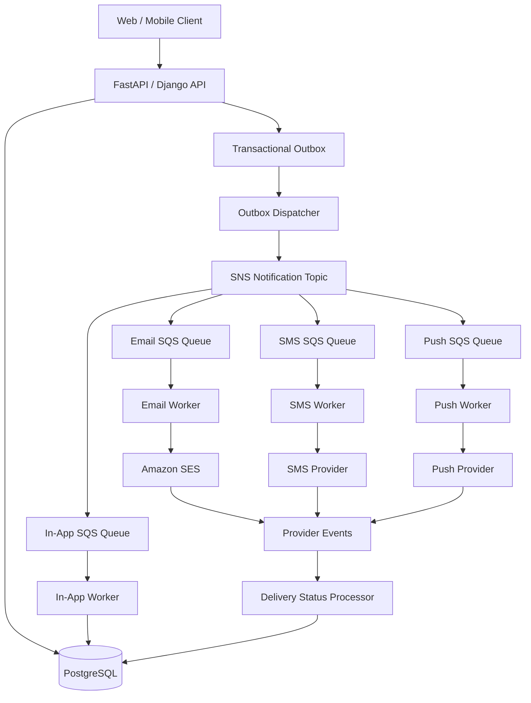
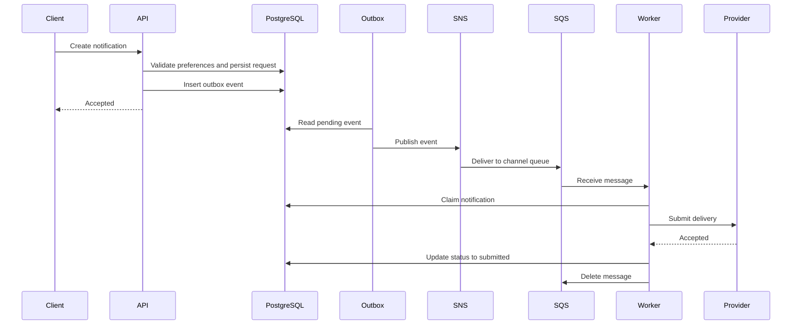
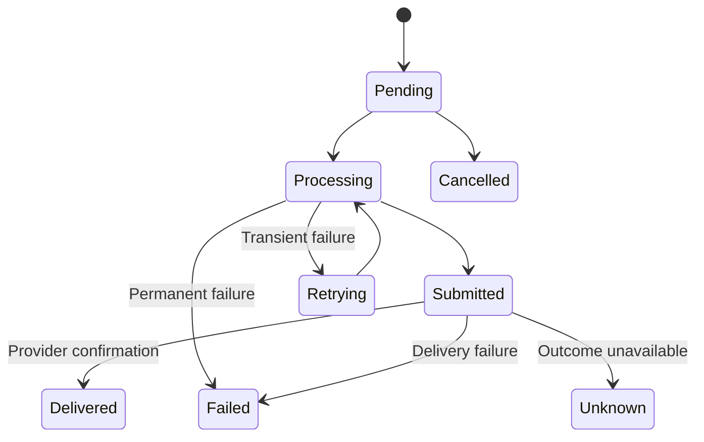

# 12- Production Notification Architecture

## Overview

A production notification system delivers business and operational messages reliably across channels such as email, SMS, mobile push, and in-app notifications.

Unlike a basic notification implementation that sends messages directly from an API request, a production architecture must handle asynchronous processing, provider failures, duplicate delivery, user preferences, rate limits, retries, observability, and delivery tracking.

Amazon SNS provides publish-subscribe distribution and supports several notification protocols. Combined with Amazon SQS, Lambda, Amazon SES, and application-managed storage, it provides a foundation for scalable notification processing.

A production system should separate:

- Notification request creation.
- Notification event distribution.
- Channel-specific processing.
- External provider integration.
- Delivery status tracking.
- Retry and failure recovery.
- User preferences and consent.
- Monitoring and operational management.

SNS is not a complete notification management platform. It does not independently provide user preference management, template lifecycle management, notification scheduling, or authoritative recipient delivery tracking.

## Production Requirements

A notification architecture should satisfy functional and operational requirements.

| Requirement | Engineering concern | Recommended approach |
|---|---|---|
| Asynchronous delivery | API requests should not wait for providers | SNS and SQS |
| Channel isolation | Email failures should not block SMS | Separate channel queues |
| Reliability | Temporary provider failures should not lose requests | Durable queues and retries |
| Idempotency | Retries must not create duplicate notifications | Stable notification IDs |
| User preferences | Users may disable particular channels | Preference service |
| Consent management | Communication must follow applicable consent requirements | Consent records and policy enforcement |
| Rate limiting | Providers enforce sending quotas | Distributed rate limiter |
| Delivery tracking | Provider acceptance differs from recipient delivery | Application delivery state |
| Scalability | Traffic can increase unpredictably | Queue-based worker scaling |
| Observability | Failures must be diagnosable | Metrics, logs, and tracing |
| Disaster recovery | Regional outages must not permanently stop delivery | Multi-Region recovery strategy |

## Reference Architecture

A production notification system can use SNS for distribution and independent SQS queues for channel-specific processing.



### Architecture Responsibilities

| Component | Responsibility |
|---|---|
| API service | Accepts notification requests |
| PostgreSQL | Stores notification requests, preferences, and delivery state |
| Transactional outbox | Persists events reliably with business transactions |
| Dispatcher | Publishes pending events |
| SNS | Distributes notification events |
| SQS | Buffers channel-specific workloads |
| Workers | Process notifications independently |
| SES | Handles transactional email delivery |
| SMS provider | Sends SMS messages |
| Push provider | Delivers mobile push notifications |
| Status processor | Updates delivery state from provider events |

The notification service owns the notification lifecycle. External providers are delivery dependencies, not the source of truth for application-level notification state.

## Notification Request Lifecycle

A typical notification request passes through several stages.



The API should normally return after the request is durably accepted, not after the external provider completes delivery.

For example:

```http
POST /api/v1/notifications
Content-Type: application/json
```

```json
{
  "recipient_id": "user-500",
  "template_id": "order-confirmation",
  "channels": ["email", "push"],
  "context": {
    "order_id": "order-9001"
  },
  "idempotency_key": "order-9001-confirmation"
}
```

Example response:

```json
{
  "notification_id": "notification-9001",
  "status": "accepted"
}
```

The response means the notification request was accepted by the application. It does not mean the email or push notification was delivered.

## Notification Data Model

A production notification system needs separate records for the logical notification and its channel-specific delivery attempts.

### Notifications Table

```sql
CREATE TABLE notifications (
    notification_id UUID PRIMARY KEY,
    recipient_id VARCHAR(150) NOT NULL,
    template_id VARCHAR(150) NOT NULL,
    notification_type VARCHAR(100) NOT NULL,
    status VARCHAR(30) NOT NULL,
    idempotency_key VARCHAR(255) UNIQUE,
    created_at TIMESTAMPTZ NOT NULL DEFAULT NOW(),
    updated_at TIMESTAMPTZ NOT NULL DEFAULT NOW()
);
```

### Notification Deliveries Table

```sql
CREATE TABLE notification_deliveries (
    delivery_id UUID PRIMARY KEY,
    notification_id UUID NOT NULL
        REFERENCES notifications(notification_id),
    channel VARCHAR(30) NOT NULL,
    provider VARCHAR(100),
    provider_message_id VARCHAR(255),
    status VARCHAR(30) NOT NULL,
    attempt_count INTEGER NOT NULL DEFAULT 0,
    last_error TEXT,
    submitted_at TIMESTAMPTZ,
    delivered_at TIMESTAMPTZ,
    created_at TIMESTAMPTZ NOT NULL DEFAULT NOW(),
    updated_at TIMESTAMPTZ NOT NULL DEFAULT NOW(),

    UNIQUE (notification_id, channel)
);
```

This separation allows one notification to have multiple channel deliveries.

For example:

```text
notification-9001
|
+-- email delivery
|   +-- submitted
|   +-- delivered
|
+-- push delivery
    +-- submitted
    +-- failed
```

A channel-specific delivery can fail without changing the outcome of another channel.

For systems that support multiple recipients or multiple delivery attempts per channel, extend the model with recipient-level delivery records and a separate attempt history table.

## Notification Status Lifecycle

Notification status should represent application-level processing, not just queue state.

| Status | Meaning |
|---|---|
| `accepted` | Application accepted the request |
| `pending` | Waiting for processing |
| `processing` | Worker currently owns the delivery |
| `submitted` | Provider accepted the delivery request |
| `delivered` | Provider reported successful delivery |
| `failed` | Delivery permanently failed |
| `retrying` | Waiting for another attempt |
| `cancelled` | Request was cancelled |
| `unknown` | Provider outcome cannot be determined |

A channel delivery state machine might look like:



A provider accepting a request is not equivalent to recipient delivery.

For example, an email provider may accept a message for processing, but the recipient's mail server may later reject it or classify it as spam.

Maintain distinct statuses for submission and delivery confirmation.

## Notification Event Contract

The event distributed through SNS should contain stable identifiers and enough information for downstream processing.

Example:

```json
{
  "event_id": "e4f7f66d-3d21-4d12-9bb5-5d27cfe78e01",
  "event_type": "notification.delivery.requested",
  "schema_version": 1,
  "occurred_at": "2026-11-20T08:30:00Z",
  "notification_id": "notification-9001",
  "delivery_id": "delivery-9001",
  "recipient_id": "user-500",
  "channel": "email",
  "template_id": "order-confirmation",
  "correlation_id": "order-9001"
}
```

Prefer references to recipient and template records instead of embedding unnecessary personal information or complete user profiles.

The consumer can retrieve the approved recipient data and template using its own authorized application interfaces.

Event contracts should be versioned. Consumers should tolerate compatible optional fields and reject unsupported breaking changes explicitly.

## Reliable Notification Creation

A common production failure occurs when the application commits a business transaction but fails to create the corresponding notification event.

For example:

1. An order is successfully created.
2. The application attempts to publish an order confirmation event.
3. SNS publication fails.
4. The order exists, but the notification request is lost.

The transactional outbox pattern prevents this dual-write problem.

### Transactional Outbox

```sql
CREATE TABLE notification_outbox (
    event_id UUID PRIMARY KEY,
    event_type VARCHAR(150) NOT NULL,
    payload JSONB NOT NULL,
    created_at TIMESTAMPTZ NOT NULL DEFAULT NOW(),
    published_at TIMESTAMPTZ
);
```

Insert the business change and outbox event within the same database transaction.

A dispatcher publishes unpublished records to SNS and marks them published after SNS accepts the message.

Use row locking or a lease-based claim mechanism when multiple dispatchers operate concurrently.

The dispatcher can publish duplicates if it crashes after SNS accepts the event but before updating the outbox record. Consumers must use stable event IDs and idempotent processing.

For notifications created independently of a business transaction, persist the notification request and its outbox event in the same transaction.

## Channel-Specific Processing

Each delivery channel has different provider behavior, limits, and failure modes.

### Email Notifications

Amazon SES is suitable for transactional email workloads requiring managed email delivery.

Typical use cases:

- Account verification.
- Password reset.
- Order confirmation.
- Invoice delivery.
- Payment receipts.
- Security alerts.

A common architecture:

```text
SNS Topic
    |
    +-- Email SQS Queue
            |
            +-- Email Worker
                    |
                    +-- Template Renderer
                    |
                    +-- Amazon SES
```

The worker should:

1. Validate the delivery request.
2. Load recipient information.
3. Load the approved email template.
4. Render the message.
5. Check sending limits.
6. Submit through SES.
7. Persist the provider message ID.
8. Process delivery, bounce, and complaint events.

SES supports event publishing for delivery-related events such as sends, deliveries, bounces, complaints, and rejections, depending on configuration.

Do not assume that an SES send API success means the recipient received the email.

### SMS Notifications

SMS is suitable for:

- OTP delivery.
- Critical account alerts.
- Transaction status updates.
- Time-sensitive notifications.

The SMS worker should enforce:

- Phone number validation.
- Country-specific rules.
- User consent.
- Provider throughput limits.
- Message-length constraints.
- Cost controls.
- Retry classification.

SMS delivery can be expensive and may be subject to regional regulatory requirements.

Avoid retrying permanent failures such as invalid destination numbers.

### Mobile Push Notifications

Mobile push delivery commonly uses platform services such as:

- Apple Push Notification service (APNs).
- Firebase Cloud Messaging (FCM).

The notification service should maintain device-token registration and invalidation state.

A typical workflow:

1. Load active device tokens for the recipient.
2. Validate notification preferences.
3. Send through the platform provider.
4. Record provider responses.
5. Invalidate expired or unregistered tokens.
6. Retry eligible transient failures.

A successful push submission does not prove that the user saw the notification.

### In-App Notifications

In-app notifications usually require application-owned persistence.

Store notification records in a database and expose them through REST APIs or WebSockets.

Example:

```text
SNS Topic
    |
    +-- In-App SQS Queue
            |
            +-- In-App Worker
                    |
                    +-- PostgreSQL
                    |
                    +-- WebSocket / SSE Notification
```

Redis Pub/Sub can distribute transient updates between application instances, but it should not be the authoritative notification store.

When a client reconnects, it should retrieve the latest notification state from the database.

## User Preferences and Consent

A production notification system must respect user preferences and applicable communication requirements.

Preferences may include:

- Enabled channels.
- Notification categories.
- Quiet hours.
- Language.
- Time zone.
- Marketing consent.
- Transactional notification rules.

Example schema:

```sql
CREATE TABLE notification_preferences (
    recipient_id VARCHAR(150) PRIMARY KEY,
    email_enabled BOOLEAN NOT NULL DEFAULT TRUE,
    sms_enabled BOOLEAN NOT NULL DEFAULT FALSE,
    push_enabled BOOLEAN NOT NULL DEFAULT TRUE,
    in_app_enabled BOOLEAN NOT NULL DEFAULT TRUE,
    preferred_language VARCHAR(20) NOT NULL DEFAULT 'en',
    updated_at TIMESTAMPTZ NOT NULL DEFAULT NOW()
);
```

A separate consent record is useful when legal consent must be recorded with its source, timestamp, purpose, and withdrawal history.

Do not assume that enabling a channel in a preference table is sufficient legal consent for every communication category.

### Preference Enforcement

Evaluate preferences before creating channel delivery records and, where necessary, again before sending.

The second check helps prevent delivery when preferences change after a notification enters the queue.

However, preference changes and provider submission can race. Define a clear cutoff: once a provider request has been accepted, an application may not be able to retract it.

For time-sensitive or regulated notifications, record the preference and consent decision associated with the delivery attempt.

## Template Management

Notification content should be separated from application business logic.

A template system supports:

- Multiple languages.
- Channel-specific formatting.
- Template versioning.
- Reusable layouts.
- Content review.
- Controlled deployment.

Example template structure:

```text
templates/
|
+-- email/
|   +-- order-confirmation.html
|   +-- password-reset.html
|
+-- sms/
|   +-- order-confirmation.txt
|   +-- otp.txt
|
+-- push/
    +-- order-confirmation.json
```

Example Python rendering:

```python
from jinja2 import Environment, StrictUndefined, select_autoescape

environment = Environment(
    undefined=StrictUndefined,
    autoescape=select_autoescape(["html", "xml"]),
)

template = environment.from_string(
    """
    <h2>Order confirmed</h2>
    <p>Your order {{ order_id }} has been confirmed.</p>
    """
)

message = template.render(
    order_id="order-9001",
)
```

Use autoescaping for HTML templates and validate template variables before rendering.

Avoid allowing untrusted users to submit arbitrary executable templates.

Store template versions or immutable template references so that retries do not unexpectedly render a different message after a template deployment.

## Idempotency and Duplicate Prevention

Duplicate notifications can result from:

- SNS at-least-once delivery.
- SQS Standard duplicate delivery.
- Outbox dispatcher retries.
- Worker crashes.
- Provider timeouts.
- Manual DLQ redrive.
- Application-level request retries.

Use a stable notification ID and delivery ID.

An API-level idempotency key prevents repeated client requests from creating multiple logical notifications.

A database uniqueness constraint should enforce the idempotency rule.

A worker should claim a delivery before processing and use a durable state transition.

### External Provider Idempotency

Database idempotency alone does not guarantee exactly-once external delivery.

Consider:

1. The worker sends an SMS.
2. The provider accepts the message.
3. The network connection fails before the worker receives the response.
4. The worker retries.
5. The provider sends another SMS.

Use provider idempotency keys where supported.

If the provider does not support idempotent submission, record ambiguous outcomes as `unknown` and reconcile through provider APIs or delivery callbacks before retrying where practical.

Never claim exactly-once delivery simply because the SQS message is deleted after processing.

## Retry and Failure Handling

Retry only failures that are likely to succeed later.

| Failure | Classification | Recommended action |
|---|---|---|
| Provider timeout | Transient or ambiguous | Reconcile or retry safely |
| HTTP 429 | Throttling | Backoff and retry |
| HTTP 5xx | Transient | Retry with exponential backoff |
| Invalid email address | Permanent | Mark failed |
| Invalid phone number | Permanent | Mark failed |
| Unsupported template | Permanent or configuration error | Quarantine and alert |
| Authentication failure | Configuration or security issue | Alert and stop uncontrolled retries |
| Provider account suspension | Operational | Pause channel and escalate |

### Exponential Backoff

A typical retry delay can use exponential backoff with jitter:

\[
delay = \min(maxDelay, baseDelay \times 2^{attempt}) + jitter
\]

Use a bounded retry count and a maximum retry age.

Avoid synchronized retries from thousands of workers. Jitter reduces retry bursts.

### SQS Visibility Timeout

When a worker receives an SQS message, the message becomes temporarily invisible to other consumers.

If processing exceeds the visibility timeout, the message may become visible again while the original worker is still processing it.

Set visibility timeout according to expected processing duration.

For Lambda with an SQS event source mapping, AWS recommends configuring visibility timeout to at least six times the function timeout, plus the maximum batching window when one is configured.

For long-running workers, extend visibility timeout when necessary and ensure the worker can recover from process termination.

### Dead-Letter Queues

Use separate DLQs for each channel.

```text
SNS Notification Topic
    |
    +-- Email Queue
    |       +-- Email DLQ
    |
    +-- SMS Queue
    |       +-- SMS DLQ
    |
    +-- Push Queue
    |       +-- Push DLQ
    |
    +-- In-App Queue
            +-- In-App DLQ
```

A failed email delivery should not block push notifications.

Monitor DLQ depth and age, and define an investigation and redrive procedure.

SNS subscription DLQs and SQS processing DLQs represent different failure stages and should be configured separately when both are required.

## Rate Limiting and Provider Quotas

Notification providers enforce limits on throughput, account activity, and recipient behavior.

A sudden traffic spike can exceed provider quotas even when SNS and SQS are healthy.

Use distributed rate limiting across all workers that share a provider account.

Possible approaches:

- Redis token bucket.
- Redis sliding-window limiter.
- Provider-specific concurrency controls.
- Queue-based throttling.
- Per-tenant sending limits.
- Per-recipient frequency limits.

A Redis-backed limiter must use atomic operations, such as Lua scripts, to avoid race conditions between workers.

Rate limits should account for:

- Provider account quotas.
- Regional sending limits.
- Recipient-specific limits.
- Tenant-level quotas.
- Message priority.
- Regulatory restrictions.

Do not implement only per-process rate limiting when multiple containers or Lambda executions share the same provider quota.

## Priority and Scheduling

Not all notifications have the same urgency.

For example:

| Priority | Notification | Processing requirement |
|---|---|---|
| Critical | Security alerts and OTPs | Low latency |
| High | Payment and order updates | Prompt delivery |
| Normal | Account activity updates | Standard processing |
| Low | Marketing and periodic summaries | Deferred processing |

Separate queues by priority when strict processing isolation is needed.

SQS does not provide native priority ordering within a standard queue. Use multiple queues and a controlled polling or scheduling strategy.

For delayed delivery, SQS delay queues support delays up to 15 minutes. For longer scheduling horizons, use EventBridge Scheduler or another scheduling mechanism.

Do not use queue delay as a replacement for a full scheduling system.

## Notification Security

Notification systems handle sensitive user and business information.

Security controls should cover the API, event payload, queues, workers, templates, and provider integrations.

### IAM and Resource Policies

Apply least-privilege access:

- API services should create notification requests.
- Outbox dispatchers should publish only to approved SNS topics.
- SNS should deliver only to authorized queues.
- Workers should consume only their channel queues.
- Email workers should access only required SES resources.
- Archive and status processors should have separate permissions.

SQS queue policies should authorize the SNS service principal and restrict delivery to the exact topic ARN using `aws:SourceArn`.

### Encryption

Use:

- TLS for AWS API calls.
- SNS server-side encryption where required.
- SQS SSE-SQS or SSE-KMS.
- Database encryption at rest.
- Secrets Manager or an equivalent secrets manager for provider credentials.

Do not embed provider API keys in source code, Docker images, or event payloads.

### Sensitive Payload Design

Prefer identifiers and references over full user profiles.

Avoid putting:

- Password reset secrets.
- Authentication tokens.
- Payment card details.
- Complete customer records.
- Unnecessary personal data.

For OTP delivery, retrieve the required secret through an approved secure workflow and apply strict expiration and access controls.

## Observability and Delivery Tracking

A production notification system should expose both technical processing metrics and business delivery metrics.

### Infrastructure Metrics

| Component | Metric | Purpose |
|---|---|---|
| SNS | `NumberOfMessagesPublished` | Publication volume |
| SNS | `NumberOfNotificationsDelivered` | Subscription delivery |
| SNS | `NumberOfNotificationsFailed` | Subscription failures |
| SQS | `ApproximateNumberOfMessagesVisible` | Queue backlog |
| SQS | `ApproximateAgeOfOldestMessage` | Delivery delay |
| SQS | DLQ visible messages | Failed processing |
| Lambda | `Errors` | Worker failures |
| Lambda | `Throttles` | Concurrency pressure |
| Lambda | `Duration` | Processing time |

SNS metrics depend on subscription protocol and do not provide complete recipient-level delivery visibility.

### Business Metrics

Track:

- Notifications accepted.
- Notifications submitted.
- Notifications delivered.
- Notifications permanently failed.
- Notifications with unknown outcomes.
- Provider throttling rate.
- Average time from acceptance to submission.
- Average time from submission to delivery.
- Duplicate requests prevented.
- Retry count by provider and channel.

### Correlation IDs

Carry identifiers across the full lifecycle:

- `notification_id`
- `delivery_id`
- `event_id`
- `correlation_id`
- `provider_message_id`
- `trace_id`

Example structured log:

```json
{
  "event": "notification_submitted",
  "notification_id": "notification-9001",
  "delivery_id": "delivery-9001",
  "channel": "email",
  "provider": "amazon-ses",
  "provider_message_id": "provider-message-123",
  "status": "submitted",
  "duration_ms": 184
}
```

Do not log complete notification content or sensitive recipient information.

## Provider Callbacks and Delivery Events

Many providers publish asynchronous delivery events.

Examples:

- Email delivery.
- Email bounce.
- Email complaint.
- SMS delivery report.
- Push token invalidation.

Use a separate ingestion endpoint or event integration to process provider callbacks.

A callback processor should:

1. Authenticate or validate the callback source.
2. Validate the event schema.
3. Identify the original delivery.
4. Deduplicate callback events.
5. Validate allowed state transitions.
6. Update delivery status.
7. Publish internal status events when required.

Do not blindly overwrite delivery state based on callback arrival order. Callbacks can be delayed, duplicated, or delivered out of order.

Use provider event identifiers and timestamps to determine whether a transition is valid.

## Scalability and Backpressure

Queue-based processing allows the notification system to absorb bursts without forcing every API request to wait for external providers.

Scale channel workers independently.

For example:

- Email workers scale according to email backlog and SES quota.
- SMS workers scale according to provider throughput.
- Push workers scale according to device-token volume.
- In-app workers scale according to database capacity.

Backpressure controls should include:

- Maximum worker concurrency.
- Provider rate limits.
- Database connection pool limits.
- Queue age thresholds.
- Bounded retries.
- Per-tenant quotas.
- Priority-aware processing.

Do not increase worker concurrency without considering downstream provider and database capacity.

A larger worker fleet can make an incident worse by increasing throttling and retry volume.

## Multi-Region Notification Architecture

SNS and SQS are regional services. A production notification system that requires regional resilience must deploy its notification infrastructure in more than one Region.

A multi-Region design should define:

- Primary and secondary processing Regions.
- Event replication mechanism.
- Notification ownership.
- Regional provider connectivity.
- Idempotency coordination.
- Failover and failback procedures.
- Data residency restrictions.

For active-passive processing, the secondary Region can remain ready to accept work when the primary Region becomes unavailable.

For active-active processing, define which Region owns each notification to prevent duplicate sends.

Use a durable event source such as an outbox or approved event archive. Do not assume SNS automatically replicates messages to another Region.

Define RTO and RPO based on business notification requirements.

## Disaster Recovery

A notification system should be recoverable without relying entirely on the Region that experienced the outage.

Recommended controls:

- Deploy regional SNS topics and SQS queues.
- Replicate or retain critical notification events.
- Protect notification state in a recoverable data store.
- Maintain provider credentials and configuration in the secondary Region.
- Monitor replication lag.
- Preserve DLQ recovery procedures.
- Reconcile ambiguous provider submissions before replay.
- Test failover and failback regularly.

A replay can create duplicate notifications if the original provider submission succeeded but its status was not recorded.

Use provider idempotency keys where supported and maintain an `unknown` state for unresolved submissions.

## Cost Optimization

Notification costs depend on traffic volume, channels, provider pricing, queue operations, and worker execution.

Important cost areas include:

- SNS requests.
- SQS requests.
- Lambda execution.
- SES sending and related features.
- SMS provider charges.
- Mobile push provider usage.
- Database storage and queries.
- CloudWatch metrics and logs.
- Cross-Region data transfer.
- S3 archives.

Cost optimization techniques:

- Use SNS filtering to avoid unnecessary delivery.
- Use SQS long polling.
- Batch processing where appropriate.
- Avoid unnecessary notification channels.
- Apply recipient frequency limits.
- Use templates rather than generating large duplicated payloads.
- Set appropriate retention for notification records.
- Monitor provider costs by tenant and channel.

SMS costs deserve particular attention because pricing varies by destination and message characteristics.

Do not reduce reliability controls simply to lower queue or worker costs.

## Infrastructure as Code

Manage SNS topics, SQS queues, queue policies, subscriptions, encryption, and DLQs through Terraform or AWS CDK.

Example:

```hcl
resource "aws_sns_topic" "notifications" {
  name = "notification-events"
}

resource "aws_sqs_queue" "email_dlq" {
  name                      = "email-notifications-dlq"
  message_retention_seconds = 1209600
}

resource "aws_sqs_queue" "email" {
  name                       = "email-notifications"
  visibility_timeout_seconds = 120

  redrive_policy = jsonencode({
    deadLetterTargetArn = aws_sqs_queue.email_dlq.arn
    maxReceiveCount     = 5
  })
}

resource "aws_sqs_queue_policy" "email" {
  queue_url = aws_sqs_queue.email.id

  policy = jsonencode({
    Version = "2012-10-17"
    Statement = [
      {
        Sid    = "AllowSnsDelivery"
        Effect = "Allow"
        Principal = {
          Service = "sns.amazonaws.com"
        }
        Action   = "sqs:SendMessage"
        Resource = aws_sqs_queue.email.arn
        Condition = {
          ArnEquals = {
            "aws:SourceArn" = aws_sns_topic.notifications.arn
          }
        }
      }
    ]
  })
}

resource "aws_sns_topic_subscription" "email" {
  topic_arn = aws_sns_topic.notifications.arn
  protocol  = "sqs"
  endpoint  = aws_sqs_queue.email.arn

  raw_message_delivery = true
}
```

A complete production deployment should also configure:

- KMS encryption.
- Topic policies.
- SNS subscription DLQs where required.
- Worker IAM roles.
- Lambda event source mappings or container deployments.
- Partial batch response handling.
- CloudWatch alarms.
- Provider secrets.
- Regional deployment configuration.

For Lambda with SQS event source mappings, configure visibility timeout in relation to the function timeout and batching window.

## Testing Strategy

Test the complete notification lifecycle rather than only the SNS publishing method.

### Unit Tests

Test:

- Notification request validation.
- Preference evaluation.
- Consent enforcement.
- Template rendering.
- Event serialization.
- Idempotency key handling.
- Provider response classification.
- Delivery state transitions.

### Integration Tests

Test:

- Database transaction and outbox creation.
- SNS publication.
- SNS-to-SQS delivery.
- Worker processing.
- Provider integration.
- Callback processing.
- DLQ routing.
- Notification status updates.

### Failure Tests

Simulate:

- SNS publication failure.
- SQS redelivery.
- Provider timeout.
- Provider throttling.
- Invalid recipient.
- Worker crash.
- Duplicate callback.
- Database outage.
- Provider account suspension.
- Regional processing failure.

Verify that failed notifications remain recoverable and that retries do not create uncontrolled duplicate delivery.

## Common Mistakes and Production Pitfalls

| Mistake | Why it is problematic | Better approach |
|---|---|---|
| Sending notifications directly inside API requests | Couples API latency to provider availability | Use asynchronous processing |
| Treating SNS as a notification platform | SNS does not manage complete notification lifecycle | Build application-level orchestration |
| Using one shared queue for every channel | One channel can block another | Separate channel queues |
| Publishing without durable persistence | Business events can be lost during failures | Use transactional outbox |
| Assuming provider acceptance means delivery | Recipient delivery may fail later | Track provider callbacks and delivery state |
| Ignoring user preferences | Sends unwanted notifications | Enforce preferences and consent |
| Retrying every error | Permanent failures waste capacity | Classify transient and permanent errors |
| Using only process-local rate limits | Multiple workers exceed shared provider quotas | Use distributed rate limiting |
| Ignoring ambiguous provider responses | Retrying can send duplicates | Reconcile before retrying |
| Storing full user data in events | Increases privacy and security exposure | Publish references and minimal metadata |
| Using Redis Pub/Sub as the in-app source of truth | Disconnected clients can miss updates | Persist in-app notifications |
| Ignoring provider callbacks | Application status becomes inaccurate | Process delivery and failure events |
| Failing to monitor DLQs | Failed messages remain unnoticed | Alarm on DLQ depth and age |
| Assuming multi-Region means automatic replication | SNS and SQS are regional | Implement explicit recovery and replication |

## Production Best Practices

- Keep notification creation independent of external provider availability.
- Use a transactional outbox for critical notification requests.
- Separate queues and workers by channel.
- Maintain notification and delivery state independently.
- Use stable IDs and idempotency keys across retries.
- Enforce preferences, consent, and recipient-level limits.
- Use provider-specific adapters to isolate external API behavior.
- Classify failures before retrying.
- Use bounded retries, exponential backoff, and DLQs.
- Apply distributed rate limiting across all workers sharing a provider quota.
- Track provider acceptance separately from recipient delivery.
- Process provider callbacks idempotently.
- Protect sensitive payloads and provider credentials.
- Monitor queue age, provider throttling, delivery failures, and unknown outcomes.
- Test replay, failover, and duplicate-delivery scenarios.
- Define operational ownership for each channel and provider.

## Key Takeaways

- A production notification system separates request creation, event distribution, channel processing, provider integration, and delivery tracking.
- SNS provides fan-out, while independent SQS queues isolate email, SMS, push, and in-app workloads.
- Transactional outbox persistence, stable notification IDs, and idempotent processing protect against event loss and duplicate requests.
- Provider acceptance is not recipient delivery; maintain application-level delivery states and process provider callbacks.
- Production reliability depends on consent enforcement, distributed rate limiting, bounded retries, DLQs, observability, and tested disaster recovery.