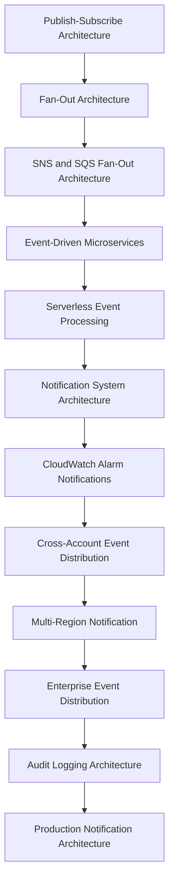
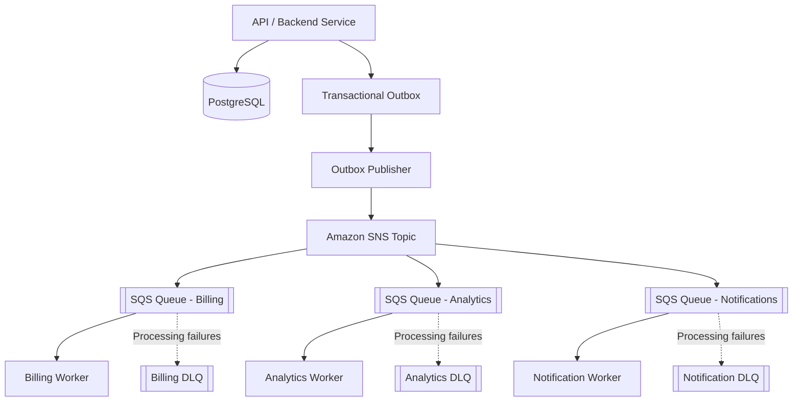

# README

## Overview

This directory contains architecture-level documentation for designing, implementing, and operating production-grade messaging systems using **Amazon Simple Notification Service (Amazon SNS)**.

Amazon SNS is a fully managed publish-subscribe messaging service that enables applications and distributed systems to publish messages to topics and distribute them to multiple subscribers. It is commonly used for event distribution, asynchronous communication, notification delivery, and integration between microservices.

The documents in this directory focus on architectural patterns and production engineering practices rather than individual API operations.

## Documentation Structure

| File | Architecture | Focus |
|---|---|---|
| [01- Publish-Subscribe Architecture.md](./01-%20Publish-Subscribe%20Architecture.md) | Publish-Subscribe Architecture | Topic-based communication, publishers, subscribers, and decoupled message distribution |
| [02- Fan-Out Architecture.md](./02-%20Fan-Out%20Architecture.md) | Fan-Out Architecture | Distributing one published message to multiple independent consumers |
| [03- SNS and SQS Fan-Out Architecture.md](./03-%20SNS%20and%20SQS%20Fan-Out%20Architecture.md) | SNS and SQS Fan-Out Architecture | Combining SNS topic distribution with independent SQS consumer queues |
| [04- Event-Driven Microservices Architecture.md](./04-%20Event-Driven%20Microservices%20Architecture.md) | Event-Driven Microservices Architecture | Asynchronous communication and event distribution across microservices |
| [05- Serverless Event Processing Architecture.md](./05-%20Serverless%20Event%20Processing%20Architecture.md) | Serverless Event Processing Architecture | Integrating SNS with Lambda and other serverless components |
| [06- Notification System Architecture.md](./06-%20Notification%20System%20Architecture.md) | Notification System Architecture | Delivering application notifications through multiple channels |
| [07- CloudWatch Alarm Notification Architecture.md](./07-%20CloudWatch%20Alarm%20Notification%20Architecture.md) | CloudWatch Alarm Notification Architecture | Distributing infrastructure and application alerts using SNS |
| [08- Cross-Account Event Distribution.md](./08-%20Cross-Account%20Event%20Distribution.md) | Cross-Account Event Distribution | Secure messaging between AWS accounts |
| [09- Multi-Region Notification Architecture.md](./09-%20Multi-Region%20Notification%20Architecture.md) | Multi-Region Notification Architecture | Regional messaging, failover, and disaster recovery |
| [10- Enterprise Event Distribution Architecture.md](./10-%20Enterprise%20Event%20Distribution%20Architecture.md) | Enterprise Event Distribution Architecture | Domain-oriented event distribution across enterprise systems |
| [11- Audit Logging Architecture.md](./11-%20Audit%20Logging%20Architecture.md) | Audit Logging Architecture | Distributing, processing, and retaining application and security audit events |
| [12- Production Notification Architecture.md](./12-%20Production%20Notification%20Architecture.md) | Production Notification Architecture | Building reliable notification platforms with preferences, retries, idempotency, and delivery tracking |

## Architecture Learning Path

The recommended sequence moves from foundational messaging patterns to distributed enterprise architectures and production notification systems.

### Foundational Messaging Patterns

Start with the core distribution model and understand how publishers, topics, and subscribers interact.

1. Publish-Subscribe Architecture
2. Fan-Out Architecture
3. SNS and SQS Fan-Out Architecture

Focus on:
- Publisher and subscriber responsibilities.
- Topic-based message distribution.
- Consumer isolation.
- Asynchronous communication.
- Delivery guarantees and duplicate handling.

### Application and Infrastructure Integration

Explore how SNS integrates with application services and AWS-managed infrastructure.

1. Event-Driven Microservices Architecture
2. Serverless Event Processing Architecture
3. Notification System Architecture
4. CloudWatch Alarm Notification Architecture

Focus on:
- Service-to-service communication.
- Lambda-based processing.
- Operational alerting.
- Notification delivery.
- Failure handling and retry strategies.

### Enterprise and Distributed Architectures

Study the patterns required when messaging systems span organizational and regional boundaries.

1. Cross-Account Event Distribution
2. Multi-Region Notification Architecture
3. Enterprise Event Distribution Architecture
4. Audit Logging Architecture
5. Production Notification Architecture

Focus on:
- Cross-account permissions.
- Regional isolation and disaster recovery.
- Event contracts and governance.
- Audit integrity and retention.
- Production reliability and observability.

## Core Architecture Concepts

The following concepts appear throughout the architecture documentation.

| Concept | Description | Engineering Consideration |
|---|---|---|
| Publisher | Application or AWS service that sends messages | Publishing should be reliable and independent of consumer availability |
| Topic | Logical message distribution endpoint | Design topic ownership around business domains and event boundaries |
| Subscription | Relationship between a topic and a subscriber | Configure delivery policies and permissions explicitly |
| Subscriber | Endpoint receiving published messages | Consumers should handle duplicate delivery and transient failures |
| Fan-out | Distribution of one message to multiple subscribers | Use independent SQS queues when consumers need processing isolation |
| Message filtering | Selective delivery based on message attributes or body properties | Filtering rules are part of the event contract |
| Dead-letter queue | Destination for messages that cannot be delivered or processed | Distinguish SNS subscription delivery failures from SQS processing failures |
| Cross-account distribution | Publishing or consuming messages across AWS accounts | Apply both identity-based and resource-based permissions |
| Multi-Region messaging | Distribution across independent AWS Regions | SNS topics and subscriptions are regional resources; replication requires explicit design |
| Transactional outbox | Durable publication intent stored alongside business data | Prevents database-to-message-broker dual-write message loss |

## Reference Architecture

A common production architecture combines SNS with SQS to distribute events while keeping consumer processing independent.

### Architecture Responsibilities

| Component | Responsibility |
|---|---|
| Backend service | Performs business operations and records event publication intent |
| PostgreSQL | Stores business data and transactional outbox records |
| Outbox publisher | Publishes pending events to SNS |
| SNS topic | Distributes events to configured subscriptions |
| SQS queues | Buffer messages independently for each consumer |
| Consumer workers | Process messages and execute business operations |
| SQS DLQs | Isolate messages that repeatedly fail consumer processing |

The transactional outbox is particularly important when publishing an event is a business-critical consequence of a database transaction. It prevents a successful database commit from being silently disconnected from the corresponding publication attempt.

## SNS and SQS Architecture Guidelines

SNS and SQS solve complementary messaging problems.

| Requirement | Recommended Service or Pattern |
|---|---|
| Distribute messages to multiple subscribers | SNS |
| Buffer messages for asynchronous processing | SQS |
| Isolate independent consumers | SNS with one SQS queue per logical consumer |
| Preserve ordering within a message group | SNS FIFO and SQS FIFO |
| Implement competing consumers | Multiple workers consuming the same SQS queue |
| Support durable consumer-side processing | SQS |
| Selectively distribute events | SNS subscription filter policies |
| Retain and replay historical events | EventBridge archives or a durable event store, depending on requirements |
| Coordinate database updates and event publication | Transactional outbox |
| Prevent duplicate business processing | Consumer-side idempotency |

### Important Design Rules

- A shared SQS queue represents competing consumers, not independent fan-out destinations.
- Use a separate queue for each logical consumer that requires independent processing, retry behavior, retention, or scaling.
- SNS is a distribution service, not a general-purpose event store or replayable event log.
- Standard SNS and SQS delivery can produce duplicates. Consumers must be idempotent.
- FIFO ordering applies within message groups, not globally.
- SNS FIFO subscription filtering changes delivery semantics and can result in sequence gaps.
- An SNS subscription DLQ and an SQS processing DLQ protect different delivery stages.
- A successful SNS publish does not prove that a downstream application completed its business operation.

## Production Engineering Considerations

### Reliability and Delivery Guarantees

Design for partial failures across every messaging boundary.

- Persist critical publication intent using a transactional outbox.
- Use stable event identifiers across retries.
- Make consumers idempotent using durable deduplication records or business-level uniqueness constraints.
- Configure retry policies and DLQs deliberately.
- Monitor queue age and processing throughput.
- Reconcile events that were accepted by SNS but whose publication status was not successfully recorded by the publisher.

Do not treat message delivery as exactly-once business execution. Transport-level deduplication does not eliminate the need for application-level idempotency.

### Security

Apply least-privilege access to topics, subscriptions, and queues.

- Use IAM policies for publisher and consumer identities.
- Use SNS topic policies for controlled cross-account access.
- Restrict SQS queue policies to the expected SNS topic ARN.
- Use AWS KMS encryption where required.
- Protect sensitive information in message bodies and attributes.
- Avoid embedding credentials, access tokens, or unnecessary personal data in events.
- Enable CloudTrail monitoring for relevant administrative and API activity.

### Scalability and Backpressure

SNS can distribute messages rapidly, but downstream consumers may have limited processing capacity.

- Buffer workloads using SQS.
- Scale consumers based on queue depth and message age.
- Apply provider and downstream API rate limits.
- Use exponential backoff with jitter for transient failures.
- Separate high-priority workloads when they require different latency or capacity guarantees.
- Monitor hot message groups when using FIFO queues.

### Observability

Monitor the complete event lifecycle rather than relying exclusively on SNS metrics.

| Layer | Useful Signals |
|---|---|
| Publisher | Publish failures, retries, outbox backlog, publication latency |
| SNS | Number of messages published, delivery failures, delivery retries |
| SQS | Approximate queue depth, oldest message age, receive count |
| Consumers | Processing latency, success rate, exception rate, throughput |
| DLQs | Message count, message age, redrive activity |
| Business workflow | Event completion rate, notification delivery state, reconciliation failures |

Use structured logs and distributed tracing with a stable correlation ID and event ID.

### Disaster Recovery

SNS topics and subscriptions are regional resources. A production system must explicitly design cross-Region distribution, replication, and recovery.

Consider:
- Regional topic and queue deployment.
- Cross-Region event routing or application-level publication.
- Durable outbox state and publication tracking.
- Regional KMS keys and permissions.
- Duplicate handling during failover.
- Recovery procedures for pending messages and failed consumers.
- Data residency and compliance requirements.

Do not assume that creating an SNS topic in multiple Regions automatically replicates messages or subscription state.

## Repository Conventions

Use this directory for architecture-level explanations and design decisions.

| Documentation Type | Appropriate Location |
|---|---|
| Service fundamentals and core terminology | `01- Concepts/15- AWS Messaging Services/02- Amazon SNS` |
| Advanced SNS capabilities | `12- Advanced Features/04- AWS Messaging Services/02- Amazon SNS` |
| Architecture patterns and system design | `02- Architecture/14- AWS Messaging Services/02- Amazon SNS` |
| Deployable implementation examples | Relevant hands-on project directories |
| Infrastructure provisioning | Project-specific Terraform or AWS CDK directories |

Architecture documents should explain why a design is appropriate, its operational trade-offs, and how its components interact. Detailed implementation code and infrastructure definitions should live in the relevant hands-on project.

## Key Takeaways

- SNS provides topic-based message distribution; SQS provides durable buffering and independent consumer processing.
- Use one SQS queue per logical consumer when independent scaling, retries, and failure isolation are required.
- Transactional outbox and consumer-side idempotency are essential for reliable event-driven systems.
- Production messaging requires explicit security, observability, backpressure, DLQ, and disaster recovery strategies.
- SNS is regional and is not a replayable event store; cross-Region replication and historical event retention require additional architecture.