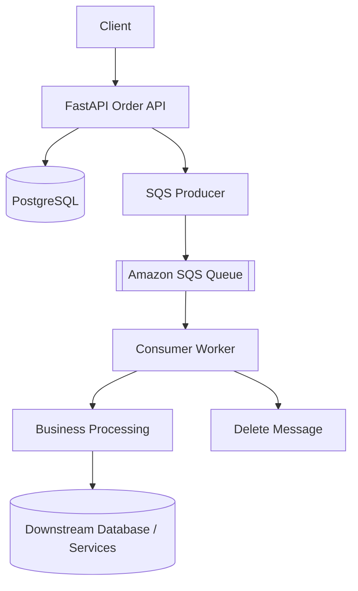
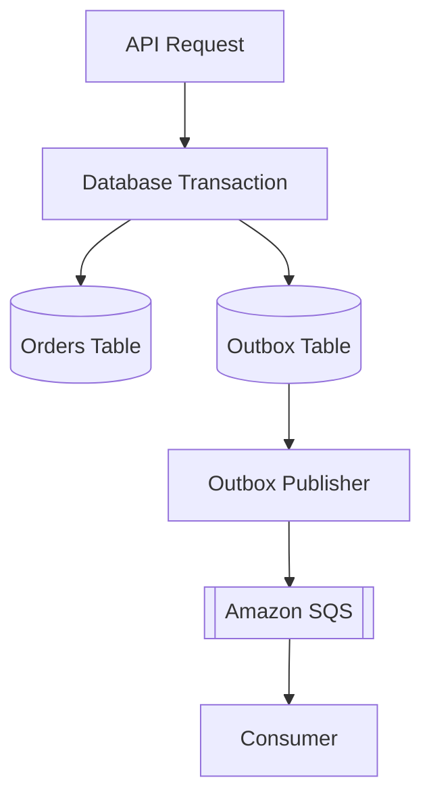
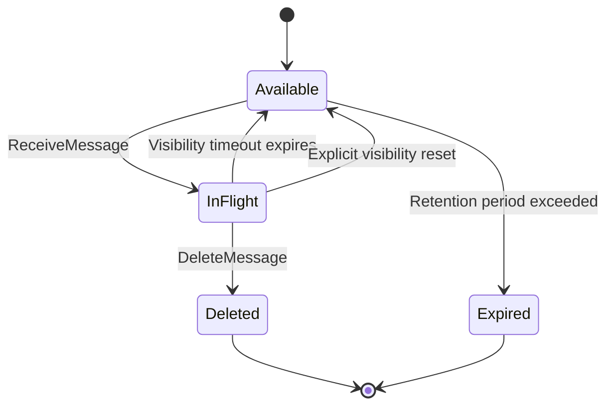
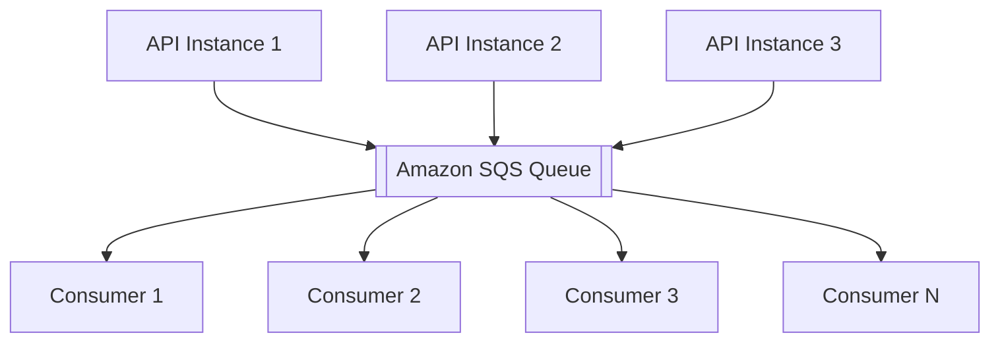
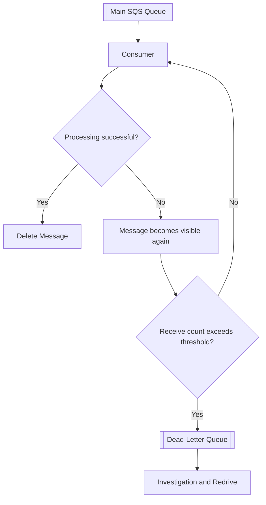

# 01- Producer-Consumer Architecture

## Overview

The producer-consumer architecture is a fundamental messaging pattern for building asynchronous, loosely coupled backend systems. Amazon Simple Queue Service (Amazon SQS) provides the managed message queue used to connect producers that generate work with consumers that process it.

A producer sends a message to an SQS queue without waiting for the consumer to complete the associated operation. SQS durably stores the message until a consumer retrieves and processes it. This allows both sides to operate independently, even when they have different processing speeds, availability requirements, or scaling characteristics.

This architecture is useful for:
- Moving slow operations out of synchronous API request paths.
- Buffering workloads during traffic spikes.
- Isolating failures between services.
- Scaling background workers independently of API instances.
- Supporting retryable and long-running processing workflows.
- Decoupling microservices without requiring direct synchronous communication.

## Architecture Components

A basic producer-consumer system consists of the following components.

| Component | Responsibility |
|---|---|
| Producer | Creates and sends messages to an SQS queue |
| SQS queue | Durably stores messages until they are processed or expire |
| Consumer | Receives messages and executes the associated business operation |
| Visibility timeout | Temporarily hides a received message from other consumers |
| Message retention | Defines how long an unprocessed message remains available |
| Dead-letter queue (DLQ) | Isolates messages that repeatedly fail processing |
| Monitoring | Tracks queue depth, processing latency, failures, and throughput |

The producer and consumer do not need to run simultaneously. The queue acts as an intermediary that absorbs differences in availability and processing capacity.

## Basic Producer-Consumer Flow

Consider an order-processing backend built with FastAPI, PostgreSQL, and SQS.

When a customer places an order:
1. The API validates the request.
2. The application persists the order.
3. The producer publishes an order-processing message to SQS.
4. A background worker receives the message.
5. The worker performs payment, inventory, or fulfillment operations.
6. The worker deletes the message after successful processing.



The API does not need to wait for the background worker to finish. It can return an accepted or created response after the application has durably recorded the order and its processing intent.

## Producer Responsibilities

A producer is responsible for creating valid messages and publishing them reliably.

Typical producers include:
- REST API applications.
- Django or FastAPI services.
- Scheduled jobs.
- Event-driven Lambda functions.
- Other microservices.
- Data-processing pipelines.

### Message Design

A message should contain enough information for the consumer to identify and process the intended operation.

Example order event:

```json
{
  "event_id": "evt_01J9X8Y7Z6",
  "event_type": "order.created",
  "event_version": 1,
  "occurred_at": "2026-11-20T08:30:00Z",
  "data": {
    "order_id": "ord_12345",
    "customer_id": "cust_789",
    "total_amount": 2499.00,
    "currency": "INR"
  }
}
```

Important message design considerations:

| Field | Purpose |
|---|---|
| `event_id` | Stable identifier used for tracing and idempotency |
| `event_type` | Identifies the business operation |
| `event_version` | Supports controlled schema evolution |
| `occurred_at` | Records when the business event occurred |
| `data` | Contains the business payload or resource reference |

Avoid embedding entire database records or sensitive information unless the consumer genuinely requires them. For large payloads, store the data in Amazon S3 and publish a reference with the required authorization context.

### Python Producer with Boto3

The following example publishes an order event using Boto3.

```python
import json
import os
from datetime import datetime, timezone

import boto3
from botocore.config import Config


aws_config = Config(
    retries={
        "mode": "standard",
        "max_attempts": 5,
    },
    connect_timeout=3,
    read_timeout=10,
)

sqs = boto3.client(
    "sqs",
    region_name=os.environ["AWS_REGION"],
    config=aws_config,
)

QUEUE_URL = os.environ["ORDER_QUEUE_URL"]


def publish_order_event(order: dict, event_id: str) -> str:
    message = {
        "event_id": event_id,
        "event_type": "order.created",
        "event_version": 1,
        "occurred_at": datetime.now(timezone.utc).isoformat(),
        "data": {
            "order_id": order["id"],
            "customer_id": order["customer_id"],
            "total_amount": order["total_amount"],
            "currency": order["currency"],
        },
    }

    response = sqs.send_message(
        QueueUrl=QUEUE_URL,
        MessageBody=json.dumps(message),
    )

    return response["MessageId"]
```

The AWS SDK handles request signing, connection management, and configured retries. However, an SDK retry does not provide exactly-once business publication. A timeout can occur after SQS accepts a message but before the producer receives the response. Retrying may therefore publish a duplicate.

Use a stable application-level event ID and consumer-side idempotency to handle this ambiguity.

### Producer Reliability

A common failure occurs when the application commits a database transaction but fails to publish the corresponding SQS message.

For example:

```text
1. Order inserted into PostgreSQL.
2. Database transaction commits.
3. Application sends message to SQS.
4. Network failure occurs.
5. Order exists, but no message is available for processing.
```

The reverse failure is also possible: the message is accepted by SQS, but the application fails before recording the publication result.

For business-critical workflows, use the transactional outbox pattern.



The order and outbox record are committed in the same database transaction. A separate publisher reads pending outbox records and sends them to SQS.

The publisher should track publication state and retry failures. Because a publisher can crash after SQS accepts a message but before the outbox record is marked as published, duplicate publication remains possible. Consumers must still be idempotent.

## Consumer Responsibilities

A consumer retrieves messages from SQS and performs the required business operation.

Consumers can run as:
- Long-running Python worker processes.
- Celery workers using a custom SQS integration.
- AWS Lambda functions triggered by SQS event source mappings.
- Kubernetes deployments.
- ECS tasks.
- Scheduled or on-demand processing services.

A consumer is responsible for:
- Validating message structure.
- Applying business rules.
- Handling duplicate messages.
- Retrying transient failures.
- Recording processing outcomes.
- Deleting successfully processed messages.

### Message Lifecycle

SQS does not immediately remove a message when a consumer receives it.

Instead, the message becomes temporarily invisible to other consumers. This period is controlled by the visibility timeout.



The lifecycle is important because receiving a message is not equivalent to successfully processing it.

If a consumer crashes before deleting the message, SQS can make it available again after the visibility timeout expires.

### Python Consumer with Boto3

The following example demonstrates a long-polling consumer with basic message validation and deletion after successful processing.

```python
import json
import logging
import os
import time

import boto3
from botocore.config import Config


logging.basicConfig(level=logging.INFO)
logger = logging.getLogger(__name__)

config = Config(
    retries={
        "mode": "standard",
        "max_attempts": 5,
    },
    connect_timeout=3,
    read_timeout=30,
)

sqs = boto3.client(
    "sqs",
    region_name=os.environ["AWS_REGION"],
    config=config,
)

QUEUE_URL = os.environ["ORDER_QUEUE_URL"]


def process_order(message: dict) -> None:
    event = json.loads(message["Body"])

    if event.get("event_type") != "order.created":
        raise ValueError("Unsupported event type")

    order_id = event["data"]["order_id"]

    logger.info(
        "Processing order",
        extra={
            "event_id": event["event_id"],
            "order_id": order_id,
        },
    )

    # Execute idempotent business processing here.


def consume_messages() -> None:
    while True:
        response = sqs.receive_message(
            QueueUrl=QUEUE_URL,
            MaxNumberOfMessages=10,
            WaitTimeSeconds=20,
            VisibilityTimeout=120,
            MessageSystemAttributeNames=[
                "ApproximateReceiveCount",
            ],
        )

        for message in response.get("Messages", []):
            receipt_handle = message["ReceiptHandle"]

            try:
                process_order(message)

                sqs.delete_message(
                    QueueUrl=QUEUE_URL,
                    ReceiptHandle=receipt_handle,
                )

                logger.info("Message processed successfully")

            except Exception:
                logger.exception("Message processing failed")
                # Do not delete the message.
                # It becomes visible again after the visibility timeout.

        time.sleep(0.1)


if __name__ == "__main__":
    consume_messages()
```

This example demonstrates the basic lifecycle. A production implementation should also include:
- Durable idempotency checks.
- Classified error handling.
- Graceful shutdown.
- Processing timeouts.
- Visibility timeout extensions for long-running work.
- DLQ configuration.
- Structured metrics and tracing.
- Controlled concurrency and rate limiting.

## Visibility Timeout and Processing Safety

Visibility timeout prevents multiple consumers from processing the same message concurrently under normal operation.

When a consumer receives a message, SQS hides it from other consumers for the configured period.

If the consumer does not delete the message before the timeout expires, the message becomes available again.

### Example

Assume:
- Visibility timeout: 60 seconds.
- Processing duration: 90 seconds.
- Consumer processing starts at 10:00:00.

At 10:01:00, the message becomes visible again even though the original consumer is still processing it. Another consumer may receive the same message.

This can result in concurrent duplicate execution.

### Configuration Guidance

| Processing Characteristics | Recommendation |
|---|---|
| Short, predictable operations | Set timeout above normal processing duration |
| Variable processing duration | Use a suitable initial timeout and extend it when necessary |
| Long-running jobs | Periodically extend visibility while processing |
| Lambda consumers | Configure queue visibility timeout to at least six times the function timeout, plus the batching window allowance |
| Unbounded processing | Redesign the workflow rather than relying on indefinite visibility extensions |

For long-running processing, use `ChangeMessageVisibility` to extend the timeout. Account for SQS's maximum visibility period of 12 hours from the initial receive.

Visibility timeout is not a distributed lock and does not guarantee exclusive execution. Idempotency remains mandatory.

## Message Deletion and Acknowledgment

In SQS, deleting a message is the equivalent of acknowledging successful processing.

The consumer must use the receipt handle returned by the latest `ReceiveMessage` operation.

```python
sqs.delete_message(
    QueueUrl=QUEUE_URL,
    ReceiptHandle=receipt_handle,
)
```

Important behavior:
- A receipt handle identifies a particular receive operation.
- A redelivered message receives a new receipt handle.
- Deletion using an outdated receipt handle may not remove the message as expected.
- The consumer should delete only after the business operation has completed successfully.

Avoid deleting messages before processing. If the consumer crashes after deletion, the work is permanently lost from the queue.

Also avoid assuming that a successful `DeleteMessage` response proves that every possible duplicate has disappeared. Standard queues provide at-least-once delivery, so application-level deduplication is still required.

## Idempotent Consumer Design

SQS Standard queues can deliver messages more than once. A consumer must be safe when the same logical event is processed repeatedly.

Consider a payment-processing consumer. If a message is delivered twice and the consumer charges the customer twice, the system has a serious correctness problem.

Use the stable `event_id` to enforce idempotency.

A simple database-backed approach:

```sql
CREATE TABLE processed_events (
    event_id VARCHAR(128) PRIMARY KEY,
    processed_at TIMESTAMPTZ NOT NULL DEFAULT NOW()
);
```

The consumer should claim the event and perform its database changes in one transaction.

```python
def process_event_idempotently(connection, event: dict) -> bool:
    event_id = event["event_id"]

    with connection.transaction():
        result = connection.execute(
            """
            INSERT INTO processed_events (event_id)
            VALUES (%s)
            ON CONFLICT (event_id) DO NOTHING
            RETURNING event_id
            """,
            (event_id,),
        ).fetchone()

        if result is None:
            return False

        order_id = event["data"]["order_id"]

        connection.execute(
            """
            UPDATE orders
            SET processing_status = 'processed'
            WHERE id = %s
            """,
            (order_id,),
        )

    return True
```

The example assumes that the business update and idempotency record use the same PostgreSQL transaction.

For external side effects such as payment-provider requests, a local database transaction cannot atomically include the remote operation. Use provider-supported idempotency keys, durable operation state, and reconciliation for ambiguous outcomes.

### Idempotency Design Considerations

| Approach | Suitable Use | Limitation |
|---|---|---|
| Database unique constraint | Durable event deduplication | Requires retention and cleanup strategy |
| Redis idempotency key | Fast duplicate checks | Expiration or eviction can permit later duplicates |
| Business-level uniqueness constraint | Preventing duplicate domain operations | Requires a suitable business key |
| Provider idempotency key | External payment or API operations | Depends on provider behavior and retention window |

Do not rely exclusively on an in-memory set or process-local cache. Consumer restarts and horizontal scaling make local state unsuitable for durable deduplication.

## Scaling Producers and Consumers

One of the main advantages of SQS is that producers and consumers can scale independently.

Producers can publish messages at a high rate while consumers process them at a controlled rate.



### Consumer Scaling Strategies

| Strategy | Description | Consideration |
|---|---|---|
| Fixed workers | Maintain a fixed number of consumers | Simple but may be inefficient during traffic changes |
| Queue-depth scaling | Scale based on approximate visible messages | Queue depth alone may not reflect processing capacity |
| Age-based scaling | Scale based on oldest message age | Useful for detecting processing delays |
| Kubernetes HPA with queue metrics | Scale worker pods using external metrics | Requires metrics integration and sensible limits |
| Lambda event source mapping | AWS manages polling and invokes functions | Configure concurrency, batching, and failure behavior |

### Queue-Based Autoscaling

A useful scaling signal is the number of messages waiting relative to available consumer capacity.

For example:

```text
Target backlog per worker = 100 messages

Approximate visible messages = 2,000

Desired workers = 2,000 / 100
                = 20
```

This is a simplified capacity estimate. A production scaling policy must also account for:
- Average processing duration.
- Worker concurrency.
- Downstream service quotas.
- Database connection limits.
- Maximum permitted infrastructure capacity.
- Scale-up and scale-down stabilization.
- In-flight messages and retry behavior.

Do not scale consumers faster than downstream systems can safely process requests.

## Long Polling

Long polling allows consumers to wait for messages instead of repeatedly making empty receive requests.

Set `WaitTimeSeconds` between 1 and 20 seconds. A value of 20 seconds is commonly appropriate for background workers.

```python
response = sqs.receive_message(
    QueueUrl=QUEUE_URL,
    MaxNumberOfMessages=10,
    WaitTimeSeconds=20,
)
```

Benefits:
- Reduces empty responses.
- Reduces unnecessary API calls.
- Improves message retrieval efficiency.
- Can reduce polling costs.

Ensure the HTTP read timeout configured in the SDK exceeds the long-poll wait duration, with sufficient network margin.

Short polling may still be appropriate for specific latency or polling-control requirements, but it generally generates more empty responses when queues are idle.

## Batch Processing

SQS supports receiving up to 10 messages in one `ReceiveMessage` request.

Batching reduces request overhead and can improve throughput.

```python
response = sqs.receive_message(
    QueueUrl=QUEUE_URL,
    MaxNumberOfMessages=10,
    WaitTimeSeconds=20,
)
```

Batching does not guarantee that SQS will return the requested number of messages. Consumers must handle smaller batches and empty responses.

When processing batches:
- Track success and failure for each message.
- Delete only successfully processed messages.
- Avoid deleting an entire batch when one item fails.
- Keep processing time within the visibility timeout.
- Use partial batch responses for Lambda SQS event source mappings where appropriate.

For direct batch deletion, `DeleteMessageBatch` accepts up to 10 entries. Inspect both `Successful` and `Failed` results because a batch request can partially fail.

## Failure Handling and Dead-Letter Queues

A consumer can fail because of:
- Invalid message payloads.
- Database outages.
- Downstream API failures.
- Network timeouts.
- Rate limiting.
- Application defects.
- Unexpected schema changes.

A failed message should not be retried indefinitely without control.

Configure a redrive policy with a maximum receive count and a dead-letter queue.



Example queue configuration:

```json
{
  "deadLetterTargetArn": "arn:aws:sqs:ap-south-1:123456789012:orders-dlq",
  "maxReceiveCount": 5
}
```

The `maxReceiveCount` value counts receives, not successful processing attempts. Configure it based on the failure characteristics and retry strategy.

### Retry Classification

Not all failures should be treated equally.

| Failure | Recommended Handling |
|---|---|
| Temporary database outage | Retry with backoff |
| HTTP 429 from downstream API | Respect retry guidance and apply rate limiting |
| HTTP 5xx | Retry with bounded backoff |
| Invalid message schema | Isolate for investigation |
| Missing required business data | Usually DLQ or controlled rejection |
| Permanent authorization failure | Alert and investigate configuration |
| Duplicate event | Treat as successful if already processed |

A DLQ is an isolation mechanism, not a complete recovery strategy. Monitor it, investigate root causes, and redrive messages only after correcting the underlying issue.

## Standard vs FIFO Producer-Consumer Architecture

SQS supports Standard and FIFO queues. The queue type affects throughput, ordering, and deduplication behavior.

| Feature | Standard Queue | FIFO Queue |
|---|---|---|
| Ordering | Best-effort ordering | Strict ordering within a message group |
| Delivery | At-least-once | Deduplication support with FIFO-specific guarantees |
| Throughput | High, scalable throughput | Depends on FIFO throughput configuration and message groups |
| Message groups | Not applicable | Required |
| Deduplication | Application-level handling | Five-minute deduplication interval |
| Consumer parallelism | High | Parallel across message groups |
| Typical use case | Independent background jobs | Ordered business operations |

Use Standard queues when high throughput and flexible processing are more important than ordering.

Use FIFO queues when processing order within a business entity is essential, such as:
- Account balance operations.
- Sequential order state transitions.
- Inventory updates for a specific item.
- Ordered workflow commands.

FIFO deduplication does not eliminate the need for application-level idempotency. The five-minute deduplication interval is not a guarantee of exactly-once business execution.

## Producer-Consumer Integration with FastAPI

A typical backend design separates HTTP request handling from asynchronous processing.

```python
from fastapi import FastAPI, HTTPException
from pydantic import BaseModel
from uuid import uuid4

app = FastAPI()


class OrderRequest(BaseModel):
    customer_id: str
    total_amount: float
    currency: str


@app.post("/orders", status_code=202)
async def create_order(payload: OrderRequest):
    order_id = str(uuid4())
    event_id = str(uuid4())

    try:
        # Persist the order and an outbox event in one database transaction.
        # A separate publisher sends pending outbox events to SQS.
        await persist_order_and_outbox(
            order_id=order_id,
            event_id=event_id,
            payload=payload.model_dump(),
        )

    except Exception as exc:
        raise HTTPException(
            status_code=500,
            detail="Unable to create order",
        ) from exc

    return {
        "order_id": order_id,
        "status": "accepted",
    }
```

The example intentionally uses an outbox rather than publishing directly inside the request handler.

The HTTP request completes after the database transaction commits. The outbox publisher handles SQS publication independently.

For a production API:
- Validate and authorize the request.
- Enforce request-level idempotency where clients may retry.
- Persist the business operation and outbox event atomically.
- Return a stable resource identifier.
- Expose a status endpoint for asynchronous completion.
- Avoid holding an HTTP request open while waiting for background processing.

## Security Considerations

Secure producer-consumer communication at both the AWS resource and application levels.

### IAM Permissions

Use separate IAM roles for producers and consumers.

| Role | Required Permissions |
|---|---|
| Producer | `sqs:SendMessage` on the target queue |
| Consumer | `sqs:ReceiveMessage`, `sqs:DeleteMessage`, `sqs:ChangeMessageVisibility`, and `sqs:GetQueueAttributes` |
| Operations role | Required monitoring and controlled redrive permissions |

Avoid granting `sqs:*` or unrestricted access to all queues.

### Encryption

SQS supports server-side encryption using SQS-managed encryption keys or AWS KMS keys.

For SSE-KMS:
- Configure the queue encryption key.
- Grant the producer the required KMS permissions.
- Grant the consumer the required KMS permissions.
- Ensure the KMS key policy permits the intended access.
- Monitor key usage and access failures.

### Message Validation

Treat messages as external input, even when they originate from internal services.

- Validate event type and schema version.
- Enforce payload size limits.
- Avoid unsafe deserialization.
- Do not execute commands or SQL derived directly from message fields.
- Keep secrets out of message bodies.
- Use resource authorization checks before performing sensitive operations.

## Monitoring and Observability

Queue health must be evaluated using both SQS metrics and application-level metrics.

| Metric | Meaning | Operational Use |
|---|---|---|
| `ApproximateNumberOfMessagesVisible` | Messages available for retrieval | Detect growing backlog |
| `ApproximateNumberOfMessagesNotVisible` | Messages currently in flight | Identify active processing and stuck work |
| `ApproximateNumberOfMessagesDelayed` | Messages waiting due to delay | Understand scheduled backlog |
| `ApproximateAgeOfOldestMessage` | Approximate age of the oldest available message | Detect processing latency |
| `NumberOfMessagesSent` | Messages sent to the queue | Track producer volume |
| `NumberOfMessagesReceived` | Messages received by consumers | Track consumer activity |
| `NumberOfMessagesDeleted` | Messages deleted after processing | Approximate successful completion activity |

CloudWatch queue metrics are approximate and should not be treated as exact business accounting.

Application-level metrics should include:
- Processing success and failure counts.
- Processing duration.
- Duplicate event count.
- Retry count.
- DLQ arrival rate.
- End-to-end event latency.
- Downstream dependency latency.
- Outbox backlog and publication delay.

Use structured logs containing `event_id`, `order_id`, and correlation identifiers. Avoid logging sensitive payloads.

## High Availability and Disaster Recovery

SQS Standard and FIFO queues are regional resources. SQS provides managed availability within a Region, but it does not automatically replicate queue messages to another Region.

For critical workloads:
- Define the acceptable RTO and RPO.
- Use infrastructure as code to reproduce queue configuration.
- Protect DLQs and retention settings.
- Maintain durable business state outside the queue.
- Design replay or republishing from an authoritative data store.
- Document recovery procedures for producers and consumers.
- Test regional recovery and duplicate handling.

Do not treat an SQS queue as the only copy of critical business data. A queue is a work-delivery mechanism, not a substitute for an authoritative database or event archive.

## Cost and Performance Considerations

SQS pricing is based on requests and related service features. Receive polling, batching, payload size, encryption, and data transfer can affect cost.

Practical optimizations:
- Enable long polling to reduce empty receives.
- Use batch send, receive, and delete operations where appropriate.
- Avoid unnecessarily frequent polling.
- Right-size consumer concurrency.
- Monitor repeated receives and failed processing.
- Avoid oversized message payloads.
- Use S3 references for large objects.

SQS supports message sizes up to 1 MiB. The producer and consumer must still account for serialization overhead and application-level payload limits.

For workloads requiring durable event retention, replay, partition-based streaming, or large-scale ordered stream processing, evaluate Amazon Kinesis Data Streams or Amazon MSK rather than forcing SQS into a streaming use case.

## Common Mistakes and Production Pitfalls

| Mistake | Why It Causes Problems | Recommended Approach |
|---|---|---|
| Deleting messages before processing | A crash can permanently lose work | Delete only after successful processing |
| Setting visibility timeout too low | Messages can be processed concurrently | Size timeout to processing duration and extend when needed |
| Assuming exactly-once processing | Duplicate deliveries can repeat business operations | Implement durable idempotency |
| Using one queue for unrelated consumers | Consumers compete for messages instead of receiving independent copies | Use separate queues for independent workflows |
| Ignoring DLQs | Failed messages accumulate without recovery | Alert, investigate, and redrive deliberately |
| Using short polling unnecessarily | Generates excess empty receive requests | Enable long polling |
| Scaling only by queue depth | Can overload databases and downstream services | Include processing capacity and dependency limits |
| Publishing after a database commit without an outbox | A crash can leave committed data without a message | Use a transactional outbox |
| Assuming batch APIs are all-or-nothing | Individual entries can fail | Inspect per-entry results |
| Treating visibility timeout as a lock | Duplicate execution remains possible | Use idempotency and business-level concurrency controls |
| Treating SQS as a permanent event store | Messages expire or are deleted | Persist authoritative business events separately |

## Key Takeaways

- SQS decouples producers and consumers, allowing independent availability, scaling, and processing rates.
- A message remains in the queue until successfully deleted, while visibility timeout controls temporary in-flight invisibility.
- Standard queues provide at-least-once delivery; consumers must implement durable idempotency.
- Use transactional outbox for critical database-to-queue publication and DLQs for controlled failure isolation.
- Production consumer design must account for backpressure, downstream limits, observability, security, and regional recovery.