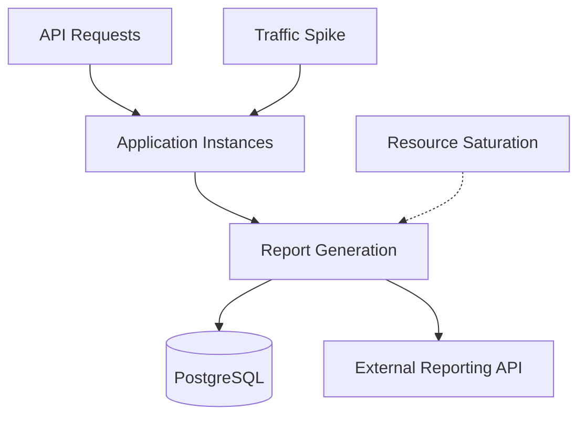
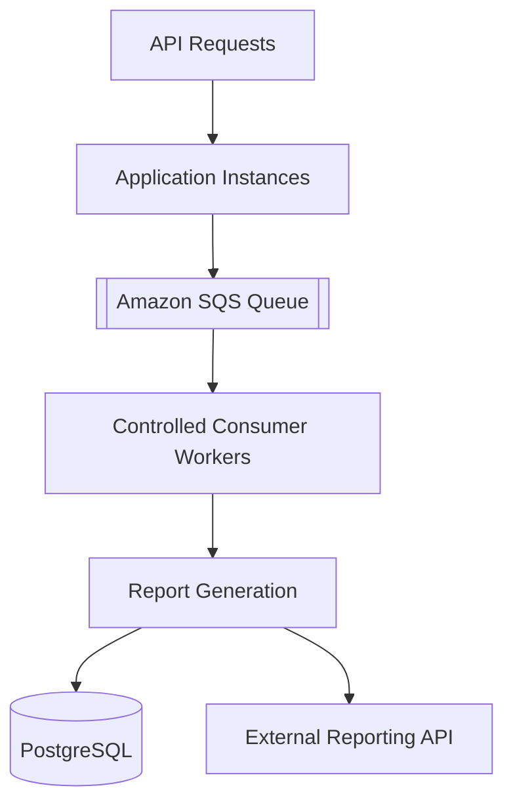
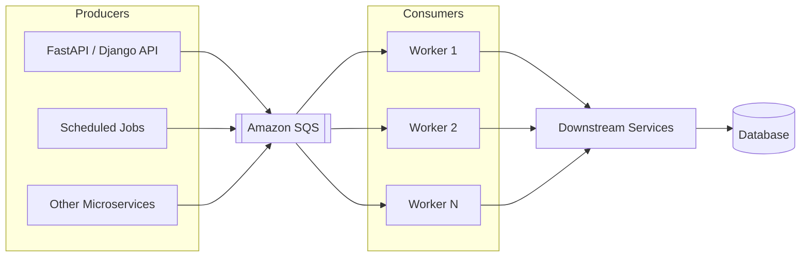
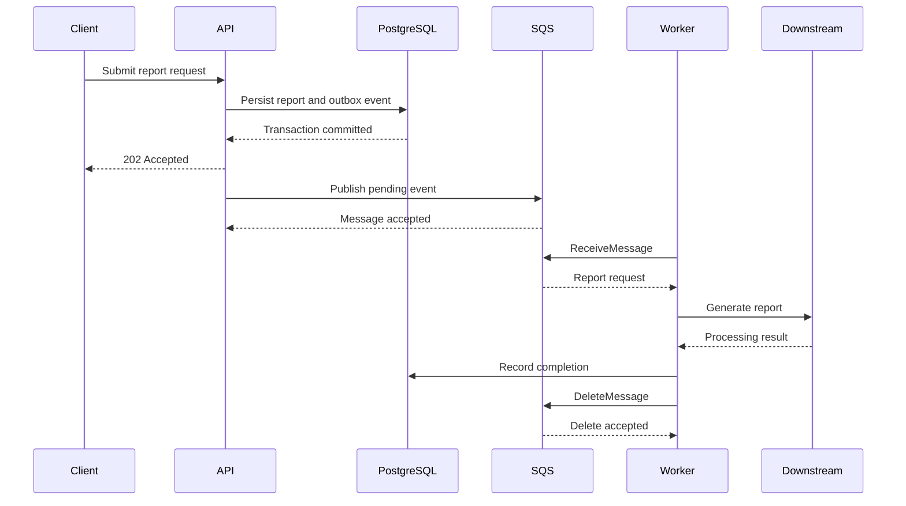
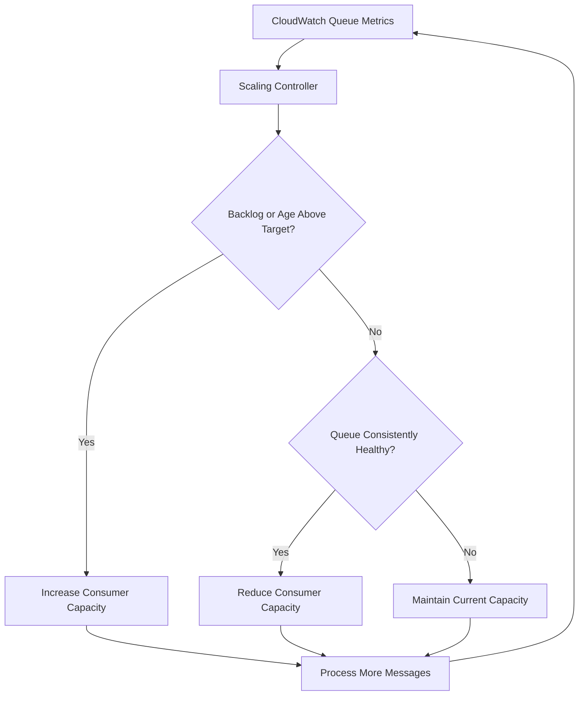
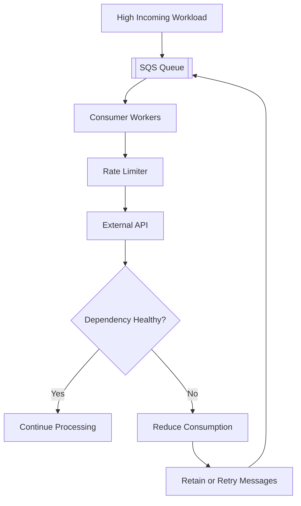
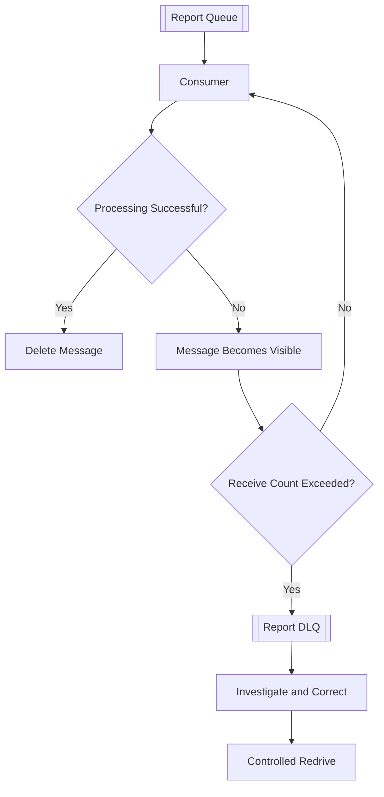

# 02- Load Leveling Architecture

## Overview

Load leveling is a messaging architecture pattern that uses a queue to absorb temporary differences between workload arrival rates and processing capacity.

Amazon Simple Queue Service (Amazon SQS) acts as a buffer between producers and consumers. Producers can submit work at a higher rate than consumers can process it without immediately overwhelming downstream services. Consumers retrieve messages at a controlled rate based on available processing capacity.

This pattern is particularly useful when backend workloads are bursty, processing times vary, or downstream dependencies have strict throughput limits.

Typical use cases include:

- Order and payment processing.
- Image and document processing.
- Bulk data imports and exports.
- Email and SMS delivery.
- Report generation.
- Third-party API integrations.
- Database-intensive background jobs.
- Event-driven microservices.

The primary objective is not simply to process messages asynchronously. It is to control the rate at which work reaches constrained components while preserving accepted workloads for later processing.

## Why Load Leveling Is Required

Consider an API that receives requests to generate customer reports.

During normal operation, the application receives 100 requests per minute. During a campaign, traffic increases to 5,000 requests per minute.

If every API instance immediately performs report generation, the system may overwhelm:

- PostgreSQL connection pools.
- CPU and memory resources.
- External reporting APIs.
- Object storage request capacity.
- Worker processes.
- Downstream microservices.

Increasing application instances does not necessarily solve the problem. It can simply move the overload to a shared database or external dependency.

A queue introduces a controlled processing boundary.

### Without Load Leveling



All incoming requests compete for processing resources immediately. When arrival rates exceed processing capacity, latency increases, requests time out, and failures propagate.

### With Load Leveling



SQS absorbs the burst. Consumers process messages at a rate that the application and downstream systems can sustain.

## Core Architecture

A load-leveling system consists of four main responsibilities:

| Component | Responsibility |
|---|---|
| Producer | Accepts work and publishes messages |
| SQS queue | Buffers accepted work |
| Consumer workers | Retrieve and process messages |
| Scaling controller | Adjusts consumer capacity based on workload and processing health |

The producer and consumer operate independently. The producer does not need to know how many workers exist or when a particular message will be processed.



## How Load Leveling Works

The queue separates the rate at which work arrives from the rate at which work is processed.

### Request Lifecycle

1. A client sends a request to the backend API.
2. The API validates the request and persists the required business state.
3. The producer publishes a message to SQS.
4. SQS accepts and stores the message.
5. The API returns a response without waiting for the background operation to finish.
6. Consumers retrieve messages using `ReceiveMessage`.
7. Consumers process messages according to their available capacity.
8. Successfully processed messages are deleted.
9. Failed messages become available again after their visibility timeout or are eventually moved to a DLQ according to the redrive policy.



The sequence illustrates the intended flow. In a transactional outbox implementation, a separate publisher normally performs the SQS publication rather than the API publishing directly.

## Arrival Rate and Processing Rate

Load leveling depends on the relationship between message arrival rate and message processing rate.

Let:

- \(\lambda\) = average message arrival rate.
- \(\mu\) = average processing rate.
- \(N\) = number of active consumers.
- \(r\) = average processing rate of one consumer.

The approximate aggregate processing capacity is:

\[
\mu = N \times r
\]

For a stable queue over the long term:

\[
\lambda < \mu
\]

If the arrival rate exceeds processing capacity for a sustained period, the backlog grows.

### Example

Assume:

| Parameter | Value |
|---|---:|
| Incoming messages | 1,000 per minute |
| Processing rate per worker | 50 per minute |
| Active workers | 10 |
| Aggregate processing capacity | 500 per minute |

The queue receives 1,000 messages per minute but consumers process only 500.

The backlog increases by approximately:

\[
1000 - 500 = 500
\]

messages per minute.

Adding workers can increase processing capacity, but only if the downstream systems can handle the additional load.

### Backlog Growth

When arrival rate exceeds processing capacity:

\[
\Delta Q \approx \lambda - \mu
\]

where \(\Delta Q\) is the approximate change in queued messages per unit of time.

When processing capacity exceeds arrival rate, the backlog decreases.

These calculations are approximations. Real workloads have variable processing times, retries, message sizes, concurrency limits, and downstream bottlenecks.

## Queue Depth and Backlog Management

Queue depth indicates how much work is waiting for processing.

SQS exposes several approximate CloudWatch metrics that help determine queue health.

| Metric | Meaning | Operational Use |
|---|---|---|
| `ApproximateNumberOfMessagesVisible` | Messages currently available for retrieval | Measures waiting backlog |
| `ApproximateNumberOfMessagesNotVisible` | Messages currently in flight | Indicates messages being processed |
| `ApproximateNumberOfMessagesDelayed` | Messages waiting due to delay | Tracks delayed work |
| `ApproximateAgeOfOldestMessage` | Approximate age of the oldest available message | Detects processing latency |
| `NumberOfMessagesSent` | Messages sent to the queue | Measures producer activity |
| `NumberOfMessagesReceived` | Messages received by consumers | Measures consumer retrieval activity |
| `NumberOfMessagesDeleted` | Messages deleted from the queue | Provides an approximate completion signal |

Queue depth alone is insufficient for determining system health.

For example, a queue may have a low visible message count but a large number of messages in flight because workers are processing slowly or have become stuck.

Monitor both backlog and message age.

## Consumer Concurrency and Throughput Control

Consumers determine how quickly queued messages reach downstream services.

Increasing consumer concurrency can improve throughput, but uncontrolled concurrency can recreate the same overload that the queue was introduced to prevent.

### Worker Concurrency

Consider a report-generation service that uses PostgreSQL and an external reporting API.

If 100 workers simultaneously execute expensive database queries, the database may become saturated.

A safer design limits:
- Number of active worker processes.
- Concurrent jobs per worker.
- Database connections.
- Concurrent external API requests.
- Requests per second to downstream services.

Example capacity configuration:

```python
WORKER_CONCURRENCY = 10
MAX_DATABASE_CONNECTIONS = 20
MAX_EXTERNAL_API_CONCURRENCY = 5
```

These values are illustrative. Production values should be derived from load testing and downstream capacity measurements.

### Concurrency vs Throughput

| Configuration | Effect |
|---|---|
| More workers | Increases potential parallel processing |
| Larger receive batches | Reduces polling overhead |
| Higher per-worker concurrency | Increases work performed by each worker |
| Longer processing time | Reduces effective throughput |
| Downstream rate limiting | Caps the rate of external operations |
| Database connection limits | Constrain concurrent database work |

Do not assume that adding consumers always increases throughput. Once a downstream dependency reaches its capacity, additional workers can increase latency and failure rates.

## Dynamic Consumer Scaling

Consumer capacity can be adjusted based on queue metrics.

A typical autoscaling strategy increases worker count when backlog or message age rises and decreases capacity when the queue becomes healthy.



### Scaling Signals

Useful scaling inputs include:

- Approximate number of visible messages.
- Approximate age of the oldest message.
- Number of in-flight messages.
- Average message processing duration.
- Worker CPU and memory utilization.
- Downstream API latency and error rate.
- Database connection utilization.

### Scaling Approaches

| Platform | Scaling Mechanism |
|---|---|
| Amazon ECS | Service Auto Scaling using CloudWatch metrics |
| Amazon EKS | Kubernetes HPA with external queue metrics |
| EC2 workers | Auto Scaling groups |
| AWS Lambda | SQS event source mapping with concurrency controls |
| Celery workers | Worker count and queue-specific concurrency management |

Use scale-up and scale-down stabilization to avoid repeatedly adding and removing workers during short-lived metric fluctuations.

For Kubernetes, queue-based scaling can be implemented using KEDA or custom external metrics. Ensure the scaling policy has a maximum replica count and respects downstream capacity.

## Practical Implementation with FastAPI and SQS

A typical API should accept work quickly and delegate processing to background consumers.

### Producer: FastAPI

The API persists a report request and its outbox event in one database transaction.

```python
from fastapi import FastAPI, HTTPException
from pydantic import BaseModel, Field
from uuid import uuid4

app = FastAPI()


class ReportRequest(BaseModel):
    customer_id: str
    report_type: str
    date_range_days: int = Field(gt=0, le=365)


@app.post("/reports", status_code=202)
async def create_report(payload: ReportRequest):
    report_id = str(uuid4())
    event_id = str(uuid4())

    try:
        await persist_report_and_outbox(
            report_id=report_id,
            event_id=event_id,
            payload=payload.model_dump(),
        )
    except Exception as exc:
        raise HTTPException(
            status_code=500,
            detail="Unable to submit report request",
        ) from exc

    return {
        "report_id": report_id,
        "status": "queued",
    }
```

The `persist_report_and_outbox` operation represents an application-specific database transaction. A separate publisher reads pending outbox events and sends them to SQS.

### Outbox Publisher

The publisher sends pending events to the configured queue.

```python
import json
import os

import boto3
from botocore.config import Config


sqs = boto3.client(
    "sqs",
    region_name=os.environ["AWS_REGION"],
    config=Config(
        retries={
            "mode": "standard",
            "max_attempts": 5,
        },
        connect_timeout=3,
        read_timeout=10,
    ),
)

QUEUE_URL = os.environ["REPORT_QUEUE_URL"]


def publish_report_event(event: dict) -> str:
    response = sqs.send_message(
        QueueUrl=QUEUE_URL,
        MessageBody=json.dumps(event),
    )

    return response["MessageId"]
```

The publisher should mark the outbox record as published only after receiving a successful SQS response.

If SQS accepts the message but the publisher crashes before updating the outbox record, the event may be published again. Stable event IDs and idempotent consumers are therefore required.

### Consumer Worker

A consumer retrieves work and processes it while respecting its configured concurrency and downstream limits.

```python
import json
import logging
import os

import boto3


logger = logging.getLogger(__name__)

sqs = boto3.client(
    "sqs",
    region_name=os.environ["AWS_REGION"],
)

QUEUE_URL = os.environ["REPORT_QUEUE_URL"]


def process_report(event: dict) -> None:
    report_id = event["data"]["report_id"]

    # Claim the report using a durable state transition.
    # Generate the report and persist its result.
    # Use idempotency to make repeated execution safe.

    logger.info(
        "Report processed",
        extra={
            "event_id": event["event_id"],
            "report_id": report_id,
        },
    )


def poll_queue() -> None:
    while True:
        response = sqs.receive_message(
            QueueUrl=QUEUE_URL,
            MaxNumberOfMessages=5,
            WaitTimeSeconds=20,
            VisibilityTimeout=180,
            MessageSystemAttributeNames=[
                "ApproximateReceiveCount",
            ],
        )

        for message in response.get("Messages", []):
            try:
                event = json.loads(message["Body"])
                process_report(event)

                sqs.delete_message(
                    QueueUrl=QUEUE_URL,
                    ReceiptHandle=message["ReceiptHandle"],
                )

            except Exception:
                logger.exception("Report processing failed")
                # Retain the message for retry or DLQ handling.
```

This is a simplified worker loop. A production worker should add graceful shutdown, bounded concurrency, error classification, idempotency, visibility extensions for long jobs, and controlled deletion.

## Visibility Timeout and Long-Running Jobs

Load leveling does not eliminate message-processing failures.

If a consumer receives a message and processing takes longer than the visibility timeout, the message may become visible to another consumer while the original worker is still running.

For example:

| Parameter | Value |
|---|---:|
| Visibility timeout | 60 seconds |
| Report generation duration | 120 seconds |
| Result | Message may be delivered again after 60 seconds |

This can produce concurrent processing of the same job.

Recommendations:

- Set visibility timeout above the expected processing duration.
- Extend visibility using `ChangeMessageVisibility` for variable-duration jobs.
- Use durable idempotency and business-level state transitions.
- Keep processing bounded and observable.
- Avoid treating visibility timeout as a distributed lock.

SQS visibility timeout has a maximum of 12 hours from the initial receive. Workloads exceeding this limit should be divided into smaller stages or coordinated through a durable workflow system.

For Lambda consumers, configure queue visibility timeout to at least six times the function timeout, plus the batching window allowance.

## Backpressure and Downstream Protection

Backpressure is the mechanism by which a system prevents upstream components from overwhelming downstream components.

SQS provides a buffer, but the application must still control how quickly messages are consumed.

Consider a service that sends messages to a third-party API with a limit of 100 requests per second.

If workers process 500 messages per second, the external API may return HTTP 429 responses or reject requests.

Use:
- Distributed rate limiting.
- Bounded worker concurrency.
- Exponential backoff with jitter.
- Separate queues for workloads with different resource requirements.
- Circuit breakers for persistently failing dependencies.
- Retry classification to avoid retrying permanent errors.

### Backpressure Flow



A queue absorbs temporary overload, but it cannot compensate for a permanent capacity mismatch. If average arrival rate remains higher than sustainable processing capacity, backlog and message age will continue to grow.

## Queue Configuration

A production queue should have explicit settings for retention, visibility, encryption, long polling, and failure handling.

Example AWS CLI configuration:

```bash
aws sqs create-queue \
  --queue-name report-processing \
  --attributes '{
    "VisibilityTimeout": "180",
    "MessageRetentionPeriod": "345600",
    "ReceiveMessageWaitTimeSeconds": "20",
    "SqsManagedSseEnabled": "true"
  }'
```

This creates a Standard queue with:
- A 180-second visibility timeout.
- Four days of message retention.
- Long polling enabled by default.
- SQS-managed server-side encryption.

For production environments, configure queue attributes through Terraform, AWS CDK, or another infrastructure-as-code system rather than relying on manual console changes.

### Configuration Considerations

| Attribute | Purpose | Design Consideration |
|---|---|---|
| `VisibilityTimeout` | Controls in-flight invisibility | Must account for processing duration |
| `MessageRetentionPeriod` | Controls maximum message lifetime | Must cover expected outage and recovery windows |
| `ReceiveMessageWaitTimeSeconds` | Enables long polling | Commonly set to 20 seconds |
| `RedrivePolicy` | Configures DLQ handling | Set a deliberate maximum receive count |
| `KmsMasterKeyId` | Configures customer-managed KMS encryption | Requires correct key permissions |
| `MaximumMessageSize` | Limits message size | SQS supports messages up to 1 MiB |

## Failure Handling and Dead-Letter Queues

A queue can accumulate messages that cannot be processed because of invalid payloads, permanent business errors, or repeated dependency failures.

Configure a DLQ to isolate messages that exceed the configured receive threshold.



Operational recommendations:

- Configure a DLQ for workloads that require failure isolation.
- Set `maxReceiveCount` according to the retry strategy.
- Alert on DLQ message arrivals and backlog.
- Inspect the original error before redriving.
- Redrive at a controlled rate to avoid creating another traffic spike.
- Preserve correlation IDs and event IDs during recovery.

Do not use retries as a substitute for correcting invalid data or application defects.

## Workload Isolation

Different workload types often have different processing characteristics.

For example, an application may process:
- Small customer notifications.
- Large document conversions.
- Financial reconciliation jobs.
- Time-sensitive order operations.

Putting all workloads into one queue can allow slow or expensive jobs to delay unrelated work.

Use separate queues when workloads need independent:
- Processing capacity.
- Scaling policies.
- Retry behavior.
- Retention periods.
- Priority handling.
- Security permissions.

| Queue | Workload | Consumer Strategy |
|---|---|---|
| `critical-orders` | Order state transitions | Low-latency, controlled concurrency |
| `document-processing` | Large document conversion | CPU and memory-aware workers |
| `notifications` | Email and SMS delivery | Provider rate-limited workers |
| `reconciliation` | Periodic financial processing | Scheduled, throughput-controlled workers |

For strict ordering within a workload, consider FIFO queues and message groups. Standard queues are appropriate when high throughput and independent processing are more important than ordering.

## Reliability and Idempotency

SQS Standard queues provide at-least-once delivery. Duplicate messages can occur, including when a consumer completes work but fails before successfully deleting the message.

Load leveling therefore requires application-level idempotency.

A durable database record can track processed event IDs:

```sql
CREATE TABLE processed_events (
    event_id VARCHAR(128) PRIMARY KEY,
    processed_at TIMESTAMPTZ NOT NULL DEFAULT NOW()
);
```

For database-backed processing, claim the event and apply the business state change in the same transaction.

For external operations, such as payment processing or third-party API calls:
- Use provider-supported idempotency keys.
- Persist operation state before and after external calls.
- Treat ambiguous network outcomes as uncertain rather than automatically assuming failure.
- Reconcile operations whose final outcome cannot be confirmed.

A queue does not make external side effects transactional.

## Security Considerations

Load-leveling architectures often process customer data and business events. Secure both message transport and processing.

- Grant producers only the required `sqs:SendMessage` permission.
- Grant consumers only the required receive, delete, visibility, and queue-inspection permissions.
- Use SQS server-side encryption.
- Use customer-managed KMS keys when key ownership or policy requirements demand them.
- Restrict queue access through IAM and resource policies.
- Validate message schemas and event versions.
- Avoid placing credentials or unnecessary personal data in message bodies.
- Use private network paths such as VPC endpoints where appropriate.
- Audit administrative and API activity through CloudTrail.

For SSE-KMS queues, ensure the producer and consumer roles have the required KMS permissions and that the key policy allows the intended usage.

## High Availability and Disaster Recovery

SQS is a regional service. Its managed availability does not automatically provide cross-Region message replication.

For critical workloads:
- Deploy producers and consumers across appropriate availability zones.
- Keep authoritative business state in durable storage.
- Define RTO and RPO for queue-dependent workflows.
- Use infrastructure as code to recreate queue configuration.
- Design recovery from durable outbox records or another authoritative event source.
- Test consumer recovery, DLQ redrive, and regional failover.
- Ensure duplicate processing remains safe during recovery.

Do not treat the queue as the only copy of accepted business work. For critical operations, retain sufficient business and publication state to reconstruct or reconcile pending work.

## Monitoring and Alerting

Monitor both queue behavior and business processing outcomes.

| Signal | What It Indicates | Suggested Response |
|---|---|---|
| Visible message count increasing | Arrival rate exceeds processing capacity | Evaluate consumer scaling and downstream capacity |
| Oldest message age increasing | Work is waiting too long | Investigate worker throughput and failures |
| Not-visible count persistently high | Messages are in flight for long periods | Check processing duration and visibility timeout |
| DLQ message count increasing | Repeated processing or delivery failures | Investigate errors and message validity |
| High receive-to-delete gap | Messages are repeatedly received or not completed | Inspect consumer crashes, retries, and timeouts |
| Outbox backlog increasing | Publication is slower than event creation | Investigate publisher health and SQS errors |
| Downstream throttling increasing | Consumers exceed dependency capacity | Reduce concurrency and apply rate limits |

Use CloudWatch alarms for:
- Oldest message age above the service-level objective.
- DLQ message count greater than zero for critical queues.
- Sustained queue backlog growth.
- Consumer processing failures.
- Outbox publication delay.

Set thresholds based on workload behavior and business latency requirements rather than arbitrary queue-depth values.

## Cost and Performance Considerations

SQS cost and throughput are influenced by API request volume, message size, batching, polling strategy, and data transfer.

Practical optimizations include:

- Enable long polling to reduce empty receive requests.
- Use batch send, receive, and delete APIs where appropriate.
- Avoid excessive polling frequency.
- Keep message payloads compact.
- Use S3 references for large objects.
- Scale workers according to actual processing capacity.
- Avoid repeated failure and redelivery cycles.
- Use separate queues to prevent expensive workloads from blocking lightweight work.

Batch APIs support up to 10 entries per request. Batch operations can partially fail, so inspect individual results.

The queue should be sized and operated according to the workload's latency requirements, retention needs, and sustainable processing capacity.

## Common Mistakes and Production Pitfalls

| Mistake | Impact | Recommended Approach |
|---|---|---|
| Treating SQS as unlimited processing capacity | Backlog can grow indefinitely | Ensure long-term processing capacity exceeds arrival rate |
| Scaling workers without downstream limits | Overloads databases and external APIs | Apply bounded concurrency and rate limiting |
| Monitoring only queue depth | Misses slow or stuck processing | Monitor oldest message age and in-flight messages |
| Setting visibility timeout too low | Causes concurrent duplicate processing | Set appropriate timeout and extend for long jobs |
| Deleting messages before business completion | Can lose accepted work | Delete only after successful processing |
| Assuming exactly-once execution | Duplicate side effects can occur | Use durable idempotency |
| Using one queue for every workload | Creates resource contention and noisy-neighbor effects | Isolate workloads by processing requirements |
| Retrying permanent failures indefinitely | Wastes capacity and delays healthy work | Classify failures and use DLQs |
| Redriving the entire DLQ at once | Can create another overload event | Redrive gradually with monitoring |
| Ignoring producer-side durability | Database commits can exist without queued work | Use a transactional outbox |
| Treating autoscaling as backpressure | Workers can still overload dependencies | Enforce explicit downstream capacity limits |

## Key Takeaways

- Load leveling uses SQS to absorb bursty workloads and decouple message arrival rates from processing capacity.
- Queue depth and oldest message age help identify backlog growth, but scaling decisions must also consider downstream capacity.
- Consumer concurrency, visibility timeout, long polling, and batch processing directly influence throughput and reliability.
- Backpressure requires bounded concurrency, rate limiting, retry control, and workload isolation; a queue alone cannot solve sustained overload.
- Production systems need durable publication, idempotent consumers, DLQs, observability, and tested recovery procedures.