# 03- Microservices Communication Architecture

## Overview

Microservices communication architecture defines how independently deployed services exchange commands, events, and business data.

Amazon Simple Queue Service (Amazon SQS) provides asynchronous messaging between microservices without requiring the producer and consumer to be available simultaneously. It introduces a durable communication boundary that reduces direct runtime dependencies and helps services operate independently.

In a distributed backend system, synchronous communication through REST or gRPC is useful when an immediate response is required. However, synchronous dependencies can create cascading failures, increase request latency, and make service availability dependent on multiple downstream components.

SQS addresses these limitations by allowing a service to publish a message and continue processing while another service handles the work asynchronously.

Typical use cases include:

- Order processing across multiple microservices.
- Payment and billing workflows.
- Inventory updates.
- Customer notification delivery.
- Asynchronous document processing.
- Data synchronization between services.
- Background business operations.
- Integration between independently deployed applications.

## Synchronous vs Asynchronous Communication

Microservices commonly use two communication models.

### Synchronous Communication

In synchronous communication, the calling service waits for the downstream service to respond.

Common technologies include:
- REST APIs over HTTP.
- gRPC.
- Internal service-to-service HTTP communication.

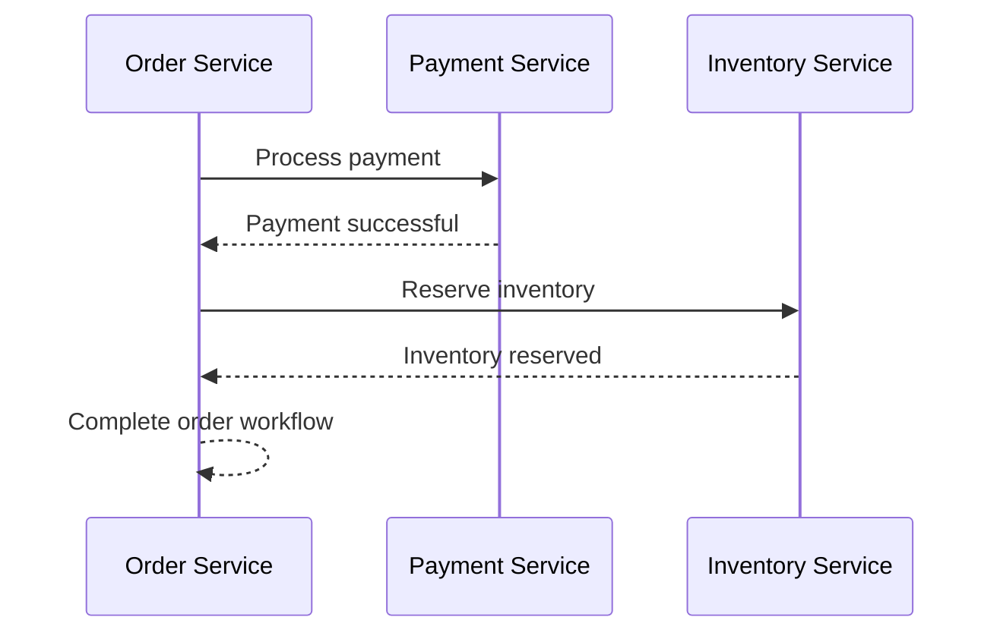

Advantages:
- Immediate response.
- Straightforward request-response flow.
- Suitable for operations requiring immediate results.
- Easier to understand for simple workflows.

Limitations:
- Caller availability depends on downstream availability.
- Network latency accumulates across service calls.
- Timeouts can leave operation outcomes uncertain.
- Cascading failures can affect multiple services.
- Tight runtime coupling makes independent scaling more difficult.

### Asynchronous Communication

In asynchronous communication, the producer publishes a message to SQS and does not wait for the consumer to finish processing it.

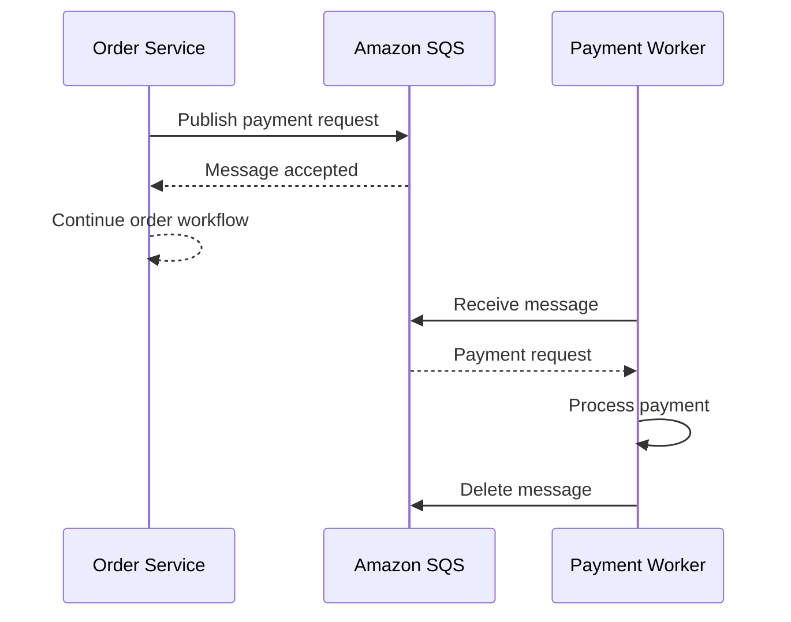

Advantages:
- Reduces runtime coupling.
- Absorbs temporary traffic spikes.
- Allows independent consumer scaling.
- Supports retryable background processing.
- Improves resilience to temporary consumer outages.

Limitations:
- Processing is not immediate or guaranteed to finish within a fixed time.
- Duplicate delivery must be handled.
- Distributed workflow state becomes more complex.
- Eventual consistency must be considered.
- Debugging requires correlation across services.

### Communication Model Comparison

| Characteristic | Synchronous | Asynchronous with SQS |
|---|---|---|
| Communication | Request-response | Message-based |
| Caller waits for processing | Yes | No |
| Runtime coupling | Higher | Lower |
| Failure isolation | Requires timeouts and resilience controls | Queue buffers temporary consumer failures |
| Processing | Usually immediate | Deferred |
| Scaling | Often coupled to request traffic | Producers and consumers scale independently |
| Retry mechanism | Application or client retry | Queue redelivery and application retry |
| Ordering | Depends on application and protocol | Standard best-effort; FIFO within message groups |
| Consistency | Immediate response may reflect completed operation | Usually eventual consistency |
| Typical use case | Query or immediate validation | Background commands and event processing |

These models are complementary. A production microservices architecture generally uses synchronous communication for queries and operations requiring immediate responses, and asynchronous messaging for independent background work.

## Core Microservices Messaging Architecture

A typical architecture uses separate SQS queues for independent service responsibilities.

Consider an e-commerce platform with:
- Order Service.
- Payment Service.
- Inventory Service.
- Notification Service.
- Shipping Service.

When an order is created, the Order Service publishes a business event. Other services consume the event independently.

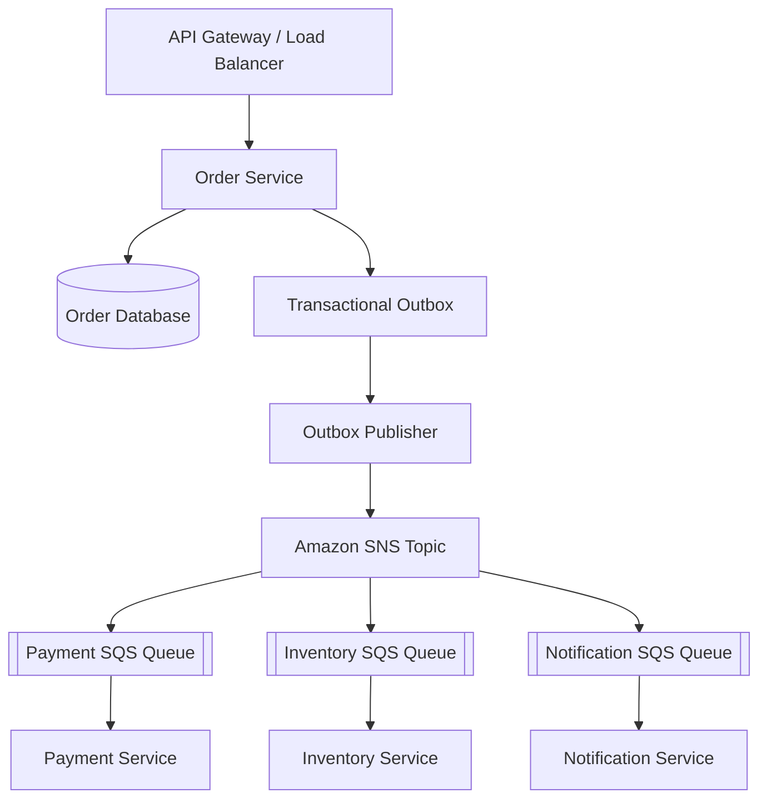

SNS provides fan-out distribution, while SQS provides independent buffering for each consumer.

This architecture prevents one consumer from competing with another for the same message.

For example, if the Notification Service is temporarily unavailable, its queue retains messages while the Payment and Inventory services continue processing their own queues.

## Service Communication Patterns

### Point-to-Point Messaging

Point-to-point communication uses one SQS queue between a producer and a logical consumer group.

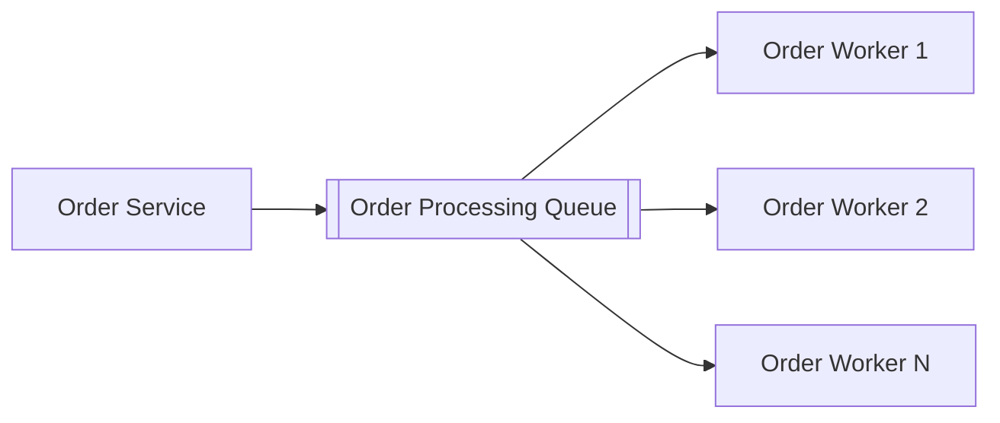

Multiple workers consume from the same queue. Each message is normally processed by one worker at a time, subject to SQS delivery semantics.

Use this pattern when:
- A command has one logical owner.
- Multiple workers should share processing load.
- Competing consumers are required.
- The operation needs independent buffering and retries.

Examples:
- Generate a report.
- Process an uploaded document.
- Execute an order fulfillment task.
- Reconcile a transaction.

A shared queue is not equivalent to broadcasting a message to every consumer. Workers compete for messages.

### Publish-Subscribe Messaging

Publish-subscribe communication distributes a published event to multiple independent subscribers.

With SNS and SQS, each subscriber receives its own queue copy.

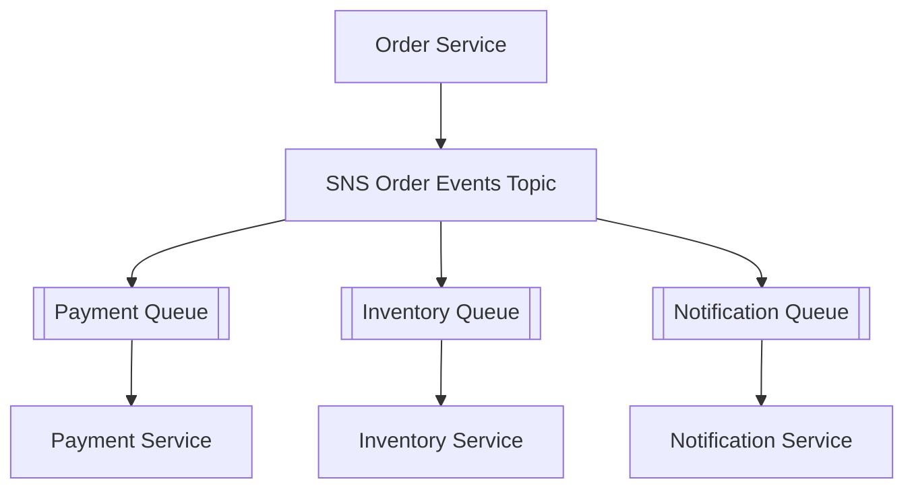

Use this pattern when multiple services need to react independently to the same business event.

Advantages:
- Independent consumer scaling.
- Failure isolation.
- Independent retry policies.
- Independent message retention.
- New consumers can be added without changing the publisher.

### Command Messaging

A command represents an instruction for a specific service to perform an operation.

Examples:

```json
{
  "message_id": "cmd_12345",
  "command_type": "payment.process",
  "command_version": 1,
  "correlation_id": "order_789",
  "data": {
    "order_id": "order_789",
    "amount": 2499.00,
    "currency": "INR"
  }
}
```

Commands should have a clear target and expected responsibility.

Examples:
- `payment.process`
- `inventory.reserve`
- `document.generate`
- `shipment.create`

A command should not be broadcast indiscriminately to every service. Use a dedicated queue or an explicitly designed routing mechanism.

### Event Messaging

An event describes something that has already happened.

Examples:
- `order.created`
- `payment.completed`
- `inventory.reserved`
- `shipment.dispatched`

Example event:

```json
{
  "event_id": "evt_12345",
  "event_type": "order.created",
  "event_version": 1,
  "occurred_at": "2026-11-20T09:30:00Z",
  "correlation_id": "order_789",
  "data": {
    "order_id": "order_789",
    "customer_id": "customer_123",
    "total_amount": 2499.00,
    "currency": "INR"
  }
}
```

Events communicate facts rather than instructions.

A service receiving `order.created` decides how that event affects its own responsibilities.

### Command vs Event

| Characteristic | Command | Event |
|---|---|---|
| Meaning | Request to perform an operation | Notification that something happened |
| Ownership | Directed to a responsible service | Can have multiple subscribers |
| Naming | Usually imperative | Usually past tense |
| Example | `payment.process` | `payment.completed` |
| Expected response | Processing outcome or status | Independent reaction |
| Typical pattern | Point-to-point | Publish-subscribe |

Keeping commands and events distinct improves service ownership and prevents accidental coupling.

## Message Contracts and Schema Evolution

Messages are integration contracts between independently deployed services.

A producer and consumer may be deployed at different times. Therefore, message formats must evolve without requiring simultaneous deployment.

### Recommended Event Structure

```json
{
  "event_id": "evt_01J9X8Y7Z6",
  "event_type": "order.created",
  "event_version": 1,
  "occurred_at": "2026-11-20T09:30:00Z",
  "producer": "order-service",
  "correlation_id": "order_789",
  "data": {
    "order_id": "order_789",
    "customer_id": "customer_123",
    "currency": "INR",
    "total_amount": 2499.00
  }
}
```

Important fields:

| Field | Purpose |
|---|---|
| `event_id` | Stable identity for deduplication |
| `event_type` | Identifies the business event |
| `event_version` | Supports schema evolution |
| `occurred_at` | Records event creation time |
| `producer` | Identifies the originating service |
| `correlation_id` | Connects related operations across services |
| `data` | Contains the event-specific payload |

### Schema Evolution Guidelines

- Prefer adding optional fields over removing existing fields.
- Do not change the meaning or data type of an existing field without a migration strategy.
- Consumers should tolerate unknown optional fields.
- Validate required fields before processing.
- Maintain explicit event versions.
- Use backward-compatible changes whenever possible.
- Test producer and consumer compatibility in CI/CD.

For more complex event ecosystems, consider a schema registry or centrally governed event-contract repository.

### Avoid Publishing Database Models

Do not serialize internal ORM objects directly into messages.

For example, publishing an entire Django model introduces dependencies on:
- Internal database field names.
- Relationships and nested objects.
- Schema migrations.
- Internal implementation details.
- Potentially sensitive columns.

Instead, construct explicit event payloads that represent stable business contracts.

## Transactional Outbox Pattern

A common failure in microservices occurs when a service commits a database transaction but fails to publish the corresponding message.

Example:

```text
1. Order Service inserts an order into PostgreSQL.
2. The database transaction commits.
3. The service attempts to publish order.created to SQS.
4. Network failure occurs.
5. The order exists, but downstream services never receive the event.
```

Publishing before committing creates the opposite problem: consumers may process an event for a database transaction that later rolls back.

The transactional outbox solves this dual-write problem by storing the business change and publication intent in the same database transaction.

### Architecture

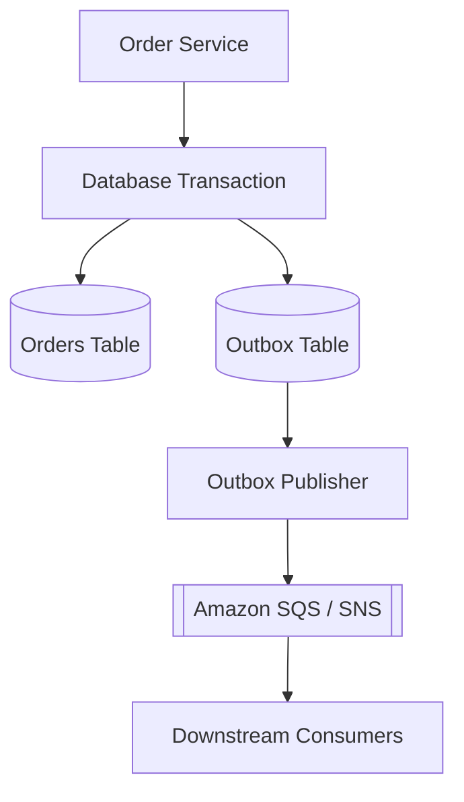

### Example Outbox Table

```sql
CREATE TABLE outbox_events (
    id UUID PRIMARY KEY,
    aggregate_id UUID NOT NULL,
    event_type VARCHAR(150) NOT NULL,
    event_version INTEGER NOT NULL,
    payload JSONB NOT NULL,
    created_at TIMESTAMPTZ NOT NULL DEFAULT NOW(),
    published_at TIMESTAMPTZ,
    attempts INTEGER NOT NULL DEFAULT 0
);

CREATE INDEX idx_outbox_pending
ON outbox_events (created_at)
WHERE published_at IS NULL;
```

The Order Service inserts the order and outbox record within one transaction.

A separate publisher retrieves pending events and sends them to the messaging system.

### Publisher Responsibilities

- Select pending outbox records.
- Claim records safely when multiple publisher instances run.
- Publish messages to SQS or SNS.
- Mark records as published after successful acknowledgment.
- Retry transient failures.
- Record attempts and publication errors.
- Monitor publication backlog.

Use a claim strategy such as PostgreSQL `FOR UPDATE SKIP LOCKED` when multiple publisher workers process the same outbox table.

An important limitation remains: if SQS accepts a message but the publisher crashes before updating `published_at`, the message can be published again. The outbox guarantees durable publication intent, not exactly-once delivery.

Consumers must use stable event IDs and idempotent processing.

## Consumer Idempotency

SQS Standard queues provide at-least-once delivery. A consumer may receive the same message more than once.

A consumer must therefore avoid repeating business operations when processing duplicates.

### Database-Based Idempotency

```sql
CREATE TABLE processed_events (
    event_id VARCHAR(128) PRIMARY KEY,
    processed_at TIMESTAMPTZ NOT NULL DEFAULT NOW()
);
```

The consumer records the event ID and performs the associated database changes in one transaction.

```python
def process_order_event(connection, event: dict) -> bool:
    event_id = event["event_id"]
    order_id = event["data"]["order_id"]

    with connection.transaction():
        result = connection.execute(
            """
            INSERT INTO processed_events (event_id)
            VALUES (%s)
            ON CONFLICT (event_id) DO NOTHING
            RETURNING event_id
            """,
            (event_id,),
        ).fetchone()

        if result is None:
            return False

        connection.execute(
            """
            UPDATE order_projection
            SET status = 'created'
            WHERE order_id = %s
            """,
            (order_id,),
        )

    return True
```

The example assumes the event record and projection update use the same database transaction.

### External Side Effects

A local database transaction cannot atomically include a remote payment-provider or REST API operation.

For external operations:
- Use provider-supported idempotency keys.
- Persist the external operation state.
- Distinguish confirmed success from ambiguous outcomes.
- Reconcile operations whose outcomes cannot be determined.
- Avoid repeating irreversible actions without checking their previous state.

A message acknowledgment should occur only after the business operation has reached a durable and recoverable state.

## Request-Reply over SQS

Although SQS is primarily asynchronous, request-reply communication can be implemented using two queues.

The requester sends a message to a request queue and includes a correlation identifier and reply destination. The consumer processes the request and sends a response to the reply queue.

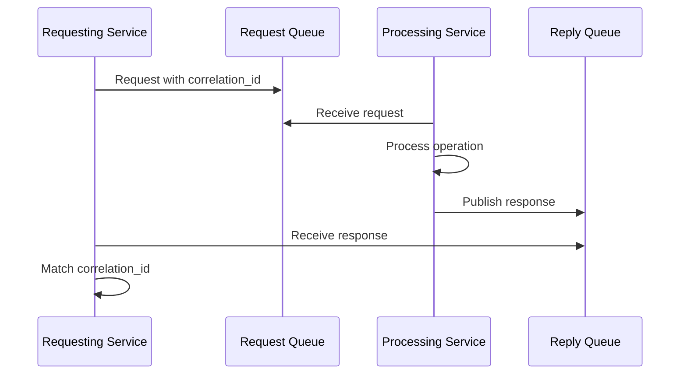

This pattern can be useful when asynchronous processing is required but the caller eventually needs a result.

However, it introduces additional complexity:
- Correlation and response matching.
- Request timeouts.
- Expired or abandoned replies.
- Duplicate requests and responses.
- Reply queue isolation.
- Cleanup of pending request state.

For ordinary request-response interactions, REST or gRPC is usually simpler. Use SQS request-reply only when the asynchronous execution model provides a meaningful architectural benefit.

## Saga Pattern for Distributed Transactions

A business workflow may span multiple services and databases.

Consider an order workflow:

1. Create order.
2. Reserve inventory.
3. Process payment.
4. Confirm order.
5. Arrange shipment.

There is no single database transaction covering all services. The Saga pattern coordinates a sequence of local transactions and compensating actions.

### Orchestration-Based Saga

A central workflow coordinator controls the sequence.

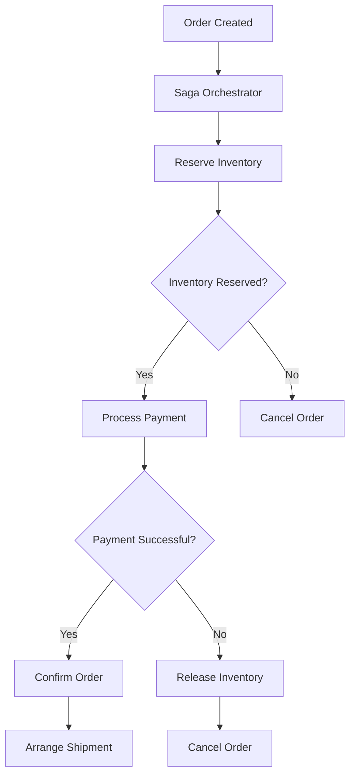

### Choreography-Based Saga

Services react to events and publish subsequent events without a central coordinator.

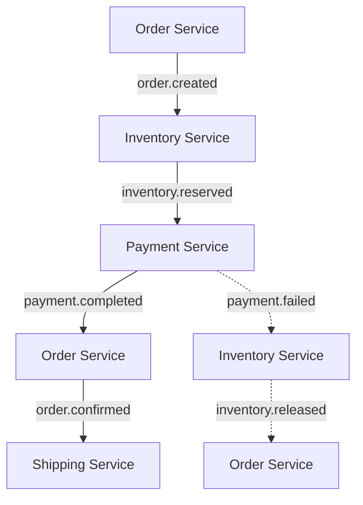

### Orchestration vs Choreography

| Characteristic | Orchestration | Choreography |
|---|---|---|
| Coordination | Central coordinator | Distributed event reactions |
| Workflow visibility | Centralized | Distributed |
| Service coupling | Services communicate with orchestrator contracts | Services depend on event contracts |
| Complexity | Coordinator state and failure handling | Distributed workflow tracing |
| Best suited for | Complex workflows with explicit transitions | Smaller event-driven workflows |

Compensating actions are business operations, not database rollbacks.

For example, a successful payment followed by shipment failure may require a refund rather than simply reverting the payment record.

Use durable workflow state, idempotent commands, timeout handling, and reconciliation for long-running workflows.

## Standard and FIFO Queues in Microservices

Queue selection affects ordering and throughput.

| Characteristic | Standard Queue | FIFO Queue |
|---|---|---|
| Ordering | Best-effort | Strict within a message group |
| Delivery | At-least-once | FIFO deduplication support |
| Message group | Not applicable | Required |
| Throughput | High and scalable | Depends on FIFO throughput configuration and message groups |
| Parallelism | High | Across independent message groups |
| Typical use | Independent business tasks | Ordered operations for a business entity |

Use Standard queues when messages can be processed independently and ordering is not essential.

Use FIFO queues when operations must preserve order within a specific entity, such as:
- Account transactions.
- Inventory updates for a product.
- Sequential order state transitions.
- Workflow commands for a customer account.

FIFO ordering is not global. Messages are ordered within their `MessageGroupId`.

The five-minute FIFO deduplication interval does not eliminate the need for durable consumer idempotency.

## Cross-Service Failure Isolation

One of the main benefits of asynchronous messaging is that a failing consumer does not necessarily prevent other services from operating.

Consider the Notification Service becoming unavailable.

With independent queues:
- Order events can continue to be published.
- Payment processing can continue.
- Inventory processing can continue.
- Notification messages accumulate for later processing.

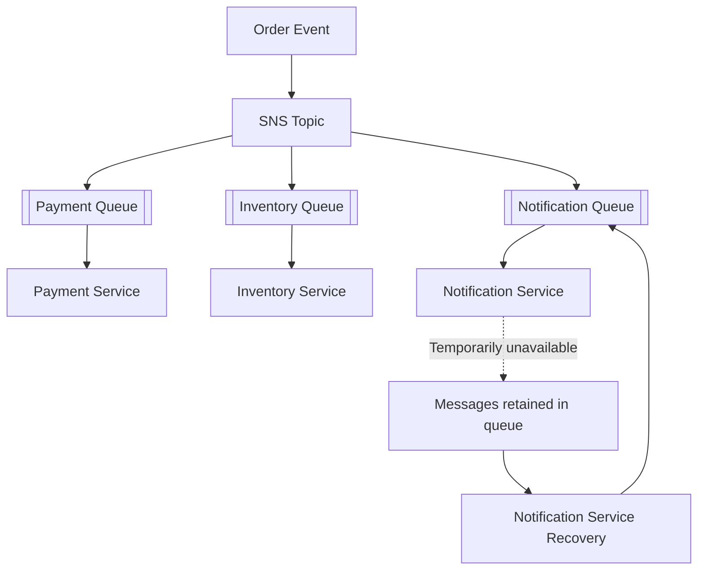

This is not unlimited fault isolation. If a queue grows beyond acceptable retention or processing capacity, business workflows may still violate their service-level objectives.

Monitor backlog age and define operational recovery procedures.

## Retry Strategy and Dead-Letter Queues

Microservices can fail because of transient infrastructure problems or permanent business errors.

Use bounded retries and a DLQ to prevent repeated failures from consuming unlimited resources.

### Failure Handling

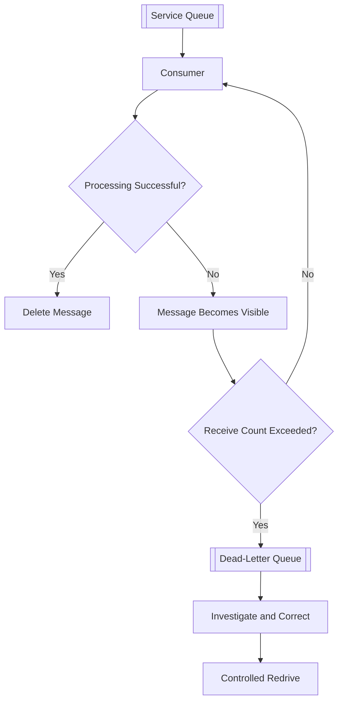

Recommended handling:

| Failure | Handling |
|---|---|
| Temporary network failure | Retry with exponential backoff and jitter |
| Database unavailable | Retry within a bounded policy |
| Downstream HTTP 429 | Respect rate limits and retry guidance |
| Downstream HTTP 5xx | Retry with backoff |
| Invalid message schema | Isolate in DLQ and investigate |
| Permanent business rejection | Record the outcome and acknowledge according to business policy |
| Duplicate event | Treat as already processed when durable idempotency confirms it |

SQS visibility timeout controls when a failed message becomes available again. It is not itself an exponential backoff policy.

For more controlled retry schedules, use separate retry queues with delay, application-managed scheduling, or EventBridge Scheduler for longer delays. SQS delay is limited to 15 minutes.

Keep two failure boundaries distinct:
- An SNS subscription DLQ captures failures delivering from SNS to a subscription endpoint.
- An SQS processing DLQ captures messages that repeatedly fail consumer processing.

## Service Discovery and Ownership

SQS removes the need for consumers to expose a synchronous endpoint for every operation. However, service ownership and queue governance still matter.

Establish clear ownership for:
- Queue creation and configuration.
- Message contracts.
- IAM policies.
- DLQ investigation.
- Redrive operations.
- Retention policies.
- Monitoring and alerting.

A domain-oriented design helps prevent every service from publishing arbitrary messages to every queue.

For example:

| Domain | Owned Events | Responsible Service |
|---|---|---|
| Orders | `order.created`, `order.cancelled` | Order Service |
| Payments | `payment.completed`, `payment.failed` | Payment Service |
| Inventory | `inventory.reserved`, `inventory.released` | Inventory Service |
| Shipping | `shipment.created`, `shipment.dispatched` | Shipping Service |

Consumers should depend on stable integration contracts rather than another service's internal database schema.

## Python Consumer Integration

A long-running Python service can consume SQS messages using Boto3.

```python
import json
import logging
import os

import boto3
from botocore.config import Config


logger = logging.getLogger(__name__)

sqs = boto3.client(
    "sqs",
    region_name=os.environ["AWS_REGION"],
    config=Config(
        retries={
            "mode": "standard",
            "max_attempts": 5,
        },
        connect_timeout=3,
        read_timeout=30,
    ),
)

QUEUE_URL = os.environ["ORDER_EVENTS_QUEUE_URL"]


def process_event(event: dict) -> None:
    event_type = event["event_type"]

    if event_type == "order.created":
        handle_order_created(event)
    elif event_type == "order.cancelled":
        handle_order_cancelled(event)
    else:
        raise ValueError(f"Unsupported event type: {event_type}")


def consume() -> None:
    while True:
        response = sqs.receive_message(
            QueueUrl=QUEUE_URL,
            MaxNumberOfMessages=10,
            WaitTimeSeconds=20,
            VisibilityTimeout=120,
            MessageSystemAttributeNames=[
                "ApproximateReceiveCount",
            ],
        )

        for message in response.get("Messages", []):
            try:
                event = json.loads(message["Body"])
                process_event(event)

                sqs.delete_message(
                    QueueUrl=QUEUE_URL,
                    ReceiptHandle=message["ReceiptHandle"],
                )

            except Exception:
                logger.exception(
                    "Message processing failed",
                    extra={
                        "message_id": message["MessageId"],
                    },
                )


if __name__ == "__main__":
    consume()
```

This is a basic polling example. Production consumers should add:
- Durable idempotency.
- Graceful shutdown.
- Bounded concurrency.
- Error classification.
- Visibility timeout extension where necessary.
- DLQ monitoring.
- Structured tracing.
- Controlled downstream request rates.

For Django applications, the consumer can run as a separate management command or worker deployment rather than inside the web-serving process.

For Kubernetes, deploy consumers independently from API pods so that background processing can scale without increasing web application capacity.

## Security Considerations

Messaging systems create additional trust boundaries between independently deployed services.

### IAM Access Control

Use separate IAM roles for producers and consumers.

| Service Role | Typical Permissions |
|---|---|
| Order Service producer | `sqs:SendMessage` on approved queues |
| Payment Service consumer | Receive, delete, visibility change, and queue inspection permissions |
| Operations role | Monitoring and controlled DLQ redrive |
| Outbox publisher | Publish access to its designated queues or topics |

Avoid unrestricted queue access and broad `sqs:*` permissions.

### Encryption

Use server-side encryption for sensitive workloads.

- SQS-managed encryption for straightforward queue encryption.
- SSE-KMS when customer-managed key policies or audit requirements are needed.
- Appropriate KMS permissions for producer and consumer roles.
- Controlled key rotation and access monitoring.

### Message Security

- Treat message bodies as untrusted input.
- Validate schema and event version.
- Avoid embedding secrets and access tokens.
- Minimize personal data in events.
- Apply authorization checks before sensitive business operations.
- Use private network connectivity through VPC endpoints where appropriate.
- Monitor access and administrative changes through CloudTrail.

## Observability and Distributed Tracing

A microservices workflow can involve several independent services and queues. Traditional request logs are insufficient for understanding end-to-end processing.

Use consistent identifiers across the workflow.

| Identifier | Purpose |
|---|---|
| `event_id` | Identifies a specific event |
| `correlation_id` | Connects related operations across services |
| `causation_id` | Identifies the event or command that caused another event |
| `trace_id` | Connects distributed tracing spans |
| `aggregate_id` | Identifies the business entity involved |

Example structured log:

```json
{
  "service": "payment-service",
  "event_type": "order.created",
  "event_id": "evt_12345",
  "correlation_id": "order_789",
  "trace_id": "trace_abc123",
  "processing_status": "success"
}
```

Do not assume that a trace context automatically propagates through SQS. Explicitly include and extract the required trace context or use supported tracing instrumentation.

### Operational Metrics

| Layer | Metrics |
|---|---|
| Producer | Publish failures, outbox backlog, publication latency |
| SQS | Visible messages, in-flight messages, oldest message age |
| Consumer | Processing throughput, duration, error rate |
| Retry | Receive count, retry rate, duplicate processing |
| DLQ | Message count, message age, redrive activity |
| Business workflow | Completion rate, failure rate, end-to-end latency |

Monitor business outcomes in addition to infrastructure metrics. A message being deleted does not necessarily prove that the overall business workflow completed correctly.

## Scalability and Performance

SQS enables independent scaling of producers and consumers, but downstream capacity remains the limiting factor.

Production recommendations:

- Scale consumers using backlog age and queue depth.
- Use long polling to reduce empty receives.
- Use batch operations where appropriate.
- Bound worker concurrency.
- Apply rate limits to downstream services.
- Isolate workloads with different processing requirements.
- Keep message payloads compact.
- Use S3 references for large payloads.
- Monitor processing duration and database connection utilization.

SQS supports messages up to 1 MiB. Large documents and binary payloads should generally be stored in S3, with messages containing an object reference and the metadata required for authorized retrieval.

For high-volume event streaming, partitioned replayable logs, or stream-processing workloads, evaluate Amazon Kinesis Data Streams or Amazon MSK instead of treating SQS as a streaming platform.

## High Availability and Disaster Recovery

SQS queues are regional resources. Cross-Region messaging and recovery require explicit architecture.

For critical microservices:
- Deploy service instances across multiple Availability Zones.
- Keep authoritative business state in durable databases.
- Use transactional outbox for critical event publication.
- Define RTO and RPO for asynchronous workflows.
- Provision queue infrastructure through Terraform or AWS CDK.
- Document replay and reconciliation procedures.
- Test recovery from consumer outages and DLQ accumulation.
- Plan regional failover and message republishing.
- Ensure KMS keys and IAM policies are available in recovery Regions.

Do not assume that deploying the same queue name in another Region replicates the original queue or its messages.

## Common Mistakes and Production Pitfalls

| Mistake | Impact | Recommended Approach |
|---|---|---|
| Using asynchronous messaging for every interaction | Adds unnecessary workflow complexity | Use REST or gRPC when an immediate response is required |
| Sharing one queue across independent services | Consumers compete for messages | Use SNS fan-out with separate SQS queues |
| Publishing internal database models | Couples consumers to database implementation | Publish explicit business contracts |
| Confusing commands and events | Creates unclear ownership and routing | Define distinct command and event semantics |
| Publishing without an outbox | Database and message publication can diverge | Use transactional outbox for critical workflows |
| Assuming exactly-once execution | Duplicate business operations occur | Implement durable idempotency |
| Creating circular service dependencies | Makes workflows difficult to reason about | Define clear domain ownership and event boundaries |
| Ignoring eventual consistency | Services may observe different states temporarily | Model explicit processing and workflow states |
| Retrying permanent errors | Wastes capacity and delays healthy work | Classify failures and use DLQs |
| Treating FIFO as global ordering | Incorrect assumptions about cross-entity ordering | Design message groups around ordering boundaries |
| Logging without correlation IDs | Makes distributed failures difficult to trace | Propagate event and correlation identifiers |
| Using SQS as an event archive | Historical events may be deleted or expire | Use a durable event store or archive when replay is required |

## Key Takeaways

- SQS enables asynchronous communication between microservices while reducing runtime coupling and absorbing temporary workload spikes.
- Use point-to-point queues for commands and SNS fan-out with independent SQS queues for events consumed by multiple services.
- Transactional outbox, stable event contracts, and durable consumer idempotency are essential for reliable distributed messaging.
- Sagas coordinate multi-service business workflows through local transactions and compensating actions rather than distributed database transactions.
- Production messaging requires explicit failure isolation, bounded retries, observability, security, downstream capacity controls, and disaster recovery.