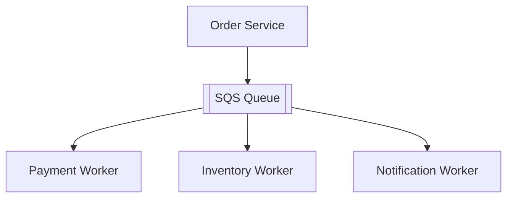
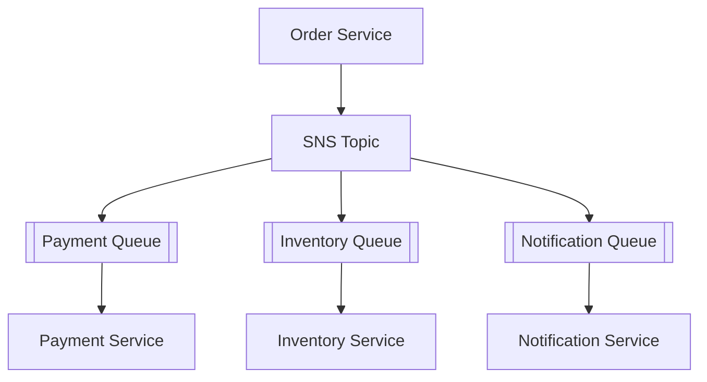
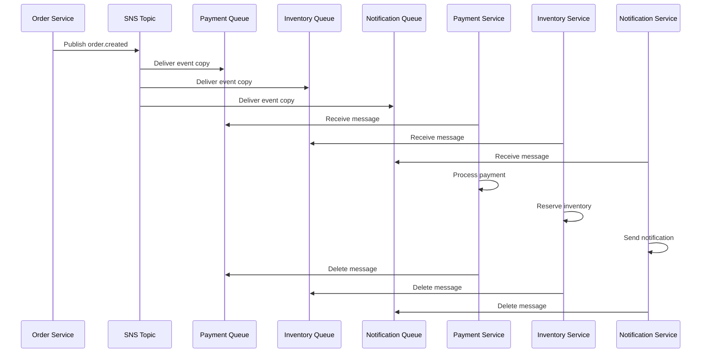
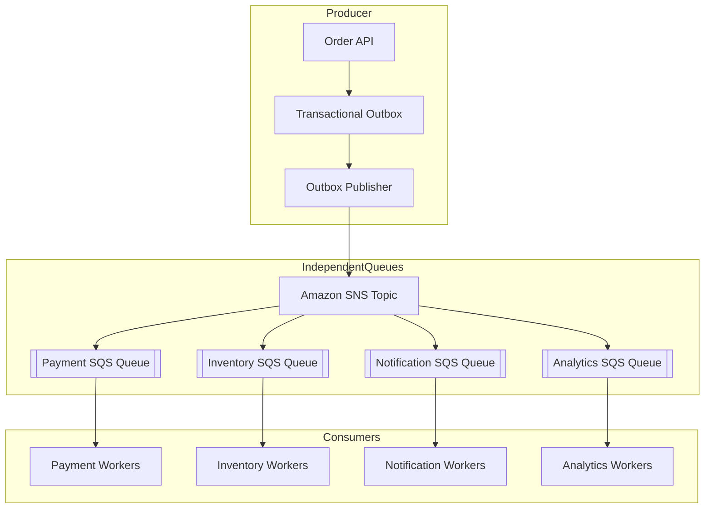
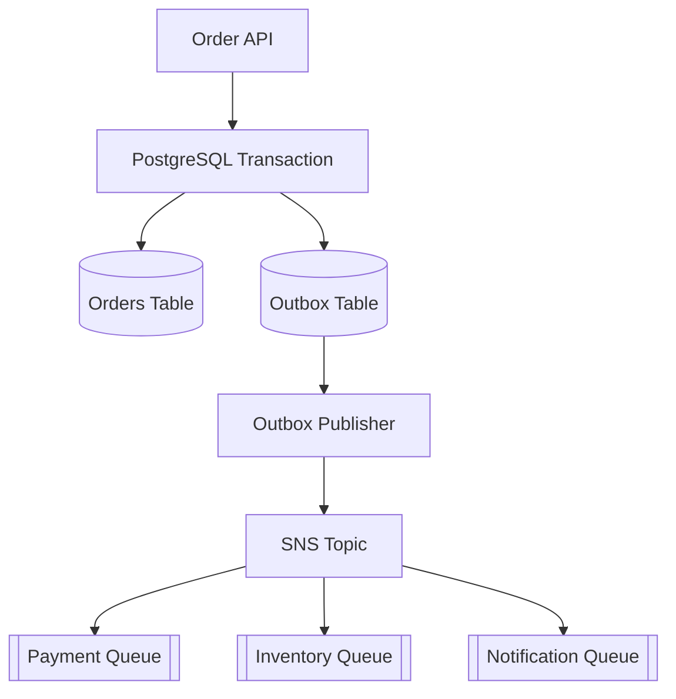
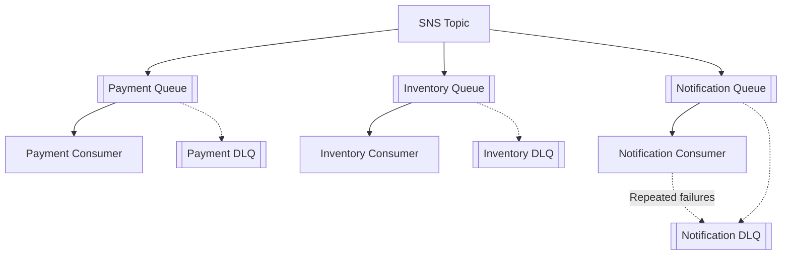
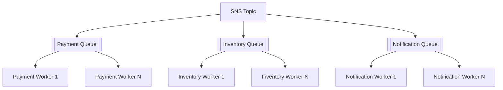
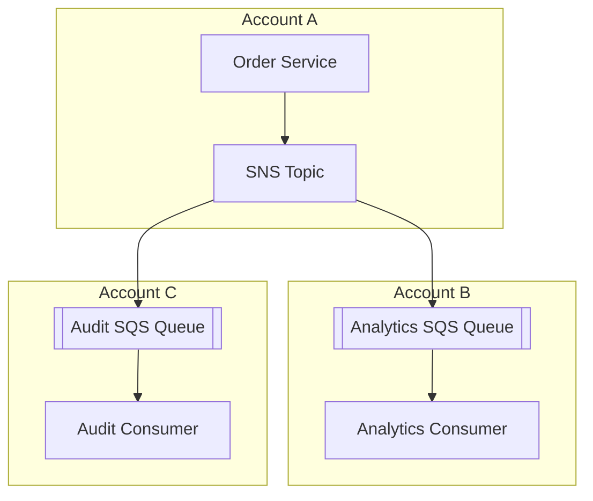

# 04- Fan-Out Architecture

## Overview

Fan-out architecture is a messaging pattern in which one published message is distributed to multiple independent consumers.

In an Amazon Simple Queue Service (Amazon SQS) architecture, fan-out is commonly implemented by combining Amazon Simple Notification Service (Amazon SNS) with multiple SQS queues.

SNS distributes the published message to subscribed queues. Each queue maintains its own copy, allowing consumers to process the same event independently.

This architecture is useful when multiple microservices need to react to the same business event without depending on one another.

Typical use cases include:

- Order events consumed by payment, inventory, and notification services.
- Customer registration events consumed by analytics and onboarding services.
- Document uploads triggering independent processing workflows.
- Transaction events distributed to billing, auditing, and reporting systems.
- Infrastructure events delivered to multiple operational systems.

The primary benefit is independent message delivery and processing. A slow or unavailable consumer does not prevent other consumers from receiving their own copies.

## Why Fan-Out Is Required

Consider an e-commerce application that publishes an `order.created` event.

Three services need to react:

- Payment Service processes the payment.
- Inventory Service reserves stock.
- Notification Service sends an order confirmation.

A single SQS queue with three consumers does not provide fan-out. The consumers compete for messages, so each message is normally delivered to only one consumer at a time.

This is appropriate for distributing work among equivalent workers, but not when every service must receive the event.

### Shared Queue: Competing Consumers



Only one consumer normally receives a particular message at a time. The message is not automatically copied to every worker.

### Fan-Out: Independent Queues



Each subscribed queue receives an independent copy of the published message.

This allows:
- Independent consumer processing.
- Separate retry policies.
- Separate DLQs.
- Independent scaling.
- Different message retention periods.
- Failure isolation between services.

## Core Architecture Components

| Component | Responsibility |
|---|---|
| Publisher | Creates and publishes the business event |
| SNS topic | Distributes the event to subscribers |
| SNS subscription | Connects the topic to a destination |
| SQS queue | Buffers an independent copy of the event |
| Consumer | Processes messages from its queue |
| DLQ | Isolates messages that repeatedly fail delivery or processing |
| CloudWatch | Provides operational metrics and alarms |

SNS and SQS have complementary responsibilities:

- SNS handles message distribution.
- SQS handles durable buffering and consumer-side processing.
- Consumers control when messages are acknowledged through deletion.

## End-to-End Message Flow

Consider the `order.created` event.

1. The Order Service creates an order.
2. The service records the event publication intent.
3. An outbox publisher sends the event to an SNS topic.
4. SNS identifies the configured subscriptions.
5. SNS delivers a copy to each subscribed SQS queue.
6. Each consumer independently retrieves its messages.
7. Each service performs its business operation.
8. Successfully processed messages are deleted from their respective queues.



The consumers operate independently. Payment processing does not need to wait for notification delivery, and notification failures do not block inventory processing.

## SNS and SQS Fan-Out Architecture

The standard implementation uses one SNS topic and multiple SQS subscriptions.



### Why Use a Separate Queue for Each Consumer?

Each queue represents an independent processing boundary.

| Requirement | Benefit of Separate Queues |
|---|---|
| Independent scaling | Each consumer scales according to its workload |
| Failure isolation | One consumer's failures do not block another |
| Retry configuration | Each queue has its own visibility timeout and redrive policy |
| Retention | Consumers can retain messages for different periods |
| Processing priority | Workloads can use separate worker capacity |
| Operational ownership | Teams can monitor and operate their queues independently |
| Replay and recovery | A consumer's retained messages can be processed independently |

Avoid sharing a single queue between services that all need to receive every event. Use SNS fan-out to create independent queue copies.

## Message Contract Design

A fan-out architecture requires a stable event contract because multiple services may depend on the same message.

Example `order.created` event:

```json
{
  "event_id": "evt_01J9X8Y7Z6",
  "event_type": "order.created",
  "event_version": 1,
  "occurred_at": "2026-11-20T09:30:00Z",
  "producer": "order-service",
  "correlation_id": "order_789",
  "data": {
    "order_id": "order_789",
    "customer_id": "customer_123",
    "total_amount": 2499.00,
    "currency": "INR"
  }
}
```

Important fields:

| Field | Purpose |
|---|---|
| `event_id` | Stable event identifier for deduplication |
| `event_type` | Identifies the business event |
| `event_version` | Supports schema evolution |
| `occurred_at` | Records event creation time |
| `producer` | Identifies the originating service |
| `correlation_id` | Connects related operations |
| `data` | Contains business information |

### Contract Design Recommendations

- Publish explicit event payloads rather than serializing ORM models.
- Use stable event identifiers.
- Include event type and version.
- Prefer backward-compatible schema changes.
- Avoid exposing internal database implementation details.
- Include only the data required by consumers.
- Use S3 references for large payloads.
- Document event ownership and compatibility expectations.

A consumer should tolerate unknown optional fields and validate required fields before processing.

## Message Filtering

Not every subscriber needs every event.

SNS subscription filter policies allow selective delivery based on message attributes or supported message-body filtering.

For example:
- Payment Service receives order events.
- Notification Service receives order and payment events.
- Analytics Service receives all relevant business events.

### Example Message Attributes

```python
import json
import os

import boto3


sns = boto3.client(
    "sns",
    region_name=os.environ["AWS_REGION"],
)

TOPIC_ARN = os.environ["ORDER_EVENTS_TOPIC_ARN"]


def publish_order_event(event: dict) -> str:
    response = sns.publish(
        TopicArn=TOPIC_ARN,
        Message=json.dumps(event),
        MessageAttributes={
            "event_type": {
                "DataType": "String",
                "StringValue": event["event_type"],
            },
            "event_version": {
                "DataType": "Number",
                "StringValue": str(event["event_version"]),
            },
        },
    )

    return response["MessageId"]
```

### Example Filter Policy

A Notification Service subscription can receive only selected event types.

```json
{
  "event_type": [
    "order.created",
    "payment.completed"
  ]
}
```

A Payment Service subscription might use:

```json
{
  "event_type": [
    "order.created"
  ]
}
```

### Filtering Considerations

- Filter policies are configured on subscriptions, not globally on the topic.
- Message attributes and message-body filtering are different filtering scopes.
- The filter policy scope must match the intended message representation.
- Filter policy changes can take time to become effective.
- A message that does not match a subscription filter is intentionally not delivered to that subscriber.
- Filtering should not replace clear event ownership or topic design.

SNS filtering is useful for routing, but it is not a substitute for consumer authorization or business validation.

## Queue Policy and SNS Permissions

SNS must have permission to send messages to subscribed SQS queues.

This requires an SQS resource policy that allows the SNS service principal to call `sqs:SendMessage`.

Example queue policy:

```json
{
  "Version": "2012-10-17",
  "Statement": [
    {
      "Sid": "AllowOrderTopicDelivery",
      "Effect": "Allow",
      "Principal": {
        "Service": "sns.amazonaws.com"
      },
      "Action": "sqs:SendMessage",
      "Resource": "arn:aws:sqs:ap-south-1:123456789012:payment-queue",
      "Condition": {
        "ArnEquals": {
          "aws:SourceArn": "arn:aws:sns:ap-south-1:123456789012:order-events"
        }
      }
    }
  ]
}
```

The `aws:SourceArn` condition restricts delivery to the expected topic.

For cross-account fan-out, configure the required SNS topic policy, SQS queue policy, and IAM permissions. Cross-account access requires the relevant resource and identity policies to permit the intended operations.

### Permission Responsibilities

| Resource | Permission |
|---|---|
| Publisher role | `sns:Publish` on the topic |
| SNS topic policy | Allows approved publishers |
| SQS queue policy | Allows the expected SNS topic to send messages |
| Consumer role | Receive, delete, visibility change, and queue inspection permissions |
| KMS key policy | Allows required encryption and decryption operations |

Avoid wildcard resource permissions where specific topic and queue ARNs can be used.

## Raw Message Delivery

By default, SNS sends an SNS notification envelope to an SQS subscription.

The SQS message body contains SNS metadata and the published message as a nested field.

Conceptually:

```json
{
  "Type": "Notification",
  "MessageId": "sns-message-id",
  "TopicArn": "arn:aws:sns:ap-south-1:123456789012:order-events",
  "Message": "{\"event_type\":\"order.created\"}"
}
```

If raw message delivery is enabled for the SQS subscription, the published message is delivered directly as the SQS message body.

### Comparison

| Mode | Message Body | Consumer Responsibility |
|---|---|---|
| Raw delivery disabled | SNS notification envelope | Extract and parse the nested `Message` field |
| Raw delivery enabled | Original published message | Parse the application event directly |

Raw delivery simplifies consumer code when SNS metadata is not required.

However, SQS raw message delivery has a message attribute limitation: at most 10 SNS message attributes are delivered as SQS message attributes. Design attribute usage accordingly.

### Consumer Parsing Example

For a subscription without raw message delivery:

```python
import json


def parse_sns_envelope(sqs_message: dict) -> dict:
    envelope = json.loads(sqs_message["Body"])

    if envelope.get("Type") != "Notification":
        raise ValueError("Unexpected SNS message type")

    return json.loads(envelope["Message"])
```

For raw message delivery:

```python
import json


def parse_raw_event(sqs_message: dict) -> dict:
    return json.loads(sqs_message["Body"])
```

The consumer must know which delivery mode is configured. Do not attempt to interpret arbitrary payloads using unreliable heuristics.

## Transactional Outbox and Reliable Fan-Out

Publishing a business event directly after a database commit can lose events if the application fails between the two operations.

For critical events, use the transactional outbox pattern.



The order and outbox event are persisted in the same database transaction. A publisher later sends pending events to SNS.

Example outbox schema:

```sql
CREATE TABLE outbox_events (
    id UUID PRIMARY KEY,
    aggregate_id UUID NOT NULL,
    event_type VARCHAR(150) NOT NULL,
    event_version INTEGER NOT NULL,
    payload JSONB NOT NULL,
    created_at TIMESTAMPTZ NOT NULL DEFAULT NOW(),
    published_at TIMESTAMPTZ,
    attempts INTEGER NOT NULL DEFAULT 0
);

CREATE INDEX idx_outbox_pending
ON outbox_events (created_at)
WHERE published_at IS NULL;
```

The publisher should:
- Claim pending records safely.
- Publish the event to SNS.
- Mark the record as published after successful acknowledgment.
- Retry transient failures.
- Track publication attempts and errors.
- Monitor outbox backlog and publication latency.

A duplicate can still occur if SNS accepts the event but the publisher crashes before updating the outbox record. Use the outbox for durable publication intent and consumer idempotency for duplicate protection.

## Consumer Idempotency

SNS and SQS Standard delivery can result in duplicate messages. Each consumer must independently protect its business operations.

Consider the same `order.created` event being delivered twice to the Payment Service.

Without idempotency, the service might initiate two payment operations.

Use the stable `event_id` to enforce duplicate detection.

```sql
CREATE TABLE processed_events (
    event_id VARCHAR(128) PRIMARY KEY,
    processed_at TIMESTAMPTZ NOT NULL DEFAULT NOW()
);
```

For database-backed processing, record the event and apply the associated business update in the same transaction.

```python
def process_event(connection, event: dict) -> bool:
    event_id = event["event_id"]
    order_id = event["data"]["order_id"]

    with connection.transaction():
        result = connection.execute(
            """
            INSERT INTO processed_events (event_id)
            VALUES (%s)
            ON CONFLICT (event_id) DO NOTHING
            RETURNING event_id
            """,
            (event_id,),
        ).fetchone()

        if result is None:
            return False

        connection.execute(
            """
            INSERT INTO payment_requests (order_id, status)
            VALUES (%s, 'pending')
            ON CONFLICT (order_id) DO NOTHING
            """,
            (order_id,),
        )

    return True
```

For external payment providers or other remote systems, use provider-supported idempotency keys and durable operation state. A local database transaction cannot atomically cover a remote API call.

## Failure Isolation and Dead-Letter Queues

Each SQS subscription should have independent failure handling.

A consumer failure should affect its own queue rather than preventing other subscribers from processing their copies.



There are two distinct failure boundaries:

| Failure Boundary | DLQ Purpose |
|---|---|
| SNS subscription delivery | Captures messages SNS cannot successfully deliver to a subscription endpoint |
| SQS consumer processing | Captures messages that repeatedly fail processing and exceed the queue's redrive threshold |

For SNS-to-SQS fan-out, configure SQS redrive policies for consumer processing failures. Configure an SNS subscription DLQ separately when delivery failures need isolation.

Operational recommendations:
- Set a suitable `maxReceiveCount`.
- Alert on DLQ message arrivals.
- Investigate failures before redriving.
- Redrive gradually to avoid another traffic spike.
- Preserve event IDs and correlation IDs.
- Track the failure reason and affected consumer.

## Scaling and Throughput

Fan-out allows each consumer to scale independently.

For example, Payment Service may require 20 workers, while Notification Service may need only 5 workers.



Scale each consumer according to its own workload and downstream capacity.

Useful scaling metrics:
- Approximate number of visible messages.
- Approximate age of the oldest message.
- Number of in-flight messages.
- Processing duration.
- Consumer error rate.
- Downstream API latency.
- Database connection utilization.

Do not scale workers based only on queue depth. More workers can overload databases and external services.

### Batching

SQS supports receiving and deleting up to 10 messages per batch request.

Batching can reduce API request overhead, but consumers must handle partial failures correctly.

- Delete only successfully processed messages.
- Inspect per-entry results from batch operations.
- Keep processing within visibility timeout.
- Avoid treating an entire batch as successful when one message fails.

### Large Payloads

SQS supports message sizes up to 1 MiB.

For large documents or binary data:
1. Store the object in S3.
2. Publish the object reference and metadata.
3. Authorize consumers to retrieve the object.
4. Apply appropriate retention and cleanup policies.

Avoid embedding large documents in every fan-out message because SNS distributes the payload to every subscriber.

## Ordering and FIFO Considerations

SNS and SQS support FIFO messaging for workflows requiring ordered delivery.

For FIFO fan-out:
- Use an SNS FIFO topic.
- Subscribe SQS FIFO queues.
- Provide a `MessageGroupId`.
- Use stable deduplication identifiers where appropriate.
- Design consumers around message-group ordering.

Ordering is maintained within a message group, not globally.

SNS FIFO filtering changes delivery semantics and can produce sequence gaps for filtered subscriptions. Do not assume every subscriber sees every sequence number.

FIFO deduplication uses a five-minute deduplication interval. It does not guarantee exactly-once business side effects.

Use FIFO only when ordering is a business requirement. Standard topics and queues are generally appropriate for independent event processing and higher-throughput workloads.

## Security Considerations

Fan-out architectures increase the number of destinations receiving business events. Security must be enforced at the topic, queue, identity, and data levels.

### IAM and Resource Policies

- Restrict publisher roles to approved SNS topics.
- Restrict consumer roles to their own queues.
- Allow only the expected SNS topic ARN in each SQS queue policy.
- Use explicit cross-account permissions when required.
- Avoid wildcard access to topics and queues.

### Encryption

Use SNS and SQS server-side encryption.

For customer-managed KMS keys:
- Configure the relevant key policies.
- Grant the required publisher and consumer permissions.
- Account for SNS and SQS service usage.
- Monitor key access and failures.
- Plan key availability in recovery Regions.

### Data Protection

- Publish only fields required by subscribers.
- Avoid credentials, tokens, and unnecessary personal data.
- Use S3 references for sensitive or large objects.
- Validate message schemas before processing.
- Apply service-level authorization checks.
- Define retention policies for queues and DLQs.

## Cross-Account Fan-Out

SNS can distribute events to SQS queues in other AWS accounts when the required topic and queue policies permit the integration.



Cross-account design requires:
- An SNS topic policy that permits the intended publishers or principals.
- SQS queue policies allowing the expected SNS topic.
- Correct queue and topic ARNs.
- Appropriate KMS key permissions.
- Controlled ownership of event contracts.
- Monitoring across account boundaries.

Cross-account access should be explicit and narrowly scoped.

## Monitoring and Observability

Fan-out requires visibility into each independent delivery and processing path.

SNS metrics alone do not provide complete business-level visibility into every consumer's processing outcome.

### SNS Metrics

Monitor:
- Number of messages published.
- Number of notifications delivered.
- Number of notifications failed.
- Delivery latency where supported.
- Subscription-level delivery failures.

### SQS Metrics

Monitor each queue independently.

| Metric | Operational Meaning |
|---|---|
| `ApproximateNumberOfMessagesVisible` | Waiting messages |
| `ApproximateNumberOfMessagesNotVisible` | Messages currently in flight |
| `ApproximateAgeOfOldestMessage` | Age of oldest available message |
| `NumberOfMessagesSent` | Messages sent to the queue |
| `NumberOfMessagesReceived` | Messages received by consumers |
| `NumberOfMessagesDeleted` | Messages deleted after processing |

### Application Metrics

Track:
- Event processing success rate per consumer.
- Event processing latency.
- Duplicate event count.
- Consumer retry count.
- DLQ arrivals.
- End-to-end business workflow completion.
- Outbox publication delay.

Use a shared `event_id`, `correlation_id`, and trace context across services.

Do not assume that an SNS publish acknowledgment means every subscriber completed its business operation.

## High Availability and Disaster Recovery

SNS topics and SQS queues are regional resources. Fan-out delivery does not automatically replicate messages to another Region.

For critical event distribution:
- Deploy topic and queue infrastructure through Terraform or AWS CDK.
- Define regional recovery procedures.
- Preserve authoritative business events or outbox records.
- Plan event republishing and duplicate handling.
- Ensure KMS keys and IAM policies exist in recovery Regions.
- Define RTO and RPO for each consumer.
- Test recovery of independent queues and DLQs.
- Reconcile events that were published but not fully processed.

A regional recovery design must consider partial delivery. One subscriber may have processed an event before another Region or consumer failed.

Use stable event IDs and consumer idempotency during failover and replay.

## Cost and Performance Considerations

Fan-out increases message delivery operations because each subscription receives an independent message copy.

For example, publishing one event to four SQS subscriptions results in four queue deliveries when all subscriptions match and delivery succeeds.

Cost considerations include:
- SNS publishing requests.
- SNS subscription delivery requests.
- SQS send, receive, and delete requests.
- Long polling and batch efficiency.
- KMS request charges.
- Data transfer.
- Consumer compute.
- DLQ retention and redrive activity.

Optimization recommendations:
- Use filtering to avoid unnecessary deliveries.
- Use long polling on SQS consumers.
- Batch SQS operations where appropriate.
- Keep event payloads compact.
- Avoid excessive subscription duplication.
- Scale consumers according to downstream capacity.
- Retain messages only as long as operational requirements demand.

Do not introduce a fan-out layer when only one consumer needs the message. Use direct SQS publishing for simple point-to-point workloads.

## Common Mistakes and Production Pitfalls

| Mistake | Impact | Recommended Approach |
|---|---|---|
| Using one SQS queue for all subscribers | Consumers compete for messages instead of receiving independent copies | Use SNS with one queue per logical subscriber |
| Assuming SNS guarantees consumer processing | Publication acknowledgment is not business completion | Track processing outcomes in each service |
| Ignoring duplicate delivery | Business operations may execute multiple times | Use stable event IDs and durable idempotency |
| Publishing database models | Couples consumers to producer internals | Publish explicit event contracts |
| Using broad queue policies | Allows unintended publishers or topics | Restrict `aws:SourceArn` |
| Ignoring subscription filters | Consumers receive unnecessary events | Define and test filter policies |
| Confusing SNS subscription DLQ with SQS processing DLQ | Leaves one failure boundary unprotected | Configure both where required |
| Enabling raw delivery without changing consumer parsing | Consumers may parse the wrong payload structure | Align parser implementation with subscription configuration |
| Publishing oversized events | Increases delivery cost and payload handling complexity | Store large objects in S3 |
| Assuming global FIFO ordering | Creates incorrect workflow assumptions | Use message groups for entity-level ordering |
| Redriving all DLQ messages immediately | Can overwhelm downstream services | Redrive at a controlled rate |
| Treating fan-out as a replayable event log | Historical events may not be retained | Use a durable event archive when replay is required |

## Key Takeaways

- Fan-out distributes one published event to multiple independent subscribers; SNS with one SQS queue per consumer is the standard AWS implementation.
- Separate queues provide independent buffering, scaling, retry policies, retention, and failure isolation.
- Stable event contracts, transactional outbox publication, and consumer idempotency are essential for reliable event distribution.
- SNS subscription delivery failures and SQS consumer processing failures are separate boundaries and may require separate DLQs.
- Production fan-out requires explicit IAM and KMS policies, filtering, observability, downstream capacity controls, and regional recovery planning.