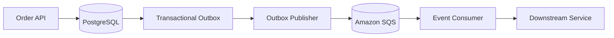
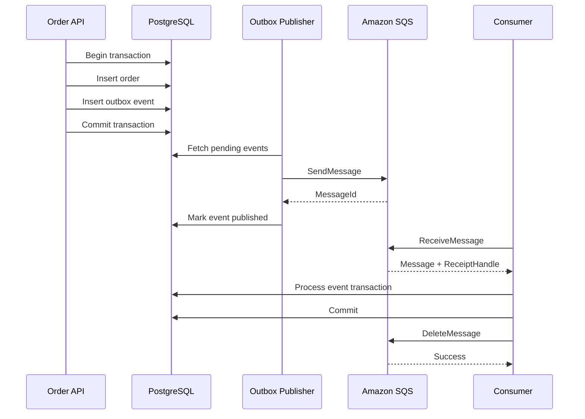
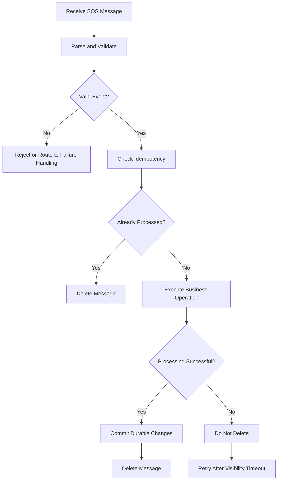
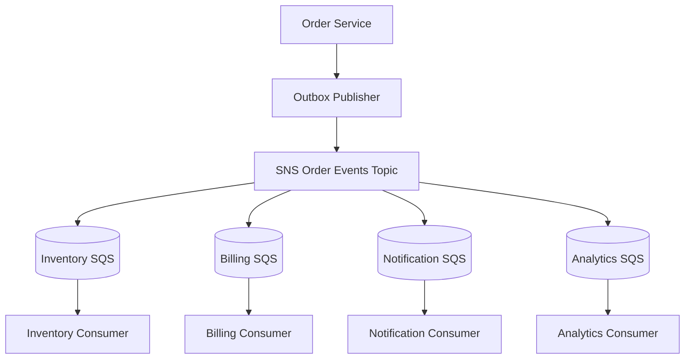

# 05- Event-Driven Processing Architecture

## Overview

Event-driven processing is an architectural pattern in which services react to events representing facts that have occurred in a system. Instead of requiring the producer to invoke downstream services directly, it publishes an event to a messaging infrastructure. Consumers process the event independently and perform their respective business operations.

Amazon SQS provides durable asynchronous message delivery between event producers and consumers. It allows backend systems to separate request handling from background processing, absorb traffic spikes, isolate failures, and scale processing independently.

A common AWS implementation combines:

- **Amazon SQS** for durable message buffering and asynchronous delivery.
- **Amazon SNS** for distributing events to multiple independent subscribers.
- **AWS Lambda, ECS, or EKS** for executing event consumers.
- **Amazon EventBridge** for event routing across services and AWS accounts.
- **Amazon S3** for storing large event payloads.
- **Amazon CloudWatch** for monitoring queue health and processing behavior.

SQS is particularly useful when an event needs durable delivery to a specific processing workload. It is not a complete event-streaming platform: messages are consumed and deleted rather than retained as a replayable event history.

## Event-Driven Processing Fundamentals

### What Is an Event?

An event is an immutable representation of something that has already happened.

Examples:

- `OrderPlaced`
- `PaymentAuthorized`
- `InvoiceGenerated`
- `CustomerRegistered`
- `DocumentUploaded`
- `ShipmentDispatched`

Events describe facts rather than commands.

| Event | Meaning |
|---|---|
| `OrderPlaced` | An order was successfully created |
| `PaymentAuthorized` | A payment authorization succeeded |
| `InventoryReserved` | Inventory was reserved |
| `InvoiceGenerated` | An invoice was generated |

An event should communicate a business fact without requiring consumers to understand the producer's internal implementation.

### Event vs Command

Events and commands have different semantics.

| Characteristic | Event | Command |
|---|---|---|
| Meaning | Something happened | Something should happen |
| Intent | Descriptive | Imperative |
| Ownership | Published by the service that observed the fact | Directed toward a responsible service |
| Typical naming | `OrderPlaced` | `ReserveInventory` |
| Mutability | Immutable historical fact | May be rejected or expire |
| Consumers | Zero or more interested subscribers | Usually one logical handler |

For example:

- `OrderPlaced` announces that an order exists.
- `ReserveInventory` requests that the inventory service reserve stock.

Do not use event terminology for every asynchronous message. Commands and events have different ownership, authorization, and failure-handling requirements.

### Why Event-Driven Processing Exists

Direct synchronous communication creates runtime dependencies between services.

Consider an order API that synchronously invokes payment, inventory, notification, and analytics services.

If any downstream service becomes unavailable, the API may experience increased latency or fail even when order creation itself is possible.

Event-driven processing separates the producer from downstream execution.

Benefits include:

- Independent service deployment and scaling.
- Reduced synchronous request latency.
- Durable buffering during downstream outages.
- Better workload isolation.
- Independent retry and failure handling.
- Support for multiple consumers.
- Improved resilience during traffic spikes.

However, asynchronous processing introduces eventual consistency, duplicate delivery, retry behavior, and additional operational complexity.

## Core SQS-Based Event Processing Architecture

A basic architecture uses one SQS queue for one logical processing workload.

<AsyncImage query="AWS SQS event driven architecture producer application SQS queue Lambda ECS consumer CloudWatch architecture diagram" aspectRatio="16:9" width="100%" />



### Component Responsibilities

| Component | Responsibility |
|---|---|
| Producer API | Accepts business requests and creates domain changes |
| PostgreSQL | Persists business data |
| Transactional outbox | Stores events that must be published |
| Outbox publisher | Publishes pending events to SQS |
| SQS queue | Buffers and delivers messages |
| Consumer | Processes events and performs business operations |
| Downstream service | Executes additional business functionality |

The producer should not depend on the consumer being available.

For example, an order service can successfully create an order even when the notification service is temporarily unavailable, provided the order transaction and event publication intent are persisted successfully.

## Event Processing Lifecycle

An SQS-based event-processing workflow typically follows this sequence:

1. A business operation occurs in the producer service.
2. The producer commits its database changes and an outbox event in one transaction.
3. An outbox publisher reads unpublished events.
4. The publisher sends the event to SQS.
5. SQS makes the message available to consumers.
6. A consumer receives the message and obtains a receipt handle.
7. The consumer validates and processes the event.
8. The consumer commits its durable business changes.
9. The consumer deletes the message from SQS.



The message should only be deleted after successful durable processing.

If the consumer fails before deletion, SQS can make the message available again after its visibility timeout expires.

This is expected behavior and must be handled through idempotent processing.

## Producer Architecture

### Transactional Outbox Pattern

A common reliability problem occurs when an application writes to a database and publishes a message as two separate operations.

Consider:

```python
order = create_order(data)
sqs.send_message(...)
```

Possible failure scenarios:

- The database transaction succeeds, but SQS publication fails.
- SQS accepts the message, but the application crashes before recording publication success.
- The database transaction rolls back after a message has already been published.

The transactional outbox pattern addresses the first problem by storing the business change and publication intent in the same database transaction.

```sql
CREATE TABLE outbox_events (
    id UUID PRIMARY KEY,
    aggregate_id UUID NOT NULL,
    event_type VARCHAR(100) NOT NULL,
    event_version INTEGER NOT NULL,
    payload JSONB NOT NULL,
    created_at TIMESTAMPTZ NOT NULL DEFAULT NOW(),
    published_at TIMESTAMPTZ,
    attempts INTEGER NOT NULL DEFAULT 0
);

CREATE INDEX idx_outbox_unpublished
ON outbox_events (created_at)
WHERE published_at IS NULL;
```

A producer transaction:

```python
from uuid import uuid4

from django.db import transaction
from django.utils import timezone


@transaction.atomic
def create_order(customer_id: int, amount: str):
    order = Order.objects.create(
        customer_id=customer_id,
        amount=amount,
        status="pending",
    )

    OutboxEvent.objects.create(
        id=uuid4(),
        aggregate_id=order.id,
        event_type="OrderPlaced",
        event_version=1,
        payload={
            "event_id": str(uuid4()),
            "order_id": order.id,
            "customer_id": customer_id,
            "amount": amount,
            "occurred_at": timezone.now().isoformat(),
        },
    )

    return order
```

Both records are committed atomically.

The outbox publisher subsequently reads pending events and sends them to SQS.

### Outbox Publisher Considerations

A production publisher should:

- Claim pending records safely across multiple publisher instances.
- Publish in bounded batches.
- Track attempts and publication errors.
- Use exponential backoff for transient failures.
- Preserve event identifiers across retries.
- Avoid holding database locks while making network requests.
- Monitor the age of the oldest unpublished event.

For PostgreSQL, `FOR UPDATE SKIP LOCKED` can support concurrent publishers.

A typical claiming operation:

```sql
BEGIN;

SELECT id, event_type, payload
FROM outbox_events
WHERE published_at IS NULL
ORDER BY created_at
FOR UPDATE SKIP LOCKED
LIMIT 100;

COMMIT;
```

The actual implementation should use a lease or claim-state mechanism when the publisher must retain ownership after the database transaction ends.

Do not keep database transactions open while waiting for SQS network calls.

### Duplicate Publication

The outbox pattern does not guarantee exactly-once publication.

Consider this sequence:

1. The publisher sends a message to SQS.
2. SQS accepts the message.
3. The publisher crashes before marking the outbox record as published.
4. Another publisher sends the same event again.

Therefore, consumers must support duplicate events.

Use a stable event ID generated once when the outbox record is created. Do not generate a new event ID every time the publisher retries.

## Event Contract Design

An event contract defines the structure and meaning of a published event.

A useful event envelope contains:

```json
{
  "event_id": "8a1e7f4c-6a3b-4d51-9c8a-2e7d8f9a1234",
  "event_type": "OrderPlaced",
  "event_version": 1,
  "occurred_at": "2026-11-20T10:30:00Z",
  "producer": "order-service",
  "correlation_id": "req-7f8c9a",
  "data": {
    "order_id": 10542,
    "customer_id": 908,
    "amount": "2499.00",
    "currency": "INR"
  }
}
```

### Important Contract Fields

| Field | Purpose |
|---|---|
| `event_id` | Stable unique identifier for deduplication |
| `event_type` | Identifies the business event |
| `event_version` | Supports schema evolution |
| `occurred_at` | Records when the business event occurred |
| `producer` | Identifies the originating service |
| `correlation_id` | Connects related operations |
| `data` | Contains event-specific information |

### Schema Evolution

Event contracts should evolve without unexpectedly breaking existing consumers.

Recommended practices:

- Add optional fields when possible.
- Preserve the meaning of existing fields.
- Avoid renaming or removing fields without a migration strategy.
- Introduce explicit versions for incompatible changes.
- Validate events before publication and consumption.
- Maintain compatibility tests for important consumers.

Do not publish complete ORM models or internal database records as event contracts.

A service's database schema is an implementation detail. Event schemas are integration contracts.

## Consumer Architecture

A consumer receives an event and executes the associated business operation.

Consumers may run as:

- AWS Lambda functions.
- Long-running Python workers on ECS.
- Kubernetes deployments on EKS.
- EC2-based worker processes.
- Celery workers integrated with an application platform.

### Consumer Processing Flow



### Idempotent Consumer Design

SQS Standard queues provide at-least-once delivery.

A message may be delivered more than once, even when the consumer previously processed it successfully.

Consumers must therefore be idempotent.

An idempotent operation produces the same intended business outcome when executed repeatedly with the same event.

A common implementation uses an inbox or processed-event table.

```sql
CREATE TABLE processed_events (
    event_id UUID PRIMARY KEY,
    event_type VARCHAR(100) NOT NULL,
    processed_at TIMESTAMPTZ NOT NULL DEFAULT NOW()
);
```

The consumer should insert the event identifier and perform its business operation in one database transaction.

```python
from django.db import IntegrityError, transaction


def process_order_event(event: dict) -> None:
    event_id = event["event_id"]

    with transaction.atomic():
        try:
            ProcessedEvent.objects.create(
                event_id=event_id,
                event_type=event["event_type"],
            )
        except IntegrityError:
            return

        order_id = event["data"]["order_id"]

        OrderProjection.objects.update_or_create(
            order_id=order_id,
            defaults={
                "status": "received",
            },
        )
```

The uniqueness constraint prevents concurrent deliveries from processing the same event twice.

The idempotency record and business changes must commit atomically. Otherwise, a crash between the two operations can produce inconsistent processing state.

For external side effects such as payment gateways, email providers, or third-party APIs, database idempotency alone is insufficient. Use provider-supported idempotency keys, durable operation records, and reconciliation where necessary.

### Message Deletion

Delete the SQS message only after the consumer has completed its durable processing.

```python
sqs.delete_message(
    QueueUrl=queue_url,
    ReceiptHandle=receipt_handle,
)
```

A receipt handle identifies a particular receive operation. It changes when a message is received again.

Always use the latest receipt handle.

Deleting a message before committing business changes can cause permanent message loss if the application crashes afterward.

## SQS Queue Configuration

### Visibility Timeout

When a consumer receives a message, SQS temporarily hides it from other consumers.

This is the visibility timeout.

If processing succeeds, the consumer deletes the message. If processing fails or the consumer crashes, the message becomes visible again after the timeout.

| Setting | Engineering consideration |
|---|---|
| Visibility timeout | Must accommodate normal processing duration |
| Maximum visibility timeout | 12 hours from the initial receive |
| Message retention | Default 4 days; maximum 14 days |
| Receive count | Used by redrive policy |
| Long polling | Up to 20 seconds |
| Delay | Up to 15 minutes |

Set the visibility timeout longer than the expected processing duration, including normal database and downstream API latency.

For long-running tasks, extend visibility using `ChangeMessageVisibility` before the current timeout expires.

Visibility extensions do not reset the 12-hour maximum measured from the initial receive.

### Long Polling

Long polling reduces empty receives by allowing SQS to wait for messages.

```python
response = sqs.receive_message(
    QueueUrl=queue_url,
    MaxNumberOfMessages=10,
    WaitTimeSeconds=20,
    VisibilityTimeout=120,
    MessageSystemAttributeNames=[
        "ApproximateReceiveCount",
    ],
)
```

Configure the HTTP read timeout to exceed the long-poll wait duration.

Long polling reduces unnecessary API calls and can lower costs for workloads with intermittent traffic.

### Dead Letter Queues

A dead-letter queue stores messages that repeatedly fail processing.

Configure a redrive policy on the source queue:

```json
{
  "deadLetterTargetArn": "arn:aws:sqs:ap-south-1:123456789012:order-events-dlq",
  "maxReceiveCount": 5
}
```

The `maxReceiveCount` value determines how many receives are allowed before a message is moved to the DLQ.

Use a DLQ for:

- Invalid event payloads.
- Repeated processing failures.
- Unavailable dependencies that exceed the retry policy.
- Unexpected application errors requiring investigation.

A DLQ is not a substitute for error classification.

Transient failures should be retried. Permanent failures should be recorded and investigated without creating endless processing loops.

## Event-Driven Processing with Multiple Consumers

A single event may need to trigger several independent business operations.

For example, when an order is placed:

- Inventory reserves stock.
- Billing initiates payment processing.
- Notifications send a confirmation.
- Analytics records the order.
- Fulfillment prepares shipment.

A single SQS queue with multiple workers does not provide independent fan-out. Workers compete for messages.

Use SNS with separate SQS queues when multiple subscribers need independent copies.

<AsyncImage query="AWS SNS topic fanout separate SQS queues inventory billing notification analytics consumers architecture diagram" aspectRatio="16:9" width="100%" />



Each subscriber has an independent queue, retry policy, visibility timeout, and DLQ.

A slow analytics consumer does not block inventory processing.

For event routing across multiple services and AWS environments, Amazon EventBridge can be used when its event bus and routing capabilities are appropriate.

| Requirement | Suitable AWS service |
|---|---|
| Durable asynchronous point-to-point processing | SQS |
| Publish-subscribe distribution | SNS |
| Event filtering and routing across services | EventBridge |
| Ordered message processing by group | SQS FIFO |
| Retained event streaming and replay | Kinesis Data Streams |

## Event Ordering and FIFO Processing

SQS Standard queues provide best-effort ordering. Messages can be delivered more than once and may arrive out of order.

When ordering matters, use FIFO queues.

FIFO queues provide ordering within a `MessageGroupId`.

For example, order-related events can use the order ID as the message group:

```python
sqs.send_message(
    QueueUrl=fifo_queue_url,
    MessageBody=event_json,
    MessageGroupId=f"order-{order_id}",
    MessageDeduplicationId=event_id,
)
```

This preserves ordering within an individual order's message group while allowing different orders to be processed independently.

Important considerations:

- A single message group can limit parallelism.
- Different groups can be processed concurrently.
- FIFO deduplication operates within a five-minute deduplication interval.
- Deduplication does not guarantee exactly-once business side effects.
- Consumers still need idempotency.
- FIFO throughput depends on queue configuration and message-group distribution.

Do not use one global message group unless global serialization is genuinely required.

## Retry and Failure Handling

A production event-processing system needs explicit failure classification.

| Failure type | Example | Recommended handling |
|---|---|---|
| Transient | Network timeout | Retry with backoff |
| Dependency failure | Database unavailable | Retry and monitor dependency |
| Validation failure | Invalid event schema | Route to failure handling or DLQ |
| Business rejection | Order no longer eligible | Record the outcome; do not retry indefinitely |
| Unknown application error | Unexpected exception | Retry within a bounded policy, then DLQ |

SQS visibility timeout provides a basic retry mechanism. It does not implement a complete exponential backoff policy automatically.

For more controlled retry schedules, consumers can use delayed messages or a dedicated retry workflow. SQS delay is limited to 15 minutes. Longer scheduling requirements may use EventBridge Scheduler.

Avoid immediate retry loops. They can increase queue traffic and overload an already unhealthy dependency.

### Lambda Partial Batch Failures

When Lambda consumes an SQS queue, messages are delivered in batches.

Without partial batch responses, a failure can cause successfully processed messages in the same batch to be retried.

Enable `ReportBatchItemFailures` to report only failed messages.

Example response:

```python
def lambda_handler(event, context):
    batch_item_failures = []

    for record in event["Records"]:
        try:
            process_message(record)
        except Exception:
            batch_item_failures.append(
                {
                    "itemIdentifier": record["messageId"],
                }
            )

    return {
        "batchItemFailures": batch_item_failures,
    }
```

Configure the event source mapping with the `ReportBatchItemFailures` response type.

The visibility timeout for an SQS queue used by a Lambda event source mapping should generally be at least six times the function timeout, plus the batching window allowance.

## Large Event Payload Handling

SQS supports message bodies up to 1 MiB.

For larger payloads, store the data in Amazon S3 and publish a reference.

```json
{
  "event_id": "8a1e7f4c-6a3b-4d51-9c8a-2e7d8f9a1234",
  "event_type": "DocumentUploaded",
  "data": {
    "bucket": "application-documents",
    "key": "orders/10542/invoice.pdf",
    "version_id": "3HL4kqtJlcpXroDTDmjVBH40Nrjfkd"
  }
}
```

The consumer retrieves the object using the bucket, key, and version information.

Production considerations:

- Enable S3 versioning when object identity must remain stable.
- Restrict bucket access using IAM and bucket policies.
- Avoid public object URLs.
- Validate object ownership and expected key prefixes.
- Handle missing or expired objects.
- Define lifecycle policies for temporary objects.
- Keep the S3 object available for at least the required message-processing and recovery period.

Do not assume an SQS message and its referenced S3 object have the same lifecycle.

## Python Consumer Implementation

The following example demonstrates a long-running Python worker using Boto3.

```python
import json
import logging
import os
import signal
import time

import boto3
from botocore.config import Config
from botocore.exceptions import BotoCoreError, ClientError

logger = logging.getLogger(__name__)
logging.basicConfig(level=logging.INFO)

QUEUE_URL = os.environ["SQS_QUEUE_URL"]

session = boto3.Session()

sqs = session.client(
    "sqs",
    config=Config(
        connect_timeout=5,
        read_timeout=30,
        retries={
            "mode": "standard",
            "max_attempts": 5,
        },
    ),
)

running = True


def stop_worker(signum, frame):
    global running
    running = False


signal.signal(signal.SIGTERM, stop_worker)
signal.signal(signal.SIGINT, stop_worker)


def process_event(event: dict) -> None:
    event_type = event["event_type"]
    event_id = event["event_id"]

    logger.info(
        "Processing event",
        extra={
            "event_id": event_id,
            "event_type": event_type,
        },
    )

    if event_type == "OrderPlaced":
        process_order_placed(event)
    else:
        raise ValueError(f"Unsupported event type: {event_type}")


def process_order_placed(event: dict) -> None:
    order_id = event["data"]["order_id"]

    # Perform an idempotent business operation.
    # Commit durable state before returning.
    logger.info("Order event processed: %s", order_id)


def poll_queue() -> None:
    while running:
        try:
            response = sqs.receive_message(
                QueueUrl=QUEUE_URL,
                MaxNumberOfMessages=10,
                WaitTimeSeconds=20,
                VisibilityTimeout=120,
                MessageSystemAttributeNames=[
                    "ApproximateReceiveCount",
                ],
            )

            for message in response.get("Messages", []):
                receipt_handle = message["ReceiptHandle"]

                try:
                    event = json.loads(message["Body"])
                    process_event(event)

                    sqs.delete_message(
                        QueueUrl=QUEUE_URL,
                        ReceiptHandle=receipt_handle,
                    )

                except (ValueError, KeyError, json.JSONDecodeError):
                    logger.exception("Invalid event payload")

                    # Do not delete. The queue's redrive policy
                    # determines when the message reaches the DLQ.

                except Exception:
                    logger.exception("Event processing failed")

                    # Leave the message for retry.

        except (BotoCoreError, ClientError):
            logger.exception("SQS polling failed")
            time.sleep(5)


if __name__ == "__main__":
    poll_queue()
```

This example demonstrates the polling and deletion lifecycle. A production implementation must additionally include:

- A database-backed idempotency mechanism.
- Event schema validation.
- Explicit transient and permanent failure classification.
- Visibility extension for long-running operations.
- Structured logs and metrics.
- Graceful shutdown that stops receiving new work and handles in-flight messages safely.
- Bounded concurrency and downstream rate limiting.

Do not treat a successful function return as proof that an external side effect is durable. The processing function must define its commit and acknowledgment boundaries explicitly.

## Event-Driven Processing with FastAPI

A FastAPI application can publish events without waiting for downstream processing.

The API should persist the business operation and outbox event transactionally. A separate publisher process handles SQS communication.

Example API structure:

```python
from fastapi import FastAPI, HTTPException
from pydantic import BaseModel, Field

app = FastAPI()


class OrderRequest(BaseModel):
    customer_id: int
    amount: float = Field(gt=0)


@app.post("/orders", status_code=201)
async def create_order(request: OrderRequest):
    try:
        order = await order_service.create_order_with_outbox(
            customer_id=request.customer_id,
            amount=request.amount,
        )
    except DatabaseError as exc:
        raise HTTPException(
            status_code=503,
            detail="Order creation temporarily unavailable",
        ) from exc

    return {
        "order_id": order.id,
        "status": order.status,
    }
```

The service method should use a single database transaction for both the order and outbox event.

Avoid calling SQS directly from an API endpoint after committing the database transaction without a durable publication mechanism.

A process crash between the database commit and SQS publication can otherwise leave an order without its corresponding event.

## Scaling Event Consumers

SQS decouples producer throughput from consumer throughput, but consumer capacity must still match workload demand over time.

Let:

- \(\lambda\) = incoming message rate.
- \(\mu\) = processing rate per worker.
- \(N\) = number of workers.

Approximate total processing capacity:

\[
\text{Capacity} = N \times \mu
\]

For a stable workload:

\[
N \times \mu > \lambda
\]

If incoming traffic continuously exceeds processing capacity, backlog grows.

### Scaling Strategies

| Strategy | Suitable workload |
|---|---|
| Fixed worker count | Predictable traffic |
| ECS service autoscaling | Containerized consumers |
| EKS HPA/KEDA | Kubernetes-based workers |
| Lambda event source mapping | Event-driven serverless processing |
| EC2 Auto Scaling | Custom long-running worker environments |

### Queue-Based Autoscaling

Useful metrics include:

- `ApproximateNumberOfMessagesVisible`
- `ApproximateNumberOfMessagesNotVisible`
- `ApproximateAgeOfOldestMessage`
- Consumer processing rate.
- Consumer error rate.
- Downstream service latency.

Queue depth alone is insufficient.

A queue may have a large backlog but still be healthy if the oldest message age remains within the processing SLA. Conversely, a small queue with an old message may indicate a stuck consumer or poison message.

Use backlog and processing capacity together when designing autoscaling policies.

### Backpressure

Increasing consumer concurrency without considering downstream capacity can make an outage worse.

For example, scaling from 10 to 100 workers may overwhelm a PostgreSQL database with connection requests.

Use:

- Bounded worker concurrency.
- Database connection pooling.
- Downstream rate limits.
- Circuit breakers where appropriate.
- Separate queues for workloads with different resource requirements.
- Controlled retry and redrive policies.

The queue should absorb bursts, not become a mechanism for continuously overloading downstream services.

## Security Architecture

SQS event processing introduces permissions across producers, consumers, and supporting services.

### IAM Permissions

Apply least privilege.

A producer generally needs only the required publishing actions:

```json
{
  "Version": "2012-10-17",
  "Statement": [
    {
      "Effect": "Allow",
      "Action": [
        "sqs:SendMessage",
        "sqs:SendMessageBatch"
      ],
      "Resource": "arn:aws:sqs:ap-south-1:123456789012:order-events"
    }
  ]
}
```

A consumer generally needs:

- `sqs:ReceiveMessage`
- `sqs:DeleteMessage`
- `sqs:ChangeMessageVisibility`
- `sqs:GetQueueAttributes`

Use separate IAM roles for producers, consumers, publishers, and operators.

### Encryption

Use server-side encryption with SQS-managed encryption keys or AWS KMS.

When using a customer-managed KMS key, ensure that key policies and IAM permissions allow the required encryption and decryption operations.

### Network and Data Protection

Consider:

- VPC endpoints for private access to SQS.
- TLS for service communication.
- Restricted queue policies.
- Encryption of sensitive data at rest.
- Avoiding credentials or unnecessary personal information in messages.
- CloudTrail auditing for supported SQS API activity.
- Redaction of sensitive payload fields in application logs.

Messages should contain only the information required by consumers. Use secure references to retrieve sensitive or large data when appropriate.

## Monitoring and Observability

Event-driven systems require end-to-end observability because producer success and consumer success occur at different times.

A successful `SendMessage` response confirms SQS accepted the message. It does not confirm that the business operation completed.

### CloudWatch Metrics

| Metric | Purpose |
|---|---|
| `NumberOfMessagesSent` | Tracks message publishing |
| `NumberOfMessagesReceived` | Tracks receives |
| `NumberOfMessagesDeleted` | Tracks successful message deletion |
| `ApproximateNumberOfMessagesVisible` | Tracks available backlog |
| `ApproximateNumberOfMessagesNotVisible` | Tracks in-flight messages |
| `ApproximateAgeOfOldestMessage` | Tracks processing delay |
| `NumberOfMessagesInDLQ` | Tracks failed messages in the DLQ |

SQS queue metrics are approximate and should not be treated as exact transactional counters.

### Application-Level Metrics

Track:

- Events published.
- Events processed.
- Events rejected.
- Duplicate events detected.
- Processing duration.
- Retry count.
- Outbox publication lag.
- Oldest unpublished outbox event.
- External dependency failures.
- End-to-end event latency.

### Distributed Tracing

Propagate correlation and trace identifiers across service boundaries.

A useful trace should connect:

1. The original API request.
2. The database transaction.
3. The outbox publisher.
4. The SQS message.
5. The consumer execution.
6. Downstream service calls.

SQS does not automatically provide a complete distributed trace across all application operations. Instrument producers and consumers to propagate supported tracing context.

Use structured logs containing `event_id`, `correlation_id`, `event_type`, and service identity.

## High Availability and Disaster Recovery

SQS is a regional managed service designed for high availability within an AWS Region.

However, application-level resilience still requires explicit design.

### Regional Resilience

Recommended practices:

- Use supported multi-AZ application deployments.
- Run multiple consumer instances where appropriate.
- Avoid single-instance publishers.
- Persist outbox events in a highly available database configuration.
- Monitor queue age and DLQ growth.
- Keep infrastructure definitions in version control.
- Test recovery procedures.

### Cross-Region Recovery

SQS queues are regional resources and do not automatically replicate messages to another Region.

For disaster recovery, define an explicit strategy:

- Recreate queues, policies, subscriptions, and event source mappings using infrastructure as code.
- Replicate required business data.
- Use an outbox or durable event archive to support republishing where required.
- Define how messages already processed in the primary Region are identified.
- Use idempotency to prevent duplicate business effects during recovery.
- Test failover and failback procedures.

Do not assume that creating a secondary queue automatically provides message replication.

## Deployment Considerations

Deploy event-processing infrastructure and consumers independently from the producer API.

A typical deployment includes:

```text
application/
├── producer/
│   ├── api.py
│   └── services.py
├── publisher/
│   └── outbox_publisher.py
├── consumer/
│   ├── worker.py
│   └── handlers.py
├── events/
│   ├── schemas.py
│   └── validation.py
├── infrastructure/
│   ├── queues.tf
│   └── iam.tf
└── tests/
    ├── test_producer.py
    ├── test_consumer.py
    └── test_idempotency.py
```

### Infrastructure as Code

Terraform can define the source queue, DLQ, and redrive policy.

```hcl
resource "aws_sqs_queue" "order_events_dlq" {
  name                      = "order-events-dlq"
  message_retention_seconds = 1209600
  sqs_managed_sse_enabled   = true
}

resource "aws_sqs_queue" "order_events" {
  name                       = "order-events"
  visibility_timeout_seconds = 120
  message_retention_seconds  = 345600
  receive_wait_time_seconds  = 20
  sqs_managed_sse_enabled    = true

  redrive_policy = jsonencode({
    deadLetterTargetArn = aws_sqs_queue.order_events_dlq.arn
    maxReceiveCount     = 5
  })
}
```

For FIFO processing, use FIFO queue names ending in `.fifo` and configure FIFO-specific attributes.

### CI/CD

A deployment pipeline should validate:

- Event schema compatibility.
- Consumer unit and integration tests.
- Idempotency behavior.
- Queue and DLQ configuration.
- IAM permissions.
- Infrastructure plans.
- Deployment compatibility between producers and consumers.

Deploy consumers so that they can tolerate both old and new event versions during rolling deployments.

Avoid introducing a breaking event schema change before all affected consumers are compatible.

## Testing Event-Driven Systems

Testing should cover both individual components and the complete message lifecycle.

| Test type | What to verify |
|---|---|
| Unit tests | Event validation and business handlers |
| Contract tests | Producer and consumer schema compatibility |
| Integration tests | SQS publishing, receiving, and deletion |
| Idempotency tests | Duplicate delivery does not duplicate business effects |
| Failure tests | Retry and DLQ behavior |
| Load tests | Backlog growth and consumer throughput |
| Recovery tests | Consumer restart and message redelivery |
| Security tests | IAM and queue policy restrictions |

Important scenarios include:

- Consumer crashes after receiving a message.
- Database transaction fails.
- SQS deletion fails after successful processing.
- Publisher crashes after successful publication.
- The same event is delivered concurrently.
- A downstream service becomes unavailable.
- A malformed event reaches the queue.
- A deployment introduces an incompatible event version.

Use LocalStack or AWS test environments for integration testing where appropriate. Do not rely exclusively on mocks to validate AWS service behavior.

## Cost Considerations

SQS pricing is primarily request-based, with additional considerations for data transfer and optional features.

Costs are influenced by:

- Number of messages.
- Number of receive requests.
- Number of delete requests.
- Empty receives.
- Message size and 64 KiB billing chunks.
- Long polling efficiency.
- Retry volume.
- Encryption and KMS usage.
- Cross-Region or cross-account data transfer.

Batch operations can reduce request overhead, but each batch API supports at most 10 entries.

Inspect individual batch results because partial failures are possible.

Use long polling, bounded retries, and appropriate batching to reduce unnecessary requests.

Do not reduce reliability controls solely to minimize request costs. A duplicate business operation or lost event can be more expensive than the messaging requests required to prevent it.

## Common Production Mistakes

| Mistake | Why it is problematic | Recommended approach |
|---|---|---|
| Treating SQS as exactly-once delivery | Duplicate messages can occur | Implement durable idempotency |
| Deleting before committing | A crash can permanently lose work | Delete after durable processing |
| Publishing directly after DB commit | Creates a dual-write failure window | Use transactional outbox |
| Using one queue for independent subscribers | Consumers compete for messages | Use SNS with separate SQS queues |
| Setting visibility too low | Messages may be processed concurrently | Match timeout to processing duration |
| Setting visibility too high | Failed messages take longer to retry | Tune based on processing and recovery requirements |
| Ignoring DLQ messages | Failed business operations remain unresolved | Alert, investigate, and redrive carefully |
| Scaling without downstream limits | Can overload databases and APIs | Apply bounded concurrency and backpressure |
| Using one FIFO message group | Serializes the entire workload | Partition by business aggregate |
| Treating queue depth as the only health metric | Hides processing latency and stuck messages | Monitor oldest message age and throughput |
| Assuming regional replication | Messages remain in their source Region | Design explicit DR and replay mechanisms |
| Publishing database models | Couples consumers to internal schemas | Define stable event contracts |

## Production Engineering Checklist

### Producer

- [ ] Business changes and outbox records commit atomically.
- [ ] Event IDs remain stable across publication retries.
- [ ] Event schemas are validated before publication.
- [ ] Publisher concurrency is bounded.
- [ ] Unpublished event age is monitored.

### Queue

- [ ] Queue type matches ordering and throughput requirements.
- [ ] Visibility timeout reflects actual processing duration.
- [ ] Long polling is enabled where appropriate.
- [ ] Message retention meets recovery requirements.
- [ ] DLQ and redrive policies are configured.
- [ ] Encryption and queue policies enforce least privilege.

### Consumer

- [ ] Processing is idempotent.
- [ ] Business state commits before message deletion.
- [ ] Transient and permanent failures are classified.
- [ ] Concurrency and downstream rate limits are controlled.
- [ ] Graceful shutdown and message redelivery are tested.
- [ ] Event versions are handled compatibly.

### Operations

- [ ] Queue backlog and oldest message age are monitored.
- [ ] DLQ growth triggers alerts.
- [ ] Logs include event and correlation identifiers.
- [ ] End-to-end processing latency is measured.
- [ ] Redrive and recovery procedures are documented and tested.
- [ ] Regional disaster recovery is explicitly designed.

## Key Takeaways

- Event-driven processing separates business event production from downstream execution, improving service isolation and resilience.
- Use a transactional outbox to prevent database-to-SQS dual-write loss, and stable event IDs to support duplicate detection.
- SQS Standard provides at-least-once delivery; consumers must implement durable idempotency and delete messages only after successful processing.
- Use SNS with independent SQS queues when multiple services need separate copies of the same event.
- Production reliability depends on bounded retries, DLQs, visibility timeout tuning, backpressure, observability, and tested recovery procedures.