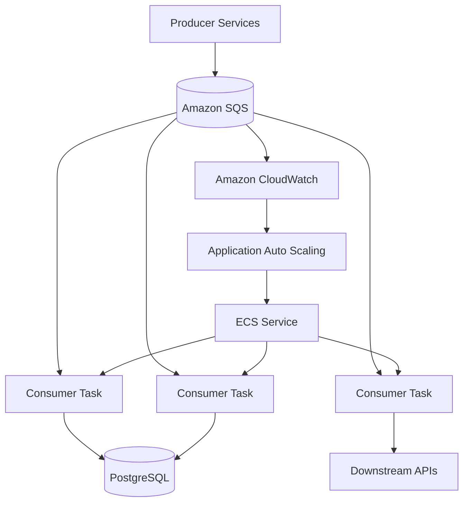
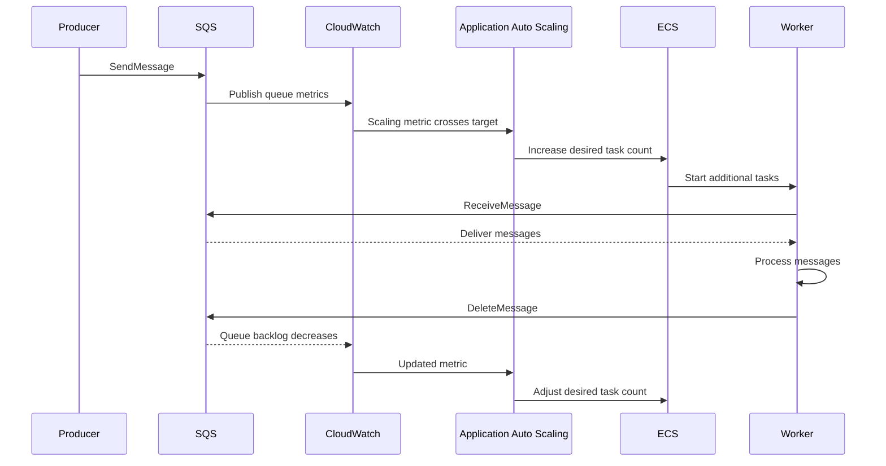
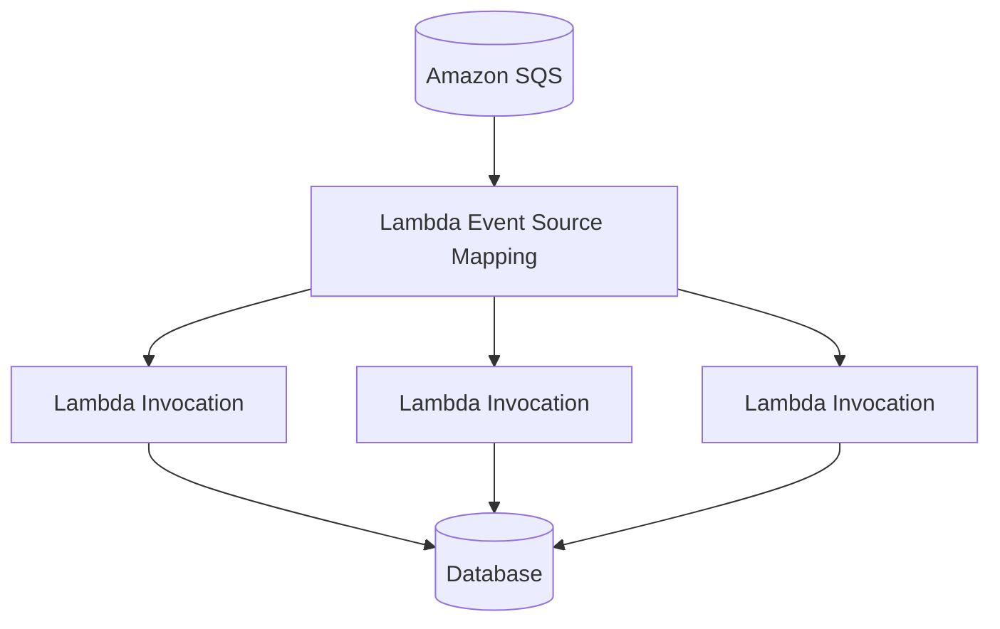
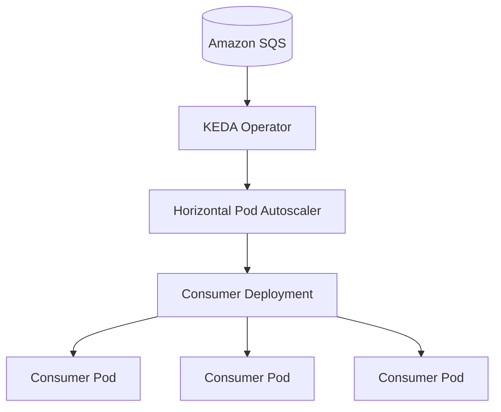

# 06- Auto Scaling Consumer Architecture

## Overview

An auto-scaling consumer architecture dynamically adjusts the number of message-processing workers based on workload demand. In an Amazon SQS-based system, producers publish messages to a queue while consumer capacity scales independently to process the backlog.

This architecture is useful when message arrival rates are variable, processing workloads are asynchronous, or downstream services have different capacity requirements.

Typical implementations use:

- **Amazon SQS** as the durable message buffer.
- **Amazon ECS, EKS, or EC2 Auto Scaling** to run containerized consumers.
- **AWS Lambda event source mappings** for serverless consumers.
- **CloudWatch** for queue metrics and scaling signals.
- **Application Auto Scaling** for ECS and other supported scalable targets.
- **PostgreSQL, Redis, or external APIs** as downstream dependencies.

The primary objective is not simply to maximize worker count. It is to maintain acceptable message-processing latency while controlling infrastructure cost and protecting downstream systems.

## Why Auto Scaling Is Required

A fixed number of workers is often inefficient for asynchronous workloads.

Consider an order-processing service:

- During normal traffic, the system receives 100 messages per minute.
- During a promotion, traffic increases to 5,000 messages per minute.
- Each worker processes 50 messages per minute.

A fixed deployment of two workers can process approximately 100 messages per minute. During the traffic spike, the backlog grows rapidly.

Auto scaling increases worker capacity when demand rises and reduces it when the backlog is processed.

### Problems with Fixed Consumer Capacity

| Problem | Impact |
|---|---|
| Insufficient workers | Queue backlog and processing latency increase |
| Excessive workers | Unnecessary infrastructure cost |
| Traffic spikes | Workers cannot keep up with incoming messages |
| Downstream bottlenecks | Increased database and API pressure |
| Long-running processing | In-flight messages accumulate |
| Worker failures | Available processing capacity decreases |

Auto scaling addresses capacity variation, but it does not eliminate the need for workload isolation, bounded concurrency, or downstream capacity planning.

## Core Architecture

A typical architecture uses an SQS queue as the scaling signal and an ECS service as the consumer workload.

<AsyncImage query="AWS SQS CloudWatch ECS service autoscaling consumer workers architecture diagram queue depth scaling" aspectRatio="16:9" width="100%" />



### Component Responsibilities

| Component | Responsibility |
|---|---|
| Producer | Publishes messages |
| SQS queue | Buffers incoming work |
| CloudWatch | Collects queue and application metrics |
| Application Auto Scaling | Adjusts desired consumer capacity |
| ECS service | Maintains the desired number of running tasks |
| Consumer task | Receives and processes messages |
| Downstream systems | Persist results or perform additional operations |

The scaling controller changes the desired capacity of the consumer service. ECS then starts or stops tasks to match that capacity.

Scaling is not instantaneous. New tasks need time to start, initialize dependencies, and begin polling the queue.

## Understanding Queue-Based Scaling

Queue-based scaling adjusts consumer capacity according to the amount of work waiting to be processed.

The most useful scaling signals are:

- Approximate number of visible messages.
- Approximate age of the oldest message.
- Number of in-flight messages.
- Current consumer processing rate.
- Average message processing duration.
- Downstream dependency health.

### Queue Depth

`ApproximateNumberOfMessagesVisible` represents messages available for retrieval.

A growing visible-message count can indicate that incoming work exceeds consumer processing capacity.

However, queue depth alone does not describe the urgency of the backlog.

For example:

- 10,000 messages arriving continuously may be acceptable if workers process them quickly.
- 100 messages waiting for 30 minutes may indicate a serious processing problem.

### Oldest Message Age

`ApproximateAgeOfOldestMessage` indicates how long the oldest available message has been waiting.

This metric is useful for measuring whether the system meets its processing-latency objective.

For example:

| Oldest message age | Interpretation |
|---|---|
| Below 30 seconds | Potentially healthy for a low-latency workload |
| 30–120 seconds | Backlog may be developing |
| 2–10 minutes | Processing delay may violate the SLA |
| Above 10 minutes | Investigate insufficient capacity or consumer failures |

These thresholds are illustrative. Define actual thresholds from business processing requirements.

### In-Flight Messages

`ApproximateNumberOfMessagesNotVisible` represents messages currently received by consumers but not yet deleted or made visible again.

A high in-flight count can indicate:

- Long-running processing.
- Excessive consumer concurrency.
- Slow downstream dependencies.
- Consumers failing to delete messages.
- Visibility timeout misconfiguration.

Do not interpret every in-flight message as a successfully executing task.

## Consumer Capacity Planning

Auto scaling requires an estimate of how much work each worker can process.

Let:

- \(\lambda\) = incoming message rate.
- \(\mu\) = processing rate per worker.
- \(N\) = number of workers.
- \(C\) = total processing capacity.

Total processing capacity is:

\[
C = N \times \mu
\]

For a stable workload:

\[
N \times \mu > \lambda
\]

If arrival rate continuously exceeds total processing capacity, the queue backlog grows.

### Estimating Required Workers

Suppose:

- Incoming rate = 1,000 messages per minute.
- Each worker processes 100 messages per minute.
- Target utilization = 70%.

Effective worker capacity:

\[
100 \times 0.70 = 70
\]

Required workers:

\[
N = \left\lceil \frac{1000}{70} \right\rceil = 15
\]

Approximately 15 workers are required to handle the incoming workload at the target utilization.

This calculation assumes reasonably consistent message-processing duration and homogeneous workers.

Real workloads require additional capacity for:

- Processing-time variance.
- Retry traffic.
- Worker startup time.
- Deployment interruptions.
- Dependency latency.
- Uneven message distribution.

### Processing Time and Concurrency

For workers that process one message at a time:

\[
\mu = \frac{60}{T}
\]

Where \(T\) is average processing time in seconds and \(\mu\) is messages per minute.

For example, a worker taking 2 seconds per message processes approximately 30 messages per minute.

If a worker processes multiple messages concurrently, estimate capacity using actual measured throughput rather than assuming linear scaling.

Concurrency can be limited by database connections, CPU, memory, API rate limits, and message-group ordering.

## Scaling Metrics and Strategies

### Approximate Messages per Task

A useful scaling metric is the number of visible messages divided by the number of running consumer tasks.

\[
\text{Messages Per Task} =
\frac{\text{Visible Messages}}{\text{Running Tasks}}
\]

This helps estimate how much work is assigned to each worker.

However, it does not account for message-processing duration or worker throughput.

For workloads with variable processing times, combine backlog-based scaling with oldest-message-age alarms and application-level processing metrics.

### Target Tracking

Target tracking adjusts capacity to maintain a selected metric near a target value.

For example:

- Maintain approximately 500 visible messages per ECS task.
- Increase task count when backlog per task rises.
- Reduce task count when backlog per task falls.

Target tracking is suitable when the metric behaves predictably as capacity changes.

### Step Scaling

Step scaling increases or decreases capacity according to CloudWatch alarm thresholds.

Example:

| Backlog threshold | Scaling action |
|---|---|
| Above 1,000 | Add 2 tasks |
| Above 5,000 | Add 5 tasks |
| Above 10,000 | Add 10 tasks |
| Below 500 | Allow scale-in |

Step scaling provides explicit control over capacity changes.

It is useful when workloads have known traffic patterns or require different responses at different backlog levels.

### Scheduled Scaling

Scheduled scaling changes capacity at predictable times.

Examples:

- Increase worker capacity before a daily batch.
- Maintain additional capacity during business hours.
- Reduce minimum capacity overnight.

Scheduled scaling is useful when traffic patterns are predictable, but it should not replace reactive scaling for unexpected demand.

### Scaling Strategy Comparison

| Strategy | Advantages | Limitations |
|---|---|---|
| Target tracking | Automatically maintains a target metric | Requires a meaningful metric |
| Step scaling | Fine-grained control | Requires threshold tuning |
| Scheduled scaling | Handles predictable demand | Cannot react to unexpected spikes |
| Predictive scaling | Can prepare capacity for recurring patterns where supported | Depends on historical patterns and service support |

A production system may combine scheduled baseline capacity with reactive scaling.

## ECS Auto Scaling Architecture

Amazon ECS can scale the desired number of service tasks using Application Auto Scaling.

The architecture typically contains:

1. An ECS cluster.
2. An ECS service running consumer tasks.
3. An SQS queue.
4. A CloudWatch metric or custom scaling metric.
5. An Application Auto Scaling policy.
6. IAM roles and task execution permissions.

### ECS Consumer Lifecycle



### Terraform: ECS Service Scaling Target

The following example defines an ECS service scaling target.

```hcl
resource "aws_appautoscaling_target" "consumer" {
  max_capacity       = 20
  min_capacity       = 2
  resource_id        = "service/${aws_ecs_cluster.main.name}/${aws_ecs_service.consumer.name}"
  scalable_dimension = "ecs:service:DesiredCount"
  service_namespace  = "ecs"
}
```

The minimum capacity keeps a baseline number of workers running. The maximum capacity prevents uncontrolled scaling.

### CloudWatch Metric

For a basic backlog-per-task metric, use a CloudWatch metric math expression.

The numerator is the visible SQS backlog. The denominator is the running ECS task count.

Conceptually:

```text
VisibleMessages / RunningTasks
```

A production implementation must ensure:

- Both metrics use compatible periods.
- ECS task count reflects running tasks rather than only desired tasks.
- Division by zero is handled.
- Missing metrics are handled deliberately.
- The metric is available at the resolution required by the scaling policy.

A custom metric can also publish backlog per healthy consumer task.

### Target Tracking Policy

An ECS target tracking policy can use a custom metric representing messages per task.

```hcl
resource "aws_appautoscaling_policy" "consumer_target_tracking" {
  name               = "order-consumer-backlog-target"
  policy_type        = "TargetTrackingScaling"
  resource_id        = aws_appautoscaling_target.consumer.resource_id
  scalable_dimension = aws_appautoscaling_target.consumer.scalable_dimension
  service_namespace  = aws_appautoscaling_target.consumer.service_namespace

  target_tracking_scaling_policy_configuration {
    target_value       = 500
    scale_out_cooldown = 60
    scale_in_cooldown  = 180

    customized_metric_specification {
      metrics {
        label = "Visible messages per running task"

        id          = "backlog_per_task"
        return_data = true

        metric_stat {
          stat = "Average"

          metric {
            metric_name = "MessagesPerTask"
            namespace   = "Application/SQSConsumers"

            dimensions {
              name  = "Service"
              value = "order-consumer"
            }
          }
        }
      }
    }
  }
}
```

The example assumes that the application or a separate metric publisher emits `MessagesPerTask`.

A target value of 500 means the scaling controller attempts to maintain approximately 500 visible messages per running task.

The target must be calibrated using measured processing throughput and acceptable queue latency.

Do not use this configuration unchanged without implementing and validating the custom metric publisher.

## Lambda-Based Auto Scaling

AWS Lambda can consume SQS messages through an event source mapping.

Lambda automatically manages the execution capacity required to process available messages, subject to configured concurrency and service limits.

The architecture is:



### Event Source Mapping

The event source mapping polls SQS and invokes the Lambda function with batches of messages.

Important configuration options include:

| Setting | Purpose |
|---|---|
| Batch size | Maximum messages delivered in one invocation |
| Maximum batching window | Maximum time spent gathering a batch |
| Maximum concurrency | Limits concurrent Lambda processing for the mapping |
| Function timeout | Maximum execution duration |
| Visibility timeout | Controls message redelivery |
| Partial batch response | Allows individual failed messages to be retried |

For Standard queues, the maximum batch size can be configured up to 10,000 messages, subject to the event source mapping's applicable constraints. FIFO queues have a maximum batch size of 10.

The actual number of messages in an invocation may be lower due to payload limits, batching windows, and available messages.

### Lambda Scaling Controls

Lambda event source mappings use polling and concurrency management to process SQS messages.

Use maximum concurrency when a consumer must not overwhelm a downstream system.

For example, if PostgreSQL can safely support only 50 concurrent processing operations from a particular workload, configure the event source mapping's concurrency limit accordingly and account for other database clients.

Reserved concurrency on the Lambda function can also limit execution, but it is shared across all invocation sources for that function.

Use dedicated functions or carefully coordinated limits when multiple event sources have different capacity requirements.

### Visibility Timeout

For Lambda SQS event source mappings, configure the queue visibility timeout to be at least six times the Lambda function timeout, plus the maximum batching window.

This provides room for retries and polling behavior.

A timeout that is too short can cause messages to become visible while an invocation is still processing them.

### Partial Batch Responses

Enable `ReportBatchItemFailures` to avoid retrying every message when only some messages fail.

The function should return failed SQS message identifiers:

```python
def lambda_handler(event, context):
    failures = []

    for record in event["Records"]:
        try:
            process_message(record)
        except Exception:
            failures.append(
                {
                    "itemIdentifier": record["messageId"],
                }
            )

    return {
        "batchItemFailures": failures,
    }
```

Configure the event source mapping with the `ReportBatchItemFailures` response type.

Partial batch responses reduce unnecessary reprocessing, but they do not remove the need for idempotent handlers.

## Kubernetes and KEDA-Based Scaling

For Kubernetes workloads, KEDA can scale deployments based on external metrics, including SQS queue activity.

KEDA integrates with Kubernetes Horizontal Pod Autoscaler and can manage the number of consumer pods based on queue metrics.

### Architecture



### KEDA ScaledObject

A simplified configuration:

```yaml
apiVersion: keda.sh/v1alpha1
kind: ScaledObject
metadata:
  name: order-consumer
  namespace: applications
spec:
  scaleTargetRef:
    name: order-consumer
  pollingInterval: 30
  cooldownPeriod: 180
  minReplicaCount: 1
  maxReplicaCount: 20
  triggers:
    - type: aws-sqs-queue
      metadata:
        queueURL: https://sqs.ap-south-1.amazonaws.com/123456789012/order-events
        queueLength: "500"
        awsRegion: ap-south-1
        identityOwner: operator
```

The `queueLength` setting defines the target backlog per replica for the scaler.

Authentication should use an appropriate workload identity mechanism, such as IAM Roles for Service Accounts (IRSA) on EKS, rather than static AWS credentials in Kubernetes manifests.

KEDA scaling behavior depends on polling intervals, metric availability, Kubernetes scheduling capacity, and pod startup time.

### Kubernetes Operational Considerations

- Set resource requests and limits for consumer pods.
- Configure graceful termination.
- Use readiness and liveness probes appropriately.
- Ensure the cluster has sufficient node capacity.
- Configure cluster autoscaling if worker nodes must also scale.
- Avoid scaling consumer pods faster than downstream systems can handle.
- Use pod disruption budgets where appropriate.

Scaling a Kubernetes Deployment does not guarantee that the cluster has enough compute capacity to schedule the new pods.

## Consumer Concurrency and Backpressure

Auto scaling increases the number of consumers, but each consumer can also process multiple messages concurrently.

For example:

```text
ECS tasks:             10
Concurrent handlers:    5 per task
Maximum active work:   50
```

Increasing both task count and per-task concurrency can multiply downstream load.

### Bounded Concurrency

Use explicit concurrency limits.

```python
import asyncio


MAX_CONCURRENT_MESSAGES = 5


async def process_messages(messages: list[dict]) -> None:
    semaphore = asyncio.Semaphore(MAX_CONCURRENT_MESSAGES)

    async def bounded_process(message: dict) -> None:
        async with semaphore:
            await process_message(message)

    await asyncio.gather(
        *(bounded_process(message) for message in messages)
    )
```

This example limits concurrent handlers within one process.

A production worker must also define exception handling, cancellation behavior, message acknowledgment, and visibility timeout management.

### Protecting PostgreSQL

If every consumer opens multiple database connections, scaling can exhaust the database connection limit.

For example:

```text
20 ECS tasks × 5 concurrent handlers = 100 concurrent handlers
```

If each handler independently creates a database connection, the workload may require up to 100 additional connections.

Use:

- Connection pooling.
- Bounded worker concurrency.
- Appropriate database connection limits.
- Query optimization.
- Read/write workload separation where necessary.
- RDS Proxy where suitable for connection management.

Do not assume that increasing consumer count always improves throughput.

### Protecting External APIs

External services often enforce rate limits.

Use:

- Token-bucket or leaky-bucket rate limiting.
- Bounded request concurrency.
- Exponential backoff with jitter.
- Circuit breakers.
- Retry budgets.
- Separate queues for workloads with different service-level requirements.

If an external API permits 100 requests per second, scaling to 200 workers without a shared rate limiter can create repeated failures.

## Scaling Delays and Stability

Auto scaling is a control system. Poorly tuned scaling policies can cause unstable behavior.

### Scale-Out Delay

New workers require time to:

1. Detect the scaling condition.
2. Request additional capacity.
3. Provision compute resources.
4. Pull container images.
5. Initialize the application.
6. Establish database and network connections.
7. Begin polling SQS.

During this period, the queue continues accumulating messages.

Use a suitable minimum capacity and pre-scaling for predictable traffic spikes.

### Scale-In Delay

Scaling in too quickly can reduce processing capacity while a backlog is still active.

A scale-in operation can also terminate workers that are processing messages.

Use graceful shutdown:

- Stop polling for new messages.
- Finish or safely abandon in-flight work.
- Extend visibility when processing requires additional time.
- Avoid deleting messages before durable completion.
- Allow sufficient container termination grace periods.

### Cooldowns and Hysteresis

Cooldowns reduce unnecessary scaling oscillations.

A typical policy may use:

- Faster scale-out to respond to growing backlog.
- Slower scale-in to avoid removing capacity prematurely.

Use different thresholds for scale-out and scale-in where appropriate.

Do not scale in solely because queue depth temporarily falls. Consider in-flight work, message age, and ongoing processing.

## Reliability and Failure Handling

Auto scaling does not replace message-processing reliability.

### Worker Failure

If a worker crashes after receiving a message:

1. The message remains invisible during the visibility timeout.
2. The timeout expires.
3. SQS makes the message available again.
4. Another consumer can receive it.

This behavior supports recovery but can produce duplicate processing.

### Dead Letter Queues

Configure a DLQ to isolate messages that repeatedly fail.

Monitor:

- DLQ message count.
- Age of the oldest DLQ message.
- Receive count.
- Failure reason.
- Event type and producer.
- Consumer version.

Do not automatically redrive a large DLQ into an already overloaded source queue.

Redrive gradually and monitor downstream capacity.

### Poison Messages

A poison message consistently fails because of invalid data, unsupported schema, or a deterministic processing error.

Repeatedly increasing worker capacity does not solve this problem.

Use validation, bounded retries, DLQs, and operational investigation.

## Monitoring and Alerting

Auto-scaling systems require both infrastructure and application-level monitoring.

### Important CloudWatch Metrics

| Metric | Purpose |
|---|---|
| `ApproximateNumberOfMessagesVisible` | Measures available backlog |
| `ApproximateNumberOfMessagesNotVisible` | Measures in-flight messages |
| `ApproximateAgeOfOldestMessage` | Measures queue processing delay |
| `NumberOfMessagesReceived` | Tracks consumer receives |
| `NumberOfMessagesDeleted` | Tracks completed message deletion |
| ECS running task count | Shows active consumer capacity |
| ECS pending task count | Indicates provisioning or capacity problems |
| CPU utilization | Identifies CPU-bound workloads |
| Memory utilization | Identifies memory pressure |

SQS queue metrics are approximate. Combine them with application-level measurements rather than treating them as exact processing counters.

### Application Metrics

Track:

- Messages processed per second.
- Average and percentile processing duration.
- Processing failures.
- Duplicate event detections.
- Retry count.
- Active handler count.
- Database connection utilization.
- Downstream API latency.
- Consumer startup duration.
- Time between event publication and completion.

### Recommended Alarms

| Condition | Operational response |
|---|---|
| Oldest message age exceeds SLA | Investigate backlog and processing capacity |
| DLQ count increases | Investigate failed messages |
| Visible backlog continuously increases | Evaluate arrival and processing rates |
| Running tasks below desired tasks | Investigate provisioning failures |
| CPU or memory remains saturated | Review task sizing and concurrency |
| Database connections approach limits | Reduce consumer concurrency |
| High receive count | Investigate repeated processing failures |

An alert should identify an actionable operational problem, not simply report that a queue contains messages.

## Security Considerations

Auto-scaling consumers often create more compute instances dynamically. Their permissions and credentials must remain consistent across all instances.

Recommended practices:

- Use ECS task roles instead of static AWS credentials.
- Use IRSA for EKS workloads.
- Grant only the required SQS actions.
- Restrict queue access through IAM and resource policies.
- Enable SQS server-side encryption.
- Use customer-managed KMS keys when required.
- Use VPC endpoints for private SQS access where appropriate.
- Avoid logging sensitive message payloads.
- Protect container images and deployment pipelines.
- Rotate and manage secrets through appropriate AWS services.

Scaling should never require broader permissions than the workload actually needs.

## High Availability and Disaster Recovery

A reliable auto-scaling consumer architecture should tolerate individual task failures and infrastructure interruptions.

### High Availability

- Run ECS tasks across multiple Availability Zones.
- Use an appropriate minimum task count.
- Configure health checks and deployment circuit breakers.
- Keep consumer instances stateless where possible.
- Persist processing state in durable services.
- Use SQS visibility timeout and redelivery for recovery.
- Monitor failed deployments and unhealthy tasks.

### Disaster Recovery

SQS queues are regional resources and do not automatically replicate messages across Regions.

A cross-Region recovery strategy should include:

- Infrastructure as code for queues and consumer services.
- Replication or recovery of required application data.
- A durable event publication or archive strategy.
- Explicit failover and failback procedures.
- Idempotency across Regions.
- Testing of queue recovery and message replay.

Do not assume that ECS service replication provides message replication.

## Performance and Cost Optimization

The objective is to meet processing SLAs at an acceptable infrastructure cost.

### Cost Drivers

| Cost area | Optimization |
|---|---|
| ECS tasks | Right-size CPU and memory |
| EC2 capacity | Use suitable capacity providers and scaling policies |
| SQS requests | Use long polling and batching |
| Lambda invocations | Tune batch size and concurrency |
| Database | Limit connection concurrency and optimize queries |
| Data transfer | Avoid unnecessary cross-AZ and cross-Region traffic |
| Logging | Use appropriate retention and avoid excessive payload logging |

### Batching

SQS supports batch operations with up to 10 entries per API request.

Batch receiving can reduce request overhead:

```python
response = sqs.receive_message(
    QueueUrl=queue_url,
    MaxNumberOfMessages=10,
    WaitTimeSeconds=20,
)
```

Batch deletion can also reduce API calls.

Inspect individual batch results because batch operations can partially succeed.

### Worker Sizing

Use measured CPU, memory, processing duration, and downstream utilization to determine task size.

A workload dominated by external API latency may benefit from bounded concurrency. A CPU-intensive document-processing workload may require more CPU per task.

Do not increase concurrency without measuring its impact on memory, database connections, and downstream request rates.

## Testing Auto-Scaling Behavior

Test scaling behavior under realistic load rather than relying only on configuration validation.

| Test | Expected behavior |
|---|---|
| Normal traffic | Baseline consumer capacity is maintained |
| Sudden traffic spike | Capacity increases and backlog stabilizes |
| Sustained high traffic | Consumer throughput meets arrival rate or exposes capacity limits |
| Traffic stops | Backlog drains and capacity scales down |
| Worker termination | Messages are retried safely |
| Database slowdown | Concurrency remains bounded |
| Poison message | Message reaches DLQ after bounded retries |
| Deployment during processing | In-flight messages are not lost |
| Maximum capacity reached | Backlog and SLA alarms activate |

Use load testing to measure:

- Time from backlog increase to scale-out.
- Time for new tasks to become healthy.
- Maximum sustainable throughput.
- Queue age during scale-out.
- Scale-in behavior.
- Downstream database and API utilization.
- Cost per successfully processed message.

Test both short bursts and sustained traffic. They expose different capacity problems.

## Common Auto-Scaling Mistakes

| Mistake | Why it occurs | Recommended approach |
|---|---|---|
| Scaling only on queue depth | Ignores processing latency | Include oldest message age and throughput |
| Scaling too slowly | Worker startup and metric delays are overlooked | Maintain baseline capacity and tune scale-out |
| Scaling without a maximum | Can create uncontrolled infrastructure growth | Define explicit maximum capacity |
| Scaling beyond database capacity | Consumer count is treated as independent of dependencies | Apply concurrency and connection limits |
| Scaling in too aggressively | Temporary backlog reduction triggers scale-in | Use cooldowns and graceful shutdown |
| Ignoring in-flight messages | Visible backlog does not represent all active work | Monitor visible and not-visible metrics |
| Retrying poison messages indefinitely | All failures are treated as transient | Use bounded retries and DLQs |
| Using desired task count as active capacity | Pending tasks are counted as workers | Use running or healthy task count |
| Ignoring startup latency | Scaling policy assumes immediate capacity | Pre-scale for predictable bursts |
| Increasing Lambda concurrency without limits | Downstream systems receive excessive parallel requests | Configure event source and function concurrency |
| Assuming autoscaling guarantees throughput | Compute capacity and downstream limits are ignored | Measure end-to-end processing capacity |

## Production Engineering Checklist

### Architecture

- [ ] Queue type matches ordering and throughput requirements.
- [ ] Consumer workload is independently deployable.
- [ ] Scaling metrics reflect actual workload demand.
- [ ] Minimum and maximum capacity are defined.
- [ ] Downstream dependencies have explicit capacity limits.

### Scaling

- [ ] Scale-out responds quickly enough to backlog growth.
- [ ] Scale-in uses appropriate cooldowns.
- [ ] Worker startup time is measured.
- [ ] Running capacity is distinguished from desired capacity.
- [ ] Scaling behavior is tested under burst and sustained load.

### Consumer Reliability

- [ ] Processing is idempotent.
- [ ] Messages are deleted only after durable completion.
- [ ] Visibility timeout accommodates processing duration.
- [ ] Long-running tasks extend visibility when necessary.
- [ ] DLQ and bounded retry policies are configured.
- [ ] Workers support graceful shutdown.

### Operations

- [ ] Queue age and backlog are monitored.
- [ ] DLQ growth triggers alerts.
- [ ] Application processing metrics are available.
- [ ] Database and API capacity are monitored.
- [ ] Autoscaling failures are observable.
- [ ] Disaster recovery procedures are documented and tested.

## Key Takeaways

- SQS-based auto scaling adjusts consumer capacity according to workload demand, helping maintain processing latency while controlling infrastructure cost.
- Queue depth, oldest message age, in-flight messages, and measured processing throughput should be considered together when designing scaling policies.
- ECS, Lambda, and Kubernetes with KEDA provide different scaling models; choose based on workload characteristics and operational requirements.
- Consumer scaling must be bounded by downstream database connections, API rate limits, CPU, memory, and other shared resource constraints.
- Reliable auto scaling requires idempotent processing, visibility timeout management, graceful shutdown, DLQs, observability, and tested recovery procedures.