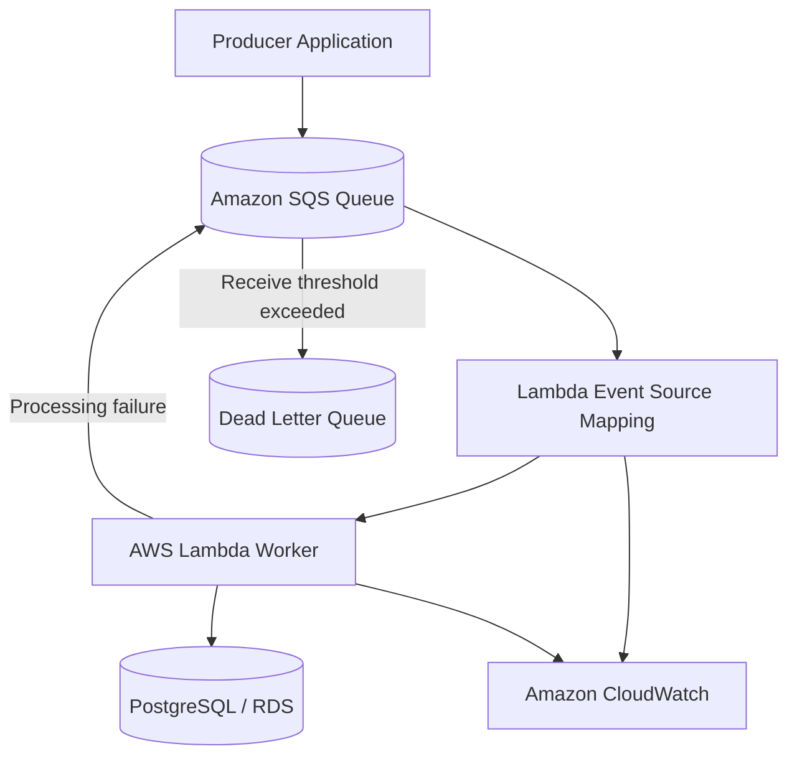
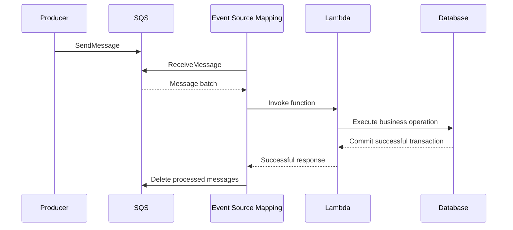
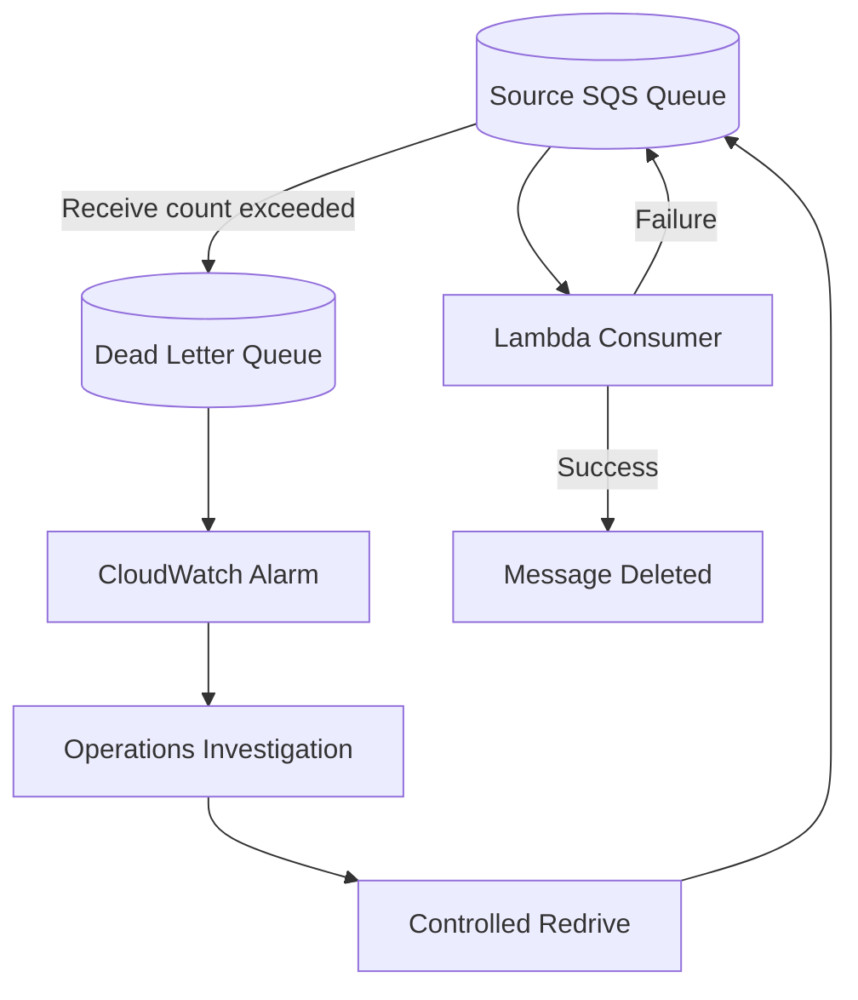
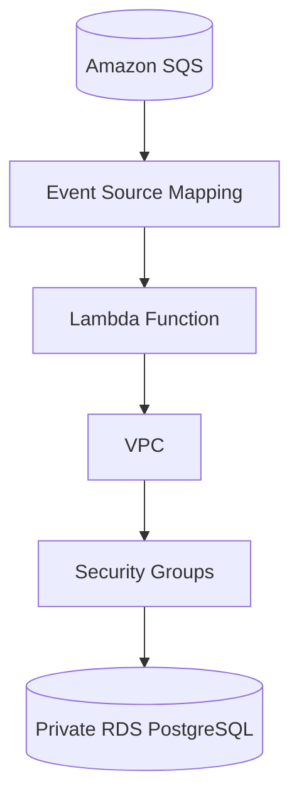

# 07- Lambda-Based Worker Architecture

## Overview

A Lambda-based worker architecture uses Amazon SQS as a durable message buffer and AWS Lambda as the asynchronous processing engine. Instead of maintaining continuously running worker processes, Lambda automatically polls the queue through an event source mapping and invokes a function when messages are available.

This architecture is suitable for background workloads with variable traffic, independent processing tasks, and execution durations that fit within Lambda's runtime limits.

Typical use cases include:

- Processing uploaded documents.
- Sending transactional notifications.
- Executing background business operations.
- Processing orders and payment events.
- Generating reports.
- Performing image and file transformations.
- Integrating independent microservices.

The architecture reduces infrastructure management because AWS handles function execution capacity and SQS polling. However, developers remain responsible for message idempotency, failure handling, concurrency limits, visibility timeout configuration, and downstream resource protection.

## Core Architecture

The basic architecture consists of:

- **Amazon SQS:** Stores messages until they are successfully processed.
- **AWS Lambda:** Executes application logic.
- **Event Source Mapping (ESM):** Polls SQS and invokes Lambda with message batches.
- **Dead Letter Queue (DLQ):** Stores messages that exceed the configured receive threshold.
- **Amazon CloudWatch:** Provides metrics, logs, and alarms.
- **IAM:** Controls access between AWS services and application resources.

<AsyncImage query="AWS Lambda SQS event source mapping worker architecture queue polling Lambda function dead letter queue CloudWatch diagram" aspectRatio="16:9" width="100%" />



The event source mapping is responsible for polling SQS. Lambda does not receive a direct push notification from SQS for every message.

## Event Source Mapping

An event source mapping connects an SQS queue to a Lambda function.

It manages:

- Polling the SQS queue.
- Retrieving messages in batches.
- Invoking the Lambda function.
- Managing polling concurrency.
- Handling successful and failed batch responses.
- Coordinating message visibility and retry behavior.

### Processing Lifecycle



The event source mapping deletes successfully processed messages from SQS.

When processing fails, messages remain available for retry after their visibility timeout expires, subject to the configured event source mapping and queue behavior.

### Polling Behavior

For SQS event sources, Lambda uses multiple polling processes to retrieve messages.

The event source mapping can increase the number of concurrent function invocations as queue traffic grows, subject to its scaling behavior and configured limits.

Important characteristics:

- SQS Standard queues support high-throughput polling and concurrent processing.
- FIFO queues preserve ordering within message groups.
- Lambda processes batches rather than requiring one invocation per message.
- Polling and invocation capacity are subject to AWS service quotas.
- Function concurrency and event source mapping limits constrain processing capacity.

The exact scaling behavior depends on queue type, function configuration, and event source mapping settings.

## Standard Queue vs FIFO Queue

Lambda supports both Standard and FIFO SQS queues.

| Characteristic | Standard Queue | FIFO Queue |
|---|---|---|
| Delivery | At least once | FIFO delivery semantics |
| Ordering | Best effort | Per message group |
| Duplicate delivery | Possible | Deduplication support, but application duplicates remain possible |
| Parallel processing | High concurrency | Parallel across message groups |
| Message group ID | Not required | Required |
| Suitable workloads | Independent background tasks | Ordered business workflows |

Use Standard queues when messages can be processed independently and high throughput is important.

Use FIFO queues when operations for a particular business entity must execute in order.

For example, order events can use the order ID as the message group:

```python
sqs.send_message(
    QueueUrl=fifo_queue_url,
    MessageBody=event_json,
    MessageGroupId=f"order-{order_id}",
    MessageDeduplicationId=event_id,
)
```

Different orders can be processed concurrently, while messages belonging to the same order retain their group ordering.

FIFO deduplication does not guarantee exactly-once execution of arbitrary business side effects. Consumers still need idempotency.

## Lambda Function Configuration

Lambda configuration directly affects throughput, cost, and reliability.

### Important Configuration Options

| Configuration | Purpose | Production consideration |
|---|---|---|
| Memory | Allocates function memory and influences CPU allocation | Benchmark processing performance |
| Timeout | Maximum execution duration | Keep below the required processing and visibility limits |
| Batch size | Maximum messages per invocation | Balance throughput and failure isolation |
| Maximum batching window | Time allowed to accumulate messages | Trade latency for batching efficiency |
| Reserved concurrency | Limits function-wide concurrent executions | Protect shared dependencies |
| Maximum concurrency | Limits concurrent processing for an SQS event source mapping | Protect downstream systems |
| Visibility timeout | Controls message redelivery | Must accommodate processing and retry behavior |
| DLQ | Stores repeatedly failing messages | Configure redrive and alerting |

### Batch Size

Lambda receives messages in batches.

For Standard queues, the maximum configured batch size is 10,000 messages, subject to the event source mapping's applicable constraints.

For FIFO queues, the maximum batch size is 10 messages.

The actual batch can be smaller because of:

- Available queue messages.
- Maximum batching window.
- Payload size limits.
- Polling behavior.
- Queue type.

A larger batch can reduce invocation overhead but increases the impact of batch-level failures when partial batch responses are not configured.

### Maximum Batching Window

The maximum batching window controls how long Lambda waits to collect messages before invoking the function.

For example:

```text
Batch size:             100
Maximum batching window: 5 seconds
```

The event source mapping can wait for additional messages before invoking the function, subject to available traffic and payload constraints.

A larger window can improve batching efficiency but increases message-processing latency.

For FIFO queues, batching behavior must also respect message-group ordering.

## Implementing a Lambda SQS Consumer in Python

A Lambda function receives SQS messages through the event payload.

Each record contains the message body, message identifier, receipt-related metadata, and SQS attributes.

### Example Event Structure

```json
{
  "Records": [
    {
      "messageId": "message-001",
      "receiptHandle": "example-receipt-handle",
      "body": "{\"event_id\":\"evt-123\",\"event_type\":\"OrderPlaced\",\"data\":{\"order_id\":10542}}",
      "attributes": {
        "ApproximateReceiveCount": "1",
        "SentTimestamp": "1795161000000"
      },
      "eventSource": "aws:sqs",
      "eventSourceARN": "arn:aws:sqs:ap-south-1:123456789012:order-events",
      "awsRegion": "ap-south-1"
    }
  ]
}
```

The message body is typically a serialized JSON string. Parse and validate it before performing business operations.

### Basic Consumer Implementation

```python
import json
import logging

logger = logging.getLogger()
logger.setLevel(logging.INFO)


def process_order(event: dict) -> None:
    order_id = event["data"]["order_id"]

    logger.info(
        "Processing order",
        extra={
            "event_id": event["event_id"],
            "order_id": order_id,
        },
    )

    # Execute the durable, idempotent business operation.
    update_order_status(order_id)


def lambda_handler(event, context):
    for record in event["Records"]:
        message = json.loads(record["body"])
        process_order(message)

    return {
        "statusCode": 200,
        "processed": len(event["Records"]),
    }
```

This example uses all-or-nothing batch failure behavior. If an exception occurs, the invocation fails and the batch can be retried.

For production workloads, partial batch responses usually provide better failure isolation.

## Partial Batch Response

Without partial batch response support, one failed message can cause the entire batch to be retried.

Consider a batch containing five messages:

```text
Message 1: Success
Message 2: Success
Message 3: Failure
Message 4: Success
Message 5: Success
```

If the function fails the entire invocation, successfully processed messages may be delivered again.

This increases processing overhead and makes idempotency even more important.

Enable `ReportBatchItemFailures` to report only failed messages.

### Implementation

```python
import json
import logging

logger = logging.getLogger()
logger.setLevel(logging.INFO)


def process_message(record: dict) -> None:
    event = json.loads(record["body"])

    validate_event(event)
    execute_business_operation(event)


def lambda_handler(event, context):
    failures = []

    for record in event["Records"]:
        try:
            process_message(record)

        except Exception:
            logger.exception(
                "SQS message processing failed",
                extra={
                    "message_id": record["messageId"],
                },
            )

            failures.append(
                {
                    "itemIdentifier": record["messageId"],
                }
            )

    return {
        "batchItemFailures": failures,
    }
```

Configure the event source mapping with:

```text
FunctionResponseTypes = ["ReportBatchItemFailures"]
```

The response identifies failed messages using their SQS `messageId`.

Successful messages can be deleted while failed messages remain eligible for retry.

### Important Considerations

- Return the correct message identifiers.
- Do not report successful messages as failures.
- Catch failures at the individual-record level.
- Ensure processing is idempotent.
- Do not swallow exceptions without reporting the corresponding failure.
- Treat malformed messages according to an explicit permanent-failure policy.

For FIFO queues, stop processing additional messages from the same message group after a failure when necessary to preserve ordering. Report failed and unprocessed records appropriately rather than allowing later messages to overtake a failed message.

## Idempotent Processing

SQS and Lambda provide asynchronous delivery, not exactly-once business execution.

A Lambda function may successfully commit a database transaction but fail before the event source mapping completes message acknowledgment.

The message can then be delivered again.

Consumers must implement idempotency.

### Database-Based Idempotency

Use a unique event identifier and a processed-events table.

```sql
CREATE TABLE processed_events (
    event_id UUID PRIMARY KEY,
    event_type VARCHAR(100) NOT NULL,
    processed_at TIMESTAMPTZ NOT NULL DEFAULT NOW()
);
```

The event identifier and business changes should be committed in one database transaction.

```python
from django.db import IntegrityError, transaction


def process_order_event(event: dict) -> None:
    event_id = event["event_id"]

    with transaction.atomic():
        try:
            ProcessedEvent.objects.create(
                event_id=event_id,
                event_type=event["event_type"],
            )
        except IntegrityError:
            return

        order_id = event["data"]["order_id"]

        Order.objects.filter(
            id=order_id,
        ).update(
            status="processing",
        )
```

The uniqueness constraint protects against concurrent duplicate deliveries.

### External Side Effects

Database idempotency does not automatically protect external operations.

For example:

1. Lambda calls a payment provider.
2. The provider successfully charges the customer.
3. Lambda times out before recording the result.
4. SQS redelivers the message.
5. Lambda attempts the payment again.

Use provider-supported idempotency keys, durable operation records, and reconciliation workflows.

A stable event ID is a useful idempotency key when its scope matches the external operation.

## Visibility Timeout and Lambda Timeout

Visibility timeout determines how long a received message remains hidden from other consumers.

For Lambda SQS event source mappings, the queue visibility timeout should be at least six times the Lambda function timeout, plus the maximum batching window.

For example:

```text
Lambda timeout:             30 seconds
Batching window:             5 seconds
Minimum visibility timeout: 185 seconds
```

Calculation:

\[
(6 \times 30) + 5 = 185 \text{ seconds}
\]

A practical configuration may use a higher value to allow for additional processing and retry overhead.

### Why This Matters

If visibility timeout is too short:

- Messages can become visible while the function is still processing.
- Multiple invocations may process the same message concurrently.
- Duplicate database operations or external side effects can occur.

If visibility timeout is too long:

- Failed messages take longer to become available again.
- Recovery from worker failures becomes slower.

The timeout should be based on the function's configured timeout and event source mapping behavior, not only its average execution duration.

## Concurrency Management

Lambda can scale concurrent invocations based on available SQS messages.

However, unrestricted concurrency can overload downstream systems.

### Reserved Concurrency

Reserved concurrency sets a function-wide concurrency allocation and limit.

It is useful for:

- Protecting shared databases.
- Reserving capacity for critical functions.
- Preventing one workload from consuming all account concurrency.
- Controlling overall function execution.

### Event Source Mapping Maximum Concurrency

For SQS Standard queues, maximum concurrency can limit the number of concurrent Lambda invocations associated with an event source mapping.

Example:

```bash
aws lambda update-event-source-mapping \
  --uuid YOUR_EVENT_SOURCE_MAPPING_UUID \
  --scaling-config '{"MaximumConcurrency": 20}'
```

This limits concurrency for that mapping.

Reserved concurrency and event source mapping maximum concurrency must be configured consistently. If the function has multiple event sources, function-wide reserved concurrency must accommodate their combined demand and other invocation sources.

For FIFO queues, message-group availability and ordering constraints also limit effective parallelism.

### Concurrency Planning

Suppose:

```text
Maximum concurrent invocations: 20
Batch size:                     10
Maximum messages in flight:     200
```

This is a rough upper bound for messages being handled by concurrent invocations, not a guarantee that all 200 messages are processed simultaneously.

Actual concurrency and throughput depend on:

- Available messages.
- Message-group distribution.
- Function duration.
- Lambda service limits.
- Event source mapping behavior.
- Downstream resource capacity.

## Dead Letter Queue Architecture

A DLQ captures messages that cannot be successfully processed within the configured retry threshold.



Configure a redrive policy on the source queue:

```json
{
  "deadLetterTargetArn": "arn:aws:sqs:ap-south-1:123456789012:order-events-dlq",
  "maxReceiveCount": 5
}
```

`maxReceiveCount` counts message receives, not successful processing attempts.

### DLQ vs Lambda On-Failure Destination

These mechanisms serve different purposes.

| Mechanism | Responsibility |
|---|---|
| SQS DLQ | Stores messages moved from the source queue by its redrive policy |
| Lambda asynchronous invocation DLQ | Stores failed asynchronous Lambda invocation events |
| Lambda asynchronous on-failure destination | Routes failure records from Lambda's asynchronous invocation system |

An SQS event source mapping uses SQS polling and acknowledgment behavior. It should not be confused with Lambda's asynchronous invocation retry mechanism.

For SQS-triggered Lambda processing, configure the SQS queue's redrive policy when a DLQ is required.

## Scaling and Throughput

Lambda automatically scales SQS event source processing, but throughput is not unlimited.

### Standard Queue Scaling

For Standard queues, Lambda can increase concurrent polling and invocation capacity as backlog grows.

The event source mapping has service-defined scaling behavior and is subject to account and function concurrency limits.

Use maximum concurrency to protect downstream services.

### FIFO Queue Scaling

FIFO processing is constrained by message groups.

Messages within the same group are processed in order, so a single message group cannot provide unlimited parallel processing.

For higher concurrency:

- Use multiple message groups.
- Partition by a business entity such as order ID or customer ID.
- Avoid a global message group unless global ordering is required.
- Monitor the number of active message groups.

### Throughput Considerations

Actual processing throughput depends on:

\[
\text{Throughput} \approx
\frac{\text{Concurrent Invocations} \times \text{Messages Per Batch}}
{\text{Average Invocation Duration}}
\]

This is an approximation. It assumes consistent batch sizes and processing durations.

For example:

```text
Concurrent invocations: 20
Messages per batch:     10
Average duration:       2 seconds
```

Approximate throughput:

\[
\frac{20 \times 10}{2} = 100
\]

Approximately 100 messages per second under those assumptions.

Measure actual throughput because Lambda scaling, polling, batch availability, and downstream latency affect results.

## Handling Large Messages

SQS supports message bodies up to 1 MiB.

For larger payloads, store the content in S3 and publish a reference in SQS.

Example message:

```json
{
  "event_id": "evt-123",
  "event_type": "DocumentUploaded",
  "data": {
    "bucket": "application-documents",
    "key": "orders/10542/invoice.pdf",
    "version_id": "3HL4kqtJlcpXroDTDmjVBH40Nrjfkd"
  }
}
```

The Lambda function retrieves the object using the S3 SDK.

Production considerations:

- Use IAM permissions scoped to required buckets and prefixes.
- Enable S3 versioning when object identity must remain stable.
- Avoid public object access.
- Validate the bucket, key, and expected object ownership.
- Handle missing or expired objects.
- Align S3 lifecycle policies with message retention and recovery requirements.
- Avoid loading very large objects entirely into memory when streaming is appropriate.

## Security Architecture

Lambda-based workers should use dedicated execution roles and narrowly scoped permissions.

### IAM Execution Role

A consumer that reads from SQS and writes to a database may need permissions for:

- SQS message consumption.
- KMS decryption when using a customer-managed key.
- Secrets Manager access when retrieving database credentials.
- CloudWatch Logs.
- S3 access when processing object references.

The event source mapping also requires permissions to poll and manage messages. AWS-managed policies can simplify setup, but production deployments should review the exact actions and resource scope.

### Example SQS Consumer Policy

```json
{
  "Version": "2012-10-17",
  "Statement": [
    {
      "Effect": "Allow",
      "Action": [
        "sqs:ReceiveMessage",
        "sqs:DeleteMessage",
        "sqs:GetQueueAttributes"
      ],
      "Resource": "arn:aws:sqs:ap-south-1:123456789012:order-events"
    }
  ]
}
```

The permissions required by a particular event source mapping and execution role should be validated against its configuration and deployment model.

### Additional Security Controls

- Enable SQS server-side encryption.
- Use customer-managed KMS keys where required.
- Restrict queue access with IAM and resource policies.
- Use VPC configuration when private access to databases is required.
- Store credentials in Secrets Manager or another approved secret-management system.
- Avoid logging sensitive message payloads.
- Validate message schemas and business authorization.
- Restrict S3 access to the required object prefixes.

## VPC and Database Connectivity

A Lambda function that accesses a private RDS or PostgreSQL instance may need VPC network configuration.



Important considerations:

- Lambda execution subnets need appropriate routing.
- Security groups must allow the required database traffic.
- Network ACLs must permit the connection.
- Lambda requires appropriate network access to AWS services.
- SQS access from a VPC-configured function may require NAT or a suitable VPC endpoint depending on the connectivity design.

A Lambda function configured inside a VPC does not automatically have internet access.

### Database Connection Management

Lambda concurrency can create a large number of database connections.

For example:

```text
100 concurrent Lambda invocations
× 1 database connection per invocation
= 100 potential database connections
```

Use:

- RDS Proxy where appropriate.
- Connection reuse within the execution environment.
- Short-lived transactions.
- Bounded concurrency.
- Efficient queries.
- Appropriate connection timeouts.

Do not create unnecessary database connections for every message in a batch.

## Observability and Monitoring

Monitoring must cover queue health, Lambda execution, and business processing outcomes.

### SQS Metrics

| Metric | Purpose |
|---|---|
| `ApproximateNumberOfMessagesVisible` | Measures available backlog |
| `ApproximateNumberOfMessagesNotVisible` | Measures in-flight messages |
| `ApproximateAgeOfOldestMessage` | Measures processing delay |
| `NumberOfMessagesReceived` | Tracks message receives |
| `NumberOfMessagesDeleted` | Tracks message deletion |
| `NumberOfMessagesSent` | Tracks producer activity |

### Lambda Metrics

| Metric | Purpose |
|---|---|
| `Invocations` | Number of function invocations |
| `Errors` | Failed invocations |
| `Duration` | Execution duration |
| `Throttles` | Invocations rejected by concurrency limits |
| `ConcurrentExecutions` | Current concurrent execution count |
| `IteratorAge` | Not applicable to SQS event source mappings |

Do not use `IteratorAge` as an SQS queue-latency metric. It is associated with stream-based event sources. For SQS, use queue age metrics and application-level processing latency.

### Application-Level Metrics

Track:

- Messages processed.
- Messages failed.
- Duplicate events detected.
- Business operations completed.
- Processing duration.
- Database latency.
- External API latency.
- DLQ message count.
- Event publication-to-completion latency.

Include `event_id`, `correlation_id`, `messageId`, and event type in structured logs where appropriate.

### Alerting

Useful alerts include:

- Oldest message age exceeds the processing SLA.
- DLQ message count increases.
- Lambda error rate exceeds the threshold.
- Lambda throttling occurs.
- Queue backlog continuously grows.
- Database connection utilization approaches capacity.
- Processing latency increases significantly.

A successful Lambda invocation does not necessarily mean every business operation succeeded. Monitor business-level outcomes separately.

## Deployment with AWS SAM

AWS Serverless Application Model (SAM) can define the Lambda function, SQS event source, and associated infrastructure.

Example:

```yaml
AWSTemplateFormatVersion: "2010-09-09"
Transform: AWS::Serverless-2016-10-31

Resources:
  OrderEventsQueue:
    Type: AWS::SQS::Queue
    Properties:
      QueueName: order-events
      VisibilityTimeout: 185
      ReceiveMessageWaitTimeSeconds: 20

  OrderEventsDLQ:
    Type: AWS::SQS::Queue
    Properties:
      QueueName: order-events-dlq
      MessageRetentionPeriod: 1209600

  OrderConsumerFunction:
    Type: AWS::Serverless::Function
    Properties:
      CodeUri: src/
      Handler: consumer.lambda_handler
      Runtime: python3.12
      Timeout: 30
      MemorySize: 512
      ReservedConcurrentExecutions: 20
      Policies:
        - SQSPollerPolicy:
            QueueName: !GetAtt OrderEventsQueue.QueueName
      Events:
        OrderQueue:
          Type: SQS
          Properties:
            Queue: !GetAtt OrderEventsQueue.Arn
            BatchSize: 10
            MaximumBatchingWindowInSeconds: 5
            FunctionResponseTypes:
              - ReportBatchItemFailures
            ScalingConfig:
              MaximumConcurrency: 20

Outputs:
  OrderQueueUrl:
    Value: !Ref OrderEventsQueue
```

The example illustrates the function and event source configuration. A complete production template must also configure the source queue's redrive policy to reference the DLQ, appropriate IAM/KMS permissions, and any required VPC settings.

The queue visibility timeout of 185 seconds satisfies the basic six-times-function-timeout plus five-second batching-window calculation:

\[
(6 \times 30) + 5 = 185
\]

### Deployment Workflow

A typical deployment pipeline includes:

1. Run Python unit tests.
2. Validate event schemas.
3. Run idempotency and failure-handling tests.
4. Validate the SAM template.
5. Build the deployment package.
6. Review infrastructure changes.
7. Deploy to a non-production environment.
8. Run integration tests using real SQS and Lambda resources.
9. Deploy to production.
10. Monitor queue and function health.

Deploy consumer code so that it remains compatible with events already waiting in the queue.

## Testing Lambda-Based Workers

A production consumer should be tested beyond the successful processing path.

| Test | Expected behavior |
|---|---|
| Valid message | Business operation completes |
| Invalid JSON | Message follows permanent-failure handling |
| Unsupported event version | Message is rejected or routed appropriately |
| Duplicate event | Business operation is not repeated |
| Database failure | Message is retried |
| Lambda timeout | Message becomes eligible for redelivery |
| Partial batch failure | Only failed messages are retried |
| Concurrent duplicate delivery | Idempotency prevents duplicate effects |
| DLQ redrive | Reprocessed messages remain safe |
| Downstream API throttling | Retry and backpressure controls apply |

Use unit tests for business handlers and integration tests for event source behavior.

Local testing frameworks can help validate function logic, but real AWS integration tests are necessary to verify event source mapping, queue policies, visibility timeout, and service-specific behavior.

## Cost Optimization

Lambda-based workers use a pay-per-use execution model, but total system cost includes more than Lambda invocations.

Cost drivers include:

- Lambda execution duration.
- Allocated memory.
- Invocation count.
- SQS API requests.
- KMS requests.
- CloudWatch logs and metrics.
- NAT Gateway data processing when applicable.
- Database and proxy capacity.
- S3 storage and retrieval.

### Optimization Strategies

- Use batching to reduce invocation overhead.
- Use long polling through the managed event source mapping.
- Tune memory based on actual execution performance.
- Set appropriate concurrency limits.
- Avoid excessive logging of complete message bodies.
- Reduce unnecessary retries.
- Keep database operations efficient.
- Use S3 references for large payloads.
- Avoid expensive network paths when private service connectivity is sufficient.

Increasing memory can sometimes reduce total execution cost if it significantly shortens processing duration. Benchmark rather than assuming lower memory is always cheaper.

## Lambda vs ECS Worker Architecture

Both Lambda and ECS can process SQS messages, but they have different operational characteristics.

| Characteristic | Lambda | ECS |
|---|---|---|
| Infrastructure management | AWS-managed execution | Container task management |
| Scaling | Event source mapping | ECS service autoscaling |
| Execution duration | Maximum 15 minutes per invocation | Suitable for long-running processes |
| Runtime model | Invocation-based | Long-running containers |
| Batch processing | Built into SQS event source mapping | Application-controlled |
| Concurrency control | Function and event source mapping limits | Task count and application concurrency |
| Operational overhead | Lower infrastructure management | More control over runtime |
| Suitable workloads | Short-lived event processing | Long-running or specialized workers |

Choose Lambda when processing is bounded, event-driven, and compatible with its runtime constraints.

Choose ECS when workloads require long-running execution, custom worker lifecycle management, specialized runtime dependencies, or sustained processing that benefits from continuously running containers.

## Common Production Mistakes

| Mistake | Why it is problematic | Recommended approach |
|---|---|---|
| Ignoring duplicate delivery | Business operations may execute repeatedly | Implement durable idempotency |
| Using an incorrect visibility timeout | Messages may be processed concurrently | Apply the six-times-timeout rule plus batching window |
| Processing a batch without partial responses | One failure can retry successful records | Enable `ReportBatchItemFailures` |
| Setting excessive concurrency | Downstream systems become overloaded | Configure mapping and function limits |
| Using one FIFO message group | Processing becomes effectively serialized | Partition by business entity |
| Ignoring DLQ messages | Failed operations remain unresolved | Monitor and investigate DLQ growth |
| Confusing SQS retries with Lambda asynchronous retries | Leads to incorrect failure configuration | Configure SQS redrive policies |
| Creating database connections per message | Connection exhaustion under concurrency | Reuse connections and consider RDS Proxy |
| Logging complete sensitive payloads | Exposes confidential information | Log identifiers and safe metadata |
| Assuming VPC Lambda has internet access | Outbound calls may fail | Configure routing, NAT, or VPC endpoints |
| Ignoring event schema compatibility | Existing messages can fail after deployment | Use versioned, backward-compatible contracts |
| Treating Lambda success as business completion | Business-level failures may be hidden | Monitor durable business outcomes |

## Production Engineering Checklist

### Queue and Event Source Mapping

- [ ] Queue type matches ordering requirements.
- [ ] Event source mapping points to the correct queue.
- [ ] Batch size is appropriate for the workload.
- [ ] Maximum batching window meets latency requirements.
- [ ] Partial batch responses are enabled where appropriate.
- [ ] Visibility timeout follows the Lambda timeout requirement.
- [ ] DLQ and redrive policy are configured.

### Lambda Function

- [ ] Timeout and memory are benchmarked.
- [ ] Reserved concurrency is configured appropriately.
- [ ] Event source maximum concurrency protects downstream systems.
- [ ] Event schema validation is implemented.
- [ ] Processing is idempotent.
- [ ] Errors are classified and logged.
- [ ] Function execution is compatible with graceful failure and retries.

### Security and Networking

- [ ] IAM permissions follow least privilege.
- [ ] SQS encryption is enabled.
- [ ] KMS permissions are correct where applicable.
- [ ] Database credentials are securely managed.
- [ ] VPC routing and security groups are validated.
- [ ] Sensitive payload data is not exposed in logs.

### Operations

- [ ] Queue backlog and oldest message age are monitored.
- [ ] Lambda errors and throttles trigger alerts.
- [ ] DLQ growth triggers investigation.
- [ ] Database connection capacity is monitored.
- [ ] Duplicate processing is tested.
- [ ] Redrive procedures are documented.
- [ ] Deployment compatibility is tested against queued events.

## Key Takeaways

- Lambda-based SQS workers use event source mappings to poll queues, batch messages, and invoke functions without managing persistent worker infrastructure.
- Partial batch responses reduce unnecessary retries, while durable idempotency protects business operations from duplicate delivery.
- Visibility timeout should be at least six times the Lambda timeout plus the maximum batching window.
- Control event source mapping and function concurrency to protect databases, APIs, and other downstream dependencies.
- Production reliability requires explicit DLQ handling, least-privilege IAM, observability, schema compatibility, and tested recovery procedures.