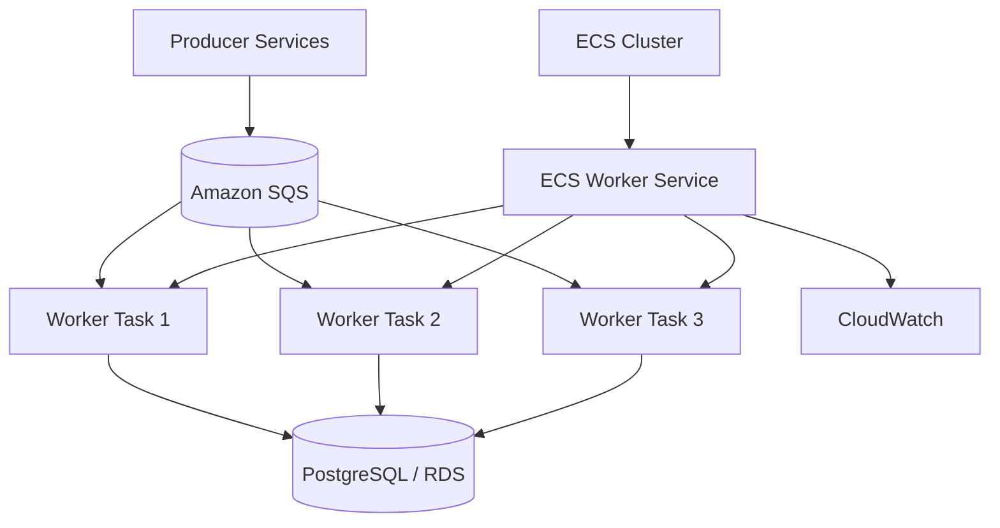
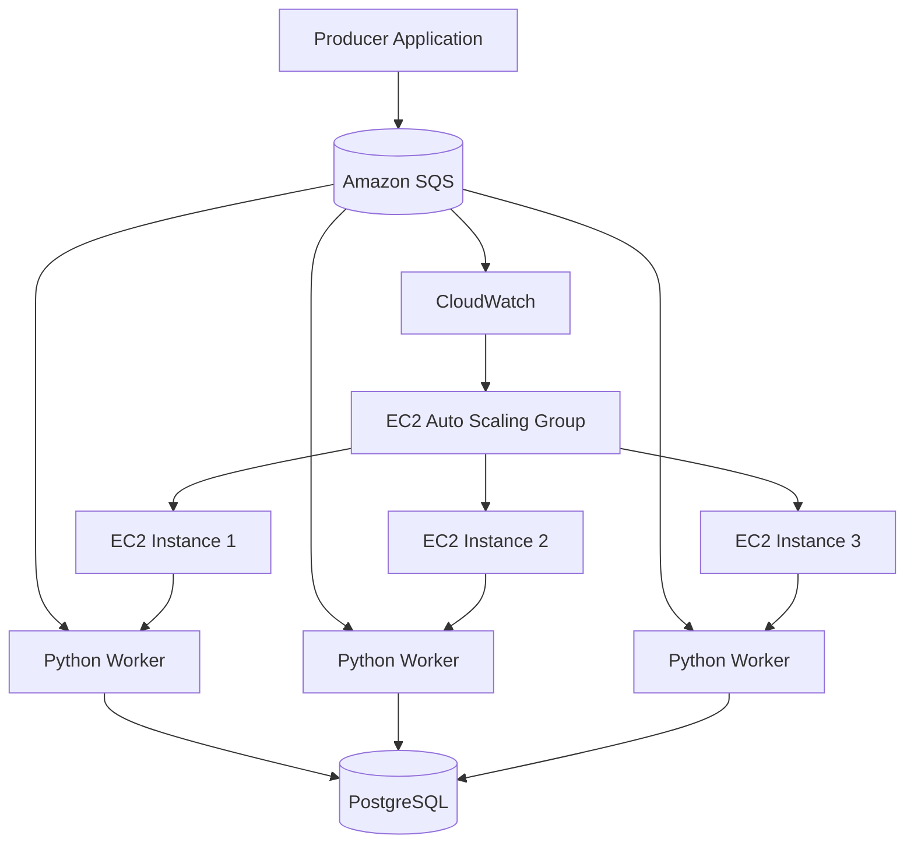
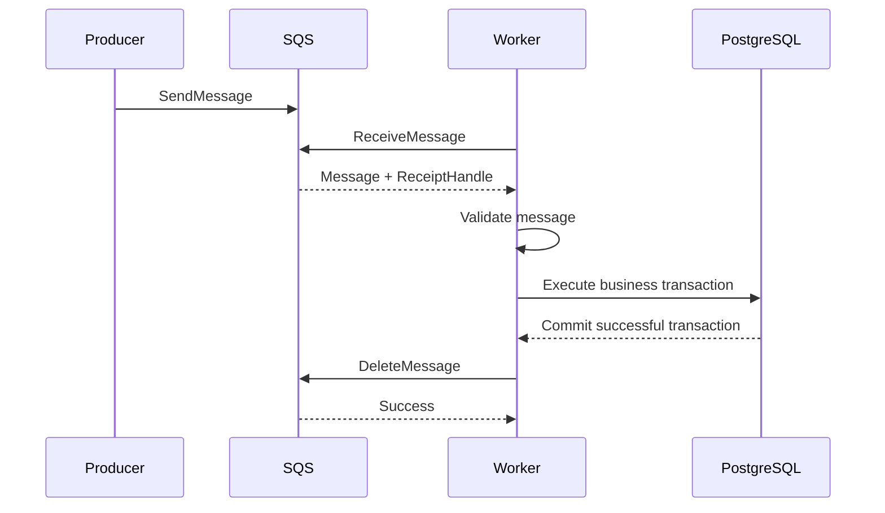

# 08- ECS and EC2 Worker Architectures

## Overview

Amazon SQS can be consumed by long-running worker applications deployed on Amazon ECS or Amazon EC2. Unlike Lambda-based consumers, these workers run as persistent processes that continuously poll queues, receive messages, execute business logic, and delete successfully processed messages.

This architecture is suitable for workloads that require:

- Processing durations longer than Lambda's maximum execution time.
- Persistent worker processes.
- Custom runtime environments and operating-system dependencies.
- Fine-grained control over concurrency and message handling.
- Specialized CPU, memory, or storage configurations.
- Continuous background processing.
- Integration with existing Python, Celery, or containerized worker systems.

Two common deployment models are:

| Architecture | Execution model | Infrastructure management |
|---|---|---|
| ECS workers | Containerized worker tasks | ECS manages task placement and service lifecycle |
| EC2 workers | Processes running on virtual machines | Application or infrastructure automation manages worker processes |

Both architectures use SQS as the durable work queue. Workers independently control message processing and acknowledgment.

## Core Architecture

### ECS-Based Worker Architecture

Amazon ECS runs consumer applications as containers. Each task can contain one or more worker processes, depending on the application design.

ECS supports two primary compute options:

- **AWS Fargate:** AWS manages the underlying compute infrastructure.
- **ECS on EC2:** Containers run on EC2 instances managed through an ECS cluster.

<AsyncImage query="AWS ECS Fargate SQS worker architecture producer queue ECS service multiple container tasks CloudWatch diagram" aspectRatio="16:9" width="100%"/>



The ECS service maintains the desired number of running tasks. Each worker task independently polls SQS.

For example:

```text
ECS Cluster
    |
    +-- Worker Service
            |
            +-- Task 1
            |      +-- Python SQS Consumer
            |
            +-- Task 2
            |      +-- Python SQS Consumer
            |
            +-- Task 3
                   +-- Python SQS Consumer
```

Multiple tasks can process messages concurrently because SQS distributes available messages among competing consumers.

### EC2-Based Worker Architecture

An EC2-based architecture runs worker processes directly on virtual machines.

Workers may be managed through:

- systemd services.
- Docker containers.
- Supervisor.
- Process managers.
- Custom deployment scripts.

<AsyncImage query="AWS EC2 Auto Scaling group SQS worker architecture multiple EC2 instances consumers queue CloudWatch diagram" aspectRatio="16:9" width="100%"/>



Each EC2 instance can run one or multiple worker processes.

The EC2 Auto Scaling group adjusts the number of instances according to configured scaling policies. Worker processes start when instances launch and stop during instance termination.

Unlike ECS, EC2-based deployments require additional responsibility for operating-system maintenance, process supervision, application installation, and instance lifecycle management.

## ECS vs EC2 Worker Architecture

| Characteristic | ECS Workers | EC2 Workers |
|---|---|---|
| Deployment unit | Container task | Instance or process |
| Application packaging | Docker image | Package, script, or container |
| Scaling | ECS service autoscaling | EC2 Auto Scaling |
| Infrastructure management | ECS manages task scheduling | Application team manages instance lifecycle |
| Runtime isolation | Container isolation | Process or container isolation |
| Operating-system access | Limited with Fargate; greater with ECS on EC2 | Full instance-level access |
| Resource allocation | Task CPU and memory | Instance CPU and memory |
| Deployment | Container image rollout | Instance or process deployment |
| Maintenance | Less infrastructure management with Fargate | OS patching and instance maintenance |
| Suitable workloads | Containerized background processing | Specialized or legacy workloads |

### Choosing Between ECS and EC2

Use ECS when:

- The application is already containerized.
- Independent task scaling is required.
- Deployment consistency is important.
- Multiple worker services share a cluster.
- Infrastructure management should be minimized.

Use EC2 when:

- Workloads require specialized instance configurations.
- Existing applications depend on host-level resources.
- Custom operating-system configuration is necessary.
- Persistent local processing environments are required.
- Infrastructure-level control is important.

For most new containerized worker systems, ECS provides a simpler operational model than manually managing worker processes on EC2.

## SQS Consumer Processing Lifecycle

An ECS or EC2 worker follows the standard SQS message lifecycle.



The processing sequence is:

1. Producer publishes a message.
2. Worker polls the queue.
3. SQS returns available messages.
4. The worker validates and processes the message.
5. Business changes are committed.
6. The worker deletes the message using its receipt handle.

If processing fails, the worker should not delete the message. It becomes available again after the visibility timeout expires, unless it is moved to a dead-letter queue through the redrive policy.

## Implementing an SQS Worker in Python

A worker can use Boto3 to poll and process messages.

### Project Structure

```text
sqs-worker/
├── app/
│   ├── __init__.py
│   ├── consumer.py
│   ├── handlers.py
│   ├── settings.py
│   └── logging_config.py
├── tests/
│   ├── test_consumer.py
│   └── test_handlers.py
├── requirements.txt
├── Dockerfile
└── entrypoint.sh
```

### Dependencies

```text
boto3
psycopg[binary]
```

Production deployments should pin dependencies using a lock file or another reproducible dependency-management approach.

### Worker Implementation

```python
import json
import logging
import os
import signal
import time

import boto3
from botocore.config import Config
from botocore.exceptions import BotoCoreError, ClientError

logger = logging.getLogger(__name__)
logging.basicConfig(level=logging.INFO)

QUEUE_URL = os.environ["SQS_QUEUE_URL"]

sqs = boto3.client(
    "sqs",
    region_name=os.environ.get("AWS_REGION", "ap-south-1"),
    config=Config(
        connect_timeout=5,
        read_timeout=30,
        retries={
            "mode": "standard",
            "max_attempts": 5,
        },
    ),
)

running = True


def handle_shutdown(signum, frame):
    global running
    running = False


signal.signal(signal.SIGTERM, handle_shutdown)
signal.signal(signal.SIGINT, handle_shutdown)


def process_message(message: dict) -> None:
    event = json.loads(message["Body"])

    event_id = event["event_id"]
    event_type = event["event_type"]

    logger.info(
        "Processing event",
        extra={
            "event_id": event_id,
            "event_type": event_type,
        },
    )

    if event_type == "OrderPlaced":
        process_order(event["data"])
    else:
        raise ValueError(f"Unsupported event type: {event_type}")


def process_order(data: dict) -> None:
    order_id = data["order_id"]

    # Perform an idempotent database transaction.
    logger.info("Order processed: %s", order_id)


def poll_queue() -> None:
    while running:
        try:
            response = sqs.receive_message(
                QueueUrl=QUEUE_URL,
                MaxNumberOfMessages=10,
                WaitTimeSeconds=20,
                VisibilityTimeout=120,
                MessageSystemAttributeNames=[
                    "ApproximateReceiveCount",
                ],
            )

            for message in response.get("Messages", []):
                if not running:
                    break

                try:
                    process_message(message)

                    if not running:
                        break

                    sqs.delete_message(
                        QueueUrl=QUEUE_URL,
                        ReceiptHandle=message["ReceiptHandle"],
                    )

                except (ValueError, KeyError, json.JSONDecodeError):
                    logger.exception(
                        "Invalid message",
                        extra={"message_id": message["MessageId"]},
                    )

                except Exception:
                    logger.exception(
                        "Message processing failed",
                        extra={"message_id": message["MessageId"]},
                    )

        except (BotoCoreError, ClientError):
            logger.exception("SQS polling failed")
            time.sleep(5)


if __name__ == "__main__":
    poll_queue()
```

This example uses sequential processing within each worker process. Multiple ECS tasks or EC2 processes can still process messages concurrently.

The implementation is a starting point. Production workers should additionally implement:

- Durable idempotency.
- Explicit transient and permanent failure classification.
- Visibility timeout extension for long-running tasks.
- Structured error reporting.
- Graceful handling of in-flight messages.
- Bounded concurrency.
- Database connection management.
- Health checks and shutdown deadlines.

A shutdown signal should stop new polling without acknowledging messages whose business operations have not completed.

## Message Processing and Acknowledgment

SQS does not provide a separate acknowledgment API.

Successful processing is acknowledged by deleting the message.

```python
sqs.delete_message(
    QueueUrl=QUEUE_URL,
    ReceiptHandle=receipt_handle,
)
```

The receipt handle is returned by `ReceiveMessage` and changes when the message is received again.

Always use the most recent receipt handle.

### Correct Processing Order

```text
Receive message
      |
      v
Validate message
      |
      v
Begin database transaction
      |
      v
Perform business operation
      |
      v
Commit database transaction
      |
      v
Delete SQS message
```

Deleting before committing the business transaction can permanently lose work if the application crashes after deletion.

Deleting after committing can result in duplicate delivery if the deletion request fails. This is why idempotency is mandatory.

## Idempotency and Duplicate Delivery

SQS Standard queues provide at-least-once delivery.

A message can be delivered again because of:

- Consumer crashes.
- Visibility timeout expiration.
- Network failures during deletion.
- Duplicate delivery behavior in Standard queues.
- Uncertain outcomes after processing or acknowledgment failures.

### Database Idempotency

Use an inbox or processed-events table with a unique event identifier.

```sql
CREATE TABLE processed_events (
    event_id UUID PRIMARY KEY,
    event_type VARCHAR(100) NOT NULL,
    processed_at TIMESTAMPTZ NOT NULL DEFAULT NOW()
);
```

The idempotency record and business changes should be committed in the same transaction.

```python
from django.db import IntegrityError, transaction


def process_order_event(event: dict) -> None:
    with transaction.atomic():
        try:
            ProcessedEvent.objects.create(
                event_id=event["event_id"],
                event_type=event["event_type"],
            )
        except IntegrityError:
            return

        Order.objects.filter(
            id=event["data"]["order_id"],
        ).update(
            status="processing",
        )
```

The unique constraint protects against concurrent duplicate deliveries.

For external side effects, such as payments or email delivery, use provider-supported idempotency keys and durable operation records. A database transaction cannot make an external API call atomic with a local database update.

## Visibility Timeout Management

The visibility timeout controls how long a received message remains unavailable to other consumers.

For example:

```text
Worker receives message
       |
       v
Message becomes invisible
       |
       v
Worker processes message
       |
       +-- Success --> Delete message
       |
       +-- Failure --> Message becomes visible after timeout
```

### Configuration

| Setting | Consideration |
|---|---|
| Default visibility timeout | 30 seconds |
| Maximum visibility timeout | 12 hours from initial receive |
| Maximum message retention | 14 days |
| Long polling maximum | 20 seconds |
| Maximum messages per receive | 10 |

Set visibility timeout longer than the expected processing duration.

For variable-duration workloads, use `ChangeMessageVisibility` to extend the timeout before it expires.

```python
sqs.change_message_visibility(
    QueueUrl=QUEUE_URL,
    ReceiptHandle=receipt_handle,
    VisibilityTimeout=120,
)
```

The maximum visibility duration remains limited to 12 hours from the initial receive.

### Visibility Timeout Problems

**Timeout too short**

- Another worker may receive the same message while the original worker is processing it.
- Concurrent duplicate execution can occur.
- Database updates and external side effects may be repeated.

**Timeout too long**

- Failed messages take longer to become available again.
- Recovery from crashed workers becomes slower.

Use measured processing duration and recovery requirements to tune the timeout.

## Long Polling and Efficient Queue Consumption

Long polling allows a worker to wait for messages rather than repeatedly issuing empty receive requests.

```python
response = sqs.receive_message(
    QueueUrl=QUEUE_URL,
    MaxNumberOfMessages=10,
    WaitTimeSeconds=20,
)
```

Advantages:

- Reduces empty receive requests.
- Reduces unnecessary API traffic.
- Improves message retrieval efficiency.
- Can reduce SQS request costs.

The HTTP read timeout must exceed the configured long-poll duration, with sufficient network overhead allowance.

For example, a 20-second long poll should use an HTTP read timeout greater than 20 seconds.

## Batch Processing

SQS supports receiving up to 10 messages per `ReceiveMessage` request.

Batch processing reduces request overhead and can improve throughput.

```python
response = sqs.receive_message(
    QueueUrl=QUEUE_URL,
    MaxNumberOfMessages=10,
    WaitTimeSeconds=20,
    VisibilityTimeout=120,
)
```

However, batch processing introduces additional considerations:

- One failed message should not prevent unrelated successful messages from being acknowledged.
- Processing duration may vary across messages.
- Visibility timeout must account for the complete processing lifecycle.
- Memory usage increases with batch size.
- Batch deletion can partially succeed.

Use `DeleteMessageBatch` when appropriate, but inspect both `Successful` and `Failed` entries.

## ECS Worker Deployment

ECS provides a managed environment for running containerized SQS workers.

### ECS Deployment Options

| Option | Characteristics |
|---|---|
| ECS Fargate | AWS manages compute infrastructure |
| ECS on EC2 | Containers run on customer-managed EC2 capacity |

### Dockerfile

A Python worker can be packaged into a container.

```dockerfile
FROM python:3.12-slim

ENV PYTHONDONTWRITEBYTECODE=1
ENV PYTHONUNBUFFERED=1

WORKDIR /app

RUN useradd --create-home --uid 10001 appuser

COPY requirements.txt .

RUN pip install --no-cache-dir --upgrade pip \
    && pip install --no-cache-dir -r requirements.txt

COPY app/ ./app/

USER appuser

CMD ["python", "-m", "app.consumer"]
```

Production images should use pinned dependencies, vulnerability scanning, and controlled image updates.

For sensitive environments, use an approved base-image policy and generate an image SBOM as part of the build process.

### ECS Task Definition

A simplified task definition:

```json
{
  "family": "sqs-order-worker",
  "networkMode": "awsvpc",
  "requiresCompatibilities": [
    "FARGATE"
  ],
  "cpu": "512",
  "memory": "1024",
  "executionRoleArn": "arn:aws:iam::123456789012:role/ecsTaskExecutionRole",
  "taskRoleArn": "arn:aws:iam::123456789012:role/orderWorkerTaskRole",
  "containerDefinitions": [
    {
      "name": "order-worker",
      "image": "123456789012.dkr.ecr.ap-south-1.amazonaws.com/order-worker:latest",
      "essential": true,
      "environment": [
        {
          "name": "SQS_QUEUE_URL",
          "value": "https://sqs.ap-south-1.amazonaws.com/123456789012/order-events"
        },
        {
          "name": "AWS_REGION",
          "value": "ap-south-1"
        }
      ],
      "logConfiguration": {
        "logDriver": "awslogs",
        "options": {
          "awslogs-group": "/ecs/order-worker",
          "awslogs-region": "ap-south-1",
          "awslogs-stream-prefix": "worker"
        }
      }
    }
  ]
}
```

Use immutable image tags or image digests in production deployments rather than relying on a mutable `latest` tag.

The task execution role is used by ECS for operations such as pulling images and sending container logs. The task role provides AWS permissions to the application running inside the container.

### ECS Service

The ECS service maintains the desired task count.

A typical deployment might use:

```text
Minimum tasks: 2
Desired tasks: 3
Maximum tasks: 20
```

Multiple tasks provide processing capacity and reduce dependence on a single worker instance.

For Fargate deployments, distribute tasks across multiple Availability Zones where possible.

### ECS Auto Scaling

Use Application Auto Scaling to adjust the desired task count.

Useful scaling signals include:

- Visible SQS messages.
- Approximate age of oldest message.
- Running task count.
- Messages processed per task.
- Application processing latency.

A useful custom metric is:

\[
\text{Backlog Per Task} =
\frac{\text{Visible Messages}}{\text{Running Tasks}}
\]

Target tracking can maintain backlog per task near a chosen target.

The metric should use actual running capacity, not only the desired task count.

Define minimum and maximum capacity to prevent unnecessary infrastructure growth.

## EC2 Worker Deployment

EC2 workers are appropriate when the application requires host-level control or specialized compute resources.

### Instance Bootstrap

A worker can be started through a systemd service.

Example unit file:

```ini
[Unit]
Description=Amazon SQS Worker
After=network-online.target
Wants=network-online.target

[Service]
Type=simple
User=appuser
WorkingDirectory=/opt/sqs-worker
EnvironmentFile=/etc/sqs-worker/worker.env
ExecStart=/opt/sqs-worker/.venv/bin/python -m app.consumer
Restart=always
RestartSec=5
KillSignal=SIGTERM
TimeoutStopSec=120

[Install]
WantedBy=multi-user.target
```

Enable the service:

```bash
sudo systemctl daemon-reload
sudo systemctl enable sqs-worker
sudo systemctl start sqs-worker
```

Check its status:

```bash
sudo systemctl status sqs-worker
```

View logs:

```bash
sudo journalctl -u sqs-worker -f
```

The worker should handle `SIGTERM` and stop receiving new messages before its shutdown deadline.

### EC2 Auto Scaling Group

An Auto Scaling group manages the number of EC2 instances.

Typical components:

- Launch template.
- Auto Scaling group.
- IAM instance profile.
- CloudWatch metrics and alarms.
- Scaling policies.
- Instance health checks.
- User data or configuration management.

The worker process should start automatically when an instance launches.

### Instance Termination

EC2 instances may be terminated during scale-in, replacement, maintenance, or infrastructure failures.

Use lifecycle-aware shutdown:

1. Detect the termination signal.
2. Stop receiving new messages.
3. Allow in-flight processing to finish within the shutdown deadline.
4. Delete only successfully processed messages.
5. Leave unfinished messages undeleted.
6. Allow SQS visibility timeout to make unfinished messages available again.

For Auto Scaling group termination, lifecycle hooks can provide additional time for controlled draining.

Do not assume an EC2 instance will remain available until every received message has completed.

## ECS vs EC2 Scaling

Both deployment models can scale according to SQS workload demand.

| Scaling dimension | ECS | EC2 |
|---|---|---|
| Scaling unit | Container task | EC2 instance |
| Scaling controller | Application Auto Scaling | EC2 Auto Scaling |
| Startup time | Task startup and image pull | Instance launch and bootstrap |
| Resource granularity | Task CPU and memory | Instance capacity |
| Scale-in | Stop tasks | Terminate instances |
| Infrastructure utilization | Can share cluster capacity | Depends on instance allocation |
| Operational complexity | Generally lower with Fargate | Higher due to host management |

ECS on EC2 adds another scaling layer: the ECS service scales tasks while the EC2 Auto Scaling group scales cluster capacity.

The cluster must have sufficient available CPU and memory to place new tasks.

## Consumer Concurrency and Backpressure

Increasing worker count does not automatically improve throughput.

A worker may be limited by:

- Database connection capacity.
- External API rate limits.
- CPU-intensive operations.
- Memory usage.
- Network bandwidth.
- Message ordering.
- Shared locks or database contention.

### Capacity Estimation

Let:

- \(\lambda\) = incoming messages per second.
- \(\mu\) = messages processed per second per worker.
- \(N\) = number of workers.

Approximate total processing capacity:

\[
C = N \times \mu
\]

For a stable workload:

\[
N \times \mu > \lambda
\]

For example:

```text
Incoming rate:       500 messages/second
Worker throughput:    25 messages/second
Required workers:     20
```

A practical deployment should include capacity for traffic variation, processing-time variance, and worker failures.

### Protecting PostgreSQL

Suppose each ECS task runs five concurrent handlers.

```text
ECS tasks:                  20
Concurrent handlers/task:   5
Maximum active handlers:   100
```

If each handler opens a separate database connection, the worker deployment can create up to 100 concurrent connections.

Use:

- Connection pooling.
- RDS Proxy where appropriate.
- Bounded handler concurrency.
- Efficient transaction boundaries.
- Database connection monitoring.
- Query optimization.

### Protecting External Services

Use bounded concurrency and rate limiting when calling external APIs.

A growing queue should not cause unlimited requests against a dependency that is already unhealthy.

Recommended controls include:

- Token-bucket rate limiting.
- Exponential backoff with jitter.
- Circuit breakers.
- Retry budgets.
- Separate queues for independent workloads.
- Controlled consumer scaling.

## ECS and EC2 Worker Reliability

### Worker Crashes

If a worker crashes after receiving a message, the message remains invisible until its visibility timeout expires.

SQS can then deliver it to another worker.

This provides recovery without requiring the producer to republish the message.

However, duplicate delivery remains possible.

### Dead Letter Queues

Configure a DLQ for messages that repeatedly fail.

```json
{
  "deadLetterTargetArn": "arn:aws:sqs:ap-south-1:123456789012:order-events-dlq",
  "maxReceiveCount": 5
}
```

Monitor:

- DLQ message count.
- Oldest DLQ message age.
- Message receive count.
- Error classification.
- Consumer version.
- Failure reason.

Redrive messages gradually after the underlying failure is resolved.

### Poison Messages

A poison message repeatedly fails because of invalid data, incompatible schema, or deterministic business errors.

Increasing worker capacity does not resolve this condition.

Validate message contracts and use bounded retries with DLQ isolation.

## Security Considerations

### IAM Task Role and EC2 Instance Profile

ECS tasks should use task roles to access AWS services.

EC2 workers should use instance profiles.

Avoid static AWS access keys stored in:

- Docker images.
- Environment files.
- Source code.
- Configuration repositories.
- User data scripts.

A consumer typically needs:

```json
{
  "Version": "2012-10-17",
  "Statement": [
    {
      "Effect": "Allow",
      "Action": [
        "sqs:ReceiveMessage",
        "sqs:DeleteMessage",
        "sqs:ChangeMessageVisibility",
        "sqs:GetQueueAttributes"
      ],
      "Resource": "arn:aws:sqs:ap-south-1:123456789012:order-events"
    }
  ]
}
```

Grant additional permissions only when the application requires them.

### Network Security

For ECS and EC2 deployments:

- Use private subnets for worker workloads where appropriate.
- Restrict security group egress.
- Use VPC endpoints for private access to AWS services where suitable.
- Restrict database access to worker security groups.
- Enable SQS server-side encryption.
- Use TLS for network communication.
- Avoid public IP assignment unless required.
- Store application secrets in Secrets Manager or an approved secret-management system.

For private-subnet workloads, ensure required AWS service connectivity is available through appropriate VPC endpoints or NAT infrastructure.

## High Availability and Disaster Recovery

### High Availability

Recommended practices:

- Distribute ECS tasks across multiple Availability Zones.
- Use multiple EC2 instances across Availability Zones.
- Maintain a suitable minimum worker capacity.
- Use health checks and automatic replacement.
- Keep workers stateless where possible.
- Persist business state in durable storage.
- Use visibility timeout and redelivery for crash recovery.
- Test rolling deployments and termination behavior.

For ECS on EC2, maintain enough cluster capacity to place replacement tasks during deployments and instance failures.

### Disaster Recovery

SQS queues are regional resources and do not automatically replicate messages across Regions.

A recovery strategy should define:

- Queue and DLQ recreation through infrastructure as code.
- Worker deployment in the recovery Region.
- Required database replication or restoration.
- Event republishing or archival strategy.
- Idempotency across recovery operations.
- Failover and failback procedures.

Do not assume that an ECS service or EC2 Auto Scaling group provides cross-Region message replication.

## Monitoring and Observability

Monitor the queue, worker processes, compute infrastructure, and downstream systems together.

### SQS Metrics

| Metric | Purpose |
|---|---|
| `ApproximateNumberOfMessagesVisible` | Available backlog |
| `ApproximateNumberOfMessagesNotVisible` | In-flight messages |
| `ApproximateAgeOfOldestMessage` | Queue processing delay |
| `NumberOfMessagesReceived` | Receive activity |
| `NumberOfMessagesDeleted` | Successful message deletion |
| `NumberOfMessagesSent` | Producer activity |

SQS metrics are approximate. They should be combined with application-level processing counters.

### ECS Metrics

Monitor:

- Desired task count.
- Running task count.
- Pending task count.
- CPU utilization.
- Memory utilization.
- Task restart frequency.
- Deployment failures.
- Container exit codes.

### EC2 Metrics

Monitor:

- CPU utilization.
- Memory utilization through the CloudWatch Agent.
- Disk utilization.
- Network throughput.
- Instance health.
- Auto Scaling group desired and healthy capacity.
- Worker process health.

### Application Metrics

Track:

- Messages processed per second.
- Processing duration.
- Processing failures.
- Duplicate event detections.
- Retry count.
- Active handlers.
- Database connection utilization.
- External API latency.
- End-to-end event processing latency.

Use structured logs with event identifiers, correlation identifiers, and message identifiers.

### Recommended Alerts

| Condition | Action |
|---|---|
| Oldest message age exceeds SLA | Investigate processing capacity |
| Visible backlog continuously increases | Evaluate worker throughput |
| DLQ count increases | Investigate failed messages |
| ECS running tasks below desired count | Investigate task placement and startup |
| EC2 instances unhealthy | Investigate instance and application health |
| CPU or memory remains saturated | Review resource allocation |
| Database connections approach limits | Reduce concurrency or improve pooling |
| High message receive count | Investigate repeated processing failures |

## Deployment and CI/CD

ECS and EC2 workers should use repeatable deployment processes.

### ECS Deployment Pipeline

A typical pipeline includes:

1. Run unit and integration tests.
2. Validate event contracts.
3. Build the Docker image.
4. Scan the image for vulnerabilities.
5. Push the image to Amazon ECR.
6. Register a new task definition revision.
7. Deploy the ECS service.
8. Wait for deployment stability.
9. Verify queue and worker metrics.

Use immutable image versions and task definition revisions.

ECS deployment circuit breakers and rollback configurations can help recover from unhealthy deployments.

### EC2 Deployment Pipeline

A typical pipeline includes:

1. Run tests and static analysis.
2. Build a versioned application package or container image.
3. Publish the artifact.
4. Deploy through an approved deployment mechanism.
5. Update instances or application processes.
6. Verify systemd and worker health.
7. Monitor queue processing.
8. Roll back when necessary.

Prefer immutable infrastructure or controlled rolling deployments over manually modifying individual production instances.

## Cost Considerations

### ECS Costs

For Fargate, costs are influenced by:

- vCPU allocation.
- Memory allocation.
- Task runtime.
- Operating system and architecture.
- Ephemeral storage configuration.
- Data transfer.

For ECS on EC2, costs include:

- EC2 instance hours.
- EBS storage.
- Load or cluster utilization.
- Networking.
- Logging and monitoring.

### EC2 Costs

EC2 worker costs depend on:

- Instance type.
- Instance count.
- Runtime duration.
- EBS storage.
- Data transfer.
- Operating system licensing where applicable.
- Scaling and idle capacity.

### Cost Optimization

- Right-size task CPU and memory.
- Use Fargate when host management is not required.
- Use ECS on EC2 when sustained workloads justify managed cluster capacity.
- Select appropriate EC2 instance families.
- Use long polling to reduce empty receives.
- Batch SQS operations.
- Scale down safely during low traffic.
- Avoid excessive logging.
- Monitor cost per successfully processed message.

Do not optimize compute cost by reducing worker capacity below the level required to meet processing SLAs.

## ECS vs EC2 vs Lambda

| Characteristic | Lambda | ECS | EC2 |
|---|---|---|---|
| Execution model | Invocation-based | Container tasks | Persistent instances/processes |
| Infrastructure control | Low | Medium to high | High |
| Long-running workloads | Limited to 15 minutes per invocation | Supported | Supported |
| Scaling | Managed event source mapping | ECS service autoscaling | EC2 Auto Scaling |
| Runtime customization | Managed runtime or container image | Container-level control | Host-level control |
| Persistent processes | No | Yes | Yes |
| Operational overhead | Lowest infrastructure management | Moderate | Highest |
| Suitable workloads | Short event-driven tasks | Containerized background workers | Specialized or host-dependent workloads |

Choose based on workload duration, runtime requirements, scaling characteristics, and operational ownership.

## Common Production Mistakes

| Mistake | Why it is problematic | Recommended approach |
|---|---|---|
| Deleting messages before committing | Can permanently lose business work | Delete after durable processing |
| Ignoring duplicate delivery | Repeated side effects can occur | Implement idempotency |
| Running unbounded worker concurrency | Overloads databases and APIs | Apply concurrency limits |
| Using short visibility timeouts | Messages can be processed concurrently | Tune against processing duration |
| Ignoring graceful shutdown | In-flight work can be interrupted | Stop polling and drain safely |
| Scaling ECS tasks without cluster capacity | Tasks remain pending | Scale EC2 capacity or use Fargate |
| Scaling EC2 without startup planning | New workers start too late | Account for instance bootstrap time |
| Using static AWS credentials | Increases credential exposure risk | Use task roles and instance profiles |
| Treating queue depth as the only metric | Processing delay can remain hidden | Monitor oldest message age |
| Ignoring DLQ growth | Failed business operations remain unresolved | Alert and investigate |
| Running too many processes per instance | Resource contention reduces throughput | Measure CPU, memory, and downstream capacity |
| Using mutable container tags | Deployments become difficult to reproduce | Use immutable image versions or digests |

## Production Engineering Checklist

### Architecture

- [ ] ECS or EC2 deployment model matches workload requirements.
- [ ] Worker processes are independently deployable.
- [ ] Queue type matches ordering requirements.
- [ ] Queue and DLQ policies are configured.
- [ ] Compute capacity has minimum and maximum boundaries.

### Consumer Reliability

- [ ] Messages are deleted only after durable processing.
- [ ] Idempotency is implemented.
- [ ] Visibility timeout matches processing duration.
- [ ] Long polling is enabled.
- [ ] Batch operations handle partial failures.
- [ ] Graceful shutdown is implemented.
- [ ] Transient and permanent failures are classified.

### Infrastructure

- [ ] ECS tasks or EC2 instances span multiple Availability Zones.
- [ ] IAM task roles or instance profiles use least privilege.
- [ ] Worker resource limits are configured.
- [ ] Database connections and external API concurrency are bounded.
- [ ] Container images and application artifacts are versioned.
- [ ] Deployment rollback procedures are tested.

### Operations

- [ ] Queue age and backlog are monitored.
- [ ] DLQ growth triggers alerts.
- [ ] Worker health is observable.
- [ ] Compute utilization is monitored.
- [ ] Database and downstream dependencies are monitored.
- [ ] Recovery and redrive procedures are documented.
- [ ] Disaster recovery procedures are tested.

## Key Takeaways

- ECS and EC2 provide persistent worker environments for SQS workloads that need greater runtime control than Lambda-based processing.
- ECS manages container task placement and lifecycle, while EC2 provides direct control over virtual machines and worker processes.
- SQS consumers must implement idempotency, delete messages only after durable processing, and configure visibility timeouts according to actual workload duration.
- Worker scaling must account for downstream database capacity, API rate limits, compute resources, and graceful shutdown behavior.
- Production reliability depends on multi-AZ deployment, least-privilege IAM, DLQs, structured observability, controlled deployments, and tested recovery procedures.