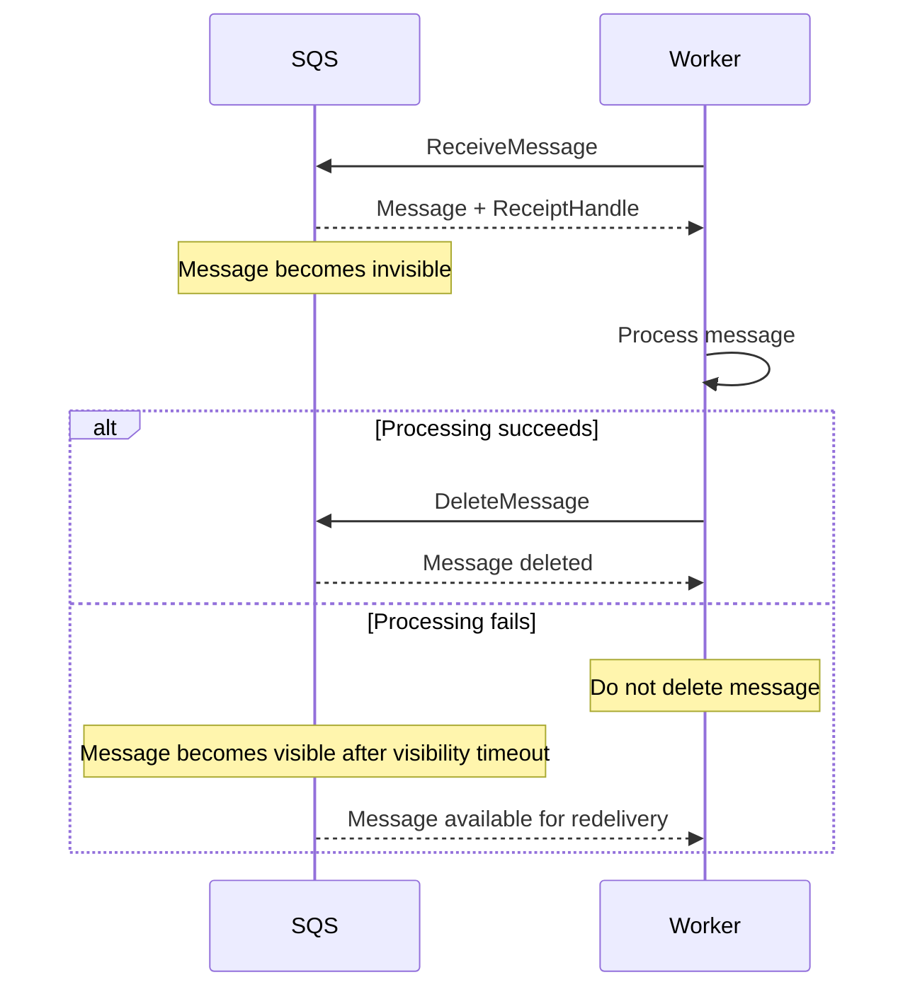
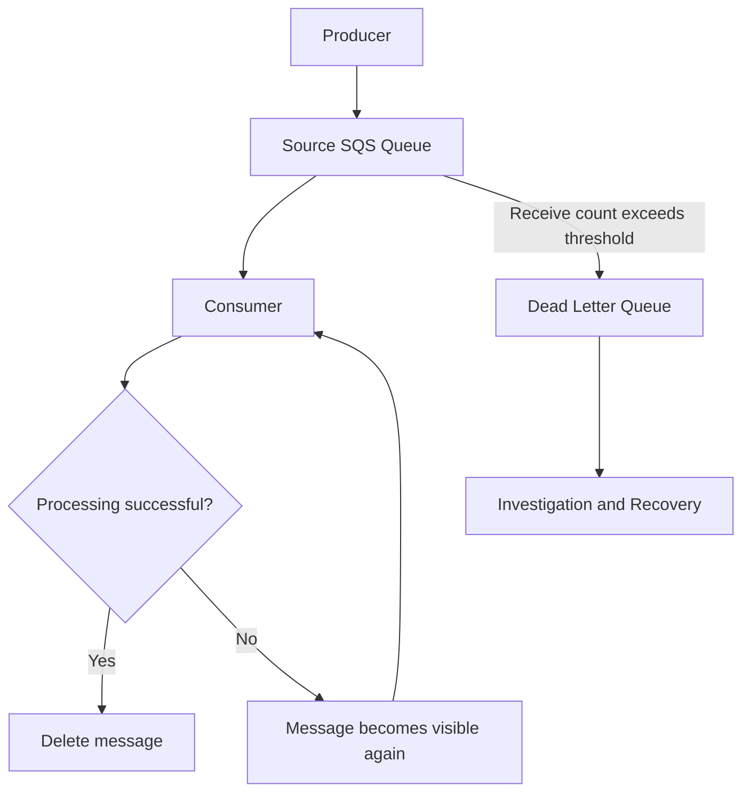
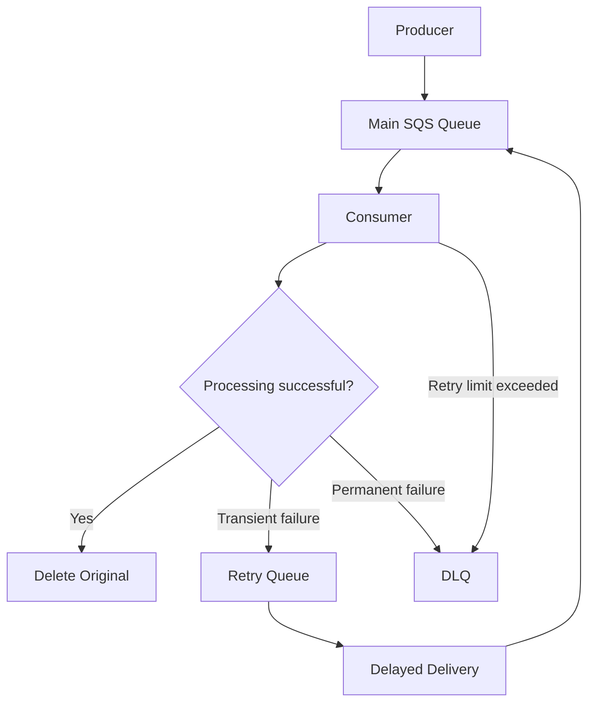
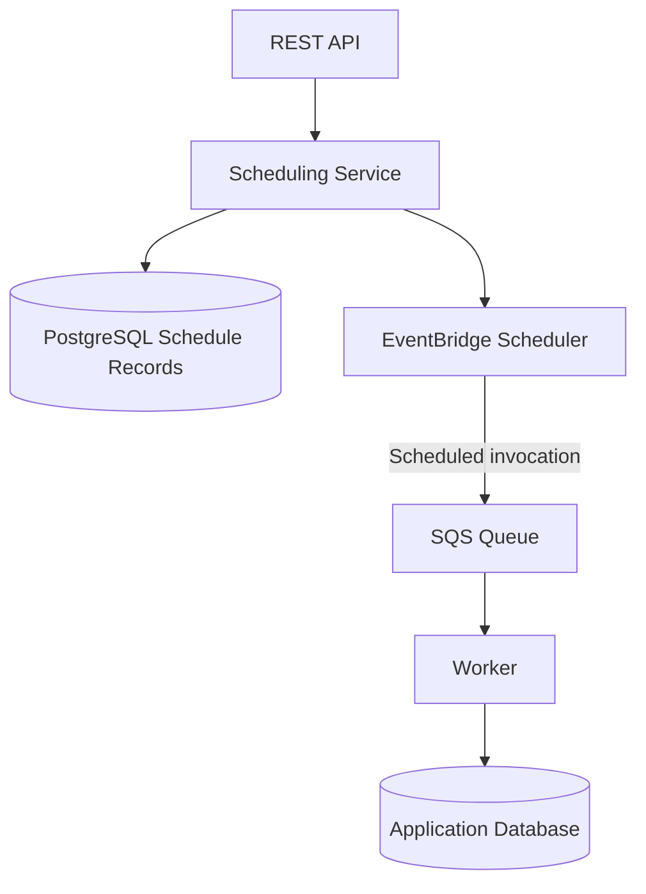
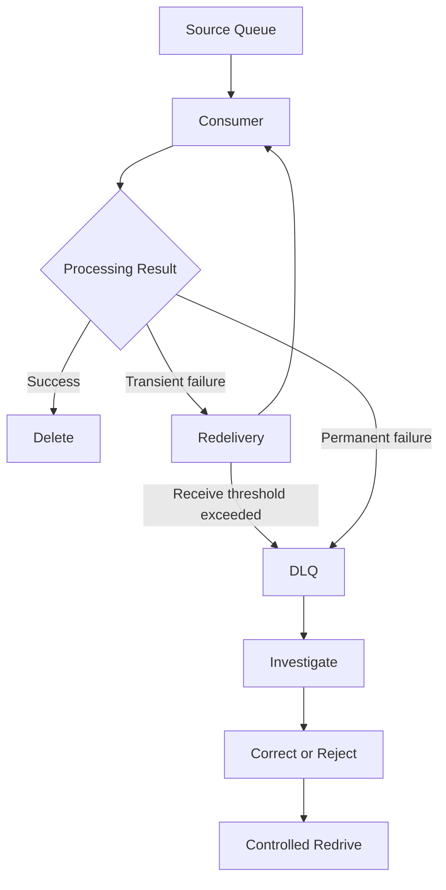
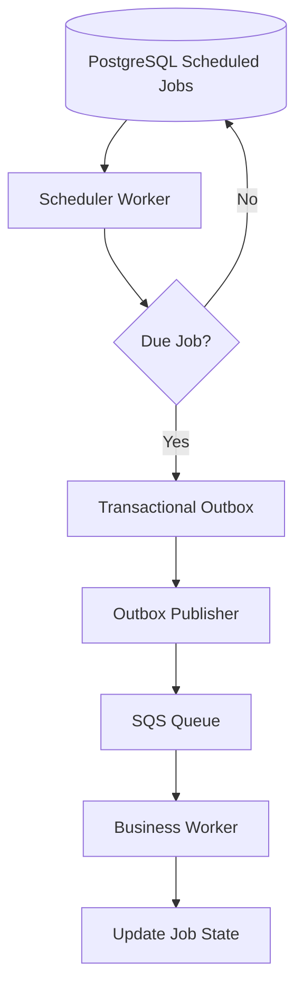

# 09- Retry and Scheduled Processing Patterns

## Overview

Amazon Simple Queue Service (SQS) provides the delivery and buffering mechanisms needed to build reliable asynchronous processing systems. However, production workloads must account for transient failures, delayed execution, repeated delivery, downstream outages, and messages that cannot be processed successfully.

Retry and scheduled processing patterns address these concerns by controlling when messages are processed again, how long processing is deferred, and how failed work is recovered.

SQS provides several mechanisms that support these patterns:

- **Visibility timeout:** Temporarily hides a received message while a consumer processes it.
- **Message delay:** Defers initial message delivery.
- **Dead-letter queues (DLQs):** Isolates messages that exceed the configured receive threshold.
- **Redrive policies:** Control when messages move from a source queue to a DLQ.
- **Message timers and scheduling services:** Support delayed execution within or beyond SQS delay limits.

These mechanisms solve different problems. A visibility timeout is not a scheduling mechanism, a DLQ is not a retry queue, and a delay queue does not provide arbitrary long-term scheduling.

A robust implementation combines queue configuration, application-level retry decisions, idempotent consumers, and operational monitoring.

## Retry Fundamentals

### Why Retry Is Necessary

Distributed systems experience transient failures even when individual components are healthy.

Typical examples include:

- Database connection timeouts.
- Temporary HTTP 5xx responses from external APIs.
- Network interruptions.
- Rate limiting by downstream services.
- Temporary resource exhaustion.
- Service deployments and maintenance windows.

Retrying a failed operation can recover from temporary conditions without requiring manual intervention.

However, retrying every failure is dangerous. Permanent failures will continue consuming resources, while aggressive retries can overload an already unhealthy dependency.

A production retry strategy must classify failures before deciding what to do.

### Transient and Permanent Failures

| Failure category | Examples | Recommended handling |
|---|---|---|
| Transient | Connection timeout, temporary DNS failure | Retry with backoff |
| Throttling | HTTP 429, database connection limit | Retry after an appropriate delay |
| Temporary service failure | HTTP 502, 503, 504 | Retry with bounded backoff |
| Invalid input | Missing required field, invalid schema | Do not retry indefinitely |
| Business validation | Insufficient balance, invalid state transition | Apply business-specific handling |
| Authorization failure | Invalid credentials, denied permission | Stop retrying and investigate |
| Resource not found | Missing referenced record | Retry only if eventual creation is expected |

Failure classification should be based on the downstream service's semantics rather than HTTP status alone.

For example, a `404 Not Found` response might be permanent for an invalid resource ID but transient when a dependent resource is created asynchronously.

## SQS Message Lifecycle During Retry

### Visibility Timeout

When a consumer receives a message, SQS makes it temporarily invisible to other consumers.

The message remains in the queue until it is deleted or becomes visible again.



The visibility timeout prevents multiple consumers from processing the same message concurrently under normal conditions. It does not guarantee exclusive processing because duplicate delivery can still occur.

If processing does not complete before the timeout expires, another consumer can receive the message while the original worker is still running.

### Configuring Visibility Timeout

Visibility timeout can be configured at queue level or changed for an individual message using `ChangeMessageVisibility`.

```bash
aws sqs set-queue-attributes \
    --queue-url "$QUEUE_URL" \
    --attributes VisibilityTimeout=120
```

This configures a 120-second visibility timeout.

The appropriate value depends on the processing duration and its variability.

| Workload | Consideration |
|---|---|
| Short API task | Small timeout with a safety margin |
| Database-heavy processing | Account for query and transaction duration |
| File processing | Account for file size and processing variability |
| External API integration | Account for network and provider latency |
| Long-running task | Extend visibility periodically or redesign the workload |

SQS visibility timeout has a maximum of 12 hours from the initial receive. Extending visibility does not reset this maximum.

### Extending Visibility During Processing

For variable-duration workloads, a worker can periodically extend the visibility timeout.

```python
import boto3
import logging
import time

logger = logging.getLogger(__name__)

sqs = boto3.client("sqs")

def extend_visibility(
    queue_url: str,
    receipt_handle: str,
    visibility_timeout: int = 120,
) -> None:
    sqs.change_message_visibility(
        QueueUrl=queue_url,
        ReceiptHandle=receipt_handle,
        VisibilityTimeout=visibility_timeout,
    )

def process_long_running_task(
    queue_url: str,
    receipt_handle: str,
) -> None:
    try:
        while True:
            perform_processing_step()

            extend_visibility(
                queue_url=queue_url,
                receipt_handle=receipt_handle,
            )

            if processing_complete():
                break

    except Exception:
        logger.exception("Long-running task failed")
        raise
```

The example illustrates the extension mechanism. A production implementation should use a heartbeat scheduler that tracks the remaining visibility budget, handles extension failures, and coordinates with cancellation and shutdown.

Do not assume that a successful visibility extension means the original worker is the only active processor. Idempotency remains necessary.

### Visibility Timeout Versus Processing Duration

A visibility timeout that is too short can cause concurrent duplicate processing.

A timeout that is excessively long delays recovery when a worker crashes.

The design should balance:

- Normal processing duration.
- High-percentile processing duration.
- Worker shutdown time.
- Recovery time after a crash.
- Maximum visibility timeout constraints.

For Lambda functions triggered by SQS, AWS recommends configuring visibility timeout to at least six times the function timeout, plus the maximum batching window allowance.

## Retry Strategies

### Immediate Retry

An immediate retry attempts the failed operation again without intentionally delaying it.

This can be useful for very short-lived failures, but repeated immediate attempts can amplify downstream incidents.

For example, if a database is temporarily unavailable, thousands of workers immediately retrying connections can create a connection storm.

Use immediate retry only when the operation is cheap and the failure is expected to resolve quickly.

### Fixed Delay Retry

Fixed delay retry waits for the same duration between attempts.

Example:

| Attempt | Delay |
|---|---:|
| 1 | 10 seconds |
| 2 | 10 seconds |
| 3 | 10 seconds |
| 4 | DLQ or failure handling |

Fixed delays are predictable and easy to configure.

However, synchronized workers may retry at the same time, producing repeated traffic spikes.

### Exponential Backoff

Exponential backoff increases the delay after each failed attempt.

A common formula is:

\[
delay_n = \min(cap,\ base \times 2^{n-1})
\]

For example, with a base delay of 2 seconds and a maximum delay of 60 seconds:

| Attempt | Calculated delay |
|---|---:|
| 1 | 2 seconds |
| 2 | 4 seconds |
| 3 | 8 seconds |
| 4 | 16 seconds |
| 5 | 32 seconds |
| 6 | 60 seconds |
| 7 | 60 seconds |

Exponential backoff reduces pressure on an unhealthy dependency.

However, without randomization, many workers can still synchronize their retries.

### Exponential Backoff With Jitter

Jitter introduces randomness into retry delays.

A common full-jitter strategy is:

\[
delay_n = random(0,\ min(cap,\ base \times 2^{n-1}))
\]

Python implementation:

```python
import random

def calculate_retry_delay(
    attempt: int,
    base_delay: float = 2.0,
    max_delay: float = 300.0,
) -> float:
    if attempt < 1:
        raise ValueError("attempt must be greater than or equal to 1")

    upper_bound = min(
        max_delay,
        base_delay * (2 ** (attempt - 1)),
    )

    return random.uniform(0, upper_bound)
```

Jitter is particularly useful when many workers process messages concurrently.

It reduces synchronized retry behavior and helps protect shared downstream dependencies.

### Retry Strategy Comparison

| Strategy | Behavior | Advantages | Limitations |
|---|---|---|---|
| Immediate | Retry immediately | Simple and fast | Can amplify failures |
| Fixed delay | Same delay between attempts | Predictable | Can synchronize retries |
| Exponential backoff | Delay increases exponentially | Reduces dependency pressure | Can produce long delays |
| Exponential with jitter | Randomized exponential delay | Reduces retry synchronization | Less predictable execution time |

For most distributed backend workloads, bounded exponential backoff with jitter is a practical default.

## Retry Patterns With SQS

SQS does not provide a general configurable per-message exponential retry policy.

A message that is not deleted becomes visible again after its visibility timeout. The queue's redrive policy determines when it is moved to a DLQ based on its receive count.

Application-level retry scheduling must therefore be designed separately when precise retry delays are required.

### Native SQS Redelivery

The simplest retry pattern uses visibility timeout and a DLQ.



Configuration example:

```bash
aws sqs set-queue-attributes \
    --queue-url "$QUEUE_URL" \
    --attributes '{
      "RedrivePolicy": "{\"deadLetterTargetArn\":\"arn:aws:sqs:ap-south-1:123456789012:orders-dlq\",\"maxReceiveCount\":\"5\"}"
    }'
```

The source queue must be configured with a compatible DLQ. Source and DLQ queue types must match.

`maxReceiveCount` counts receives, not successful processing attempts.

Native redelivery is appropriate when:

- Retry delays do not need to vary by attempt.
- The processing operation is reasonably short.
- The visibility timeout provides sufficient retry spacing.
- The application can safely process duplicate deliveries.

Its main limitation is that the same visibility timeout applies to the message's next delivery unless the consumer changes it.

### Per-Message Visibility Retry

A consumer can change the visibility timeout after a failure.

This provides a basic form of per-message retry scheduling.

```python
import boto3
import logging

logger = logging.getLogger(__name__)

sqs = boto3.client("sqs")

def defer_message(
    queue_url: str,
    receipt_handle: str,
    delay_seconds: int,
) -> None:
    if not 0 <= delay_seconds <= 43200:
        raise ValueError("Visibility timeout must be between 0 and 43200")

    sqs.change_message_visibility(
        QueueUrl=queue_url,
        ReceiptHandle=receipt_handle,
        VisibilityTimeout=delay_seconds,
    )
```

A worker can calculate the delay from the receive count:

```python
def retry_delay(receive_count: int) -> int:
    base = 10
    maximum = 900

    return min(
        maximum,
        base * (2 ** max(receive_count - 1, 0)),
    )
```

Use the `ApproximateReceiveCount` system attribute to obtain the approximate number of receives.

```python
response = sqs.receive_message(
    QueueUrl=queue_url,
    MaxNumberOfMessages=10,
    WaitTimeSeconds=20,
    MessageSystemAttributeNames=[
        "ApproximateReceiveCount",
    ],
)
```

Important limitations:

- Visibility timeout is capped at 12 hours from initial receipt.
- The configured delay is not a durable business schedule.
- A worker can crash before changing visibility.
- Repeated receives still contribute to the redrive threshold.
- Visibility changes do not replace idempotency.

Use this pattern for simple retry delays. Use a dedicated retry queue or scheduling service when retry timing is a first-class requirement.

## Dedicated Retry Queue Pattern

A dedicated retry queue separates failed work from the main processing queue.

The consumer receives a message, classifies the failure, and sends a retry message to a retry queue with a delay.

After successfully publishing the retry message, the consumer deletes the original message.



### Why Use a Retry Queue?

A retry queue provides:

- Separation between normal and delayed traffic.
- Independent monitoring of retry backlog.
- Configurable delay periods.
- Better control over retry scheduling.
- Reduced interference with healthy messages.

It is useful when failed messages should not immediately compete with newly arriving messages.

### Retry Queue Configuration

SQS delay queues can defer message delivery for up to 15 minutes.

```bash
aws sqs create-queue \
    --queue-name orders-retry-queue \
    --attributes '{
      "DelaySeconds": "60",
      "ReceiveMessageWaitTimeSeconds": "20"
    }'
```

A queue-level delay applies to messages entering the queue.

For per-message delay on Standard queues, use the `DelaySeconds` parameter when sending the message.

```python
import boto3

sqs = boto3.client("sqs")

def publish_retry(
    queue_url: str,
    payload: str,
    delay_seconds: int,
) -> None:
    if not 0 <= delay_seconds <= 900:
        raise ValueError("SQS message delay must be between 0 and 900")

    sqs.send_message(
        QueueUrl=queue_url,
        MessageBody=payload,
        DelaySeconds=delay_seconds,
    )
```

For Standard queues, per-message delay can override the queue-level delay.

FIFO queues do not support per-message timers. Their delay configuration is queue-level.

### Retry Publication and Message Deletion

Publishing a retry message and deleting the original message are two separate SQS operations.

This creates an important failure window:

1. The consumer publishes the retry message successfully.
2. The consumer crashes before deleting the original message.
3. The original message becomes visible again.
4. The consumer publishes another retry message.

The result can be duplicate retry messages.

Reversing the order is worse:

1. The consumer deletes the original message.
2. Retry publication fails.
3. The work is lost.

There is no atomic transaction spanning `SendMessage` and `DeleteMessage`.

A production implementation should use:

- Stable message or event IDs.
- Idempotent consumers.
- Retry attempt metadata.
- Durable retry scheduling records where required.
- Reconciliation for ambiguous publication outcomes.

For systems requiring stronger coordination, persist retry intent in a database transaction and publish it through a transactional outbox.

## Delayed Processing With SQS

### Delay Queues

A delay queue postpones message availability after the message is sent.

This is useful for short deferrals such as:

- Waiting before retrying a transient API failure.
- Delaying follow-up processing.
- Applying a short cooldown.
- Separating immediate and deferred workloads.

Queue-level delay example:

```bash
aws sqs set-queue-attributes \
    --queue-url "$QUEUE_URL" \
    --attributes DelaySeconds=120
```

Messages sent to the queue are delayed by 120 seconds.

SQS delay is limited to 15 minutes. It should not be used for arbitrary long-term scheduling.

### Message Timers

A message timer specifies a delay for an individual message in a Standard queue.

```python
sqs.send_message(
    QueueUrl=queue_url,
    MessageBody='{"order_id": "ORD-1001"}',
    DelaySeconds=300,
)
```

This message becomes available after approximately five minutes.

Message timers are useful when different messages require different short delays.

They are not supported for FIFO queues.

### Delay Queue Versus Visibility Timeout

These mechanisms are often confused.

| Feature | Delay queue or message timer | Visibility timeout |
|---|---|---|
| Purpose | Delay initial delivery | Hide a received message temporarily |
| Applied | When sending | After receiving |
| Consumer has received message? | No | Yes |
| Common use | Scheduled initial processing | Processing protection and retry |
| Maximum duration | 15 minutes | 12 hours from initial receive |
| Per-message support | Standard queues | Individual received messages |

Use delay queues for initial delivery deferral and visibility timeout for managing an already received message.

## Long-Term Scheduled Processing

SQS delay mechanisms are insufficient for schedules that extend beyond 15 minutes.

Examples include:

- Sending an order reminder after 24 hours.
- Processing a subscription renewal next month.
- Executing a payment collection on a future date.
- Scheduling a report for a specific date and time.
- Retrying a dependency after several hours.

For these workloads, use a scheduling service that publishes a message to SQS when the scheduled time arrives.

### Amazon EventBridge Scheduler With SQS

Amazon EventBridge Scheduler supports one-time and recurring schedules and can invoke SQS as a target.



The application stores business scheduling metadata in PostgreSQL and creates a corresponding EventBridge schedule.

EventBridge Scheduler delivers the scheduled invocation to SQS.

The worker processes the resulting message using normal SQS consumer semantics.

### When to Use EventBridge Scheduler

Use EventBridge Scheduler when:

- A task must execute at a specific future time.
- A schedule must recur.
- Scheduling extends beyond 15 minutes.
- The application needs managed schedule delivery.
- A large number of independent schedules must be managed.

Important considerations:

- Configure the schedule's time zone explicitly when using local-time requirements.
- Understand daylight-saving behavior for recurring schedules.
- Configure retry and DLQ behavior for failed target delivery.
- Use stable business identifiers to make target processing idempotent.
- Track schedule creation, updates, and deletion in application state.
- Avoid treating successful schedule creation as proof that business processing completed.

EventBridge Scheduler delivery and SQS processing are separate stages. A successful scheduled invocation does not prove that the worker completed the business operation.

### One-Time Schedule Example

The following AWS CLI example creates a one-time schedule that sends a message to an SQS queue.

```bash
aws scheduler create-schedule \
    --name order-reminder-ORD-1001 \
    --schedule-expression "at(2026-12-01T09:00:00)" \
    --schedule-expression-timezone "Asia/Kolkata" \
    --flexible-time-window '{"Mode":"OFF"}' \
    --target '{
      "Arn":"arn:aws:sqs:ap-south-1:123456789012:order-reminders",
      "RoleArn":"arn:aws:iam::123456789012:role/EventBridgeSchedulerSqsRole",
      "Input":"{\"event_type\":\"ORDER_REMINDER\",\"order_id\":\"ORD-1001\",\"event_id\":\"evt-1001\"}"
    }' \
    --action-after-completion DELETE
```

The execution time is expressed in the configured time zone.

The target role must allow EventBridge Scheduler to send messages to the specified queue. Its trust policy must allow the Scheduler service to assume the role.

For recurring schedules, use an appropriate `rate(...)` or `cron(...)` expression.

### Recurring Schedule Example

```bash
aws scheduler create-schedule \
    --name daily-reconciliation \
    --schedule-expression "cron(0 2 * * ? *)" \
    --schedule-expression-timezone "Asia/Kolkata" \
    --flexible-time-window '{"Mode":"OFF"}' \
    --target '{
      "Arn":"arn:aws:sqs:ap-south-1:123456789012:reconciliation-queue",
      "RoleArn":"arn:aws:iam::123456789012:role/EventBridgeSchedulerSqsRole",
      "Input":"{\"event_type\":\"DAILY_RECONCILIATION\"}"
    }'
```

This schedules a daily invocation at 02:00 in the specified time zone.

Recurring schedule semantics, daylight-saving transitions, and flexible time windows should be tested against the business requirement.

## Application-Level Scheduled Job Management

EventBridge Scheduler manages execution timing, but applications still need to manage business state.

A scheduling service should generally persist:

- Business schedule ID.
- Business entity ID.
- Scheduled execution time.
- Schedule status.
- Event or payload version.
- External scheduler identifier.
- Last execution result.
- Creation and update timestamps.

Example PostgreSQL schema:

```sql
CREATE TABLE scheduled_jobs (
    id UUID PRIMARY KEY,
    job_type VARCHAR(100) NOT NULL,
    entity_id VARCHAR(255) NOT NULL,
    scheduled_at TIMESTAMPTZ NOT NULL,
    status VARCHAR(30) NOT NULL DEFAULT 'PENDING',
    scheduler_name VARCHAR(255),
    payload JSONB NOT NULL,
    created_at TIMESTAMPTZ NOT NULL DEFAULT NOW(),
    updated_at TIMESTAMPTZ NOT NULL DEFAULT NOW()
);

CREATE INDEX idx_scheduled_jobs_pending
    ON scheduled_jobs (scheduled_at)
    WHERE status = 'PENDING';
```

The database is the application's source of truth for business scheduling state.

EventBridge Scheduler is responsible for delivering the scheduled invocation.

### Schedule Creation Consistency

Creating a database record and an EventBridge schedule involves two separate systems.

A failure can occur between the operations.

For example:

1. The application inserts a schedule record.
2. The application creates the EventBridge schedule.
3. The application crashes before updating the database record with the scheduler identifier.

The schedule may exist even though the database does not reflect its successful creation.

A reliable implementation should use a scheduling outbox or reconciliation workflow.

One possible design:

1. Insert the scheduled job and a schedule-creation outbox record in one database transaction.
2. A publisher reads pending outbox records.
3. The publisher creates or updates the EventBridge schedule.
4. The publisher records the scheduler identifier and marks the outbox operation complete.
5. A reconciliation process detects incomplete or inconsistent schedules.

Use deterministic schedule names derived from stable business identifiers where practical. Handle duplicate creation and update requests idempotently.

## Retry Metadata and Message Contracts

Retry systems need to preserve enough information to make correct decisions.

A useful message contract includes:

```json
{
  "event_id": "evt-1001",
  "event_type": "ORDER_PROCESSING_REQUESTED",
  "version": 1,
  "occurred_at": "2026-11-20T08:30:00Z",
  "correlation_id": "corr-1001",
  "retry": {
    "attempt": 2,
    "max_attempts": 5,
    "original_event_id": "evt-1001"
  },
  "data": {
    "order_id": "ORD-1001"
  }
}
```

Recommended metadata:

| Field | Purpose |
|---|---|
| `event_id` | Stable identity for idempotency |
| `event_type` | Identifies the operation |
| `version` | Supports schema evolution |
| `occurred_at` | Original event timestamp |
| `correlation_id` | Connects related operations |
| `attempt` | Tracks application-level retry attempts |
| `max_attempts` | Defines the retry limit |
| `original_event_id` | Links retry messages to the original event |

Do not rely exclusively on SQS `ApproximateReceiveCount` when implementing a separate retry queue. Publishing a new message creates a new SQS message with a new receive count.

Application-level attempt metadata should be carried explicitly and validated.

For security, do not allow untrusted producers to set arbitrary retry metadata that can bypass retry limits.

## Production Python Consumer With Retry Classification

The following example demonstrates a Standard SQS consumer that:

- Uses long polling.
- Classifies transient and permanent failures.
- Publishes transient failures to a retry queue.
- Uses bounded exponential backoff with jitter.
- Deletes the original message only after retry publication succeeds.
- Preserves a stable event ID.

It assumes the message contains a JSON event envelope.

```python
import json
import logging
import random
import time
from typing import Any

import boto3
from botocore.exceptions import BotoCoreError, ClientError

logger = logging.getLogger(__name__)

sqs = boto3.client("sqs")

MAIN_QUEUE_URL = "https://sqs.ap-south-1.amazonaws.com/123456789012/orders"
RETRY_QUEUE_URL = "https://sqs.ap-south-1.amazonaws.com/123456789012/orders-retry"

MAX_ATTEMPTS = 5
BASE_DELAY_SECONDS = 10
MAX_DELAY_SECONDS = 900


class TransientProcessingError(Exception):
    pass


class PermanentProcessingError(Exception):
    pass


def calculate_retry_delay(attempt: int) -> int:
    upper_bound = min(
        MAX_DELAY_SECONDS,
        BASE_DELAY_SECONDS * (2 ** max(attempt - 1, 0)),
    )

    return max(1, int(random.uniform(0, upper_bound)))


def process_order(event: dict[str, Any]) -> None:
    order_id = event["data"]["order_id"]

    try:
        perform_order_processing(order_id)
    except TemporaryDependencyError as exc:
        raise TransientProcessingError(str(exc)) from exc
    except InvalidOrderError as exc:
        raise PermanentProcessingError(str(exc)) from exc


def publish_retry(
    event: dict[str, Any],
    attempt: int,
) -> None:
    delay = calculate_retry_delay(attempt)

    retry_event = {
        **event,
        "retry": {
            **event.get("retry", {}),
            "attempt": attempt,
            "max_attempts": MAX_ATTEMPTS,
            "original_event_id": event["event_id"],
        },
    }

    sqs.send_message(
        QueueUrl=RETRY_QUEUE_URL,
        MessageBody=json.dumps(retry_event),
        DelaySeconds=delay,
    )


def handle_message(message: dict[str, Any]) -> None:
    receipt_handle = message["ReceiptHandle"]
    queue_url = MAIN_QUEUE_URL

    try:
        event = json.loads(message["Body"])
        process_order(event)

    except PermanentProcessingError:
        logger.exception("Permanent processing failure")
        raise

    except TransientProcessingError:
        event = json.loads(message["Body"])
        current_attempt = event.get("retry", {}).get("attempt", 0)

        if current_attempt >= MAX_ATTEMPTS:
            logger.error(
                "Retry limit exceeded for event %s",
                event.get("event_id"),
            )
            raise

        publish_retry(event, current_attempt + 1)

        sqs.delete_message(
            QueueUrl=queue_url,
            ReceiptHandle=receipt_handle,
        )

    except (BotoCoreError, ClientError):
        logger.exception("AWS operation failed")
        raise

    else:
        sqs.delete_message(
            QueueUrl=queue_url,
            ReceiptHandle=receipt_handle,
        )


def poll() -> None:
    while True:
        response = sqs.receive_message(
            QueueUrl=MAIN_QUEUE_URL,
            MaxNumberOfMessages=10,
            WaitTimeSeconds=20,
            MessageSystemAttributeNames=[
                "ApproximateReceiveCount",
            ],
        )

        for message in response.get("Messages", []):
            try:
                handle_message(message)
            except Exception:
                logger.exception(
                    "Message processing failed; allowing redelivery"
                )


if __name__ == "__main__":
    logging.basicConfig(level=logging.INFO)
    poll()
```

The example is illustrative and requires application-specific exception definitions and processing functions.

It also demonstrates a simple retry-queue flow, not an atomic transfer between queues.

Important production improvements include:

- Use a stable idempotency key and durable processing record.
- Ensure retry publication is idempotent or reconciled.
- Configure a DLQ for the main and retry queues.
- Avoid allowing permanent failures to circulate indefinitely.
- Include graceful shutdown and bounded in-flight work.
- Handle malformed messages explicitly.
- Monitor retry publication failures.
- Use configuration or environment variables for queue URLs and retry limits.

The retry queue should have a consumer or routing mechanism that eventually returns due messages to the main processing path. A retry queue is not useful unless delayed messages are consumed.

## Idempotency Across Retries

Retries introduce repeated execution.

SQS Standard queues can deliver messages more than once even when the consumer successfully processes and deletes a message. Retry queues can also create duplicates when publication and deletion are not atomic.

Therefore, every business operation that can be retried should have an idempotency strategy.

### Database Idempotency

A common approach is to store processed event IDs.

```sql
CREATE TABLE processed_events (
    event_id VARCHAR(255) PRIMARY KEY,
    processed_at TIMESTAMPTZ NOT NULL DEFAULT NOW()
);
```

The idempotency record and business update must be committed in the same database transaction.

```python
from sqlalchemy import text

def process_event_idempotently(
    session,
    event_id: str,
    order_id: str,
) -> bool:
    with session.begin():
        result = session.execute(
            text("""
                INSERT INTO processed_events (event_id)
                VALUES (:event_id)
                ON CONFLICT (event_id) DO NOTHING
                RETURNING event_id
            """),
            {"event_id": event_id},
        )

        if result.scalar_one_or_none() is None:
            return False

        session.execute(
            text("""
                UPDATE orders
                SET status = 'PROCESSED'
                WHERE id = :order_id
            """),
            {"order_id": order_id},
        )

    return True
```

The unique constraint prevents duplicate event processing from committing the same database operation twice.

The transaction ensures that a failed business update does not leave a committed idempotency record that incorrectly blocks future retries.

### External Side Effects

Database idempotency does not automatically protect external operations.

Examples include:

- Payment provider requests.
- Email delivery.
- Third-party API calls.
- File uploads.
- Provisioning cloud resources.

Use provider-supported idempotency keys where available.

For external operations without idempotency support, maintain a durable operation state and implement reconciliation.

Do not assume that a timeout means the external operation failed. The provider may have completed the operation while the response was lost.

## Retry Limits and Dead-Letter Queues

Retries must be bounded.

Without a retry limit, a permanently failing message can circulate indefinitely.

A DLQ provides isolation after a message exceeds the configured receive threshold.



### DLQ Configuration

```bash
aws sqs create-queue \
    --queue-name orders-dlq \
    --attributes '{
      "MessageRetentionPeriod": "1209600"
    }'
```

Configure the source queue's redrive policy to reference the DLQ ARN.

For Standard queues, messages moved to a DLQ retain their original enqueue timestamp for retention purposes. The DLQ's retention period should generally be longer than the source queue's retention period.

For FIFO queues, the enqueue timestamp resets when the message moves to the DLQ.

### DLQ Processing Strategy

A DLQ should have an explicit operational workflow.

Recommended actions:

1. Inspect message payload and attributes.
2. Identify the failure category.
3. Correlate the event with application logs and traces.
4. Determine whether the message is safe to retry.
5. Correct the underlying problem.
6. Redrive a controlled batch.
7. Verify successful processing.

Do not blindly redrive all DLQ messages during a production incident.

A large redrive can overload downstream systems or repeat a permanent failure.

### Redrive Considerations

SQS supports managed DLQ movement through:

- `StartMessageMoveTask`
- `ListMessageMoveTasks`
- `CancelMessageMoveTask`

Redrive is asynchronous. Monitor its progress and control the movement rate.

A cancelled movement does not reverse messages that have already been moved.

## FIFO Queues and Retry Ordering

FIFO queues provide ordering within a message group.

Retry handling must preserve the ordering requirements of the business process.

For example, an order may have the following events:

1. `ORDER_CREATED`
2. `PAYMENT_CONFIRMED`
3. `ORDER_DISPATCHED`

If `PAYMENT_CONFIRMED` fails, processing `ORDER_DISPATCHED` first may violate business invariants.

FIFO message groups can prevent later messages in the same group from being processed while an earlier message remains in flight.

However, moving failed messages to a DLQ can break the original sequence from the application's perspective.

Consider:

- Message A fails repeatedly.
- Message A moves to the DLQ.
- Message B becomes available and is processed.
- Message A is later redriven.

The application may now observe B before A.

For strict business ordering, design explicit sequence validation and recovery.

Additional considerations:

- FIFO queues do not support per-message timers.
- FIFO deduplication uses a five-minute deduplication interval.
- Deduplication does not guarantee exactly-once business side effects.
- Retry and DLQ policies must account for message-group ordering.
- Use stable `MessageGroupId` values that match the required ordering boundary.

## Retry Patterns for Lambda-Based Consumers

When Lambda consumes SQS through an event source mapping, AWS manages polling and invocation.

The application should not manually receive and delete messages in the normal event source mapping flow.

### Partial Batch Failure

By default, a failed batch can cause successfully processed messages to be delivered again.

Enable partial batch responses to identify only failed messages.

Example handler:

```python
def lambda_handler(event, context):
    failures = []

    for record in event["Records"]:
        try:
            process_record(record)

        except Exception:
            failures.append({
                "itemIdentifier": record["messageId"],
            })

    return {
        "batchItemFailures": failures,
    }
```

Configure the event source mapping with the `ReportBatchItemFailures` response type.

This reduces unnecessary retries of successfully processed records.

For FIFO queues, preserve ordering. After a failure in a message group, stop processing later records in that group and report failed and unprocessed records appropriately.

### Lambda Retry and DLQ Semantics

An SQS-triggered Lambda uses the SQS queue's visibility timeout and redrive policy for message retry and DLQ movement.

Do not confuse this with Lambda's asynchronous invocation retry configuration. SQS event source mappings use a different delivery and retry model.

Monitor:

- `ApproximateAgeOfOldestMessage`
- `ApproximateNumberOfMessagesVisible`
- `ApproximateNumberOfMessagesNotVisible`
- Lambda errors and throttles
- Event source mapping concurrency
- DLQ message count

## Scheduled Processing With a Database Scheduler

Not every scheduled workload requires an external scheduling service.

A database-backed scheduler can be appropriate when:

- The application already owns the schedule lifecycle.
- Schedules need complex querying.
- Jobs require transactional coordination with application state.
- The number of schedules is manageable.
- The team can operate a reliable polling and claiming mechanism.

### PostgreSQL-Based Job Claiming

Workers can claim due jobs using `FOR UPDATE SKIP LOCKED`.

```sql
WITH due_jobs AS (
    SELECT id
    FROM scheduled_jobs
    WHERE status = 'PENDING'
      AND scheduled_at <= NOW()
    ORDER BY scheduled_at
    FOR UPDATE SKIP LOCKED
    LIMIT 100
)
UPDATE scheduled_jobs
SET status = 'CLAIMED',
    updated_at = NOW()
WHERE id IN (SELECT id FROM due_jobs)
RETURNING *;
```

This allows multiple workers to claim different jobs without blocking each other on the same rows.

A production design should also include:

- Lease expiration or claim timeout.
- Recovery of abandoned claims.
- Bounded batch size.
- Retry metadata.
- Job idempotency.
- Transactional publication to SQS.
- Indexes supporting due-job selection.

Do not hold database transactions open while performing long-running business operations.

### Database Scheduler With SQS

A common pattern is to claim due jobs and publish them to SQS.



The transactional outbox ensures that the database's scheduling decision and publication intent are committed together.

The publisher can still publish a message more than once if it crashes after sending but before marking the outbox record as published.

Consumers must therefore remain idempotent.

### Celery and Redis as an Alternative

Python applications may use Celery with Redis or RabbitMQ for task scheduling and execution.

Celery supports periodic tasks through Celery Beat and delayed task execution through task scheduling features.

Use Celery when the application already operates a Celery-based task infrastructure and its delivery semantics meet the workload requirements.

Consider:

- Broker durability and persistence.
- Worker acknowledgement configuration.
- Retry policies and backoff.
- Task expiration.
- Duplicate execution.
- Scheduler availability.
- Monitoring and recovery of missed jobs.

Celery is not automatically equivalent to SQS. Broker reliability, acknowledgement behavior, and operational responsibilities differ.

## Retry and Scheduling Architecture Selection

Different scheduling requirements call for different mechanisms.

| Requirement | Recommended mechanism | Key limitation |
|---|---|---|
| Retry after a short processing failure | Visibility timeout | Same message is redelivered |
| Retry with per-message delay | ChangeMessageVisibility | Maximum 12-hour visibility budget |
| Delay initial Standard queue delivery | Message timer | Maximum 15 minutes |
| Delay all messages entering a queue | Queue delay | Maximum 15 minutes |
| Retry through a separate processing path | Dedicated retry queue | Requires reliable retry routing |
| Schedule one-time future work | EventBridge Scheduler | Target delivery is separate from business completion |
| Schedule recurring work | EventBridge Scheduler | Time zone and recurrence semantics matter |
| Complex database-driven schedules | PostgreSQL scheduler | Requires lease and recovery management |
| Python periodic task processing | Celery Beat | Requires reliable broker and scheduler operations |

### Decision Guidelines

Use native SQS redelivery when the retry model is simple and processing can safely repeat.

Use a dedicated retry queue when delayed retries need separate monitoring, traffic isolation, or independent scaling.

Use EventBridge Scheduler for long-term or recurring execution.

Use a database scheduler when business scheduling state and complex job selection are central to the application.

Avoid building a custom scheduler when a managed service already meets the requirements.

## Reliability and Failure Handling

### Duplicate Retry Publication

A worker can publish a retry message and fail before deleting the original.

Mitigations:

- Stable event IDs.
- Consumer idempotency.
- Retry attempt metadata.
- Durable retry-operation records.
- Reconciliation for ambiguous publication outcomes.

### Retry Storms

A dependency outage can cause thousands of messages to retry simultaneously.

Mitigations:

- Exponential backoff with jitter.
- Bounded concurrency.
- Dependency-specific rate limits.
- Circuit breakers.
- Separate queues for high-risk dependencies.
- Controlled retry release after recovery.

### Poison Messages

A poison message consistently fails because its content or schema is invalid.

Mitigations:

- Validate message contracts early.
- Classify permanent failures.
- Route invalid messages to a DLQ.
- Capture diagnostic metadata.
- Avoid repeatedly executing known-invalid operations.

### Worker Crashes

A worker can terminate after receiving a message but before deleting it.

Mitigations:

- Configure an appropriate visibility timeout.
- Extend visibility for long-running tasks.
- Use idempotent processing.
- Handle graceful shutdown.
- Monitor in-flight messages and queue age.

### Downstream Dependency Outages

Retries should not continue at full speed when a downstream dependency is unavailable.

Use bounded concurrency and circuit breakers to reduce pressure.

A circuit breaker can temporarily stop calls to an unhealthy dependency while messages remain safely queued or are rescheduled.

The breaker should not cause successful messages to be acknowledged without processing.

## Security Considerations

Retry and scheduled processing introduce additional message movement and permissions.

Recommended practices:

- Use IAM roles for ECS tasks, EC2 instances, and Lambda functions.
- Avoid static AWS credentials.
- Restrict `sqs:SendMessage`, `sqs:ReceiveMessage`, and `sqs:DeleteMessage` to required queues.
- Restrict EventBridge Scheduler target roles to specific SQS resources.
- Encrypt queues with SSE-SQS or SSE-KMS.
- Review KMS key policies and grants.
- Validate message payloads before processing.
- Do not include passwords, access tokens, or sensitive payment information in retry metadata.
- Restrict DLQ access because failed messages may contain sensitive business data.
- Enable CloudTrail for relevant control-plane activity.
- Apply least-privilege access to schedule creation, update, and deletion.

Queue policies should also restrict cross-service access to trusted source resources where applicable.

## Monitoring and Observability

Retry systems require visibility into both processing health and recovery behavior.

### Important SQS Metrics

| Metric | Why it matters |
|---|---|
| `ApproximateNumberOfMessagesVisible` | Messages waiting for processing |
| `ApproximateNumberOfMessagesNotVisible` | Messages currently in flight |
| `ApproximateAgeOfOldestMessage` | Indicates processing delay and backlog age |
| `NumberOfMessagesReceived` | Delivery activity |
| `NumberOfMessagesDeleted` | Successful acknowledgement activity |
| `NumberOfMessagesSent` | Incoming message volume |
| DLQ visible message count | Failed work requiring investigation |

These metrics are approximate and should be interpreted alongside application-level metrics.

### Application-Level Metrics

Track:

- Processing success rate.
- Processing failure rate.
- Retry attempts by failure category.
- Retry delay distribution.
- Retry queue backlog.
- DLQ arrival rate.
- Duplicate event detection.
- Idempotency conflicts.
- Downstream dependency latency.
- Scheduled job lateness.
- Schedule creation and delivery failures.
- Time from scheduled execution to business completion.

### Logging and Tracing

Include these fields in structured logs:

```json
{
  "event_id": "evt-1001",
  "correlation_id": "corr-1001",
  "event_type": "ORDER_PROCESSING_REQUESTED",
  "attempt": 3,
  "queue": "orders-retry-queue",
  "failure_category": "TRANSIENT_DEPENDENCY",
  "delay_seconds": 80
}
```

Use correlation IDs to connect producer, scheduler, queue, and consumer activity.

Do not log entire sensitive payloads by default.

## Scalability and Cost Considerations

### Scalability

Retry and scheduled processing systems should scale independently from normal traffic where possible.

Recommendations:

- Separate retry queues by workload or dependency when operational isolation is important.
- Scale consumers using backlog age and processing throughput.
- Limit concurrency based on downstream capacity.
- Use long polling to reduce empty receives.
- Batch operations where appropriate.
- Avoid excessive visibility extensions.
- Process DLQ redrives gradually.
- Partition database-backed schedules using suitable indexes and claim strategies.

### Cost

Relevant cost components include:

- SQS API requests.
- EventBridge Scheduler invocations.
- Lambda invocations.
- ECS or EC2 worker runtime.
- Database storage and query capacity.
- CloudWatch metrics, logs, and alarms.
- KMS requests where applicable.
- Network transfer.

Retries increase message and API activity. Poorly designed retry loops can create substantial cost without increasing successful throughput.

Monitor retry volume as a percentage of total workload and investigate sudden changes.

## High Availability and Disaster Recovery

SQS and EventBridge Scheduler are regional services.

A regional architecture should distribute compute workers across multiple Availability Zones and avoid depending on a single worker instance.

For disaster recovery:

- Define whether schedules must be recreated in another Region.
- Persist business schedule definitions outside ephemeral scheduler state.
- Replicate required application data.
- Document queue and DLQ recreation procedures.
- Define how in-flight and delayed work is recovered.
- Make schedule creation idempotent.
- Use stable event IDs across Regions.
- Prevent simultaneous active execution in multiple Regions unless the business operation supports it.
- Test recovery and reconciliation procedures.

Do not assume that SQS queues or EventBridge schedules automatically replicate across Regions.

## Testing Retry and Scheduling Behavior

Retry logic must be tested as a stateful workflow, not only as an isolated function.

Important test scenarios:

| Scenario | Expected behavior |
|---|---|
| Transient failure | Message is retried |
| Permanent failure | Message is rejected or routed to failure handling |
| Retry limit exceeded | Message reaches the configured failure path |
| Retry publication fails | Original message is not deleted |
| Worker crashes after retry publication | Duplicate retry is safely handled |
| Duplicate event delivery | Business operation remains idempotent |
| Visibility timeout expires | Message can be redelivered safely |
| Scheduled invocation arrives late | Application handles lateness |
| Schedule creation is repeated | Duplicate schedules are avoided |
| Scheduler target delivery fails | Retry or configured failure handling occurs |
| DLQ redrive | Recovered messages process safely |

Use integration tests against real AWS resources in a dedicated test account when validating service-specific behavior.

Local emulators can help test application logic, but they should not be treated as proof of identical AWS service semantics.

## Common Mistakes and Production Pitfalls

### Treating Visibility Timeout as a Retry Policy

Visibility timeout controls temporary message invisibility. It does not provide a complete configurable retry policy.

Use application-level retry metadata or dedicated scheduling when retry timing needs to vary by attempt.

### Retrying Permanent Failures

Repeatedly retrying invalid input wastes resources and delays investigation.

Classify errors and route permanent failures to an appropriate failure path.

### Deleting Before Retry Publication

Deleting the original message before confirming retry publication can lose work.

Publish first, then delete, and make duplicate publication safe through idempotency and reconciliation.

### Assuming Queue Delivery Is Exactly Once

SQS Standard queues provide at-least-once delivery.

Consumers must tolerate duplicates even when retry logic is correctly implemented.

### Using SQS Delay for Long-Term Scheduling

SQS delay is limited to 15 minutes.

Use EventBridge Scheduler or a database-backed scheduler for longer delays and recurring execution.

### Ignoring FIFO Ordering During Recovery

Moving failed FIFO messages to a DLQ and redriving them later can violate business-level ordering.

Design explicit recovery and sequence validation when order matters.

### Using Receive Count as the Only Retry Counter

A new retry message has a new SQS receive count.

Carry application-level attempt metadata when messages move between queues.

### Redriving an Entire DLQ Without Capacity Planning

Large redrives can overload downstream services and reproduce the original incident.

Use controlled redrive rates and monitor downstream health.

### Assuming a Scheduled Invocation Means the Job Completed

EventBridge Scheduler delivery only initiates the target invocation.

Track business execution separately and reconcile incomplete jobs.

## Key Takeaways

- Use visibility timeout for in-flight message protection, not as a replacement for a complete retry policy.
- Apply bounded exponential backoff with jitter to reduce retry storms and protect unhealthy dependencies.
- Use retry queues for short delayed retries and EventBridge Scheduler for long-term or recurring execution.
- Design every retry path around stable event IDs, idempotent processing, bounded attempts, and controlled DLQ recovery.
- Monitor queue age, retry volume, DLQ growth, scheduled-job lateness, and downstream health as part of production operations.