# 10- Amazon S3 Event Processing Architecture

## Overview

Amazon S3 event processing architecture uses object storage events to trigger asynchronous workflows when objects are created, modified, deleted, or otherwise changed in an S3 bucket.

Instead of continuously polling a bucket for new objects, an application can receive event notifications and process relevant objects through services such as:

- Amazon SQS
- AWS Lambda
- Amazon SNS
- Amazon EventBridge
- Amazon ECS and AWS Fargate
- Amazon EKS
- Amazon Step Functions

A typical backend workflow uses S3 for durable object storage, SQS for buffering and decoupling, and a worker service for processing objects.

For example, a document ingestion platform might:

1. Receive a document through a FastAPI or Django REST API.
2. Upload the document to an S3 bucket.
3. Receive an S3 object-created event.
4. Route the event to an SQS queue.
5. Process the document asynchronously using a Python worker.
6. Store extracted metadata and processing status in PostgreSQL.
7. Move failed messages to a dead-letter queue for investigation.

The architecture separates object storage from processing execution. S3 stores the data, while SQS controls the asynchronous delivery of work to consumers.

### Why This Architecture Matters

Directly processing uploaded objects inside an HTTP request creates several operational problems:

- Long-running requests increase API latency.
- Large files consume application memory and worker capacity.
- Temporary processing failures can force clients to upload files again.
- Traffic spikes can overwhelm application instances.
- Retrying failed processing becomes difficult.
- Upload availability becomes coupled to processing availability.

An event-driven architecture addresses these concerns by making processing asynchronous and independently scalable.

## Core Architecture Components

| Component | Responsibility |
|---|---|
| Amazon S3 | Stores uploaded objects and generates event notifications |
| Amazon SQS | Buffers events and decouples producers from consumers |
| SQS Dead-Letter Queue | Stores messages that exceed the configured receive limit |
| Python Worker | Downloads and processes objects |
| PostgreSQL | Stores processing state, metadata, and idempotency records |
| Amazon CloudWatch | Monitors queue health, processing failures, and operational metrics |
| AWS IAM | Controls access between services |
| AWS KMS | Provides encryption key management where required |

### High-Level Architecture

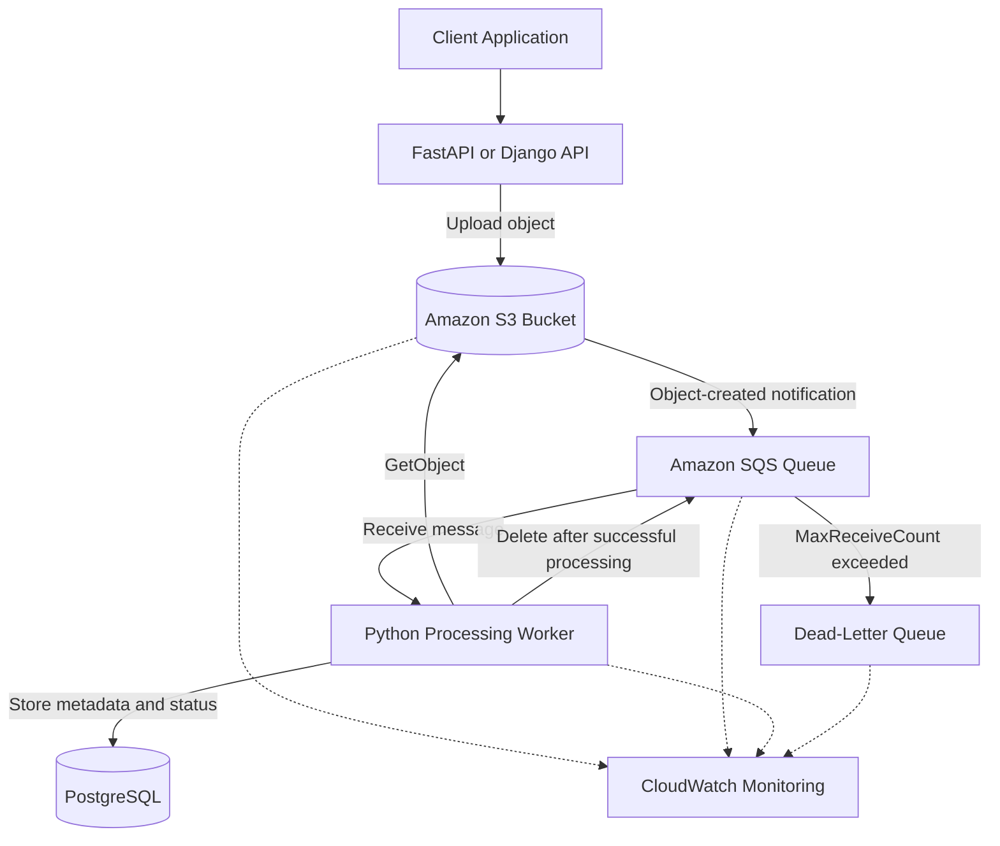

The SQS message contains event metadata and an object reference. It does not contain the actual uploaded object contents.

The worker retrieves the object separately using the S3 `GetObject` API.

## S3 Event Notification Mechanism

S3 event notifications allow applications to react to object-level operations.

Common event types include:

| Event | Example | Typical Use Case |
|---|---|---|
| `s3:ObjectCreated:Put` | Object uploaded using PUT | Document ingestion |
| `s3:ObjectCreated:Post` | Object uploaded using POST | Form-based uploads |
| `s3:ObjectCreated:Copy` | Object copied | Object migration |
| `s3:ObjectCreated:CompleteMultipartUpload` | Multipart upload completed | Large file ingestion |
| `s3:ObjectRemoved:Delete` | Object deleted | Cleanup workflows |
| `s3:ObjectRemoved:DeleteMarkerCreated` | Delete marker created | Versioned object lifecycle |
| `s3:ObjectRestore:Completed` | Archived object restored | Archive processing |
| `s3:LifecycleTransition` | Object transitioned by lifecycle rules | Storage lifecycle auditing |

An application should subscribe only to the event types required by its workflow.

### Event Notification Configuration

S3 notification configuration supports:

- SQS queues
- SNS topics
- Lambda functions
- EventBridge

A bucket can have multiple notification configurations, subject to supported destination and filtering rules.

For example, a bucket may route uploaded PDF documents to an ingestion queue and uploaded images to an image-processing queue.

### S3 Event Filters

Event notifications can be restricted using object key prefixes and suffixes.

Example:

```text
Prefix: incoming/
Suffix: .pdf
```

This configuration matches objects such as:

```text
incoming/invoice-001.pdf
incoming/contracts/agreement.pdf
```

It does not match:

```text
processed/invoice-001.pdf
incoming/image-001.png
```

Filtering reduces unnecessary messages and prevents unrelated objects from entering a processing pipeline.

#### Important Filter Considerations

- Prefix and suffix filters are case-sensitive.
- S3 notification filters do not support arbitrary regular expressions.
- Overlapping filters for the same event types and destination can create configuration conflicts.
- Object keys in event payloads are URL encoded.
- Filter design should account for output prefixes to prevent recursive processing.

For example, if a worker writes processed files back into the same bucket, it should use a different prefix and the notification should target only the input prefix.

## S3 to SQS Integration

S3 can publish supported object event notifications directly to an SQS queue.

This architecture is useful when processing workloads need buffering, controlled concurrency, independent scaling, and retry handling.

### Message Flow

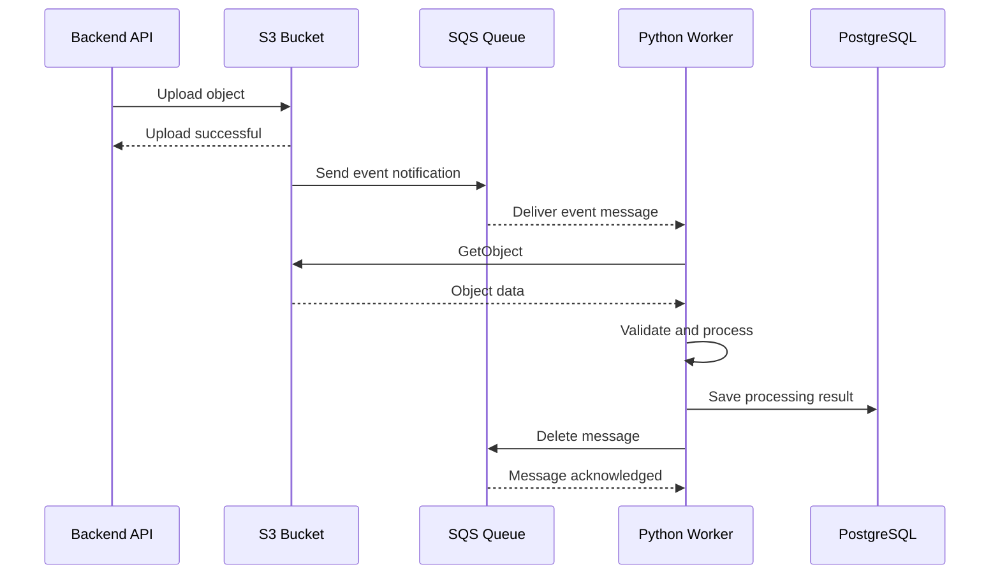

S3 event delivery and SQS message consumption are separate operations.

An upload can succeed even if notification delivery or downstream processing is delayed or unsuccessful.

### Create an SQS Queue

Create a queue for incoming document events:

```bash
aws sqs create-queue \
  --queue-name document-ingestion-queue \
  --region ap-south-1
```

Retrieve the queue URL:

```bash
aws sqs get-queue-url \
  --queue-name document-ingestion-queue \
  --region ap-south-1
```

Retrieve the queue ARN:

```bash
aws sqs get-queue-attributes \
  --queue-url https://sqs.ap-south-1.amazonaws.com/123456789012/document-ingestion-queue \
  --attribute-names QueueArn \
  --region ap-south-1
```

For production, configure visibility timeout, message retention, long polling, encryption, and a dead-letter queue before connecting the bucket.

### SQS Queue Policy

S3 requires permission to send messages to the destination queue.

The queue resource policy should grant `sqs:SendMessage` to the S3 service principal, restricted to the intended bucket and account.

Example policy:

```json
{
  "Version": "2012-10-17",
  "Statement": [
    {
      "Sid": "AllowS3BucketNotifications",
      "Effect": "Allow",
      "Principal": {
        "Service": "s3.amazonaws.com"
      },
      "Action": "sqs:SendMessage",
      "Resource": "arn:aws:sqs:ap-south-1:123456789012:document-ingestion-queue",
      "Condition": {
        "ArnEquals": {
          "aws:SourceArn": "arn:aws:s3:::company-document-bucket"
        },
        "StringEquals": {
          "aws:SourceAccount": "123456789012"
        }
      }
    }
  ]
}
```

Apply the policy:

```bash
aws sqs set-queue-attributes \
  --queue-url https://sqs.ap-south-1.amazonaws.com/123456789012/document-ingestion-queue \
  --attributes file://queue-policy.json \
  --region ap-south-1
```

The queue policy must be configured before creating the S3 notification destination.

### Configure S3 Notification

Create a notification configuration:

```json
{
  "QueueConfigurations": [
    {
      "Id": "document-ingestion",
      "QueueArn": "arn:aws:sqs:ap-south-1:123456789012:document-ingestion-queue",
      "Events": [
        "s3:ObjectCreated:*"
      ],
      "Filter": {
        "Key": {
          "FilterRules": [
            {
              "Name": "prefix",
              "Value": "incoming/"
            },
            {
              "Name": "suffix",
              "Value": ".pdf"
            }
          ]
        }
      }
    }
  ]
}
```

Apply the configuration:

```bash
aws s3api put-bucket-notification-configuration \
  --bucket company-document-bucket \
  --notification-configuration file://notification.json \
  --region ap-south-1
```

**Important:** `put-bucket-notification-configuration` replaces the bucket's existing notification configuration. It does not merge the supplied configuration with existing rules.

Before applying it in production:

1. Retrieve the current configuration.
2. Preserve existing notification destinations.
3. Add the new configuration.
4. Validate destination permissions.
5. Apply the complete configuration.

Retrieve the existing configuration:

```bash
aws s3api get-bucket-notification-configuration \
  --bucket company-document-bucket \
  --region ap-south-1
```

## S3 Event Message Structure

An S3 event notification delivered through SQS contains information about the bucket and object that triggered the event.

A simplified event payload looks like this:

```json
{
  "Records": [
    {
      "eventVersion": "2.1",
      "eventSource": "aws:s3",
      "awsRegion": "ap-south-1",
      "eventTime": "2026-11-22T09:30:00.000Z",
      "eventName": "ObjectCreated:Put",
      "s3": {
        "bucket": {
          "name": "company-document-bucket",
          "arn": "arn:aws:s3:::company-document-bucket"
        },
        "object": {
          "key": "incoming/invoice-001.pdf",
          "size": 204800,
          "eTag": "example-etag",
          "versionId": "example-version-id",
          "sequencer": "00673F000000000000"
        }
      }
    }
  ]
}
```

The actual event payload can contain additional fields. Applications should parse required fields without assuming that every optional field is present.

### Important Event Fields

| Field | Purpose | Engineering Consideration |
|---|---|---|
| `eventName` | Identifies the operation | Validate supported event types |
| `eventTime` | Event timestamp | Useful for diagnostics, not a global ordering guarantee |
| `awsRegion` | Source bucket Region | Use for regional routing and validation |
| `bucket.name` | Bucket identifier | Validate against expected buckets |
| `object.key` | Object key | Decode before accessing S3 |
| `object.size` | Object size | Validate processing limits |
| `object.eTag` | Object entity tag | Do not universally treat as MD5 |
| `object.versionId` | Object version identifier | Use to retrieve the exact object version |
| `object.sequencer` | Ordering-related identifier | Comparable only for events concerning the same object key |

### Decode Object Keys Correctly

S3 event object keys are URL encoded using form-style encoding.

A key such as:

```text
incoming/customer%2Bdocuments%2Finvoice+001.pdf
```

must be decoded before calling S3.

Use Python's `unquote_plus`:

```python
from urllib.parse import unquote_plus

encoded_key = "incoming/customer%2Bdocuments%2Finvoice+001.pdf"

object_key = unquote_plus(encoded_key)

print(object_key)
```

Result:

```text
incoming/customer+documents/invoice 001.pdf
```

Using `unquote` instead of `unquote_plus` can produce incorrect results when keys contain spaces represented by `+`.

## SQS Message Processing Lifecycle

SQS provides at-least-once message delivery for Standard queues.

A message is not permanently removed when a consumer receives it. Instead, it becomes temporarily invisible for the configured visibility timeout.

### Visibility Timeout Lifecycle

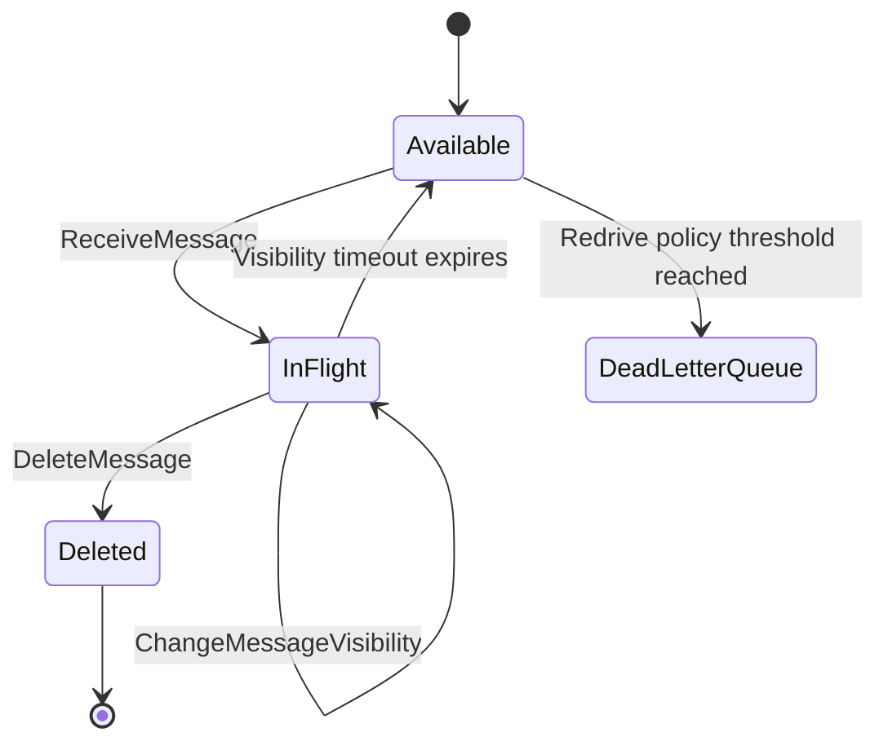

### Message Processing Sequence

1. Worker calls `ReceiveMessage`.
2. SQS returns an event message and receipt handle.
3. The message becomes invisible to other consumers.
4. Worker parses the event.
5. Worker downloads the corresponding S3 object.
6. Worker processes the object.
7. Worker commits the business result.
8. Worker calls `DeleteMessage`.
9. SQS permanently removes the message.

If the worker crashes before deleting the message, it becomes visible again after the visibility timeout.

This behavior enables retry, but it also means that the same event can be processed more than once.

### Visibility Timeout Design

The visibility timeout should account for the maximum expected processing duration.

For example:

| Processing Duration | Suggested Initial Visibility Timeout |
|---|---|
| 10 seconds | 60 seconds |
| 1 minute | 5 minutes |
| 5 minutes | 15 minutes |
| 15 minutes | 30–45 minutes |

These are starting points, not universal settings.

For long-running jobs, extend visibility using `ChangeMessageVisibility` while processing.

A visibility timeout that is too short can cause concurrent processing of the same object. A timeout that is excessively long delays recovery after a worker failure.

### Configure Visibility Timeout

```bash
aws sqs set-queue-attributes \
  --queue-url https://sqs.ap-south-1.amazonaws.com/123456789012/document-ingestion-queue \
  --attributes VisibilityTimeout=900 \
  --region ap-south-1
```

The visibility timeout is specified in seconds.

## Building an S3 Event Processing Worker in Python

A production worker should separate:

- SQS polling
- Event parsing
- Object retrieval
- Object validation
- Business processing
- Database persistence
- Message acknowledgement
- Retry and error handling

The following example demonstrates a worker that processes S3 object-created notifications.

### Dependencies

```bash
pip install boto3 psycopg[binary]
```

Use environment variables or workload identity for configuration. Do not hardcode AWS credentials.

### Worker Implementation

```python
import json
import logging
import os
import signal
import time
from dataclasses import dataclass
from urllib.parse import unquote_plus

import boto3
from botocore.config import Config
from botocore.exceptions import BotoCoreError, ClientError

logger = logging.getLogger(__name__)
logging.basicConfig(level=logging.INFO)

QUEUE_URL = os.environ["SQS_QUEUE_URL"]
EXPECTED_BUCKET = os.environ["S3_BUCKET"]
AWS_REGION = os.getenv("AWS_REGION", "ap-south-1")

running = True

aws_config = Config(
    region_name=AWS_REGION,
    connect_timeout=5,
    read_timeout=30,
    retries={
        "mode": "standard",
        "max_attempts": 5,
    },
)

s3_client = boto3.client("s3", config=aws_config)
sqs_client = boto3.client("sqs", config=aws_config)


@dataclass(frozen=True)
class S3ObjectEvent:
    bucket: str
    key: str
    version_id: str | None
    event_name: str


def stop_worker(signum, frame):
    global running
    running = False
    logger.info("Shutdown signal received: %s", signum)


signal.signal(signal.SIGTERM, stop_worker)
signal.signal(signal.SIGINT, stop_worker)


def parse_s3_event(body: str) -> list[S3ObjectEvent]:
    payload = json.loads(body)

    if payload.get("Event") == "s3:TestEvent":
        logger.info("Received S3 test event")
        return []

    events = []

    for record in payload.get("Records", []):
        if record.get("eventSource") != "aws:s3":
            continue

        event_name = record.get("eventName", "")

        if not event_name.startswith("ObjectCreated:"):
            continue

        s3_data = record["s3"]
        bucket = s3_data["bucket"]["name"]
        object_data = s3_data["object"]

        events.append(
            S3ObjectEvent(
                bucket=bucket,
                key=unquote_plus(object_data["key"]),
                version_id=object_data.get("versionId"),
                event_name=event_name,
            )
        )

    return events


def download_object(event: S3ObjectEvent) -> bytes:
    if event.bucket != EXPECTED_BUCKET:
        raise ValueError(f"Unexpected bucket: {event.bucket}")

    params = {
        "Bucket": event.bucket,
        "Key": event.key,
    }

    if event.version_id:
        params["VersionId"] = event.version_id

    response = s3_client.get_object(**params)

    try:
        body = response["Body"]
        return body.read()
    finally:
        response["Body"].close()


def process_document(content: bytes, object_key: str) -> dict:
    if not content:
        raise ValueError("Uploaded document is empty")

    # Replace with PDF validation, extraction, and business processing.
    return {
        "object_key": object_key,
        "size_bytes": len(content),
        "status": "processed",
    }


def persist_result(result: dict) -> None:
    # Persist the result and idempotency record in a database transaction.
    # This function must be implemented using the application's repository layer.
    logger.info("Persisting result: %s", result)


def process_message(message: dict) -> None:
    events = parse_s3_event(message["Body"])

    for event in events:
        content = download_object(event)
        result = process_document(content, event.key)
        persist_result(result)


def poll_messages() -> None:
    while running:
        try:
            response = sqs_client.receive_message(
                QueueUrl=QUEUE_URL,
                MaxNumberOfMessages=5,
                WaitTimeSeconds=20,
                VisibilityTimeout=900,
                AttributeNames=["ApproximateReceiveCount"],
            )

            messages = response.get("Messages", [])

            for message in messages:
                try:
                    process_message(message)

                    sqs_client.delete_message(
                        QueueUrl=QUEUE_URL,
                        ReceiptHandle=message["ReceiptHandle"],
                    )

                except (ClientError, BotoCoreError):
                    logger.exception(
                        "AWS operation failed while processing message"
                    )
                    # Do not delete. SQS will make the message visible again.

                except Exception:
                    logger.exception(
                        "Message processing failed"
                    )
                    # Do not delete. Retry and DLQ policies handle recovery.

        except (ClientError, BotoCoreError):
            logger.exception("SQS polling failed")
            time.sleep(5)


if __name__ == "__main__":
    poll_messages()
```

This example illustrates the processing lifecycle. A production implementation should replace the placeholder persistence layer with a durable, transactional repository and should stream large objects instead of reading them entirely into memory.

### Why Delete Happens After Persistence

Deleting a message before committing the processing result creates a data-loss scenario.

Consider this sequence:

1. Worker receives a message.
2. Worker deletes the message.
3. Worker crashes before saving the processing result.

The event is now removed from SQS, but the business operation was never completed.

The correct order is:

```text
Receive message
    |
Download object
    |
Validate and process
    |
Commit durable result
    |
Delete SQS message
```

There is still a failure window between database commit and SQS deletion. If the worker crashes during that interval, SQS can redeliver the event. Idempotency is therefore mandatory.

## Idempotency and Duplicate Event Handling

S3 notifications and SQS Standard queues provide at-least-once delivery semantics.

An application must assume that:

- S3 events can be delivered more than once.
- SQS can deliver the same message more than once.
- Events can arrive out of order.
- A worker can crash after committing data but before deleting the message.

Without idempotency, duplicate events can cause:

- Duplicate document extraction.
- Repeated database inserts.
- Duplicate downstream notifications.
- Repeated billing or payment-related operations.
- Incorrect processing state.

### Designing an Idempotency Key

A useful idempotency key should identify the specific object processing operation.

For versioned buckets:

```text
bucket + object_key + version_id + processor_version
```

For non-versioned buckets:

```text
bucket + object_key + processor_version
```

A processor version is useful when the same object must be intentionally reprocessed after business logic changes.

For stronger event identity, applications can also incorporate the event type and other relevant source metadata.

Do not use the SQS message ID as the sole business idempotency key. A duplicate S3 event can be delivered as a separate SQS message.

### PostgreSQL Idempotency Table

```sql
CREATE TABLE object_processing (
    id BIGSERIAL PRIMARY KEY,
    bucket_name TEXT NOT NULL,
    object_key TEXT NOT NULL,
    version_id TEXT NOT NULL DEFAULT '',
    processor_version TEXT NOT NULL,
    status TEXT NOT NULL,
    result JSONB,
    created_at TIMESTAMPTZ NOT NULL DEFAULT NOW(),
    updated_at TIMESTAMPTZ NOT NULL DEFAULT NOW(),

    CONSTRAINT uq_object_processing
        UNIQUE (
            bucket_name,
            object_key,
            version_id,
            processor_version
        )
);
```

The unique constraint prevents duplicate processing records for the same object version and processor version.

### Atomic Processing Claim

A worker can claim an object using an atomic database operation:

```sql
INSERT INTO object_processing (
    bucket_name,
    object_key,
    version_id,
    processor_version,
    status
)
VALUES (
    %(bucket_name)s,
    %(object_key)s,
    %(version_id)s,
    %(processor_version)s,
    'processing'
)
ON CONFLICT (
    bucket_name,
    object_key,
    version_id,
    processor_version
)
DO NOTHING
RETURNING id;
```

If no row is returned, another worker has already claimed or completed that operation.

However, a simple permanent `processing` record is insufficient for recovery. Production implementations should also include:

- Processing leases or claim expiration.
- Worker ownership identifiers.
- Attempt counts.
- Last error details.
- Recovery of abandoned processing records.
- Explicit state transitions.
- Transactional updates.

A worker that encounters an existing completed record can treat the event as successfully processed and acknowledge the SQS message.

### Idempotency State Model

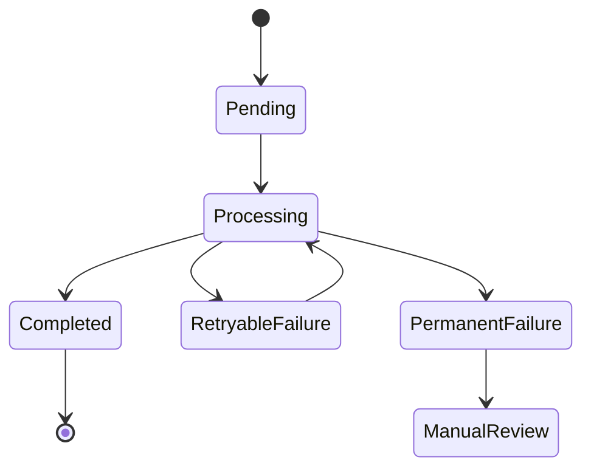

The database is the source of truth for business processing state. SQS is the delivery mechanism, not the authoritative processing ledger.

## Handling Event Ordering

S3 event notifications are not guaranteed to arrive in the same order as the corresponding object operations.

For example:

1. `document.pdf` is uploaded.
2. The object is overwritten.
3. The event for the overwrite reaches the queue first.
4. The event for the original upload arrives later.

A naive worker may process the older event after the newer event and overwrite the latest business state.

### Object Versioning

Enable S3 versioning when the application needs to identify and retrieve exact object versions.

```bash
aws s3api put-bucket-versioning \
  --bucket company-document-bucket \
  --versioning-configuration Status=Enabled \
  --region ap-south-1
```

With versioning enabled, an event can contain a `versionId`.

The worker can retrieve the exact version:

```python
response = s3_client.get_object(
    Bucket="company-document-bucket",
    Key="incoming/invoice-001.pdf",
    VersionId="example-version-id",
)
```

This prevents a worker from accidentally processing a newer object version when handling an older event.

### Sequencer-Based Comparison

S3 event notifications can include a `sequencer` value.

The sequencer can help determine the relative order of events for the same object key.

It must not be used to establish ordering across different object keys.

When comparing sequencers of different lengths, left-pad the shorter hexadecimal string before comparison.

```python
def is_newer_sequencer(candidate: str, current: str) -> bool:
    width = max(len(candidate), len(current))

    candidate_value = int(candidate.zfill(width), 16)
    current_value = int(current.zfill(width), 16)

    return candidate_value > current_value
```

Persist the last processed sequencer for each object key if the application needs to reject stale events.

Sequencer comparison should be combined with durable state management and concurrency control. It does not replace object versioning.

## Large Object Processing

S3 is designed for durable object storage, not for embedding large files in queue messages.

SQS messages should contain object references and event metadata. Workers should retrieve object contents from S3.

### Avoid Loading Large Objects into Memory

The following approach is risky for large files:

```python
response = s3_client.get_object(
    Bucket=bucket,
    Key=key,
)

content = response["Body"].read()
```

It loads the entire object into memory.

For a 500 MB object, multiple concurrent workers can consume several gigabytes of memory.

Prefer streaming:

```python
response = s3_client.get_object(
    Bucket=bucket,
    Key=key,
)

body = response["Body"]

try:
    while chunk := body.read(1024 * 1024):
        process_chunk(chunk)
finally:
    body.close()
```

For large files, consider:

- Multipart-aware processing.
- Temporary disk storage with bounded capacity.
- Streaming parsers.
- S3 range requests.
- Distributed processing for very large datasets.
- Separate queues for different workload classes.

### Object Size Limits

SQS messages have a maximum message size of 256 KiB. S3 event notifications contain metadata and references, not the uploaded object body.

Do not attempt to send file contents through SQS.

The correct pattern is:

```text
SQS message
    |
    +--> Bucket name
    |
    +--> Object key
    |
    +--> Version ID
    |
    +--> Event metadata

Worker
    |
    +--> S3 GetObject
    |
    +--> Stream object contents
    |
    +--> Process
```

## Scaling the Processing Architecture

SQS provides buffering between S3 event production and consumer execution.

The queue can absorb bursts of object uploads while workers process messages at a controlled rate.

### Horizontal Scaling

A worker deployment can scale based on:

- Approximate number of visible messages.
- Age of the oldest message.
- Processing latency.
- CPU utilization.
- Memory utilization.
- Downstream database capacity.

A queue with a large backlog does not always mean that more workers should be started. Scaling must account for downstream bottlenecks.

For example, increasing worker concurrency can overwhelm PostgreSQL connection limits or an external document-processing API.

### Scaling Architecture

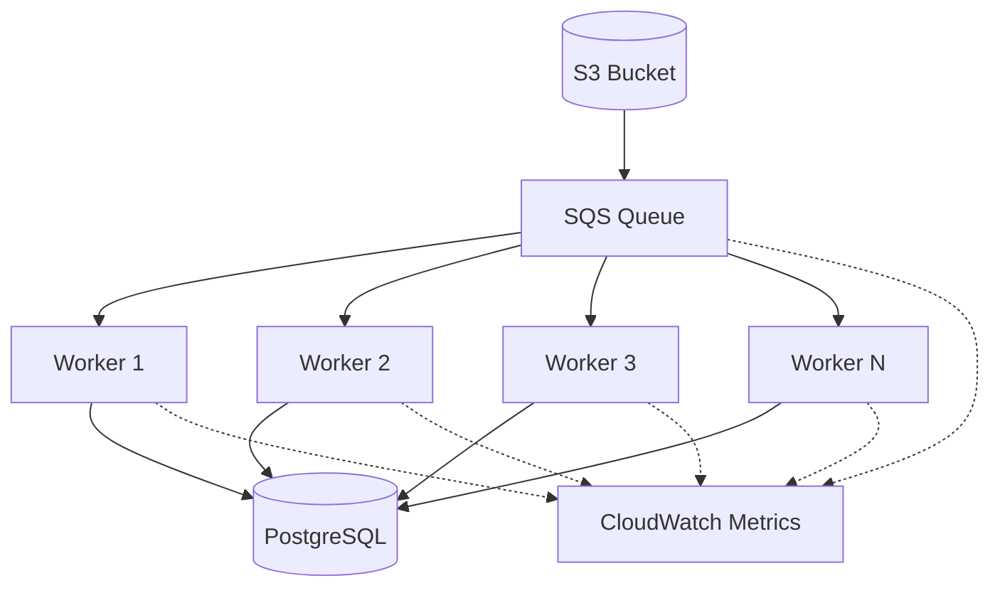

Each worker independently polls SQS and processes messages.

### Worker Concurrency

For CPU-intensive document processing, worker concurrency should be limited by CPU and memory.

For I/O-intensive processing, concurrency can be higher, but it must still respect:

- S3 request limits and application throughput.
- Database connection limits.
- External API rate limits.
- Network bandwidth.
- Container memory limits.

A practical architecture may use separate queues for:

| Queue | Workload | Worker Configuration |
|---|---|---|
| `document-small-queue` | Small PDFs and text files | Higher concurrency |
| `document-large-queue` | Large PDFs and archives | Lower concurrency |
| `image-processing-queue` | Image transformations | CPU-oriented workers |
| `document-retry-queue` | Delayed retry processing | Controlled concurrency |

Separate queues prevent expensive workloads from blocking lightweight jobs.

### Long Polling

Use SQS long polling to reduce empty receive requests and API costs.

Configure:

```bash
aws sqs set-queue-attributes \
  --queue-url https://sqs.ap-south-1.amazonaws.com/123456789012/document-ingestion-queue \
  --attributes ReceiveMessageWaitTimeSeconds=20 \
  --region ap-south-1
```

The maximum long-poll wait time is 20 seconds.

Long polling reduces unnecessary API calls but does not replace appropriate worker scaling.

## Retry Handling and Dead-Letter Queues

Transient failures are expected in distributed systems.

Examples include:

- Temporary S3 API errors.
- Database connectivity failures.
- External service timeouts.
- Rate limiting.
- Temporary network interruptions.

SQS retries a message when the consumer does not delete it before the visibility timeout expires.

### Configure a Dead-Letter Queue

Create a DLQ:

```bash
aws sqs create-queue \
  --queue-name document-ingestion-dlq \
  --region ap-south-1
```

Retrieve its ARN:

```bash
aws sqs get-queue-attributes \
  --queue-url https://sqs.ap-south-1.amazonaws.com/123456789012/document-ingestion-dlq \
  --attribute-names QueueArn \
  --region ap-south-1
```

Configure the source queue's redrive policy:

```json
{
  "deadLetterTargetArn": "arn:aws:sqs:ap-south-1:123456789012:document-ingestion-dlq",
  "maxReceiveCount": 5
}
```

Apply it:

```bash
aws sqs set-queue-attributes \
  --queue-url https://sqs.ap-south-1.amazonaws.com/123456789012/document-ingestion-queue \
  --attributes RedrivePolicy=file://redrive-policy.json \
  --region ap-south-1
```

The `maxReceiveCount` determines how many receives are allowed before the message is moved to the DLQ.

### Retry Classification

Not every error should be retried indefinitely.

| Failure | Handling |
|---|---|
| Temporary S3 throttling | Retry with backoff |
| Network timeout | Retry |
| Temporary database outage | Retry |
| Invalid object format | Record failure and route for review |
| Unsupported file type | Permanent failure |
| Missing object version | Investigate event and retention behavior |
| Unauthorized S3 access | Alert and investigate configuration |
| External service rate limit | Retry with controlled backoff |

A DLQ should not become a permanent storage location for ignored failures.

Establish an operational process to:

1. Monitor DLQ depth.
2. Inspect message bodies.
3. Identify the underlying failure.
4. Fix the cause.
5. Redrive eligible messages.
6. Confirm successful processing.

### SQS Redrive

Inspect messages in the DLQ:

```bash
aws sqs receive-message \
  --queue-url https://sqs.ap-south-1.amazonaws.com/123456789012/document-ingestion-dlq \
  --max-number-of-messages 5 \
  --wait-time-seconds 10 \
  --region ap-south-1
```

For controlled recovery, use the SQS redrive APIs or console redrive workflow rather than manually copying and deleting messages without tracking.

Before redriving, verify that the underlying failure has been resolved and that consumers remain idempotent.

## Integrating with FastAPI or Django

An HTTP API should not wait for document extraction or other long-running processing.

The API should upload the object and return an acknowledgement that the document has been accepted for asynchronous processing.

### Upload API Flow

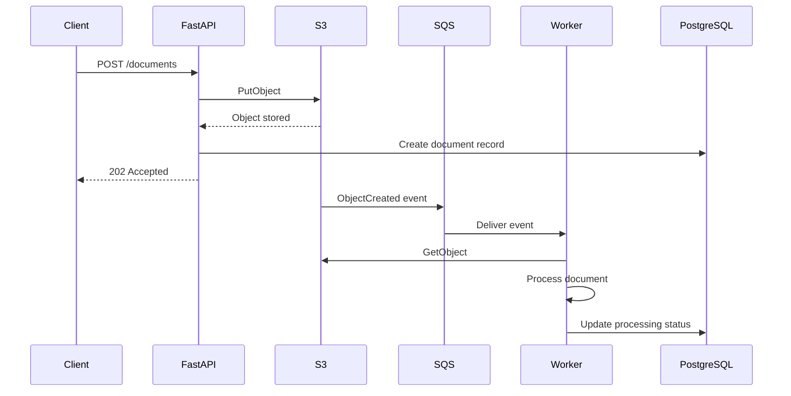

The S3 notification can arrive before or after the API finishes creating its database record.

The worker must therefore tolerate temporarily missing application metadata or use an upload state that supports asynchronous reconciliation.

### FastAPI Upload Endpoint

```python
from uuid import uuid4

import boto3
from fastapi import FastAPI, File, HTTPException, UploadFile, status

app = FastAPI()

s3_client = boto3.client("s3")

BUCKET_NAME = "company-document-bucket"
MAX_FILE_SIZE = 20 * 1024 * 1024

ALLOWED_CONTENT_TYPES = {
    "application/pdf",
    "text/plain",
}


@app.post("/documents", status_code=status.HTTP_202_ACCEPTED)
async def upload_document(file: UploadFile = File(...)):
    if file.content_type not in ALLOWED_CONTENT_TYPES:
        raise HTTPException(
            status_code=status.HTTP_415_UNSUPPORTED_MEDIA_TYPE,
            detail="Unsupported document type",
        )

    object_key = f"incoming/{uuid4()}/{file.filename}"

    content = await file.read(MAX_FILE_SIZE + 1)

    if len(content) > MAX_FILE_SIZE:
        raise HTTPException(
            status_code=status.HTTP_413_CONTENT_TOO_LARGE,
            detail="File exceeds the allowed size",
        )

    try:
        s3_client.put_object(
            Bucket=BUCKET_NAME,
            Key=object_key,
            Body=content,
            ContentType=file.content_type,
        )
    except Exception as exc:
        raise HTTPException(
            status_code=status.HTTP_502_BAD_GATEWAY,
            detail="Unable to upload document",
        ) from exc

    return {
        "message": "Document accepted for processing",
        "object_key": object_key,
        "status": "pending",
    }
```

This is a bounded-size example. For larger files, use streaming or presigned multipart uploads rather than reading the entire file into memory.

A production endpoint should also:

- Authenticate and authorize the uploader.
- Generate object keys independently of untrusted filenames.
- Validate actual file content, not only the declared MIME type.
- Persist an upload record.
- Apply upload size limits.
- Handle partial uploads and cleanup.
- Use presigned URLs when direct client-to-S3 uploads are appropriate.

### Presigned Upload Architecture

For large files, the API can generate a presigned URL and allow the client to upload directly to S3.

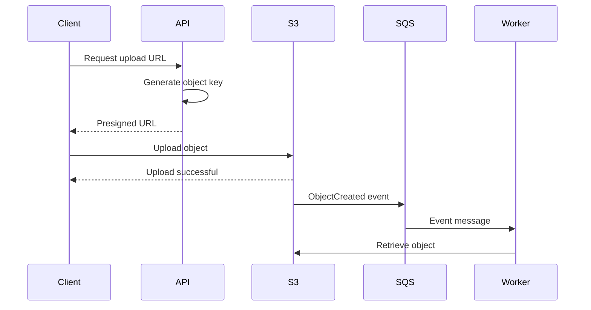

This reduces API bandwidth and memory usage.

The backend should generate a unique object key, enforce content constraints where possible, and associate the upload with an authenticated application record.

## Handling Database and Event Consistency

S3 and PostgreSQL do not share a distributed transaction.

An API that uploads an object and writes a database record performs two independent operations.

For example:

```text
1. Upload object to S3
2. Insert document record into PostgreSQL
```

If the upload succeeds but the database transaction fails, the bucket contains an object without a corresponding application record.

If the database record is created first but the upload fails, the database contains a document that does not exist in S3.

### Recommended Upload State Model

Use an explicit state machine:

```text
UPLOAD_REQUESTED
    |
    v
UPLOAD_IN_PROGRESS
    |
    v
UPLOADED
    |
    v
PROCESSING
    |
    v
COMPLETED
```

Failure states should be represented separately:

```text
UPLOAD_FAILED
PROCESSING_FAILED
```

A reconciliation job can periodically identify:

- Objects without database records.
- Database records without corresponding objects.
- Uploads stuck in an intermediate state.
- Processing records with expired leases.

For applications that use a backend-mediated upload, persist upload intent before uploading and transition the record only after successful object storage.

For direct client uploads, create a pending upload record before issuing the presigned URL and reconcile it after the S3 event arrives.

### Transactional Outbox Considerations

The transactional outbox pattern is useful when a backend must reliably publish an application event after a database transaction.

For example:

1. API stores a document record.
2. API inserts an outbox event in the same PostgreSQL transaction.
3. A background publisher reads the outbox.
4. Publisher sends an event to SQS.
5. Publisher marks the outbox record as published.

However, an S3-to-SQS notification architecture does not require the application to republish the same S3 event through an outbox.

Use the outbox when the application owns the business event or when an additional reliable workflow event must be emitted.

Avoid creating two independent event paths for the same processing operation unless deduplication and ownership are clearly defined.

## Alternative Event Processing Architectures

S3 supports multiple notification destinations. The correct choice depends on routing complexity, consumer requirements, and processing characteristics.

### Direct S3 to SQS

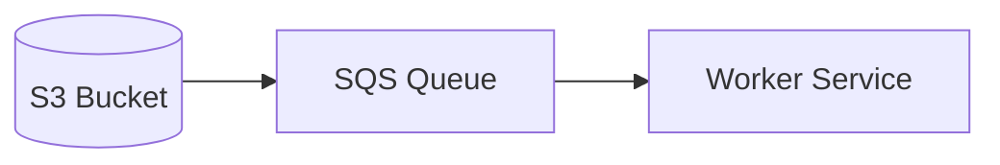

Use this when:

- A single processing workflow consumes object events.
- Durable buffering is required.
- Consumers need independent scaling.
- Retry and DLQ handling are important.

Advantages:

- Simple architecture.
- Native SQS buffering.
- Straightforward IAM integration.
- Supports long-running workers.

Limitations:

- Direct S3 notification destinations do not include SQS FIFO queues.
- Routing capabilities are limited compared with EventBridge.
- Multiple independent consumers may require separate queues or fan-out.

### S3 to SNS to SQS

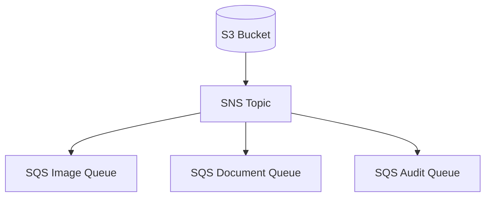

Use this when multiple independent systems need to receive the same event.

SNS provides fan-out, while each SQS queue provides independent buffering and retry behavior.

Advantages:

- Multiple subscribers.
- Independent consumer scaling.
- Per-consumer retry and DLQ configuration.
- Subscription filtering.

Limitations:

- Additional service and policy configuration.
- More components to monitor.
- Duplicate handling remains necessary.

### S3 to EventBridge

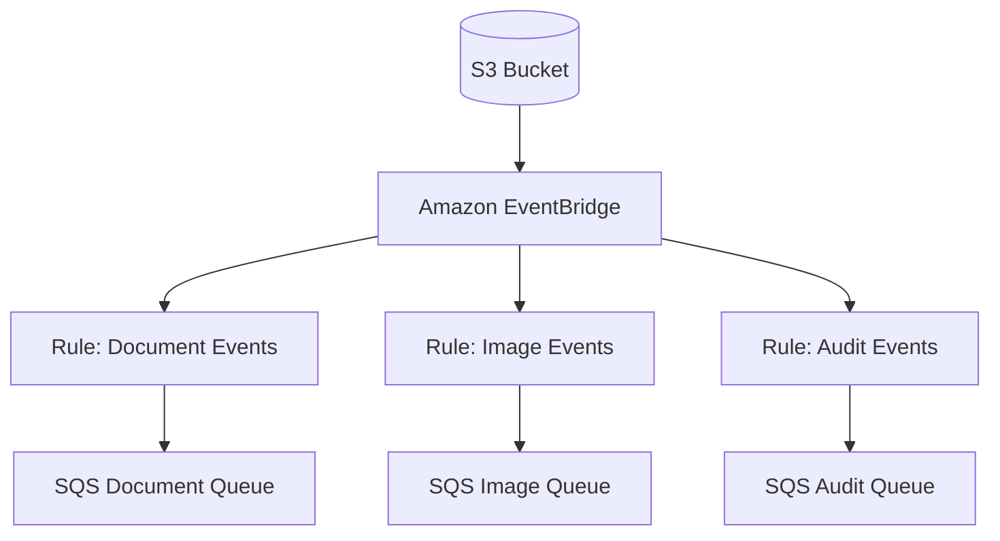

Enable EventBridge notifications on the bucket:

```bash
aws s3api put-bucket-notification-configuration \
  --bucket company-document-bucket \
  --notification-configuration '{"EventBridgeConfiguration":{}}' \
  --region ap-south-1
```

This command replaces the bucket's existing notification configuration. Preserve existing configurations before applying it.

EventBridge can route events using event patterns based on bucket, object key, event type, and other supported fields.

Use EventBridge when:

- Multiple event types need different routing.
- Many AWS services consume object events.
- Centralized event routing is required.
- Event filtering needs to be more expressive.
- The architecture requires event-driven orchestration.

For durable processing, route matching events to SQS targets rather than assuming that EventBridge alone provides the application's processing state.

### Architecture Comparison

| Architecture | Best Fit | Main Advantage | Main Limitation |
|---|---|---|---|
| S3 → SQS | Single processing pipeline | Simple buffering | Limited routing |
| S3 → SNS → SQS | Multiple independent consumers | Fan-out | Additional configuration |
| S3 → EventBridge → SQS | Complex event routing | Flexible rules | Additional service complexity |
| S3 → Lambda | Short event-driven operations | Managed execution | Execution limits and concurrency considerations |
| S3 → Step Functions | Multi-step workflows | Orchestration and state management | Workflow cost and design complexity |

### Choosing an Architecture

| Requirement | Recommended Pattern |
|---|---|
| One asynchronous worker | S3 → SQS |
| Multiple independent consumers | S3 → SNS → SQS |
| Complex event filtering | S3 → EventBridge → SQS |
| Short-running processing | S3 → Lambda |
| Long-running document processing | S3 → SQS → ECS/EKS worker |
| Multi-step processing with branching | S3 → EventBridge → Step Functions |
| Ordered processing requirements | EventBridge or another compatible routing layer with SQS FIFO where supported |

Direct S3 notifications cannot target SQS FIFO queues. If FIFO processing is required, use a compatible intermediary such as EventBridge and validate the target configuration and delivery semantics.

## Security Architecture

S3 event processing involves multiple service identities and access boundaries.

A secure implementation should follow least privilege.

### IAM Permissions

The worker generally needs:

- `sqs:ReceiveMessage`
- `sqs:DeleteMessage`
- `sqs:ChangeMessageVisibility` when extending visibility
- `sqs:GetQueueAttributes`
- `s3:GetObject`
- `s3:GetObjectVersion` when retrieving specific versions
- Required KMS permissions for encrypted objects

The worker should not receive broad `s3:*` or `sqs:*` permissions.

Example worker identity policy:

```json
{
  "Version": "2012-10-17",
  "Statement": [
    {
      "Sid": "ReadDocumentObjects",
      "Effect": "Allow",
      "Action": [
        "s3:GetObject",
        "s3:GetObjectVersion"
      ],
      "Resource": "arn:aws:s3:::company-document-bucket/incoming/*"
    },
    {
      "Sid": "ConsumeDocumentEvents",
      "Effect": "Allow",
      "Action": [
        "sqs:ReceiveMessage",
        "sqs:DeleteMessage",
        "sqs:ChangeMessageVisibility",
        "sqs:GetQueueAttributes"
      ],
      "Resource": "arn:aws:sqs:ap-south-1:123456789012:document-ingestion-queue"
    }
  ]
}
```

Use an IAM role for EC2, ECS tasks, EKS workloads through an appropriate workload identity mechanism, or Lambda execution roles.

Do not distribute long-lived AWS access keys inside containers or source code.

### Encryption at Rest

Use S3 server-side encryption and SQS encryption.

Common options include:

- SSE-S3 for S3-managed encryption.
- SSE-KMS for customer-managed key control.
- SQS server-side encryption with SQS-managed or KMS-managed keys, as supported by the queue configuration.

S3 object encryption and SQS message encryption are separate controls.

When using customer-managed KMS keys, verify:

- Key policy permissions.
- IAM permissions for the workload.
- Service access requirements.
- Cross-account permissions where applicable.
- Key lifecycle and rotation requirements.

### Network Security

For private worker environments:

- Use private subnets.
- Use S3 and SQS VPC endpoints where appropriate.
- Restrict outbound network access.
- Avoid public IP requirements for workers.
- Use security groups and network policies to control communication.

S3 and SQS interface and gateway endpoint behavior differs. Select the appropriate endpoint type and policy for the service.

### Input Validation

S3 event payloads should be treated as external input.

Workers should validate:

- Expected bucket name.
- Expected event source.
- Supported event type.
- Object key prefix.
- Object size.
- Object version.
- File format and actual content.
- Application ownership and authorization metadata where applicable.

Do not assume that an object is safe because it was uploaded to an internal bucket.

For document-processing systems, consider malware scanning, decompression limits, parser sandboxing, and protection against archive bombs.

## Monitoring and Observability

A reliable event-driven architecture requires visibility into both queue delivery and business processing.

A message disappearing from SQS does not prove that the business operation completed correctly.

Monitor infrastructure metrics and application-level processing outcomes.

### Important SQS Metrics

| Metric | Meaning | Operational Use |
|---|---|---|
| `ApproximateNumberOfMessagesVisible` | Messages available for retrieval | Detect backlog |
| `ApproximateNumberOfMessagesNotVisible` | Messages currently in flight | Detect excessive concurrency or stuck processing |
| `ApproximateAgeOfOldestMessage` | Approximate age of the oldest available message | Detect processing delay |
| `NumberOfMessagesSent` | Messages sent to the queue | Understand event volume |
| `NumberOfMessagesReceived` | Messages received by consumers | Understand consumer activity |
| `NumberOfMessagesDeleted` | Messages deleted | Track acknowledgements |
| `NumberOfEmptyReceives` | Empty receive requests | Evaluate polling efficiency |

Metric interpretation should account for SQS's approximate metric semantics and the fact that some metrics are not available for every queue type or condition.

### DLQ Monitoring

Monitor:

- DLQ message count.
- Age of the oldest DLQ message.
- Message receive count.
- Failure categories.
- Time since the first failure.
- Redrive activity.

Create alarms when DLQ messages appear or when their count exceeds an operational threshold.

### Application Metrics

Infrastructure metrics are insufficient for business observability.

Track:

```text
documents_received_total
documents_processed_total
documents_failed_total
document_processing_duration_seconds
document_download_duration_seconds
document_size_bytes
document_retry_total
document_duplicate_event_total
document_processing_in_progress
```

Use structured logs containing:

- SQS message ID.
- Bucket name.
- Object key or a safe object identifier.
- Object version ID.
- Event name.
- Processing attempt.
- Correlation ID.
- Worker ID.
- Processing duration.
- Final processing status.

Avoid logging sensitive document contents, credentials, presigned URLs, or unnecessary personally identifiable information.

### Distributed Tracing

A typical trace should connect:

```text
API upload request
    |
    v
S3 object upload
    |
    v
S3 event delivery
    |
    v
SQS message processing
    |
    v
Object download
    |
    v
Document extraction
    |
    v
Database persistence
```

S3 event notifications and SQS messages do not automatically propagate an application's full distributed tracing context.

Include a correlation identifier in application metadata or object metadata where appropriate, and propagate it through the processing pipeline.

## Reliability and Disaster Recovery

The architecture should be designed around failure recovery rather than assuming that all events are delivered and processed immediately.

### S3 Event Delivery Considerations

S3 event notifications are designed for at-least-once delivery, but they are not a complete durable business event log.

Applications should not depend on:

- Exactly-once notification delivery.
- Global event ordering.
- Immediate notification delivery.
- A guaranteed event arrival order.
- Notification payloads containing the object body.

For critical workflows, add reconciliation and audit mechanisms.

### Reconciliation Strategy

A periodic reconciliation job can compare S3 objects with database processing records.

For example:

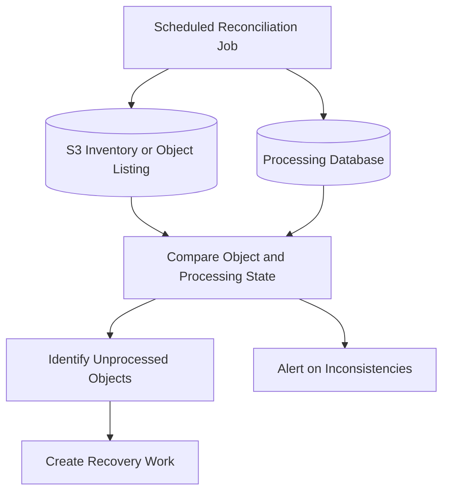

For large buckets, S3 Inventory is often more appropriate than repeatedly listing every object during frequent reconciliation.

The reconciliation process should avoid creating duplicate business operations and should use the same idempotency keys as normal event processing.

### Cross-Region Recovery

S3 replication and SQS are separate regional resources.

Replicating objects does not automatically replicate:

- S3 notification configurations.
- SQS messages.
- SQS queue policies.
- Worker deployments.
- Database processing state.
- IAM roles and KMS key policies.

A cross-Region recovery design should define:

1. Which bucket is authoritative.
2. How object replication is configured.
3. How destination-region events are generated or routed.
4. How duplicate processing across Regions is prevented.
5. How processing state is recovered.
6. How KMS keys and IAM permissions are restored.
7. How consumers are activated during failover.

Do not assume that S3 replication automatically creates a complete event-processing disaster recovery solution.

## Deployment with Terraform

Infrastructure as Code should manage the bucket, queue, DLQ, policies, and notification configuration together.

The following example demonstrates the main resources for a direct S3-to-SQS architecture.

```hcl
resource "aws_sqs_queue" "document_dlq" {
  name                      = "document-ingestion-dlq"
  message_retention_seconds = 1209600
  sqs_managed_sse_enabled   = true
}

resource "aws_sqs_queue" "document_queue" {
  name                       = "document-ingestion-queue"
  visibility_timeout_seconds = 900
  message_retention_seconds  = 345600
  receive_wait_time_seconds  = 20
  sqs_managed_sse_enabled    = true

  redrive_policy = jsonencode({
    deadLetterTargetArn = aws_sqs_queue.document_dlq.arn
    maxReceiveCount     = 5
  })
}

resource "aws_s3_bucket" "documents" {
  bucket = "company-document-bucket-example"
}

resource "aws_s3_bucket_versioning" "documents" {
  bucket = aws_s3_bucket.documents.id

  versioning_configuration {
    status = "Enabled"
  }
}

resource "aws_sqs_queue_policy" "document_queue" {
  queue_url = aws_sqs_queue.document_queue.id

  policy = jsonencode({
    Version = "2012-10-17"

    Statement = [
      {
        Sid    = "AllowS3BucketNotifications"
        Effect = "Allow"

        Principal = {
          Service = "s3.amazonaws.com"
        }

        Action   = "sqs:SendMessage"
        Resource = aws_sqs_queue.document_queue.arn

        Condition = {
          ArnEquals = {
            "aws:SourceArn" = aws_s3_bucket.documents.arn
          }

          StringEquals = {
            "aws:SourceAccount" = data.aws_caller_identity.current.account_id
          }
        }
      }
    ]
  })
}

data "aws_caller_identity" "current" {}

resource "aws_s3_bucket_notification" "documents" {
  bucket = aws_s3_bucket.documents.id

  queue {
    queue_arn     = aws_sqs_queue.document_queue.arn
    events        = ["s3:ObjectCreated:*"]
    filter_prefix = "incoming/"
    filter_suffix = ".pdf"
  }

  depends_on = [
    aws_sqs_queue_policy.document_queue
  ]
}
```

### Terraform Deployment Considerations

- S3 bucket names must be globally unique.
- Queue policies must allow the S3 service to publish notifications.
- The notification resource should depend on the queue policy.
- Manage the complete bucket notification configuration in one place.
- Avoid multiple independent Terraform resources attempting to manage the same bucket notification configuration.
- Configure encryption and lifecycle policies according to workload requirements.
- Use remote state with locking and restricted access.
- Avoid hardcoding account IDs and environment-specific identifiers.

The example uses SQS-managed encryption. If the queue uses a customer-managed KMS key, verify the required KMS permissions and key policy for the publishing and consuming services.

## Performance and Cost Considerations

S3 event processing cost depends on upload volume, notification routing, queue activity, object retrieval, worker execution, and downstream storage or processing.

### Main Cost Drivers

| Component | Cost Driver | Optimization |
|---|---|---|
| S3 | Storage, PUT, GET, replication, data transfer | Lifecycle policies and appropriate storage classes |
| SQS | API requests and data transfer | Long polling and batch operations |
| Lambda | Invocations and execution duration | Appropriate memory and execution design |
| ECS/EKS | Compute, storage, and networking | Right-size workers and scale based on backlog |
| EventBridge | Event ingestion and rule processing | Avoid unnecessary routing |
| CloudWatch | Metrics, logs, alarms, and retention | Control log volume and retention |
| KMS | Key usage requests | Understand encryption request patterns |

### SQS Batching

Receive multiple messages per request:

```python
response = sqs_client.receive_message(
    QueueUrl=QUEUE_URL,
    MaxNumberOfMessages=10,
    WaitTimeSeconds=20,
    VisibilityTimeout=900,
)
```

SQS allows up to 10 messages per `ReceiveMessage` request.

Batching reduces API request overhead, but it introduces additional processing considerations:

- Process messages independently.
- Acknowledge only successfully processed messages.
- Do not delete an entire batch because one message succeeded.
- Keep visibility timeout appropriate for batch processing duration.
- Limit in-memory work when messages reference large objects.

### Avoiding Queue Backlog

A queue backlog can indicate:

- Worker capacity is insufficient.
- Object processing is slower than expected.
- Downstream dependencies are unavailable.
- Messages are repeatedly failing.
- Visibility timeout is causing unnecessary redelivery.

Monitor both backlog size and oldest-message age. A large backlog with low message age may represent a short-lived traffic spike, while a small backlog with high age can indicate a stuck consumer.

## Common Mistakes and Production Pitfalls

| Mistake | Why It Causes Problems | Recommended Approach |
|---|---|---|
| Assuming exactly-once event delivery | Duplicate events can trigger repeated processing | Implement durable idempotency |
| Assuming event ordering | Older events can overwrite newer processing state | Use version IDs and sequencer-aware state management |
| Reading large objects entirely into memory | Causes memory pressure and container failures | Stream objects |
| Deleting messages before database commit | Can permanently lose work | Commit first, acknowledge afterward |
| Using a very short visibility timeout | Causes concurrent duplicate processing | Set timeout based on processing duration |
| Ignoring DLQ messages | Failed events accumulate without recovery | Alert, investigate, and redrive |
| Treating ETag as MD5 | Multipart uploads and encryption can produce different ETag behavior | Use explicit checksums where required |
| Using the raw event key | Encoded keys can retrieve the wrong object | Decode with `unquote_plus` |
| Triggering on every object prefix | Can cause recursive processing | Filter input prefixes and isolate outputs |
| Replacing notification configuration blindly | Existing destinations can be removed | Manage the complete configuration |
| Assuming S3 replication copies notifications | Destination event processing may not be configured | Design regional event routing separately |
| Scaling workers without database limits | Can overload PostgreSQL | Apply concurrency and connection limits |
| Treating SQS as the business state database | Queue state does not represent completed business operations | Persist processing state separately |
| Assuming a successful S3 upload means processing succeeded | Upload and processing are independent | Expose asynchronous processing status |

## Production Engineering Checklist

### S3 Configuration

- [ ] Enable versioning where exact object-version processing is required.
- [ ] Configure event types and prefix/suffix filters.
- [ ] Separate input and output object prefixes.
- [ ] Configure encryption and bucket access controls.
- [ ] Define object retention and lifecycle policies.
- [ ] Review notification configuration before modifying it.

### SQS Configuration

- [ ] Configure queue visibility timeout.
- [ ] Enable long polling.
- [ ] Set an appropriate message retention period.
- [ ] Configure a dead-letter queue.
- [ ] Set a suitable maximum receive count.
- [ ] Configure queue encryption.
- [ ] Apply a restrictive queue resource policy.
- [ ] Monitor backlog and message age.

### Worker Implementation

- [ ] Decode object keys using `unquote_plus`.
- [ ] Validate bucket names and event types.
- [ ] Handle missing optional event fields.
- [ ] Retrieve the exact object version when available.
- [ ] Stream large objects.
- [ ] Implement idempotency.
- [ ] Persist business results before deleting messages.
- [ ] Handle transient and permanent failures separately.
- [ ] Extend visibility for long-running processing.
- [ ] Handle graceful shutdown and in-flight messages.

### Operations

- [ ] Monitor processing latency and failure rates.
- [ ] Alert on DLQ messages.
- [ ] Maintain structured logs and correlation identifiers.
- [ ] Implement reconciliation for critical workflows.
- [ ] Test duplicate and out-of-order event handling.
- [ ] Test worker crashes and dependency failures.
- [ ] Document recovery and redrive procedures.
- [ ] Define cross-Region recovery requirements.

## Key Takeaways

- S3 event notifications combined with SQS provide an asynchronous, decoupled architecture for processing uploaded objects without coupling file uploads to long-running backend operations.
- S3 event delivery and SQS Standard delivery are at-least-once; workers must implement idempotency and tolerate duplicate and out-of-order events.
- SQS visibility timeout, long polling, retry policies, and dead-letter queues control processing reliability and recovery.
- Object versioning, streaming downloads, durable processing state, and reconciliation are important for large-scale and failure-resistant ingestion systems.
- Secure the architecture with least-privilege IAM, restrictive queue policies, encryption, structured observability, and independently managed disaster recovery.