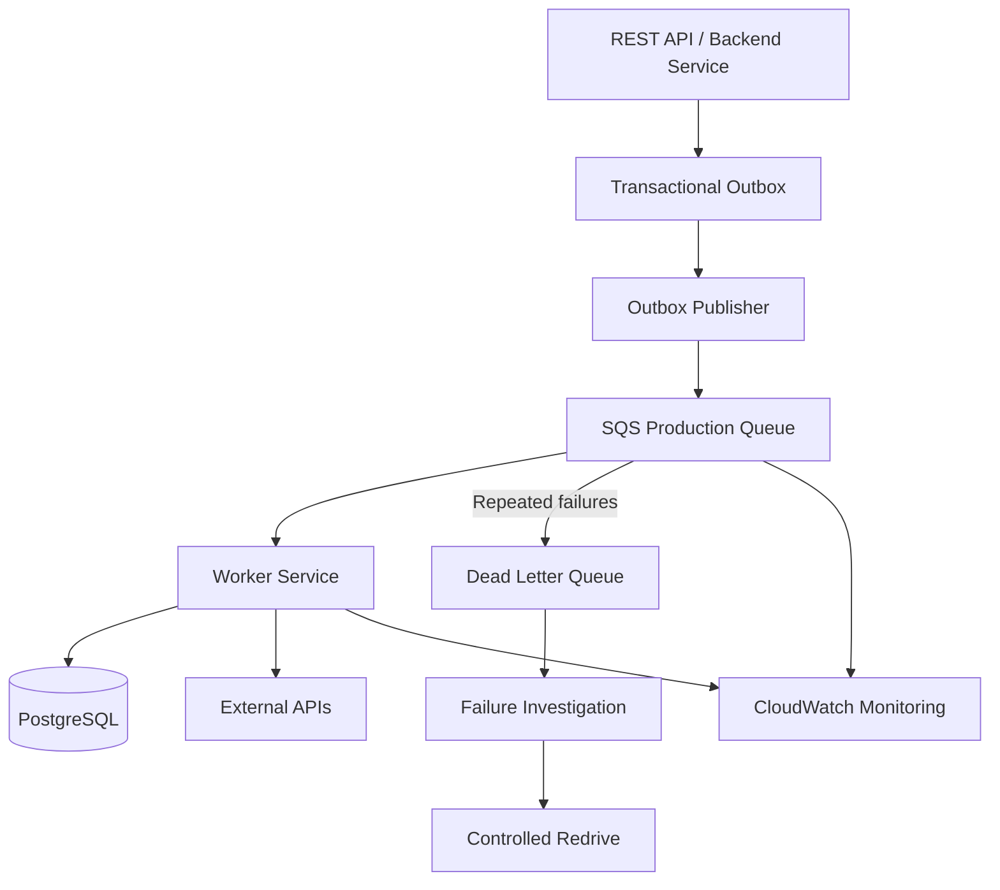
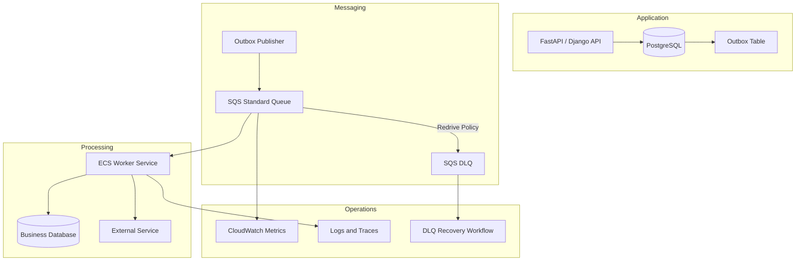
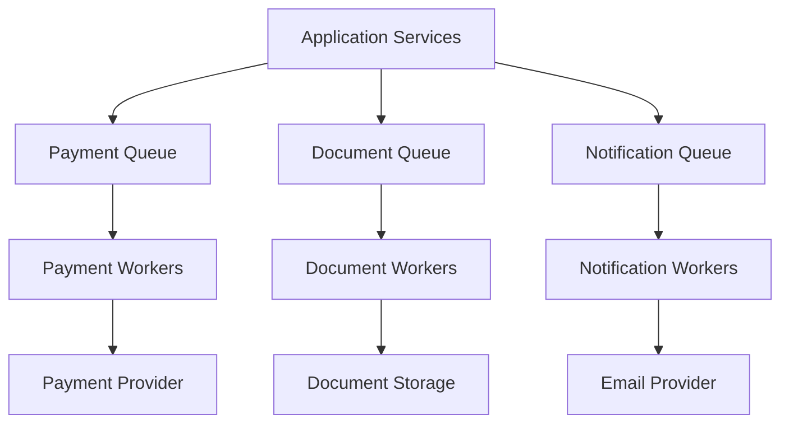
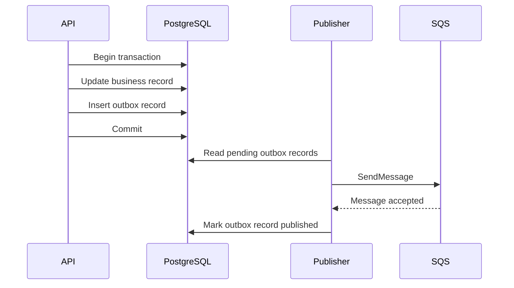
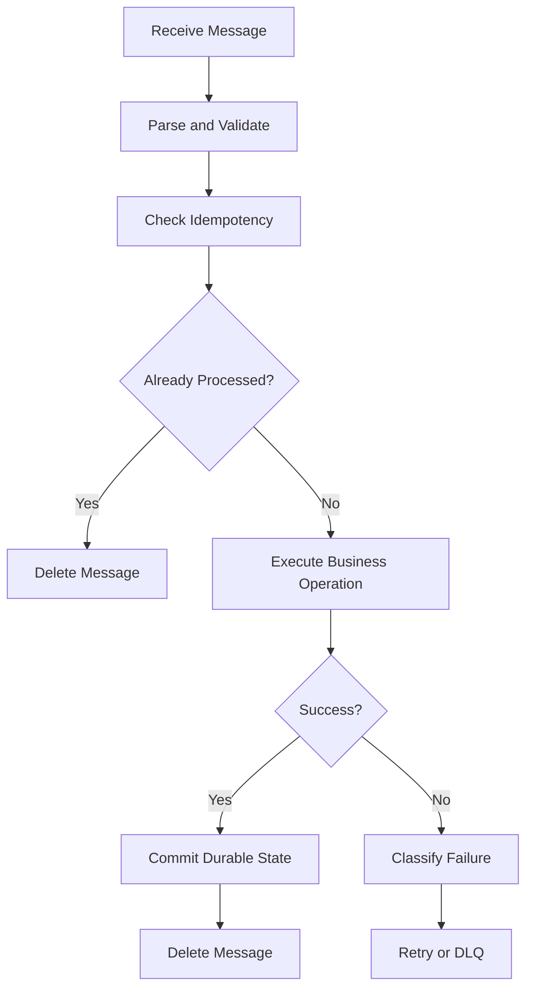
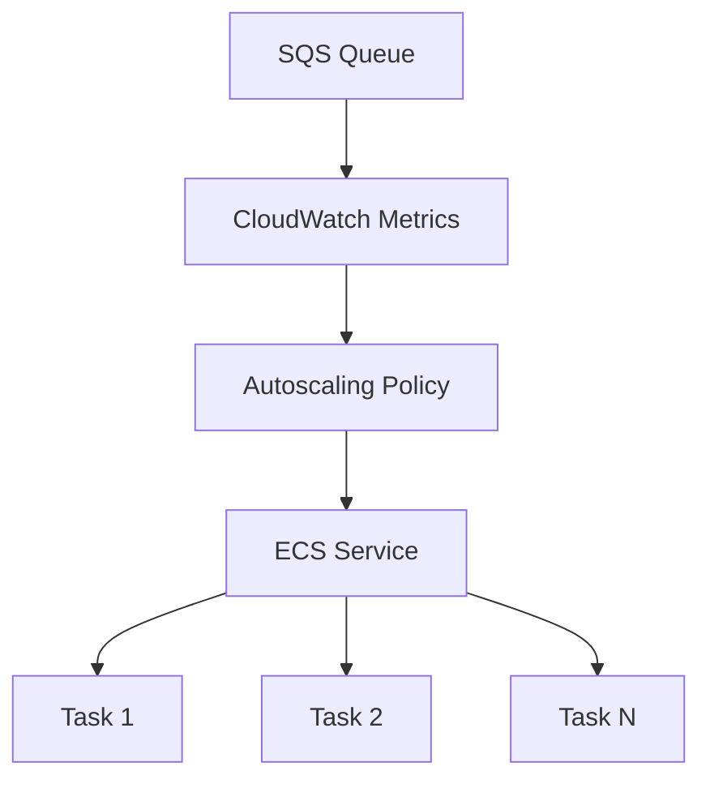
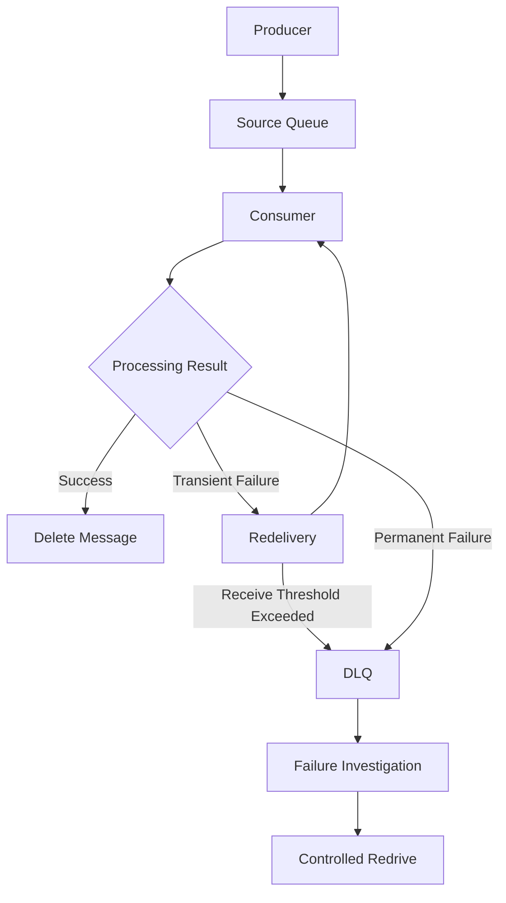

# 11- Production Queue Architecture

## Overview

Amazon Simple Queue Service (SQS) is a managed message queuing service used to decouple backend components and coordinate asynchronous workloads. A production queue architecture goes beyond creating a queue and attaching consumers. It requires deliberate decisions about delivery guarantees, message contracts, retries, concurrency, backpressure, security, observability, and disaster recovery.

A production SQS architecture should provide:

- Reliable asynchronous communication between services.
- Controlled processing concurrency.
- Isolation between producers and consumers.
- Safe handling of duplicate and out-of-order messages.
- Bounded retries and dead-letter processing.
- Protection for downstream databases and APIs.
- Operational visibility into queue health and processing latency.
- Recoverable infrastructure and deployment procedures.

A typical architecture uses an API or application service to publish messages, SQS to buffer work, and independently scalable workers to process it.



The queue provides durable buffering and asynchronous delivery. The application remains responsible for business correctness, including idempotency and transaction management.

## Production Architecture Requirements

### Reliability

A production queue must tolerate:

- Producer retries.
- Duplicate message delivery.
- Worker crashes.
- Temporary network failures.
- Downstream service outages.
- Deployment interruptions.
- Partial batch failures.
- Delayed message processing.

SQS Standard queues provide at-least-once delivery with best-effort ordering. Consumers must assume that a message can be delivered more than once.

FIFO queues provide ordering within a message group and deduplication within a five-minute deduplication interval. They do not guarantee exactly-once business side effects.

### Scalability

Queue-based systems separate message arrival rate from processing capacity.

This allows producers to continue accepting work during temporary traffic spikes while consumers process the backlog at a controlled rate.

However, SQS does not automatically solve a sustained capacity mismatch.

If messages arrive faster than workers can process them, backlog continues growing.

### Fault Isolation

A failure in one consumer should not unnecessarily affect unrelated workloads.

Use separate queues for independent processing responsibilities, especially when workloads have different:

- Processing durations.
- Retry requirements.
- Priority levels.
- Resource requirements.
- Downstream dependencies.
- Availability objectives.

### Operational Visibility

Queue depth alone is insufficient to determine system health.

Monitor:

- Oldest message age.
- Visible messages.
- In-flight messages.
- Processing throughput.
- Failure rate.
- Retry volume.
- DLQ growth.
- Downstream dependency health.

## Reference Production Architecture

A production backend commonly uses a transactional outbox, SQS, independently deployed workers, and a DLQ.



### Component Responsibilities

| Component | Responsibility |
|---|---|
| API service | Accepts business requests |
| PostgreSQL | Stores business state |
| Outbox table | Stores pending message publication intent |
| Outbox publisher | Publishes committed events to SQS |
| SQS source queue | Buffers asynchronous work |
| Worker service | Executes business processing |
| DLQ | Isolates repeatedly failing messages |
| CloudWatch | Provides operational metrics and alarms |
| Recovery workflow | Investigates and reprocesses failed messages |

Each component should have a clearly defined failure boundary.

For example, an API request should not report success merely because an in-memory background task was created. If the business operation requires durable asynchronous execution, persist the request and publication intent before acknowledging success.

## Queue Selection

### Standard Queue

Standard queues are appropriate for most asynchronous workloads.

Characteristics:

- At-least-once delivery.
- Best-effort ordering.
- High throughput.
- Potential duplicate delivery.
- Independent message processing.

Typical use cases:

- Document processing.
- Notification delivery.
- Background report generation.
- Data ingestion.
- Independent microservice tasks.

### FIFO Queue

FIFO queues are appropriate when message ordering within a logical group is a business requirement.

Examples:

- Processing account transactions in sequence.
- Applying ordered inventory changes.
- Processing commands for a specific aggregate.
- Maintaining order within a customer workflow.

FIFO uses `MessageGroupId` to define ordering boundaries.

Messages in the same group are processed in order. Different groups can be processed concurrently.

### Queue Selection Comparison

| Requirement | Standard | FIFO |
|---|---|---|
| At-least-once delivery | Yes | Yes |
| Best-effort ordering | Yes | No; ordered within message group |
| Deduplication interval | No queue-level FIFO deduplication | Five minutes |
| High-throughput processing | Yes | Supported with appropriate configuration |
| Message groups | No | Yes |
| Per-message delay | Supported | Not supported |
| Consumer idempotency | Required | Required for business correctness |

Do not select FIFO merely because duplicate delivery is undesirable. FIFO deduplication does not eliminate the need for idempotent business processing.

## Queue Isolation and Workload Separation

A common production mistake is placing unrelated workloads in one queue.

Consider an application processing:

- Image transformations.
- Payment requests.
- Email notifications.
- Document extraction.
- Report generation.

These workloads have different processing characteristics.

A slow document extraction task should not consume all available worker capacity and delay payment processing.

Use separate queues when workloads require independent scaling, retry policies, or service-level objectives.



### Queue Separation Guidelines

| Separation criterion | Reason |
|---|---|
| Different business domains | Independent ownership and deployment |
| Different processing durations | Prevent long-running work from blocking short tasks |
| Different downstream dependencies | Isolate dependency outages |
| Different retry requirements | Apply appropriate recovery policies |
| Different priority levels | Prevent low-priority work from delaying critical work |
| Different security boundaries | Restrict access to sensitive workloads |

Separate queues introduce additional infrastructure and operational overhead. Use them where isolation provides measurable value.

## Message Contract Design

A production message should represent a stable application contract rather than a serialized database object.

Example:

```json
{
  "event_id": "evt-20261120-1001",
  "event_type": "ORDER_PROCESSING_REQUESTED",
  "version": 1,
  "occurred_at": "2026-11-20T08:30:00Z",
  "producer": "order-service",
  "correlation_id": "corr-1001",
  "data": {
    "order_id": "ORD-1001",
    "customer_id": "CUS-2001"
  }
}
```

### Recommended Fields

| Field | Purpose |
|---|---|
| `event_id` | Stable event identity |
| `event_type` | Identifies the operation |
| `version` | Supports schema evolution |
| `occurred_at` | Records event creation time |
| `producer` | Identifies the originating service |
| `correlation_id` | Connects related operations |
| `data` | Contains business-specific information |

### Contract Design Recommendations

- Use stable identifiers.
- Include a schema version.
- Keep payloads small.
- Avoid embedding credentials or secrets.
- Avoid serializing ORM models directly.
- Use UTC timestamps.
- Define compatibility rules.
- Validate messages at consumer boundaries.
- Preserve original event identity across retry paths.

For large payloads, store the content in S3 and send a reference containing the bucket, key, and version ID.

### Schema Evolution

Consumers and producers may be deployed independently.

A new producer version should not unexpectedly break older consumers.

Prefer additive changes:

- Add optional fields.
- Preserve existing field meaning.
- Avoid renaming fields without a migration strategy.
- Introduce a new event version for incompatible changes.
- Support a controlled transition period.

Contract tests should validate producer and consumer compatibility in CI/CD.

## Reliable Message Publishing

### The Dual-Write Problem

A common architecture performs two operations:

1. Commit a business change to PostgreSQL.
2. Publish a message to SQS.

These operations are not part of one distributed transaction.

If the database commit succeeds but SQS publication fails, the business state changes without a corresponding message.

If the message is published but the database transaction rolls back, consumers may process an event describing a change that never committed.

### Transactional Outbox Pattern

The transactional outbox stores business changes and publication intent in the same database transaction.



Example schema:

```sql
CREATE TABLE outbox_events (
    id UUID PRIMARY KEY,
    aggregate_id VARCHAR(255) NOT NULL,
    event_type VARCHAR(100) NOT NULL,
    payload JSONB NOT NULL,
    created_at TIMESTAMPTZ NOT NULL DEFAULT NOW(),
    published_at TIMESTAMPTZ,
    attempts INTEGER NOT NULL DEFAULT 0
);

CREATE INDEX idx_outbox_pending
    ON outbox_events (created_at)
    WHERE published_at IS NULL;
```

Business update and outbox insertion:

```python
from sqlalchemy import text
from uuid import uuid4
import json

def create_order(session, order_id: str, customer_id: str) -> str:
    event_id = str(uuid4())

    payload = {
        "event_id": event_id,
        "event_type": "ORDER_CREATED",
        "version": 1,
        "data": {
            "order_id": order_id,
            "customer_id": customer_id,
        },
    }

    with session.begin():
        session.execute(
            text("""
                INSERT INTO orders (id, customer_id, status)
                VALUES (:order_id, :customer_id, 'PENDING')
            """),
            {
                "order_id": order_id,
                "customer_id": customer_id,
            },
        )

        session.execute(
            text("""
                INSERT INTO outbox_events (
                    id,
                    aggregate_id,
                    event_type,
                    payload
                )
                VALUES (
                    :event_id,
                    :aggregate_id,
                    :event_type,
                    CAST(:payload AS JSONB)
                )
            """),
            {
                "event_id": event_id,
                "aggregate_id": order_id,
                "event_type": "ORDER_CREATED",
                "payload": json.dumps(payload),
            },
        )

    return event_id
```

The outbox publisher can safely retry publication because the consumer uses the stable event ID for idempotency.

The outbox pattern prevents lost publication intent, but it does not guarantee exactly-once publication. A publisher can successfully send a message and crash before marking the outbox record as published.

### Publisher Reliability

A production publisher should:

- Use bounded batches.
- Inspect individual batch failures.
- Retry transient failures.
- Track publication attempts.
- Avoid holding database locks during network calls.
- Use stable event IDs.
- Support graceful shutdown.
- Expose outbox backlog metrics.

SQS `SendMessageBatch` supports up to 10 entries per request. A successful batch response can contain individual failures, so inspect both `Successful` and `Failed`.

## Consumer Architecture

A consumer receives messages, validates the contract, executes the business operation, and deletes the message after successful completion.



### Consumer Responsibilities

- Validate message structure.
- Verify event type and version.
- Apply idempotency.
- Enforce business invariants.
- Handle transient and permanent failures.
- Protect downstream dependencies.
- Delete messages only after durable completion.
- Emit structured logs and metrics.

### Boto3 Consumer Example

```python
import json
import logging
import boto3
from botocore.exceptions import BotoCoreError, ClientError

logger = logging.getLogger(__name__)

sqs = boto3.client("sqs")

QUEUE_URL = "https://sqs.ap-south-1.amazonaws.com/123456789012/orders"


def process_event(event: dict) -> None:
    if event.get("event_type") != "ORDER_CREATED":
        raise ValueError("Unsupported event type")

    event_id = event["event_id"]
    order_id = event["data"]["order_id"]

    process_order_idempotently(
        event_id=event_id,
        order_id=order_id,
    )


def poll_queue() -> None:
    while True:
        response = sqs.receive_message(
            QueueUrl=QUEUE_URL,
            MaxNumberOfMessages=10,
            WaitTimeSeconds=20,
            MessageSystemAttributeNames=[
                "ApproximateReceiveCount",
            ],
        )

        for message in response.get("Messages", []):
            try:
                event = json.loads(message["Body"])
                process_event(event)

                sqs.delete_message(
                    QueueUrl=QUEUE_URL,
                    ReceiptHandle=message["ReceiptHandle"],
                )

            except (ClientError, BotoCoreError):
                logger.exception("AWS operation failed")

            except Exception:
                logger.exception(
                    "Message processing failed; allowing redelivery"
                )
```

The example assumes that `process_order_idempotently()` commits the business operation and idempotency record atomically.

Production workers should also implement graceful shutdown, bounded concurrency, visibility management, and explicit permanent-failure handling.

## Idempotent Processing

SQS Standard queues can deliver duplicate messages.

Duplicates can also occur because:

- A worker crashes after committing a database transaction but before deleting the message.
- A retry publisher sends a message more than once.
- A visibility timeout expires during processing.
- A producer retries after an ambiguous network failure.

Idempotency ensures that processing the same business event repeatedly does not create repeated business effects.

### Database Idempotency

Use a unique event identifier.

```sql
CREATE TABLE processed_events (
    event_id VARCHAR(255) PRIMARY KEY,
    processed_at TIMESTAMPTZ NOT NULL DEFAULT NOW()
);
```

The idempotency record and business update must be in the same database transaction.

```python
from sqlalchemy import text

def process_order_idempotently(
    session,
    event_id: str,
    order_id: str,
) -> bool:
    with session.begin():
        result = session.execute(
            text("""
                INSERT INTO processed_events (event_id)
                VALUES (:event_id)
                ON CONFLICT (event_id) DO NOTHING
                RETURNING event_id
            """),
            {"event_id": event_id},
        )

        if result.scalar_one_or_none() is None:
            return False

        session.execute(
            text("""
                UPDATE orders
                SET status = 'PROCESSING'
                WHERE id = :order_id
            """),
            {"order_id": order_id},
        )

    return True
```

If the event was already processed, the unique constraint prevents the same transaction from applying the business operation again.

### External Side Effects

Database idempotency does not protect operations performed outside the database.

Examples:

- Payment provider requests.
- Email delivery.
- Third-party API calls.
- File uploads.
- Cloud resource creation.

Use provider-supported idempotency keys whenever available.

If the external service does not support idempotency, maintain durable operation state and reconciliation.

A network timeout does not prove that the external operation failed. The remote service may have completed the operation while the response was lost.

## Visibility Timeout Management

Visibility timeout controls how long a received message remains unavailable to other consumers.

If the worker does not delete the message before the timeout expires, SQS can make it visible again.

### Configuration

```bash
aws sqs set-queue-attributes \
    --queue-url "$QUEUE_URL" \
    --attributes VisibilityTimeout=300
```

A 300-second timeout provides five minutes for processing.

Choose the timeout based on:

- Processing duration distribution.
- Downstream request timeouts.
- Database transaction duration.
- Worker shutdown behavior.
- Retry recovery requirements.

A timeout that is too short can cause concurrent duplicate processing.

A timeout that is too long delays recovery after a worker crash.

### Visibility Extension

For long-running tasks, use `ChangeMessageVisibility` to extend the timeout.

```python
def extend_visibility(
    sqs_client,
    queue_url: str,
    receipt_handle: str,
    timeout_seconds: int,
) -> None:
    sqs_client.change_message_visibility(
        QueueUrl=queue_url,
        ReceiptHandle=receipt_handle,
        VisibilityTimeout=timeout_seconds,
    )
```

The maximum visibility timeout is 12 hours from the initial receive. Extensions do not reset this maximum.

For work that regularly exceeds the limit, split the workload into smaller tasks or use a workflow orchestration service.

### Graceful Shutdown

A worker should stop receiving new messages when it receives a termination signal.

For in-flight messages, it should either:

- Finish processing and delete successfully completed messages.
- Stop safely and allow unfinished messages to become visible again.

Do not delete unfinished messages during shutdown.

ECS and Kubernetes termination grace periods should be aligned with the worker's processing and drain behavior.

## Long Polling and Batch Processing

### Long Polling

Long polling reduces unnecessary empty receive requests.

```python
response = sqs.receive_message(
    QueueUrl=QUEUE_URL,
    MaxNumberOfMessages=10,
    WaitTimeSeconds=20,
)
```

`WaitTimeSeconds` supports values from 0 to 20 seconds.

The HTTP read timeout configured in the SDK must exceed the long-poll wait duration, with additional allowance for network latency.

Long polling is generally appropriate for continuously running workers.

### Batch Operations

SQS batch APIs support up to 10 messages per request.

| Operation | Maximum entries |
|---|---:|
| `SendMessageBatch` | 10 |
| `ReceiveMessage` | 10 |
| `DeleteMessageBatch` | 10 |

Batch operations reduce request overhead but require partial-failure handling.

A batch request can succeed while some individual entries fail.

Always inspect response-level and entry-level results.

### Concurrency

Worker concurrency should be bounded.

Unbounded concurrency can overwhelm:

- PostgreSQL connection pools.
- External APIs.
- CPU and memory resources.
- Shared storage.
- Rate-limited downstream services.

Use a worker concurrency limit based on the capacity of the slowest critical dependency.

## Backpressure and Capacity Planning

SQS acts as a buffer between producers and consumers.

Let:

- \(\lambda\) = incoming messages per second.
- \(\mu\) = messages processed per worker per second.
- \(N\) = active worker count.

Total processing capacity is:

\[
Capacity = N \times \mu
\]

For a stable system:

\[
N \times \mu > \lambda
\]

This provides capacity to process incoming traffic and reduce accumulated backlog.

If arrival rate remains higher than processing capacity, queue depth grows indefinitely.

### Backlog Per Worker

A useful scaling metric is:

\[
BacklogPerWorker =
\frac{VisibleMessages}{HealthyWorkers}
\]

This metric helps determine whether the current worker fleet can handle the workload.

However, backlog per worker should be combined with oldest message age and processing throughput.

### Backpressure Controls

Use:

- Bounded worker concurrency.
- Database connection limits.
- External API rate limits.
- Circuit breakers.
- Retry backoff with jitter.
- Queue-specific worker pools.
- Autoscaling with maximum capacity limits.

When a dependency becomes unhealthy, reduce processing pressure rather than allowing every worker to retry aggressively.

## Autoscaling Architecture

SQS consumers can run on ECS, EC2, EKS, or Lambda.

### ECS Worker Scaling



ECS service autoscaling can use custom metrics such as backlog per running task.

A typical target tracking configuration requires:

- An ECS service.
- An Application Auto Scaling target.
- A CloudWatch metric or custom metric.
- A target tracking scaling policy.
- Maximum and minimum task counts.

The metric should use the number of running or healthy tasks rather than the desired task count alone.

For ECS on EC2, task scaling and EC2 capacity scaling are separate concerns. Ensure the cluster has sufficient CPU and memory capacity to place the desired tasks.

### Lambda Worker Scaling

Lambda can consume SQS through an event source mapping.

AWS manages polling and invokes the function with batches.

Use:

- Batch size.
- Maximum batching window.
- Event source mapping maximum concurrency.
- Function reserved concurrency.
- Partial batch responses.

For SQS-triggered Lambda, visibility timeout should be at least six times the function timeout, plus the maximum batching window allowance.

Use `ReportBatchItemFailures` to identify failed records without unnecessarily retrying successful records.

For FIFO queues, preserve ordering by stopping processing of later records in a message group after a failure and reporting failed and unprocessed records appropriately.

### Kubernetes Worker Scaling

Kubernetes workers can use KEDA to scale based on SQS queue metrics.

A typical design includes:

- An SQS queue.
- A Kubernetes Deployment.
- A KEDA `ScaledObject`.
- IAM Roles for Service Accounts or EKS Pod Identity.
- A maximum replica limit.

Use workload identity rather than static AWS credentials.

## Retry and Dead-Letter Queue Architecture

A production queue should have a bounded failure policy.



### Redrive Policy

Example configuration:

```bash
aws sqs set-queue-attributes \
    --queue-url "$QUEUE_URL" \
    --attributes '{
      "RedrivePolicy": "{\"deadLetterTargetArn\":\"arn:aws:sqs:ap-south-1:123456789012:orders-dlq\",\"maxReceiveCount\":\"5\"}"
    }'
```

`maxReceiveCount` counts receives, not successful processing attempts.

The source and DLQ queue types must match.

For Standard queues, messages moved to a DLQ retain their original enqueue timestamp for retention purposes. Configure the DLQ retention period longer than the source queue retention period.

For FIFO queues, the enqueue timestamp resets when a message moves to the DLQ.

### Failure Classification

| Failure | Recommended handling |
|---|---|
| Temporary network timeout | Retry with backoff |
| HTTP 429 | Respect provider throttling guidance |
| HTTP 503 | Retry with bounded backoff |
| Invalid payload | Permanent failure path |
| Unsupported schema version | Quarantine or DLQ |
| Authorization failure | Stop repeated retries and investigate |
| Database outage | Pause or reduce consumption |
| External operation timeout | Reconcile before repeating side effects |

A DLQ should be treated as an operational recovery mechanism, not a permanent storage location for ignored failures.

### Controlled Redrive

Before redriving messages:

1. Identify the root cause.
2. Confirm that the underlying issue is resolved.
3. Validate that the consumer can process the message.
4. Estimate downstream capacity.
5. Redrive a small batch.
6. Monitor processing success and latency.
7. Increase the redrive rate gradually.

SQS supports managed movement through `StartMessageMoveTask`, `ListMessageMoveTasks`, and `CancelMessageMoveTask`.

Redrive is asynchronous. Cancellation does not reverse messages that have already moved.

## FIFO Production Considerations

FIFO queues are appropriate when ordering is part of the business contract.

### Message Groups

Choose `MessageGroupId` based on the entity whose operations must be ordered.

Examples:

- Customer ID.
- Account ID.
- Order ID.
- Inventory item ID.

Messages in different groups can be processed concurrently.

A single global message group serializes all processing and can severely limit throughput.

### Deduplication

FIFO queues support:

- Explicit deduplication IDs.
- Content-based deduplication.

Content-based deduplication calculates a SHA-256 hash of the message body. Message attributes are excluded.

The five-minute deduplication interval reduces duplicate sends within that window but does not guarantee exactly-once business processing.

### DLQ and Ordering

Moving a failed message to a DLQ can allow later messages in the same group to proceed.

When strict business ordering is required, DLQ movement and redrive must be designed carefully.

The application should validate sequence or aggregate state before applying later operations.

## Security Architecture

A production SQS architecture should use least-privilege IAM and encrypted transport and storage.

### IAM Permissions

Separate producer and consumer permissions.

| Role | Required permissions |
|---|---|
| Producer | `sqs:SendMessage` |
| Consumer | `sqs:ReceiveMessage`, `sqs:DeleteMessage`, `sqs:ChangeMessageVisibility` |
| Queue administrator | Required queue configuration actions |
| DLQ recovery operator | Restricted DLQ inspection and redrive permissions |

Avoid giving application workers broad administrative permissions.

### Encryption

SQS supports:

- Server-side encryption with SQS-managed encryption keys.
- Server-side encryption with AWS KMS customer-managed keys.

When using customer-managed KMS keys, review key policies and permissions for producers and consumers.

Encryption does not replace application-level payload protection. Avoid sending secrets or unnecessary personal information in messages.

### Network and Resource Policies

- Use HTTPS for AWS API calls.
- Restrict queue policies to trusted principals.
- Use VPC endpoints where appropriate.
- Apply endpoint policies when network-level restrictions are required.
- Restrict cross-account access explicitly.
- Enable CloudTrail for relevant control-plane activity.

## Observability and Alerting

Queue monitoring must detect both growing backlog and stalled processing.

### Important SQS Metrics

| Metric | Meaning | Operational use |
|---|---|---|
| `ApproximateNumberOfMessagesVisible` | Messages available for retrieval | Backlog monitoring |
| `ApproximateNumberOfMessagesNotVisible` | Messages currently in flight | Processing and visibility analysis |
| `ApproximateAgeOfOldestMessage` | Age of oldest available message | Processing delay detection |
| `NumberOfMessagesSent` | Messages sent | Incoming workload |
| `NumberOfMessagesReceived` | Messages received | Consumer activity |
| `NumberOfMessagesDeleted` | Messages deleted | Successful acknowledgement activity |
| `NumberOfEmptyReceives` | Empty receive operations | Polling efficiency |

SQS metrics are approximate. Combine them with application-level metrics.

### Application Metrics

Track:

- Processing success rate.
- Processing failure rate.
- Processing duration.
- Retry count by failure category.
- Duplicate event count.
- Idempotency conflicts.
- Downstream dependency latency.
- Worker concurrency.
- Queue backlog per worker.
- DLQ arrival rate.
- Outbox publication lag.

### Recommended Alarms

| Alarm | Purpose |
|---|---|
| Oldest message age exceeds SLO | Detect delayed processing |
| DLQ visible messages greater than zero | Detect failed work |
| Visible backlog grows continuously | Detect insufficient capacity |
| In-flight messages remain high | Detect stuck or slow consumers |
| Outbox backlog grows | Detect publisher failure |
| Worker error rate increases | Detect processing instability |
| Downstream latency increases | Detect dependency degradation |

Alarm thresholds should reflect the workload's processing SLO rather than arbitrary fixed values.

### Structured Logging

Include stable identifiers in every processing log.

```json
{
  "event_id": "evt-20261120-1001",
  "correlation_id": "corr-1001",
  "event_type": "ORDER_CREATED",
  "queue": "orders",
  "attempt": 2,
  "worker_id": "worker-03",
  "processing_status": "SUCCESS",
  "duration_ms": 420
}
```

Do not log full message payloads by default.

Use correlation IDs across the API, database, publisher, queue, and consumer.

## High Availability and Disaster Recovery

SQS is a regional service designed for high availability within a Region.

A production architecture should still account for regional failures and recovery requirements.

### Availability Recommendations

- Run workers across multiple Availability Zones.
- Avoid single-instance consumers.
- Use managed compute services where appropriate.
- Keep queue configuration in infrastructure as code.
- Use durable business state outside the queue.
- Configure DLQs and recovery procedures.
- Use bounded retries.
- Test worker termination and replacement.
- Ensure deployment procedures do not delete or recreate queues unnecessarily.

### Disaster Recovery

SQS queues do not automatically replicate messages across Regions.

A cross-Region strategy must explicitly address:

- Queue recreation.
- Message replication or event replay.
- Business database recovery.
- Worker deployment.
- IAM and KMS configuration.
- DLQ recovery.
- Duplicate processing across Regions.
- Failover and failback procedures.

Use an outbox or durable event source when the business requires reliable reconstruction of pending work.

Do not assume that copying queue configuration is equivalent to recovering queued messages.

## Infrastructure as Code

Production queues should be managed through Terraform, CloudFormation, or AWS CDK.

Example Terraform configuration:

```hcl
resource "aws_sqs_queue" "orders_dlq" {
  name                      = "orders-dlq"
  message_retention_seconds = 1209600

  sqs_managed_sse_enabled = true
}

resource "aws_sqs_queue" "orders" {
  name                       = "orders"
  visibility_timeout_seconds = 120
  message_retention_seconds  = 345600
  receive_wait_time_seconds  = 20

  sqs_managed_sse_enabled = true

  redrive_policy = jsonencode({
    deadLetterTargetArn = aws_sqs_queue.orders_dlq.arn
    maxReceiveCount     = 5
  })
}
```

The example creates a Standard queue and a corresponding DLQ.

Production infrastructure should also define:

- Queue policies.
- Producer and consumer IAM policies.
- KMS configuration where required.
- CloudWatch alarms.
- Worker compute resources.
- Autoscaling policies.
- Deployment dependencies.
- Queue retention and redrive configuration.

### Deployment Considerations

Queue infrastructure should be deployed before applications that depend on it.

A safe deployment sequence is:

1. Create or update queues.
2. Configure resource policies and encryption.
3. Deploy producers.
4. Deploy consumers.
5. Enable traffic.
6. Verify processing and monitoring.
7. Remove obsolete infrastructure only after migration is complete.

Avoid replacing a queue with a new queue of the same logical purpose without planning for messages that remain in the original queue.

Queue URLs and ARNs should be supplied through deployment configuration rather than hardcoded in application source.

## Production Testing Strategy

A production queue architecture requires unit, integration, and failure-injection testing.

| Test scenario | Expected behavior |
|---|---|
| Normal message processing | Business operation completes and message is deleted |
| Duplicate delivery | Business side effect occurs once |
| Worker crash before commit | Message becomes available for retry |
| Worker crash after commit | Redelivery is handled idempotently |
| SQS publication failure | Outbox event remains pending |
| Partial batch failure | Failed entries are retried |
| Visibility timeout expiration | Duplicate processing is safe |
| Downstream outage | Consumption is controlled |
| Retry threshold exceeded | Message reaches DLQ |
| DLQ redrive | Recovered work is processed safely |
| Queue backlog spike | Workers scale within configured limits |
| Worker deployment | In-flight messages are not lost |
| Regional recovery | Work can be reconstructed or recovered according to the DR plan |

### Failure Injection

Simulate:

- Database unavailability.
- External API timeouts.
- Worker termination.
- Network interruption.
- Invalid message payloads.
- SQS throttling.
- KMS permission failures.

Verify that the system recovers without losing business operations or generating uncontrolled retry traffic.

## Cost Optimization

SQS costs are primarily influenced by API requests and data transfer.

Other cost components depend on the processing architecture.

| Component | Cost drivers |
|---|---|
| SQS | API requests, payload size, queue usage |
| ECS Fargate | vCPU, memory, runtime |
| ECS on EC2 | EC2 capacity, EBS, networking |
| Lambda | Invocations, duration, memory |
| PostgreSQL | Compute, storage, connections |
| CloudWatch | Logs, metrics, alarms |
| KMS | Key usage and API requests |
| S3 | Storage, requests, retrieval, transfer |

Optimization practices:

- Use long polling.
- Batch send and delete operations where appropriate.
- Avoid excessive polling frequency.
- Keep message payloads small.
- Use S3 references for large objects.
- Scale workers according to backlog and processing demand.
- Set sensible retention periods.
- Avoid unnecessary retry loops.
- Control log volume.
- Remove obsolete queues and unused resources through reviewed infrastructure changes.

Do not reduce polling or worker capacity so aggressively that processing latency violates the workload's SLO.

## Common Production Mistakes

### Assuming SQS Guarantees Exactly-Once Processing

Standard queues provide at-least-once delivery.

Use idempotency to protect business operations from duplicate delivery.

### Using One Queue for Every Workload

Unrelated workloads can interfere with each other.

Separate queues when processing characteristics, failure domains, or operational requirements differ.

### Setting Visibility Timeout Without Measuring Processing Duration

A short timeout can cause concurrent duplicate processing.

Measure processing duration and provide a suitable timeout or heartbeat extension strategy.

### Deleting Messages Before Durable Completion

A worker that deletes a message before committing its business operation can lose work.

Delete only after the required state has been durably committed.

### Scaling Workers Without Considering Database Capacity

Increasing worker count can overwhelm PostgreSQL or external APIs.

Set concurrency limits based on downstream capacity.

### Treating DLQ as Long-Term Storage

A DLQ is a failure isolation mechanism, not an archive.

Define retention, investigation, ownership, and recovery procedures.

### Ignoring Partial Batch Failures

Batch operations can partially succeed.

Inspect individual result entries and retry only failed operations where appropriate.

### Using FIFO Without a Clear Ordering Requirement

FIFO introduces message-group and throughput considerations.

Use it when ordering is a business requirement, not merely as a duplicate-delivery workaround.

### Ignoring Regional Recovery

SQS messages are not automatically replicated across Regions.

Define how pending work is reconstructed, replicated, or replayed.

### Treating Queue Depth as the Only Health Metric

A queue can have a small backlog but still violate processing latency requirements.

Monitor oldest message age, throughput, failures, and downstream health.

## Key Takeaways

- A production SQS architecture requires explicit delivery, idempotency, retry, backpressure, and recovery strategies.
- Use a transactional outbox to make database changes and message publication intent consistent, while designing consumers for duplicate publication.
- Separate queues by workload and failure domain when independent scaling, retry behavior, or service-level objectives require isolation.
- Control worker concurrency using queue age, backlog, throughput, and downstream capacity rather than queue depth alone.
- Treat DLQs, observability, infrastructure as code, and disaster recovery as core parts of the queue architecture.