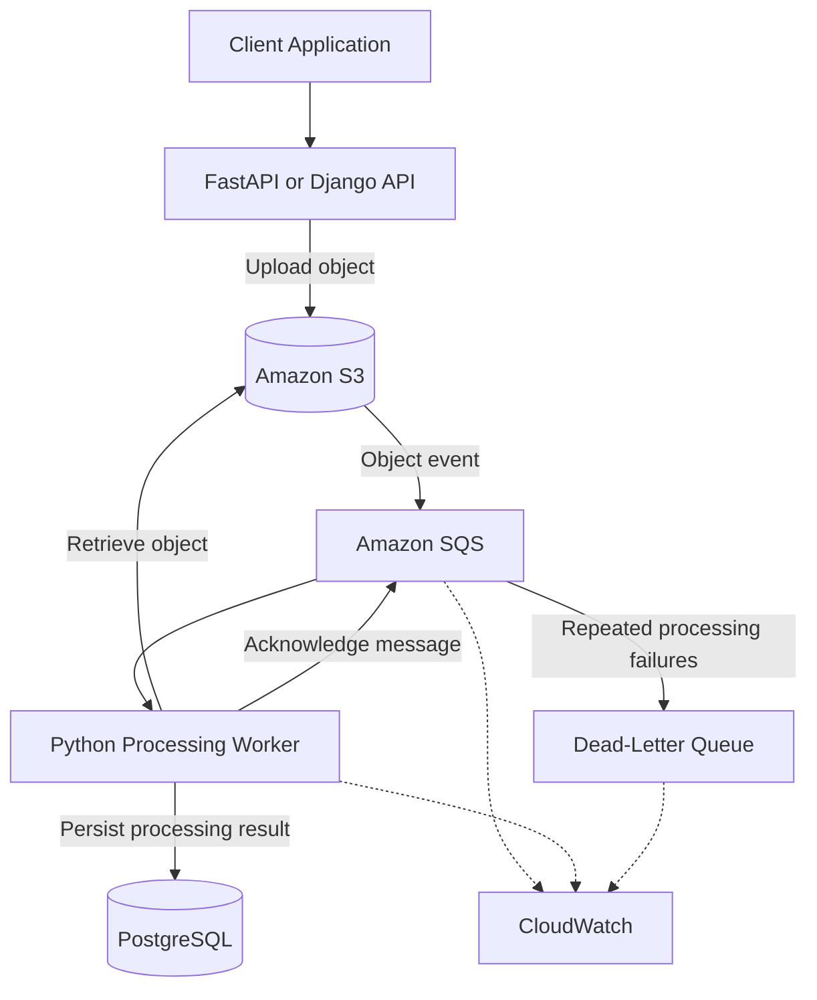

# README

## Overview

This folder contains architecture documentation for integrating Amazon Simple Queue Service (Amazon SQS) with Amazon S3 event notifications to build reliable, asynchronous object-processing workflows.

The architecture uses S3 as the durable object store and SQS as the message buffer between object uploads and backend processing services. It allows applications to process documents, images, reports, and other uploaded objects without coupling upload requests to long-running processing operations.

Typical backend implementations use Python workers deployed through Docker, Amazon ECS, Amazon EKS, or AWS Lambda, with PostgreSQL or another database maintaining processing state.

## Documentation Structure

| File | Description |
|---|---|
| [10- Amazon S3 Event Processing Architecture.md](10-%20Amazon%20S3%20Event%20Processing%20Architecture.md) | Explains S3 event notifications, S3-to-SQS integration, event payloads, Python worker implementation, idempotency, ordering, retry handling, scaling, security, monitoring, and disaster recovery. |

## Architecture Overview

The core processing architecture is:

### Processing Lifecycle

1. A client uploads an object through an API or directly to S3 using a presigned URL.
2. S3 stores the object and generates an event notification.
3. S3 delivers the event to the configured SQS queue.
4. A worker receives the message and retrieves the referenced object.
5. The worker validates and processes the object.
6. Processing results and status are persisted in the application database.
7. The worker deletes the SQS message after successful processing.
8. Messages that repeatedly fail are moved to the configured dead-letter queue.

## Key Engineering Concepts

| Concept | Engineering Consideration |
|---|---|
| S3 Event Notifications | Events are delivered at least once and may arrive out of order. |
| SQS Standard Queue | Provides asynchronous buffering and at-least-once message delivery. |
| Object Versioning | Allows workers to retrieve the exact object version associated with an event. |
| Idempotency | Prevents duplicate events from causing repeated business operations. |
| Visibility Timeout | Controls how long a received message remains invisible to other consumers. |
| Dead-Letter Queue | Isolates messages that repeatedly fail processing. |
| Object Streaming | Prevents large files from consuming excessive worker memory. |
| Reconciliation | Detects objects or processing records that were missed or left incomplete. |
| Observability | Connects queue metrics with application-level processing outcomes. |

## Recommended Reading Order

1. **Amazon S3 Event Processing Architecture** — Understand the complete event-driven architecture, message lifecycle, worker implementation, and production reliability considerations.
2. Review the implementation sections when building S3-triggered processing pipelines.
3. Use the production engineering checklist when deploying or reviewing an implementation.

## Architecture Design Considerations

When implementing this architecture, account for the following requirements:

- **Reliability:** Assume duplicate notifications, duplicate SQS deliveries, worker crashes, and temporary dependency failures.
- **Idempotency:** Use a durable processing key based on bucket, object key, object version, and processor version where appropriate.
- **Ordering:** Do not assume S3 events arrive in upload order. Use version IDs and sequencer-aware state management when required.
- **Scalability:** Scale workers according to queue backlog, message age, processing duration, and downstream capacity.
- **Security:** Apply least-privilege IAM policies, restrictive SQS queue policies, and encryption at rest.
- **Observability:** Monitor queue depth, oldest-message age, processing latency, retry counts, and DLQ activity.
- **Recovery:** Implement controlled DLQ redrive and reconciliation for critical processing workflows.
- **Cost:** Use long polling, appropriate worker sizing, object lifecycle policies, and bounded processing concurrency.

## Key Takeaways

- S3 provides durable object storage, while SQS decouples object uploads from asynchronous processing.
- S3 notifications and SQS Standard queues require consumers to handle duplicate and out-of-order events.
- Durable processing state, idempotency, visibility timeout configuration, and DLQs are essential for reliable workers.
- Production deployments should include least-privilege access, monitoring, reconciliation, and tested recovery procedures.