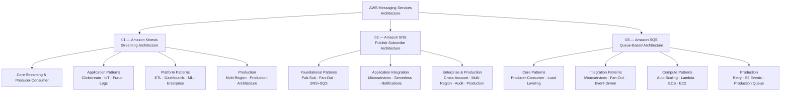
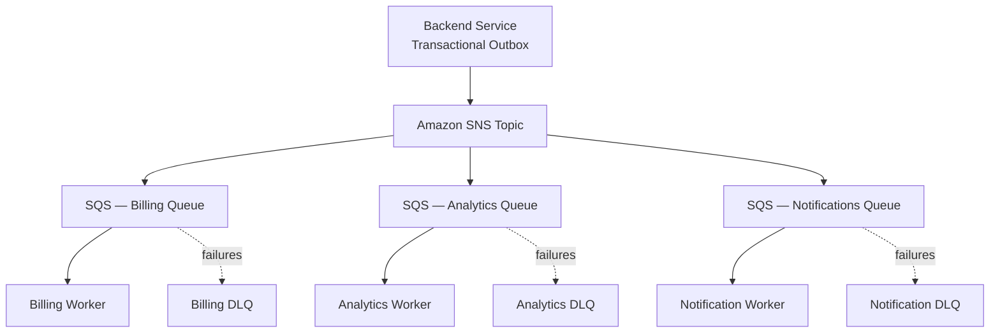
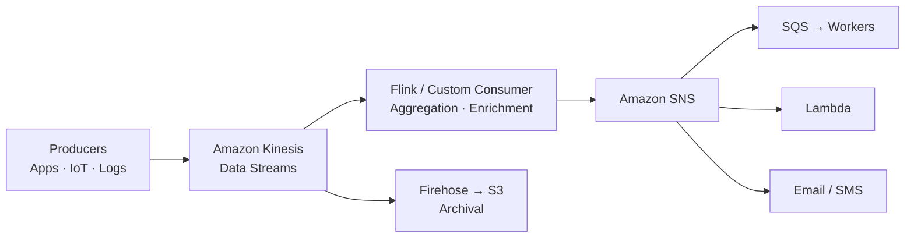
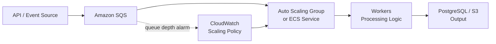

# AWS Messaging Services — Architecture

## Overview

This section covers architecture-level documentation for designing, implementing, and operating production-grade messaging systems on AWS using Amazon Kinesis, Amazon SNS, and Amazon SQS.

The documents focus on **architectural patterns and system design decisions** rather than individual API operations or service fundamentals. Each section progresses from foundational patterns to enterprise-scale production architectures.

---

## Contents

| # | Section | Documents | Focus |
|---|---|---|---|
| 01 | [Amazon Kinesis](./01-%20Amazon%20Kinesis/README.md) | 12 | Streaming architecture patterns from core ingestion to enterprise data platforms |
| 02 | [Amazon SNS](./02-%20Amazon%20SNS/README.md) | 12 | Pub-sub patterns from fan-out to cross-account and multi-region notification systems |
| 03 | [Amazon SQS](./03-%20Amazon%20SQS/README.md) | 11 | Queue-based patterns from producer-consumer to auto-scaling and production reliability |

**Total: 35 architecture documents**

---

## Architecture Map

---

## Section Summaries

### [01 — Amazon Kinesis](./01-%20Amazon%20Kinesis/README.md)

Architecture patterns for real-time streaming systems. Covers high-volume event ingestion, stateful stream processing, and delivery to downstream analytical and operational systems.

| # | Document | Description |
|---|---|---|
| 01 | [Core Streaming Architecture](./01-%20Amazon%20Kinesis/01-%20Core%20Streaming%20Architecture.md) | Amazon Kinesis services, shards, producers, consumers, retention, and core streaming patterns. |
| 02 | [Producer-Consumer Architecture](./01-%20Amazon%20Kinesis/02-%20Producer-Consumer%20Architecture.md) | Producer and consumer responsibilities, partition-key design, publishing, checkpointing, and idempotent processing. |
| 03 | [Real-Time Clickstream Analytics](./01-%20Amazon%20Kinesis/03-%20Real-Time%20Clickstream%20Analytics.md) | Browser event collection, session analytics, conversion metrics, and real-time aggregation. |
| 04 | [IoT Telemetry Processing Architecture](./01-%20Amazon%20Kinesis/04-%20IoT%20Telemetry%20Processing%20Architecture.md) | Device telemetry ingestion, event-time processing, device state, threshold alerts, and IoT integration. |
| 05 | [Fraud Detection and Financial Streaming](./01-%20Amazon%20Kinesis/05-%20Fraud%20Detection%20and%20Financial%20Streaming.md) | Financial event processing, velocity checks, anomaly detection, risk scoring, and reliable decision workflows. |
| 06 | [Log Aggregation and Security Monitoring](./01-%20Amazon%20Kinesis/06-%20Log%20Aggregation%20and%20Security%20Monitoring.md) | Centralized log ingestion, security event processing, threat detection, and operational analytics. |
| 07 | [Streaming ETL and Data Lake Architecture](./01-%20Amazon%20Kinesis/07-%20Streaming%20ETL%20and%20Data%20Lake%20Architecture.md) | Streaming transformations, S3 data lake zones, data quality, schema evolution, and analytical storage. |
| 08 | [Real-Time Dashboard Architecture](./01-%20Amazon%20Kinesis/08-%20Real-Time%20Dashboard%20Architecture.md) | Streaming metrics, aggregation, Redis and DynamoDB serving layers, and real-time dashboard delivery. |
| 09 | [Machine Learning Streaming Pipeline](./01-%20Amazon%20Kinesis/09-%20Machine%20Learning%20Streaming%20Pipeline.md) | Online feature engineering, model inference, prediction delivery, and batch-training integration. |
| 10 | [Enterprise Data Platform Architecture](./01-%20Amazon%20Kinesis/10-%20Enterprise%20Data%20Platform%20Architecture.md) | Enterprise streaming and batch data platforms, governance, orchestration, serving, and multi-team integration. |
| 11 | [Multi-Region and Hybrid Cloud Streaming](./01-%20Amazon%20Kinesis/11-%20Multi-Region%20and%20Hybrid%20Cloud%20Streaming.md) | Cross-Region replication, hybrid connectivity, failover strategies, and distributed streaming considerations. |
| 12 | [Production Streaming Architecture](./01-%20Amazon%20Kinesis/12-%20Production%20Streaming%20Architecture.md) | Production reference architecture covering SLOs, reliability, idempotency, observability, security, and disaster recovery. |

---

### [02 — Amazon SNS](./02-%20Amazon%20SNS/README.md)

Architecture patterns for publish-subscribe messaging systems. Covers topic-based event distribution, fan-out patterns, cross-account and multi-region messaging, and production notification platforms.

| # | Document | Description |
|---|---|---|
| 01 | [Publish-Subscribe Architecture](./02-%20Amazon%20SNS/01-%20Publish-Subscribe%20Architecture.md) | Topic-based communication, publishers, subscribers, and decoupled message distribution. |
| 02 | [Fan-Out Architecture](./02-%20Amazon%20SNS/02-%20Fan-Out%20Architecture.md) | Distributing one published message to multiple independent consumers. |
| 03 | [SNS and SQS Fan-Out Architecture](./02-%20Amazon%20SNS/03-%20SNS%20and%20SQS%20Fan-Out%20Architecture.md) | Combining SNS topic distribution with independent SQS consumer queues for processing isolation. |
| 04 | [Event-Driven Microservices Architecture](./02-%20Amazon%20SNS/04-%20Event-Driven%20Microservices%20Architecture.md) | Asynchronous service-to-service communication and event distribution across microservices. |
| 05 | [Serverless Event Processing Architecture](./02-%20Amazon%20SNS/05-%20Serverless%20Event%20Processing%20Architecture.md) | Integrating SNS with Lambda and SQS for serverless event processing. |
| 06 | [Notification System Architecture](./02-%20Amazon%20SNS/06-%20Notification%20System%20Architecture.md) | Delivering application notifications through email, SMS, mobile push, and in-app channels. |
| 07 | [CloudWatch Alarm Notification Architecture](./02-%20Amazon%20SNS/07-%20CloudWatch%20Alarm%20Notification%20Architecture.md) | Distributing infrastructure and application alerts to notification and incident-response workflows. |
| 08 | [Cross-Account Event Distribution](./02-%20Amazon%20SNS/08-%20Cross-Account%20Event%20Distribution.md) | Secure publishing and consumption of events across AWS accounts. |
| 09 | [Multi-Region Notification Architecture](./02-%20Amazon%20SNS/09-%20Multi-Region%20Notification%20Architecture.md) | Regional messaging, failover, geographic distribution, and disaster recovery. |
| 10 | [Enterprise Event Distribution Architecture](./02-%20Amazon%20SNS/10-%20Enterprise%20Event%20Distribution%20Architecture.md) | Domain-oriented event distribution across enterprise systems, teams, and accounts. |
| 11 | [Audit Logging Architecture](./02-%20Amazon%20SNS/11-%20Audit%20Logging%20Architecture.md) | Distributing, processing, and retaining application and security audit events. |
| 12 | [Production Notification Architecture](./02-%20Amazon%20SNS/12-%20Production%20Notification%20Architecture.md) | Building reliable notification platforms with preferences, retries, idempotency, and delivery tracking. |

---

### [03 — Amazon SQS](./03-%20Amazon%20SQS/README.md)

Architecture patterns for queue-based asynchronous systems. Covers decoupled producer-consumer designs, load leveling, event-driven processing, compute integration, and production queue reliability.

| # | Document | Description |
|---|---|---|
| 01 | [Producer-Consumer Architecture](./03-%20Amazon%20SQS/01-%20Producer-Consumer%20Architecture.md) | Fundamental queue-based pattern for asynchronous, loosely coupled backend systems. |
| 02 | [Load Leveling Architecture](./03-%20Amazon%20SQS/02-%20Load%20Leveling%20Architecture.md) | Using SQS to absorb traffic spikes and smooth workload arrival rates. |
| 03 | [Microservices Communication Architecture](./03-%20Amazon%20SQS/03-%20Microservices%20Communication%20Architecture.md) | Asynchronous command and event exchange between independently deployed services. |
| 04 | [Fan-Out Architecture](./03-%20Amazon%20SQS/04-%20Fan-Out%20Architecture.md) | Distributing one event to multiple independent SQS consumer queues. |
| 05 | [Event-Driven Processing Architecture](./03-%20Amazon%20SQS/05-%20Event-Driven%20Processing%20Architecture.md) | Services reacting to domain events published to SQS rather than direct invocation. |
| 06 | [Auto Scaling Consumer Architecture](./03-%20Amazon%20SQS/06-%20Auto%20Scaling%20Consumer%20Architecture.md) | Dynamically adjusting worker count based on queue depth and message age. |
| 07 | [Lambda-Based Worker Architecture](./03-%20Amazon%20SQS/07-%20Lambda-Based%20Worker%20Architecture.md) | Using SQS as a durable buffer with Lambda as the asynchronous processing engine. |
| 08 | [ECS and EC2 Worker Architectures](./03-%20Amazon%20SQS/08-%20ECS%20and%20EC2%20Worker%20Architectures.md) | Long-running workers on ECS or EC2 consuming SQS with persistent polling loops. |
| 09 | [Retry and Scheduled Processing Patterns](./03-%20Amazon%20SQS/09-%20Retry%20and%20Scheduled%20Processing%20Patterns.md) | Handling transient failures, delayed execution, and messages that cannot be processed. |
| 10 | [Amazon S3 Event Processing Architecture](./03-%20Amazon%20SQS/10-%20Amazon%20S3%20Event%20Processing%20Architecture.md) | Triggering asynchronous workflows from S3 object events via SQS. |
| 11 | [Production Queue Architecture](./03-%20Amazon%20SQS/11-%20Production%20Queue%20Architecture.md) | End-to-end production SQS architecture covering delivery guarantees, retries, concurrency, security, and observability. |

---

## Cross-Service Architecture Patterns

The three services are commonly used together in production systems.

### SNS + SQS Fan-Out

Publish one event through SNS and fan it out to multiple independent SQS queues. Each downstream consumer maintains its own processing, retry, and scaling behavior.

### Kinesis + SNS + SQS Pipeline

Stream high-volume events through Kinesis, process analytically, and trigger downstream notification or processing workflows through SNS and SQS.

### SQS Load Leveling with Auto-Scaling

Absorb traffic spikes using SQS as a buffer and automatically scale consumers based on queue depth.

---

## Production Engineering Principles

The following principles apply across all three services.

### Reliability

- Design all consumers for **at-least-once delivery** — duplicates are possible in SQS Standard, SNS Standard, and Kinesis.
- Use **stable event identifiers** across retries and redeliveries.
- Implement **consumer-side idempotency** using durable deduplication records or business-level uniqueness constraints.
- Use a **transactional outbox** when publishing events is a business-critical consequence of a database transaction.
- Configure **dead-letter queues** and monitor them actively.
- Define explicit **replay and recovery strategies** for each service.

### Scalability

- SQS: Scale consumers based on queue depth and oldest-message age, not fixed instance counts.
- SNS: Use independent SQS queues per logical consumer so each scales independently.
- Kinesis: Choose partition keys that distribute traffic evenly; monitor for hot shards.

### Security

- Apply **least-privilege IAM policies** to all producers, consumers, and delivery services.
- Use **resource-based policies** (SQS queue policies, SNS topic policies) to restrict cross-account access explicitly.
- **Encrypt** streams, queues, and topics using AWS KMS where required.
- Never embed credentials, access tokens, or sensitive personal data in message payloads.
- Enable **CloudTrail** for administrative and API activity.

### Observability

| Layer | Key Signals |
|---|---|
| Producers | Publish success rate, latency, throttling, retry count |
| Kinesis | Iterator age, write/read throttling, shard utilization |
| SNS | Delivery failures, delivery retries, subscription health |
| SQS | Queue depth, oldest-message age, receive count, DLQ depth |
| Consumers | Processing latency, success rate, exception rate, throughput |
| Business | Event completion rate, reconciliation failures, notification delivery state |

Use structured logs, distributed tracing, and a stable **correlation ID** and **event ID** across the full event lifecycle.

---

## Key Takeaways

- Amazon Kinesis is the right choice for **continuous high-volume streaming** with multiple independent consumers, replay within a retention window, and stateful real-time processing.
- Amazon SNS is the right choice for **broadcasting events** to multiple subscribers and integrating heterogeneous endpoints (SQS, Lambda, HTTP, email, SMS).
- Amazon SQS is the right choice for **reliable asynchronous processing** with durable buffering, independent consumer scaling, retry handling, and dead-letter isolation.
- **SNS + SQS fan-out** is the standard pattern for distributing domain events to multiple independent backend consumers.
- **Idempotency is not optional** — at-least-once delivery is the norm across all three services.
- Production architectures require explicit design for **security, observability, disaster recovery, and cross-Region distribution**.
