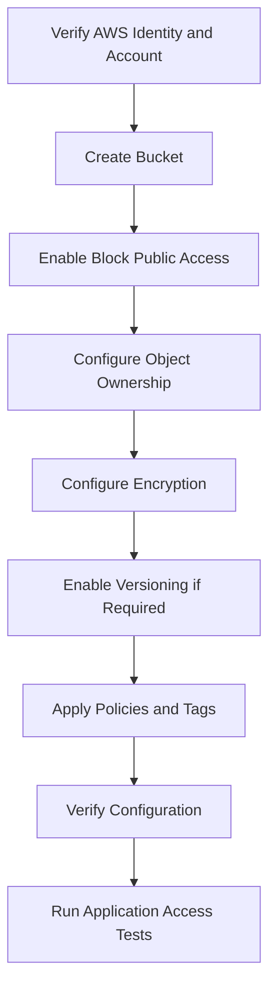

# 01- AWS CLI Bucket Operations

## Overview

Amazon S3 bucket operations are commonly performed through the AWS CLI during infrastructure provisioning, deployment, troubleshooting, and routine administration. A bucket is a regional S3 resource that provides the namespace for objects and the configuration boundary for settings such as versioning, encryption, public-access controls, lifecycle policies, and resource policies.

The AWS CLI provides two complementary command interfaces:

| Interface | Purpose | Typical commands |
|---|---|---|
| High-level `aws s3` | Convenient object and synchronization operations | `aws s3 ls`, `aws s3 cp`, `aws s3 sync`, `aws s3 rm` |
| Low-level `aws s3api` | Explicit S3 API operations and bucket configuration | `aws s3api create-bucket`, `get-bucket-encryption`, `put-bucket-versioning` |

Use `aws s3api` when you need precise control over bucket configuration, structured JSON responses, or repeatable infrastructure workflows. Use `aws s3` for convenient object transfers and directory synchronization.

This guide covers general-purpose bucket operations, including creation, inspection, configuration, access controls, tagging, and safe deletion. It assumes that AWS CLI v2 is installed and that the active AWS identity is authorized to perform the required operations.

## Pre-Operation Checks

Before changing a bucket, verify the AWS identity, account, Region, and CLI configuration. These checks reduce the risk of modifying a similarly named resource in the wrong account or environment.

### Verify the AWS CLI installation

```bash
aws --version
```

Example output:

```text
aws-cli/2.x.x Python/3.x.x ...
```

The exact versions depend on the installed release.

### Verify the active identity

```bash
aws sts get-caller-identity
```

The response includes the account ID and ARN of the active identity.

For production operations, verify that the returned account ID matches the intended environment before proceeding.

### Select a profile and Region

```bash
aws configure list --profile production

aws sts get-caller-identity \
  --profile production
```

Set the Region explicitly in commands or through the environment:

```bash
export AWS_PROFILE=production
export AWS_REGION=ap-south-1
```

On Windows PowerShell:

```powershell
$env:AWS_PROFILE = "production"
$env:AWS_REGION = "ap-south-1"
```

Use IAM roles, IAM Identity Center, or another approved short-lived credential mechanism wherever possible. Do not store access keys in shell scripts, source control, or documentation.

### Confirm the intended environment

```bash
aws sts get-caller-identity \
  --query '{Account:Account,Arn:Arn}' \
  --output table

aws configure get region
```

The configured default Region can be empty or differ from the Region intended for a particular bucket. Pass `--region` explicitly for sensitive operations.

## Create an S3 Bucket

Use `aws s3api create-bucket` when you need precise control over bucket creation and regional configuration.

### Create a bucket in `us-east-1`

```bash
aws s3api create-bucket \
  --bucket company-prod-documents-123456789012 \
  --region us-east-1
```

For the `us-east-1` Region, omit `--create-bucket-configuration`.

### Create a bucket in another Region

```bash
aws s3api create-bucket \
  --bucket company-prod-documents-123456789012 \
  --region ap-south-1 \
  --create-bucket-configuration LocationConstraint=ap-south-1
```

For Regions other than `us-east-1`, supply the matching `LocationConstraint`.

Use a bucket name that is globally unique within the applicable AWS partition and compliant with S3 general-purpose bucket naming rules. Avoid including confidential information in bucket names because names can appear in logs, policies, URLs, and operational tooling.

### Verify bucket creation

```bash
aws s3api head-bucket \
  --bucket company-prod-documents-123456789012 \
  --region ap-south-1
```

A successful `head-bucket` request returns no response body. A failure requires further investigation; it does not always mean the bucket does not exist because authorization and Region-related issues can also affect the request.

### Capture the bucket location

```bash
aws s3api get-bucket-location \
  --bucket company-prod-documents-123456789012
```

For the legacy location API, a returned `null` location constraint represents `us-east-1`. Prefer keeping the intended Region in deployment configuration rather than repeatedly inferring it at runtime.

### Creation considerations

- Bucket creation requires the appropriate `s3:CreateBucket` permission.
- Bucket names are not arbitrary private identifiers; avoid predictable names containing sensitive business details.
- Bucket creation and bucket configuration are separate operations.
- A successful create operation does not prove that access controls, encryption, logging, or versioning meet production requirements.
- Some resource configurations and security controls are best managed through infrastructure as code rather than manual CLI changes.

## List and Discover Buckets

### List buckets available to the caller

```bash
aws s3api list-buckets \
  --query 'Buckets[].{Name:Name,Created:CreationDate}' \
  --output table
```

The result includes buckets visible to the calling identity. It is not necessarily a complete inventory of every bucket in the AWS organization.

For a large-scale, multi-account inventory, use an approved organization-level inventory mechanism rather than relying on one account's `list-buckets` output.

### List buckets with the high-level interface

```bash
aws s3 ls
```

This is a convenient interactive command, but structured automation generally benefits from `s3api` and an explicit query.

### List objects inside a bucket

```bash
aws s3 ls s3://company-prod-documents-123456789012/
```

List a prefix recursively:

```bash
aws s3 ls \
  s3://company-prod-documents-123456789012/reports/ \
  --recursive
```

For structured object listings:

```bash
aws s3api list-objects-v2 \
  --bucket company-prod-documents-123456789012 \
  --prefix reports/ \
  --query 'Contents[].{Key:Key,Size:Size,Modified:LastModified}' \
  --output table
```

`ListObjectsV2` returns at most 1,000 objects per API response. The AWS CLI automatically paginates standard listing commands unless pagination is disabled or otherwise constrained. Avoid `--no-paginate` for audits that must examine the full result set.

## Inspect Bucket Configuration

A production bucket's behavior is controlled by several independent configuration APIs. Inspect them separately rather than assuming that one successful query verifies the entire resource.

| Configuration | Inspection command |
|---|---|
| Bucket existence and accessibility | `head-bucket` |
| Location | `get-bucket-location` |
| Versioning | `get-bucket-versioning` |
| Default encryption | `get-bucket-encryption` |
| Public-access block | `get-public-access-block` |
| Object Ownership | `get-bucket-ownership-controls` |
| Bucket policy | `get-bucket-policy` |
| Bucket tags | `get-bucket-tagging` |
| Lifecycle rules | `get-bucket-lifecycle-configuration` |
| Logging configuration | `get-bucket-logging` |
| Replication configuration | `get-bucket-replication` |

### Inspect versioning

```bash
aws s3api get-bucket-versioning \
  --bucket company-prod-documents-123456789012 \
  --region ap-south-1
```

An empty response can indicate that versioning has never been enabled. A `Status` of `Enabled` or `Suspended` indicates the corresponding configuration state.

Versioning configuration is not the same as a complete recovery strategy. Recovery also depends on object versions, retention controls, lifecycle configuration, permissions, and operational procedures.

### Inspect default encryption

```bash
aws s3api get-bucket-encryption \
  --bucket company-prod-documents-123456789012 \
  --region ap-south-1
```

Use the response to verify the configured default encryption algorithm and the KMS key identifier, if applicable.

### Inspect public-access controls

```bash
aws s3api get-public-access-block \
  --bucket company-prod-documents-123456789012 \
  --region ap-south-1
```

A missing public-access-block configuration can produce an error rather than a configuration document. Interpret that result carefully and check the intended bucket policy, account-level controls, and organization-level guardrails.

### Inspect Object Ownership

```bash
aws s3api get-bucket-ownership-controls \
  --bucket company-prod-documents-123456789012 \
  --region ap-south-1
```

For many modern applications, `BucketOwnerEnforced` is the appropriate baseline because it disables ACLs and simplifies access management through policies. Validate compatibility before applying it to workloads that still depend on ACLs.

## Apply a Secure Bucket Baseline

A production bucket commonly requires private access by default, predictable ownership, encryption, and versioning where recovery requirements justify it.

Apply and verify each setting independently, or manage the settings together through infrastructure as code.

### Enable Block Public Access

```bash
aws s3api put-public-access-block \
  --bucket company-prod-documents-123456789012 \
  --public-access-block-configuration \
    BlockPublicAcls=true,IgnorePublicAcls=true,BlockPublicPolicy=true,RestrictPublicBuckets=true \
  --region ap-south-1
```

Inspect the resulting configuration:

```bash
aws s3api get-public-access-block \
  --bucket company-prod-documents-123456789012 \
  --region ap-south-1
```

These controls help prevent unintended public exposure. They do not replace reviewing IAM policies, bucket policies, access points, and account-level controls.

### Configure Object Ownership

```bash
aws s3api put-bucket-ownership-controls \
  --bucket company-prod-documents-123456789012 \
  --ownership-controls '{
    "Rules": [
      {
        "ObjectOwnership": "BucketOwnerEnforced"
      }
    ]
  }' \
  --region ap-south-1
```

This setting disables ACLs and makes the bucket owner responsible for object ownership. Check compatibility with producers that send ACL headers before applying it.

### Enable versioning

```bash
aws s3api put-bucket-versioning \
  --bucket company-prod-documents-123456789012 \
  --versioning-configuration Status=Enabled \
  --region ap-south-1
```

Verify the status:

```bash
aws s3api get-bucket-versioning \
  --bucket company-prod-documents-123456789012 \
  --region ap-south-1
```

Versioning can protect against accidental overwrites and ordinary deletion, but it increases storage usage and requires appropriate lifecycle and recovery policies. It is not a substitute for an independently designed backup or disaster-recovery strategy.

### Apply a baseline in a deliberate order



The order is a practical workflow, not a universal dependency graph. Use infrastructure as code to define resource dependencies and avoid unmanaged configuration drift.

## Configure Default Encryption

S3 automatically encrypts new object uploads using SSE-S3 by default. Explicit bucket configuration makes the intended baseline visible and is useful when the workload requires SSE-KMS.

For an SSE-S3 configuration:

```bash
aws s3api put-bucket-encryption \
  --bucket company-prod-documents-123456789012 \
  --server-side-encryption-configuration '{
    "Rules": [
      {
        "ApplyServerSideEncryptionByDefault": {
          "SSEAlgorithm": "AES256"
        }
      }
    ]
  }' \
  --region ap-south-1
```

For SSE-KMS, use a reviewed KMS key ARN and configure the intended key permissions:

```bash
aws s3api put-bucket-encryption \
  --bucket company-prod-documents-123456789012 \
  --server-side-encryption-configuration '{
    "Rules": [
      {
        "ApplyServerSideEncryptionByDefault": {
          "SSEAlgorithm": "aws:kms",
          "KMSMasterKeyID": "arn:aws:kms:ap-south-1:123456789012:key/EXAMPLE-KEY-ID"
        },
        "BucketKeyEnabled": true
      }
    ]
  }' \
  --region ap-south-1
```

Replace the example key ARN with the intended key. A successful configuration change does not prove that the application can use the key. Verify the configuration and perform a controlled upload and read test using the intended role.

For detailed encryption choices, KMS authorization, and object-level validation, consult the dedicated S3 encryption documentation.

## Manage Bucket Policies

Bucket policies are resource-based policies that govern access to a bucket and its objects. Use policy files for changes that need code review, repeatable application, and reliable auditing.

### Retrieve a bucket policy

```bash
aws s3api get-bucket-policy \
  --bucket company-prod-documents-123456789012 \
  --query Policy \
  --output text
```

If no bucket policy exists, the operation can return an error. That does not mean the bucket is publicly accessible; access may also be governed by identity policies, account controls, and other applicable policies.

### Prepare and apply a policy

Create a file named `bucket-policy.json` containing a reviewed policy. For example, the following policy denies insecure transport for bucket and object requests.

```json
{
  "Version": "2012-10-17",
  "Statement": [
    {
      "Sid": "DenyInsecureTransport",
      "Effect": "Deny",
      "Principal": "*",
      "Action": "s3:*",
      "Resource": [
        "arn:aws:s3:::company-prod-documents-123456789012",
        "arn:aws:s3:::company-prod-documents-123456789012/*"
      ],
      "Condition": {
        "Bool": {
          "aws:SecureTransport": "false"
        }
      }
    }
  ]
}
```

Apply the policy:

```bash
aws s3api put-bucket-policy \
  --bucket company-prod-documents-123456789012 \
  --policy file://bucket-policy.json \
  --region ap-south-1
```

Verify that the intended policy is present:

```bash
aws s3api get-bucket-policy \
  --bucket company-prod-documents-123456789012 \
  --region ap-south-1
```

### Policy safety rules

- Validate bucket and account ARNs before applying a policy.
- Review explicit denies because they can block legitimate callers even when identity policies allow access.
- Keep a reviewed copy of the previous policy before replacing it.
- Test application reads and writes after a policy change.
- Do not assume that a bucket policy alone represents every effective access decision.
- Never apply an unreviewed policy to production using copied placeholder principals or resource identifiers.

`put-bucket-policy` replaces the bucket's existing policy; it does not append a statement automatically.

## Apply Bucket Tags

Tags support cost allocation, ownership, environment classification, and operational inventory.

### Add or replace the bucket tag set

Prepare `bucket-tags.json`:

```json
{
  "TagSet": [
    {
      "Key": "Environment",
      "Value": "production"
    },
    {
      "Key": "Application",
      "Value": "document-service"
    },
    {
      "Key": "Owner",
      "Value": "platform-team"
    }
  ]
}
```

Apply the tags:

```bash
aws s3api put-bucket-tagging \
  --bucket company-prod-documents-123456789012 \
  --tagging file://bucket-tags.json \
  --region ap-south-1
```

Inspect the current tags:

```bash
aws s3api get-bucket-tagging \
  --bucket company-prod-documents-123456789012 \
  --region ap-south-1
```

`put-bucket-tagging` replaces the existing bucket tag set. Retrieve and merge existing tags before applying changes when tags are managed by multiple systems.

Bucket tags and object tags are separate mechanisms. Object tags are not automatically changed when bucket tags change.

## Synchronize Bucket Configuration with Infrastructure as Code

Manual CLI changes are useful for diagnosis and carefully controlled administrative work. For long-lived infrastructure, use a version-controlled definition to make intended settings reproducible.

Terraform can manage the bucket and its configuration as separate resources:

```hcl
resource "aws_s3_bucket" "documents" {
  bucket = var.bucket_name

  tags = {
    Environment = var.environment
    Application = "document-service"
    Owner       = "platform-team"
  }
}

resource "aws_s3_bucket_public_access_block" "documents" {
  bucket = aws_s3_bucket.documents.id

  block_public_acls       = true
  ignore_public_acls      = true
  block_public_policy     = true
  restrict_public_buckets = true
}

resource "aws_s3_bucket_ownership_controls" "documents" {
  bucket = aws_s3_bucket.documents.id

  rule {
    object_ownership = "BucketOwnerEnforced"
  }
}

resource "aws_s3_bucket_versioning" "documents" {
  bucket = aws_s3_bucket.documents.id

  versioning_configuration {
    status = "Enabled"
  }
}
```

This example defines a bucket, public-access controls, ownership controls, and versioning. Encryption, lifecycle configuration, resource policies, logging, and other requirements should be modeled explicitly where applicable.

Validate and plan changes before applying them:

```bash
terraform fmt -check
terraform validate
terraform plan
```

When Terraform manages a resource, do not make untracked CLI changes and assume they will persist. A subsequent plan or apply may reconcile the resource back to the configuration in source control.

## Remove a Bucket Safely

Bucket deletion is a destructive operation. Validate ownership, environment, object retention, versioning, replication, and downstream dependencies before deleting a resource.

### Confirm the target

```bash
aws sts get-caller-identity

aws s3api head-bucket \
  --bucket company-prod-documents-123456789012 \
  --region ap-south-1

aws s3api list-objects-v2 \
  --bucket company-prod-documents-123456789012 \
  --max-keys 10 \
  --region ap-south-1
```

Inspect versioning before planning deletion:

```bash
aws s3api get-bucket-versioning \
  --bucket company-prod-documents-123456789012 \
  --region ap-south-1
```

Also review retention requirements, Object Lock, replication, lifecycle rules, and the applications that reference the bucket.

### Delete an empty bucket

```bash
aws s3api delete-bucket \
  --bucket company-prod-documents-123456789012 \
  --region ap-south-1
```

For a general-purpose bucket, deletion requires that the bucket contain no objects or object versions, including delete markers. Versioned buckets therefore need additional cleanup before deletion.

### Remove an unversioned test bucket

For an explicitly disposable, unversioned test bucket:

```bash
aws s3 rm \
  s3://company-test-temporary-123456789012/ \
  --recursive

aws s3 rb \
  s3://company-test-temporary-123456789012
```

The first command removes current objects recursively. The second removes the bucket after it is empty.

Do not run these commands against production resources without a reviewed deletion plan. `aws s3 rm --recursive` does not permanently remove all historical versions in a versioned bucket.

### Versioned bucket deletion

For versioned buckets, inspect versions and delete markers before removing anything:

```bash
aws s3api list-object-versions \
  --bucket company-prod-documents-123456789012 \
  --region ap-south-1 \
  --output json
```

Deletion must account for every version and delete marker. For large buckets, use an appropriately scoped S3 Batch Operations job or a controlled cleanup process that handles pagination, version IDs, retries, and failures.

Do not disable versioning or issue a recursive removal command as a substitute for a documented retention and deletion procedure. Object Lock and retention settings may also prevent permanent deletion.

## Operational Safeguards

Use the following controls for routine bucket administration.

| Risk | Safeguard |
|---|---|
| Wrong account or Region | Verify `get-caller-identity` and supply `--region` |
| Bucket name collision | Use an approved globally unique naming convention |
| Accidental public exposure | Configure Block Public Access and review resource policies |
| Overwriting production configuration | Retrieve and review current settings before applying updates |
| Lost tag metadata | Merge the existing tag set before replacement |
| Broken application access | Test real read and write workflows after policy changes |
| Untracked configuration drift | Manage long-lived resources through infrastructure as code |
| Accidental data deletion | Review versioning, retention, object versions, and delete markers first |
| Incomplete command results | Preserve CLI pagination for full inventory and audit operations |
| Unexpected charges | Review storage, versions, requests, data transfer, and lifecycle behavior before migration or cleanup |

## Troubleshooting Common Bucket Operations

| Symptom | Likely causes | Diagnostic approach |
|---|---|---|
| `AccessDenied` | Missing IAM permission, explicit deny, incorrect resource policy, or organizational restriction | Verify the active identity, action permission, resource ARN, and applicable policies |
| `NoSuchBucket` | Incorrect bucket name, wrong Region context, or bucket no longer exists | Confirm the name and inspect account inventory and location |
| `BucketAlreadyExists` | The general-purpose bucket name is already taken by another account | Choose a compliant name that is globally unique |
| `BucketAlreadyOwnedByYou` | The caller's account already owns the named bucket | Inspect the existing bucket rather than attempting to recreate it |
| `InvalidLocationConstraint` | Missing or mismatched Region configuration during creation | Match the client Region and `LocationConstraint`; omit the constraint for `us-east-1` |
| `BucketNotEmpty` | Objects, versions, or delete markers remain | Inspect object listings and, for versioned buckets, `list-object-versions` |
| `NoSuchPublicAccessBlockConfiguration` | No bucket-level public-access-block configuration is present | Inspect the intended baseline and account-level controls before applying configuration |
| Unexpected policy behavior | Policy replacement, explicit deny, or conflicting conditions | Retrieve the policy and test the original request with the intended principal |
| Tagging configuration unexpectedly loses tags | `put-bucket-tagging` replaced the whole tag set | Retrieve, merge, and reapply the complete intended set |

A failed bucket operation should be diagnosed using the actual API error and request context. Avoid broadening permissions or disabling security controls without identifying the root cause.

## Key Takeaways

- Verify the active AWS identity, account, and Region before executing bucket operations.
- Use `aws s3api` for precise bucket configuration and `aws s3` for convenient transfers and synchronization.
- Treat encryption, versioning, public-access controls, ownership, policies, and tags as independent settings that require explicit verification.
- Manage production bucket configuration through infrastructure as code and test application behavior after security changes.
- Treat deletion as a controlled operational workflow, especially when object versioning, retention, and delete markers are involved.