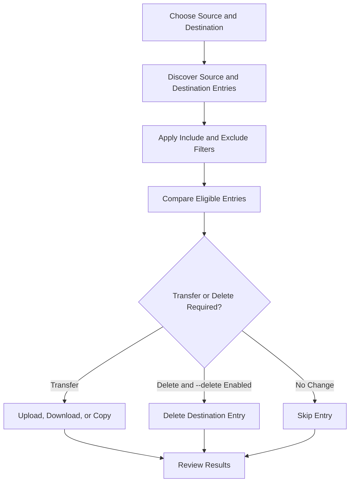
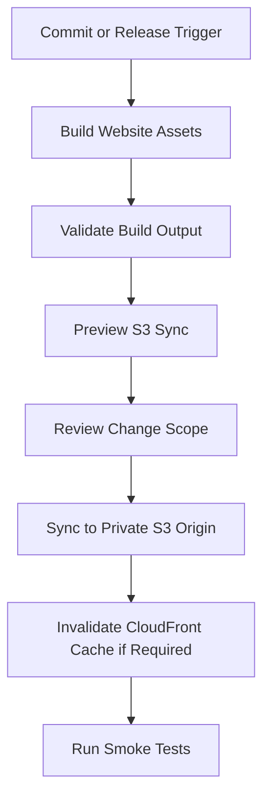

# 03- AWS CLI Sync Operations

## Overview

Amazon S3 synchronization is used to keep local directories, S3 prefixes, and separate S3 buckets aligned without manually transferring every object. The AWS CLI `aws s3 sync` command recursively identifies missing or outdated files and objects, then transfers the changes between the source and destination.

Synchronization is useful for:

- Deploying static website assets.
- Uploading application-generated reports and documents.
- Moving datasets between environments or buckets.
- Copying backups to a separate storage location.
- Synchronizing development artifacts with S3.
- Transferring data into analytics and archival workflows.

A key distinction is that **synchronization is not necessarily an exact mirror operation**. By default, the command copies missing or outdated data but does not delete destination objects that are absent from the source. The `--delete` option changes that behavior and must be used carefully.

This document covers synchronization workflows, comparison behavior, filtering, deletion safety, encryption, performance, integrity validation, and production deployment patterns.

## Understanding `aws s3 sync`

### Command syntax

```bash
aws s3 sync <source> <destination> [options]
```

The command supports three primary transfer directions.

| Direction | Example | Typical use case |
|---|---|---|
| Local to S3 | `./reports/` → `s3://company-bucket/reports/` | Upload generated files or deploy assets |
| S3 to local | `s3://company-bucket/reports/` → `./reports/` | Download files or restore a working copy |
| S3 to S3 | `s3://source-bucket/reports/` → `s3://archive-bucket/reports/` | Copy data between prefixes or buckets |

Synchronization recursively processes the contents of the selected source directory or S3 prefix. It does not require that the destination already exist.

### How synchronization works

At a high level, the CLI discovers source and destination entries, compares their attributes, applies the include/exclude filters, and transfers eligible files or objects.



The exact comparison rules depend on the transfer direction and command options. The command does not perform an unconditional full-content comparison of every source and destination object.

## Default Comparison Behavior

By default, `sync` transfers missing or outdated entries using file size and modification-time comparisons, with behavior that varies by direction.

| Situation | Typical default behavior |
|---|---|
| Source file has no matching destination entry | Transfer the file |
| Source and destination sizes differ | Transfer the file |
| Source is considered newer than the destination | Transfer the file |
| Entries are considered equivalent | Skip the transfer |
| Destination contains an extra entry | Keep it unless `--delete` is enabled |
| Only metadata differs | Do not assume that `sync` will detect and correct the difference |

### Important limitations

A synchronization run can skip an object even when the underlying content or metadata does not meet your expectations.

For example, a file may have different contents but the same size and timestamps that cause the CLI to consider it unchanged. Likewise, a metadata change alone may not cause the expected transfer.

For workloads that require strong integrity guarantees, use explicit checksum validation, controlled rewrites, version-aware workflows, or a dedicated data-validation process.

### The `--size-only` option

The `--size-only` option uses size as the principal change criterion instead of the normal comparison behavior.

```bash
aws s3 sync \
  ./reports/ \
  s3://company-prod-documents-123456789012/reports/ \
  --size-only
```

Use it only when equal-sized files can reasonably be treated as equivalent for the workload. A changed file with the same size may be skipped even when its contents differ.

### The `--exact-timestamps` option

When synchronizing from S3 to a local directory, `--exact-timestamps` changes the handling of same-sized objects so that their timestamps must match exactly for them to be considered unchanged.

```bash
aws s3 sync \
  s3://company-prod-documents-123456789012/reports/ \
  ./reports/ \
  --exact-timestamps
```

This is useful when local and remote modification times need stricter comparison. It is not a checksum-based guarantee that the contents are identical.

## Synchronize Local Files to S3

Local-to-S3 synchronization is common for application deployments, generated reports, static assets, and data ingestion.

### Basic synchronization

```bash
aws s3 sync \
  ./reports/ \
  s3://company-prod-documents-123456789012/reports/ \
  --region ap-south-1
```

The command uploads eligible new and changed files while retaining unrelated destination objects.

### Synchronize a build directory

For example, deploy the contents of a generated frontend build:

```bash
aws s3 sync \
  ./dist/ \
  s3://company-prod-website-123456789012/ \
  --region ap-south-1
```

This command copies the contents of `dist/` to the bucket root. It does not upload the `dist` directory as an additional path component.

For website assets, configure the appropriate MIME types and cache-control behavior. Avoid using a long cache lifetime for frequently changing HTML files unless the deployment process includes suitable cache invalidation or versioned asset names.

### Synchronize with explicit metadata

```bash
aws s3 sync \
  ./dist/ \
  s3://company-prod-website-123456789012/ \
  --cache-control "public, max-age=31536000, immutable" \
  --region ap-south-1
```

This cache policy is appropriate only for content whose URL changes whenever the content changes, such as content-hashed JavaScript or CSS assets. Do not apply it indiscriminately to HTML entry points or mutable resources.

If files require different metadata policies, deploy them in separate synchronization steps with narrowly scoped prefixes and options.

## Synchronize S3 to a Local Directory

Use S3-to-local synchronization to retrieve reports, reproduce processing workflows, or restore a local copy of remote data.

### Basic download synchronization

```bash
aws s3 sync \
  s3://company-prod-documents-123456789012/reports/ \
  ./reports/ \
  --region ap-south-1
```

The destination directory is created when necessary. Existing local files that are considered up to date are generally skipped.

### Download while preserving unrelated local files

By default, local files that have no corresponding source object are not removed.

```bash
aws s3 sync \
  s3://company-prod-documents-123456789012/reports/ \
  ./reports/
```

This is useful when the local directory contains additional files that must remain untouched.

### Restore a working copy

For recovery workflows, synchronization alone does not prove that the restored data is complete or correct. Define the recovery scope, select the required object versions where applicable, validate important checksums, and verify the restored application data.

For versioned objects, ordinary synchronization should not be treated as a version-history restoration mechanism.

## Synchronize Between S3 Buckets

S3-to-S3 synchronization is useful for copying datasets, moving artifacts, and maintaining a destination copy in a separate bucket.

### Same-Region synchronization

```bash
aws s3 sync \
  s3://company-source-data-123456789012/exports/ \
  s3://company-archive-data-123456789012/exports/ \
  --region ap-south-1
```

The CLI copies eligible objects from the source prefix to the destination prefix.

### Cross-Region synchronization

```bash
aws s3 sync \
  s3://company-source-data-123456789012/exports/ \
  s3://company-dr-data-123456789012/exports/ \
  --source-region ap-south-1 \
  --region eu-west-1
```

The source and destination Regions are specified separately. Replace the example Regions with those of the actual buckets.

### Cross-account considerations

When the buckets belong to different AWS accounts, verify:

- The caller can list and read the source objects.
- The caller can write objects to the destination.
- Destination bucket policies permit the required operations.
- KMS permissions allow the source to be read and the destination to be encrypted as intended.
- Object ownership and tagging behavior meet the destination account's requirements.
- Data-transfer and request costs have been considered.

For durable disaster recovery, S3 replication may be more suitable than periodically running `sync`. Replication provides a managed mechanism for replicating eligible new objects and supported changes, whereas synchronization is an explicitly initiated transfer workflow.

## Use Include and Exclude Filters

The `--exclude` and `--include` options allow synchronization to select files or objects based on patterns. Filters are evaluated in the order provided, and later matching rules can override earlier rules.

### Exclude temporary files

```bash
aws s3 sync \
  ./reports/ \
  s3://company-prod-documents-123456789012/reports/ \
  --exclude "*.tmp" \
  --exclude "*.log"
```

Temporary files and logs matching these rules are excluded from the synchronization operation.

### Include only PDF files

Because entries are included by default, an include-only filter does not restrict the command to that file type. Start by excluding everything, then include the required extension.

```bash
aws s3 sync \
  ./reports/ \
  s3://company-prod-documents-123456789012/reports/ \
  --exclude "*" \
  --include "*.pdf"
```

### Exclude a directory

```bash
aws s3 sync \
  ./application-data/ \
  s3://company-prod-data-123456789012/ \
  --exclude "temporary/*" \
  --exclude "cache/*"
```

Filter patterns are matched relative to the synchronization source. Test directory-specific patterns with `--dryrun` before executing the command.

### Combine filters

```bash
aws s3 sync \
  ./reports/ \
  s3://company-prod-documents-123456789012/reports/ \
  --exclude "*" \
  --include "*.pdf" \
  --include "*.csv" \
  --exclude "internal/*"
```

The command selects PDF and CSV files while excluding matching entries under `internal/`, subject to the exact filter patterns and source-relative paths.

### Filter behavior with `--delete`

Filters also affect which destination entries are eligible for deletion. An excluded destination object is not deleted by that synchronization run.

This interaction is important when the command is intended to create an exact destination mirror. A filter that prevents copying an object can also prevent its deletion, so validate both transfer and deletion behavior in a preview.

## Delete Destination Entries with `--delete`

The `--delete` option removes destination files or objects that are absent from the source and are not excluded by the effective filters.

### Default synchronization versus exact mirroring

Without `--delete`, the command normally leaves extra destination entries in place.

With `--delete`, the command can remove these entries to bring the selected destination scope closer to the source contents.

| Behavior | Default sync | Sync with `--delete` |
|---|---|---|
| Upload or copy missing entries | Yes | Yes |
| Update entries considered outdated | Yes | Yes |
| Preserve extra destination entries | Yes | No, if eligible for deletion |
| Potentially destructive | Lower risk | Higher risk |
| Appropriate for a production mirror | Only when retaining extras is acceptable | Only after validating source and destination scope |

### Preview a destructive synchronization

```bash
aws s3 sync \
  ./release/ \
  s3://company-prod-website-123456789012/ \
  --delete \
  --dryrun
```

Review every planned upload, copy, and deletion.

Only after confirming the exact source, destination, filters, account, and Region should the real command be executed:

```bash
aws s3 sync \
  ./release/ \
  s3://company-prod-website-123456789012/ \
  --delete \
  --region ap-south-1
```

### Production precautions

- Never use an empty or incorrectly resolved source path in a destructive synchronization.
- Do not rely on the current working directory without checking it.
- Preserve required destination-only files by using a separate prefix or carefully designed filters.
- Test the exact command in a non-production environment.
- Restrict the execution role to the intended destination resources.
- Verify results after deletion.
- Account for versioning, retention controls, and Object Lock.

In a versioned bucket, deleting an object through a normal delete operation can create a delete marker rather than permanently erasing historical versions. A successful synchronization therefore does not necessarily mean that previous versions or their storage costs have been removed.

## Control Storage Class and Encryption

Synchronization supports several transfer and object-configuration options. Select settings based on the data's security requirements, access pattern, and expected lifecycle.

### Specify a storage class

```bash
aws s3 sync \
  ./archive/ \
  s3://company-archive-data-123456789012/archive/ \
  --storage-class STANDARD_IA
```

Storage-class selection affects the storage and retrieval cost model. Infrequent-access and archival classes have restrictions and minimum-duration considerations that must be evaluated before using them for frequently accessed application data.

For Glacier-family storage classes, retrieval behavior and availability differ from immediately accessible classes. Do not treat a successful synchronization command as proof that future retrieval will be immediate.

### Use SSE-KMS encryption

```bash
aws s3 sync \
  ./sensitive-reports/ \
  s3://company-prod-secure-documents-123456789012/reports/ \
  --sse aws:kms \
  --sse-kms-key-id arn:aws:kms:ap-south-1:123456789012:key/EXAMPLE-KEY-ID \
  --region ap-south-1
```

Replace the example key ARN with the approved customer-managed key.

The caller needs the appropriate S3 permissions and applicable KMS authorization. For cross-account copies, the source decryption path and destination encryption path may require different keys and permissions.

### Default encryption versus request parameters

A bucket can have default encryption configured, so explicit request parameters are not required for every upload. However, where a workflow requires a specific encryption key, verify the effective encryption metadata of the destination objects.

Synchronization success alone does not prove that every object uses the intended encryption configuration.

## Symlinks and Local Filesystem Behavior

By default, the AWS CLI follows symbolic links when uploading from a local filesystem to S3. The linked file's contents can therefore be uploaded under the path associated with the link.

### Disable following symbolic links

```bash
aws s3 sync \
  ./build/ \
  s3://company-prod-website-123456789012/ \
  --no-follow-symlinks
```

Use this when symlink targets should not be included in an upload.

### Deployment considerations

- Review symlinks in build artifacts and deployment directories.
- Restrict the source path to a known build output directory.
- Exclude local caches, temporary files, dependency directories, and repository metadata where appropriate.
- Check case-sensitivity differences between development filesystems and downstream environments.
- Avoid assuming that a local filesystem tree maps exactly to all S3 key semantics.

The symlink options apply to uploads from the local filesystem. They do not create a filesystem directory structure inside S3.

## Preview, Logging, and Output Control

For operational scripts, previewing changes and preserving useful command output can prevent unexpected updates and make failures easier to diagnose.

### Preview the synchronization

```bash
aws s3 sync \
  ./reports/ \
  s3://company-prod-documents-123456789012/reports/ \
  --dryrun \
  --region ap-south-1
```

`--dryrun` displays planned operations without performing the transfers or deletions.

### Suppress progress output

```bash
aws s3 sync \
  ./reports/ \
  s3://company-prod-documents-123456789012/reports/ \
  --no-progress
```

This is useful for cleaner logs in CI/CD and automated jobs.

### Show errors while suppressing successful transfer lines

```bash
aws s3 sync \
  ./reports/ \
  s3://company-prod-documents-123456789012/reports/ \
  --only-show-errors
```

This reduces the volume of successful-transfer output but does not replace structured monitoring or explicit error handling.

### Capture the command exit status

In Bash:

```bash
set -euo pipefail

aws s3 sync \
  ./reports/ \
  s3://company-prod-documents-123456789012/reports/ \
  --region ap-south-1 \
  --no-progress

echo "Synchronization completed successfully."
```

With `set -e`, the script terminates when the synchronization command returns a nonzero status.

For more complex automation, capture logs and exit status explicitly and decide how the pipeline should handle partial failures, retries, and notifications.

## Performance and Large Transfers

The AWS CLI manages multiple transfer operations and uses multipart transfer behavior for supported large files. Performance depends on file count, average file size, network throughput, concurrency, API latency, and the source and destination storage patterns.

### Performance considerations

| Workload | Main concern | Recommended approach |
|---|---|---|
| Many small files | Per-object request overhead | Reduce unnecessary files and synchronize only required prefixes |
| Large files | Network throughput and multipart efficiency | Use supported multipart transfer behavior and validate network capacity |
| Cross-Region synchronization | Network transfer time and data-transfer charges | Estimate volume and cost before large jobs |
| High-frequency synchronization | Repeated discovery and request overhead | Synchronize targeted prefixes and consider event-driven or managed alternatives |
| Very large datasets | Long runtimes and recoverability | Divide work into controlled prefixes and persist useful execution logs |
| Strict integrity workloads | Content and metadata validation | Use checksums and explicit verification after transfer |

### Configure transfer concurrency cautiously

AWS CLI S3 transfer behavior can be adjusted using supported configuration settings, including concurrent request limits and multipart thresholds. Higher concurrency can improve throughput but also increase memory usage, request volume, and the load placed on network infrastructure.

Benchmark changes against realistic data rather than increasing concurrency indiscriminately.

### Use `--page-size` when necessary

```bash
aws s3 sync \
  s3://company-prod-data-123456789012/exports/ \
  ./exports/ \
  --page-size 100 \
  --no-progress
```

A smaller page size can reduce the number of objects returned per listing request, which may help with certain timeouts or responsiveness issues. It can also increase the number of requests required. Use it only when the default behavior has a demonstrated operational problem.

## Data Integrity and Post-Sync Validation

A successful synchronization command establishes that the CLI completed its planned operations without reporting a command-level failure. It does not automatically prove that every business requirement has been met.

For critical datasets, perform independent validation.

### Verify object counts

For a targeted S3 prefix:

```bash
aws s3api list-objects-v2 \
  --bucket company-prod-documents-123456789012 \
  --prefix reports/ \
  --query 'KeyCount' \
  --output text
```

`KeyCount` applies to the returned page, not necessarily the total object count across a large prefix. Use complete pagination or an inventory process for authoritative counts.

### Verify metadata for a critical object

```bash
aws s3api head-object \
  --bucket company-prod-documents-123456789012 \
  --key reports/monthly-report.pdf \
  --query '{Size:ContentLength,Modified:LastModified,Encryption:ServerSideEncryption,Version:VersionId}' \
  --output json
```

Compare the result with the expected metadata.

### Validate checksums

For supported workflows, S3 objects can carry checksums such as CRC-based or cryptographic checksums. Use matching checksum algorithms and compatible full-object or composite checksum semantics when comparing source and destination data.

Do not assume that the ETag is always an MD5 checksum. Multipart uploads and encryption-related behavior can make that assumption invalid.

For sensitive data migration, record the scope, expected object count, checksums where available, failure list, and final verification outcome.

## Production Synchronization Patterns

### Static website deployment

A CI/CD workflow can build a static website, preview the upload, synchronize the generated assets, and verify the deployed content.



Prefer a private S3 origin behind CloudFront using Origin Access Control when the architecture requires private origin access. A website deployment should not make the bucket public merely to simplify synchronization.

Example deployment command:

```bash
aws s3 sync \
  ./dist/ \
  s3://company-prod-website-123456789012/ \
  --no-progress \
  --region ap-south-1
```

For versioned assets, use immutable caching where appropriate. For HTML or mutable objects, implement a suitable cache policy and invalidation strategy.

### Data pipeline synchronization

For scheduled ingestion, synchronize a clearly bounded source prefix into a destination prefix and record the job result.

```bash
aws s3 sync \
  s3://company-ingestion-source-123456789012/exports/ \
  s3://company-analytics-data-123456789012/raw/ \
  --source-region ap-south-1 \
  --region ap-south-1 \
  --no-progress
```

A production pipeline should additionally track the execution ID, expected input scope, object counts, failures, and downstream processing status. For event-driven systems, avoid treating the synchronization command as a transaction that guarantees all downstream processing is complete.

### Backup and disaster recovery

A recurring synchronization task may be useful for copying selected data into another bucket, but it is not equivalent to a complete backup design.

Consider:

- Versioning and protection against accidental deletion.
- Retention policies and independent recovery controls.
- Object Lock when immutable retention is required.
- Cross-Region Replication when managed replication behavior is appropriate.
- Separate account boundaries for important recovery copies.
- Periodic restoration tests and documented recovery objectives.

A destination synchronized with `--delete` can lose the same current objects that disappeared from the source. For recovery use cases, decide whether the destination should be a mirror, a historical archive, or an independently retained backup.

## Common Synchronization Mistakes

| Mistake | Why it is a problem | Prevention |
|---|---|---|
| Using `--delete` without a preview | Extra destination objects may be removed | Use `--dryrun` and validate the full scope |
| Assuming `sync` compares every object's contents | Changes with equivalent comparison attributes can be missed | Use explicit checksums or a controlled rewrite when required |
| Using only `--include` | Existing default inclusion behavior may leave unwanted files selected | Start with `--exclude "*"` and then add desired includes |
| Assuming synchronization is a transaction | Partial transfers can occur before a failure | Make jobs restartable and reconcile destination state |
| Assuming metadata changes automatically trigger transfers | Objects may be skipped even when metadata is wrong | Use a deliberate metadata rewrite or separate validation workflow |
| Treating sync as an atomic move | Both source and destination may retain copies after partial failure | Validate destination before initiating source cleanup |
| Treating a synchronized copy as a version-history backup | Historical versions and delete markers may not be reproduced as expected | Design version-aware backup and recovery workflows |
| Increasing concurrency without benchmarking | Resource usage and request pressure may rise unexpectedly | Test with realistic files and measure throughput and errors |
| Assuming a successful exit guarantees application readiness | Data may still require validation or downstream processing | Run verification and smoke tests after synchronization |

## Pre-Execution Checklist

Before running a production synchronization:

- [ ] Verify the AWS account, Region, bucket, and prefix.
- [ ] Confirm the source directory or S3 prefix is correct.
- [ ] Review include and exclude filter order.
- [ ] Determine whether destination-only files must be preserved.
- [ ] Preview any operation using `--delete`.
- [ ] Check IAM and KMS permissions.
- [ ] Evaluate storage class, encryption, transfer, and request costs.
- [ ] Account for versioning and retention requirements.
- [ ] Define validation and recovery steps for partial failure.
- [ ] Capture the command result and verify important objects after completion.

## Official References

- [AWS CLI `sync` command reference](https://docs.aws.amazon.com/cli/latest/reference/s3/sync.html)
- [Using high-level S3 commands in the AWS CLI](https://docs.aws.amazon.com/cli/latest/userguide/cli-services-s3-commands.html)
- [AWS CLI S3 command reference](https://docs.aws.amazon.com/cli/latest/reference/s3/)
- [Checking object integrity in Amazon S3](https://docs.aws.amazon.com/AmazonS3/latest/userguide/checking-object-integrity.html)
- [Amazon S3 Replication](https://docs.aws.amazon.com/AmazonS3/latest/userguide/replication.html)
- [Amazon S3 storage classes](https://docs.aws.amazon.com/AmazonS3/latest/userguide/storage-class-intro.html)

## Key Takeaways

- `aws s3 sync` transfers missing or outdated entries; it does not automatically produce an exact mirror unless deletion behavior is explicitly enabled.
- Comparison rules depend on transfer direction and command options, so synchronization is not a substitute for checksum-based integrity verification.
- Always preview destructive operations with `--dryrun` and review how filters affect both transfers and deletions.
- Treat encryption, metadata, version history, retention, and cross-account permissions as explicit parts of a synchronization design.
- Production workflows should record execution results, handle partial completion safely, and validate critical data after synchronization.