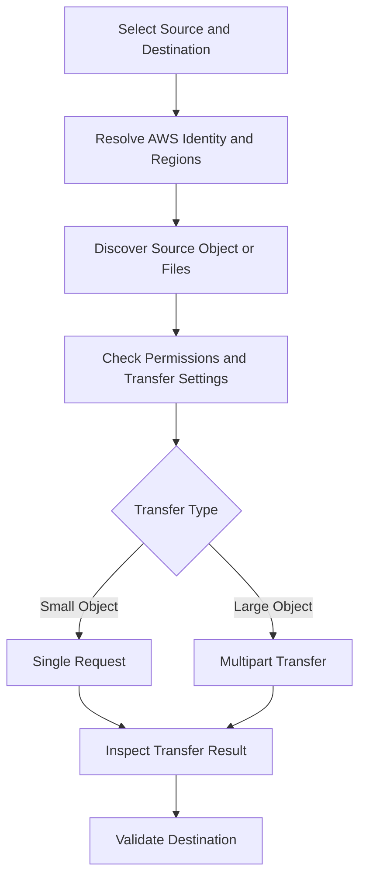

# 04- AWS CLI Copy and Transfer Operations

## Overview

Amazon S3 copy and transfer operations move data between local filesystems, S3 buckets, and S3 object prefixes. These operations are fundamental to application deployments, data ingestion, backup workflows, archival systems, and cross-account data movement.

The AWS CLI provides high-level transfer commands that manage common details such as multipart uploads, concurrent requests, object discovery, and transfer retries.

The primary commands are:

| Command | Purpose | Typical use case |
|---|---|---|
| `aws s3 cp` | Copy a file, object, or directory tree | Upload reports, download datasets, copy objects between buckets |
| `aws s3 mv` | Move files or objects through copy-and-delete behavior | Reorganize objects or relocate files |
| `aws s3 sync` | Transfer missing or outdated entries between locations | Incremental deployment and dataset synchronization |
| `aws s3api copy-object` | Perform an explicit single-object S3 copy | Copy an object with specific API parameters |
| `aws s3api get-object` | Download an object through the S3 API | Retrieve a specific object version or byte range |

This document focuses on copy and transfer operations, including multipart transfers, metadata preservation, encryption, cross-Region copying, performance tuning, error handling, and production safeguards.

## Prerequisites

Verify the installed AWS CLI version and the identity used for the transfer.

```bash
aws --version

aws sts get-caller-identity
```

Set the intended profile and Region when appropriate:

```bash
export AWS_PROFILE=production
export AWS_REGION=ap-south-1
```

On Windows PowerShell:

```powershell
$env:AWS_PROFILE = "production"
$env:AWS_REGION = "ap-south-1"
```

Example resources used throughout this document:

```text
Source bucket:      company-source-data-123456789012
Destination bucket: company-archive-data-123456789012
Source Region:      ap-south-1
Destination Region: eu-west-1
Object key:         exports/monthly-report.csv
```

Replace these identifiers with the actual resources.

Use IAM roles, IAM Identity Center, or another approved short-lived credential mechanism. Avoid placing AWS credentials in shell commands, scripts, or source control.

## Understand Transfer Directions

The AWS CLI supports transfers between local filesystems and S3, as well as copies between S3 locations.

### Local file to S3

```bash
aws s3 cp \
  ./monthly-report.csv \
  s3://company-source-data-123456789012/exports/monthly-report.csv \
  --region ap-south-1
```

### S3 to local file

```bash
aws s3 cp \
  s3://company-source-data-123456789012/exports/monthly-report.csv \
  ./monthly-report.csv \
  --region ap-south-1
```

### S3 to S3

```bash
aws s3 cp \
  s3://company-source-data-123456789012/exports/monthly-report.csv \
  s3://company-archive-data-123456789012/exports/monthly-report.csv \
  --source-region ap-south-1 \
  --region eu-west-1
```

For S3-to-S3 operations, `--source-region` identifies the source bucket's Region, while `--region` identifies the destination-side Region used by the operation.

### Transfer flow



The exact requests depend on the transfer direction, file size, CLI configuration, and selected options.

## Copy a Single File or Object

### Copy a local file to S3

```bash
aws s3 cp \
  ./invoice-001.pdf \
  s3://company-source-data-123456789012/invoices/invoice-001.pdf \
  --region ap-south-1
```

The destination object key is `invoices/invoice-001.pdf`.

### Copy an object within the same bucket

```bash
aws s3 cp \
  s3://company-source-data-123456789012/reports/draft.csv \
  s3://company-source-data-123456789012/archive/draft.csv \
  --region ap-south-1
```

An S3-to-S3 copy normally occurs within S3. The object data does not need to pass through the local machine.

### Copy an object between buckets

```bash
aws s3 cp \
  s3://company-source-data-123456789012/exports/monthly-report.csv \
  s3://company-archive-data-123456789012/exports/monthly-report.csv \
  --source-region ap-south-1 \
  --region eu-west-1
```

The caller needs appropriate access to the source and destination. Cross-account and SSE-KMS workflows can require additional resource-policy and KMS permissions.

### Rename the destination key

S3 does not provide a traditional filesystem-style rename operation. To change an object key, copy the object to the new key and then delete the original when safe.

```bash
aws s3 cp \
  s3://company-source-data-123456789012/reports/old-name.csv \
  s3://company-source-data-123456789012/reports/new-name.csv \
  --region ap-south-1
```

Verify the destination before deleting the source.

## Copy Directories Recursively

Use `--recursive` to copy a directory tree or all objects under an S3 prefix.

### Local directory to S3

```bash
aws s3 cp \
  ./reports/ \
  s3://company-source-data-123456789012/reports/ \
  --recursive \
  --region ap-south-1
```

### S3 prefix to local directory

```bash
aws s3 cp \
  s3://company-source-data-123456789012/reports/ \
  ./downloaded-reports/ \
  --recursive \
  --region ap-south-1
```

### S3 prefix to another prefix

```bash
aws s3 cp \
  s3://company-source-data-123456789012/reports/ \
  s3://company-archive-data-123456789012/reports/ \
  --recursive \
  --source-region ap-south-1 \
  --region eu-west-1
```

Recursive copying processes eligible objects under the selected source prefix. It does not delete unrelated destination objects.

### Destination path semantics

The destination URI determines whether the source name is retained or replaced.

For an individual file:

```bash
aws s3 cp \
  ./report.csv \
  s3://company-source-data-123456789012/reports/
```

The object is uploaded as `reports/report.csv`.

Without the trailing slash, the destination is interpreted as the intended object name:

```bash
aws s3 cp \
  ./report.csv \
  s3://company-source-data-123456789012/reports/final-report.csv
```

Quote local paths containing spaces:

```bash
aws s3 cp \
  "./monthly reports/report final.csv" \
  "s3://company-source-data-123456789012/reports/report final.csv"
```

Always inspect source and destination paths before recursive or bulk transfers.

## Preview Transfers Before Execution

Use `--dryrun` to see which operations the high-level CLI plans to execute without performing the actual transfers.

```bash
aws s3 cp \
  ./reports/ \
  s3://company-source-data-123456789012/reports/ \
  --recursive \
  --dryrun \
  --region ap-south-1
```

Preview an S3-to-S3 copy:

```bash
aws s3 cp \
  s3://company-source-data-123456789012/exports/ \
  s3://company-archive-data-123456789012/exports/ \
  --recursive \
  --dryrun \
  --source-region ap-south-1 \
  --region eu-west-1
```

A dry run does not prove that the actual transfer will succeed. Authorization, KMS access, connectivity, quotas, and other runtime conditions may still cause failures.

For production workflows, use a preview for large or destructive operations and retain the output for change review where appropriate.

## Filter Files During Copy Operations

Use `--exclude` and `--include` to restrict the files or objects selected for copying.

### Exclude temporary and log files

```bash
aws s3 cp \
  ./application-data/ \
  s3://company-source-data-123456789012/application-data/ \
  --recursive \
  --exclude "*.tmp" \
  --exclude "*.log"
```

### Copy only CSV files

By default, files are included. An include-only filter does not exclude other files.

```bash
aws s3 cp \
  ./exports/ \
  s3://company-source-data-123456789012/exports/ \
  --recursive \
  --exclude "*" \
  --include "*.csv"
```

### Copy multiple file types

```bash
aws s3 cp \
  ./exports/ \
  s3://company-source-data-123456789012/exports/ \
  --recursive \
  --exclude "*" \
  --include "*.csv" \
  --include "*.json"
```

Filter rules are evaluated in the order provided. Later matching filters can override earlier exclusions.

Test complex filters with `--dryrun` to confirm the actual transfer scope before executing the command.

## Copy Objects Using `s3api`

Use `aws s3api` for individual S3 API operations that require explicit parameters or structured output.

### Copy an object

```bash
aws s3api copy-object \
  --bucket company-archive-data-123456789012 \
  --key exports/monthly-report.csv \
  --copy-source company-source-data-123456789012/exports/monthly-report.csv \
  --region eu-west-1
```

For this example, the source bucket is in `ap-south-1` and the destination is in `eu-west-1`. Configure the command's destination Region as shown and ensure that the source identifier and permissions are correct.

For S3-to-S3 copies, the CLI and S3 API must be able to resolve the source object correctly. When using API-level commands, pay attention to source-key encoding, source version IDs, and source Region requirements.

### Copy a particular source version

```bash
aws s3api copy-object \
  --bucket company-archive-data-123456789012 \
  --key exports/monthly-report.csv \
  --copy-source 'company-source-data-123456789012/exports/monthly-report.csv?versionId=EXAMPLE-VERSION-ID' \
  --region eu-west-1
```

Replace the example version ID with the actual source version identifier.

A version-specific copy is useful when the source bucket is versioned and the migration must copy a particular historical object version.

### Inspect the copy result

`copy-object` returns information about the new object, including its ETag and version identifier where applicable.

Inspect the destination object separately when the workflow requires verification of size, metadata, tags, or encryption.

```bash
aws s3api head-object \
  --bucket company-archive-data-123456789012 \
  --key exports/monthly-report.csv \
  --region eu-west-1
```

## Copy Large Objects and Multipart Transfers

Multipart transfer breaks a large object into parts that can be transferred independently. The AWS CLI high-level S3 commands can manage multipart uploads and copies automatically when configured thresholds are exceeded.

### Relevant limits

| Constraint | Documented behavior |
|---|---|
| Maximum S3 object size | 50 TB |
| Single `CopyObject` operation | Up to 5 GB |
| Multipart upload part count | Up to 10,000 parts |
| Multipart part size | 5 MiB to 5 GiB, except the final part, which has no minimum size |
| Maximum multipart part count | 10,000 |

These are S3 service limits; an individual CLI command or transfer configuration can introduce additional operational constraints.

Reference: [Amazon S3 multipart upload limits](https://docs.aws.amazon.com/AmazonS3/latest/userguide/qfacts.html).

### Copy a large S3 object

Use the high-level `aws s3 cp` command for large-object copies:

```bash
aws s3 cp \
  s3://company-source-data-123456789012/datasets/large-dataset.bin \
  s3://company-archive-data-123456789012/datasets/large-dataset.bin \
  --source-region ap-south-1 \
  --region eu-west-1 \
  --no-progress
```

The CLI can use multipart copy for objects larger than the single-operation `CopyObject` limit.

Forcing a large copy through a single `aws s3api copy-object` operation will fail when the source exceeds the API's single-copy size limit. Use multipart copy through supported CLI transfer commands or an SDK workflow.

### Why multipart transfer is useful

- Parts can be transferred concurrently.
- Failed parts can be retried without retransferring the entire object.
- Large uploads and copies can achieve better throughput.
- Long-running transfers can be managed more effectively.

Multipart operations increase request volume and can leave incomplete uploads if a transfer is interrupted. Configure appropriate lifecycle cleanup policies and investigate abandoned uploads.

## Control Multipart Transfer Settings

AWS CLI S3 transfers support configurable thresholds, chunk sizes, concurrency, and queue settings. These are advanced controls that should be adjusted only after measuring an actual workload.

The settings can be placed in the active AWS CLI configuration file.

Example:

```ini
[profile production]
region = ap-south-1
s3 =
    multipart_threshold = 64MB
    multipart_chunksize = 16MB
    max_concurrent_requests = 10
```

The example illustrates configuration syntax, not a universal performance recommendation. Tune the values according to file sizes, available memory, CPU, network bandwidth, and expected request volume.

The standard multipart threshold in AWS CLI v2 is configurable; consult the current AWS CLI configuration reference for the defaults and supported units in your installed version.

### Tuning considerations

| Setting | Effect | Trade-off |
|---|---|---|
| `multipart_threshold` | Determines when multipart transfer is used | Lower thresholds increase multipart request overhead |
| `multipart_chunksize` | Controls individual transfer-part size | Larger parts use more memory per concurrent transfer |
| `max_concurrent_requests` | Controls concurrent S3 transfer requests | Higher concurrency may improve throughput but increase memory and network pressure |
| Queue-related settings | Control pending transfer work | Larger queues can increase memory usage |

Benchmark the complete transfer workflow rather than optimizing only one parameter. Include retries, request costs, network bottlenecks, and the impact on other services sharing the same environment.

## Preserve and Replace Object Metadata

Copy operations can affect object metadata, tags, storage class, and encryption settings. Do not assume that every copy preserves all source attributes under every transfer mode.

### Copy with replacement metadata

```bash
aws s3 cp \
  s3://company-source-data-123456789012/reports/report.csv \
  s3://company-archive-data-123456789012/reports/report.csv \
  --metadata-directive REPLACE \
  --content-type text/csv \
  --cache-control "private, no-store" \
  --source-region ap-south-1 \
  --region eu-west-1
```

The replacement directive means that the supplied metadata should be used for the destination. Specify every required metadata value explicitly, as metadata not included in the replacement request may no longer be present.

### Control copy properties in AWS CLI v2

For high-level S3 copy operations, AWS CLI v2 supports `--copy-props` options that control the properties preserved during multipart copies.

| Option | Behavior |
|---|---|
| `default` | Copies tags and the supported object properties handled by the CLI's default copy behavior |
| `metadata-directive` | Copies the properties governed by the applicable metadata directive; tags are not copied |
| `none` | Does not copy the source properties covered by this option |

Example:

```bash
aws s3 cp \
  s3://company-source-data-123456789012/reports/report.csv \
  s3://company-archive-data-123456789012/reports/report.csv \
  --copy-props default \
  --source-region ap-south-1 \
  --region eu-west-1
```

The default behavior for AWS CLI v2 is intended to preserve the supported object properties and tags. These behaviors differ from AWS CLI v1 in some multipart-copy scenarios.

Reference: [Using high-level S3 commands](https://docs.aws.amazon.com/cli/latest/userguide/cli-services-s3-commands.html).

### Metadata validation

After copying a critical object, inspect the destination:

```bash
aws s3api head-object \
  --bucket company-archive-data-123456789012 \
  --key reports/report.csv \
  --region eu-west-1
```

Use `get-object-tagging` when tags are part of the validation requirements.

```bash
aws s3api get-object-tagging \
  --bucket company-archive-data-123456789012 \
  --key reports/report.csv \
  --region eu-west-1
```

For versioned objects, inspect the appropriate object version when version-specific validation is required.

## Apply Storage Class and Encryption Settings

A copy can be used to create a destination object with a different storage class or encryption configuration.

### Select a destination storage class

```bash
aws s3 cp \
  s3://company-source-data-123456789012/exports/old-data.csv \
  s3://company-archive-data-123456789012/exports/old-data.csv \
  --storage-class STANDARD_IA \
  --source-region ap-south-1 \
  --region eu-west-1
```

Choose a storage class based on access frequency, retrieval requirements, minimum storage duration, and cost.

### Copy with SSE-KMS

```bash
aws s3 cp \
  s3://company-source-data-123456789012/reports/sensitive-report.pdf \
  s3://company-archive-data-123456789012/reports/sensitive-report.pdf \
  --sse aws:kms \
  --sse-kms-key-id arn:aws:kms:eu-west-1:123456789012:key/EXAMPLE-DESTINATION-KEY-ID \
  --source-region ap-south-1 \
  --region eu-west-1
```

Use the approved destination KMS key ARN and verify that the caller is authorized to read the source and encrypt the destination.

For SSE-KMS source objects, the source read operation can require permission to decrypt with the source key. The destination write operation can require permission to use the destination key.

### Verify the resulting encryption

```bash
aws s3api head-object \
  --bucket company-archive-data-123456789012 \
  --key reports/sensitive-report.pdf \
  --query '{Encryption:ServerSideEncryption,KmsKey:SSEKMSKeyId,Size:ContentLength}' \
  --output json \
  --region eu-west-1
```

Successful copying alone does not prove that the intended encryption key was used. Validate the resulting object metadata.

## Copy Objects Between Accounts

Cross-account copying requires authorization for both source and destination resources.

A transfer may be authorized through a combination of identity-based policies, source bucket policies, destination bucket policies, and KMS key policies.

### Operational checklist

- Confirm the source and destination account IDs.
- Verify that the caller can list and read the source object or prefix.
- Verify that the destination bucket permits the required writes.
- Check KMS permissions for encrypted source and destination objects.
- Confirm destination ownership and Object Ownership settings.
- Validate tags, metadata, storage class, and encryption after the copy.
- Confirm whether version IDs and retention requirements must be preserved.

For production workflows, prefer dedicated transfer roles with narrowly scoped access to the relevant source and destination prefixes.

Avoid granting broad administrative permissions simply to make cross-account copying work.

## Transfer Through Standard Input and Output

The high-level `aws s3 cp` command supports `-` as a streaming source or destination.

### Stream data into S3

```bash
printf 'id,name\n1,alice\n2,bob\n' | \
  aws s3 cp - \
    s3://company-source-data-123456789012/exports/users.csv \
    --content-type text/csv \
    --region ap-south-1
```

This pattern is useful when data is generated by a process and does not need to be written to a temporary file first.

### Stream an S3 object to standard output

```bash
aws s3 cp \
  s3://company-source-data-123456789012/exports/users.csv \
  - \
  --region ap-south-1
```

Redirect the output when appropriate:

```bash
aws s3 cp \
  s3://company-source-data-123456789012/exports/users.csv \
  - \
  --region ap-south-1 \
  > users.csv
```

Streaming can reduce intermediate disk usage, but it introduces constraints around retries, error handling, and observability. Ensure that pipeline failure handling does not hide failed transfers behind a successful downstream command.

For large streaming workflows, validate the transfer-size requirements and CLI behavior of the installed version.

## Data Integrity Validation

A completed copy does not necessarily prove that the destination meets every data-integrity requirement.

### Inspect the destination object

```bash
aws s3api head-object \
  --bucket company-archive-data-123456789012 \
  --key exports/monthly-report.csv \
  --region eu-west-1
```

Check the content length, encryption metadata, version ID, and relevant application metadata.

### Do not treat ETag as a universal checksum

An S3 ETag is not always the MD5 digest of the complete object. Multipart upload behavior and encryption configurations can result in ETags that do not have that interpretation.

For high-assurance migrations, use supported S3 checksums or compute and compare a checksum with clearly defined semantics on the source and destination.

### Verify a large transfer

For a large migration, a repeatable validation workflow should:

1. Record the intended source bucket and prefix.
2. Determine the expected number of objects and total size.
3. Copy the selected objects.
4. Record failed or skipped operations where relevant.
5. Verify destination metadata and checksums for the required scope.
6. Reconcile failures and retry only the affected work.
7. Preserve the final verification record.

For large datasets, use an inventory or application-level manifest rather than relying solely on terminal output.

## Transfer Reliability and Error Handling

Production transfer jobs must account for transient network failures, authorization errors, missing source objects, throttling, and partially completed operations.

### Recommended approach

- Use the CLI's built-in retry behavior for retryable failures.
- Keep source and destination paths deterministic.
- Divide large migrations into bounded prefixes or batches.
- Capture the command exit status and preserve actionable logs.
- Treat access-denied and invalid-configuration errors as diagnostic failures, not as reasons for blind retries.
- Verify objects before deleting source data.
- Make jobs safe to restart when a previous execution partially completed.

### Shell script example

The following Bash script performs a controlled single-file copy and validates the destination content length.

```bash
#!/usr/bin/env bash
set -euo pipefail

SOURCE_BUCKET="company-source-data-123456789012"
DEST_BUCKET="company-archive-data-123456789012"
SOURCE_KEY="exports/monthly-report.csv"
DEST_KEY="exports/monthly-report.csv"
SOURCE_REGION="ap-south-1"
DEST_REGION="eu-west-1"

aws s3 cp \
  "s3://${SOURCE_BUCKET}/${SOURCE_KEY}" \
  "s3://${DEST_BUCKET}/${DEST_KEY}" \
  --source-region "$SOURCE_REGION" \
  --region "$DEST_REGION" \
  --no-progress

aws s3api head-object \
  --bucket "$DEST_BUCKET" \
  --key "$DEST_KEY" \
  --region "$DEST_REGION" \
  --query '{Size:ContentLength,Version:VersionId,Encryption:ServerSideEncryption}' \
  --output json
```

The example checks that the copy command succeeded and retrieves destination metadata. A high-assurance workflow should additionally compare the destination against an expected size or checksum and record the results.

## Performance and Cost Considerations

Copy and transfer operations can generate storage, request, retrieval, and data-transfer charges. The impact depends on transfer direction, Region placement, storage classes, number of objects, and the configuration of the source and destination.

| Workload | Key considerations |
|---|---|
| Many small objects | Request overhead and object discovery can dominate transfer time |
| Large objects | Multipart sizing, concurrency, memory use, and network throughput |
| Cross-Region copy | Data-transfer charges, Region-specific configuration, and destination costs |
| Cross-account copy | Authorization complexity and possible extra API requests |
| Metadata replacement | Additional copy work and risk of losing unspecified metadata |
| Archival copy | Storage class retrieval behavior and minimum-duration considerations |
| Large recurring transfers | Request costs, retries, validation overhead, and operational monitoring |

### Avoid unnecessary copies

Every copy creates destination storage and can incur request charges. Repeatedly copying unchanged objects is often less efficient than using a targeted synchronization workflow.

For large-scale recurring replication requirements, evaluate S3 Replication and managed data-transfer approaches instead of building repeated ad hoc copy jobs.

### Control concurrency based on measurements

Increasing concurrency can improve throughput when network and endpoint capacity are available. It can also increase memory usage, API request volume, retry activity, and the load on a shared host.

Benchmark with realistic files and object counts before changing transfer settings.

## Troubleshooting Common Copy and Transfer Errors

| Symptom | Likely cause | Diagnostic approach |
|---|---|---|
| `AccessDenied` | Missing source, destination, or KMS permission | Verify caller identity, bucket policies, IAM policies, and KMS key access |
| `NoSuchBucket` | Incorrect bucket identifier or missing bucket | Verify the name, account, and Region |
| `NoSuchKey` | Incorrect source key or prefix | Inspect the exact object key with `list-objects-v2` |
| `InvalidRequest` or `400 Bad Request` | Unsupported parameters or incompatible request configuration | Review the operation, encryption settings, and request options |
| `SignatureDoesNotMatch` | Incorrect signing context or malformed request | Verify credentials, Region, endpoint, and key encoding |
| Metadata is missing at the destination | Metadata was replaced or not copied as expected | Inspect `head-object` and verify copy properties |
| A large `copy-object` request fails | The object exceeds the single-operation copy limit | Use the high-level CLI command or an SDK multipart-copy workflow |
| Cross-Region copy fails | Incorrect source Region or insufficient access | Supply the correct Region settings and check source and destination permissions |
| Destination has unexpected encryption | The effective destination settings differ from expectations | Inspect the destination's encryption metadata |
| Transfer completes with missing expected objects | Filters, source selection, or individual failures excluded objects | Review command options, logs, and destination inventory |
| CLI process exits unsuccessfully after partial work | One or more transfers failed | Preserve logs, identify incomplete work, and retry the failed scope |

### Diagnostic sequence

1. Record the exact command, CLI version, and complete error message.
2. Verify the active AWS identity.
3. Confirm the source and destination account IDs, Regions, keys, and storage settings.
4. Check source-read, destination-write, and relevant KMS permissions.
5. Inspect destination metadata to determine whether partial copying occurred.
6. Fix the confirmed issue and retry the affected scope.
7. Perform destination validation before any source cleanup.

Do not respond to a transfer failure by automatically granting broad permissions or deleting and recreating resources.

## Production Transfer Checklist

Before executing a production copy or migration:

- [ ] Verify the intended source and destination accounts, Regions, buckets, and keys.
- [ ] Preview large or high-impact operations where supported.
- [ ] Confirm source, destination, and KMS permissions.
- [ ] Decide which metadata, tags, storage class, and encryption settings must be retained.
- [ ] Confirm multipart transfer behavior for large objects.
- [ ] Evaluate request, storage, retrieval, and cross-Region costs.
- [ ] Define the retry and partial-completion recovery strategy.
- [ ] Validate destination metadata and checksums where required.
- [ ] Preserve logs and enough context to investigate failures.
- [ ] Delete or archive the source only after the destination meets the recovery and integrity requirements.

## Official References

- [AWS CLI `cp` command reference](https://docs.aws.amazon.com/cli/latest/reference/s3/cp.html)
- [AWS CLI high-level S3 command reference](https://docs.aws.amazon.com/cli/latest/userguide/cli-services-s3-commands.html)
- [Copying, moving, and renaming objects](https://docs.aws.amazon.com/AmazonS3/latest/userguide/copy-object.html)
- [Copying objects using multipart upload](https://docs.aws.amazon.com/AmazonS3/latest/userguide/CopyingObjectsMPUapi.html)
- [Amazon S3 multipart upload limits](https://docs.aws.amazon.com/AmazonS3/latest/userguide/qfacts.html)
- [AWS CLI S3 transfer configuration](https://docs.aws.amazon.com/cli/latest/topic/s3-config.html)
- [Checking object integrity](https://docs.aws.amazon.com/AmazonS3/latest/userguide/checking-object-integrity.html)
- [AWS CLI v2 installation and configuration](https://docs.aws.amazon.com/cli/latest/userguide/cli-chap-welcome.html)

## Key Takeaways

- Use `aws s3 cp` for general transfers and multipart-capable large-object copies; use `aws s3api copy-object` when its single-operation constraints are sufficient.
- For cross-account and cross-Region copies, validate source and destination permissions, Regions, encryption keys, and ownership requirements.
- Explicitly control metadata, tags, storage class, and encryption when they are part of the destination contract.
- Build reliable migrations around retries, partial-failure recovery, checksum validation, and destination verification.
- Treat source deletion as a separate, controlled step after a successful and verified copy.