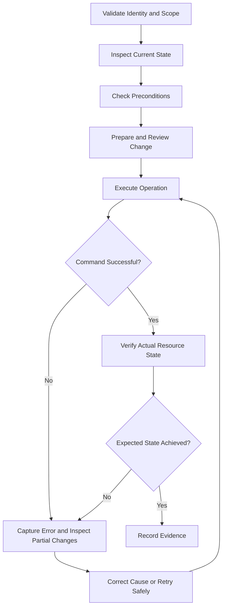

# 06- AWS CLI Operational Workflows

## Overview

Amazon S3 operational workflows combine resource inspection, controlled configuration changes, data movement, verification, and recovery into repeatable procedures. They are used by backend engineers, platform teams, data engineers, and on-call engineers to operate S3 resources safely across development, staging, and production environments.

An individual AWS CLI command performs a specific API operation. A production workflow defines the larger operational contract: the conditions that must hold before execution, the changes that are allowed, how success is measured, and what to do when an operation partially fails.

This document provides reusable runbooks for common S3 activities:

- Environment and resource validation.
- Bucket configuration and security checks.
- Object ingestion and transfer verification.
- Version recovery and deletion.
- Replication and lifecycle inspection.
- Storage auditing and cost investigation.
- Failure diagnosis and controlled remediation.

The examples use AWS CLI v2 and general-purpose S3 buckets. Replace sample account IDs, Regions, bucket names, and object keys with environment-specific values before execution.

## Establish an Operational Baseline

Every S3 workflow should begin by verifying its execution context and identifying the exact resource scope.

### Configure the environment

Linux or macOS:

```bash
export AWS_PROFILE=production
export AWS_REGION=ap-south-1
export EXPECTED_ACCOUNT_ID=123456789012
export BUCKET=company-prod-documents-123456789012
```

Windows PowerShell:

```powershell
$env:AWS_PROFILE = "production"
$env:AWS_REGION = "ap-south-1"
$env:EXPECTED_ACCOUNT_ID = "123456789012"
$env:BUCKET = "company-prod-documents-123456789012"
```

Use the credential mechanism approved for the environment, preferably IAM roles, IAM Identity Center, or short-lived workload credentials. Do not hardcode AWS access keys in scripts.

### Verify the caller identity

```bash
aws sts get-caller-identity \
  --query '{Account:Account,Arn:Arn}' \
  --output json
```

For production automation, compare the returned account ID against the expected value before performing a state-changing operation.

```bash
ACTUAL_ACCOUNT_ID="$(
  aws sts get-caller-identity \
    --query Account \
    --output text
)"

if [[ "$ACTUAL_ACCOUNT_ID" != "$EXPECTED_ACCOUNT_ID" ]]; then
  echo "Unexpected AWS account: $ACTUAL_ACCOUNT_ID" >&2
  exit 1
fi
```

The check prevents an operation from silently targeting a different account due to an incorrect profile or inherited credential configuration.

### Verify the target bucket

```bash
aws s3api head-bucket \
  --bucket "$BUCKET" \
  --expected-bucket-owner "$EXPECTED_ACCOUNT_ID" \
  --region "$AWS_REGION"
```

The command normally produces no output when successful.

A failed request does not always mean the bucket is absent. Investigate the returned error, caller permissions, bucket name, and Region before making any changes.

### Operational preconditions

Before executing a production workflow, establish:

| Precondition | Required verification |
|---|---|
| Identity | The intended IAM principal is active |
| Account | The account ID matches the approved environment |
| Region | The selected Region matches the target resource |
| Scope | Bucket, prefix, object key, or version is correct |
| Permissions | The principal has only the permissions required for the workflow |
| Data protection | Versioning, retention, Object Lock, and recovery requirements are understood |
| Change control | The operation has an appropriate review or approval |
| Verification | Success criteria and rollback or recovery procedures are defined |

## Use a Standard Operational Execution Pattern

A controlled workflow separates discovery, execution, and validation.



A successful command is not always equivalent to a successful business operation. For example, a copy can finish while the resulting metadata is incorrect, or a configured replication rule can exist while particular objects have not replicated.

Use measurable postconditions to establish that the workflow achieved its intended outcome.

## Workflow: Prepare a Bucket for an Application

A new application bucket typically needs an explicit access-control design, encryption configuration, ownership behavior, and recovery policy before it accepts production data.

### Inspect existing configuration

```bash
aws s3api get-bucket-versioning \
  --bucket "$BUCKET" \
  --region "$AWS_REGION"

aws s3api get-bucket-encryption \
  --bucket "$BUCKET" \
  --region "$AWS_REGION"

aws s3api get-public-access-block \
  --bucket "$BUCKET" \
  --region "$AWS_REGION"

aws s3api get-bucket-ownership-controls \
  --bucket "$BUCKET" \
  --region "$AWS_REGION"
```

Some configuration APIs return errors when a particular configuration is absent. Interpret each response individually rather than assuming all errors indicate a missing bucket.

### Establish private access controls

For a bucket that must remain private, configure Block Public Access:

```bash
aws s3api put-public-access-block \
  --bucket "$BUCKET" \
  --public-access-block-configuration \
    BlockPublicAcls=true,IgnorePublicAcls=true,BlockPublicPolicy=true,RestrictPublicBuckets=true \
  --region "$AWS_REGION"
```

Verify the configuration afterward:

```bash
aws s3api get-public-access-block \
  --bucket "$BUCKET" \
  --region "$AWS_REGION"
```

These settings help prevent public exposure but do not replace IAM, bucket-policy, access-point, and organizational-policy reviews.

### Configure the encryption baseline

For an SSE-KMS workload, configure the approved key:

```bash
aws s3api put-bucket-encryption \
  --bucket "$BUCKET" \
  --server-side-encryption-configuration '{
    "Rules": [
      {
        "ApplyServerSideEncryptionByDefault": {
          "SSEAlgorithm": "aws:kms",
          "KMSMasterKeyID": "arn:aws:kms:ap-south-1:123456789012:key/EXAMPLE-KEY-ID"
        },
        "BucketKeyEnabled": true
      }
    ]
  }' \
  --region "$AWS_REGION"
```

The sample ARN must be replaced with the actual KMS key ARN. Confirm the key's Region, state, policy, and intended application permissions before deploying this setting.

### Decide whether versioning is required

```bash
aws s3api put-bucket-versioning \
  --bucket "$BUCKET" \
  --versioning-configuration Status=Enabled \
  --region "$AWS_REGION"
```

Enable versioning when it supports the application's recovery and retention requirements. Versioning can increase storage costs and does not independently provide a complete backup or disaster-recovery strategy.

For long-lived production resources, declare these settings through Terraform, CloudFormation, or AWS CDK instead of relying on manually executed commands as the source of truth.

## Workflow: Ingest and Validate Objects

A data-ingestion workflow should verify that the expected objects were written with the correct attributes before downstream processing begins.

### Upload a single object

```bash
aws s3 cp \
  ./exports/monthly-report.csv \
  "s3://$BUCKET/exports/monthly-report.csv" \
  --content-type text/csv \
  --region "$AWS_REGION"
```

For workflows that require an explicit SSE-KMS key:

```bash
aws s3 cp \
  ./exports/monthly-report.csv \
  "s3://$BUCKET/exports/monthly-report.csv" \
  --content-type text/csv \
  --sse aws:kms \
  --sse-kms-key-id "arn:aws:kms:ap-south-1:123456789012:key/EXAMPLE-KEY-ID" \
  --region "$AWS_REGION"
```

The application identity must be authorized for the relevant S3 operation and the applicable KMS operations.

### Verify the resulting object

```bash
aws s3api head-object \
  --bucket "$BUCKET" \
  --key exports/monthly-report.csv \
  --region "$AWS_REGION" \
  --query '{
    Size:ContentLength,
    Modified:LastModified,
    Encryption:ServerSideEncryption,
    KmsKey:SSEKMSKeyId,
    Version:VersionId
  }' \
  --output json
```

Define the expected size, encryption method, key, and metadata before execution. A validation process should compare the actual response with those expectations instead of simply printing the result.

When data integrity is critical, validate a supported object checksum against a known expected checksum. Do not assume the ETag is always the MD5 digest of the entire object.

### Ingest a directory

For batch ingestion, preview the transfer:

```bash
aws s3 sync \
  ./exports/ \
  "s3://$BUCKET/exports/" \
  --dryrun \
  --region "$AWS_REGION"
```

Execute after reviewing the scope:

```bash
aws s3 sync \
  ./exports/ \
  "s3://$BUCKET/exports/" \
  --no-progress \
  --region "$AWS_REGION"
```

Record the execution result, expected object count, applicable checksums, and any failures. If downstream processing depends on a complete batch, use an explicit manifest or completion record rather than assuming that a successful CLI invocation is sufficient.

## Workflow: Transfer Data Between Buckets

Cross-bucket transfers are commonly used for archival, account separation, regional copies, and data migrations.

### Inspect the source

```bash
aws s3api head-object \
  --bucket company-source-data-123456789012 \
  --key exports/monthly-report.csv \
  --region ap-south-1
```

Confirm the source key, object size, version requirements, and encryption configuration.

### Copy the object

```bash
aws s3 cp \
  s3://company-source-data-123456789012/exports/monthly-report.csv \
  s3://company-archive-data-123456789012/exports/monthly-report.csv \
  --source-region ap-south-1 \
  --region eu-west-1
```

The caller needs permission to read the source and write to the destination. Cross-account or SSE-KMS workflows may also require resource policies and authorization for the relevant KMS keys.

### Validate the destination

```bash
aws s3api head-object \
  --bucket company-archive-data-123456789012 \
  --key exports/monthly-report.csv \
  --region eu-west-1
```

Check the destination object against the required size, metadata, encryption, and version expectations. Where checksum verification is required, compare compatible checksum algorithms and checksum types.

### Do not treat copy as an atomic move

If the objective is to relocate data, copy and validate the destination first. Delete the source only after the required integrity checks pass and the deletion has been approved.

For large migrations, divide the work into bounded batches and maintain a manifest of successful, failed, and unverified objects. This makes the workflow restartable without blindly repeating or deleting large amounts of data.

## Workflow: Recover a Previous Object Version

S3 versioning can preserve historical object versions after overwrites and ordinary deletions.

### List versions and delete markers

```bash
aws s3api list-object-versions \
  --bucket "$BUCKET" \
  --prefix exports/monthly-report.csv \
  --region "$AWS_REGION" \
  --output json
```

Review the `Versions` and `DeleteMarkers` collections, including `VersionId`, `IsLatest`, and `LastModified`.

A delete marker can make an object appear absent from ordinary listings even when historical versions remain.

### Download the historical version

```bash
aws s3api get-object \
  --bucket "$BUCKET" \
  --key exports/monthly-report.csv \
  --version-id EXAMPLE-VERSION-ID \
  ./recovered-monthly-report.csv \
  --region "$AWS_REGION"
```

Replace the example version ID with the identifier returned by the version listing. Validate the downloaded content before restoring it to a production key.

### Restore it as the current version

```bash
aws s3api copy-object \
  --bucket "$BUCKET" \
  --key exports/monthly-report.csv \
  --copy-source "$BUCKET/exports/monthly-report.csv?versionId=EXAMPLE-VERSION-ID" \
  --region "$AWS_REGION"
```

This creates a new current object version using the selected historical version. It does not erase the rest of the version history.

Before restoration, verify the selected source version, encryption-key accessibility, metadata requirements, and expected application behavior. Check the resulting object with `head-object` and perform an application-level verification when required.

## Workflow: Investigate a Replication Problem

Replication is useful for regional redundancy and recovery architectures. Its configuration should be inspected alongside the replication status of individual objects.

### Inspect the replication rules

```bash
aws s3api get-bucket-replication \
  --bucket "$BUCKET" \
  --region "$AWS_REGION"
```

Check the rule status, filters, destination configuration, replication role, and applicable encryption permissions.

### Inspect an object's replication status

```bash
aws s3api head-object \
  --bucket "$BUCKET" \
  --key exports/monthly-report.csv \
  --region "$AWS_REGION" \
  --query '{
    Version:VersionId,
    ReplicationStatus:ReplicationStatus,
    Encryption:ServerSideEncryption
  }' \
  --output json
```

The replication status field may not be present for every object or replication configuration. Do not interpret an absent field by itself as proof of successful replication.

### Diagnose the result

| Observation | Investigation |
|---|---|
| Replication configuration is missing | Verify whether replication is required and whether the rule was deployed |
| Rule exists but the object is pending | Inspect object eligibility, rule filters, permissions, and replication metrics |
| Replication reports failure | Investigate destination authorization, KMS access, and replication configuration |
| Destination object is missing | Check object eligibility, replication timing, versioning, and rule scope |
| Destination object exists but is unreadable | Verify destination S3 access and the associated encryption-key authorization |

Replication generally applies to eligible object versions. Existing objects may require a separate backfill or Batch Replication workflow.

Validate a recovery procedure by reading and checking data in the destination environment. A replication rule alone does not prove that the recovery objectives can be met.

## Workflow: Audit Storage and Encryption

Use object listings for small, focused checks and inventory-based processes for large recurring audits.

### Inspect a prefix

```bash
aws s3api list-objects-v2 \
  --bucket "$BUCKET" \
  --prefix exports/ \
  --query 'Contents[].{
    Key:Key,
    Size:Size,
    Modified:LastModified,
    StorageClass:StorageClass
  }' \
  --output table \
  --region "$AWS_REGION"
```

`ListObjectsV2` returns up to 1,000 objects per response. The AWS CLI normally follows pagination automatically, but a count or query that is evaluated page by page must not be assumed to represent the global result.

### Inspect bucket encryption

```bash
aws s3api get-bucket-encryption \
  --bucket "$BUCKET" \
  --region "$AWS_REGION"
```

This reports the bucket's default encryption configuration. It does not prove that every existing object uses the same encryption method or KMS key.

### Perform large-scale auditing

For recurring audits of large buckets, consider S3 Inventory and a processing workflow that reports:

- Total object count and size.
- Encryption status and relevant key information where configured.
- Storage class distribution.
- Object versions where included in the inventory.
- Replication status where included in the report.
- Objects that do not comply with the approved baseline.

Inventory reports are asynchronous and may not reflect the most recent changes immediately. Include the report generation time and coverage scope in audit records.

CloudTrail supports investigation of S3 activity and configuration changes. Object-level auditing requires appropriate S3 data-event logging; management event history alone is not a complete record of all object operations.

## Workflow: Clean Up Incomplete Multipart Uploads

Interrupted large-object uploads can leave incomplete parts stored in S3 and incur storage charges.

### Identify active multipart uploads

```bash
aws s3api list-multipart-uploads \
  --bucket "$BUCKET" \
  --prefix exports/ \
  --region "$AWS_REGION" \
  --output json
```

Review each upload's key, upload ID, initiation time, and owning workflow where that information is available.

### Abort a confirmed abandoned upload

```bash
aws s3api abort-multipart-upload \
  --bucket "$BUCKET" \
  --key exports/large-dataset.bin \
  --upload-id EXAMPLE-UPLOAD-ID \
  --region "$AWS_REGION"
```

Do not abort an upload that is still active. For recurring cleanup, configure an appropriate S3 lifecycle rule to abort incomplete multipart uploads after a defined period.

After aborting, verify that the intended upload is no longer active and investigate any remaining parts or in-flight operations if cleanup is not complete.

## Workflow: Execute a Controlled Deletion

Deletion must account for the intended scope, object versioning, retention requirements, and recovery requirements.

### Preview a recursive deletion

```bash
aws s3 rm \
  "s3://$BUCKET/temporary/" \
  --recursive \
  --dryrun \
  --region "$AWS_REGION"
```

Review the proposed deletion and confirm the bucket and prefix before execution.

### Execute the deletion

```bash
aws s3 rm \
  "s3://$BUCKET/temporary/" \
  --recursive \
  --region "$AWS_REGION"
```

In a versioned bucket, ordinary deletion typically creates delete markers rather than permanently deleting all historical versions. For permanent deletion, inspect version IDs and delete markers and follow the applicable retention, legal-hold, and Object Lock requirements.

### Delete a particular object version

```bash
aws s3api delete-object \
  --bucket "$BUCKET" \
  --key temporary/obsolete-report.csv \
  --version-id EXAMPLE-VERSION-ID \
  --region "$AWS_REGION"
```

Use this operation only after confirming that the version can be permanently removed and that the correct object version has been selected.

For very large deletion workloads, use an appropriately scoped and monitored batch process. Track failures rather than assuming every requested deletion succeeded.

## Workflow: Troubleshoot a Failed CLI Operation

When a command fails, preserve the complete error message and inspect the caller, resource, permissions, and actual object state before retrying.

### Collect diagnostic evidence

Verify the identity:

```bash
aws sts get-caller-identity
```

Check the bucket:

```bash
aws s3api head-bucket \
  --bucket "$BUCKET" \
  --region "$AWS_REGION"
```

Inspect the relevant object:

```bash
aws s3api head-object \
  --bucket "$BUCKET" \
  --key exports/monthly-report.csv \
  --region "$AWS_REGION"
```

For listing failures, inspect a limited number of entries:

```bash
aws s3api list-objects-v2 \
  --bucket "$BUCKET" \
  --prefix exports/ \
  --max-keys 20 \
  --region "$AWS_REGION"
```

### Classify common failures

| Symptom | Likely cause | Next diagnostic action |
|---|---|---|
| `AccessDenied` | Missing permission, explicit deny, or organizational restriction | Inspect the caller and applicable identity and resource policies |
| `NoSuchBucket` | Incorrect bucket name, account, or resource state | Verify identifiers and target environment |
| `NoSuchKey` | Incorrect key or prefix | List objects under the intended prefix |
| `SignatureDoesNotMatch` | Incorrect signing context or request construction | Check credential source, Region, endpoint, and key encoding |
| SSE-KMS access failure | Missing decryption or encryption authorization | Inspect S3 and KMS permissions separately |
| Unexpected object metadata | Incorrect request options or copy behavior | Inspect the resulting object with `head-object` |
| Missing historical data | Delete marker or incorrect version selection | Inspect `list-object-versions` |
| Replication delay | Eligibility, configuration, permission, or processing issue | Inspect the rule, object status, metrics, and destination |
| Partial transfer | Some files or objects failed after others succeeded | Reconcile the intended manifest and retry the failed subset |

Avoid granting broad permissions or disabling security controls merely to make an error disappear. Correct the specific failure and add regression checks when the issue could recur.

## Workflow: Make an Operational Script Restartable

Production automation should capture the result of each operation and avoid destructive follow-up actions until verification succeeds.

The following Bash example copies one object and inspects its destination metadata.

```bash
#!/usr/bin/env bash
set -euo pipefail

SOURCE_BUCKET="${SOURCE_BUCKET:?Set SOURCE_BUCKET}"
DESTINATION_BUCKET="${DESTINATION_BUCKET:?Set DESTINATION_BUCKET}"
SOURCE_KEY="${SOURCE_KEY:?Set SOURCE_KEY}"
DESTINATION_KEY="${DESTINATION_KEY:?Set DESTINATION_KEY}"
SOURCE_REGION="${SOURCE_REGION:?Set SOURCE_REGION}"
DESTINATION_REGION="${DESTINATION_REGION:?Set DESTINATION_REGION}"

aws s3 cp \
  "s3://${SOURCE_BUCKET}/${SOURCE_KEY}" \
  "s3://${DESTINATION_BUCKET}/${DESTINATION_KEY}" \
  --source-region "$SOURCE_REGION" \
  --region "$DESTINATION_REGION" \
  --no-progress

aws s3api head-object \
  --bucket "$DESTINATION_BUCKET" \
  --key "$DESTINATION_KEY" \
  --region "$DESTINATION_REGION" \
  --query '{
    Size:ContentLength,
    Version:VersionId,
    Encryption:ServerSideEncryption,
    KmsKey:SSEKMSKeyId
  }' \
  --output json
```

This example checks the copy command's exit status and retrieves destination metadata. It is a starting point, not a complete integrity guarantee: a production implementation should compare the result against expected values and validate checksums where required.

For restartable bulk workflows:

- Store a deterministic manifest of intended objects.
- Track each object's status and last error.
- Retry failed items instead of restarting an uncontrolled destructive operation.
- Keep source data until destination verification passes.
- Record the execution identity, timestamp, and configuration version.
- Make duplicate execution safe for the workflow's data model.

## Monitoring and Cost Controls

Operational workflows should consider storage usage, request volume, retrieval charges, transfer costs, and incomplete upload parts.

| Concern | Useful evidence | Operational action |
|---|---|---|
| Unexpected storage growth | Storage metrics and inventory reports | Inspect prefixes, versions, storage classes, and retention policies |
| High request volume | Request metrics and application telemetry | Identify repeated scans, retries, or inefficient access patterns |
| Incomplete multipart uploads | Multipart upload listings and lifecycle configuration | Abort confirmed abandoned uploads and configure lifecycle cleanup |
| Unexpected archive retrieval cost | Storage class distribution and retrieval activity | Review access patterns and archival selection |
| Replication lag or failures | Replication metrics, object status, and service events | Diagnose eligibility, permissions, and destination configuration |
| Suspicious access | Applicable CloudTrail events and access logs | Investigate the principal, request, and resource scope |

For large-bucket metrics and compliance checks, use S3 Inventory, Storage Lens, CloudWatch, CloudTrail, and billing tools as appropriate rather than repeatedly enumerating every object through an interactive CLI session.

## Production Readiness Checklist

Before completing an operational S3 task, verify the relevant items below.

- [ ] The active identity, account ID, Region, bucket, and object scope were checked.
- [ ] Existing configuration was inspected before changes were made.
- [ ] IAM and KMS permissions were reviewed.
- [ ] Destructive actions were previewed where supported.
- [ ] The resulting object or configuration was checked against explicit expectations.
- [ ] Versioning, retention, and Object Lock requirements were respected.
- [ ] Replication and recovery were verified where required.
- [ ] Large-listing pagination and inventory freshness were accounted for.
- [ ] Errors and partial completion were captured and reconciled.
- [ ] The final result and any remaining risks were recorded.
- [ ] Changes to managed infrastructure were reflected in infrastructure as code.

## Official References

- [AWS CLI S3 commands](https://docs.aws.amazon.com/cli/latest/userguide/cli-services-s3-commands.html)
- [AWS CLI S3 API reference](https://docs.aws.amazon.com/cli/latest/reference/s3api/)
- [Amazon S3 versioning](https://docs.aws.amazon.com/AmazonS3/latest/userguide/Versioning.html)
- [Amazon S3 replication](https://docs.aws.amazon.com/AmazonS3/latest/userguide/replication.html)
- [S3 Inventory](https://docs.aws.amazon.com/AmazonS3/latest/userguide/storage-inventory.html)
- [S3 lifecycle management](https://docs.aws.amazon.com/AmazonS3/latest/userguide/object-lifecycle-mgmt.html)
- [Aborting incomplete multipart uploads](https://docs.aws.amazon.com/AmazonS3/latest/userguide/abort-mpu.html)
- [CloudTrail logging for S3](https://docs.aws.amazon.com/AmazonS3/latest/userguide/cloudtrail-logging-s3-info.html)
- [Amazon S3 security best practices](https://docs.aws.amazon.com/AmazonS3/latest/userguide/security-best-practices.html)

## Key Takeaways

- Validate identity, account, Region, resource scope, and preconditions before every production operation.
- Define explicit postconditions and verify actual resource state rather than relying exclusively on successful command execution.
- Handle version recovery, deletion, multipart cleanup, and replication as separate workflows with deliberate safety controls.
- Use least-privilege authorization and diagnose S3 and KMS failures at their respective permission layers.
- Make operational scripts restartable, preserve evidence, and reconcile infrastructure changes with the approved source of truth.