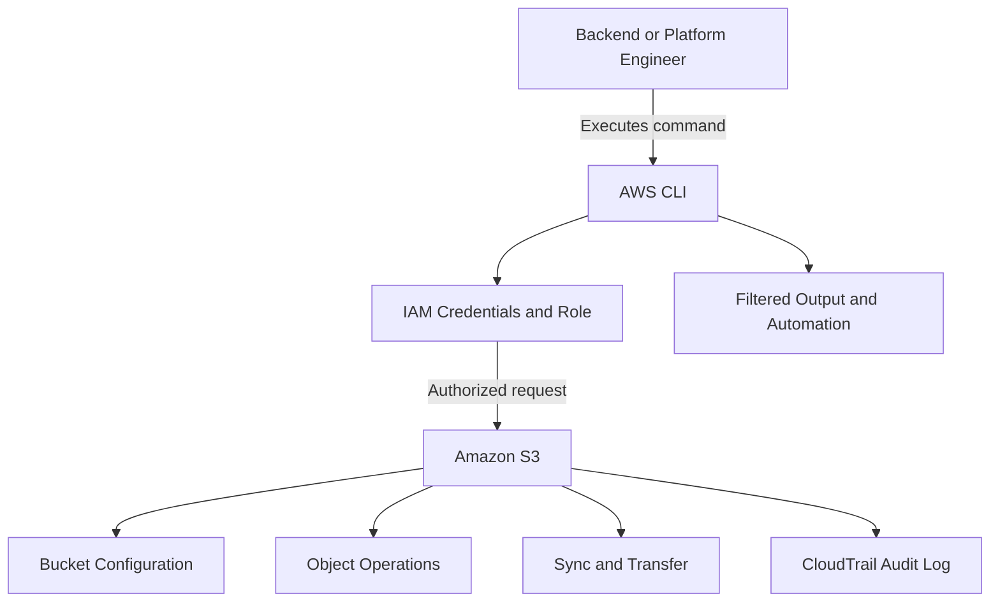

# README

## Overview

Amazon S3 CLI covers the command-line operations, workflows, and operational patterns required to manage Amazon S3 resources efficiently and safely in production environments. It addresses bucket provisioning, object lifecycle, synchronization, copy and transfer workflows, output filtering, and end-to-end operational procedures using the AWS CLI.

This section of the Backend Engineering Playbook provides a structured reference for backend engineers, platform engineers, and DevOps engineers who manage S3 resources through automation, deployments, backups, data migrations, and incident response workflows.

The focus is on practical CLI engineering: understanding when to use `aws s3` versus `aws s3api`, constructing safe and repeatable operational workflows, interpreting command output, diagnosing failures systematically, and building automation that remains reliable as systems scale.

## Navigation

| # | File | Description |
|---|---|---|
| 01 | [01- AWS CLI Bucket Operations](./01-%20AWS%20CLI%20Bucket%20Operations.md) | Bucket provisioning, versioning, encryption, public-access controls, lifecycle policies, and bucket administration workflows |
| 02 | [02- AWS CLI Object Operations](./02-%20AWS%20CLI%20Object%20Operations.md) | Uploading, downloading, inspecting, copying, moving, tagging, and deleting S3 objects from the command line |
| 03 | [03- AWS CLI Sync Operations](./03-%20AWS%20CLI%20Sync%20Operations.md) | Recursive synchronization between local directories, S3 prefixes, and buckets using `aws s3 sync` |
| 04 | [04- AWS CLI Copy and Transfer Operations](./04-%20AWS%20CLI%20Copy%20and%20Transfer%20Operations.md) | Data movement between local filesystems, buckets, and prefixes for deployments, backups, and cross-account transfers |
| 05 | [05- AWS CLI Filtering and Output Formatting](./05-%20AWS%20CLI%20Filtering%20and%20Output%20Formatting.md) | JMESPath filtering, output formats, resource inspection, metadata extraction, and automated validation workflows |
| 06 | [06- AWS CLI Operational Workflows](./06-%20AWS%20CLI%20Operational%20Workflows.md) | Repeatable operational procedures combining inspection, configuration, data movement, verification, and recovery |

## Why S3 CLI Matters

The AWS Management Console is useful for exploration and one-off tasks. Production environments depend on the AWS CLI for automation, scripted deployments, scheduled backups, data migrations, and incident response. Engineers who rely only on the console cannot build repeatable, auditable, or scriptable workflows.

Common operational risks without a systematic CLI approach include:

- Destructive operations executed without verification, such as recursive deletes or bucket removals with remaining objects.
- Synchronization workflows that overwrite or delete objects unintentionally due to missing `--dryrun` validation.
- AccessDenied errors that are resolved by granting excessive permissions rather than diagnosing the specific policy boundary.
- Copy and transfer operations that silently skip objects due to mismatched storage classes, object lock settings, or cross-account permission gaps.
- Output interpreted incorrectly because JSON filtering was not applied, leading to manual errors in automation scripts.
- Operational workflows that are not documented or tested, making incident response slow and error-prone.

Effective S3 CLI usage combines command selection, safe workflow practices, output filtering, permission verification, and tested operational runbooks rather than ad hoc command execution.

## Documentation Structure

This section is organized into focused documents covering bucket operations, object management, synchronization, copy and transfer, output filtering, and end-to-end operational workflows.

| Area | Primary focus |
|---|---|
| Bucket operations | Provisioning, configuring, and administering S3 buckets and their settings |
| Object operations | Managing individual objects including uploads, downloads, copies, tags, and deletions |
| Sync operations | Keeping local directories and S3 prefixes aligned through recursive synchronization |
| Copy and transfer | Moving data between sources and destinations for deployments, backups, and migrations |
| Filtering and output | Extracting and processing CLI output using JMESPath and format options |
| Operational workflows | End-to-end repeatable procedures for safe production operations and incident response |

Each document is intended to be independently maintainable while connecting to the broader S3 and AWS CLI operational model. Shared patterns should be referenced rather than duplicated across documents.

## Core CLI Principles

### Prefer `aws s3` for Common Operations

The `aws s3` interface provides high-level commands for the most frequent object and bucket operations. Use it for uploads, downloads, copies, sync, and basic bucket management. It handles multipart uploads, recursive operations, and progress reporting automatically.

Reserve `aws s3api` for operations that require fine-grained control over request parameters, object metadata, ACLs, bucket policy JSON, or responses not exposed by the high-level interface.

### Validate Before Executing Destructive Commands

Use `--dryrun` for any sync, copy, or recursive delete operation before executing it against production resources. Review the planned changes and confirm they match the intended operation. A single incorrect prefix or missing filter can delete or overwrite objects that cannot be recovered without versioning.

### Verify the Active Account and Region

Before executing any operation, confirm the active AWS account, identity, and region using `aws sts get-caller-identity` and `aws configure list`. Errors caused by operating against the wrong account or region are difficult to reverse and may affect production data.

### Scope Permissions to the Operation

Do not resolve AccessDenied errors by granting administrator access. Identify the specific principal, action, resource, and condition that is causing the failure. Grant only the permissions required for the operation. Use `aws iam simulate-principal-policy` or CloudTrail to diagnose the exact policy boundary.

### Build Repeatable Operational Workflows

One-off commands are difficult to audit, reproduce, and hand off. Document operational procedures as scripts or runbooks. Include verification steps before and after changes. Design workflows to be idempotent where possible so that re-execution does not cause unintended side effects.

## How the CLI Fits into S3 Operations

The following diagram illustrates where CLI-driven operations fit within the broader S3 operational model.

The diagram represents logical relationships rather than a complete deployment specification. The exact workflows depend on the operational context, IAM configuration, bucket settings, and automation requirements.

## Recommended Operational Workflow

Use a repeatable process when performing S3 CLI operations in production environments.

1. **Confirm identity and context.** Run `aws sts get-caller-identity` and `aws configure list` to verify the active account, role, and region before making changes.
2. **Inspect the current state.** List buckets, describe bucket configuration, or list objects to understand the current state before modifying it.
3. **Construct and validate the command.** Use `--dryrun` for sync, copy, and delete operations. Review planned changes before executing.
4. **Execute the operation.** Run the command with appropriate flags. Use `--recursive` carefully and always with a clearly scoped prefix.
5. **Verify the result.** Confirm the expected outcome by listing objects, checking metadata, or validating configuration after the operation.
6. **Check for errors.** Inspect CLI output and CloudTrail for unexpected AccessDenied errors, skipped objects, or partial completions.
7. **Document the workflow.** Record the commands, flags, and verification steps for future use, audit evidence, and incident response.

## S3 CLI in Backend Engineering Workflows

AWS CLI S3 operations appear at multiple stages of backend engineering work.

| Workflow | CLI role |
|---|---|
| Application deployment | Syncing build artifacts, static assets, or configuration files to S3 |
| Backup automation | Scheduled copy or sync operations from application data stores to S3 |
| Data migration | Transferring objects between buckets, prefixes, accounts, or regions |
| Incident response | Inspecting bucket configuration, recovering versioned objects, and auditing recent operations |
| Infrastructure provisioning | Creating and configuring buckets as part of IaC or manual setup |
| Operational troubleshooting | Diagnosing AccessDenied errors, missing objects, replication failures, and lifecycle issues |
| Cost management | Listing objects by storage class, identifying large objects, and validating lifecycle transitions |

The CLI does not replace infrastructure-as-code for provisioning or application SDKs for runtime operations. It fills the operational gap between automated provisioning and application-level SDK usage, covering inspection, administration, and incident response tasks that are not suited to either.

## Operational Standards

Apply the following standards when using the AWS CLI to manage Amazon S3.

- **Identity verification:** Confirm the active account and role before any operation that modifies bucket configuration, object data, or access control settings.
- **Dry-run first:** Use `--dryrun` for every sync, recursive copy, or delete command before executing against production resources.
- **Scoped commands:** Always specify precise prefixes, object keys, or bucket names. Avoid commands that operate on entire buckets without a clearly defined scope.
- **Permission diagnosis:** Diagnose AccessDenied errors by identifying the principal, action, resource, and condition. Never resolve them with broad permission grants.
- **Output validation:** Use `--query` with JMESPath and `--output` format options to extract and validate relevant fields from command responses before using them in automation.
- **Idempotent workflows:** Design operational scripts so that re-execution produces the same result. Use conditional flags and verification steps to prevent unintended side effects.
- **Audit coverage:** Ensure CloudTrail data events are enabled for buckets where operational changes require audit evidence.
- **Versioning awareness:** Know whether versioning is enabled before deleting objects. A delete on a versioned bucket creates a delete marker rather than permanently removing the object.
- **Cross-account caution:** Verify bucket ownership, object ownership settings, and cross-account IAM permissions before copy or sync operations between accounts.

Never resolve an unexpected `AccessDenied` error by attaching `AdministratorAccess`. Identify the specific principal, action, resource, and applicable condition, then make a targeted permission change.

## Key Takeaways

- The AWS CLI is the primary tool for S3 automation, deployment, backup, migration, and operational workflows in production environments.
- `aws s3` handles most common operations cleanly; `aws s3api` provides fine-grained access to advanced configuration and request parameters.
- Safe CLI practice requires identity verification, dry-run validation, scoped commands, and documented repeatable workflows.
- AccessDenied errors must be diagnosed at the policy boundary, not resolved with broad permission grants.
- Operational workflows that combine inspection, execution, and verification are more reliable, auditable, and transferable than ad hoc command sequences.
