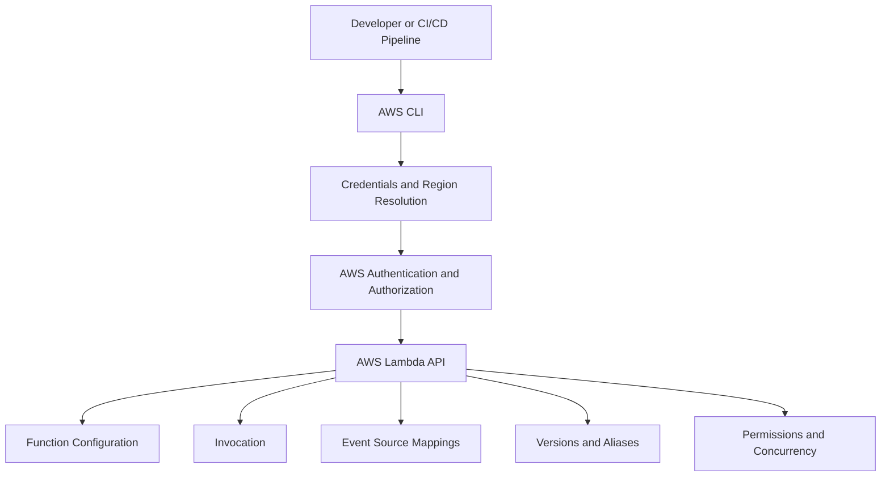

# Introduction to Lambda CLI

## Overview

The AWS Command Line Interface (AWS CLI) provides a programmable interface for managing AWS Lambda functions, configuration, permissions, event source mappings, versions, aliases, and operational diagnostics.

For backend engineers, the Lambda CLI is useful for inspecting deployed functions, reproducing failures, validating configuration, automating operational workflows, and integrating serverless deployments into CI/CD pipelines.

This document introduces the AWS CLI commands and conventions used throughout the Lambda CLI section. Detailed procedures for individual operations should remain in their respective topic files.

## What Is the AWS Lambda CLI?

The Lambda CLI is the collection of AWS CLI commands under the `aws lambda` command namespace.

It communicates with the AWS Lambda service API using the credentials and Region resolved by the AWS CLI configuration.



The CLI can perform two broad categories of operations:

- **Control-plane operations:** Create functions, update configuration, publish versions, manage aliases, and configure event source mappings.
- **Invocation and diagnostic operations:** Invoke functions, inspect invocation results, retrieve configuration, and investigate runtime behavior through related services such as CloudWatch Logs.

Most Lambda management commands operate against the control plane. Function invocation executes application code and may produce application-level side effects.

## Prerequisites

Install the AWS CLI and configure credentials before executing Lambda commands.

Verify the installation:

```bash
aws --version
```

Verify the active identity:

```bash
aws sts get-caller-identity
```

The response includes the AWS account ID and the ARN of the active IAM identity or assumed role.

Inspect the current CLI configuration:

```bash
aws configure list
```

Inspect the configured default Region:

```bash
aws configure get region
```

A successful identity check confirms that the credentials can authenticate, but it does not prove that the identity has permission to manage or invoke Lambda functions.

## Configure Profiles and Regions

Use named profiles to separate development, staging, production, and other AWS environments.

List configured profiles:

```bash
aws configure list-profiles
```

Inspect a specific profile:

```bash
aws configure list --profile dev
```

Verify its identity:

```bash
aws sts get-caller-identity --profile dev
```

Specify a Region explicitly when the target environment requires it:

```bash
aws lambda list-functions \
  --profile dev \
  --region ap-south-1
```

For this example:

- `dev` is the configured AWS CLI profile.
- `ap-south-1` is the AWS Region in which the functions are listed.

The profile determines the credential configuration, while the Region determines the regional Lambda endpoint. Always verify both before modifying resources.

Avoid using a production profile for experimental commands. Prefer short-lived credentials, IAM roles, and federated authentication over long-lived access keys wherever possible.

## Lambda CLI Command Structure

Most Lambda CLI commands follow this structure:

```bash
aws lambda COMMAND \
  --option value
```

Examples include:

| Command | Purpose | Typical impact |
|---|---|---|
| `list-functions` | List functions visible to the caller | Read-only |
| `get-function` | Inspect function configuration and deployment details | Read-only |
| `get-function-configuration` | Inspect runtime and function settings | Read-only |
| `invoke` | Execute a function | Application execution and possible side effects |
| `create-function` | Create a function | Creates a resource |
| `update-function-configuration` | Change function settings | Modifies a resource |
| `update-function-code` | Replace deployed code | Modifies deployed behavior |
| `publish-version` | Publish an immutable function version | Creates a version |
| `create-alias` | Create an alias pointing to a version | Creates a resource |
| `put-function-concurrency` | Configure reserved concurrency | Changes capacity allocation |
| `create-event-source-mapping` | Connect a supported event source to Lambda | Creates an integration |
| `delete-function` | Delete a function | Destructive operation |

The exact permissions required depend on the operation, target resource, and associated AWS services.

## Read-Only and Modifying Commands

Distinguish inspection commands from commands that change deployed infrastructure.

### Read-only inspection

```bash
aws lambda list-functions \
  --region ap-south-1

aws lambda get-function-configuration \
  --function-name my-function \
  --region ap-south-1
```

These commands retrieve function information without changing its configuration.

### Configuration changes

```bash
aws lambda update-function-configuration \
  --function-name my-function \
  --timeout 15 \
  --region ap-south-1
```

This command changes the function timeout to 15 seconds.

Wait for the update to complete:

```bash
aws lambda wait function-updated \
  --function-name my-function \
  --region ap-south-1
```

Verify the final value:

```bash
aws lambda get-function-configuration \
  --function-name my-function \
  --query '{Timeout:Timeout,State:State,LastUpdateStatus:LastUpdateStatus}' \
  --output table \
  --region ap-south-1
```

Treat configuration changes as deployments: confirm the target, understand the impact, wait for completion, and verify the resulting state.

## Inspect Functions Efficiently

List function names and runtimes:

```bash
aws lambda list-functions \
  --query 'Functions[].{Name:FunctionName,Runtime:Runtime,Memory:MemorySize,Timeout:Timeout}' \
  --output table \
  --region ap-south-1
```

Inspect a particular function:

```bash
aws lambda get-function-configuration \
  --function-name my-function \
  --query '{Name:FunctionName,Runtime:Runtime,Handler:Handler,Memory:MemorySize,Timeout:Timeout,Role:Role,State:State}' \
  --output json \
  --region ap-south-1
```

The `--query` option uses JMESPath to filter and transform the response. The `--output` option controls presentation.

Prefer queries that return only the fields needed for the task. This makes command output easier to review and reduces the risk of exposing unnecessary configuration details in logs or automation output.

## Invoke a Lambda Function

The `invoke` command executes a function and writes the invocation response to a local file.

```bash
aws lambda invoke \
  --function-name my-function \
  --payload '{"action":"health-check"}' \
  --cli-binary-format raw-in-base64-out \
  response.json \
  --region ap-south-1
```

The example uses a JSON event payload and writes the function's response payload to `response.json`.

The `--cli-binary-format raw-in-base64-out` option is important when using AWS CLI v2 with a raw JSON payload.

Inspect the response:

```bash
cat response.json
```

On Windows PowerShell:

```powershell
Get-Content response.json
```

For synchronous invocation, the CLI response metadata and the function response payload are distinct. Check `FunctionError` in the invocation metadata when diagnosing an execution failure; an HTTP-style error object returned by application code does not necessarily indicate a Lambda runtime error.

Use synthetic payloads for initial testing. Invoking a function can create database records, send messages, trigger workflows, or perform other irreversible business operations.

## Use JMESPath and Structured Output

The AWS CLI supports JSON, YAML, text, and table output formats, depending on the command.

Example:

```bash
aws lambda list-functions \
  --query 'Functions[?Runtime==`python3.12`].FunctionName' \
  --output text \
  --region ap-south-1
```

This example filters the returned functions to those reporting the specified runtime.

Runtime availability and lifecycle status can change. A runtime value returned by the API does not by itself establish that the runtime is currently supported for new deployments.

For automation, prefer JSON or text output with explicit queries. Avoid parsing human-formatted table output in shell scripts because presentation can change and values may contain whitespace.

## Handle Common CLI Errors

| Error | Possible cause | Diagnostic approach |
|---|---|---|
| `AccessDeniedException` | Missing IAM permission or an applicable policy restriction | Inspect the active identity, action, resource, and relevant policies |
| `ResourceNotFoundException` | Incorrect function name, qualifier, account, or Region | Verify the account, Region, function name, and version or alias |
| `ResourceConflictException` | An incompatible operation is already in progress or the resource conflicts with the requested change | Inspect current function state and retry only when appropriate |
| `InvalidParameterValueException` | Invalid configuration or unsupported value | Check the command parameters and current service constraints |
| `TooManyRequestsException` | API throttling or service capacity limits | Review request rate, retry behavior, and applicable quotas |
| `UnrecognizedClientException` or credential errors | Invalid or expired credentials | Recheck the active profile and credential source |
| Function invocation error | Runtime exception, timeout, initialization failure, or application error | Inspect invocation metadata and CloudWatch logs |

Do not respond to every failure by increasing retries. Authorization errors, invalid parameters, and incorrect resource identifiers generally require correction rather than repeated execution.

## Operational Safety Guidelines

Before running a modifying command:

1. Verify the AWS account and Region.
2. Confirm the exact function, alias, version, or event source mapping.
3. Determine whether the operation changes code, configuration, permissions, or traffic routing.
4. Check whether the function has active production traffic or downstream side effects.
5. Execute the command with the minimum necessary permissions.
6. Wait for asynchronous configuration updates where required.
7. Verify the final resource state.
8. Review logs and metrics when the change affects application behavior.

For repeatable deployments, prefer AWS SAM, CloudFormation, or another suitable infrastructure-as-code tool instead of relying exclusively on manual CLI changes. Direct changes made outside the infrastructure-as-code workflow can create configuration drift.

## Navigation

The Lambda CLI documentation should keep individual operational tasks in focused files rather than duplicating full command references in this introduction.

| Topic | Coverage |
|---|---|
| AWS CLI configuration | Profiles, credentials, Regions, and account verification |
| Function management | Creation, inspection, configuration updates, and deletion |
| Invocation | Synchronous invocation, payload handling, and error inspection |
| Deployment packages | ZIP uploads, dependencies, and container-image deployment |
| Versions and aliases | Immutable versions, traffic routing, and rollback |
| Concurrency | Reserved concurrency and provisioned concurrency management |
| Event source mappings | SQS, stream integrations, filtering, and batch configuration |
| Permissions | Execution roles, resource-based policies, and invocation access |
| Layers | Publishing, inspection, and version management |
| Logging and diagnosis | CloudWatch log retrieval, metrics, and operational investigation |
| Querying and automation | JMESPath, JSON output, and repeatable command workflows |

## Key Takeaways

- Use AWS CLI profiles and explicit Regions to prevent accidental operations against the wrong environment.
- Distinguish read-only inspection commands from resource creation, configuration changes, deployment, and invocation.
- Verify both command metadata and application responses when invoking Lambda functions.
- Use JMESPath and structured output for reliable inspection and automation.
- Prefer least-privilege permissions, infrastructure as code, and explicit post-operation verification for production workflows.