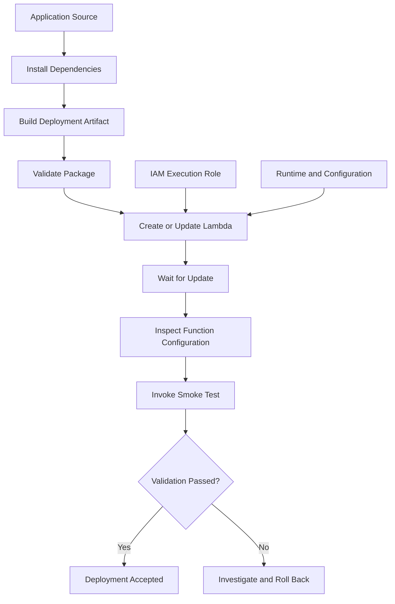

# 03- Function Creation and Deployment

## Overview

Creating and deploying AWS Lambda functions through the AWS CLI involves configuring the execution role, packaging application code, creating the function, updating deployed artifacts, and verifying that the resulting function is operational.

For backend engineers, these operations are useful for understanding the deployment lifecycle, automating serverless workflows, troubleshooting deployment failures, and integrating Lambda into CI/CD pipelines.

This document covers ZIP-based function creation and deployment, configuration requirements, code updates, deployment verification, and container-image deployment considerations. Infrastructure as code, versions and aliases, and advanced release strategies should be handled through their dedicated documentation.

## Deployment Workflow

A Lambda deployment requires more than uploading application code. The function needs a compatible runtime or container image, an execution role, valid configuration, and the permissions required by its integrations.



The normal deployment sequence is:

1. Verify the target AWS account and Region.
2. Create or identify the execution role.
3. Build and validate the deployment artifact.
4. Create the function or update its code.
5. Wait for the update to finish.
6. Verify the deployed configuration and artifact.
7. Execute a controlled smoke test.
8. Inspect logs and metrics for unexpected behavior.

For production environments, prefer AWS SAM or CloudFormation to manage the function and its dependencies as a single deployment unit.

## Prerequisites

Install AWS CLI v2 and configure an appropriate credential source.

Verify the active identity:

```bash
aws sts get-caller-identity --profile dev
```

Verify the configured Region:

```bash
aws configure get region --profile dev
```

Set the values used in the following examples:

```bash
PROFILE=dev
REGION=ap-south-1
FUNCTION_NAME=orders-health-check
ROLE_ARN=arn:aws:iam::123456789012:role/lambda-orders-execution
```

Replace the account ID, role ARN, function name, and Region with values from your environment.

The examples use Bash syntax. In PowerShell, use `$PROFILE`, `$REGION`, `$FUNCTION_NAME`, and `$ROLE_ARN`.

### Required permissions

The deploying identity may need permissions such as:

| Permission | Purpose |
|---|---|
| `lambda:CreateFunction` | Create a new function |
| `lambda:GetFunction` | Inspect deployment metadata |
| `lambda:GetFunctionConfiguration` | Verify function configuration |
| `lambda:UpdateFunctionCode` | Deploy updated code |
| `lambda:UpdateFunctionConfiguration` | Modify function settings |
| `iam:PassRole` | Pass the execution role to Lambda |
| `lambda:InvokeFunction` | Execute a smoke test |

The exact permissions depend on the operations being performed. Creating or modifying the execution role also requires appropriate IAM permissions, which should generally be handled separately from routine application deployment.

The execution role is assumed by Lambda at runtime. The deployment identity and the execution role serve different purposes and should not be interchangeable.

## Prepare the Execution Role

A Lambda execution role defines the AWS permissions available to application code while the function executes.

The role must trust the Lambda service principal:

```json
{
  "Version": "2012-10-17",
  "Statement": [
    {
      "Effect": "Allow",
      "Principal": {
        "Service": "lambda.amazonaws.com"
      },
      "Action": "sts:AssumeRole"
    }
  ]
}
```

Save this as `trust-policy.json`.

Create the role only if it does not already exist:

```bash
aws iam create-role \
  --role-name lambda-orders-execution \
  --assume-role-policy-document file://trust-policy.json \
  --profile "$PROFILE"
```

This command creates an IAM role and is not idempotent: rerunning it for an existing role can fail.

For a basic function that writes logs to CloudWatch Logs, attach the AWS-managed basic execution policy:

```bash
aws iam attach-role-policy \
  --role-name lambda-orders-execution \
  --policy-arn arn:aws:iam::aws:policy/service-role/AWSLambdaBasicExecutionRole \
  --profile "$PROFILE"
```

This policy permits the basic logging operations commonly required by Lambda. Application-specific permissions, such as reading a secret or accessing DynamoDB, must be granted separately and narrowly scoped.

Allow time for IAM changes to propagate before creating or invoking the function.

Retrieve the role ARN:

```bash
aws iam get-role \
  --role-name lambda-orders-execution \
  --query 'Role.Arn' \
  --output text \
  --profile "$PROFILE"
```

Use the returned ARN for `ROLE_ARN`.

**Production consideration:** Prefer an existing role managed through infrastructure as code. Avoid attaching broad managed policies such as `AdministratorAccess` merely to make a deployment succeed.

## Create a Python Lambda Function

### Prepare the application

Create a working directory:

```text
orders-health-check/
    lambda_function.py
```

Create `lambda_function.py`:

```python
import json
import os


def lambda_handler(event, context):
    return {
        "statusCode": 200,
        "headers": {
            "content-type": "application/json",
        },
        "body": json.dumps(
            {
                "status": "ok",
                "service": os.environ.get(
                    "SERVICE_NAME",
                    "orders",
                ),
                "request_id": context.aws_request_id,
            }
        ),
    }
```

This example demonstrates the Lambda handler contract and returns an API-shaped response. It does not automatically create an HTTP endpoint; an API Gateway integration or another invocation mechanism is needed for external HTTP access.

For production APIs, validate incoming events, define error-handling behavior, and avoid exposing internal exception details.

### Package the application

From the application directory, create the ZIP archive:

```bash
zip function.zip lambda_function.py
```

Verify the package contents:

```bash
unzip -l function.zip
```

The ZIP archive must contain `lambda_function.py` at its root. If it is nested inside another directory, the handler may fail to import.

For example, the following layout is incorrect for the handler specified below:

```text
function.zip
    orders-health-check/
        lambda_function.py
```

The expected layout is:

```text
function.zip
    lambda_function.py
```

### Create the function

```bash
aws lambda create-function \
  --function-name "$FUNCTION_NAME" \
  --runtime python3.12 \
  --handler lambda_function.lambda_handler \
  --role "$ROLE_ARN" \
  --zip-file fileb://function.zip \
  --memory-size 512 \
  --timeout 10 \
  --description "Orders service health check" \
  --profile "$PROFILE" \
  --region "$REGION"
```

This command creates a function with:

- Python 3.12 as the runtime.
- `lambda_function.lambda_handler` as the handler.
- 512 MB of memory.
- A 10-second timeout.
- The specified execution role.

Runtime availability changes over time. Before using a runtime for a new deployment, verify its current support status in the target Region and consult the AWS Lambda runtime lifecycle documentation.

The `fileb://` prefix instructs the AWS CLI to read the local file as binary data. It is appropriate for ZIP artifacts.

### Wait for function creation

```bash
aws lambda wait function-active-v2 \
  --function-name "$FUNCTION_NAME" \
  --profile "$PROFILE" \
  --region "$REGION"
```

Verify the final state:

```bash
aws lambda get-function-configuration \
  --function-name "$FUNCTION_NAME" \
  --query '{Name:FunctionName,Arn:FunctionArn,Runtime:Runtime,Handler:Handler,State:State,LastUpdateStatus:LastUpdateStatus,MemoryMB:MemorySize,TimeoutSeconds:Timeout}' \
  --output json \
  --profile "$PROFILE" \
  --region "$REGION"
```

The function should be active and its latest update should be successful before proceeding to the smoke test.

## Package Python Dependencies

When a function uses third-party libraries, include compatible dependencies in the deployment package or use a Lambda layer.

A typical project structure is:

```text
orders-health-check/
    lambda_function.py
    requirements.txt
```

Example `requirements.txt`:

```text
requests==2.32.5
```

Pin dependencies to versions approved by your dependency-management process. The version shown is illustrative; verify that the selected release meets your security and compatibility requirements.

Install dependencies into a package directory:

```bash
mkdir -p package

python -m pip install \
  --requirement requirements.txt \
  --target package
```

Copy the handler into the package directory and create the ZIP:

```bash
cp lambda_function.py package/

cd package
zip -r ../function.zip .
cd ..
```

Inspect the ZIP contents:

```bash
unzip -l function.zip
```

Native Python dependencies must be built for a compatible Linux environment, Python runtime, and CPU architecture. Building packages directly on Windows or macOS can produce artifacts that fail inside Lambda when they include platform-specific native extensions.

For packages containing native dependencies, build in a compatible container or CI environment. For larger applications, consider AWS SAM, a Lambda layer, or a container image when those options simplify reproducible builds.

## Invoke the Function After Deployment

A synchronous invocation is a practical smoke test.

```bash
aws lambda invoke \
  --function-name "$FUNCTION_NAME" \
  --payload '{}' \
  --cli-binary-format raw-in-base64-out \
  response.json \
  --profile "$PROFILE" \
  --region "$REGION"
```

Inspect the returned payload:

```bash
cat response.json
```

Expected application output resembles:

```json
{
  "statusCode": 200,
  "headers": {
    "content-type": "application/json"
  },
  "body": "{\"status\": \"ok\", \"service\": \"orders\", \"request_id\": \"example-request-id\"}"
}
```

The request ID is generated by Lambda and will differ for each invocation. JSON key ordering and whitespace may also differ.

The CLI invocation response includes execution metadata. If the function returns an application error or the runtime reports a failure, inspect the invocation metadata and logs rather than relying exclusively on the contents of `response.json`.

A function can return an application-level error response without producing a Lambda `FunctionError`. Smoke tests should therefore validate both the invocation outcome and the expected application contract.

## Update Existing Function Code

Use `update-function-code` when deploying a new ZIP artifact to an existing ZIP-based function.

```bash
aws lambda update-function-code \
  --function-name "$FUNCTION_NAME" \
  --zip-file fileb://function.zip \
  --profile "$PROFILE" \
  --region "$REGION"
```

Wait for the update:

```bash
aws lambda wait function-updated \
  --function-name "$FUNCTION_NAME" \
  --profile "$PROFILE" \
  --region "$REGION"
```

Inspect the resulting deployment metadata:

```bash
aws lambda get-function \
  --function-name "$FUNCTION_NAME" \
  --query '{Arn:Configuration.FunctionArn,Version:Configuration.Version,CodeSha256:Configuration.CodeSha256,LastModified:Configuration.LastModified,LastUpdateStatus:Configuration.LastUpdateStatus}' \
  --output json \
  --profile "$PROFILE" \
  --region "$REGION"
```

Updating code changes the function's current code but does not automatically publish a new immutable version.

For production, use a version and alias deployment strategy so that release promotion and rollback can be controlled explicitly. See the dedicated version and alias documentation for the relevant CLI operations.

## Update Function Configuration

Code and configuration are separate deployment concerns.

For example, update memory and timeout:

```bash
aws lambda update-function-configuration \
  --function-name "$FUNCTION_NAME" \
  --memory-size 1024 \
  --timeout 15 \
  --profile "$PROFILE" \
  --region "$REGION"
```

Wait for completion:

```bash
aws lambda wait function-updated \
  --function-name "$FUNCTION_NAME" \
  --profile "$PROFILE" \
  --region "$REGION"
```

Verify the new settings:

```bash
aws lambda get-function-configuration \
  --function-name "$FUNCTION_NAME" \
  --query '{MemoryMB:MemorySize,TimeoutSeconds:Timeout,State:State,LastUpdateStatus:LastUpdateStatus}' \
  --output json \
  --profile "$PROFILE" \
  --region "$REGION"
```

Avoid changing runtime, architecture, handler, memory, timeout, and environment variables in one unreviewed operation. Separating changes makes it easier to identify the cause of a deployment regression.

When changing environment variables, supply the complete intended map. The environment-variable map supplied to the update API replaces the previous map rather than merging automatically with omitted keys.

## Deployment with AWS SAM

For repeatable application deployments, AWS Serverless Application Model (SAM) provides a higher-level workflow built on CloudFormation.

A minimal `template.yaml` can define the function and its configuration:

```yaml
AWSTemplateFormatVersion: "2010-09-09"
Transform: AWS::Serverless-2016-10-31
Description: Orders health check Lambda

Resources:
  OrdersHealthCheck:
    Type: AWS::Serverless::Function
    Properties:
      FunctionName: orders-health-check
      Runtime: python3.12
      Handler: lambda_function.lambda_handler
      CodeUri: src/
      MemorySize: 512
      Timeout: 10
      Environment:
        Variables:
          SERVICE_NAME: orders
      Policies:
        - AWSLambdaBasicExecutionRole
```

Directory structure:

```text
orders-health-check/
    template.yaml
    src/
        lambda_function.py
```

Build and deploy:

```bash
sam build

sam deploy --guided
```

During guided deployment, configure the stack name, Region, and deployment options. Review the generated change set before applying changes to a production environment.

The SAM template makes the function configuration reproducible and allows CloudFormation to track resource ownership. For production, define permissions explicitly, separate environments, and avoid embedding secrets in the template.

Do not assume that a successful deployment alone proves application correctness. Add automated tests and a post-deployment smoke test to the pipeline.

## Deploy a Container-Image Function

Lambda supports container-image deployment as an alternative to ZIP packages. This is useful when the application requires a custom base image, complex dependencies, or a build workflow aligned with container tooling.

A container-image function must use an image stored in Amazon ECR and must be configured for the image package type. The image must comply with Lambda's container-image requirements.

A simplified deployment workflow is:

1. Build a compatible Lambda container image.
2. Create an ECR repository if one does not exist.
3. Authenticate Docker to ECR.
4. Push the image to ECR.
5. Create or update the Lambda function using the image URI.
6. Verify the deployed image metadata and invoke a smoke test.

Example repository creation:

```bash
aws ecr create-repository \
  --repository-name orders-health-check \
  --image-scanning-configuration scanOnPush=true \
  --profile "$PROFILE" \
  --region "$REGION"
```

This command creates an ECR repository. If it already exists, the command returns a repository-exists error; inspect the existing repository instead of repeatedly attempting creation.

Retrieve the repository URI:

```bash
aws ecr describe-repositories \
  --repository-names orders-health-check \
  --query 'repositories[0].repositoryUri' \
  --output text \
  --profile "$PROFILE" \
  --region "$REGION"
```

After building and pushing a compatible image, create a new function with `--package-type Image` and `--code ImageUri=...`, or update an existing image-based function using `update-function-code --image-uri ...`.

Do not mix ZIP deployment arguments with image deployment arguments. Package type is a fundamental property of the function, and changing an existing function between ZIP and image package types is not supported as an ordinary in-place update. A migration between package types requires a separately created function and a controlled traffic transition.

Container images introduce additional operational responsibilities, including base-image updates, vulnerability scanning, immutable artifact identification, and image lifecycle management. ECR storage and image transfer can incur charges.

## Common Deployment Failures

| Symptom | Likely cause | Diagnostic action |
|---|---|---|
| `InvalidParameterValueException` during creation | Invalid runtime, handler, role, or configuration | Validate the parameters and runtime availability |
| `AccessDeniedException` | Missing deployment permission or an applicable policy restriction | Inspect the active identity and denied action |
| `iam:PassRole` failure | Deployment identity cannot pass the execution role | Grant narrowly scoped `iam:PassRole` permission |
| `HandlerNotFound` or import failure | Incorrect handler path or ZIP directory layout | Inspect the archive contents and handler name |
| Missing Python module | Dependency omitted from the artifact or built incompatibly | Rebuild in a compatible environment and inspect the ZIP |
| Function remains unavailable | Update failed or the function has not completed initialization | Inspect `State`, `LastUpdateStatus`, and their reason fields |
| Invocation returns an error | Runtime exception, invalid event, or application failure | Inspect invocation metadata and CloudWatch logs |
| Image deployment fails | Invalid image URI, incompatible image, or missing ECR permissions | Verify the image, architecture, repository, and access |
| Deployment succeeds but the application is stale | Wrong artifact or deployment target | Compare the artifact hash and target function ARN |

## Security and Operational Best Practices

- **Separate deployment and runtime permissions.** The CI/CD identity should deploy approved artifacts; the execution role should grant only the permissions the application needs.
- **Use reproducible artifacts.** Build once, test the artifact, and promote the same artifact through environments where possible.
- **Avoid broad permissions.** Do not grant administrator access to Lambda execution roles or deployment identities simply to bypass authorization failures.
- **Verify deployment state.** Wait for updates and inspect the final configuration before running smoke tests.
- **Protect secrets.** Do not package credentials in ZIP files or container images. Retrieve secrets at runtime through approved secret-management services.
- **Use infrastructure as code.** Prefer SAM or CloudFormation for resource ownership, configuration consistency, and repeatable deployments.
- **Plan rollback.** Published versions and aliases provide safer release control than repeatedly overwriting the unqualified function.
- **Monitor the first invocations.** Check errors, duration, throttles, and application-specific signals after deployment.
- **Control costs.** Lambda, ECR, CloudWatch Logs, and associated services can incur charges. Remove test resources and images when no longer required.

## Cleanup

Delete the example function only if it was created for this exercise and is no longer needed.

```bash
aws lambda delete-function \
  --function-name "$FUNCTION_NAME" \
  --profile "$PROFILE" \
  --region "$REGION"
```

If the function was deployed through SAM, delete the owning stack rather than deleting individual resources manually:

```bash
aws cloudformation delete-stack \
  --stack-name orders-health-check \
  --profile "$PROFILE" \
  --region "$REGION"
```

Wait for stack deletion:

```bash
aws cloudformation wait stack-delete-complete \
  --stack-name orders-health-check \
  --profile "$PROFILE" \
  --region "$REGION"
```

Only delete the stack if it is dedicated to this exercise. Stack deletion can remove every resource managed by that stack.

For container-image exercises, remove unused ECR images and delete the repository only after confirming that no deployed functions depend on it. Remove exercise-specific IAM roles and policies only after verifying that no other function uses them. Review CloudWatch log groups separately because they may remain after function deletion.

## Key Takeaways

- Lambda creation requires a valid execution role, compatible runtime or image, correct handler configuration, and a properly packaged artifact.
- ZIP deployment packages must contain the handler at the expected path, and native dependencies must match the Lambda runtime environment and architecture.
- Use waiters, configuration inspection, artifact metadata, and smoke tests to verify deployment outcomes.
- Prefer AWS SAM or CloudFormation for repeatable deployments and use versions and aliases for controlled production releases.
- Treat deployment identities, execution roles, secrets, container images, and cleanup as separate security and operational responsibilities.