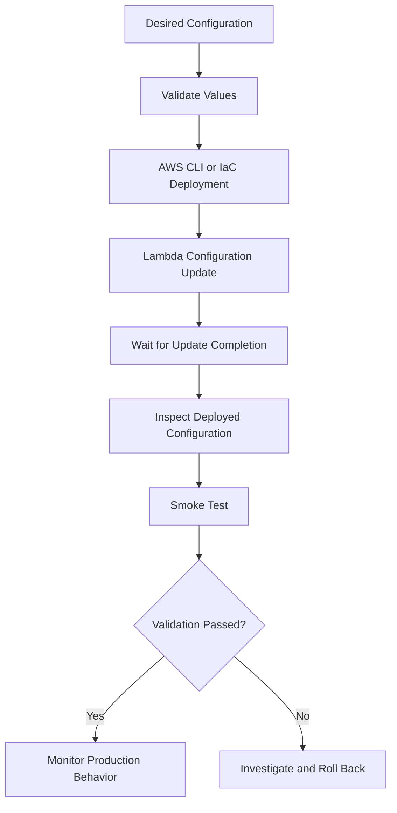

# 04- Function Configuration and Environment Variables

## Overview

AWS Lambda function configuration determines how application code executes, which resources it can access, how it connects to other services, and how operational behavior is controlled.

The AWS CLI allows engineers to inspect and update configuration without relying on the AWS Management Console. This is useful for troubleshooting production issues, tuning memory and timeout settings, managing environment-specific values, and automating configuration changes.

This document focuses on runtime configuration, environment variables, memory, timeout, ephemeral storage, architecture, execution roles, VPC settings, configuration updates, and safe verification procedures.

## Configuration Lifecycle

Lambda separates function code from function configuration. Both can be updated independently, but configuration changes can affect application behavior and availability.



A reliable configuration workflow should:

- Retrieve the current configuration.
- Identify the exact fields being changed.
- Preserve unrelated settings.
- Apply the change through an approved deployment mechanism.
- Wait for the update to complete.
- Verify the resulting configuration and application behavior.

For production workloads, prefer AWS SAM or CloudFormation as the source of truth. Direct CLI changes are useful for operational tasks but can create infrastructure drift when they bypass the deployment pipeline.

## Inspect Current Configuration

Set the deployment context:

```bash
PROFILE=dev
REGION=ap-south-1
FUNCTION_NAME=orders-api
```

Verify the active AWS identity:

```bash
aws sts get-caller-identity \
  --profile "$PROFILE"
```

Retrieve the function configuration:

```bash
aws lambda get-function-configuration \
  --function-name "$FUNCTION_NAME" \
  --profile "$PROFILE" \
  --region "$REGION"
```

Inspect commonly relevant fields:

```bash
aws lambda get-function-configuration \
  --function-name "$FUNCTION_NAME" \
  --query '{Name:FunctionName,Runtime:Runtime,Handler:Handler,MemoryMB:MemorySize,TimeoutSeconds:Timeout,Architectures:Architectures,EphemeralStorageMB:EphemeralStorage.Size,Role:Role,State:State,LastUpdateStatus:LastUpdateStatus}' \
  --output json \
  --profile "$PROFILE" \
  --region "$REGION"
```

The command is read-only. It does not modify the function.

Some fields vary according to package type, runtime, or configuration. Do not assume that every function exposes identical values.

## Memory and Timeout Configuration

### Memory allocation

Lambda memory controls the memory available to the execution environment and influences the CPU resources allocated to the function.

Increasing memory can improve CPU-bound workloads, JSON processing, compression, cryptographic operations, and other compute-intensive tasks. It can also reduce execution duration enough to lower total compute cost, even though the configured price per unit of execution time increases.

Inspect the current memory allocation:

```bash
aws lambda get-function-configuration \
  --function-name "$FUNCTION_NAME" \
  --query 'MemorySize' \
  --output text \
  --profile "$PROFILE" \
  --region "$REGION"
```

Update the allocation:

```bash
aws lambda update-function-configuration \
  --function-name "$FUNCTION_NAME" \
  --memory-size 1024 \
  --profile "$PROFILE" \
  --region "$REGION"
```

The example configures 1024 MB of memory.

Wait for the update:

```bash
aws lambda wait function-updated \
  --function-name "$FUNCTION_NAME" \
  --profile "$PROFILE" \
  --region "$REGION"
```

Verify the new value:

```bash
aws lambda get-function-configuration \
  --function-name "$FUNCTION_NAME" \
  --query '{MemoryMB:MemorySize,LastUpdateStatus:LastUpdateStatus}' \
  --output json \
  --profile "$PROFILE" \
  --region "$REGION"
```

### Timeout

The timeout specifies the maximum execution duration of a single invocation. Lambda terminates an invocation that exceeds the configured limit.

Inspect the current timeout:

```bash
aws lambda get-function-configuration \
  --function-name "$FUNCTION_NAME" \
  --query 'Timeout' \
  --output text \
  --profile "$PROFILE" \
  --region "$REGION"
```

Update it:

```bash
aws lambda update-function-configuration \
  --function-name "$FUNCTION_NAME" \
  --timeout 20 \
  --profile "$PROFILE" \
  --region "$REGION"
```

A timeout of 20 seconds is appropriate only if it matches the workload's latency requirements and downstream behavior.

For API-backed functions, the Lambda timeout should be compatible with the timeout imposed by the caller or integration. A client timeout longer than the Lambda timeout does not prevent Lambda from terminating the execution. Conversely, a shorter client timeout can cause the client to stop waiting while the backend continues processing.

For queue consumers, align the function timeout, event source configuration, visibility timeout, retry policy, and downstream request timeouts. A poorly coordinated configuration can cause duplicate processing or repeated failures.

### Memory and timeout trade-offs

| Configuration | Benefit | Risk or limitation |
|---|---|---|
| Higher memory | More memory and CPU capacity; may reduce duration | Higher configured compute rate |
| Lower memory | Lower compute rate per unit time | Slower execution or memory exhaustion |
| Longer timeout | Supports legitimately long operations | Holds concurrency longer and can increase retry latency |
| Shorter timeout | Limits runaway operations and bounds latency | May terminate valid work if set too aggressively |

Do not tune memory or timeout solely from a successful smoke test. Use representative workloads, duration distributions, maximum memory usage, error rates, and downstream capacity measurements.

## Ephemeral Storage

Lambda provides temporary storage under `/tmp`. It is local to the execution environment and is not durable storage for business data.

Use it for workloads such as:

- Downloading and transforming files.
- Temporary archives and extracted content.
- Intermediate artifacts during data processing.
- Libraries or tools that require filesystem access.

Inspect the configured capacity:

```bash
aws lambda get-function-configuration \
  --function-name "$FUNCTION_NAME" \
  --query 'EphemeralStorage.Size' \
  --output text \
  --profile "$PROFILE" \
  --region "$REGION"
```

Increase it when the workload needs more temporary disk space:

```bash
aws lambda update-function-configuration \
  --function-name "$FUNCTION_NAME" \
  --ephemeral-storage '{"Size":2048}' \
  --profile "$PROFILE" \
  --region "$REGION"
```

The example configures 2048 MB of ephemeral storage. Validate the value against current Lambda limits before deployment.

Wait for completion and verify the resulting capacity:

```bash
aws lambda wait function-updated \
  --function-name "$FUNCTION_NAME" \
  --profile "$PROFILE" \
  --region "$REGION"

aws lambda get-function-configuration \
  --function-name "$FUNCTION_NAME" \
  --query 'EphemeralStorage.Size' \
  --output text \
  --profile "$PROFILE" \
  --region "$REGION"
```

Temporary files can remain available when an execution environment is reused, but the application must not depend on that reuse for correctness. The environment can be replaced at any time.

Do not use `/tmp` as the authoritative location for uploaded files, transaction state, distributed locks, or other durable application data. Use S3, a database, or another suitable persistent service.

## Environment Variables

Environment variables provide function-level configuration without requiring application code changes for every environment.

Common examples include:

- Application environment identifiers.
- Log levels.
- Feature flags.
- Table names and queue URLs.
- Downstream service endpoints.
- Non-sensitive operational settings.

Example configuration:

```json
{
  "Variables": {
    "APP_ENV": "staging",
    "LOG_LEVEL": "INFO",
    "ORDERS_TABLE": "orders-staging",
    "REQUEST_TIMEOUT_SECONDS": "5"
  }
}
```

Save this content to `environment.json`.

### Apply environment variables

```bash
aws lambda update-function-configuration \
  --function-name "$FUNCTION_NAME" \
  --environment file://environment.json \
  --profile "$PROFILE" \
  --region "$REGION"
```

**Important:** The supplied `Variables` map replaces the existing environment-variable map. Omitted variables are not automatically preserved.

Before updating an existing function, retrieve its current configuration through an approved workflow, merge the desired changes, and submit the complete intended map. Do not copy sensitive values into shell history, terminal recordings, tickets, or CI logs.

Wait for the update:

```bash
aws lambda wait function-updated \
  --function-name "$FUNCTION_NAME" \
  --profile "$PROFILE" \
  --region "$REGION"
```

Inspect the environment-variable names without printing their values:

```bash
aws lambda get-function-configuration \
  --function-name "$FUNCTION_NAME" \
  --query 'keys(Environment.Variables || `{}`)' \
  --output json \
  --profile "$PROFILE" \
  --region "$REGION"
```

If the query expression is unsupported by the local CLI environment, retrieve the JSON and filter the key names using a controlled local script.

### Read environment variables in Python

```python
import os


APP_ENV = os.environ.get("APP_ENV", "development")
LOG_LEVEL = os.environ.get("LOG_LEVEL", "INFO")
ORDERS_TABLE = os.environ["ORDERS_TABLE"]

REQUEST_TIMEOUT_SECONDS = int(
    os.environ.get("REQUEST_TIMEOUT_SECONDS", "5")
)
```

Use defaults only when they are safe. For required configuration, direct indexing such as `os.environ["ORDERS_TABLE"]` fails during initialization if the variable is absent. This can be preferable to silently operating with an incorrect resource name.

Validate configuration explicitly when more detailed error messages are needed:

```python
import os


def load_settings() -> dict[str, str | int]:
    required = ("ORDERS_TABLE",)
    missing = [name for name in required if not os.environ.get(name)]

    if missing:
        raise RuntimeError(
            f"Missing required environment variables: {', '.join(missing)}"
        )

    try:
        request_timeout = int(
            os.environ.get("REQUEST_TIMEOUT_SECONDS", "5")
        )
    except ValueError as exc:
        raise RuntimeError(
            "REQUEST_TIMEOUT_SECONDS must be an integer"
        ) from exc

    if request_timeout <= 0:
        raise RuntimeError(
            "REQUEST_TIMEOUT_SECONDS must be greater than zero"
        )

    return {
        "orders_table": os.environ["ORDERS_TABLE"],
        "request_timeout_seconds": request_timeout,
    }
```

Avoid logging environment-variable values during initialization. Log validated, non-sensitive configuration metadata when it helps diagnose deployment problems.

## Environment Variables and Secret Management

Environment variables are configuration, not a complete secrets-management system.

Lambda encrypts environment variables at rest. However, principals with sufficient permissions to retrieve function configuration may be able to read the configured values. Application code can also read them during execution.

For credentials, API tokens, and other sensitive values, prefer AWS Secrets Manager or Systems Manager Parameter Store with narrowly scoped IAM permissions.

| Requirement | Recommended approach |
|---|---|
| Non-sensitive application setting | Environment variable |
| Environment-specific table or queue name | Environment variable or deployment configuration |
| Database password | Secrets Manager or an appropriate Parameter Store configuration |
| Rotating API credential | Secrets Manager with a rotation strategy where supported |
| Sensitive configuration with access controls | Secret store plus least-privilege IAM |
| Public feature flag | Environment variable or an appropriate feature-management service |

If a secret is retrieved at runtime, consider the latency and cost of retrieval, caching behavior, rotation requirements, and failure modes. Cache secrets only with a deliberate refresh strategy so that rotation does not leave long-lived execution environments using stale credentials indefinitely.

Never embed secrets in source code, ZIP artifacts, container images, or plain-text infrastructure templates.

## Runtime and Handler Configuration

The runtime identifies the execution environment used by Lambda. The handler identifies the application entry point for handler-based runtimes.

Inspect both:

```bash
aws lambda get-function-configuration \
  --function-name "$FUNCTION_NAME" \
  --query '{Runtime:Runtime,Handler:Handler,PackageType:PackageType,Architectures:Architectures}' \
  --output json \
  --profile "$PROFILE" \
  --region "$REGION"
```

For a Python ZIP-based function, a handler such as `lambda_function.lambda_handler` refers to the `lambda_handler` function in `lambda_function.py`.

Update the handler when required:

```bash
aws lambda update-function-configuration \
  --function-name "$FUNCTION_NAME" \
  --handler lambda_function.lambda_handler \
  --profile "$PROFILE" \
  --region "$REGION"
```

Runtime changes must be planned carefully because dependency compatibility, native libraries, initialization behavior, and runtime support can differ.

For container-image functions, the image and its runtime configuration determine how the application starts. Do not assume that every ZIP-specific configuration workflow applies identically to image-based functions.

## CPU Architecture

Lambda supports architecture choices that include `x86_64` and `arm64`, subject to the function's package and runtime compatibility.

Inspect the configured architecture:

```bash
aws lambda get-function-configuration \
  --function-name "$FUNCTION_NAME" \
  --query 'Architectures' \
  --output json \
  --profile "$PROFILE" \
  --region "$REGION"
```

Architecture affects the compatibility of native dependencies and container images. Python packages containing compiled extensions must be built for the selected architecture and compatible Linux environment.

Do not change architecture without rebuilding and testing the deployment artifact. Evaluate performance and pricing using representative workloads rather than assuming that one architecture is always faster or cheaper.

## Execution Role Configuration

The execution role determines which AWS APIs the function can call using its runtime credentials.

Inspect the current role:

```bash
aws lambda get-function-configuration \
  --function-name "$FUNCTION_NAME" \
  --query 'Role' \
  --output text \
  --profile "$PROFILE" \
  --region "$REGION"
```

Update the role association when required:

```bash
aws lambda update-function-configuration \
  --function-name "$FUNCTION_NAME" \
  --role arn:aws:iam::123456789012:role/lambda-orders-execution \
  --profile "$PROFILE" \
  --region "$REGION"
```

Wait for the update and verify the resulting ARN.

Changing the execution role does not automatically grant the new role the permissions needed by the application. Ensure the trust policy permits Lambda to assume the role and that the role has the required least-privilege permissions.

Keep invocation permission separate from execution permissions:

- The **execution role** controls what the function can access.
- The **resource-based policy** can control which principals or services may invoke the function.
- The **deployment identity** controls who can create or modify the function and pass its role.

## VPC Configuration

A Lambda function can be connected to a VPC to reach private databases, caches, internal services, and other private resources.

Inspect the current VPC configuration:

```bash
aws lambda get-function-configuration \
  --function-name "$FUNCTION_NAME" \
  --query 'VpcConfig' \
  --output json \
  --profile "$PROFILE" \
  --region "$REGION"
```

VPC configuration includes subnet and security group selections. Connectivity also depends on routing, DNS, network ACLs, destination security groups, and the availability of the destination.

For outbound internet access, a public subnet selection alone does not provide internet connectivity to Lambda. Configure a suitable egress path, such as NAT, or use private service endpoints when appropriate.

When changing VPC settings:

1. Verify subnet and security group identifiers.
2. Confirm that the subnets can reach required destinations.
3. Check DNS and routing requirements.
4. Validate database security groups and connection limits.
5. Apply the configuration.
6. Wait for the update to complete.
7. Test actual connectivity from the function.

VPC attachment can affect startup behavior and introduces networking dependencies. Do not add VPC configuration unless the workload needs it or the architecture requires it.

## Update Multiple Configuration Values Safely

Several configuration fields can be updated in one command, but combining unrelated changes can make failures harder to diagnose.

Example:

```bash
aws lambda update-function-configuration \
  --function-name "$FUNCTION_NAME" \
  --memory-size 1024 \
  --timeout 15 \
  --ephemeral-storage '{"Size":2048}' \
  --profile "$PROFILE" \
  --region "$REGION"
```

Wait and verify:

```bash
aws lambda wait function-updated \
  --function-name "$FUNCTION_NAME" \
  --profile "$PROFILE" \
  --region "$REGION"

aws lambda get-function-configuration \
  --function-name "$FUNCTION_NAME" \
  --query '{MemoryMB:MemorySize,TimeoutSeconds:Timeout,EphemeralStorageMB:EphemeralStorage.Size,State:State,LastUpdateStatus:LastUpdateStatus}' \
  --output json \
  --profile "$PROFILE" \
  --region "$REGION"
```

For high-risk changes, prefer smaller changes with independent verification. For routine deployments, keep the desired configuration in version-controlled infrastructure definitions and let the deployment tool calculate the resource changes.

## Configuration Verification Checklist

Before considering a configuration change complete, verify:

- [ ] The correct account, Region, and function were targeted.
- [ ] The requested configuration values are present.
- [ ] The function state and latest update status indicate success.
- [ ] Required environment variables are present without exposing sensitive values.
- [ ] The execution role has the intended permissions.
- [ ] VPC connectivity works when the function uses private resources.
- [ ] Memory and timeout are appropriate for measured workload behavior.
- [ ] A smoke test validates the expected application response.
- [ ] CloudWatch Logs and metrics show no unexpected errors or latency regressions.
- [ ] Infrastructure-as-code definitions remain consistent with the deployed configuration.

## Common Mistakes

| Mistake | Why it causes problems | Prevention |
|---|---|---|
| Replacing environment variables with an incomplete map | Existing variables are removed | Retrieve, merge, and apply the complete intended map |
| Increasing timeout without examining downstream timeouts | The caller or dependency may fail earlier | Align timeout budgets across the request path |
| Increasing memory without benchmarking | Cost may increase without meaningful performance gains | Compare duration, memory usage, and cost under representative load |
| Storing durable state in `/tmp` | Execution environments can be replaced | Use persistent storage for authoritative data |
| Logging environment-variable values | Credentials and sensitive configuration can leak | Log only safe metadata |
| Changing architecture without rebuilding dependencies | Native extensions may fail to load | Rebuild and test for the target architecture |
| Assuming a public subnet gives Lambda internet access | Routing and egress requirements remain unmet | Validate the full network path |
| Updating configuration manually without updating IaC | Deployment drift can cause future changes to revert settings | Keep infrastructure definitions as the source of truth |

## Key Takeaways

- Lambda configuration controls runtime behavior, resource allocation, networking, and access to downstream services.
- Environment-variable updates replace the supplied variable map, so preserve existing values deliberately and never expose secrets in logs.
- Tune memory, timeout, and ephemeral storage using workload measurements and explicit operational requirements.
- Treat execution roles, invocation permissions, deployment permissions, and VPC connectivity as separate concerns.
- Wait for updates, inspect the resulting configuration, run smoke tests, and keep infrastructure-as-code definitions synchronized with production.