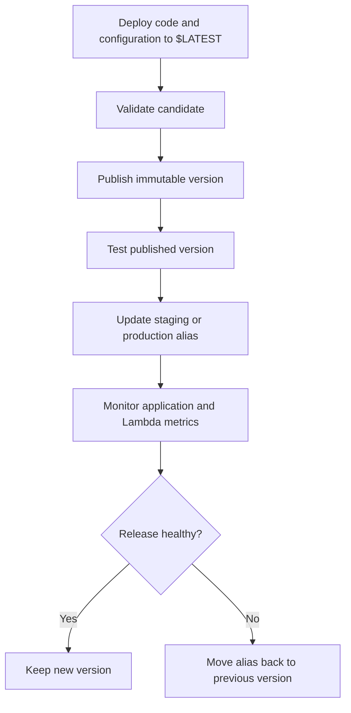

# 05- Versions and Aliases Management

## Overview

AWS Lambda versions and aliases provide a controlled mechanism for managing function releases, separating deployment from production traffic, and supporting rollback without rebuilding previously published artifacts.

For backend engineering teams, these capabilities are particularly useful when deploying REST APIs, asynchronous processors, and serverless microservices through CI/CD pipelines. Published versions provide immutable release snapshots, while aliases provide stable invocation targets that can be moved between releases.

This document focuses on AWS CLI operations for publishing versions, creating and updating aliases, configuring weighted routing, validating deployments, and recovering from failed releases.

## Versions and Aliases Fundamentals

### Published versions

A published Lambda version is an immutable snapshot of a function's code and qualifying configuration at publication time.

A function may have the following versions:

```text
orders-api
├── $LATEST
├── 1
├── 2
└── 3
```

- `$LATEST` represents the current editable function code and configuration.
- `1`, `2`, and `3` are published versions.
- Publishing a new version creates another numbered version; it does not modify an existing published version.

Published versions are useful when a deployment needs a stable, identifiable release target for testing, production traffic, or rollback.

### Aliases

An alias is a mutable, named pointer to a published version. It can optionally distribute traffic between a primary version and one additional version through weighted routing.

```text
orders-api:staging    -> Version 13
orders-api:production -> Version 12
```

An alias allows an integration to use a stable function identifier even as the application is updated. For example, an API Gateway integration can invoke `orders-api:production`; during deployment, the alias can be moved from version `12` to version `13` without changing the integration's target ARN.

### How versions and aliases work together



A version captures a release snapshot. An alias controls which published version an integration invokes. Neither feature automatically validates application behavior or reverses external side effects.

## AWS CLI Prerequisites

The examples use these variables:

```bash
PROFILE=dev
REGION=ap-south-1
FUNCTION_NAME=orders-api
```

Replace these values with your AWS CLI profile, target Region, and Lambda function name.

Verify the AWS identity before making changes:

```bash
aws sts get-caller-identity \
  --profile "$PROFILE"
```

Verify that the target function exists:

```bash
aws lambda get-function \
  --function-name "$FUNCTION_NAME" \
  --profile "$PROFILE" \
  --region "$REGION"
```

Use an explicit profile and Region for operational commands. This reduces the risk of modifying a similarly named function in the wrong account or Region.

## Inspect Published Versions

### List all versions

This read-only command lists `$LATEST` and the published versions:

```bash
aws lambda list-versions-by-function \
  --function-name "$FUNCTION_NAME" \
  --query 'Versions[].{Version:Version,LastModified:LastModified,MemoryMB:MemorySize,TimeoutSeconds:Timeout,CodeSha256:CodeSha256,Description:Description}' \
  --output table \
  --profile "$PROFILE" \
  --region "$REGION"
```

Review the version number, code hash, configuration, and description before selecting a release for production.

### Inspect a specific version

```bash
VERSION=12

aws lambda get-function-configuration \
  --function-name "$FUNCTION_NAME" \
  --qualifier "$VERSION" \
  --query '{Version:Version,Arn:FunctionArn,Runtime:Runtime,Handler:Handler,MemoryMB:MemorySize,TimeoutSeconds:Timeout,CodeSha256:CodeSha256,State:State}' \
  --output json \
  --profile "$PROFILE" \
  --region "$REGION"
```

Replace `12` with an existing published version.

Use this operation to confirm that the candidate has the expected runtime, handler, memory, timeout, and code hash.

## Publish a New Version

### Prepare the candidate

Before publishing, deploy the intended code and configuration to `$LATEST` through the approved deployment process.

Inspect the function's update state:

```bash
aws lambda get-function-configuration \
  --function-name "$FUNCTION_NAME" \
  --query '{State:State,LastUpdateStatus:LastUpdateStatus,CodeSha256:CodeSha256,LastModified:LastModified}' \
  --output json \
  --profile "$PROFILE" \
  --region "$REGION"
```

Do not publish while a code or configuration update is still in progress or has failed.

### Publish the version

The following mutating command publishes a version when the qualifying code or configuration differs from the latest published version:

```bash
aws lambda publish-version \
  --function-name "$FUNCTION_NAME" \
  --description "Orders API release 2026-10" \
  --profile "$PROFILE" \
  --region "$REGION"
```

The response includes the newly published version number and qualified ARN.

To capture the version number in a Bash deployment script:

```bash
NEW_VERSION=$(aws lambda publish-version \
  --function-name "$FUNCTION_NAME" \
  --description "Orders API release 2026-10" \
  --query 'Version' \
  --output text \
  --profile "$PROFILE" \
  --region "$REGION")
```

Treat the returned version as a release identifier. Record the source commit, build ID, artifact hash, and deployment metadata alongside it.

### Verify publication

```bash
aws lambda get-function-configuration \
  --function-name "$FUNCTION_NAME" \
  --qualifier "$NEW_VERSION" \
  --query '{Version:Version,Arn:FunctionArn,CodeSha256:CodeSha256,LastModified:LastModified,State:State}' \
  --output json \
  --profile "$PROFILE" \
  --region "$REGION"
```

Confirm that the published version matches the intended artifact and configuration.

**Important:** Repeating `publish-version` without a qualifying change does not necessarily create another version. Deployment pipelines should handle this behavior explicitly rather than assuming every command invocation produces a new version number.

## Create an Alias

Create an alias that points to an existing published version:

```bash
aws lambda create-alias \
  --function-name "$FUNCTION_NAME" \
  --name production \
  --function-version "$NEW_VERSION" \
  --description "Production release" \
  --profile "$PROFILE" \
  --region "$REGION"
```

This is a mutating operation. It fails if the alias already exists or the target version is invalid.

### List aliases

```bash
aws lambda list-aliases \
  --function-name "$FUNCTION_NAME" \
  --query 'Aliases[].{Name:Name,Version:FunctionVersion,Arn:AliasArn,Description:Description}' \
  --output table \
  --profile "$PROFILE" \
  --region "$REGION"
```

### Inspect one alias

```bash
aws lambda get-alias \
  --function-name "$FUNCTION_NAME" \
  --name production \
  --profile "$PROFILE" \
  --region "$REGION"
```

The response includes the primary version, alias ARN, description, and any additional version weights.

Aliases must target published versions; they cannot target `$LATEST`.

## Update an Alias

Move an existing alias to a new published version:

```bash
aws lambda update-alias \
  --function-name "$FUNCTION_NAME" \
  --name production \
  --function-version "$NEW_VERSION" \
  --description "Production release" \
  --profile "$PROFILE" \
  --region "$REGION"
```

After the update, invocations using that alias resolve to the new target, subject to any configured weighted routing.

Verify the result:

```bash
aws lambda get-alias \
  --function-name "$FUNCTION_NAME" \
  --name production \
  --query '{Name:Name,FunctionVersion:FunctionVersion,AliasArn:AliasArn,RoutingConfig:RoutingConfig}' \
  --output json \
  --profile "$PROFILE" \
  --region "$REGION"
```

### Safe deployment sequence

1. Deploy code and configuration to `$LATEST`.
2. Run unit, integration, and contract tests.
3. Publish the candidate version.
4. Invoke and validate the published version.
5. Move the staging or production alias.
6. Verify the alias target and integration behavior.
7. Monitor error rates, latency, throttling, and business metrics.
8. Roll back if the release violates defined health criteria.

For high-impact production services, use controlled traffic shifting and automated deployment alarms rather than relying exclusively on a manual alias switch.

## Invoke a Version or Alias

The `--qualifier` option selects a published version or alias.

### Invoke a published version

```bash
aws lambda invoke \
  --function-name "$FUNCTION_NAME" \
  --qualifier "$NEW_VERSION" \
  --payload '{}' \
  --cli-binary-format raw-in-base64-out \
  version-response.json \
  --profile "$PROFILE" \
  --region "$REGION"
```

### Invoke the production alias

```bash
aws lambda invoke \
  --function-name "$FUNCTION_NAME" \
  --qualifier production \
  --payload '{}' \
  --cli-binary-format raw-in-base64-out \
  production-response.json \
  --profile "$PROFILE" \
  --region "$REGION"
```

The first command invokes the specified version directly. The second uses the alias's current routing configuration.

Inspect the response payload:

```bash
cat production-response.json
```

Check the CLI response for `FunctionError` as well as the API call status. A successful invocation API request does not necessarily mean the function executed successfully; function-level errors can be returned in the invocation response.

Direct invocation validates the function's behavior for the supplied event, but it does not fully validate API Gateway authorization, request transformations, resource policies, or other integration-specific behavior. Test the actual production entry point separately.

## Configure Weighted Traffic Shifting

Weighted aliases allow Lambda to route a proportion of eligible invocations to an additional published version. This supports canary releases and gradual rollout.

Assume:

- Version `12` is the current production release.
- Version `13` is the candidate.
- The candidate should initially receive approximately 5% of traffic.

Create `routing-config.json`:

```json
{
  "AdditionalVersionWeights": {
    "13": 0.05
  }
}
```

Apply the configuration:

```bash
aws lambda update-alias \
  --function-name "$FUNCTION_NAME" \
  --name production \
  --function-version 12 \
  --routing-config file://routing-config.json \
  --profile "$PROFILE" \
  --region "$REGION"
```

Version `12` remains the primary version and version `13` receives a configured weight of `0.05`.

Inspect the configuration:

```bash
aws lambda get-alias \
  --function-name "$FUNCTION_NAME" \
  --name production \
  --query '{PrimaryVersion:FunctionVersion,RoutingConfig:RoutingConfig}' \
  --output json \
  --profile "$PROFILE" \
  --region "$REGION"
```

### Weighted routing limitations

Weighted routing is probabilistic. A 5% configured weight does not guarantee that exactly 5% of every small group of requests will execute the candidate version.

It also does not provide arbitrary request-based routing. If traffic must be assigned deterministically by tenant, customer ID, or feature-flag cohort, implement that behavior in an appropriate application or integration layer.

Monitor the candidate for:

- Lambda invocation errors and duration.
- API error rate and latency.
- Downstream database and service errors.
- Throttling and concurrency pressure.
- Business-level success and failure indicators.

For managed canary or linear deployments with alarm-based rollback, consider AWS CodeDeploy's Lambda deployment integration where appropriate.

## Roll Back a Release

If the new release fails, point the alias back to the previous known-good version.

```bash
aws lambda update-alias \
  --function-name "$FUNCTION_NAME" \
  --name production \
  --function-version 12 \
  --profile "$PROFILE" \
  --region "$REGION"
```

If weighted routing is configured, remove the candidate weight explicitly:

```bash
aws lambda update-alias \
  --function-name "$FUNCTION_NAME" \
  --name production \
  --function-version 12 \
  --routing-config '{"AdditionalVersionWeights":{}}' \
  --profile "$PROFILE" \
  --region "$REGION"
```

Verify the rollback:

```bash
aws lambda get-alias \
  --function-name "$FUNCTION_NAME" \
  --name production \
  --query '{FunctionVersion:FunctionVersion,RoutingConfig:RoutingConfig}' \
  --output json \
  --profile "$PROFILE" \
  --region "$REGION"
```

### Rollback limitations

Alias rollback changes routing for subsequent invocations through the alias. It does not undo side effects already produced by the failed release.

Examples include:

- Database writes using a new schema.
- Messages published to SQS or EventBridge.
- External API calls.
- Changes to customer-visible state.
- Events that an older function version cannot deserialize.

Use backward-compatible database migrations and event contracts. For incompatible changes, define an explicit migration and recovery plan before deployment.

Rollback also does not automatically reverse changes to IAM policies, network configuration, secrets, database schemas, or other resources managed outside the published function version.

## Version and Alias Comparison

| Capability | Published version | Alias |
|---|---|---|
| Immutable code snapshot | Yes | No; references published versions |
| Mutable target | No | Yes |
| Stable invocation identifier | Yes | Yes |
| Weighted routing | No | Yes |
| Release history | Directly represented by version numbers | Indirectly represented by alias changes |
| Production traffic switching | Requires changing the integration target | Can switch without changing the integration target |
| Targets `$LATEST` | Not applicable | No |
| Supports rollback | Can be invoked directly | Can be moved to a previous version |

A common production design uses published versions as immutable release artifacts and aliases as stable integration endpoints.

## Operational and Security Considerations

### Invocation permissions

Aliases have qualified ARNs. When configuring resource-based permissions or service integrations, verify that the permission scope matches the intended function or alias ARN.

Do not assume that a permission granted to an unqualified function ARN automatically authorizes every qualified resource in every integration scenario. Inspect the function's resource policy and the integration's configured target.

### Event source mappings

Event source mappings can target qualified function ARNs, including aliases where supported. Inspect the mapping configuration before changing release targets.

Versioning and aliases do not change the retry or delivery semantics of the underlying invocation mechanism. Asynchronous invocations and event source mappings may retry failed processing and can deliver duplicate events. Implement idempotency for side-effecting operations.

### Configuration consistency

A published version snapshots qualifying function configuration, but external dependencies can change independently. Examples include:

- IAM policies and execution-role permissions.
- Secrets and parameters.
- Database schemas and data.
- Network routes and security groups.
- Downstream APIs and event contracts.

Record the artifact identity, published version, alias target, infrastructure revision, and relevant external configuration assumptions for each release.

### Cost considerations

Publishing versions and creating aliases do not inherently incur continuous compute charges. Costs depend on actual usage and related configuration, including invocations, execution duration, provisioned concurrency, logs, and integrated services.

Avoid configuring provisioned concurrency on every published version without a clear latency requirement. Provisioned concurrency can incur charges while capacity is allocated, even when that capacity receives little or no traffic.

## Common Mistakes

| Mistake | Why it is problematic | Prevention |
|---|---|---|
| Invoking `$LATEST` in production | Code and configuration can change during deployment | Use an alias targeting a published version |
| Updating an alias before testing | Production traffic can reach unverified code | Validate the candidate version first |
| Treating weighted routing as an exact percentage | Small samples naturally vary | Use sufficient traffic and statistical monitoring |
| Rolling back code without considering data changes | The previous version may not support the new state | Use backward-compatible migrations and event contracts |
| Publishing versions without release metadata | Difficult to identify the deployed artifact | Record commit, build ID, artifact hash, and version |
| Leaving candidate weights after rollback | Some traffic may still reach the candidate | Explicitly clear additional version weights |
| Assuming aliases eliminate retries or duplicates | Invocation semantics remain unchanged | Implement idempotency and failure handling |
| Deleting versions without checking dependencies | Operational workflows or integrations may depend on them | Inspect aliases and event source mappings before cleanup |

## Production Release Checklist

- [ ] Verify the AWS account, Region, and target function.
- [ ] Confirm the candidate code and configuration are deployed successfully.
- [ ] Run automated tests and smoke tests against the candidate version.
- [ ] Verify the published version and code hash.
- [ ] Confirm database migrations and event contracts remain compatible.
- [ ] Check invocation permissions and integration targets.
- [ ] Record the current production alias target.
- [ ] Define health metrics, alarms, and rollback criteria.
- [ ] Apply the alias update or weighted routing configuration.
- [ ] Verify the resulting alias configuration.
- [ ] Monitor application and infrastructure signals.
- [ ] Clear candidate weights if rollback is required.
- [ ] Record the final version, alias target, and release outcome.

## Key Takeaways

- Published Lambda versions are immutable release snapshots; aliases are mutable pointers used to control which version integrations invoke.
- Validate candidate versions before moving production aliases, and verify alias changes through the AWS CLI.
- Weighted routing supports gradual rollout but does not guarantee exact percentages for small request volumes or provide arbitrary deterministic cohort routing.
- Alias rollback changes future routing but does not reverse database migrations, messages, or other side effects already produced.
- Use immutable release artifacts, backward-compatible changes, monitoring, and explicit rollback criteria to make Lambda deployments safer.