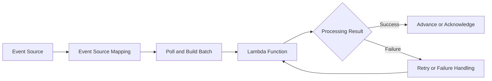
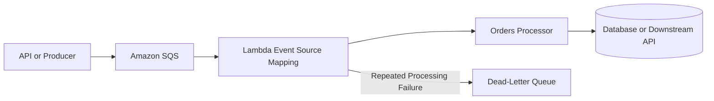

# 06- Event Source Mapping Management

## Overview

AWS Lambda event source mappings connect Lambda functions to supported event sources that Lambda polls on the application's behalf. They are commonly used to process messages from Amazon SQS, records from Amazon Kinesis Data Streams, Amazon DynamoDB Streams, and self-managed Apache Kafka or Amazon Managed Streaming for Apache Kafka clusters.

Unlike direct service invocation, where a service invokes a Lambda function, an event source mapping manages the polling and delivery process between a supported event source and a Lambda function. It controls operational settings such as batch size, batching windows, filtering, concurrency, and failure handling, subject to the capabilities of the selected source.

Event source mappings are managed resources with their own UUIDs and lifecycle. Production teams should inspect and modify them deliberately because changes can affect processing latency, throughput, retry behavior, checkpoint progression, and downstream capacity.

This document covers AWS CLI workflows for inspecting, creating, updating, enabling, disabling, and deleting event source mappings.

## Event Source Mapping Architecture



The exact delivery and checkpoint behavior depends on the event source.

| Event source | Mapping behavior | Important operational consideration |
|---|---|---|
| Amazon SQS | Polls messages and invokes Lambda with batches | Visibility timeout, retries, and partial batch responses |
| Kinesis Data Streams | Reads stream records and invokes Lambda with batches | Shard-level processing, checkpoints, and iterator age |
| DynamoDB Streams | Reads stream records and invokes Lambda with batches | Ordering within a partition key and checkpoint progression |
| Amazon MSK | Reads Kafka records and invokes Lambda with batches | Consumer-group behavior, offsets, and broker connectivity |
| Self-managed Kafka | Polls a supported Kafka cluster | Network access, authentication, and broker configuration |
| Amazon MQ | Polls supported ActiveMQ or RabbitMQ brokers | Broker configuration and event-source-specific semantics |

Not every setting applies to every source. Always consult the event source mapping API documentation for the specific source type before changing configuration.

## AWS CLI Prerequisites

Define the target function and CLI context:

```bash
PROFILE=dev
REGION=ap-south-1
FUNCTION_NAME=orders-processor
```

Replace the example values with your AWS profile, Region, and Lambda function name.

Verify the current identity:

```bash
aws sts get-caller-identity \
  --profile "$PROFILE"
```

Inspect the target function:

```bash
aws lambda get-function-configuration \
  --function-name "$FUNCTION_NAME" \
  --profile "$PROFILE" \
  --region "$REGION"
```

Before creating or updating a mapping, confirm:

- The function exists in the intended account and Region.
- The execution role has the required permissions for processing.
- The event source exists and is accessible.
- The configured batch size and concurrency are compatible with downstream capacity.
- The source-specific retry, visibility, checkpoint, and failure-handling settings are understood.

Event source mapping operations generally require Lambda control-plane permissions. Depending on the source, the caller may also need permissions to configure or inspect the event source and its associated resources.

## Inspect Event Source Mappings

### List mappings for a function

This read-only command lists mappings associated with the function:

```bash
aws lambda list-event-source-mappings \
  --function-name "$FUNCTION_NAME" \
  --query 'EventSourceMappings[].{UUID:UUID,State:State,StateTransitionReason:StateTransitionReason,EventSourceArn:EventSourceArn,FunctionArn:FunctionArn,LastModified:LastModified,BatchSize:BatchSize}' \
  --output table \
  --profile "$PROFILE" \
  --region "$REGION"
```

Review the mapping UUID, state, source ARN, target function ARN, and batch size.

A mapping may take time to transition into an enabled or disabled state. Do not assume that a successful configuration API response means the mapping is already processing records.

### List mappings for an event source

When the source ARN is known:

```bash
EVENT_SOURCE_ARN="arn:aws:sqs:ap-south-1:123456789012:orders-queue"

aws lambda list-event-source-mappings \
  --event-source-arn "$EVENT_SOURCE_ARN" \
  --query 'EventSourceMappings[].{UUID:UUID,State:State,FunctionArn:FunctionArn,BatchSize:BatchSize,LastModified:LastModified}' \
  --output table \
  --profile "$PROFILE" \
  --region "$REGION"
```

Replace the sample ARN with the actual event source ARN.

This is useful when identifying multiple consumers or determining whether a source is connected to an unexpected function.

### Inspect a specific mapping

Capture the mapping UUID from the previous command:

```bash
MAPPING_UUID="11111111-2222-3333-4444-555555555555"
```

Inspect its configuration:

```bash
aws lambda get-event-source-mapping \
  --uuid "$MAPPING_UUID" \
  --profile "$PROFILE" \
  --region "$REGION"
```

For a compact operational view:

```bash
aws lambda get-event-source-mapping \
  --uuid "$MAPPING_UUID" \
  --query '{UUID:UUID,State:State,StateTransitionReason:StateTransitionReason,EventSourceArn:EventSourceArn,FunctionArn:FunctionArn,BatchSize:BatchSize,MaximumBatchingWindowInSeconds:MaximumBatchingWindowInSeconds,MaximumRetryAttempts:MaximumRetryAttempts,MaximumRecordAgeInSeconds:MaximumRecordAgeInSeconds,FunctionResponseTypes:FunctionResponseTypes,ScalingConfig:ScalingConfig}' \
  --output json \
  --profile "$PROFILE" \
  --region "$REGION"
```

Some fields are source-specific and may be absent from the response. Interpret the result according to the source type.

## Create an SQS Event Source Mapping

SQS is a common choice for decoupling API request handling from background processing.



The dead-letter queue in this diagram is typically configured on the SQS source queue as a redrive target. It is not automatically created by the Lambda event source mapping.

### Prerequisites

Create or identify the following resources before configuring the mapping:

- An SQS queue containing the messages to process.
- A Lambda function that accepts SQS event batches.
- A Lambda execution role with the necessary SQS permissions.
- A queue visibility timeout appropriate for the processing duration and retry strategy.

Set the queue ARN:

```bash
QUEUE_ARN="arn:aws:sqs:ap-south-1:123456789012:orders-queue"
```

### Create the mapping

This is a mutating operation:

```bash
aws lambda create-event-source-mapping \
  --function-name "$FUNCTION_NAME" \
  --event-source-arn "$QUEUE_ARN" \
  --batch-size 10 \
  --enabled \
  --function-response-types ReportBatchItemFailures \
  --profile "$PROFILE" \
  --region "$REGION"
```

The command requests batches of up to 10 messages and enables partial batch failure reporting.

`ReportBatchItemFailures` requires compatible handler behavior: the function must return the identifiers of failed records in the expected response format. If the handler reports no failures, Lambda treats the batch as successfully processed.

For SQS, the supported batch size depends on the queue type and configuration. FIFO queues have different batching constraints from standard queues. Verify the current service limits before selecting a larger batch.

### Verify creation

The create operation returns a mapping UUID. Save it:

```bash
MAPPING_UUID="11111111-2222-3333-4444-555555555555"
```

Inspect the mapping:

```bash
aws lambda get-event-source-mapping \
  --uuid "$MAPPING_UUID" \
  --profile "$PROFILE" \
  --region "$REGION"
```

Wait for the mapping to reach `Enabled` and check its state transition reason before sending production traffic.

## Create a DynamoDB Streams Mapping

DynamoDB Streams can trigger Lambda processing when table records are inserted, modified, or removed.

Set the stream ARN:

```bash
STREAM_ARN="arn:aws:dynamodb:ap-south-1:123456789012:table/orders/stream/2026-10-01T10:00:00.000"
```

The ARN must identify an enabled stream for the table.

Create the mapping:

```bash
aws lambda create-event-source-mapping \
  --function-name "$FUNCTION_NAME" \
  --event-source-arn "$STREAM_ARN" \
  --starting-position LATEST \
  --batch-size 100 \
  --enabled \
  --function-response-types ReportBatchItemFailures \
  --profile "$PROFILE" \
  --region "$REGION"
```

`LATEST` starts reading from the latest records when the mapping begins processing. It can skip records written before the consumer starts reading. Use `TRIM_HORIZON` when processing from the oldest records still available in the stream is required.

The stream's retention period is finite. If a consumer remains unavailable long enough, older records may expire before processing resumes.

### Starting position options

| Position | Behavior | Use case |
|---|---|---|
| `LATEST` | Starts with new records observed after the mapping begins reading | New consumers that do not require historical records |
| `TRIM_HORIZON` | Starts from the oldest retained records | Initial processing or recovery requiring retained history |
| `AT_TIMESTAMP` | Starts at a specified timestamp | Controlled replay or recovery when supported by the source |

`AT_TIMESTAMP` requires a valid timestamp parameter and is not available for every source type. Consult the source-specific API requirements before using it.

For Kinesis and DynamoDB Streams, checkpointing and ordering behavior require careful consideration. A failed batch may block progress for a shard or partition until retry or failure-handling conditions allow processing to continue.

## Configure Batch Size and Batching Window

Batch size determines the maximum number of records Lambda collects before invoking the function, subject to source-specific constraints.

A batching window allows Lambda to wait for additional records before invoking the function, potentially reducing invocation overhead for low-volume workloads.

For example, update an existing compatible mapping:

```bash
aws lambda update-event-source-mapping \
  --uuid "$MAPPING_UUID" \
  --batch-size 100 \
  --maximum-batching-window-in-seconds 5 \
  --profile "$PROFILE" \
  --region "$REGION"
```

Verify the change:

```bash
aws lambda get-event-source-mapping \
  --uuid "$MAPPING_UUID" \
  --query '{UUID:UUID,State:State,BatchSize:BatchSize,MaximumBatchingWindowInSeconds:MaximumBatchingWindowInSeconds}' \
  --output json \
  --profile "$PROFILE" \
  --region "$REGION"
```

### Choosing batch settings

| Workload | Starting point | Trade-off |
|---|---|---|
| Latency-sensitive processing | Small batch and short or zero batching window | More invocations and potentially higher cost |
| High-volume processing | Larger batch and a measured batching window | Better amortization but more memory and retry impact per batch |
| Expensive downstream writes | Batch size aligned with database or API bulk-write capacity | Fewer calls, but larger failure domains |
| Stream processing with ordering requirements | Source-appropriate batch size and failure configuration | A failed batch may delay later records |

Batch size is not a substitute for throughput testing. Benchmark realistic event sizes, processing time, memory use, downstream capacity, and failure behavior before increasing it.

## Configure SQS Partial Batch Responses

By default, a failed SQS batch can cause messages that were processed successfully to be delivered again. Partial batch responses allow the handler to identify only the records that failed.

A Python handler can return a response like this:

```python
import json
import logging

logger = logging.getLogger()
logger.setLevel(logging.INFO)


def process_order(order: dict) -> None:
    # Perform idempotent business processing.
    # Raise an exception when this record cannot be processed.
    ...


def lambda_handler(event, context):
    batch_item_failures = []

    for record in event.get("Records", []):
        message_id = record["messageId"]

        try:
            order = json.loads(record["body"])
            process_order(order)
        except Exception:
            logger.exception(
                "Failed to process SQS message",
                extra={"message_id": message_id},
            )
            batch_item_failures.append(
                {"itemIdentifier": message_id}
            )

    return {"batchItemFailures": batch_item_failures}
```

The handler should catch errors at the individual record boundary when partial success is intended. Errors outside that boundary can still fail the entire invocation.

Enable the corresponding response type on the mapping:

```bash
aws lambda update-event-source-mapping \
  --uuid "$MAPPING_UUID" \
  --function-response-types ReportBatchItemFailures \
  --profile "$PROFILE" \
  --region "$REGION"
```

### Important reliability considerations

- Partial batch responses reduce unnecessary retries for successfully processed records.
- Failed records can still be delivered more than once.
- Processing must be idempotent when it performs side effects.
- Configure the SQS visibility timeout to allow sufficient time for processing and retries.
- Configure a redrive policy and dead-letter queue to isolate messages that repeatedly fail.
- FIFO queue handling must preserve the required ordering behavior; do not continue processing later records in a message group after a failure if doing so would violate business ordering.

Partial batch response support and response formats differ across event sources. Do not assume the SQS response structure applies to every mapping.

## Configure Retry and Failure Handling

Event source mappings do not share one universal retry model.

| Source type | Failure behavior to account for |
|---|---|
| SQS | Messages become visible again after visibility timeout unless successfully deleted; repeated failures can reach a configured redrive DLQ |
| Kinesis Data Streams | Failed records can be retried while checkpoint progression is delayed; retry and record-age policies affect recovery |
| DynamoDB Streams | Checkpoint progression and retries affect shard processing; partial batch reporting can reduce reprocessing when supported |
| Kafka sources | Offset progression, batch processing, consumer-group behavior, and retry handling determine recovery behavior |

For stream mappings that support them, configure retry limits and maximum record age deliberately:

```bash
aws lambda update-event-source-mapping \
  --uuid "$MAPPING_UUID" \
  --maximum-retry-attempts 5 \
  --maximum-record-age-in-seconds 3600 \
  --profile "$PROFILE" \
  --region "$REGION"
```

These parameters are not supported by every event source. Confirm compatibility before applying the command. For SQS, message visibility and queue redrive policy are central to retry handling; do not treat stream retry settings as interchangeable with SQS behavior.

For supported stream sources, a destination configuration can preserve records that could not be processed after the configured failure conditions:

```bash
aws lambda update-event-source-mapping \
  --uuid "$MAPPING_UUID" \
  --destination-config '{"OnFailure":{"Destination":"arn:aws:s3:::lambda-failure-archive"}}' \
  --profile "$PROFILE" \
  --region "$REGION"
```

This is an example of the request shape, not a universally valid configuration. Supported destination types and required permissions vary by source and feature. Validate the destination configuration against the current AWS API documentation before applying it. For SQS, use the queue's redrive policy and DLQ configuration for message failure isolation.

## Configure Event Filtering

Event filtering can prevent Lambda from receiving records that do not match a defined pattern. This reduces unnecessary invocations and downstream work, but filters must match the source event structure exactly.

Create a filter file, for example `filter-criteria.json`:

```json
{
  "Filters": [
    {
      "Pattern": "{\"body\":{\"eventType\":[\"order.created\"]}}"
    }
  ]
}
```

Apply the filter:

```bash
aws lambda update-event-source-mapping \
  --uuid "$MAPPING_UUID" \
  --filter-criteria file://filter-criteria.json \
  --profile "$PROFILE" \
  --region "$REGION"
```

The pattern above is illustrative and is appropriate only if the source's filtering format exposes a matching `body.eventType` structure. SQS message-body filtering, stream record filtering, and other event source formats have different details. Test the pattern against representative events before enabling it in production.

Verify the mapping:

```bash
aws lambda get-event-source-mapping \
  --uuid "$MAPPING_UUID" \
  --query '{UUID:UUID,FilterCriteria:FilterCriteria,State:State}' \
  --output json \
  --profile "$PROFILE" \
  --region "$REGION"
```

A filter that is syntactically valid but semantically incorrect can silently exclude business events. Include positive and negative test cases in deployment validation.

## Manage Mapping State

### Disable a mapping

Disabling a mapping stops new processing through that mapping after the state transition completes. It does not delete the mapping.

```bash
aws lambda update-event-source-mapping \
  --uuid "$MAPPING_UUID" \
  --no-enabled \
  --profile "$PROFILE" \
  --region "$REGION"
```

Verify the state:

```bash
aws lambda get-event-source-mapping \
  --uuid "$MAPPING_UUID" \
  --query '{UUID:UUID,State:State,StateTransitionReason:StateTransitionReason}' \
  --output json \
  --profile "$PROFILE" \
  --region "$REGION"
```

Disabling a mapping can cause backlog growth or stream retention risk. Plan for how processing will resume and whether the event source retains data long enough.

### Re-enable a mapping

```bash
aws lambda update-event-source-mapping \
  --uuid "$MAPPING_UUID" \
  --enabled \
  --profile "$PROFILE" \
  --region "$REGION"
```

Wait for the mapping to return to `Enabled`, then monitor backlog, iterator age where applicable, function errors, and downstream load.

### Delete a mapping

Deletion is destructive to the mapping resource, although it does not delete the event source or Lambda function.

```bash
aws lambda delete-event-source-mapping \
  --uuid "$MAPPING_UUID" \
  --profile "$PROFILE" \
  --region "$REGION"
```

Verify that it is no longer present:

```bash
aws lambda get-event-source-mapping \
  --uuid "$MAPPING_UUID" \
  --profile "$PROFILE" \
  --region "$REGION"
```

A successful deletion request may initiate a transition before the mapping is fully removed. A subsequent `get-event-source-mapping` call may show a deleting state before the resource becomes unavailable.

Before deletion, confirm that the mapping is not required by production consumers, deployment automation, or disaster recovery procedures.

## Configure Scaling and Concurrency

Some event source mappings support a scaling configuration that limits the maximum number of concurrent function instances used for processing.

For supported sources, an SQS mapping can be configured with a maximum concurrency value:

```bash
aws lambda update-event-source-mapping \
  --uuid "$MAPPING_UUID" \
  --scaling-config '{"MaximumConcurrency":50}' \
  --profile "$PROFILE" \
  --region "$REGION"
```

This is a mutating operation. Use it only for source types that support the relevant scaling configuration.

### Concurrency planning

The mapping's effective processing capacity is constrained by multiple factors:

- Function reserved concurrency and account concurrency availability.
- Event source mapping scaling behavior.
- Source-specific partition, shard, or queue characteristics.
- Batch size and function duration.
- Downstream capacity, such as database connections or API rate limits.

For SQS, maximum concurrency can help protect downstream services. Ensure the function's reserved concurrency is sufficient for the sum of concurrent workloads that share the function, and avoid configuring multiple mappings to collectively overwhelm the same downstream system.

For Kinesis and DynamoDB Streams, shard and partition characteristics affect parallelism. Increasing concurrency cannot remove source-level ordering or partition constraints.

## Monitor Event Source Mapping Health

Monitor both Lambda metrics and event source metrics. A mapping can be enabled while processing is unhealthy or falling behind.

| Signal | What it indicates |
|---|---|
| Lambda `Errors` | Invocations that failed |
| Lambda `Duration` | Processing time and timeout risk |
| Lambda `Throttles` | Invocation capacity pressure |
| Lambda `ConcurrentExecutions` | Active execution demand |
| SQS `ApproximateAgeOfOldestMessage` | Backlog age and processing delay |
| SQS `ApproximateNumberOfMessagesVisible` | Messages waiting for processing |
| Kinesis or DynamoDB Streams `IteratorAge` | Delay between the latest stream record and processing progress |
| Mapping state and transition reason | Whether the mapping is enabled, creating, updating, disabled, or failed |

Metric names and dimensions depend on the source and integration. Establish alarms based on service objectives rather than relying on a single metric.

Example: inspect the mapping state and reason during an incident.

```bash
aws lambda get-event-source-mapping \
  --uuid "$MAPPING_UUID" \
  --query '{State:State,Reason:StateTransitionReason,LastModified:LastModified,LastProcessingResult:LastProcessingResult}' \
  --output json \
  --profile "$PROFILE" \
  --region "$REGION"
```

For logs:

```bash
LOG_GROUP="/aws/lambda/$FUNCTION_NAME"

aws logs tail "$LOG_GROUP" \
  --since 30m \
  --format short \
  --profile "$PROFILE" \
  --region "$REGION"
```

Correlate the mapping state, Lambda errors, queue backlog or stream iterator age, and downstream failures before changing batch or concurrency settings.

## Troubleshooting

Use a consistent diagnostic flow: symptom, possible causes, isolation, verification, correction, and prevention.

| Symptom | Possible causes | Diagnostic approach | Corrective action |
|---|---|---|---|
| Mapping remains in a failed state | Invalid source configuration, inaccessible source, missing permissions, or networking errors | Inspect `get-event-source-mapping` and `StateTransitionReason` | Correct source access, IAM, network, or configuration issues |
| Mapping is enabled but no records are processed | Empty source, incorrect filter, wrong starting position, or no new events | Inspect source backlog, stream activity, and filter criteria | Correct filters or source configuration and verify with a controlled event |
| SQS backlog keeps increasing | Insufficient concurrency, slow processing, throttling, or repeated failures | Inspect queue age, visible messages, Lambda duration, errors, and throttles | Tune concurrency and batching, optimize processing, and address poison messages |
| Stream iterator age increases | Processing slower than incoming traffic, repeated failures, or insufficient parallelism | Inspect iterator age, function duration, errors, and mapping configuration | Improve processing throughput and resolve checkpoint-blocking failures |
| Messages are processed more than once | At-least-once delivery, visibility timeout expiry, or retries | Correlate message identifiers and idempotency records | Make processing idempotent and tune visibility and retry settings |
| Mapping creation fails | Invalid ARN, unsupported configuration, missing role permissions, or incompatible parameter values | Inspect the API error and verify source-specific constraints | Correct the ARN, permissions, or configuration values |
| Filtering excludes expected records | Pattern does not match the actual event structure | Compare representative source records with the configured pattern | Update the filter and test both matching and non-matching cases |
| Processing stops after disabling a mapping | Mapping was intentionally disabled or did not return to `Enabled` | Inspect the state and transition reason | Re-enable after validating downstream capacity and backlog risk |

## Production Best Practices

- **Use idempotent handlers.** Event source mappings can deliver records more than once. Use stable event or message identifiers and durable idempotency records for side-effecting operations.
- **Tune batches with realistic data.** Larger batches reduce invocation overhead but increase memory requirements and can enlarge the failure domain.
- **Protect downstream systems.** Set concurrency limits according to database connection capacity, API quotas, and acceptable queue latency.
- **Configure source-appropriate retries.** Use SQS visibility and redrive policies for queues, and checkpoint, retry, and record-age settings where supported for streams.
- **Use partial batch responses when appropriate.** Report individual record failures to avoid unnecessarily retrying successful records.
- **Test filters before deployment.** Validate the exact event structure and confirm that important events are not silently excluded.
- **Monitor backlog and processing delay.** An enabled mapping is not proof that the consumer is meeting its service objectives.
- **Treat mapping changes as production changes.** Review batch size, concurrency, filtering, retry, and state changes through the same deployment and audit process used for function configuration.
- **Plan for recovery.** Confirm retention periods, DLQ handling, replay procedures, and downstream idempotency before disabling a consumer or changing checkpoint behavior.
- **Use least privilege.** Grant only the permissions required by the event source, function, and deployment workflow.

## Key Takeaways

- Event source mappings poll supported sources and invoke Lambda, with delivery, retry, ordering, and checkpoint semantics determined by the specific source.
- Use `list-event-source-mappings` and `get-event-source-mapping` to inspect configuration and state before making changes.
- Batch size, batching windows, filtering, retries, and concurrency affect throughput, latency, failure isolation, and downstream pressure.
- Implement idempotency and source-appropriate failure handling because retries can cause duplicate processing.
- Monitor mapping state alongside Lambda errors, throttles, queue backlog, and stream iterator age to diagnose processing failures.