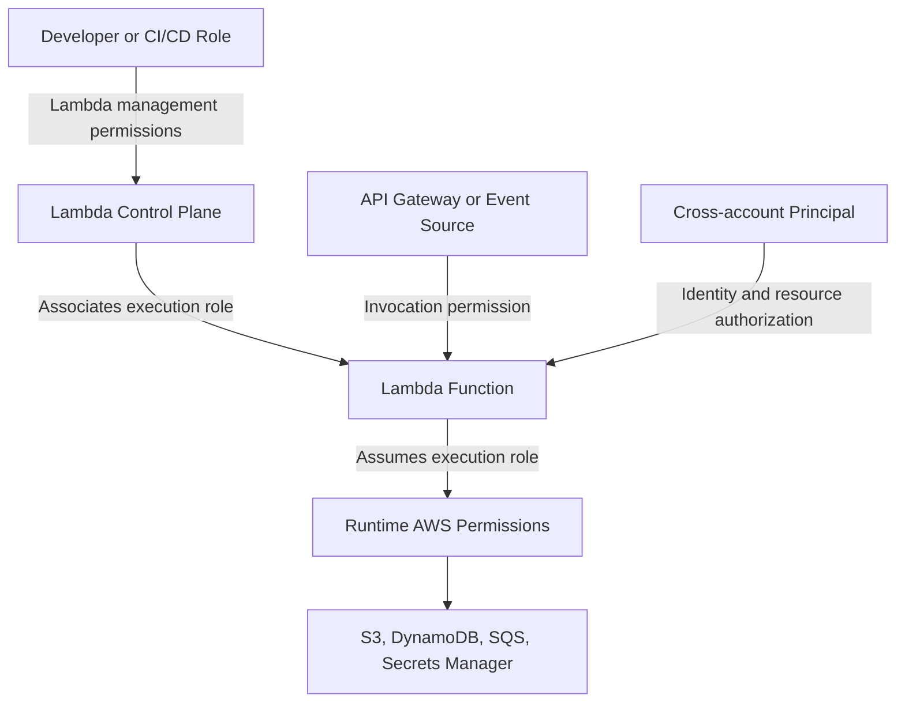
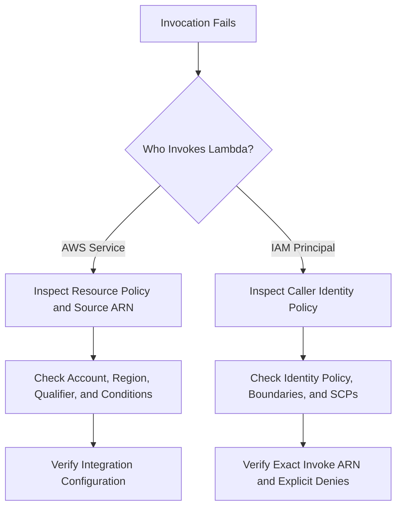

# 07- IAM Permissions and Resource Policies

## Overview

AWS Lambda access control involves several distinct permission layers. The AWS CLI caller needs permission to manage Lambda resources, the Lambda execution role determines what the function can access at runtime, and resource-based policies control which principals or AWS services can invoke the function.

Understanding these boundaries is essential when configuring API integrations, event-driven processing, cross-account invocation, and automated deployments.

This document covers CLI operations for inspecting and managing Lambda execution-role associations, resource-based policies, invocation permissions, and policy validation.

## Lambda Permission Model

A typical Lambda integration involves three security relationships:



| Permission layer | Purpose | Typical permissions |
|---|---|---|
| Deployment identity | Creates, updates, and configures Lambda resources | `lambda:CreateFunction`, `lambda:UpdateFunctionCode`, `lambda:AddPermission`, `iam:PassRole` |
| Execution role | Allows running code to access AWS services | `dynamodb:GetItem`, `sqs:SendMessage`, `secretsmanager:GetSecretValue` |
| Resource-based policy | Allows a principal or service to invoke a function | `lambda:InvokeFunction` granted to an approved principal or service |
| Event source permissions | Allow Lambda's event source mapping to read supported sources | SQS polling permissions, stream-reading permissions, or source-specific access |
| Organizational controls | Restrict access across accounts or organizational units | Service control policies, permissions boundaries, and applicable resource controls |

These permissions are not interchangeable. Giving a function permission to read S3 objects does not automatically permit API Gateway to invoke it. Similarly, allowing a deployment role to update a function does not mean the function's execution role can access the same resources.

## Configure AWS CLI Context

Define the target environment:

```bash
PROFILE=dev
REGION=ap-south-1
FUNCTION_NAME=orders-processor
```

Verify the authenticated AWS identity:

```bash
aws sts get-caller-identity \
  --profile "$PROFILE"
```

Inspect the Lambda function configuration:

```bash
aws lambda get-function-configuration \
  --function-name "$FUNCTION_NAME" \
  --query '{FunctionName:FunctionName,Role:Role,FunctionArn:FunctionArn,State:State,LastUpdateStatus:LastUpdateStatus}' \
  --output json \
  --profile "$PROFILE" \
  --region "$REGION"
```

The `Role` field identifies the execution role associated with the function. It does not show the complete set of permissions granted by that role.

Before making changes, verify the account, Region, function ARN, deployment environment, and permissions of the identity executing the CLI command.

## Inspect the Execution Role

### Retrieve the role ARN

```bash
ROLE_ARN=$(aws lambda get-function-configuration \
  --function-name "$FUNCTION_NAME" \
  --query 'Role' \
  --output text \
  --profile "$PROFILE" \
  --region "$REGION")

printf '%s\n' "$ROLE_ARN"
```

Extract the role name from its ARN:

```bash
ROLE_NAME="${ROLE_ARN##*/}"

printf '%s\n' "$ROLE_NAME"
```

This shell operation assumes the role ARN ends with the role name, as standard IAM role ARNs do.

### Inspect the trust policy

The trust policy determines which principals may assume the role.

```bash
aws iam get-role \
  --role-name "$ROLE_NAME" \
  --query 'Role.{RoleName:RoleName,Arn:Arn,AssumeRolePolicyDocument:AssumeRolePolicyDocument}' \
  --output json \
  --profile "$PROFILE"
```

A typical Lambda execution role trusts the Lambda service principal:

```json
{
  "Version": "2012-10-17",
  "Statement": [
    {
      "Effect": "Allow",
      "Principal": {
        "Service": "lambda.amazonaws.com"
      },
      "Action": "sts:AssumeRole"
    }
  ]
}
```

The trust policy controls who can assume the role. It does not grant access to DynamoDB, S3, SQS, or other services.

### Inspect attached managed policies

List managed policies attached directly to the role:

```bash
aws iam list-attached-role-policies \
  --role-name "$ROLE_NAME" \
  --output table \
  --profile "$PROFILE"
```

List inline policies:

```bash
aws iam list-role-policies \
  --role-name "$ROLE_NAME" \
  --output table \
  --profile "$PROFILE"
```

Retrieve an inline policy:

```bash
POLICY_NAME="OrdersProcessorInlinePolicy"

aws iam get-role-policy \
  --role-name "$ROLE_NAME" \
  --policy-name "$POLICY_NAME" \
  --output json \
  --profile "$PROFILE"
```

For an attached managed policy, retrieve its ARN and default version:

```bash
POLICY_ARN="arn:aws:iam::123456789012:policy/OrdersProcessorPolicy"

aws iam get-policy \
  --policy-arn "$POLICY_ARN" \
  --query 'Policy.{Arn:Arn,DefaultVersionId:DefaultVersionId,AttachmentCount:AttachmentCount}' \
  --output json \
  --profile "$PROFILE"
```

Then retrieve the policy document using the returned version ID:

```bash
VERSION_ID="v1"

aws iam get-policy-version \
  --policy-arn "$POLICY_ARN" \
  --version-id "$VERSION_ID" \
  --query 'PolicyVersion.Document' \
  --output json \
  --profile "$PROFILE"
```

An IAM role's effective permissions may also be affected by permissions boundaries, session policies, service control policies, resource policies, and explicit denies. Reviewing attached policies alone does not establish that an operation will succeed.

## Associate an Execution Role with a Lambda Function

The execution role is specified when a function is created. An existing function can be assigned a different role using `update-function-configuration`.

### Prerequisites

- The replacement role must exist.
- Its trust policy must allow Lambda to assume it.
- It must grant the function's required runtime permissions.
- The deployment identity must be authorized to update the function and pass the role.

Set the replacement role ARN:

```bash
NEW_ROLE_ARN="arn:aws:iam::123456789012:role/OrdersProcessorExecutionRole"
```

Update the function:

```bash
aws lambda update-function-configuration \
  --function-name "$FUNCTION_NAME" \
  --role "$NEW_ROLE_ARN" \
  --profile "$PROFILE" \
  --region "$REGION"
```

This is a mutating operation. Lambda configuration updates are asynchronous, so verify the result before relying on the new role.

```bash
aws lambda wait function-updated \
  --function-name "$FUNCTION_NAME" \
  --profile "$PROFILE" \
  --region "$REGION"
```

Inspect the effective role association:

```bash
aws lambda get-function-configuration \
  --function-name "$FUNCTION_NAME" \
  --query '{Role:Role,State:State,LastUpdateStatus:LastUpdateStatus,LastUpdateStatusReason:LastUpdateStatusReason}' \
  --output json \
  --profile "$PROFILE" \
  --region "$REGION"
```

A successful role update does not guarantee that the function can perform every business operation. Validate the permissions required by its actual code paths.

## Inspect Lambda Resource-Based Policies

A Lambda resource-based policy controls which principals can invoke a function or qualified resource, subject to AWS authorization rules.

### Retrieve the policy

```bash
aws lambda get-policy \
  --function-name "$FUNCTION_NAME" \
  --profile "$PROFILE" \
  --region "$REGION"
```

The response includes the policy document and a revision identifier. The policy may be absent if no resource-based permissions have been configured.

For a specific alias or version, supply the qualifier:

```bash
ALIAS_NAME="prod"

aws lambda get-policy \
  --function-name "$FUNCTION_NAME" \
  --qualifier "$ALIAS_NAME" \
  --profile "$PROFILE" \
  --region "$REGION"
```

A qualified policy can differ from the policy attached to the unqualified function. Inspect the exact resource that the integration invokes.

### Inspect policy statements

A typical service invocation statement resembles:

```json
{
  "Sid": "AllowApprovedService",
  "Effect": "Allow",
  "Principal": {
    "Service": "apigateway.amazonaws.com"
  },
  "Action": "lambda:InvokeFunction",
  "Resource": "arn:aws:lambda:ap-south-1:123456789012:function:orders-processor",
  "Condition": {
    "ArnLike": {
      "AWS:SourceArn": "arn:aws:execute-api:ap-south-1:123456789012:api-id/*/POST/orders"
    }
  }
}
```

The source ARN is illustrative. Use the actual API Gateway execution ARN and scope it to the required API, stage, method, and route wherever possible.

A service principal should not receive unrestricted invocation access when the integration supports source restrictions.

## Grant Invocation Permission

`aws lambda add-permission` adds a statement to a function's resource-based policy.

### Allow API Gateway to invoke a function

Set the API execution ARN:

```bash
API_EXECUTION_ARN="arn:aws:execute-api:ap-south-1:123456789012:api-id/*/POST/orders"
```

Add a narrowly scoped permission:

```bash
aws lambda add-permission \
  --function-name "$FUNCTION_NAME" \
  --statement-id AllowOrdersApiPost \
  --action lambda:InvokeFunction \
  --principal apigateway.amazonaws.com \
  --source-arn "$API_EXECUTION_ARN" \
  --profile "$PROFILE" \
  --region "$REGION"
```

Verify the resulting policy:

```bash
aws lambda get-policy \
  --function-name "$FUNCTION_NAME" \
  --profile "$PROFILE" \
  --region "$REGION"
```

This operation adds authorization to the Lambda resource. It does not create the API Gateway integration, route, stage deployment, or API method configuration.

### Allow an AWS service to invoke a function

For an S3-triggered function, the invocation permission commonly uses the S3 service principal and a source ARN restriction.

```bash
BUCKET_ARN="arn:aws:s3:::orders-upload-bucket"

aws lambda add-permission \
  --function-name "$FUNCTION_NAME" \
  --statement-id AllowOrdersBucketInvoke \
  --action lambda:InvokeFunction \
  --principal s3.amazonaws.com \
  --source-arn "$BUCKET_ARN" \
  --source-account 123456789012 \
  --profile "$PROFILE" \
  --region "$REGION"
```

The source account restriction helps prevent unintended cross-account use of a resource ARN that could otherwise be recreated by another account under certain circumstances.

For S3, the bucket notification configuration must also be set up separately. Ensure the bucket and Lambda function are in compatible Regions for the integration.

For services such as EventBridge, SNS, and API Gateway, use the service-specific source ARN and permission model appropriate to the integration.

## Use Qualified Permissions for Aliases

Production integrations commonly invoke an alias such as `prod` rather than `$LATEST`.

Set the alias name:

```bash
ALIAS_NAME="prod"
```

Grant permission to the alias:

```bash
aws lambda add-permission \
  --function-name "$FUNCTION_NAME" \
  --qualifier "$ALIAS_NAME" \
  --statement-id AllowApiInvokeProdAlias \
  --action lambda:InvokeFunction \
  --principal apigateway.amazonaws.com \
  --source-arn "$API_EXECUTION_ARN" \
  --profile "$PROFILE" \
  --region "$REGION"
```

Inspect the alias policy:

```bash
aws lambda get-policy \
  --function-name "$FUNCTION_NAME" \
  --qualifier "$ALIAS_NAME" \
  --profile "$PROFILE" \
  --region "$REGION"
```

A permission attached to the unqualified function does not automatically mean every qualified invocation path is configured correctly. Verify the ARN used by the integration and the resource on which the policy statement was added.

## Remove a Resource-Based Permission

Use the statement ID returned or configured when the permission was added.

```bash
STATEMENT_ID="AllowOrdersApiPost"
```

Remove the statement:

```bash
aws lambda remove-permission \
  --function-name "$FUNCTION_NAME" \
  --statement-id "$STATEMENT_ID" \
  --profile "$PROFILE" \
  --region "$REGION"
```

For a statement attached to a qualified resource, specify the same qualifier:

```bash
aws lambda remove-permission \
  --function-name "$FUNCTION_NAME" \
  --qualifier "$ALIAS_NAME" \
  --statement-id AllowApiInvokeProdAlias \
  --profile "$PROFILE" \
  --region "$REGION"
```

Verify the change with `get-policy`. Removing an invocation permission can break an integration immediately after the policy update takes effect. Coordinate removal with the service configuration and deployment lifecycle.

## Configure Cross-Account Invocation

Cross-account invocation requires authorization on the target side and, depending on the caller type and authorization model, permission for the caller to invoke the target.

For an external AWS account, use its account ID as the principal:

```bash
CALLER_ACCOUNT_ID="210987654321"
```

Grant access to a specific function:

```bash
aws lambda add-permission \
  --function-name "$FUNCTION_NAME" \
  --statement-id AllowTrustedAccountInvoke \
  --action lambda:InvokeFunction \
  --principal "$CALLER_ACCOUNT_ID" \
  --profile "$PROFILE" \
  --region "$REGION"
```

For production, prefer a narrowly scoped role or principal where the integration supports it, and avoid granting an entire external account broader access than necessary.

The external caller also needs appropriate identity-based permissions to invoke the function. Cross-account invocation can be affected by organization policies, permission boundaries, explicit denies, and the exact resource ARN being invoked.

### Verify the target ARN

```bash
aws lambda get-function \
  --function-name "$FUNCTION_NAME" \
  --query 'Configuration.FunctionArn' \
  --output text \
  --profile "$PROFILE" \
  --region "$REGION"
```

Ensure the caller uses the intended account, Region, function, and qualifier.

## Diagnose Invocation Permission Failures

When invocation fails with `AccessDeniedException`, `AccessDenied`, or an integration-specific authorization error, identify which authorization layer denied the request.



### Diagnostic checklist

1. Confirm the caller's identity with `aws sts get-caller-identity`.
2. Inspect the target function ARN and any qualifier.
3. Retrieve the resource-based policy with `aws lambda get-policy`.
4. Verify the principal, action, source ARN, source account, and conditions.
5. For IAM callers, inspect their identity policies and applicable permission boundaries or organizational controls.
6. For service integrations, inspect the source service's integration configuration.
7. Review CloudTrail events when available to identify the denied API operation and principal.

Example: inspect a policy for a function alias:

```bash
aws lambda get-policy \
  --function-name "$FUNCTION_NAME" \
  --qualifier "$ALIAS_NAME" \
  --profile "$PROFILE" \
  --region "$REGION"
```

A source ARN mismatch is a common cause of service invocation failures. Wildcards, stage names, HTTP methods, route paths, account IDs, and Regions must match the actual integration.

## Common Permission Mistakes

| Mistake | Why it causes problems | Better approach |
|---|---|---|
| Granting `lambda:InvokeFunction` to `Principal: "*"` without appropriate restrictions | Exposes the function to unintended invocation paths where the policy and authorization model permit access | Restrict the principal and use source conditions when supported |
| Confusing the execution role with the resource policy | Runtime access and invocation authorization are different permission relationships | Inspect both the execution role and the resource-based policy |
| Allowing an entire service principal without source restrictions | Other resources using that service may be able to invoke the function if the policy permits it | Use a specific source ARN and source account where applicable |
| Using the wrong alias or version qualifier | The integration may invoke a resource whose permissions differ from those inspected | Inspect and authorize the exact qualified ARN |
| Omitting `iam:PassRole` from deployment permissions | The deployment identity may be unable to associate the execution role with the function | Grant `iam:PassRole` only for approved roles |
| Giving the execution role administrator access | A code defect or compromised dependency can use excessive runtime privileges | Apply least privilege to the resources and actions the handler requires |
| Treating a successful policy update as proof of integration health | The source integration may still be misconfigured or invoke a different ARN | Verify the integration and execute a controlled test invocation |

## Production Security Checklist

- Keep deployment permissions separate from runtime permissions.
- Restrict `iam:PassRole` to approved execution roles and, where appropriate, constrain its use to Lambda.
- Use resource-based policies for supported service and cross-account invocation patterns, scoped to the intended principal and source.
- Inspect policies on the exact function, version, or alias used by production integrations.
- Avoid broad wildcard permissions unless the use case and authorization boundary justify them.
- Review execution-role trust policies, attached policies, inline policies, permissions boundaries, and organizational restrictions.
- Audit policy changes and invocation activity through CloudTrail.
- Use infrastructure as code to make permissions reviewable, repeatable, and consistent across environments.
- Test both successful access and expected denials before promoting a configuration to production.
- Remove obsolete statements and roles only after confirming that no active integration depends on them.

## Key Takeaways

- The deployment identity, Lambda execution role, and Lambda resource-based policy govern different parts of the authorization model.
- Use `get-function-configuration`, IAM inspection commands, and `get-policy` to identify the exact permission layer involved.
- Grant service invocation permissions with the narrowest practical principal and source restrictions.
- Qualified function and alias invocation paths must be checked against the permissions attached to the actual target resource.
- Diagnose authorization failures by verifying the caller, target ARN, resource policy, identity policies, and applicable explicit denies.