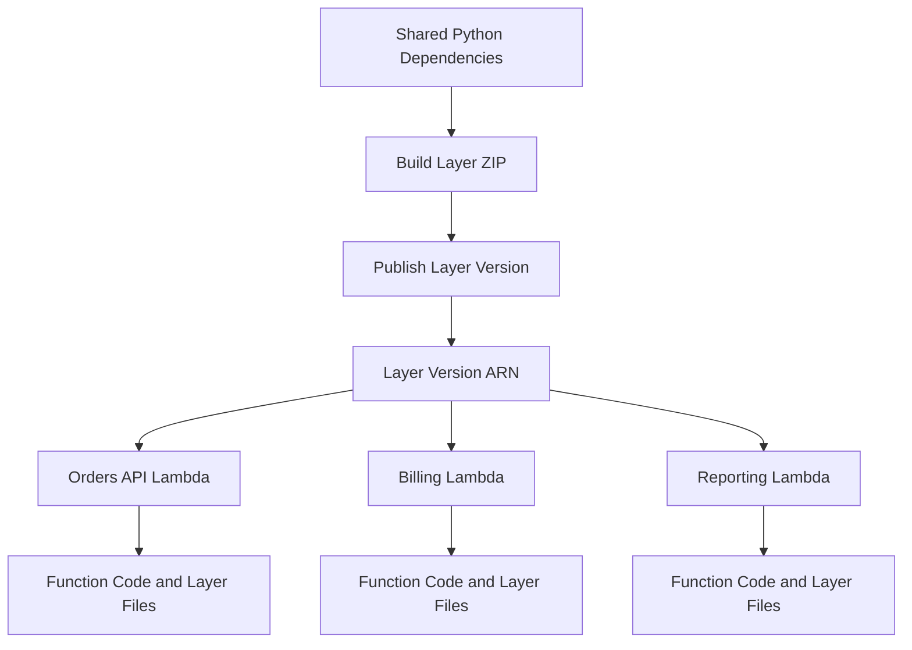

# 08- Lambda Layers Management

## Overview

AWS Lambda layers provide a mechanism for packaging and sharing dependencies, libraries, custom runtimes, and supporting files across multiple Lambda functions. A layer is published as a versioned resource and attached to a function through its configuration.

Layers are useful when multiple Python functions share internal libraries, third-party dependencies, or observability extensions. They separate reusable dependencies from function-specific code, but introduce additional versioning, compatibility, security, and deployment considerations.

This document covers AWS CLI workflows for publishing, inspecting, attaching, updating, removing, and deleting Lambda layers.

## Layer Architecture



A layer does not execute independently. Lambda makes the layer's contents available to the function's execution environment, where the runtime can load the libraries or files.

Each published layer version is immutable. Publishing a new version does not automatically update functions that reference an earlier version.

## Layer Structure and Python Compatibility

For Python functions, the ZIP archive must use the directory structure expected by the Lambda Python runtime.

A typical layer containing Python packages looks like this:

```text
python-layer/
    python/
        lib/
            python3.12/
                site-packages/
                    requests/
                    urllib3/
```

The directory structure must match the Python runtime and packaging approach. Python packages placed directly under the layer's `python/` directory can also be made available to the runtime, depending on the package layout.

For example, a layer containing a shared Python module can use:

```text
python-layer/
    python/
        shared_utils/
            __init__.py
            logging.py
```

Lambda includes supported layer paths in the runtime's module search path. Do not assume that arbitrary directories in the ZIP archive will automatically become importable Python packages.

### Compatibility requirements

Before publishing a layer, verify:

- The Python runtime version supported by the target function.
- The CPU architecture, such as `x86_64` or `arm64`.
- Native dependencies and their operating-system compatibility.
- The layer's compatible runtimes and architectures.
- The combined uncompressed size of the function code and attached layers.

Packages containing native extensions must be built for a compatible Lambda execution environment. A dependency installed on a Windows development machine may not work in a Linux Lambda runtime.

## Configure AWS CLI Context

Define the target environment:

```bash
PROFILE=dev
REGION=ap-south-1
FUNCTION_NAME=orders-processor
```

Verify the current AWS identity:

```bash
aws sts get-caller-identity \
  --profile "$PROFILE"
```

Inspect the function configuration:

```bash
aws lambda get-function-configuration \
  --function-name "$FUNCTION_NAME" \
  --query '{FunctionName:FunctionName,Runtime:Runtime,Architectures:Architectures,Layers:Layers,LastUpdateStatus:LastUpdateStatus}' \
  --output json \
  --profile "$PROFILE" \
  --region "$REGION"
```

The `Runtime` and `Architectures` fields help determine whether a candidate layer is compatible with the function.

## Build a Python Layer

### Create the directory structure

For a Python 3.12 function:

```bash
mkdir -p python-layer/python
```

Install dependencies into the layer directory:

```bash
python -m pip install \
  --target python-layer/python \
  requests
```

Create the ZIP archive:

```bash
cd python-layer
zip -r ../python-dependencies.zip python
cd ..
```

This example is appropriate for pure Python packages such as many common utility libraries. Packages containing native extensions should be built in an environment compatible with the Lambda runtime and target architecture.

For reproducible production builds, pin dependency versions in a requirements file and build from a controlled environment:

```text
requests==2.32.5
```

Install the pinned dependencies:

```bash
python -m pip install \
  --requirement requirements.txt \
  --target python-layer/python
```

Use the actual versions approved by your dependency management and security process. Keep development-only dependencies out of the deployment artifact.

### Inspect the archive

List its contents:

```bash
unzip -l python-dependencies.zip
```

Verify that the archive contains the expected top-level `python/` directory rather than an extra parent directory such as `python-layer/python/`.

An incorrect archive layout can cause imports to fail even when the layer publishes successfully.

## Publish a Layer Version

Publishing a layer creates a new immutable version.

Set the layer name:

```bash
LAYER_NAME=python-dependencies
```

Publish the archive:

```bash
aws lambda publish-layer-version \
  --layer-name "$LAYER_NAME" \
  --description "Shared Python dependencies for backend functions" \
  --zip-file fileb://python-dependencies.zip \
  --compatible-runtimes python3.12 \
  --compatible-architectures x86_64 arm64 \
  --profile "$PROFILE" \
  --region "$REGION"
```

The compatibility flags are declarations of intended compatibility, not proof that the archive works on both architectures. If the package contains architecture-specific native code, build and validate separate compatible artifacts as necessary.

The response includes the layer ARN and version number.

Example:

```text
arn:aws:lambda:ap-south-1:123456789012:layer:python-dependencies:1
```

Capture the actual returned ARN rather than assuming a version number.

```bash
LAYER_VERSION_ARN="arn:aws:lambda:ap-south-1:123456789012:layer:python-dependencies:1"
```

## Inspect Layer Versions

### List versions of a layer

```bash
aws lambda list-layer-versions \
  --layer-name "$LAYER_NAME" \
  --query 'LayerVersions[].{Version:Version,Arn:LayerVersionArn,CreatedDate:CreatedDate,CompatibleRuntimes:CompatibleRuntimes,CompatibleArchitectures:CompatibleArchitectures,Description:Description}' \
  --output table \
  --profile "$PROFILE" \
  --region "$REGION"
```

This read-only command helps identify published versions and their declared compatibility.

### Inspect a specific version

```bash
aws lambda get-layer-version \
  --layer-name "$LAYER_NAME" \
  --version-number 1 \
  --profile "$PROFILE" \
  --region "$REGION"
```

The response includes metadata and a download location for the content. The download location is a temporary URL; do not hard-code it into deployment scripts or documentation.

### Inspect layer content metadata

```bash
aws lambda get-layer-version-by-arn \
  --arn "$LAYER_VERSION_ARN" \
  --query '{LayerVersionArn:LayerVersionArn,Version:Version,Description:Description,CompatibleRuntimes:CompatibleRuntimes,CompatibleArchitectures:CompatibleArchitectures,CodeSize:Content.CodeSize,CodeSha256:Content.CodeSha256}' \
  --output json \
  --profile "$PROFILE" \
  --region "$REGION"
```

Compare `CodeSha256` across releases when verifying that the intended artifact was published.

## Attach a Layer to a Function

Lambda function configuration accepts a list of layer version ARNs. Updating the layer list replaces the function's configured layer list, so preserve existing layers that must remain attached.

### Inspect current layers

```bash
aws lambda get-function-configuration \
  --function-name "$FUNCTION_NAME" \
  --query 'Layers[].Arn' \
  --output json \
  --profile "$PROFILE" \
  --region "$REGION"
```

### Attach a single layer

If the function currently has no layers:

```bash
aws lambda update-function-configuration \
  --function-name "$FUNCTION_NAME" \
  --layers "$LAYER_VERSION_ARN" \
  --profile "$PROFILE" \
  --region "$REGION"
```

This is a mutating operation. It replaces the function's configured layer list with the specified ARN.

Wait for the update to complete:

```bash
aws lambda wait function-updated \
  --function-name "$FUNCTION_NAME" \
  --profile "$PROFILE" \
  --region "$REGION"
```

Verify the result:

```bash
aws lambda get-function-configuration \
  --function-name "$FUNCTION_NAME" \
  --query '{Layers:Layers,LastUpdateStatus:LastUpdateStatus,LastUpdateStatusReason:LastUpdateStatusReason}' \
  --output json \
  --profile "$PROFILE" \
  --region "$REGION"
```

### Attach a layer while preserving existing layers

If the function already has layers, pass all desired layer version ARNs in the update command.

For example:

```bash
SHARED_UTILS_ARN="arn:aws:lambda:ap-south-1:123456789012:layer:shared-utils:3"
OBSERVABILITY_ARN="arn:aws:lambda:ap-south-1:123456789012:layer:observability:2"

aws lambda update-function-configuration \
  --function-name "$FUNCTION_NAME" \
  --layers "$SHARED_UTILS_ARN" "$OBSERVABILITY_ARN" \
  --profile "$PROFILE" \
  --region "$REGION"
```

The example deliberately specifies the complete intended layer list. Replace the ARNs with the actual layer versions required by the function.

Lambda limits the number of layers attached to a function. Check the current service quota and combined uncompressed deployment size before adding more dependencies.

## Update a Layer Version

Published layer versions cannot be modified in place. To change dependencies or files, build a new ZIP archive and publish another version.

```bash
aws lambda publish-layer-version \
  --layer-name "$LAYER_NAME" \
  --description "Updated shared Python dependencies" \
  --zip-file fileb://python-dependencies.zip \
  --compatible-runtimes python3.12 \
  --compatible-architectures x86_64 \
  --profile "$PROFILE" \
  --region "$REGION"
```

After publication, explicitly update each intended function to use the new version ARN.

A new layer version does not automatically propagate to functions using an older version. This immutability supports reproducible deployments and controlled rollouts.

## Remove a Layer from a Function

To detach layers, update the function with the complete remaining layer list.

If the function has no other required layers:

```bash
aws lambda update-function-configuration \
  --function-name "$FUNCTION_NAME" \
  --layers \
  --profile "$PROFILE" \
  --region "$REGION"
```

Wait for the update and verify the configuration:

```bash
aws lambda wait function-updated \
  --function-name "$FUNCTION_NAME" \
  --profile "$PROFILE" \
  --region "$REGION"

aws lambda get-function-configuration \
  --function-name "$FUNCTION_NAME" \
  --query 'Layers' \
  --output json \
  --profile "$PROFILE" \
  --region "$REGION"
```

Before detaching a layer, confirm that the function's code does not import modules or access files provided by it. Otherwise, the function may fail during initialization or invocation.

## Delete a Layer Version

Deleting a layer version removes that version as a resource for future configuration use. It does not update functions that already reference it; existing consumers must be migrated or detached before cleanup.

Delete a specific version:

```bash
aws lambda delete-layer-version \
  --layer-name "$LAYER_NAME" \
  --version-number 1 \
  --profile "$PROFILE" \
  --region "$REGION"
```

Verify the remaining versions:

```bash
aws lambda list-layer-versions \
  --layer-name "$LAYER_NAME" \
  --query 'LayerVersions[].{Version:Version,Arn:LayerVersionArn}' \
  --output table \
  --profile "$PROFILE" \
  --region "$REGION"
```

Deletion is a destructive administrative action. Check references in deployed functions, aliases, infrastructure-as-code definitions, and rollback plans before removing old versions.

## Manage Cross-Account Layer Access

A layer published in one account can be shared with another account by granting the appropriate permission on a specific layer version.

For example, grant another account permission to use a layer version:

```bash
LAYER_VERSION_ARN="arn:aws:lambda:ap-south-1:123456789012:layer:python-dependencies:1"
CONSUMER_ACCOUNT_ID="210987654321"

aws lambda add-layer-version-permission \
  --layer-name "$LAYER_NAME" \
  --version-number 1 \
  --statement-id AllowConsumerAccount \
  --action lambda:GetLayerVersion \
  --principal "$CONSUMER_ACCOUNT_ID" \
  --profile "$PROFILE" \
  --region "$REGION"
```

Inspect the policy for that version:

```bash
aws lambda get-layer-version-policy \
  --layer-name "$LAYER_NAME" \
  --version-number 1 \
  --profile "$PROFILE" \
  --region "$REGION"
```

Remove the statement when access is no longer needed:

```bash
aws lambda remove-layer-version-permission \
  --layer-name "$LAYER_NAME" \
  --version-number 1 \
  --statement-id AllowConsumerAccount \
  --profile "$PROFILE" \
  --region "$REGION"
```

Cross-account consumers must reference the correct layer version ARN and Region, and their deployment workflow must be authorized to retrieve and use the layer. Avoid granting public access unless there is a deliberate, reviewed distribution requirement.

## Troubleshooting

| Symptom | Possible cause | Diagnostic approach | Corrective action |
|---|---|---|---|
| `ImportError` or `ModuleNotFoundError` | Incorrect ZIP structure, missing package, or incompatible Python version | Inspect the ZIP and function runtime | Rebuild the archive with the expected Python directory layout |
| Native extension fails to load | Wrong OS, architecture, or binary dependency | Check function architecture and package build environment | Rebuild the dependency for a compatible Lambda environment |
| Layer attachment fails | Invalid ARN, incompatible configuration, missing permission, or size limit | Inspect the API error and layer metadata | Correct the ARN, compatibility, permissions, or package size |
| Function update remains in progress | Lambda is still applying configuration changes | Inspect `LastUpdateStatus` and wait for the update | Wait for completion before issuing dependent changes |
| New dependency version is not used | Function still references an older immutable layer version | Inspect `Layers` in function configuration | Update the function to the intended version ARN |
| Function fails after layer removal | Application still imports a module supplied by the layer | Inspect imports and initialization logs | Restore the layer or package the dependency with the function |
| Cross-account layer retrieval fails | Missing layer-version permission or wrong ARN | Inspect the layer-version policy and caller identity | Grant the intended account access and verify the ARN |

Use the function's CloudWatch log group to diagnose runtime import errors:

```bash
aws logs tail "/aws/lambda/$FUNCTION_NAME" \
  --since 30m \
  --format short \
  --profile "$PROFILE" \
  --region "$REGION"
```

For reliable diagnosis, compare the function runtime, architecture, layer version ARN, ZIP contents, and exact import failure. A successful layer publication does not guarantee runtime compatibility.

## Production Best Practices

- **Pin layer versions.** Deploy functions against explicit immutable version ARNs instead of relying on an assumed latest version.
- **Build reproducibly.** Pin dependencies and use controlled build environments to avoid inconsistent artifacts between releases.
- **Validate native dependencies.** Build and test native packages for the target Lambda runtime and architecture.
- **Keep layers focused.** Separate independently versioned dependency groups rather than creating one oversized layer containing unrelated libraries.
- **Evaluate ZIP versus image deployment.** Layers are useful for shared ZIP-based functions, but container images may be simpler for applications with complex system dependencies.
- **Manage security updates centrally.** Inventory functions using vulnerable dependencies and roll out new layer versions through controlled deployments.
- **Preserve rollback options.** Retain older versions while deployed functions or release procedures still depend on them.
- **Avoid dependency conflicts.** A function package and its attached layers may contain different versions of the same library; test the effective import behavior before release.
- **Monitor artifact size.** Layer contents count toward Lambda deployment package size constraints, so remove unused dependencies and files.
- **Use infrastructure as code.** Define layer publication and function references in a repeatable deployment workflow rather than manually updating production resources.
- **Review cross-account sharing.** Grant access only to intended consumer accounts or principals and audit obsolete layer-version permissions.

## Key Takeaways

- Lambda layers are immutable, versioned packages that provide shared libraries, files, or extensions to compatible functions.
- Python layer ZIP files must follow the expected directory layout, and native dependencies must match the runtime environment and architecture.
- Updating a function's layer list replaces the configured list, so preserve every layer that should remain attached.
- Publishing a new layer version does not automatically update existing functions; deployments must reference the new version ARN explicitly.
- Treat layer permissions, dependency security, compatibility, artifact size, and rollback retention as part of the production release process.