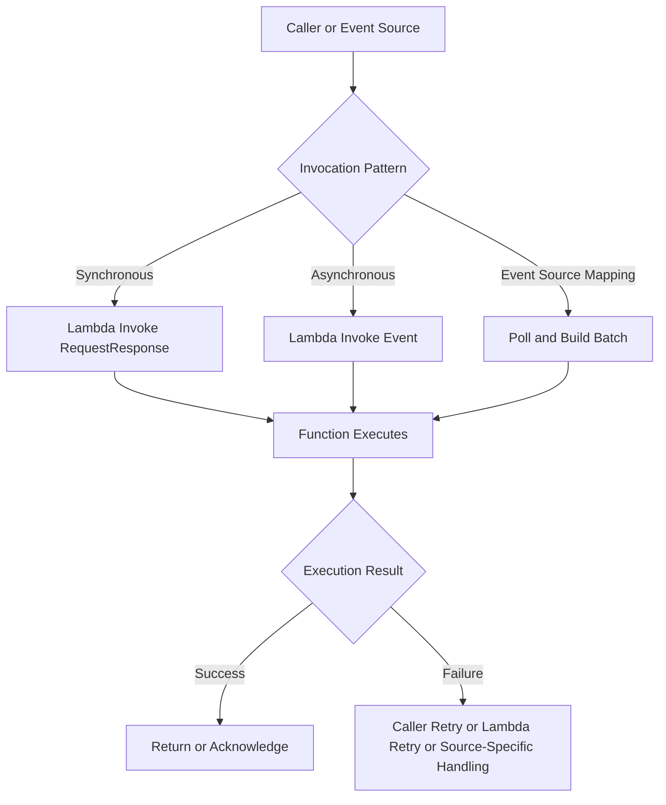

# 09- Function Invocation and Payloads

## Overview

AWS Lambda functions can be invoked directly through the AWS CLI, SDKs, APIs, and integrated AWS services. The invocation mechanism determines how the caller receives results, how failures are handled, and whether the caller or Lambda manages retries.

For backend engineers, understanding invocation behavior is essential when building REST APIs, asynchronous workers, event-driven microservices, and operational automation.

This document covers CLI workflows for synchronous and asynchronous invocation, payload handling, response inspection, qualified function invocation, and invocation troubleshooting.

## Lambda Invocation Models

Lambda supports three primary invocation patterns.

| Invocation model | CLI invocation type | Caller receives function result | Failure handling |
|---|---|---|---|
| Synchronous | `RequestResponse` | Yes, including the function response and invocation status | Caller handles errors and retry decisions |
| Asynchronous | `Event` | No business response; Lambda acknowledges acceptance | Lambda manages asynchronous retries and can route failures to configured destinations |
| Event source mapping | Managed by the event source mapping | Depends on the source integration; the mapping controls polling and delivery | Source-specific retry, acknowledgment, and checkpoint behavior |

Event source mappings are not a third value for the CLI `--invocation-type` option. They are managed integrations that poll supported sources such as SQS, Kinesis, and DynamoDB Streams.

## Invocation Flow



The invocation model affects latency, reliability, observability, and the architecture's failure boundaries. Do not assume that all Lambda integrations retry failures in the same way.

## Configure AWS CLI Context

Define the function and AWS environment:

```bash
PROFILE=dev
REGION=ap-south-1
FUNCTION_NAME=orders-processor
```

Verify the active AWS identity:

```bash
aws sts get-caller-identity \
  --profile "$PROFILE"
```

Inspect the function:

```bash
aws lambda get-function-configuration \
  --function-name "$FUNCTION_NAME" \
  --query '{FunctionName:FunctionName,FunctionArn:FunctionArn,Runtime:Runtime,State:State,LastUpdateStatus:LastUpdateStatus}' \
  --output json \
  --profile "$PROFILE" \
  --region "$REGION"
```

The function must exist in the specified account and Region. The caller also needs `lambda:InvokeFunction` permission for the exact function resource or qualified ARN being invoked.

## Prepare a Test Payload

Create a representative event payload:

```json
{
  "event_type": "order.created",
  "order_id": "ord-1001",
  "customer_id": "cust-2001",
  "amount": 1499.00
}
```

Save it as `event.json`.

Inspect the payload before invoking the function:

```bash
cat event.json
```

Using a file is preferable to embedding complex JSON in a shell command because it reduces quoting errors and makes test cases reusable.

For production workflows, keep test payloads free of credentials, personal data, and other sensitive information unless the testing environment is explicitly approved for that data.

## Invoke a Function Synchronously

Synchronous invocation is appropriate when the caller needs the result before continuing, such as an API backend calling a business-processing function.

### Invoke with `RequestResponse`

```bash
aws lambda invoke \
  --function-name "$FUNCTION_NAME" \
  --invocation-type RequestResponse \
  --payload fileb://event.json \
  response.json \
  --cli-binary-format raw-in-base64-out \
  --profile "$PROFILE" \
  --region "$REGION"
```

The command writes the function's response payload to `response.json`. The CLI response also includes invocation metadata such as `StatusCode`, `ExecutedVersion`, and, when applicable, `FunctionError`.

Inspect the response body:

```bash
cat response.json
```

Inspect the invocation metadata separately:

```bash
aws lambda invoke \
  --function-name "$FUNCTION_NAME" \
  --invocation-type RequestResponse \
  --payload fileb://event.json \
  response.json \
  --cli-binary-format raw-in-base64-out \
  --query '{StatusCode:StatusCode,FunctionError:FunctionError,ExecutedVersion:ExecutedVersion}' \
  --output json \
  --profile "$PROFILE" \
  --region "$REGION"
```

The `--cli-binary-format raw-in-base64-out` option is useful with AWS CLI v2 when supplying a raw JSON payload through `--payload`.

### Understand the response status

A successful Lambda Invoke API request does not necessarily mean that the function executed successfully.

| Response indicator | Meaning |
|---|---|
| `StatusCode: 200` | The Invoke API request succeeded; inspect `FunctionError` to determine whether function execution failed |
| `FunctionError` is present | The function returned an execution error, such as an unhandled exception |
| `ExecutedVersion` | Identifies the function version that executed |
| Response payload | Contains the function's returned value or runtime error payload |

For synchronous invocation, Lambda can return HTTP status `200` from the Invoke API even when the function itself fails. Always inspect the `FunctionError` field and response payload.

## Invoke a Function Asynchronously

Asynchronous invocation is appropriate when the caller only needs Lambda to accept the event and does not need the processing result immediately.

```bash
aws lambda invoke \
  --function-name "$FUNCTION_NAME" \
  --invocation-type Event \
  --payload fileb://event.json \
  async-response.json \
  --cli-binary-format raw-in-base64-out \
  --profile "$PROFILE" \
  --region "$REGION"
```

A successful asynchronous submission typically returns HTTP status `202`, indicating that Lambda accepted the event for asynchronous processing.

The output file is not the business result of the function. Do not treat it as proof that the handler completed successfully.

### Asynchronous failure handling

Lambda's asynchronous invocation system manages retries for eligible function errors and can be configured with a dead-letter queue or an on-failure destination.

Production systems should define:

- Retry behavior and maximum event age.
- An on-failure destination or dead-letter queue appropriate to the use case.
- Monitoring for asynchronous errors and dropped events.
- Idempotency to protect against duplicate processing.
- A replay or recovery procedure for failed events.

Asynchronous invocation has different delivery and retry semantics from SQS event source mappings. If you need durable queue-based buffering, explicit backlog visibility, or consumer-controlled processing capacity, consider using SQS with Lambda rather than relying only on direct asynchronous invocation.

## Invoke a Specific Version or Alias

Published versions and aliases provide stable invocation targets for production deployments.

Set the alias:

```bash
ALIAS_NAME=prod
```

Invoke the alias:

```bash
aws lambda invoke \
  --function-name "$FUNCTION_NAME" \
  --qualifier "$ALIAS_NAME" \
  --invocation-type RequestResponse \
  --payload fileb://event.json \
  response.json \
  --cli-binary-format raw-in-base64-out \
  --profile "$PROFILE" \
  --region "$REGION"
```

The alias resolves to its configured published version. The response's `ExecutedVersion` field identifies the version used.

Inspect the alias:

```bash
aws lambda get-alias \
  --function-name "$FUNCTION_NAME" \
  --name "$ALIAS_NAME" \
  --profile "$PROFILE" \
  --region "$REGION"
```

For release verification, invoke the same qualified ARN used by the production integration. Testing `$LATEST` alone does not prove that the production alias points to the expected version.

## Inspect Function Execution Errors

When a synchronous invocation returns a `FunctionError`, inspect the response body first:

```bash
cat response.json
```

For Python functions, a runtime error payload may include an error type and message. The full stack trace and structured application logs are generally available in CloudWatch Logs if the execution role permits log delivery.

Retrieve recent logs:

```bash
LOG_GROUP="/aws/lambda/$FUNCTION_NAME"

aws logs tail "$LOG_GROUP" \
  --since 30m \
  --format short \
  --profile "$PROFILE" \
  --region "$REGION"
```

For a more reliable investigation:

1. Capture the invocation time and request ID.
2. Inspect `FunctionError` and the response payload.
3. Find the matching log stream and request ID.
4. Check whether the failure occurred during initialization, handler execution, or a downstream call.
5. Correct the root cause and repeat the invocation with the same payload.

A successful CLI request proves only that the Invoke API accepted the request. It does not establish that the function met its business requirements.

## Payload Size and Serialization

Lambda invocation payloads have service-defined size limits that vary by invocation model. Current limits should be verified against the AWS Lambda quotas documentation before designing around large requests or events.

| Consideration | Engineering guidance |
|---|---|
| JSON payloads | Validate serialization and schema before invocation |
| Large files | Pass an S3 object reference instead of embedding the file contents |
| Binary data | Use an explicit encoding or object-storage reference appropriate to the integration |
| Nested events | Validate the complete envelope, including service-specific metadata |
| Sensitive data | Avoid logging full payloads by default |
| Large responses | Consider returning a reference to stored results rather than a large response body |

For example, instead of passing an entire file to Lambda, send an event containing an object reference:

```json
{
  "event_type": "document.process",
  "bucket": "orders-upload-bucket",
  "key": "incoming/document-1001.pdf"
}
```

The function can then retrieve the object using its execution role. This reduces payload size and avoids unnecessary data transfer through the invocation request.

## Payload Format Depends on the Integration

A Lambda handler receives an event object, but the event structure depends on the invoking service.

| Integration | Typical event structure |
|---|---|
| AWS CLI or SDK direct invocation | Application-defined JSON |
| API Gateway | HTTP request metadata, headers, path, query parameters, and body |
| SQS event source mapping | A `Records` array containing messages and message metadata |
| S3 notification | Records describing bucket and object events |
| EventBridge | Event envelope containing source, detail type, time, and `detail` |
| DynamoDB Streams | Records containing stream metadata and database changes |

Do not assume that a payload designed for direct CLI invocation will work unchanged when the same function is invoked through API Gateway or SQS.

For Python handlers, validate the event schema and handle missing or malformed fields explicitly. Where a function supports multiple event sources, prefer separate adapters that normalize each source's event into an internal application model.

## Invocation Permissions

The invoking identity must have permission to invoke the target function. AWS service integrations may also require a resource-based policy on the function.

Inspect the caller:

```bash
aws sts get-caller-identity \
  --profile "$PROFILE"
```

Inspect the function ARN:

```bash
aws lambda get-function \
  --function-name "$FUNCTION_NAME" \
  --query 'Configuration.FunctionArn' \
  --output text \
  --profile "$PROFILE" \
  --region "$REGION"
```

Inspect the resource-based policy if applicable:

```bash
aws lambda get-policy \
  --function-name "$FUNCTION_NAME" \
  --profile "$PROFILE" \
  --region "$REGION"
```

For an alias, inspect the qualified resource policy by including `--qualifier`.

A permission failure may arise from the caller's identity policy, the Lambda resource policy, an explicit deny, a permission boundary, or an organizational policy. Diagnose the authorization layer before changing permissions.

## Troubleshooting

| Symptom | Possible cause | Isolation strategy | Corrective action |
|---|---|---|---|
| `AccessDeniedException` | Caller lacks invoke permission or a policy denies the request | Verify caller identity, target ARN, and applicable policies | Grant the minimum required permission or correct the policy |
| `ResourceNotFoundException` | Wrong function name, account, Region, version, or alias | Inspect identity and function configuration | Correct the target resource or CLI context |
| `FunctionError` is present | Handler exception, initialization failure, or runtime error | Inspect response payload and CloudWatch Logs | Fix the application or runtime issue and retest |
| Invocation times out | Function duration exceeds timeout or a dependency stalls | Inspect duration metrics, logs, and downstream latency | Optimize processing or configure an appropriate timeout |
| Asynchronous invocation returns `202` but no result is visible | Acceptance was mistaken for execution completion | Inspect asynchronous error metrics, logs, and destinations | Configure failure handling and observability |
| `InvalidRequestContentException` | Malformed JSON or incompatible payload encoding | Validate the event file and CLI payload options | Correct JSON and use the appropriate CLI binary format |
| Wrong code version executes | Invocation targets `$LATEST` or an unexpected alias/version | Inspect `ExecutedVersion` and alias configuration | Invoke the intended qualifier and correct the deployment configuration |
| Response file is empty or unexpected | Function returned no value, or the caller misunderstood asynchronous semantics | Inspect invocation type and metadata | Use synchronous invocation when the result is required |

## Production Best Practices

- **Choose invocation semantics deliberately.** Use synchronous invocation when the caller needs an immediate result and asynchronous invocation or queues for decoupled processing.
- **Check both API status and execution status.** A successful Invoke API response is not proof of successful handler execution.
- **Use versioned aliases in production.** They make deployment targets explicit and support controlled rollout and rollback.
- **Keep payloads bounded.** Use S3 or another suitable storage service for large files and pass references through events.
- **Validate event schemas.** Different AWS services provide different envelopes and retry semantics.
- **Make side effects idempotent.** Retries and duplicate delivery can occur, particularly with asynchronous and event-driven processing.
- **Instrument failures.** Use structured logs, request IDs, Lambda metrics, and failure destinations to support incident diagnosis.
- **Protect sensitive data.** Avoid logging complete request payloads, credentials, tokens, or personal information.
- **Test the production invocation path.** Verify the exact function qualifier, permissions, integration configuration, and expected payload format.
- **Use queues when buffering is important.** SQS provides explicit backlog visibility and queue-level controls that direct asynchronous invocation does not replace.

## Key Takeaways

- `RequestResponse` returns the function's result, while `Event` confirms asynchronous acceptance rather than business completion.
- Check `FunctionError`, response payloads, and CloudWatch Logs instead of relying solely on the Invoke API status code.
- Use qualified versions or aliases to verify the exact code deployed to production.
- Payload format depends on the invoking service; validate event schemas and use object references for large files.
- Invocation permissions, retry behavior, idempotency, and failure monitoring must match the chosen invocation model.