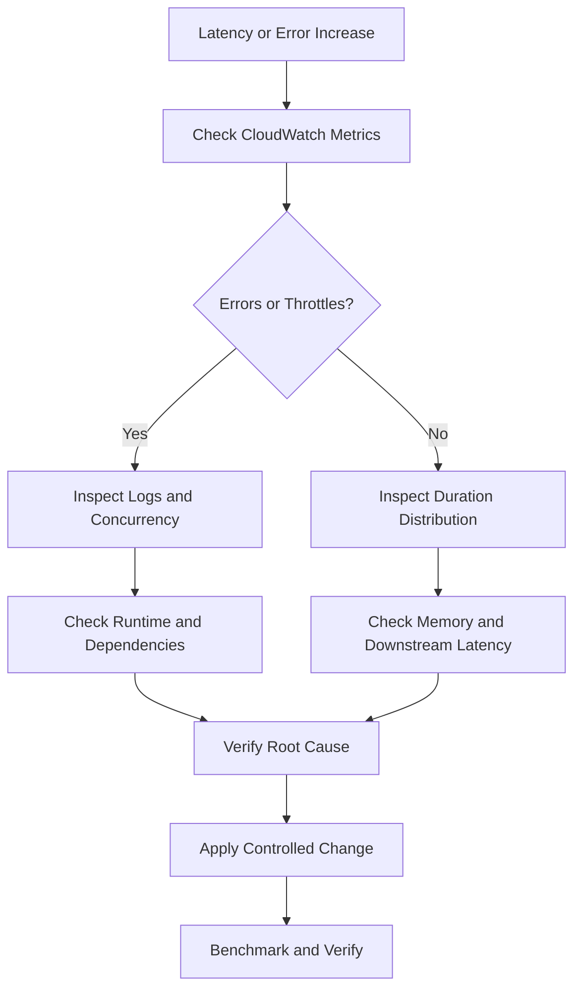

# 10- Monitoring, Logging and Performance Commands

## Overview

AWS Lambda monitoring combines CloudWatch metrics, CloudWatch Logs, distributed tracing, and function configuration inspection. These capabilities help backend engineers diagnose execution failures, latency regressions, throttling, memory pressure, concurrency exhaustion, and downstream service bottlenecks.

This document provides repeatable AWS CLI workflows for inspecting Lambda health, retrieving logs, querying metrics, analyzing performance, configuring alarms, and validating operational changes.

The examples use the following environment variables:

```bash
PROFILE=dev
REGION=ap-south-1
FUNCTION_NAME=orders-processor
LOG_GROUP="/aws/lambda/$FUNCTION_NAME"
```

Replace these values with the target AWS profile, Region, function, and log group. Examples marked **Mutating operation** create or modify AWS resources. Run read-only inspection commands first and verify the target account before making changes.

## Verify the AWS Environment

### Verify the AWS account and identity

**Read-only:**

```bash
aws sts get-caller-identity \
  --profile "$PROFILE"
```

Verify the returned account ID and ARN. A correct function name is not sufficient if the CLI is configured for the wrong account.

### Inspect function configuration

**Read-only:**

```bash
aws lambda get-function-configuration \
  --function-name "$FUNCTION_NAME" \
  --query '{
    FunctionName:FunctionName,
    Runtime:Runtime,
    Handler:Handler,
    MemorySize:MemorySize,
    Timeout:Timeout,
    Architectures:Architectures,
    State:State,
    LastUpdateStatus:LastUpdateStatus,
    LastModified:LastModified
  }' \
  --output json \
  --profile "$PROFILE" \
  --region "$REGION"
```

Important fields:

| Field | Operational meaning |
|---|---|
| `State` | Current function lifecycle state |
| `LastUpdateStatus` | Status of the latest function configuration update |
| `Runtime` | Configured runtime identifier |
| `MemorySize` | Allocated memory in MB |
| `Timeout` | Maximum execution duration in seconds |
| `Architectures` | Configured instruction-set architecture |
| `LastModified` | Timestamp of the latest function modification |

A function can exist while an update is unsuccessful or its runtime configuration is incorrect. Inspect both lifecycle state and configuration before changing resources.

### Inspect configuration without exposing environment variable values

**Read-only:**

```bash
aws lambda get-function-configuration \
  --function-name "$FUNCTION_NAME" \
  --query '{
    Role:Role,
    Runtime:Runtime,
    Handler:Handler,
    MemorySize:MemorySize,
    Timeout:Timeout,
    EnvironmentVariableNames:keys(Environment.Variables),
    EphemeralStorage:EphemeralStorage,
    Layers:Layers[].Arn,
    LoggingConfig:LoggingConfig,
    TracingConfig:TracingConfig
  }' \
  --output json \
  --profile "$PROFILE" \
  --region "$REGION"
```

Environment variables may contain sensitive configuration. Avoid dumping their values into shared terminals, tickets, or incident reports.

## Retrieve CloudWatch Logs

Lambda commonly writes logs to `/aws/lambda/<function-name>`. Custom logging configurations, permissions, and log-group settings can change where logs are delivered.

### Tail recent logs

**Read-only:**

```bash
aws logs tail "$LOG_GROUP" \
  --since 30m \
  --format short \
  --profile "$PROFILE" \
  --region "$REGION"
```

For detailed timestamps:

```bash
aws logs tail "$LOG_GROUP" \
  --since 1h \
  --format detailed \
  --profile "$PROFILE" \
  --region "$REGION"
```

Use these commands to investigate recent exceptions, timeout messages, dependency failures, and application-level diagnostic events.

### List recent log streams

**Read-only:**

```bash
aws logs describe-log-streams \
  --log-group-name "$LOG_GROUP" \
  --order-by LastEventTime \
  --descending \
  --limit 10 \
  --query 'logStreams[].{
    Stream:logStreamName,
    LastEvent:lastEventTimestamp,
    LastIngestion:lastIngestionTime
  }' \
  --output table \
  --profile "$PROFILE" \
  --region "$REGION"
```

CloudWatch timestamps use Unix epoch milliseconds. Event and ingestion timestamps can lag behind actual activity, so do not treat them as precise real-time health indicators.

### Retrieve events from a specific stream

Set the stream name to one returned by `describe-log-streams`.

```bash
LOG_STREAM='2026/10/11/[$LATEST]example-stream'
```

**Read-only:**

```bash
aws logs get-log-events \
  --log-group-name "$LOG_GROUP" \
  --log-stream-name "$LOG_STREAM" \
  --start-from-head \
  --limit 100 \
  --query 'events[].{
    Timestamp:timestamp,
    Message:message
  }' \
  --output json \
  --profile "$PROFILE" \
  --region "$REGION"
```

Use `get-log-events` when you need events from a particular stream. For general incident investigation, `aws logs tail` is usually simpler.

### Diagnose missing logs

Inspect the function's configured logging destination and execution role. With standard CloudWatch Logs delivery, the execution role commonly needs permissions such as `logs:CreateLogStream` and `logs:PutLogEvents`; the exact permissions depend on the logging configuration.

**Read-only:**

```bash
aws lambda get-function-configuration \
  --function-name "$FUNCTION_NAME" \
  --query '{
    Role:Role,
    LoggingConfig:LoggingConfig
  }' \
  --output json \
  --profile "$PROFILE" \
  --region "$REGION"
```

Check whether the expected log group exists:

```bash
aws logs describe-log-groups \
  --log-group-name-prefix "$LOG_GROUP" \
  --query 'logGroups[].{
    Name:logGroupName,
    RetentionDays:retentionInDays,
    StoredBytes:storedBytes
  }' \
  --output table \
  --profile "$PROFILE" \
  --region "$REGION"
```

Possible causes of missing logs include:

- The function has not been invoked during the selected period.
- The CLI is querying the wrong account or Region.
- The execution role lacks required logging permissions.
- A custom logging configuration points to a different destination.
- The application fails before emitting application-level logs.
- Log ingestion is delayed.

Do not immediately recreate a log group or replace an execution role without verifying the existing configuration and permissions.

## Query Logs with CloudWatch Logs Insights

CloudWatch Logs Insights supports filtering, aggregation, and analysis over selected log groups and time ranges. It is useful for correlating errors and execution durations across many invocations.

### Define a time window

The following commands use GNU `date`, commonly available in Linux environments:

```bash
START_TIME=$(date -u -d '30 minutes ago' +%s)
END_TIME=$(date -u +%s)
```

On macOS or Windows, calculate equivalent Unix epoch timestamps using the appropriate shell or script.

### Find errors and exceptions

Create `error-query.txt`:

```sql
fields @timestamp, @requestId, @message
| filter @message like /(?i)(error|exception|timed out|task timed out)/
| sort @timestamp desc
| limit 100
```

Submit the query:

```bash
QUERY_ID=$(aws logs start-query \
  --log-group-name "$LOG_GROUP" \
  --start-time "$START_TIME" \
  --end-time "$END_TIME" \
  --query-string file://error-query.txt \
  --query 'queryId' \
  --output text \
  --profile "$PROFILE" \
  --region "$REGION")
```

Retrieve the results:

```bash
aws logs get-query-results \
  --query-id "$QUERY_ID" \
  --output json \
  --profile "$PROFILE" \
  --region "$REGION"
```

A query can initially return `Running` or `Scheduled`. Poll `get-query-results` until it completes, fails, or is cancelled.

### Find slow invocations

Create `duration-query.txt`:

```sql
filter @type = "REPORT"
| fields @timestamp, @requestId, @duration, @billedDuration, @maxMemoryUsed, @memorySize
| sort @duration desc
| limit 50
```

Submit the query:

```bash
QUERY_ID=$(aws logs start-query \
  --log-group-name "$LOG_GROUP" \
  --start-time "$START_TIME" \
  --end-time "$END_TIME" \
  --query-string file://duration-query.txt \
  --query 'queryId' \
  --output text \
  --profile "$PROFILE" \
  --region "$REGION")
```

Retrieve the results:

```bash
aws logs get-query-results \
  --query-id "$QUERY_ID" \
  --output json \
  --profile "$PROFILE" \
  --region "$REGION"
```

Standard Lambda `REPORT` records commonly contain execution duration, billed duration, configured memory, and peak memory usage. Available fields depend on the log format and runtime.

### Count invocations over time

Create `invocation-query.txt`:

```sql
filter @type = "REPORT"
| stats count(*) as Invocations by bin(5m)
| sort bin(5m) desc
```

This query counts report records in the selected logs. For authoritative Lambda invocation counts, use the `Invocations` CloudWatch metric.

### Analyze duration and memory

```sql
filter @type = "REPORT"
| stats
    count(*) as Invocations,
    avg(@duration) as AverageDurationMs,
    max(@duration) as MaximumDurationMs,
    max(@maxMemoryUsed) as PeakMemoryMB
```

Use a time range representative of normal and peak traffic. Averages alone can conceal tail-latency regressions, so inspect the slowest individual invocations and CloudWatch duration percentiles as well.

**Cost consideration:** Logs Insights charges depend on the amount of data scanned and the applicable pricing model. Narrow the time range, query only necessary log groups, and avoid repeatedly scanning large historical datasets during an incident.

## Inspect CloudWatch Metrics

Lambda publishes standard metrics in the `AWS/Lambda` namespace. Most function-level metrics can be queried with the `FunctionName` dimension, but available dimensions vary by metric.

### Core metrics

| Metric | Meaning | Typical use |
|---|---|---|
| `Invocations` | Invocation requests counted by Lambda | Traffic trends and unexpected spikes |
| `Errors` | Function invocations that failed during execution | Execution failures and regression detection |
| `Throttles` | Invocation requests rejected by Lambda throttling | Concurrency and account-capacity investigation |
| `Duration` | Function execution duration in milliseconds | Performance analysis |
| `ConcurrentExecutions` | Concurrent invocations in progress | Capacity and scaling analysis |
| `UnreservedConcurrentExecutions` | Concurrent executions using the account's unreserved pool | Account-level concurrency pressure |
| `AsyncEventsDropped` | Asynchronous events dropped after applicable processing limits | Failed asynchronous delivery |
| `AsyncEventAge` | Age of asynchronous events when Lambda invokes the function | Asynchronous processing delay |

Metric semantics depend on the invocation model. Lambda's `Errors` metric is not a universal count of every failed business operation across all integrations.

### Define the metric time window

```bash
START_TIME=$(date -u -d '30 minutes ago' +%Y-%m-%dT%H:%M:%SZ)
END_TIME=$(date -u +%Y-%m-%dT%H:%M:%SZ)
```

These ISO 8601 timestamps work with CloudWatch commands that accept timestamp values. Keep the epoch-second variables used by Logs Insights separate from these ISO timestamp variables.

### Query invocation counts

**Read-only:**

```bash
aws cloudwatch get-metric-statistics \
  --namespace AWS/Lambda \
  --metric-name Invocations \
  --dimensions Name=FunctionName,Value="$FUNCTION_NAME" \
  --start-time "$START_TIME" \
  --end-time "$END_TIME" \
  --period 300 \
  --statistics Sum \
  --query 'Datapoints[].{
    Timestamp:Timestamp,
    Invocations:Sum
  }' \
  --output table \
  --profile "$PROFILE" \
  --region "$REGION"
```

### Query execution errors

**Read-only:**

```bash
aws cloudwatch get-metric-statistics \
  --namespace AWS/Lambda \
  --metric-name Errors \
  --dimensions Name=FunctionName,Value="$FUNCTION_NAME" \
  --start-time "$START_TIME" \
  --end-time "$END_TIME" \
  --period 300 \
  --statistics Sum \
  --query 'Datapoints[].{
    Timestamp:Timestamp,
    Errors:Sum
  }' \
  --output table \
  --profile "$PROFILE" \
  --region "$REGION"
```

### Query throttles

**Read-only:**

```bash
aws cloudwatch get-metric-statistics \
  --namespace AWS/Lambda \
  --metric-name Throttles \
  --dimensions Name=FunctionName,Value="$FUNCTION_NAME" \
  --start-time "$START_TIME" \
  --end-time "$END_TIME" \
  --period 300 \
  --statistics Sum \
  --query 'Datapoints[].{
    Timestamp:Timestamp,
    Throttles:Sum
  }' \
  --output table \
  --profile "$PROFILE" \
  --region "$REGION"
```

### Query maximum duration

**Read-only:**

```bash
aws cloudwatch get-metric-statistics \
  --namespace AWS/Lambda \
  --metric-name Duration \
  --dimensions Name=FunctionName,Value="$FUNCTION_NAME" \
  --start-time "$START_TIME" \
  --end-time "$END_TIME" \
  --period 300 \
  --statistics Maximum \
  --query 'Datapoints[].{
    Timestamp:Timestamp,
    MaxDurationMs:Maximum
  }' \
  --output table \
  --profile "$PROFILE" \
  --region "$REGION"
```

`Maximum` helps identify slow outliers but does not describe typical request latency. For tail latency, use CloudWatch metric statistics and percentiles where supported, and compare them against the function's latency objective.

CloudWatch metric data can be delayed. An empty response can indicate no activity, an incorrect dimension, an unsuitable time range, or delayed metric publication.

## Inspect Memory, Timeout, and Ephemeral Storage

### Inspect current limits

**Read-only:**

```bash
aws lambda get-function-configuration \
  --function-name "$FUNCTION_NAME" \
  --query '{
    MemorySize:MemorySize,
    Timeout:Timeout,
    EphemeralStorage:EphemeralStorage
  }' \
  --output json \
  --profile "$PROFILE" \
  --region "$REGION"
```

Use the `REPORT` log fields to compare peak memory use with the configured allocation:

```sql
filter @type = "REPORT"
| fields @timestamp, @requestId, @duration, @maxMemoryUsed, @memorySize
| sort @maxMemoryUsed desc
| limit 50
```

Interpret the results:

- Peak memory close to the allocation may indicate memory pressure.
- Timeout messages indicate that execution exceeded the configured time limit.
- High duration with low memory usage can indicate slow downstream calls, inefficient processing, or insufficient CPU for the workload.
- High ephemeral-storage usage can cause failures when temporary files exceed the configured `/tmp` capacity.

Lambda allocates more CPU capacity as memory allocation increases. Benchmark multiple memory configurations rather than assuming that the smallest allocation is the most cost-effective.

### Update memory allocation

**Mutating operation:**

```bash
aws lambda update-function-configuration \
  --function-name "$FUNCTION_NAME" \
  --memory-size 1024 \
  --profile "$PROFILE" \
  --region "$REGION"
```

Wait for the update to complete:

```bash
aws lambda wait function-updated \
  --function-name "$FUNCTION_NAME" \
  --profile "$PROFILE" \
  --region "$REGION"
```

Verify the new configuration:

```bash
aws lambda get-function-configuration \
  --function-name "$FUNCTION_NAME" \
  --query '{
    MemorySize:MemorySize,
    LastUpdateStatus:LastUpdateStatus
  }' \
  --output json \
  --profile "$PROFILE" \
  --region "$REGION"
```

### Update timeout

**Mutating operation:**

```bash
aws lambda update-function-configuration \
  --function-name "$FUNCTION_NAME" \
  --timeout 30 \
  --profile "$PROFILE" \
  --region "$REGION"
```

Wait for completion before invoking or testing the changed function.

A longer timeout is not a substitute for fixing unbounded database queries, stalled HTTP calls, or inefficient algorithms. Configure downstream client timeouts so the function can handle failures before its overall execution budget expires.

### Update ephemeral storage

**Mutating operation:**

```bash
aws lambda update-function-configuration \
  --function-name "$FUNCTION_NAME" \
  --ephemeral-storage '{"Size":2048}' \
  --profile "$PROFILE" \
  --region "$REGION"
```

Lambda's configurable `/tmp` storage supports workloads such as file conversion, decompression, and temporary data processing. Increased ephemeral storage may affect cost. Confirm current service limits and pricing before choosing a value.

## Inspect Concurrency and Throttling

Concurrency represents the number of invocations executing at the same time. High concurrency may indicate healthy traffic growth or an overload risk for databases and downstream APIs.

### Query concurrent executions

**Read-only:**

```bash
aws cloudwatch get-metric-statistics \
  --namespace AWS/Lambda \
  --metric-name ConcurrentExecutions \
  --dimensions Name=FunctionName,Value="$FUNCTION_NAME" \
  --start-time "$START_TIME" \
  --end-time "$END_TIME" \
  --period 300 \
  --statistics Maximum \
  --query 'Datapoints[].{
    Timestamp:Timestamp,
    MaxConcurrent:Maximum
  }' \
  --output table \
  --profile "$PROFILE" \
  --region "$REGION"
```

### Inspect reserved concurrency

**Read-only:**

```bash
aws lambda get-function-concurrency \
  --function-name "$FUNCTION_NAME" \
  --profile "$PROFILE" \
  --region "$REGION"
```

### Set reserved concurrency

**Mutating operation:**

```bash
aws lambda put-function-concurrency \
  --function-name "$FUNCTION_NAME" \
  --reserved-concurrent-executions 50 \
  --profile "$PROFILE" \
  --region "$REGION"
```

Reserved concurrency reserves capacity for the function and sets its maximum concurrency. A low value can throttle legitimate traffic; a high value can overload downstream services.

Verify the setting:

```bash
aws lambda get-function-concurrency \
  --function-name "$FUNCTION_NAME" \
  --profile "$PROFILE" \
  --region "$REGION"
```

### Remove reserved concurrency

**Mutating operation:**

```bash
aws lambda delete-function-concurrency \
  --function-name "$FUNCTION_NAME" \
  --profile "$PROFILE" \
  --region "$REGION"
```

This removes the function's reserved concurrency configuration. It does not guarantee additional capacity if account-level concurrency is exhausted.

## Inspect Provisioned Concurrency

Provisioned concurrency keeps execution environments initialized for a published function version or alias. It can reduce initialization latency for latency-sensitive workloads, but allocated capacity incurs additional charges.

### List provisioned concurrency configurations

**Read-only:**

```bash
aws lambda list-provisioned-concurrency-configs \
  --function-name "$FUNCTION_NAME" \
  --profile "$PROFILE" \
  --region "$REGION"
```

### Inspect a specific alias

**Read-only:**

```bash
aws lambda get-provisioned-concurrency-config \
  --function-name "$FUNCTION_NAME" \
  --qualifier prod \
  --profile "$PROFILE" \
  --region "$REGION"
```

### Configure provisioned concurrency

**Mutating operation:**

```bash
aws lambda put-provisioned-concurrency-config \
  --function-name "$FUNCTION_NAME" \
  --qualifier prod \
  --provisioned-concurrent-executions 10 \
  --profile "$PROFILE" \
  --region "$REGION"
```

The qualifier must identify a published version or alias. Provisioned concurrency cannot be configured directly on `$LATEST`.

Verify initialization status:

```bash
aws lambda get-provisioned-concurrency-config \
  --function-name "$FUNCTION_NAME" \
  --qualifier prod \
  --profile "$PROFILE" \
  --region "$REGION"
```

Wait for the configuration to become ready before routing latency-sensitive traffic to the target. Provisioned concurrency does not eliminate downstream latency, application processing time, or every possible scaling-related delay.

## Inspect X-Ray Tracing

AWS X-Ray can help diagnose latency across instrumented services and dependencies.

### Inspect tracing configuration

**Read-only:**

```bash
aws lambda get-function-configuration \
  --function-name "$FUNCTION_NAME" \
  --query 'TracingConfig' \
  --output json \
  --profile "$PROFILE" \
  --region "$REGION"
```

### Enable active tracing

**Mutating operation:**

```bash
aws lambda update-function-configuration \
  --function-name "$FUNCTION_NAME" \
  --tracing-config Mode=Active \
  --profile "$PROFILE" \
  --region "$REGION"
```

Verify the configuration:

```bash
aws lambda get-function-configuration \
  --function-name "$FUNCTION_NAME" \
  --query 'TracingConfig' \
  --output json \
  --profile "$PROFILE" \
  --region "$REGION"
```

The execution role must have the required trace-publishing permissions. Application instrumentation and propagation of trace context through downstream calls also affect trace completeness.

Use tracing when request paths cross services such as API Gateway, Lambda, DynamoDB, and external HTTP APIs. Sampling means not every request necessarily generates a trace.

## Create and Inspect CloudWatch Alarms

CloudWatch alarms turn metric thresholds into operational signals. Alarm configuration alone does not guarantee that an engineer receives a notification; configure appropriate alarm actions when required.

### Create an error alarm

**Mutating operation:**

```bash
aws cloudwatch put-metric-alarm \
  --alarm-name "${FUNCTION_NAME}-errors" \
  --namespace AWS/Lambda \
  --metric-name Errors \
  --dimensions Name=FunctionName,Value="$FUNCTION_NAME" \
  --statistic Sum \
  --period 300 \
  --evaluation-periods 1 \
  --threshold 5 \
  --comparison-operator GreaterThanOrEqualToThreshold \
  --treat-missing-data notBreaching \
  --alarm-description "Alert when Lambda execution errors reach the configured threshold" \
  --profile "$PROFILE" \
  --region "$REGION"
```

The threshold is illustrative. Set production thresholds according to traffic volume, error budgets, and service-level objectives.

### Inspect the alarm

**Read-only:**

```bash
aws cloudwatch describe-alarms \
  --alarm-names "${FUNCTION_NAME}-errors" \
  --query 'MetricAlarms[].{
    Name:AlarmName,
    State:StateValue,
    Reason:StateReason,
    Threshold:Threshold,
    Metric:MetricName
  }' \
  --output table \
  --profile "$PROFILE" \
  --region "$REGION"
```

### Delete an obsolete alarm

**Mutating operation:**

```bash
aws cloudwatch delete-alarms \
  --alarm-names "${FUNCTION_NAME}-errors" \
  --profile "$PROFILE" \
  --region "$REGION"
```

Delete alarms only when they are no longer referenced by operational procedures or notification workflows.

## Diagnose Performance Regressions

Use a consistent diagnostic sequence rather than immediately increasing memory or timeout.



| Symptom | Initial checks | Investigation path |
|---|---|---|
| Increased latency | `Duration`, logs, recent deployment | Separate initialization, application processing, and dependency latency |
| Rising errors | `Errors`, exception logs, function state | Inspect runtime failures, timeouts, and downstream errors |
| Rising throttles | `Throttles`, concurrency metrics | Review reserved concurrency and account capacity |
| High memory usage | `REPORT` records, memory allocation | Profile allocations, payload sizes, and processing behavior |
| Queue backlog growth | Source-specific backlog and age metrics | Inspect event source mapping, retries, concurrency, and downstream throughput |
| Unexpected cost increase | Invocation volume, duration, concurrency | Inspect retries, recursive invocation, provisioned capacity, and log ingestion |

Compare equivalent time windows and account for traffic volume. An increase in the absolute number of errors does not necessarily mean the error rate has worsened.

## Common Monitoring Mistakes

- **Relying only on logs:** Metrics reveal aggregate behavior; logs provide diagnostic details. Use both.
- **Treating `Duration` as end-to-end latency:** It does not include all integration and client-side time.
- **Treating missing metric data as proof of health:** Missing data can indicate no invocations, delayed publication, or incorrect dimensions.
- **Increasing timeout without investigating the bottleneck:** This can increase billed duration and delay failure detection.
- **Increasing concurrency without checking downstream capacity:** This can exhaust database connections or external API quotas.
- **Enabling tracing without checking permissions and instrumentation:** Configuration alone does not guarantee complete traces.
- **Running broad Logs Insights queries repeatedly:** Large scans can increase observability costs.
- **Creating alarms without notification actions:** An alarm may change state without reaching the team responsible for remediation.

## Production Best Practices

- Use metrics for detection and logs for diagnosis.
- Monitor errors, throttles, duration percentiles, concurrency, and event-source backlog where applicable.
- Emit structured application logs with request IDs and correlation identifiers.
- Avoid logging credentials, tokens, or sensitive payloads.
- Benchmark memory and timeout changes against representative workloads.
- Set reserved concurrency with both traffic demand and downstream capacity in mind.
- Use provisioned concurrency only when latency requirements justify its cost.
- Use tracing for cross-service latency investigations and account for sampling.
- Narrow Logs Insights queries by log group and time range.
- Test alarm thresholds and notification actions before relying on them during incidents.
- Include log retention, ingestion, query scans, metrics, and tracing in the observability budget.

## Key Takeaways

- Use CloudWatch metrics to detect errors, throttling, latency, and concurrency pressure; use logs to identify root causes.
- Inspect function state, configuration, and `REPORT` records before changing memory, timeout, or ephemeral storage.
- Distinguish Lambda invocation status from successful execution and successful business outcomes.
- Provisioned concurrency can reduce initialization latency but introduces capacity and cost considerations.
- Build actionable alarms around service objectives and verify notification paths before production incidents occur.