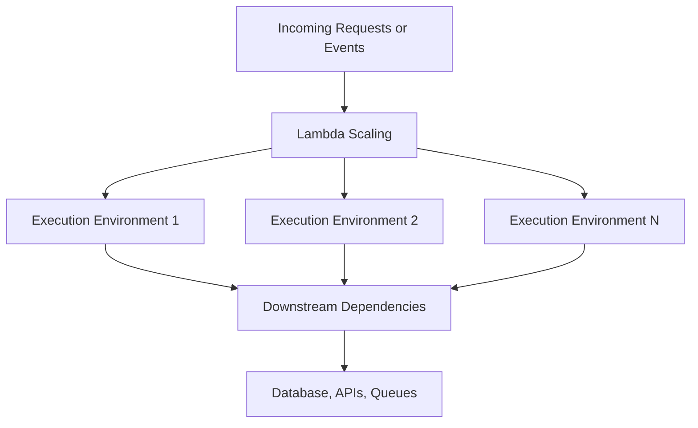
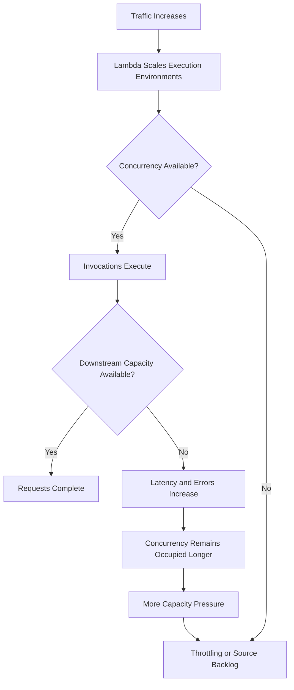
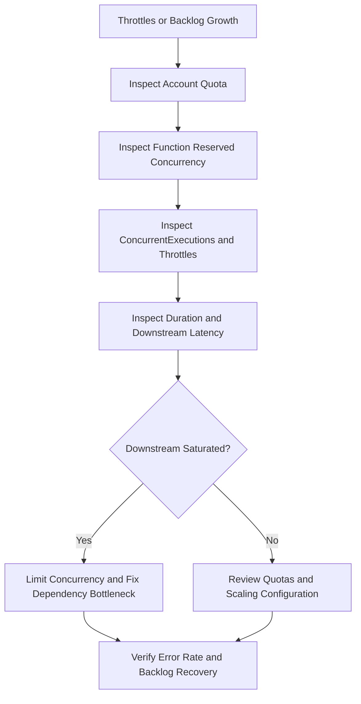

# 11- Concurrency and Scaling Management

## Overview

AWS Lambda concurrency determines how many invocations of a function can execute simultaneously. Scaling controls how Lambda responds to increasing invocation demand by provisioning execution environments. Together, these mechanisms affect throughput, latency, throttling, downstream capacity, and cost.

Concurrency management is particularly important for backend systems that integrate Lambda with PostgreSQL, DynamoDB, Redis, external REST APIs, SQS, or other rate-limited services. Lambda can scale faster than a downstream dependency can safely handle. Increasing function capacity without considering the entire request path can therefore reduce system reliability.

This document covers the AWS CLI workflows for inspecting concurrency, configuring reserved and provisioned concurrency, monitoring scaling behavior, diagnosing throttling, and protecting downstream services.

## Verify the AWS Environment

Define the target environment before running operational commands:

```bash
PROFILE=dev
REGION=ap-south-1
FUNCTION_NAME=orders-processor
```

Replace these example values with the intended AWS profile, Region, and function name.

### Verify the AWS identity

**Operation:** Read-only.

```bash
aws sts get-caller-identity \
  --profile "$PROFILE"
```

Confirm the account ID before changing concurrency settings. Lambda concurrency configuration is Region-specific.

### Inspect function state

**Operation:** Read-only.

```bash
aws lambda get-function-configuration \
  --function-name "$FUNCTION_NAME" \
  --query '{
    FunctionName:FunctionName,
    State:State,
    LastUpdateStatus:LastUpdateStatus,
    MemorySize:MemorySize,
    Timeout:Timeout,
    LastModified:LastModified
  }' \
  --output json \
  --profile "$PROFILE" \
  --region "$REGION"
```

Confirm that the function is in an appropriate state before making configuration changes.

## Concurrency Fundamentals

### Understand concurrency

For a function with an average execution duration of \(D\) seconds and an arrival rate of \(\lambda\) invocations per second, a useful steady-state approximation is:

\[
C \approx \lambda \times D
\]

For example, if a function receives 120 requests per second and each invocation runs for 0.25 seconds:

\[
C \approx 120 \times 0.25 = 30
\]

The function needs approximately 30 concurrent executions under those steady-state assumptions.

This is an estimate, not a capacity guarantee. Bursty traffic, initialization overhead, variable execution duration, retries, and uneven request distribution can increase actual concurrency requirements.

### Understand the execution model

Lambda creates and reuses execution environments to run function invocations. In the standard execution model, an execution environment processes one invocation at a time, while separate environments can execute invocations concurrently.



Concurrency is not the same as the number of requests received:

- **Invocation rate** measures requests or events over time.
- **Concurrency** measures invocations executing simultaneously.
- **Duration** measures execution time.
- **Throttling** occurs when Lambda cannot accept an invocation under the applicable concurrency or scaling limits.

A function can have a high invocation rate with relatively low concurrency if executions are short. Slow downstream calls can increase concurrency even when the incoming request rate remains unchanged.

## Inspect Account-Level Concurrency

Lambda concurrency quotas apply at the account and Region level. The default quota and any approved increases depend on the account and Region.

### Inspect account concurrency quotas

**Operation:** Read-only.

```bash
aws lambda get-account-settings \
  --query '{
    AccountLimit:AccountLimit,
    AccountUsage:AccountUsage
  }' \
  --output json \
  --profile "$PROFILE" \
  --region "$REGION"
```

Important fields include:

| Field | Meaning |
|---|---|
| `AccountLimit.ConcurrentExecutions` | Account concurrency quota |
| `AccountUsage.ConcurrentExecutions` | Current concurrent execution usage |
| `AccountLimit.UnreservedConcurrentExecutions` | Reported unreserved concurrency limit |
| `AccountUsage.UnreservedConcurrentExecutions` | Current usage of the unreserved concurrency pool |

Reserved concurrency allocations affect how account capacity is distributed. Do not assume the entire account quota is available to a particular function.

### Inspect concurrency metrics

**Operation:** Read-only.

The following GNU `date` commands work in common Linux shells. On Windows, use Git Bash, WSL, or explicitly supply ISO 8601 timestamps.

```bash
START_TIME=$(date -u -d '30 minutes ago' +%Y-%m-%dT%H:%M:%SZ)
END_TIME=$(date -u +%Y-%m-%dT%H:%M:%SZ)
```

Query the function's maximum concurrent executions:

```bash
aws cloudwatch get-metric-statistics \
  --namespace AWS/Lambda \
  --metric-name ConcurrentExecutions \
  --dimensions Name=FunctionName,Value="$FUNCTION_NAME" \
  --start-time "$START_TIME" \
  --end-time "$END_TIME" \
  --period 60 \
  --statistics Maximum \
  --query 'Datapoints[].{
    Timestamp:Timestamp,
    MaximumConcurrency:Maximum
  }' \
  --output table \
  --profile "$PROFILE" \
  --region "$REGION"
```

Query throttling:

```bash
aws cloudwatch get-metric-statistics \
  --namespace AWS/Lambda \
  --metric-name Throttles \
  --dimensions Name=FunctionName,Value="$FUNCTION_NAME" \
  --start-time "$START_TIME" \
  --end-time "$END_TIME" \
  --period 60 \
  --statistics Sum \
  --query 'Datapoints[].{
    Timestamp:Timestamp,
    Throttles:Sum
  }' \
  --output table \
  --profile "$PROFILE" \
  --region "$REGION"
```

Metric data may be delayed. A short time window can also produce no datapoints when the function has not been active or the selected dimension does not match published metrics.

## Reserved Concurrency

Reserved concurrency reserves capacity for a function and establishes its maximum concurrency.

It serves two purposes:

- **Capacity reservation:** Protects a function's share of the account's concurrency capacity.
- **Concurrency limiting:** Prevents the function from exceeding a configured maximum.

Reserved concurrency does not pre-initialize execution environments. It therefore does not, by itself, eliminate cold starts.

### Inspect reserved concurrency

**Operation:** Read-only.

```bash
aws lambda get-function-concurrency \
  --function-name "$FUNCTION_NAME" \
  --profile "$PROFILE" \
  --region "$REGION"
```

If reserved concurrency is configured, the response includes `ReservedConcurrentExecutions`. If no reserved concurrency is configured, the response may contain an empty configuration object.

### Configure reserved concurrency

**Operation:** Mutating.

```bash
aws lambda put-function-concurrency \
  --function-name "$FUNCTION_NAME" \
  --reserved-concurrent-executions 50 \
  --profile "$PROFILE" \
  --region "$REGION"
```

This example limits the function to 50 concurrent executions and reserves corresponding capacity from the account's unreserved pool.

Verify the configuration:

```bash
aws lambda get-function-concurrency \
  --function-name "$FUNCTION_NAME" \
  --profile "$PROFILE" \
  --region "$REGION"
```

Before applying the change, verify that the account has enough unreserved capacity and that the limit is appropriate for the function's traffic and dependencies.

### Remove reserved concurrency

**Operation:** Mutating.

```bash
aws lambda delete-function-concurrency \
  --function-name "$FUNCTION_NAME" \
  --profile "$PROFILE" \
  --region "$REGION"
```

Removing the reservation allows the function to use unreserved account capacity, subject to applicable account limits and other constraints. It does not guarantee unlimited concurrency.

### When to use reserved concurrency

| Scenario | Recommendation |
|---|---|
| Protect a critical API function from unrelated workloads | Reserve sufficient concurrency |
| Protect a database from excessive concurrent connections | Set an appropriate concurrency limit |
| Isolate a background worker from the rest of the application | Consider a workload-specific concurrency limit |
| Eliminate initialization latency | Reserved concurrency alone is insufficient |
| Maximize flexibility for a low-risk function | Leaving concurrency unreserved may be appropriate |

A concurrency limit that is too low can cause throttling and backlog growth. A limit that is too high can overwhelm downstream systems.

## Provisioned Concurrency

Provisioned concurrency prepares execution environments for a published function version or alias before requests arrive. It is intended for latency-sensitive workloads where initialization delay is unacceptable or difficult to tolerate.

Unlike reserved concurrency, provisioned concurrency allocates initialized execution capacity and incurs additional charges while configured.

### Inspect provisioned concurrency

**Operation:** Read-only.

```bash
aws lambda list-provisioned-concurrency-configs \
  --function-name "$FUNCTION_NAME" \
  --profile "$PROFILE" \
  --region "$REGION"
```

Inspect the configuration for a specific alias:

```bash
aws lambda get-provisioned-concurrency-config \
  --function-name "$FUNCTION_NAME" \
  --qualifier prod \
  --profile "$PROFILE" \
  --region "$REGION"
```

The qualifier must identify a published version or alias. Provisioned concurrency cannot be configured directly on `$LATEST`.

### Configure provisioned concurrency

**Operation:** Mutating.

```bash
aws lambda put-provisioned-concurrency-config \
  --function-name "$FUNCTION_NAME" \
  --qualifier prod \
  --provisioned-concurrent-executions 10 \
  --profile "$PROFILE" \
  --region "$REGION"
```

Inspect the status:

```bash
aws lambda get-provisioned-concurrency-config \
  --function-name "$FUNCTION_NAME" \
  --qualifier prod \
  --profile "$PROFILE" \
  --region "$REGION"
```

The configuration may initially be `IN_PROGRESS`. Wait for it to reach `READY` before routing latency-sensitive traffic to the target.

### Remove provisioned concurrency

**Operation:** Mutating.

```bash
aws lambda delete-provisioned-concurrency-config \
  --function-name "$FUNCTION_NAME" \
  --qualifier prod \
  --profile "$PROFILE" \
  --region "$REGION"
```

Verify that the configuration has been removed:

```bash
aws lambda list-provisioned-concurrency-configs \
  --function-name "$FUNCTION_NAME" \
  --profile "$PROFILE" \
  --region "$REGION"
```

### Reserved versus provisioned concurrency

| Property | Reserved concurrency | Provisioned concurrency |
|---|---|---|
| Reserves account capacity | Yes | Uses concurrency capacity for initialized environments |
| Sets a maximum for the function | Yes | No, not by itself |
| Pre-initializes environments | No | Yes |
| Reduces initialization latency | Not directly | Yes, for provisioned capacity |
| Adds a separate provisioned-capacity charge | No | Yes |
| Requires a published version or alias | No | Yes |

Provisioned concurrency does not guarantee that every request avoids initialization latency. Traffic beyond provisioned capacity can require additional on-demand execution environments, subject to applicable scaling and concurrency limits.

## Monitor Provisioned Concurrency

Lambda publishes provisioned-concurrency metrics that help identify whether configured capacity matches traffic demand.

| Metric | Purpose |
|---|---|
| `ProvisionedConcurrentExecutions` | Concurrent executions using provisioned capacity |
| `ProvisionedConcurrencyInvocations` | Invocations served by provisioned concurrency |
| `ProvisionedConcurrencySpilloverInvocations` | Invocations that spill over from provisioned capacity |
| `ProvisionedConcurrencyUtilization` | Utilization of provisioned concurrency |

Metric availability and dimensions depend on the metric and qualifier configuration.

### Query provisioned concurrency utilization

**Operation:** Read-only.

```bash
aws cloudwatch get-metric-statistics \
  --namespace AWS/Lambda \
  --metric-name ProvisionedConcurrencyUtilization \
  --dimensions Name=FunctionName,Value="$FUNCTION_NAME" Name=Resource,Value="$FUNCTION_NAME:prod" \
  --start-time "$START_TIME" \
  --end-time "$END_TIME" \
  --period 60 \
  --statistics Maximum \
  --query 'Datapoints[].{
    Timestamp:Timestamp,
    Utilization:Maximum
  }' \
  --output table \
  --profile "$PROFILE" \
  --region "$REGION"
```

The exact dimensions required depend on the published metric. If the query returns no datapoints, inspect the metric's available dimensions in CloudWatch and use the dimensions that match the actual qualifier and function resource.

### Interpret spillover

Spillover indicates that invocations exceeded the capacity served by provisioned concurrency. It does not automatically mean the function failed; spillover invocations can use on-demand capacity.

Investigate spillover when strict latency targets matter. Compare it with request volume, provisioned utilization, duration, and throttles before increasing provisioned capacity.

## Scaling Behavior and Capacity Planning

Lambda scaling depends on the invocation model and event source. Direct synchronous invocations, asynchronous invocations, and event source mappings do not all apply identical scaling and retry behavior.

### Understand scaling pressure



The critical failure mode is a feedback loop: slow downstream dependencies increase execution duration, longer execution duration increases concurrency demand, and insufficient capacity leads to throttling or backlogs.

### Estimate concurrency requirements

For steady-state planning:

\[
C \approx \lambda \times D
\]

Where:

- \(C\) is expected concurrency.
- \(\lambda\) is the invocation rate per second.
- \(D\) is average execution duration in seconds.

Example:

| Invocation rate | Average duration | Approximate concurrency |
|---:|---:|---:|
| 50 requests/s | 0.2 s | 10 |
| 100 requests/s | 0.5 s | 50 |
| 200 requests/s | 1.0 s | 200 |
| 300 requests/s | 2.0 s | 600 |

Use this estimate as a starting point. Validate it with representative load tests and production metrics, including burst behavior and tail latency.

### Protect downstream systems

Suppose a Lambda function connects to PostgreSQL and each concurrent execution can hold one database connection. A function that scales to 500 concurrent executions can potentially create hundreds of simultaneous connections, even if the database was sized for far fewer clients.

Mitigations include:

- Set reserved concurrency according to database capacity.
- Reuse database clients safely within execution environments.
- Use Amazon RDS Proxy where appropriate for connection pooling.
- Keep transactions short and release connections promptly.
- Use queue-based processing to control the rate of background work.
- Apply client-side timeouts and bounded retries to external dependencies.

Concurrency should be planned across the complete request path, not only against the Lambda quota.

## Event Source Scaling

Lambda event source mappings poll or consume supported event sources and invoke functions. Their scaling controls differ by source.

Examples include SQS, Kinesis, DynamoDB Streams, and Amazon MSK. The source's partitioning, batching, checkpoints, visibility timeout, throughput limits, and ordering semantics affect scaling behavior.

### Inspect event source mappings

**Operation:** Read-only.

```bash
aws lambda list-event-source-mappings \
  --function-name "$FUNCTION_NAME" \
  --query 'EventSourceMappings[].{
    UUID:UUID,
    State:State,
    EventSourceArn:EventSourceArn,
    BatchSize:BatchSize,
    MaximumConcurrency:ScalingConfig.MaximumConcurrency,
    LastProcessingResult:LastProcessingResult
  }' \
  --output json \
  --profile "$PROFILE" \
  --region "$REGION"
```

For a specific mapping:

```bash
MAPPING_UUID='replace-with-event-source-mapping-uuid'
```

```bash
aws lambda get-event-source-mapping \
  --uuid "$MAPPING_UUID" \
  --output json \
  --profile "$PROFILE" \
  --region "$REGION"
```

### Configure SQS event source maximum concurrency

For supported SQS event source mappings, `ScalingConfig.MaximumConcurrency` limits the maximum concurrent Lambda invocations used to process messages from that mapping.

**Operation:** Mutating.

```bash
aws lambda update-event-source-mapping \
  --uuid "$MAPPING_UUID" \
  --scaling-config MaximumConcurrency=20 \
  --profile "$PROFILE" \
  --region "$REGION"
```

Verify the mapping:

```bash
aws lambda get-event-source-mapping \
  --uuid "$MAPPING_UUID" \
  --query '{
    UUID:UUID,
    State:State,
    ScalingConfig:ScalingConfig
  }' \
  --output json \
  --profile "$PROFILE" \
  --region "$REGION"
```

Before setting a maximum, verify that the function's reserved concurrency can accommodate the combined demand from all mappings and direct invocations. SQS event source maximum concurrency and function reserved concurrency are separate controls.

### Remove the SQS mapping concurrency limit

**Operation:** Mutating.

```bash
aws lambda update-event-source-mapping \
  --uuid "$MAPPING_UUID" \
  --scaling-config '{}' \
  --profile "$PROFILE" \
  --region "$REGION"
```

An empty scaling configuration removes the mapping's explicit maximum-concurrency setting where supported. Verify the resulting configuration before assuming that the mapping can scale without constraint.

### Event source considerations

| Source | Important scaling consideration |
|---|---|
| SQS | Queue backlog, batch size, visibility timeout, and mapping maximum concurrency |
| Kinesis | Shard-level processing, ordering, batch failures, and parallelization settings |
| DynamoDB Streams | Shard processing, iterator age, and stream retention |
| Amazon MSK | Partition assignment, consumer throughput, and event source mapping configuration |
| Direct invocation | Caller behavior, function concurrency limits, and throttling responses |

Do not assume that every event source supports the same scaling configuration. Verify the current AWS documentation for the exact source and Region.

## Monitor Queue Backlogs and Event Age

A Lambda function can appear healthy while an event source backlog grows because processing capacity is lower than incoming traffic.

For SQS, monitor metrics such as:

- `ApproximateNumberOfMessagesVisible`
- `ApproximateNumberOfMessagesNotVisible`
- `ApproximateAgeOfOldestMessage`

For Kinesis and DynamoDB Streams, monitor relevant iterator-age metrics. The precise metric namespace and dimensions depend on the source service.

For asynchronous Lambda invocation, monitor `AsyncEventAge` and `AsyncEventsDropped` where applicable.

A growing backlog may indicate insufficient concurrency, slow processing, downstream throttling, poison messages, or a retry loop. Increasing concurrency helps only when the downstream dependency can support the additional load.

## Troubleshooting Concurrency Problems

Use a consistent diagnostic sequence:



### Function is being throttled

**Symptom:** `Throttles` increases or callers receive throttling responses.

Possible causes:

- Reserved concurrency is too low.
- Account-level concurrency is exhausted.
- The function is scaling faster than applicable scaling limits permit.
- Provisioned concurrency is insufficient for a strict latency target, although spillover itself does not necessarily cause throttling.
- Other workloads consume shared account capacity.

**Isolation commands:**

```bash
aws lambda get-account-settings \
  --query '{
    AccountLimit:AccountLimit,
    AccountUsage:AccountUsage
  }' \
  --output json \
  --profile "$PROFILE" \
  --region "$REGION"
```

```bash
aws lambda get-function-concurrency \
  --function-name "$FUNCTION_NAME" \
  --profile "$PROFILE" \
  --region "$REGION"
```

**Corrective action:** Determine whether the limiting factor is the function reservation, account quota, or scaling behavior. Request a quota increase when justified, adjust reserved concurrency carefully, and protect downstream systems before increasing capacity.

### Queue backlog continues to grow

**Symptom:** SQS visible messages or stream iterator age increases despite successful Lambda executions.

Possible causes:

- Incoming event volume exceeds processing throughput.
- Function duration is high.
- Batch processing repeatedly fails.
- Mapping concurrency is too restrictive.
- Downstream services are throttling requests.
- Poison messages cause repeated processing attempts.

**Isolation strategy:**

1. Inspect queue or stream backlog and age metrics.
2. Inspect event source mapping state and scaling configuration.
3. Compare function duration with invocation and error metrics.
4. Inspect application logs for downstream timeouts and batch failures.
5. Increase concurrency only after validating downstream capacity.

**Corrective action:** Reduce processing duration, fix repeated failures, adjust batching or mapping concurrency where appropriate, and introduce backpressure if downstream capacity is constrained.

### Database connection exhaustion

**Symptom:** Database connection errors appear as Lambda concurrency rises.

Possible causes:

- Each invocation opens a new connection.
- Connections are not released.
- Lambda concurrency exceeds the database's connection budget.
- Retry behavior multiplies connection pressure.

**Corrective action:**

- Set a deliberate concurrency ceiling.
- Reuse clients where safe.
- Consider RDS Proxy for supported relational database workloads.
- Bound connection timeouts and retries.
- Monitor database connection count alongside Lambda concurrency.

Increasing the database's connection limit without understanding memory, CPU, and workload capacity can move the failure elsewhere rather than solve it.

## Operational Safety and Cost

Concurrency settings affect both reliability and cost. Reserved concurrency is a capacity-allocation control, while provisioned concurrency adds charges for prepared execution capacity. Actual Lambda charges also depend on invocation count, duration, memory configuration, architecture, and other applicable features.

Before applying changes:

- Record the current configuration.
- Verify the account, Region, function, and qualifier.
- Estimate peak demand and downstream capacity.
- Apply changes during a controlled rollout when possible.
- Verify configuration state and monitor metrics after the change.
- Document rollback commands and expected side effects.

Avoid using `put-function-concurrency` with a value of zero as a normal scaling control without understanding its effect: setting reserved concurrency to zero intentionally stops the function from processing invocations and can cause requests to be throttled or work to accumulate upstream.

## Key Takeaways

- Estimate steady-state concurrency using invocation rate multiplied by execution duration, then validate against real traffic and burst behavior.
- Reserved concurrency reserves capacity and limits a function's maximum concurrency; provisioned concurrency pre-initializes capacity and adds cost.
- Function concurrency, account quotas, and event source mapping scaling are separate controls that must be planned together.
- Increasing Lambda concurrency can overload databases and APIs, so configure limits according to downstream capacity and use backpressure where appropriate.
- Diagnose throttling and backlog growth using account settings, function configuration, CloudWatch metrics, event source mapping state, and application logs.