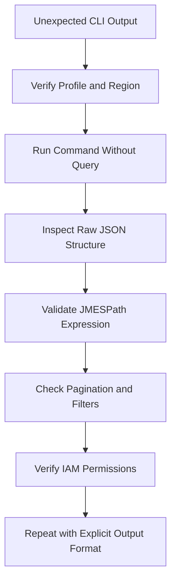

# 12- Querying, Filtering and Output Formatting

## Overview

AWS CLI querying and output formatting allow engineers to extract actionable information from AWS Lambda resources without manually inspecting large JSON responses. The primary tools are:

- **`--query`**: Filters and transforms command responses using JMESPath.
- **`--output`**: Controls how AWS CLI formats the response, typically as JSON, YAML, text, or a table.
- **`--filter` and service-specific filtering parameters**: Narrow results on the AWS service side when supported.
- **`--max-items`, `--page-size`, and `--no-paginate`**: Control CLI pagination behavior.

These capabilities are useful for operational scripts, CI/CD pipelines, incident investigation, resource inventories, and configuration audits.

A key distinction is that `--query` generally operates on data returned by the service, while service-side filters can reduce the data returned in the first place. Efficient queries, predictable output formats, and explicit pagination handling make automation safer and more maintainable.

## Configure a Reusable CLI Environment

Define a profile, Region, and function name for examples throughout this document.

```bash
PROFILE=dev
REGION=ap-south-1
FUNCTION_NAME=orders-processor
```

These are shell variables, not AWS CLI configuration settings. They apply only to the current shell session unless exported or defined in a startup script.

### Verify the target account

**Operation:** Read-only.

```bash
aws sts get-caller-identity \
  --profile "$PROFILE" \
  --output json
```

Example response:

```json
{
  "UserId": "AIDEXAMPLE",
  "Account": "123456789012",
  "Arn": "arn:aws:iam::123456789012:user/developer"
}
```

The values above are illustrative. Confirm the account and identity before executing mutating commands.

### Set a default output format

**Operation:** Configuration change.

```bash
aws configure set output json --profile "$PROFILE"
aws configure set region "$REGION" --profile "$PROFILE"
```

These commands update the local AWS CLI configuration for the specified profile. They do not modify AWS resources.

For automation, specifying `--profile`, `--region`, and `--output` explicitly makes command behavior easier to audit and reproduce.

## Understand AWS CLI Output Formats

The `--output` parameter determines how AWS CLI presents the response.

| Format | Appropriate use | Limitations |
|---|---|---|
| `json` | Scripts, structured data, API responses, and nested objects | Verbose for large responses |
| `yaml` | Human-readable configuration inspection | Not ideal for shell parsing |
| `text` | Compact output and simple shell pipelines | Column order and structure can be difficult to maintain |
| `table` | Interactive inspection in a terminal | Not suitable for machine parsing |

For reusable automation, prefer JSON with an explicit JMESPath query. Use tables for interactive diagnosis and text output for simple, controlled pipelines.

### Inspect a Lambda function

**Operation:** Read-only.

```bash
aws lambda get-function-configuration \
  --function-name "$FUNCTION_NAME" \
  --profile "$PROFILE" \
  --region "$REGION" \
  --query '{
    Name:FunctionName,
    Runtime:Runtime,
    Handler:Handler,
    Memory:MemorySize,
    Timeout:Timeout,
    State:State,
    LastUpdateStatus:LastUpdateStatus
  }' \
  --output json
```

This returns only the fields relevant to a configuration review rather than the complete function configuration.

Use this pattern in deployment verification scripts to confirm that the deployed function matches expected settings.

## JMESPath Query Fundamentals

JMESPath is the query language used by AWS CLI's `--query` parameter. It supports selecting fields, filtering arrays, projecting values, and constructing new JSON structures.

### Select a single field

```bash
aws lambda get-function-configuration \
  --function-name "$FUNCTION_NAME" \
  --query 'FunctionArn' \
  --output text \
  --profile "$PROFILE" \
  --region "$REGION"
```

This extracts the function ARN from the response.

### Select multiple fields

```bash
aws lambda get-function-configuration \
  --function-name "$FUNCTION_NAME" \
  --query '{
    FunctionName:FunctionName,
    Runtime:Runtime,
    Role:Role,
    MemorySize:MemorySize,
    Timeout:Timeout
  }' \
  --output json \
  --profile "$PROFILE" \
  --region "$REGION"
```

Object construction creates a smaller, purpose-specific response. This is useful when downstream scripts need only a small subset of fields.

### Select nested fields

```bash
aws lambda get-account-settings \
  --query '{
    AccountLimit:AccountLimit.ConcurrentExecutions,
    CurrentUsage:AccountUsage.ConcurrentExecutions
  }' \
  --output json \
  --profile "$PROFILE" \
  --region "$REGION"
```

Nested field access avoids returning unrelated account settings.

### Select array elements

List the names of Lambda functions returned by the API:

```bash
aws lambda list-functions \
  --query 'Functions[].FunctionName' \
  --output json \
  --profile "$PROFILE" \
  --region "$REGION"
```

The `[]` projection extracts a field from each element in the array.

### Filter arrays

List functions using a particular runtime:

```bash
aws lambda list-functions \
  --query "Functions[?Runtime=='python3.12'].{
    Name:FunctionName,
    Runtime:Runtime,
    Memory:MemorySize,
    Timeout:Timeout
  }" \
  --output table \
  --profile "$PROFILE" \
  --region "$REGION"
```

The example uses `python3.12` as a filter value, not as a recommendation to deploy a new function on that runtime. Check the current Lambda runtime support and deprecation schedule before choosing a runtime.

### Filter using numeric comparisons

Find functions configured with at least 1,024 MB of memory:

```bash
aws lambda list-functions \
  --query 'Functions[?MemorySize >= `1024`].{
    Name:FunctionName,
    Memory:MemorySize,
    Timeout:Timeout
  }' \
  --output table \
  --profile "$PROFILE" \
  --region "$REGION"
```

JMESPath uses backtick-delimited JSON literals for numeric values in expressions such as this one.

### Combine filters

Find Python functions with a timeout of at least 30 seconds:

```bash
aws lambda list-functions \
  --query "Functions[?starts_with(Runtime, 'python') && Timeout >= \`30\`].{
    Name:FunctionName,
    Runtime:Runtime,
    Timeout:Timeout,
    Memory:MemorySize
  }" \
  --output table \
  --profile "$PROFILE" \
  --region "$REGION"
```

This combines a runtime string condition with a numeric comparison.

The query only filters the function objects returned by the API. It does not automatically search every function across every Region.

## Query Lambda Function Inventories

Function inventories are useful for auditing configuration drift, identifying outdated runtime choices, and reviewing resource settings.

### List function names and ARNs

**Operation:** Read-only.

```bash
aws lambda list-functions \
  --query 'Functions[].{
    Name:FunctionName,
    ARN:FunctionArn
  }' \
  --output table \
  --profile "$PROFILE" \
  --region "$REGION"
```

### Inspect memory and timeout settings

```bash
aws lambda list-functions \
  --query 'Functions[].{
    Name:FunctionName,
    MemoryMB:MemorySize,
    TimeoutSeconds:Timeout
  }' \
  --output table \
  --profile "$PROFILE" \
  --region "$REGION"
```

Use the result as an initial inventory, not as proof that each setting is appropriate. Validate configuration against workload-specific service-level objectives.

### Identify functions with a specific role

```bash
ROLE_NAME='orders-lambda-execution-role'

aws lambda list-functions \
  --query "Functions[?contains(Role, '/role/${ROLE_NAME}')].{
    Name:FunctionName,
    Role:Role
  }" \
  --output json \
  --profile "$PROFILE" \
  --region "$REGION"
```

This is a convenient inventory query, but role-name substring matching is not a substitute for exact IAM ARN validation. For security audits, inspect the complete role ARN and its attached or inline policies.

### Inspect environment variable names without printing values

Environment variables may contain sensitive configuration. To inspect only their names:

```bash
aws lambda get-function-configuration \
  --function-name "$FUNCTION_NAME" \
  --query 'keys(Environment.Variables)' \
  --output json \
  --profile "$PROFILE" \
  --region "$REGION"
```

This avoids intentionally displaying variable values in terminal output. It does not prevent authorized users from retrieving the full configuration through other commands.

Do not include environment-variable values in shell traces, build logs, CI artifacts, or shared incident reports.

## Query Event Source Mappings

Event source mappings connect supported event sources to Lambda functions. Filtering their output helps diagnose disabled mappings, unexpected batch sizes, and processing failures.

### List mapping status and configuration

**Operation:** Read-only.

```bash
aws lambda list-event-source-mappings \
  --function-name "$FUNCTION_NAME" \
  --query 'EventSourceMappings[].{
    UUID:UUID,
    State:State,
    EventSource:EventSourceArn,
    BatchSize:BatchSize,
    LastProcessingResult:LastProcessingResult
  }' \
  --output table \
  --profile "$PROFILE" \
  --region "$REGION"
```

### Find mappings that are not enabled

```bash
aws lambda list-event-source-mappings \
  --function-name "$FUNCTION_NAME" \
  --query "EventSourceMappings[?State!='Enabled'].{
    UUID:UUID,
    State:State,
    EventSource:EventSourceArn,
    Result:LastProcessingResult
  }" \
  --output json \
  --profile "$PROFILE" \
  --region "$REGION"
```

An empty result means no mappings in the returned result matched the condition. It does not prove that all event sources in the account are healthy.

### Inspect a specific mapping

```bash
MAPPING_UUID='replace-with-event-source-mapping-uuid'
```

**Operation:** Read-only.

```bash
aws lambda get-event-source-mapping \
  --uuid "$MAPPING_UUID" \
  --query '{
    UUID:UUID,
    State:State,
    StateTransitionReason:StateTransitionReason,
    EventSourceArn:EventSourceArn,
    BatchSize:BatchSize,
    MaximumBatchingWindow:MaximumBatchingWindowInSeconds,
    LastProcessingResult:LastProcessingResult
  }' \
  --output json \
  --profile "$PROFILE" \
  --region "$REGION"
```

A mapping can exist but be disabled, creating an event-processing gap. Inspect its state and last processing result before investigating application code.

## Query Versions and Aliases

Published versions and aliases are important for production deployments because traffic can be directed to a stable version or alias rather than `$LATEST`.

### List published versions

**Operation:** Read-only.

```bash
aws lambda list-versions-by-function \
  --function-name "$FUNCTION_NAME" \
  --query 'Versions[].{
    Version:Version,
    Runtime:Runtime,
    Memory:MemorySize,
    Timeout:Timeout,
    LastModified:LastModified
  }' \
  --output table \
  --profile "$PROFILE" \
  --region "$REGION"
```

### Inspect aliases

**Operation:** Read-only.

```bash
aws lambda list-aliases \
  --function-name "$FUNCTION_NAME" \
  --query 'Aliases[].{
    Name:Name,
    AliasArn:AliasArn,
    Version:FunctionVersion,
    Description:Description
  }' \
  --output table \
  --profile "$PROFILE" \
  --region "$REGION"
```

### Find aliases using a particular version

```bash
TARGET_VERSION='12'

aws lambda list-aliases \
  --function-name "$FUNCTION_NAME" \
  --query "Aliases[?FunctionVersion=='${TARGET_VERSION}'].{
    Alias:Name,
    Version:FunctionVersion,
    ARN:AliasArn
  }" \
  --output json \
  --profile "$PROFILE" \
  --region "$REGION"
```

This helps identify aliases that currently route their primary traffic to a particular published version. If weighted routing is configured, inspect `RoutingConfig.AdditionalVersionWeights` as well; the primary version alone does not describe the full traffic distribution.

## Server-Side Filtering Versus JMESPath Filtering

Filtering can happen at different stages.

| Approach | Where filtering occurs | Benefit | Limitation |
|---|---|---|---|
| Service API parameters | AWS service | Can reduce returned data when supported | Available filters vary by operation |
| `--query` | AWS CLI response processing | Flexible selection and transformation | Does not inherently reduce service-side retrieval |
| Shell tools such as `grep` | After CLI output | Quick text searches | Fragile with structured data and formatting changes |

For example, `list-functions` does not provide arbitrary server-side filtering by runtime or memory. A JMESPath filter is therefore useful for those fields.

For large inventories, use supported service-side parameters where available, handle pagination, and avoid downloading or printing unnecessary fields.

## Pagination and Large Results

Many AWS CLI operations return paginated results. The CLI normally follows pagination tokens automatically, so a command may make multiple service requests before returning the complete result.

### Understand pagination options

| Option | Purpose | Operational consideration |
|---|---|---|
| `--page-size` | Controls the number of items requested per service page | May increase request count without limiting total results |
| `--max-items` | Limits the total number of items returned by the CLI operation | Useful for bounded inventory queries |
| `--starting-token` | Continues from a CLI pagination token | Use a token generated by the corresponding CLI operation |
| `--no-paginate` | Disables automatic pagination | May return only the first service page |

### Limit the number of returned functions

**Operation:** Read-only.

```bash
aws lambda list-functions \
  --max-items 20 \
  --query 'Functions[].{
    Name:FunctionName,
    Runtime:Runtime
  }' \
  --output table \
  --profile "$PROFILE" \
  --region "$REGION"
```

This limits the total number of items returned by the CLI operation, not merely the number of items requested per service page.

### Adjust service page size

```bash
aws lambda list-functions \
  --page-size 25 \
  --query 'Functions[].FunctionName' \
  --output json \
  --profile "$PROFILE" \
  --region "$REGION"
```

The CLI can still retrieve all pages. A smaller page size may help with service-side timeouts or troubleshooting but can increase the number of API requests.

### Avoid incomplete inventories

Do not use `--no-paginate` for a complete resource inventory unless you have verified that a single page is sufficient.

When using `--max-items`, remember that the result may be intentionally partial. Do not treat it as a complete account or Region inventory.

For multi-page workflows, use the CLI's returned `NextToken` or `NextMarker` where applicable, or rely on normal automatic pagination. Pagination behavior is operation-specific.

## Output Formatting for Shell Automation

The format should match the consumer of the command output.

### Use text output for a single value

```bash
FUNCTION_ARN=$(aws lambda get-function-configuration \
  --function-name "$FUNCTION_NAME" \
  --query 'FunctionArn' \
  --output text \
  --profile "$PROFILE" \
  --region "$REGION")
```

This is convenient when a script needs one scalar value.

### Use JSON for structured data

```bash
FUNCTION_CONFIG=$(aws lambda get-function-configuration \
  --function-name "$FUNCTION_NAME" \
  --query '{
    Name:FunctionName,
    Runtime:Runtime,
    Memory:MemorySize,
    Timeout:Timeout
  }' \
  --output json \
  --profile "$PROFILE" \
  --region "$REGION")
```

If the script needs to manipulate the response, parse JSON with an appropriate JSON parser rather than relying on whitespace or column positions.

### Use tables for interactive inspection

```bash
aws lambda list-functions \
  --query 'Functions[].{
    Name:FunctionName,
    Runtime:Runtime,
    Memory:MemorySize,
    Timeout:Timeout
  }' \
  --output table \
  --profile "$PROFILE" \
  --region "$REGION"
```

Tables are useful during an incident or manual review. They are not stable data formats for automation because display formatting can change and nested values may not render as expected.

### Check command success before consuming output

In shell scripts, do not assume that a failed AWS CLI command produces valid data.

```bash
if ! aws lambda get-function-configuration \
  --function-name "$FUNCTION_NAME" \
  --query 'FunctionArn' \
  --output text \
  --profile "$PROFILE" \
  --region "$REGION"; then
  printf 'Failed to inspect Lambda function: %s\n' "$FUNCTION_NAME" >&2
  exit 1
fi
```

For larger workflows, capture output only after checking the exit status. Avoid enabling shell tracing around commands that could expose sensitive information.

## Practical Operational Workflows

### Inventory Lambda functions in a Region

**Operation:** Read-only.

```bash
aws lambda list-functions \
  --query 'Functions[].{
    Name:FunctionName,
    ARN:FunctionArn,
    Runtime:Runtime,
    MemoryMB:MemorySize,
    TimeoutSeconds:Timeout,
    LastModified:LastModified
  }' \
  --output json \
  --profile "$PROFILE" \
  --region "$REGION"
```

Use this as the basis for configuration reviews and controlled inventory exports.

### Find functions with unusually long timeouts

```bash
aws lambda list-functions \
  --query 'Functions[?Timeout >= `60`].{
    Name:FunctionName,
    Timeout:Timeout,
    Memory:MemorySize,
    Runtime:Runtime
  }' \
  --output table \
  --profile "$PROFILE" \
  --region "$REGION"
```

A long timeout is not automatically incorrect. Compare it with the function's workload, caller timeout, retry behavior, and downstream limits before making changes.

### Inspect configuration drift for one function

```bash
aws lambda get-function-configuration \
  --function-name "$FUNCTION_NAME" \
  --query '{
    Runtime:Runtime,
    Handler:Handler,
    MemorySize:MemorySize,
    Timeout:Timeout,
    Architectures:Architectures,
    EphemeralStorage:EphemeralStorage.Size,
    TracingMode:TracingConfig.Mode
  }' \
  --output json \
  --profile "$PROFILE" \
  --region "$REGION"
```

Compare the output with the desired configuration in your infrastructure-as-code repository. Prefer correcting drift through the authoritative deployment process rather than making undocumented manual changes.

### Audit configuration across multiple Regions

AWS Lambda resources are Regional. To inventory multiple Regions, iterate over an explicitly approved list.

```bash
REGIONS=("ap-south-1" "ap-southeast-1")

for region in "${REGIONS[@]}"; do
  printf '\nRegion: %s\n' "$region"

  aws lambda list-functions \
    --query 'Functions[].{
      Name:FunctionName,
      Runtime:Runtime,
      Memory:MemorySize
    }' \
    --output table \
    --profile "$PROFILE" \
    --region "$region" || exit 1
done
```

Use an explicit Region list rather than assuming every enabled Region should be queried. This makes audits predictable and reduces accidental cross-environment inspection.

## Common Mistakes and Troubleshooting

| Symptom | Likely cause | Corrective action |
|---|---|---|
| Query returns `null` | Incorrect field name, absent optional field, or unexpected response shape | Inspect the unfiltered JSON response |
| Query returns an empty array | No matching resources, incomplete pagination, or an overly restrictive filter | Verify Region, filters, and pagination |
| Table output is difficult to parse | Human-readable formatting used in automation | Use JSON and a structured parser |
| Inventory is unexpectedly incomplete | `--no-paginate` or a restrictive `--max-items` value | Enable pagination and review limits |
| Shell variable is empty | Command failed or query returned no value | Check the exit code and inspect the raw response |
| Access denied | IAM permissions do not allow the requested operation | Inspect the caller identity and relevant IAM policies |
| Function appears missing | Wrong account, Region, function name, or qualifier | Verify STS identity and CLI Region |
| Sensitive values appear in logs | Full configuration output or shell tracing exposed them | Query only required fields and redact sensitive output |

### Diagnostic sequence



When a query fails, start with the unfiltered response before changing multiple parts of the expression. This separates data-shape problems from filtering and formatting problems.

## Security and Production Best Practices

- **Use least-privilege IAM permissions.** Read-only inventory commands generally need read permissions for the corresponding Lambda APIs, but do not assume one generic permission covers every operation.
- **Verify the account and Region.** A correct function name in the wrong account can lead to misleading results or unsafe follow-up actions.
- **Avoid dumping secrets.** Lambda environment configuration can contain sensitive values. Query only fields required for the task.
- **Use JSON for automation.** Avoid parsing table output or relying on undocumented column ordering.
- **Handle pagination deliberately.** Inventory scripts should distinguish complete results from intentionally limited results.
- **Check exit codes.** AWS CLI commands can fail because of IAM, network, service, or parameter errors. Do not continue with empty or invalid output.
- **Keep scripts reproducible.** Use explicit profiles, Regions, output formats, and stable field names.
- **Prefer infrastructure as code for configuration changes.** CLI inspection is useful for diagnosing drift; persistent changes should normally flow through the deployment process.
- **Review API costs and request volume when appropriate.** Inventory calls are generally low-cost operational requests, but large automated audits should still avoid unnecessary polling and repeated scans.
- **Validate queries against current API responses.** Optional fields and service-specific response shapes can vary by operation and resource state.

## Key Takeaways

- Use JMESPath with `--query` to extract and transform AWS Lambda API responses without manually processing large JSON documents.
- Prefer JSON for automation, tables for interactive inspection, and text output for carefully controlled scalar values.
- Understand pagination: `--page-size`, `--max-items`, and `--no-paginate` have different effects and can produce incomplete inventories if misused.
- Verify the AWS account, Region, command exit status, and raw response structure before trusting query results or using them in operational workflows.
- Treat configuration output as potentially sensitive, and use least-privilege permissions and explicit field selection in production scripts.