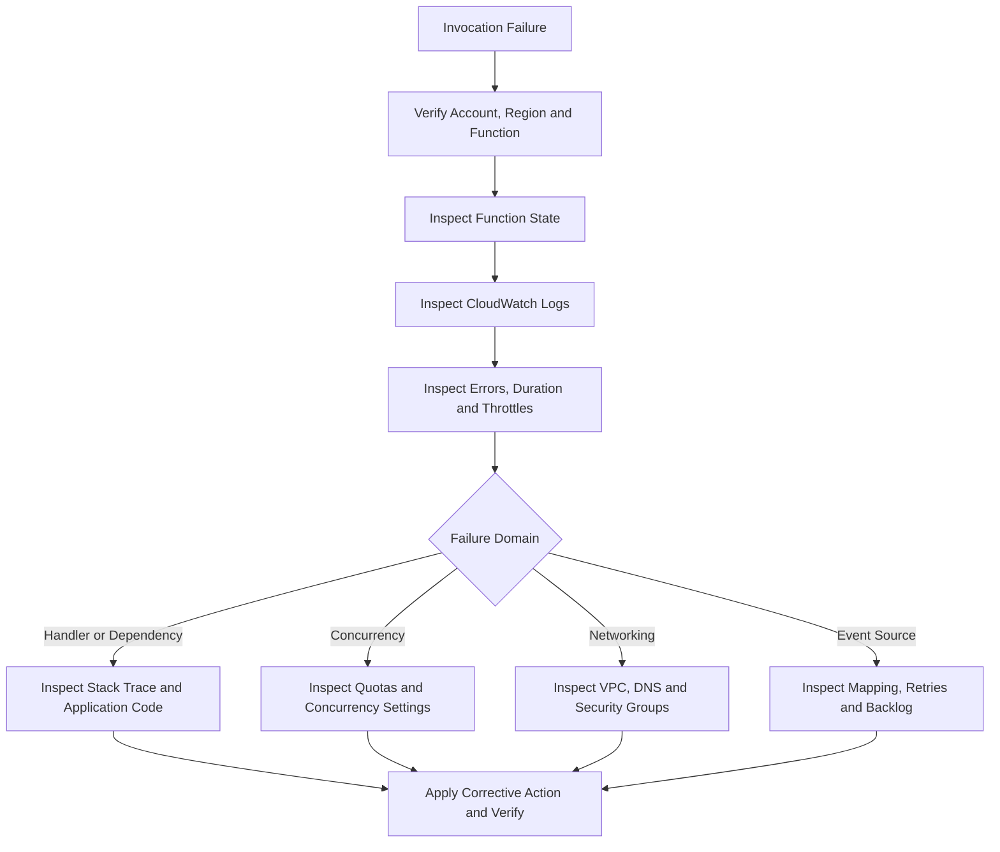

# 13- Operational CLI Workflows

## Overview

Operational AWS Lambda workflows combine multiple AWS CLI commands into repeatable procedures for inspecting deployments, diagnosing failures, validating configuration, monitoring execution, and recovering from operational incidents.

Individual CLI commands are useful for isolated tasks, but production operations require a controlled sequence of actions with explicit prerequisites, verification steps, error handling, and rollback procedures.

This document focuses on reusable operational workflows rather than duplicating the complete command reference covered in the other AWS Lambda CLI notes.

Typical workflows include:

- Verifying the AWS account, Region, and function identity before making changes.
- Inspecting function configuration, versions, aliases, and event source mappings.
- Deploying a new function version and verifying the release.
- Investigating invocation errors, throttling, timeouts, and event-processing failures.
- Validating concurrency and downstream capacity constraints.
- Performing controlled recovery and documenting operational changes.

## Establish an Operational Context

Before executing a workflow, define the target environment and verify that the AWS CLI can access it.

### Define reusable variables

```bash
PROFILE=dev
REGION=ap-south-1
FUNCTION_NAME=orders-processor
ALIAS_NAME=prod
```

These are shell variables used by the examples. Replace the values with the intended account, Region, function, and alias.

For production operations, avoid relying on implicit CLI defaults. Specify the profile and Region explicitly in every command.

### Verify the caller identity

**Operation:** Read-only.

```bash
aws sts get-caller-identity \
  --profile "$PROFILE" \
  --output json
```

Verify the account ID and caller ARN before proceeding.

### Verify the target function

**Operation:** Read-only.

```bash
aws lambda get-function-configuration \
  --function-name "$FUNCTION_NAME" \
  --profile "$PROFILE" \
  --region "$REGION" \
  --query '{
    FunctionName:FunctionName,
    FunctionArn:FunctionArn,
    State:State,
    LastUpdateStatus:LastUpdateStatus,
    Runtime:Runtime,
    MemorySize:MemorySize,
    Timeout:Timeout,
    LastModified:LastModified
  }' \
  --output json
```

Confirm that the function exists in the intended Region and is in an appropriate state before performing deployment or recovery operations.

### Capture the current configuration

For an operational change, record the relevant configuration before modifying it.

```bash
aws lambda get-function-configuration \
  --function-name "$FUNCTION_NAME" \
  --profile "$PROFILE" \
  --region "$REGION" \
  --output json > function-config-before.json
```

This file can contain sensitive configuration metadata, including environment-variable values. Store it securely, restrict access, and do not commit it to source control. Prefer capturing only the required fields when a complete configuration snapshot is unnecessary.

## Inspect Function Health and Deployment State

Lambda configuration and deployment state are separate concerns. A function may exist while an update is in progress or while its latest update has failed.

### Inspect function state

**Operation:** Read-only.

```bash
aws lambda get-function-configuration \
  --function-name "$FUNCTION_NAME" \
  --profile "$PROFILE" \
  --region "$REGION" \
  --query '{
    State:State,
    StateReason:StateReason,
    StateReasonCode:StateReasonCode,
    LastUpdateStatus:LastUpdateStatus,
    LastUpdateStatusReason:LastUpdateStatusReason,
    LastUpdateStatusReasonCode:LastUpdateStatusReasonCode
  }' \
  --output json
```

Interpret the results as follows:

| Field | Operational purpose |
|---|---|
| `State` | Indicates the function lifecycle state |
| `StateReason` | Provides additional lifecycle context |
| `LastUpdateStatus` | Indicates whether the most recent configuration or code update succeeded |
| `LastUpdateStatusReason` | Helps explain an unsuccessful update |

Do not begin a second deployment merely because the first deployment appears slow. Inspect the current update status and diagnose the reason for any failure.

### Wait for a function update

**Operation:** Read-only polling.

```bash
aws lambda wait function-updated \
  --function-name "$FUNCTION_NAME" \
  --profile "$PROFILE" \
  --region "$REGION"
```

The waiter polls until the function update reaches the expected completed state or the waiter exhausts its attempts.

A successful waiter indicates that the update completed according to the waiter's condition. It does not prove that the application behaves correctly. Follow it with configuration inspection and a smoke test.

## Validate Published Versions and Aliases

Production deployments should generally direct traffic through an alias that references a published version instead of relying on mutable `$LATEST`.

### Inspect published versions

**Operation:** Read-only.

```bash
aws lambda list-versions-by-function \
  --function-name "$FUNCTION_NAME" \
  --profile "$PROFILE" \
  --region "$REGION" \
  --query 'Versions[].{
    Version:Version,
    Runtime:Runtime,
    Memory:MemorySize,
    Timeout:Timeout,
    LastModified:LastModified
  }' \
  --output table
```

### Inspect the production alias

**Operation:** Read-only.

```bash
aws lambda get-alias \
  --function-name "$FUNCTION_NAME" \
  --name "$ALIAS_NAME" \
  --profile "$PROFILE" \
  --region "$REGION" \
  --output json
```

Review `FunctionVersion` and `RoutingConfig`. If weighted routing is configured, the alias can send a portion of traffic to an additional version.

### Verify the alias target

```bash
aws lambda get-alias \
  --function-name "$FUNCTION_NAME" \
  --name "$ALIAS_NAME" \
  --profile "$PROFILE" \
  --region "$REGION" \
  --query '{
    Alias:Name,
    Version:FunctionVersion,
    Routing:RoutingConfig.AdditionalVersionWeights
  }' \
  --output json
```

Use this check after a release or rollback to confirm the actual routing configuration.

## Operational Workflow: Deploy and Verify a Release

A safe deployment sequence separates artifact preparation, code upload, version publication, traffic movement, and post-deployment validation.

The following example assumes that the deployment package is already built and tested, and that the function and alias exist.

### Inspect the current production target

**Operation:** Read-only.

```bash
aws lambda get-alias \
  --function-name "$FUNCTION_NAME" \
  --name "$ALIAS_NAME" \
  --profile "$PROFILE" \
  --region "$REGION" \
  --query '{
    Alias:Name,
    CurrentVersion:FunctionVersion,
    Routing:RoutingConfig.AdditionalVersionWeights
  }' \
  --output json
```

Record the current version and routing configuration. If weighted routing exists, preserve that information for rollback planning.

### Update the function code

**Operation:** Mutating.

```bash
PACKAGE_PATH=dist/function.zip
```

```bash
aws lambda update-function-code \
  --function-name "$FUNCTION_NAME" \
  --zip-file "fileb://$PACKAGE_PATH" \
  --profile "$PROFILE" \
  --region "$REGION"
```

The package must satisfy Lambda's deployment-package requirements. The caller must have the appropriate update permissions, and the function must use a compatible deployment configuration.

Wait for the update:

```bash
aws lambda wait function-updated \
  --function-name "$FUNCTION_NAME" \
  --profile "$PROFILE" \
  --region "$REGION"
```

Inspect the deployment state:

```bash
aws lambda get-function-configuration \
  --function-name "$FUNCTION_NAME" \
  --profile "$PROFILE" \
  --region "$REGION" \
  --query '{
    State:State,
    LastUpdateStatus:LastUpdateStatus,
    CodeSha256:CodeSha256,
    LastModified:LastModified
  }' \
  --output json
```

Compare `CodeSha256` with the expected artifact hash when your build pipeline tracks that value. A successful upload alone does not prove that the new application code works.

### Publish a version

**Operation:** Mutating.

```bash
aws lambda publish-version \
  --function-name "$FUNCTION_NAME" \
  --description "Release $(date -u +%Y-%m-%dT%H:%M:%SZ)" \
  --profile "$PROFILE" \
  --region "$REGION"
```

Capture the returned version number rather than assuming the next version number.

For example:

```bash
NEW_VERSION=42
```

Replace this illustrative value with the actual version returned by the command.

### Test the published version before routing production traffic

**Operation:** Read-only invocation of the selected version.

```bash
aws lambda invoke \
  --function-name "$FUNCTION_NAME" \
  --qualifier "$NEW_VERSION" \
  --payload '{"operation":"health-check"}' \
  --cli-binary-format raw-in-base64-out \
  --profile "$PROFILE" \
  --region "$REGION" \
  response.json
```

Inspect the invocation metadata and response body:

```bash
cat response.json
```

The test payload must match the function's event contract. The example is appropriate only if the handler supports this event.

For synchronous invocation, inspect the CLI response for `FunctionError` and review the response body. A successful CLI request does not necessarily mean the business operation succeeded.

### Move the alias to the new version

**Operation:** Mutating.

```bash
aws lambda update-alias \
  --function-name "$FUNCTION_NAME" \
  --name "$ALIAS_NAME" \
  --function-version "$NEW_VERSION" \
  --profile "$PROFILE" \
  --region "$REGION"
```

This example moves the alias directly to the new version. Use a controlled canary or weighted rollout when gradual exposure is required. Preserve and explicitly manage existing routing configuration when using weighted deployments.

Verify the alias:

```bash
aws lambda get-alias \
  --function-name "$FUNCTION_NAME" \
  --name "$ALIAS_NAME" \
  --profile "$PROFILE" \
  --region "$REGION" \
  --output json
```

### Perform a post-deployment smoke test

**Operation:** Invokes the production alias.

```bash
aws lambda invoke \
  --function-name "$FUNCTION_NAME" \
  --qualifier "$ALIAS_NAME" \
  --payload '{"operation":"health-check"}' \
  --cli-binary-format raw-in-base64-out \
  --profile "$PROFILE" \
  --region "$REGION" \
  smoke-test-response.json
```

Validate the response, application logs, error rate, duration, and relevant downstream dependencies before declaring the deployment healthy.

**Production caution:** A health-check event should not trigger irreversible business operations. Use a dedicated diagnostic event or an integration-level smoke test that is safe to repeat.

## Operational Workflow: Roll Back a Release

Rollback should restore a known-good application version and its routing configuration. It should not be treated as a universal reversal of all deployment changes.

### Identify the previous version

**Operation:** Read-only.

```bash
aws lambda list-versions-by-function \
  --function-name "$FUNCTION_NAME" \
  --profile "$PROFILE" \
  --region "$REGION" \
  --query 'Versions[].{
    Version:Version,
    Modified:LastModified,
    Description:Description
  }' \
  --output table
```

Confirm that the intended version exists and contains the expected configuration and code.

### Move the alias back

**Operation:** Mutating.

```bash
PREVIOUS_VERSION=41
```

Replace `41` with the verified previous version.

```bash
aws lambda update-alias \
  --function-name "$FUNCTION_NAME" \
  --name "$ALIAS_NAME" \
  --function-version "$PREVIOUS_VERSION" \
  --profile "$PROFILE" \
  --region "$REGION"
```

Verify the alias target:

```bash
aws lambda get-alias \
  --function-name "$FUNCTION_NAME" \
  --name "$ALIAS_NAME" \
  --profile "$PROFILE" \
  --region "$REGION" \
  --query '{
    Version:FunctionVersion,
    Routing:RoutingConfig
  }' \
  --output json
```

### Understand rollback limitations

Alias rollback changes which published function version receives traffic through that alias. It does not automatically reverse:

- Database schema migrations.
- Messages already emitted to queues or event buses.
- External API calls or other side effects.
- Changes to IAM policies, networking, secrets, or event source mappings.
- Data written by the failed release.
- Configuration changes outside the published version.

Use backward-compatible database migrations, idempotent event processing, and explicit infrastructure rollback procedures. If the deployment changed function-level settings or external resources, verify those separately.

## Operational Workflow: Diagnose Invocation Errors

When an application reports failures, use a sequence that narrows the failure domain before changing configuration.



### Inspect recent invocations

**Operation:** Read-only.

```bash
LOG_GROUP="/aws/lambda/$FUNCTION_NAME"
```

```bash
aws logs tail "$LOG_GROUP" \
  --since 30m \
  --format short \
  --profile "$PROFILE" \
  --region "$REGION"
```

The log group must exist, the function must have written logs, and the caller must have permission to read them. Recent log delivery may be delayed.

Search for common failure indicators:

```bash
aws logs filter-log-events \
  --log-group-name "$LOG_GROUP" \
  --filter-pattern '"ERROR"' \
  --start-time "$(($(date +%s) - 1800))000" \
  --profile "$PROFILE" \
  --region "$REGION" \
  --query 'events[].{
    Timestamp:timestamp,
    Message:message
  }' \
  --output json
```

CloudWatch Logs API timestamps use epoch milliseconds for `--start-time`. The command uses GNU-compatible `date` syntax; adapt it for the local shell when necessary.

### Inspect error metrics

**Operation:** Read-only.

```bash
START_TIME=$(date -u -d '30 minutes ago' +%Y-%m-%dT%H:%M:%SZ)
END_TIME=$(date -u +%Y-%m-%dT%H:%M:%SZ)
```

```bash
aws cloudwatch get-metric-statistics \
  --namespace AWS/Lambda \
  --metric-name Errors \
  --dimensions Name=FunctionName,Value="$FUNCTION_NAME" \
  --start-time "$START_TIME" \
  --end-time "$END_TIME" \
  --period 60 \
  --statistics Sum \
  --profile "$PROFILE" \
  --region "$REGION" \
  --output table
```

Repeat for `Duration`, `Throttles`, and `ConcurrentExecutions` when relevant. Use the correct metric dimensions for the resource and qualifier being investigated.

### Interpret failures correctly

| Symptom | Investigation |
|---|---|
| Handler exception | Inspect stack traces and input validation |
| Timeout | Inspect downstream latency, blocking operations, and configured timeout |
| Throttling | Inspect reserved concurrency, account usage, and event source behavior |
| No logs | Verify invocation, log group, execution-role permissions, and log delivery |
| Function succeeds but business operation fails | Inspect response payload, application logs, and downstream transaction state |
| Repeated event failures | Inspect retry behavior, message visibility, poison events, and failure destinations |

Do not respond to every error by increasing memory or timeout. Identify the bottleneck first.

## Operational Workflow: Inspect and Recover Event Source Mappings

Event source mappings can fail independently of the Lambda handler. A mapping may be disabled, still initializing, or repeatedly encountering event-processing errors.

### Inspect mapping state

**Operation:** Read-only.

```bash
aws lambda list-event-source-mappings \
  --function-name "$FUNCTION_NAME" \
  --profile "$PROFILE" \
  --region "$REGION" \
  --query 'EventSourceMappings[].{
    UUID:UUID,
    State:State,
    EventSourceArn:EventSourceArn,
    LastProcessingResult:LastProcessingResult
  }' \
  --output table
```

For a specific mapping:

```bash
MAPPING_UUID='replace-with-event-source-mapping-uuid'
```

```bash
aws lambda get-event-source-mapping \
  --uuid "$MAPPING_UUID" \
  --profile "$PROFILE" \
  --region "$REGION" \
  --output json
```

Inspect the state transition reason, event source ARN, batch settings, and last processing result.

### Re-enable a mapping only after diagnosis

**Operation:** Mutating.

```bash
aws lambda update-event-source-mapping \
  --uuid "$MAPPING_UUID" \
  --enabled \
  --profile "$PROFILE" \
  --region "$REGION"
```

Verify the mapping state:

```bash
aws lambda get-event-source-mapping \
  --uuid "$MAPPING_UUID" \
  --query '{
    UUID:UUID,
    State:State,
    StateTransitionReason:StateTransitionReason
  }' \
  --output json \
  --profile "$PROFILE" \
  --region "$REGION"
```

Re-enabling a mapping can immediately resume processing. Before doing so, ensure the handler is safe to retry, the downstream service can handle the additional load, and any poison-message condition has been addressed.

Do not delete and recreate a mapping as a first-line recovery action. Doing so can change operational state and complicate diagnosis.

## Operational Workflow: Inspect Concurrency and Protect Dependencies

Concurrency should be managed against both Lambda capacity and downstream service limits.

### Inspect reserved concurrency

**Operation:** Read-only.

```bash
aws lambda get-function-concurrency \
  --function-name "$FUNCTION_NAME" \
  --profile "$PROFILE" \
  --region "$REGION"
```

### Inspect account concurrency

**Operation:** Read-only.

```bash
aws lambda get-account-settings \
  --profile "$PROFILE" \
  --region "$REGION" \
  --query '{
    AccountLimit:AccountLimit,
    AccountUsage:AccountUsage
  }' \
  --output json
```

### Inspect concurrency metrics

```bash
aws cloudwatch get-metric-statistics \
  --namespace AWS/Lambda \
  --metric-name ConcurrentExecutions \
  --dimensions Name=FunctionName,Value="$FUNCTION_NAME" \
  --start-time "$START_TIME" \
  --end-time "$END_TIME" \
  --period 60 \
  --statistics Maximum \
  --profile "$PROFILE" \
  --region "$REGION" \
  --output table
```

### Apply a concurrency limit when justified

**Operation:** Mutating.

```bash
aws lambda put-function-concurrency \
  --function-name "$FUNCTION_NAME" \
  --reserved-concurrent-executions 50 \
  --profile "$PROFILE" \
  --region "$REGION"
```

Use this only after assessing the function's traffic, downstream capacity, and shared account concurrency. A low limit can cause throttling and backlog growth; a high limit can exhaust database connections or external API quotas.

For queue-based workloads, consider mapping-specific scaling controls where supported. Lambda reserved concurrency and event source mapping maximum concurrency are separate controls and should be coordinated.

## Operational Workflow: Validate IAM and Invocation Permissions

Lambda authorization has multiple boundaries. The execution role determines what the function can access, while resource-based policies and caller permissions determine who can invoke the function.

### Inspect the execution role

**Operation:** Read-only.

```bash
aws lambda get-function-configuration \
  --function-name "$FUNCTION_NAME" \
  --profile "$PROFILE" \
  --region "$REGION" \
  --query '{
    Role:Role,
    FunctionArn:FunctionArn
  }' \
  --output json
```

Inspect the returned role ARN and verify that the trust policy allows the Lambda service to assume the role. Review attached and inline policies when diagnosing access failures.

### Inspect the function resource policy

**Operation:** Read-only.

```bash
aws lambda get-policy \
  --function-name "$FUNCTION_NAME" \
  --profile "$PROFILE" \
  --region "$REGION" \
  --output json
```

The command can return a resource-not-found error if no resource-based policy exists. That does not necessarily mean invocation is impossible; authorization depends on the caller, resource configuration, and integration.

### Diagnose authorization failures

Follow this sequence:

1. Identify the principal making the request.
2. Determine whether the failure occurs while invoking Lambda or inside the handler.
3. Inspect the caller's identity-based permissions and relevant resource policy.
4. Inspect the function execution role if the handler cannot access another AWS service.
5. Check permissions boundaries, service control policies, resource policies, and applicable organization controls.
6. Reproduce the operation with the minimum required permissions.

Avoid attaching broad administrative permissions as a diagnostic shortcut. Confirm the exact denied action and resource before changing IAM policy.

## Operational Workflow: Verify Logs and Monitoring

Monitoring should distinguish function failures from invocation throttling, event source backlogs, and downstream errors.

### Verify the log group

**Operation:** Read-only.

```bash
aws logs describe-log-groups \
  --log-group-name-prefix "$LOG_GROUP" \
  --profile "$PROFILE" \
  --region "$REGION" \
  --query 'logGroups[].{
    Name:logGroupName,
    RetentionDays:retentionInDays,
    StoredBytes:storedBytes
  }' \
  --output table
```

No result can mean that the log group has not been created, the wrong Region was selected, or the name is incorrect.

### Inspect recent errors

```bash
aws logs filter-log-events \
  --log-group-name "$LOG_GROUP" \
  --filter-pattern '"ERROR"' \
  --start-time "$(($(date +%s) - 3600))000" \
  --profile "$PROFILE" \
  --region "$REGION" \
  --query 'events[].{
    Timestamp:timestamp,
    Message:message
  }' \
  --output json
```

### Recommended operational signals

| Signal | Why it matters |
|---|---|
| `Errors` | Indicates failed function invocations |
| `Throttles` | Indicates invocation capacity constraints |
| `Duration` | Identifies latency changes and timeout risk |
| `ConcurrentExecutions` | Helps evaluate capacity and scaling |
| `AsyncEventAge` | Indicates aging asynchronous work where applicable |
| `AsyncEventsDropped` | Indicates asynchronous events dropped by Lambda |
| Queue depth and oldest-message age | Reveal processing backlogs for queue-driven workloads |
| Stream iterator age | Reveals lag for supported streaming event sources |

Configure alarms around workload-specific service-level objectives. An alarm should have an owner, an actionable runbook, and a clearly defined response.

## Operational Workflow: Manage Environment Configuration Safely

Environment variables are part of the function's configuration. Updating them replaces the configured environment-variable map, so careless updates can remove existing values.

### Inspect environment-variable names

**Operation:** Read-only.

```bash
aws lambda get-function-configuration \
  --function-name "$FUNCTION_NAME" \
  --profile "$PROFILE" \
  --region "$REGION" \
  --query 'keys(Environment.Variables)' \
  --output json
```

Avoid displaying secrets in terminal output.

### Update environment variables

**Operation:** Mutating.

The following example demonstrates the update format, but it replaces the complete environment-variable map. Include every variable that must remain configured.

```bash
aws lambda update-function-configuration \
  --function-name "$FUNCTION_NAME" \
  --environment 'Variables={APP_ENV=production,LOG_LEVEL=INFO}' \
  --profile "$PROFILE" \
  --region "$REGION"
```

Wait for the update:

```bash
aws lambda wait function-updated \
  --function-name "$FUNCTION_NAME" \
  --profile "$PROFILE" \
  --region "$REGION"
```

Verify the configuration without printing values:

```bash
aws lambda get-function-configuration \
  --function-name "$FUNCTION_NAME" \
  --profile "$PROFILE" \
  --region "$REGION" \
  --query 'keys(Environment.Variables)' \
  --output json
```

For production deployments, prefer infrastructure as code or a deployment pipeline that manages the complete desired configuration. Store sensitive values in Secrets Manager or Parameter Store where appropriate, and grant the function only the required access.

## Operational Workflow: Automate Safe CLI Checks

Reusable scripts should fail fast, verify the target identity, and avoid performing destructive actions when a prerequisite fails.

The following Bash example validates the target function and displays a small configuration summary.

```bash
#!/usr/bin/env bash
set -euo pipefail

PROFILE="${PROFILE:-dev}"
REGION="${REGION:-ap-south-1}"
FUNCTION_NAME="${FUNCTION_NAME:-orders-processor}"

IDENTITY=$(aws sts get-caller-identity \
  --profile "$PROFILE" \
  --output json)

printf 'AWS identity:\n%s\n' "$IDENTITY"

CONFIG=$(aws lambda get-function-configuration \
  --function-name "$FUNCTION_NAME" \
  --profile "$PROFILE" \
  --region "$REGION" \
  --output json)

printf '%s\n' "$CONFIG" |
  python -c '
import json
import sys

config = json.load(sys.stdin)
result = {
    "FunctionName": config.get("FunctionName"),
    "State": config.get("State"),
    "LastUpdateStatus": config.get("LastUpdateStatus"),
    "Runtime": config.get("Runtime"),
    "MemorySize": config.get("MemorySize"),
    "Timeout": config.get("Timeout"),
}
print(json.dumps(result, indent=2))
'
```

This script requires Bash, AWS CLI, Python, valid AWS credentials, and permission to inspect the function. It performs read-only operations.

For automated deployments, extend this approach with:

- An allowlist of permitted account IDs.
- Explicit environment and Region validation.
- Artifact integrity verification.
- A deployment lock or pipeline-level concurrency control.
- Exit-code checks after every mutating command.
- Post-deployment smoke tests.
- A documented rollback procedure.
- Secure handling of generated files and command output.

Do not embed long-lived AWS access keys in scripts or repositories. Prefer short-lived credentials through IAM roles and the CI/CD platform's supported federation mechanism.

## Common Operational Mistakes

| Mistake | Why it is dangerous | Better approach |
|---|---|---|
| Deploying without verifying the account | Changes can affect the wrong environment | Verify the caller identity and account allowlist |
| Updating `$LATEST` and assuming production traffic changed | Aliases may still target a previously published version | Verify alias routing after deployment |
| Treating a successful CLI response as application success | The handler may return a business-level error or perform a partial operation | Inspect function errors, response payloads, and application metrics |
| Increasing concurrency without checking database capacity | Can exhaust connections or overload downstream APIs | Establish downstream limits and apply controlled concurrency |
| Re-enabling a failed event source mapping immediately | Can restart a poison-message loop or overload dependencies | Diagnose the failure and validate retry safety first |
| Replacing environment variables without preserving existing values | Required configuration can disappear | Manage the full configuration declaratively |
| Using broad IAM policies to resolve access failures | Creates unnecessary security exposure | Identify the exact denied action and grant least privilege |
| Rolling back only the Lambda alias | Does not reverse database or external side effects | Coordinate application, data, and infrastructure recovery |
| Parsing table output in scripts | Formatting is intended for people, not stable machine interfaces | Use JSON and a structured parser |
| Ignoring CLI exit codes | Later commands may operate on missing or invalid data | Use strict shell options and explicit error handling |

## Production Readiness Checklist

Before a production change:

- [ ] Verify the AWS account, profile, Region, function, and alias.
- [ ] Record the current version, routing configuration, and relevant settings.
- [ ] Confirm that the artifact and configuration have passed automated tests.
- [ ] Ensure that deployment and runtime permissions follow least privilege.
- [ ] Check concurrency limits and downstream service capacity.
- [ ] Confirm that retries, idempotency, and failure handling are appropriate.
- [ ] Execute a safe smoke test against the intended version or alias.
- [ ] Monitor errors, duration, throttles, and relevant event source metrics.
- [ ] Verify the final alias and event source mapping states.
- [ ] Document rollback steps, operational ownership, and any irreversible side effects.

## Key Takeaways

- Build operational workflows from small, verifiable CLI steps with explicit account, Region, and resource selection.
- Deploy through published versions and aliases, and verify application behavior after every release or rollback.
- Diagnose failures using function state, CloudWatch logs, metrics, event source mapping status, and IAM permissions before changing configuration.
- Coordinate concurrency, retries, and event source scaling with downstream capacity to avoid cascading failures.
- Automate repeatable checks with structured output, strict error handling, least-privilege credentials, and documented recovery procedures.