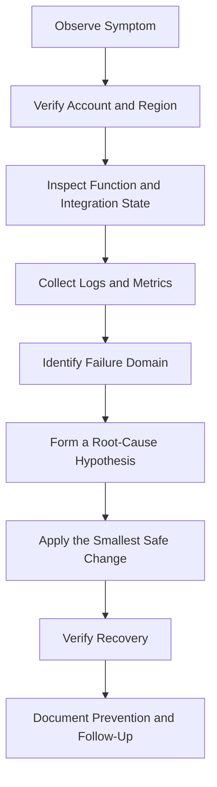

# 14- Troubleshooting Commands and Best Practices

## Overview

AWS Lambda troubleshooting requires correlating function configuration, invocation results, CloudWatch logs, service metrics, event source state, IAM permissions, and downstream dependencies. A successful AWS CLI command confirms that an API operation completed; it does not necessarily confirm that the application is healthy.

This document provides a command-driven diagnostic workflow for common Lambda failures, including runtime errors, timeouts, throttling, authorization failures, networking problems, event source mapping issues, deployment failures, and unexpected costs.

Use the following diagnostic sequence consistently:

**Symptom → Possible causes → Isolation strategy → Diagnostic commands → Root cause verification → Corrective action → Prevention**

The examples use Bash, AWS CLI, and CloudWatch. Replace the example resource names with values from the target environment. Commands are marked as read-only, mutating, or potentially disruptive.

## Establish a Safe Diagnostic Context

Before investigating a production incident, verify the account, Region, function, and caller identity.

### Define environment variables

```bash
PROFILE=dev
REGION=ap-south-1
FUNCTION_NAME=orders-processor
LOG_GROUP="/aws/lambda/$FUNCTION_NAME"
```

Use explicit profile and Region values instead of relying on local defaults.

### Verify the AWS identity

**Operation:** Read-only.

```bash
aws sts get-caller-identity \
  --profile "$PROFILE" \
  --output json
```

Confirm that the returned account ID and principal match the intended environment. Stop if the identity is unexpected.

### Inspect the function configuration

**Operation:** Read-only.

```bash
aws lambda get-function-configuration \
  --function-name "$FUNCTION_NAME" \
  --profile "$PROFILE" \
  --region "$REGION" \
  --query '{
    FunctionName:FunctionName,
    FunctionArn:FunctionArn,
    State:State,
    StateReason:StateReason,
    LastUpdateStatus:LastUpdateStatus,
    LastUpdateStatusReason:LastUpdateStatusReason,
    Runtime:Runtime,
    Handler:Handler,
    MemorySize:MemorySize,
    Timeout:Timeout,
    Role:Role,
    LastModified:LastModified
  }' \
  --output json
```

This identifies basic configuration and lifecycle problems before investigating application code.

### Capture a diagnostic time window

The following commands use GNU `date`, available in common Linux environments and Git Bash or WSL.

```bash
START_TIME=$(date -u -d '30 minutes ago' +%Y-%m-%dT%H:%M:%SZ)
END_TIME=$(date -u +%Y-%m-%dT%H:%M:%SZ)
START_MS=$(($(date -u -d '30 minutes ago' +%s) * 1000))
```

Use a consistent time window when comparing logs and metrics. Account for CloudWatch ingestion delay and the timestamp of the original incident.

## Troubleshoot Handler, Runtime, and Dependency Errors

### Symptoms

- Invocation returns a function error.
- Logs show `Runtime.ImportModuleError`, `Runtime.HandlerNotFound`, or an unhandled exception.
- The function fails during initialization.
- A dependency works locally but fails after deployment.

### Possible causes

- Incorrect handler configuration.
- Missing dependency in the deployment package.
- Incompatible package architecture or native extension.
- Unsupported or deprecated runtime.
- Incorrect ZIP directory structure.
- Import-time code fails before the handler executes.
- Environment variables or required configuration are missing.

### Inspect runtime and handler settings

**Operation:** Read-only.

```bash
aws lambda get-function-configuration \
  --function-name "$FUNCTION_NAME" \
  --profile "$PROFILE" \
  --region "$REGION" \
  --query '{
    Runtime:Runtime,
    Handler:Handler,
    Architectures:Architectures,
    PackageType:PackageType,
    State:State,
    LastUpdateStatus:LastUpdateStatus
  }' \
  --output json
```

For a Python function with handler `app.handler`, the deployment package must contain an importable `app.py` module with a callable named `handler`, unless the package layout or handler configuration intentionally differs.

### Inspect recent logs

**Operation:** Read-only.

```bash
aws logs tail "$LOG_GROUP" \
  --since 30m \
  --format short \
  --profile "$PROFILE" \
  --region "$REGION"
```

Look for initialization failures, import errors, stack traces, and runtime startup messages.

### Inspect the deployment package locally

**Operation:** Read-only local inspection.

```bash
unzip -l dist/function.zip
```

A common packaging mistake is creating an extra directory level:

```text
function.zip
    application/
        app.py
        dependencies/
```

If the handler is configured as `app.handler`, the ZIP normally needs `app.py` at its root unless the function's package layout and handler configuration explicitly account for another structure.

### Corrective action

- Match the configured handler to the actual module and callable.
- Package dependencies for the Lambda runtime and target architecture.
- Test the deployment artifact rather than only the source directory.
- Validate native dependencies in a compatible build environment.
- Verify runtime support and deprecation status in the AWS documentation.

### Prevention

Include artifact inspection, import tests, runtime compatibility checks, and a deployment smoke test in CI/CD.

## Troubleshoot Timeouts and Memory Exhaustion

### Symptoms

- Logs contain `Task timed out`.
- Invocation duration approaches the configured timeout.
- The function reports out-of-memory behavior or terminates unexpectedly.
- Latency increases as traffic grows.

### Possible causes

- Slow database queries or external APIs.
- Insufficient memory for CPU-intensive processing.
- Blocking network calls without appropriate timeouts.
- Excessive data loaded into memory.
- Unbounded retries or inefficient algorithms.
- Downstream connection pool exhaustion.

### Inspect timeout and memory settings

**Operation:** Read-only.

```bash
aws lambda get-function-configuration \
  --function-name "$FUNCTION_NAME" \
  --profile "$PROFILE" \
  --region "$REGION" \
  --query '{
    MemoryMB:MemorySize,
    TimeoutSeconds:Timeout,
    EphemeralStorageMB:EphemeralStorage.Size
  }' \
  --output json
```

### Query duration metrics

**Operation:** Read-only.

```bash
aws cloudwatch get-metric-statistics \
  --namespace AWS/Lambda \
  --metric-name Duration \
  --dimensions Name=FunctionName,Value="$FUNCTION_NAME" \
  --start-time "$START_TIME" \
  --end-time "$END_TIME" \
  --period 60 \
  --statistics Average Maximum \
  --profile "$PROFILE" \
  --region "$REGION" \
  --output table
```

Query maximum memory usage from logs when the runtime's `REPORT` line includes `Max Memory Used`. For example:

```bash
aws logs filter-log-events \
  --log-group-name "$LOG_GROUP" \
  --filter-pattern '"REPORT RequestId"' \
  --start-time "$START_MS" \
  --profile "$PROFILE" \
  --region "$REGION" \
  --query 'events[].message' \
  --output text
```

The exact `REPORT` fields vary by runtime and logging format.

### Corrective action

- Set explicit timeouts on HTTP clients, database drivers, and other blocking operations.
- Investigate slow dependencies before increasing the Lambda timeout.
- Benchmark memory and duration together because Lambda allocates CPU in proportion to configured memory.
- Stream or batch large datasets instead of loading everything into memory.
- Use asynchronous processing for work that does not need to finish within an interactive request.

Increasing the timeout without addressing a slow dependency can increase concurrency pressure because each invocation occupies an execution environment for longer.

## Troubleshoot Cold Starts and Unexpected Latency

### Symptoms

- The first invocation is much slower than subsequent invocations.
- Latency increases after periods of inactivity or deployment.
- A function has acceptable average duration but poor tail latency.

### Possible causes

- Runtime startup and initialization work.
- Large deployment packages or heavy imports.
- Initialization-time network calls.
- VPC networking initialization overhead in applicable execution paths.
- New execution environments created during traffic spikes.
- Provisioned concurrency that is insufficient for demand.

### Inspect duration and initialization logs

**Operation:** Read-only.

```bash
aws logs tail "$LOG_GROUP" \
  --since 30m \
  --format short \
  --profile "$PROFILE" \
  --region "$REGION"
```

Inspect initialization-related messages and `REPORT` lines. Compare invocation duration across warm and newly initialized execution environments where the available telemetry permits.

### Corrective action

- Remove unnecessary dependencies and expensive initialization work.
- Reuse safe clients and connection objects across invocations.
- Avoid retrieving secrets or performing remote calls during initialization unless required.
- Consider provisioned concurrency for predictable low latency.
- Evaluate SnapStart only for supported runtimes and deployment configurations.

Provisioned concurrency has additional charges, and traffic beyond its prepared capacity may use on-demand environments. Do not assume every invocation will avoid initialization latency.

## Troubleshoot Throttling and Concurrency Exhaustion

### Symptoms

- Callers receive throttling responses.
- The `Throttles` metric increases.
- SQS backlogs grow while processing slows.
- Downstream services become overloaded during traffic spikes.

### Possible causes

- Reserved concurrency is too restrictive.
- Account-level concurrency is exhausted.
- The function is scaling faster than the downstream system can handle.
- Invocation bursts or retries increase demand.
- Execution duration rises because of dependency latency.

### Inspect reserved concurrency

**Operation:** Read-only.

```bash
aws lambda get-function-concurrency \
  --function-name "$FUNCTION_NAME" \
  --profile "$PROFILE" \
  --region "$REGION"
```

### Inspect account concurrency

**Operation:** Read-only.

```bash
aws lambda get-account-settings \
  --profile "$PROFILE" \
  --region "$REGION" \
  --query '{
    AccountLimit:AccountLimit,
    AccountUsage:AccountUsage
  }' \
  --output json
```

### Query throttling metrics

**Operation:** Read-only.

```bash
aws cloudwatch get-metric-statistics \
  --namespace AWS/Lambda \
  --metric-name Throttles \
  --dimensions Name=FunctionName,Value="$FUNCTION_NAME" \
  --start-time "$START_TIME" \
  --end-time "$END_TIME" \
  --period 60 \
  --statistics Sum \
  --profile "$PROFILE" \
  --region "$REGION" \
  --output table
```

### Corrective action

- Identify whether the constraint is function-level, account-level, or source-specific.
- Review `Duration` and downstream latency before increasing capacity.
- Adjust reserved concurrency only after calculating downstream capacity.
- For supported event sources, consider mapping-level scaling controls.
- Use queue-based backpressure for background workloads.
- Request a service quota increase when evidence shows that the account quota is the limiting factor.

Increasing concurrency blindly can move the bottleneck to PostgreSQL, Redis, or an external API.

## Troubleshoot IAM Authorization and Invocation Permissions

### Symptoms

- The caller receives `AccessDeniedException`.
- The function starts but cannot access S3, DynamoDB, Secrets Manager, or another dependency.
- An AWS service cannot invoke the function.
- An API integration returns a permission-related error.

### Identify the authorization boundary

Lambda access failures usually fall into one of these categories:

| Failure | Permission boundary to inspect |
|---|---|
| Caller cannot invoke Lambda | Caller identity policy and applicable resource policy |
| S3, DynamoDB, or another dependency rejects the function | Lambda execution role and dependency resource policy |
| Event source cannot invoke the function | Event source mapping configuration and relevant service permissions |
| Cross-account invocation fails | Caller permissions, function resource policy, and applicable organization controls |
| Secret retrieval fails | Execution role, secret resource policy, KMS permissions where applicable, and secret configuration |

### Inspect the execution role

**Operation:** Read-only.

```bash
aws lambda get-function-configuration \
  --function-name "$FUNCTION_NAME" \
  --profile "$PROFILE" \
  --region "$REGION" \
  --query '{
    FunctionArn:FunctionArn,
    ExecutionRole:Role
  }' \
  --output json
```

### Inspect the function resource policy

**Operation:** Read-only.

```bash
aws lambda get-policy \
  --function-name "$FUNCTION_NAME" \
  --profile "$PROFILE" \
  --region "$REGION" \
  --output json
```

The command may return a resource-not-found error if no resource-based policy exists. Whether one is needed depends on the invocation path and principal.

### Corrective action

- Identify the exact denied API action and resource ARN.
- Check the execution role's trust policy and permissions.
- Inspect identity policies, resource policies, permission boundaries, service control policies, and relevant KMS policies.
- Grant only the required permissions.
- Verify the fix by repeating the original operation.

Avoid attaching broad administrator permissions as a troubleshooting shortcut.

## Troubleshoot API Gateway and Function URL Errors

### Symptoms

- API Gateway returns `500`, `502`, or an authorization error.
- A function URL returns an unexpected status.
- Direct invocation succeeds, but HTTP requests fail.
- HTTP requests time out even though Lambda logs show successful execution.

### Possible causes

- Incorrect integration configuration.
- Lambda invocation permission is missing.
- The handler returns an invalid proxy response.
- The request or response payload exceeds an applicable limit.
- API Gateway, the client, and Lambda have different timeout behavior.
- Function URL authentication configuration does not match the caller's authorization.

### Inspect the function configuration

**Operation:** Read-only.

```bash
aws lambda get-function-configuration \
  --function-name "$FUNCTION_NAME" \
  --profile "$PROFILE" \
  --region "$REGION" \
  --query '{
    FunctionArn:FunctionArn,
    Timeout:Timeout,
    State:State,
    LastUpdateStatus:LastUpdateStatus
  }' \
  --output json
```

### Inspect resource permissions

**Operation:** Read-only.

```bash
aws lambda get-policy \
  --function-name "$FUNCTION_NAME" \
  --profile "$PROFILE" \
  --region "$REGION" \
  --output json
```

### Inspect function URL configuration

**Operation:** Read-only.

```bash
aws lambda get-function-url-config \
  --function-name "$FUNCTION_NAME" \
  --profile "$PROFILE" \
  --region "$REGION" \
  --output json
```

If the function URL uses a qualifier, inspect the corresponding qualified configuration. A function URL may not exist, in which case the command can return a resource-not-found error.

### Corrective action

- Inspect API Gateway execution logs and access logs when available.
- Validate the handler's expected event shape and response format.
- Verify authentication and invocation permissions for the specific integration.
- Compare integration timeout limits with Lambda and client timeouts.
- Test the HTTP path end to end rather than relying exclusively on direct Lambda invocation.

Do not disable authentication or broaden invocation permissions as a temporary fix without understanding the exposure.

## Troubleshoot VPC Connectivity and Database Failures

### Symptoms

- Lambda times out when connecting to PostgreSQL or another private service.
- DNS resolution fails.
- External API calls fail only after attaching the function to a VPC.
- Database connections are exhausted under load.

### Possible causes

- Incorrect subnet or route-table configuration.
- Security groups block required traffic.
- DNS configuration or private hosted zone issues.
- Missing outbound connectivity to public endpoints.
- Required VPC endpoints are absent.
- Database connection count exceeds capacity.
- Connection leaks or overly aggressive retries.

### Inspect VPC configuration

**Operation:** Read-only.

```bash
aws lambda get-function-configuration \
  --function-name "$FUNCTION_NAME" \
  --profile "$PROFILE" \
  --region "$REGION" \
  --query 'VpcConfig' \
  --output json
```

Review subnet IDs, security group IDs, and VPC configuration status.

### Inspect the network resources

**Operation:** Read-only.

```bash
aws ec2 describe-subnets \
  --subnet-ids subnet-0123456789abcdef0 \
  --profile "$PROFILE" \
  --region "$REGION" \
  --output json
```

```bash
aws ec2 describe-security-groups \
  --group-ids sg-0123456789abcdef0 \
  --profile "$PROFILE" \
  --region "$REGION" \
  --output json
```

Replace the example IDs with the actual subnet and security group IDs returned by the function configuration.

Inspect route tables and network ACLs when needed. A subnet having a public IP route does not automatically give a Lambda execution environment public internet access. Outbound access depends on the VPC architecture and appropriate egress path.

### Corrective action

- Validate the route from the Lambda subnet to the destination.
- Confirm that security groups allow required traffic and return traffic is supported.
- Verify DNS resolution and private endpoint configuration.
- Configure NAT or service endpoints where appropriate.
- Use connection reuse and bounded connection pools.
- Consider RDS Proxy for supported relational database workloads.
- Limit concurrency according to the database's connection budget.

Do not open database access to `0.0.0.0/0` to resolve a connectivity problem.

## Troubleshoot Event Source Mappings and Batch Processing

### Symptoms

- An event source mapping is disabled or stuck in a non-enabled state.
- SQS backlog or stream iterator age increases.
- Messages are processed repeatedly.
- A single bad record causes an entire batch to fail.

### Possible causes

- Missing source permissions.
- Invalid event source configuration.
- Handler errors or malformed records.
- Visibility timeout shorter than required processing and retry behavior.
- Incorrect batch size or batching window.
- Partial batch failure handling is not configured or implemented correctly.
- Downstream throttling or poison messages.

### Inspect mappings

**Operation:** Read-only.

```bash
aws lambda list-event-source-mappings \
  --function-name "$FUNCTION_NAME" \
  --profile "$PROFILE" \
  --region "$REGION" \
  --query 'EventSourceMappings[].{
    UUID:UUID,
    State:State,
    EventSourceArn:EventSourceArn,
    BatchSize:BatchSize,
    LastProcessingResult:LastProcessingResult
  }' \
  --output table
```

### Inspect a mapping in detail

```bash
MAPPING_UUID='replace-with-event-source-mapping-uuid'
```

**Operation:** Read-only.

```bash
aws lambda get-event-source-mapping \
  --uuid "$MAPPING_UUID" \
  --profile "$PROFILE" \
  --region "$REGION" \
  --output json
```

### Corrective action

- Inspect the mapping state, source ARN, batch settings, and processing result.
- Validate the event schema and handler's batch response contract.
- Configure partial batch responses for supported sources when appropriate.
- Use dead-letter handling or failure destinations according to the invocation model.
- Tune visibility timeout, batching, and concurrency based on the source's semantics.
- Make processing idempotent because retries and duplicate delivery can occur.

Do not assume all event sources use the same retry, ordering, checkpoint, or failure behavior. Follow the documentation for the specific source.

## Troubleshoot Duplicate Events and Failed Asynchronous Invocations

### Symptoms

- The same business operation occurs more than once.
- Asynchronous events are delayed or dropped.
- Failed records are retried unexpectedly.
- A downstream side effect succeeds even though the invocation is reported as failed.

### Possible causes

- At-least-once delivery.
- The handler performs a side effect before failing.
- Retry behavior is misunderstood.
- The idempotency key is unstable or incomplete.
- Event source mapping checkpoints or batch failures are misconfigured.
- Asynchronous retry limits or failure destinations are not configured appropriately.

### Inspect asynchronous invocation configuration

**Operation:** Read-only.

```bash
aws lambda get-function-event-invoke-config \
  --function-name "$FUNCTION_NAME" \
  --profile "$PROFILE" \
  --region "$REGION" \
  --output json
```

This inspects asynchronous invocation settings. It does not replace inspection of event source mapping configuration for SQS, streams, or other sources that use event source mappings.

### Corrective action

- Implement idempotency using a stable business or event identifier.
- Persist the idempotency record atomically with the relevant business state where possible.
- Configure retries and failure destinations according to the invocation model.
- Ensure consumers tolerate duplicate events.
- Inspect the source-specific delivery and checkpoint semantics before changing retry behavior.

Exactly-once business outcomes generally require application-level deduplication or transactional design; they should not be inferred from successful Lambda invocation.

## Troubleshoot Deployment and Package Errors

### Symptoms

- Code update fails.
- A published version does not contain the expected code.
- Container-image deployment fails.
- The function is stuck in an update state.

### Possible causes

- Invalid ZIP package or container image.
- Unsupported architecture or runtime.
- Incorrect ECR repository, image tag, or permissions.
- Incomplete deployment artifact.
- Concurrent deployment operations.
- Invalid function configuration.

### Inspect the current update status

**Operation:** Read-only.

```bash
aws lambda get-function-configuration \
  --function-name "$FUNCTION_NAME" \
  --profile "$PROFILE" \
  --region "$REGION" \
  --query '{
    State:State,
    StateReason:StateReason,
    LastUpdateStatus:LastUpdateStatus,
    LastUpdateStatusReason:LastUpdateStatusReason,
    CodeSha256:CodeSha256,
    PackageType:PackageType,
    Architectures:Architectures
  }' \
  --output json
```

### Inspect the deployed artifact metadata

**Operation:** Read-only.

```bash
aws lambda get-function \
  --function-name "$FUNCTION_NAME" \
  --profile "$PROFILE" \
  --region "$REGION" \
  --query '{
    Configuration:{
      Runtime:Configuration.Runtime,
      PackageType:Configuration.PackageType,
      Architectures:Configuration.Architectures,
      LastModified:Configuration.LastModified,
      CodeSha256:Configuration.CodeSha256
    },
    Code:Code
  }' \
  --output json
```

The `Code` response may contain temporary download URLs or image metadata. Treat the complete response as operationally sensitive and avoid logging it unnecessarily.

### Corrective action

- Validate the artifact locally before upload.
- Confirm package architecture and runtime compatibility.
- Inspect ECR permissions and image architecture for container-based functions.
- Wait for the previous update to complete before starting another update.
- Verify the published version and alias after deployment.

## Troubleshoot Missing Logs and Metrics

### Symptoms

- No CloudWatch logs appear.
- Metric queries return no datapoints.
- The function succeeds but operational dashboards remain empty.
- Tracing data is absent.

### Possible causes

- The function has not been invoked.
- Wrong Region or log group name.
- The execution role lacks required logging permissions.
- Logs have not yet been delivered.
- Metric dimensions do not match the emitted metrics.
- Tracing is not enabled or instrumentation is incomplete.

### Inspect the log group

**Operation:** Read-only.

```bash
aws logs describe-log-groups \
  --log-group-name-prefix "$LOG_GROUP" \
  --profile "$PROFILE" \
  --region "$REGION" \
  --query 'logGroups[].{
    Name:logGroupName,
    RetentionDays:retentionInDays
  }' \
  --output table
```

### Inspect tracing configuration

**Operation:** Read-only.

```bash
aws lambda get-function-configuration \
  --function-name "$FUNCTION_NAME" \
  --profile "$PROFILE" \
  --region "$REGION" \
  --query 'TracingConfig' \
  --output json
```

### Corrective action

- Verify that the function was invoked in the selected time window.
- Confirm log group and Region.
- Inspect execution-role logging permissions.
- Validate the exact metric namespace and dimensions.
- Confirm tracing configuration and instrumentation.
- Account for ingestion delay before concluding that telemetry is missing.

Do not interpret an empty metric query as proof that no failures occurred.

## Troubleshoot Unexpected Costs and Invocation Spikes

### Symptoms

- Lambda charges rise unexpectedly.
- Invocation count increases without an intentional traffic change.
- CloudWatch Logs storage grows rapidly.
- A recursive invocation loop is suspected.

### Possible causes

- Traffic spikes or repeated client requests.
- Retry storms.
- S3 event recursion or other circular event-driven flows.
- Excessive logging.
- High execution duration or memory allocation.
- Provisioned concurrency left enabled after testing.
- Background queues accumulating and later draining rapidly.

### Inspect function configuration

**Operation:** Read-only.

```bash
aws lambda get-function-configuration \
  --function-name "$FUNCTION_NAME" \
  --profile "$PROFILE" \
  --region "$REGION" \
  --query '{
    MemorySize:MemorySize,
    Timeout:Timeout,
    State:State,
    LastModified:LastModified
  }' \
  --output json
```

### Inspect invocation count

**Operation:** Read-only.

```bash
aws cloudwatch get-metric-statistics \
  --namespace AWS/Lambda \
  --metric-name Invocations \
  --dimensions Name=FunctionName,Value="$FUNCTION_NAME" \
  --start-time "$START_TIME" \
  --end-time "$END_TIME" \
  --period 60 \
  --statistics Sum \
  --profile "$PROFILE" \
  --region "$REGION" \
  --output table
```

Compare invocation count with errors, duration, event source activity, and application request volume.

### Corrective action

- Identify the source of invocation growth.
- Stop recursive event paths safely when necessary.
- Review retries, queue backlogs, and client retry policies.
- Remove unnecessary provisioned concurrency.
- Apply log retention and appropriate logging levels.
- Use billing and cost-management tools to investigate actual charges.

Disabling or setting reserved concurrency to zero can halt processing but may create throttling, backlog growth, or failed requests. Treat it as a controlled containment action, not a routine cost-optimization technique.

## Production Troubleshooting Best Practices

### Use evidence before changing configuration

Follow a consistent investigation sequence:



### Recommended practices

- **Use read-only commands first.** Avoid changing concurrency, IAM policies, or event source mappings until the failure domain is understood.
- **Correlate logs and metrics.** A single error message rarely explains the full failure path.
- **Keep changes reversible.** Record previous configuration and define rollback steps before modifying production resources.
- **Use least privilege.** Avoid broad IAM changes to bypass an authorization error.
- **Make event processing idempotent.** Retries and duplicate delivery are normal possibilities in distributed systems.
- **Protect downstream dependencies.** Use connection pooling, explicit timeouts, bounded retries, and concurrency limits.
- **Monitor the source as well as the function.** Queue depth and stream iterator age may reveal problems before Lambda error metrics do.
- **Automate repeatable checks.** Use JSON output, explicit exit-code handling, and account allowlists.
- **Control diagnostic data.** Logs, function configuration, and CLI responses can contain sensitive information.
- **Document incident outcomes.** Record the symptom, root cause, corrective action, verification evidence, and preventive change.

## Key Takeaways

- Verify the AWS identity, Region, function state, and deployment configuration before investigating application failures.
- Use CloudWatch logs, Lambda metrics, event source mapping state, and downstream telemetry together to identify root causes.
- Distinguish invocation failures, throttling, networking errors, and event-processing failures before changing configuration.
- Design for duplicate events, retries, and downstream limits using idempotency, bounded retries, and deliberate concurrency controls.
- Prefer the smallest reversible corrective action, verify recovery with evidence, and turn recurring incidents into automated checks and preventive controls.