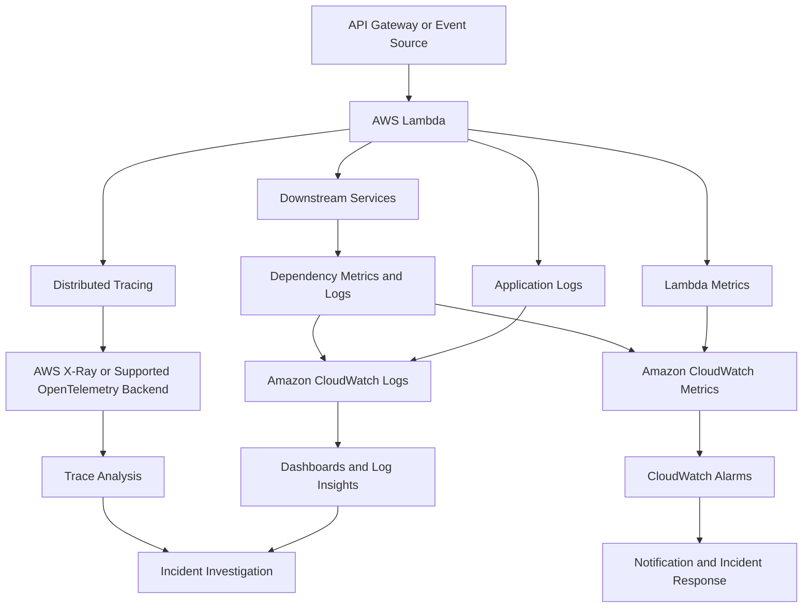

# 01- Monitoring, Logging and Observability

## Overview

Monitoring, logging, and observability are essential for operating AWS Lambda workloads reliably in production. They help engineers understand application behavior, detect failures, investigate latency, identify capacity constraints, and verify business outcomes across distributed serverless architectures.

Lambda automatically integrates with Amazon CloudWatch for execution metrics and logging. Additional capabilities, including AWS X-Ray, OpenTelemetry instrumentation, CloudWatch alarms, and application-level telemetry, provide deeper visibility when required.

These capabilities serve different purposes:

- **Monitoring** tracks known signals against expected operational behavior and alerts when thresholds or service-level objectives are violated.
- **Logging** records contextual events that explain what happened during an invocation.
- **Observability** combines metrics, logs, traces, and application context to investigate behavior that was not fully anticipated.

For a production backend, visibility must extend beyond the Lambda function itself. An invocation can succeed while a business operation fails downstream, a queue backlog grows, or an external dependency becomes too slow.

## Observability Architecture

A practical architecture combines AWS-managed telemetry with application-level signals.



The exact telemetry pipeline depends on the runtime, instrumentation libraries, integration, and deployment configuration. Do not assume that installing a tracing library automatically enables every form of trace propagation or exports all telemetry.

## CloudWatch Metrics

### Lambda service metrics

AWS Lambda publishes invocation and execution metrics to CloudWatch. These metrics help identify function-level failures, latency, throttling, and capacity constraints.

| Metric | What it indicates | Operational use |
|---|---|---|
| `Invocations` | Number of function executions counted by Lambda | Understand workload volume and traffic changes |
| `Errors` | Invocations that ended in function errors | Detect application failures and runtime errors |
| `Duration` | Execution duration for invocations | Track latency, regressions, and performance |
| `Throttles` | Invocation requests throttled by Lambda | Identify concurrency or quota constraints |
| `ConcurrentExecutions` | Number of concurrent executions | Understand capacity utilization |
| `UnreservedConcurrentExecutions` | Account-level unreserved concurrency utilization | Investigate shared concurrency pressure |
| `DeadLetterErrors` | Failures sending asynchronous invocation records to a configured dead-letter queue | Detect problems with failure delivery |
| `DestinationDeliveryFailures` | Failures delivering asynchronous invocation records to configured destinations | Detect destination configuration or delivery problems |

Metric availability and dimensions depend on the metric and integration. Confirm the applicable definitions in CloudWatch and Lambda documentation before using a metric in an alert.

### Important metric interpretation

**Errors are not the same as throttles.** Throttling generally means Lambda did not accept an invocation for execution under the applicable concurrency or rate constraints. Function errors indicate execution failures. Monitor them separately.

**Duration averages can hide tail latency.** Use appropriate percentile statistics, such as p95 and p99, for latency-sensitive workloads. Lambda's `Duration` metric supports percentile statistics, subject to the metric's supported statistics and dimensions.

**Invocation counts do not prove business success.** A function may return successfully after accepting work into a queue while the downstream processing later fails. Track business outcomes and asynchronous processing health separately.

**Metrics can have different dimensions.** Function-level metrics, alias-qualified metrics, and event-source metrics answer different questions. Use dimensions that match the production traffic path being investigated.

### Querying Lambda metrics with AWS CLI

The following read-only command retrieves invocation counts for the previous hour.

```bash
aws cloudwatch get-metric-statistics \
  --namespace AWS/Lambda \
  --metric-name Invocations \
  --dimensions Name=FunctionName,Value=orders-api \
  --start-time "$(date -u -d '1 hour ago' +%Y-%m-%dT%H:%M:%SZ)" \
  --end-time "$(date -u +%Y-%m-%dT%H:%M:%SZ)" \
  --period 300 \
  --statistics Sum \
  --output json
```

Replace `orders-api` with the deployed function name. The example uses GNU `date`, which is common on Linux; Windows PowerShell and other environments require equivalent timestamp generation.

The command returns five-minute invocation totals for the requested interval when corresponding data is available. An empty result does not necessarily indicate a problem: the function might not have been invoked, metrics might not yet be available, or the selected dimensions might not match the metric.

## Structured Logging

### Why structured logs matter

Unstructured logs are readable but difficult to query consistently across thousands of invocations. Structured logging stores events as machine-readable fields, typically JSON, allowing CloudWatch Logs Insights to filter, aggregate, and correlate events.

A useful application log event may contain:

- Timestamp
- Severity level
- Message or event name
- Lambda request ID
- Business correlation ID
- Operation name
- Relevant resource identifier
- Duration or outcome
- Error classification

Do not log entire event payloads by default. API requests, queue messages, and database records may contain secrets, tokens, personal information, or large payloads.

### Python logging example

The following example uses Python's standard logging library. It emits a structured JSON message and includes the Lambda request ID without logging the incoming event.

```python
import json
import logging
import os
from typing import Any

logger = logging.getLogger()
logger.setLevel(os.getenv("LOG_LEVEL", "INFO").upper())


def lambda_handler(event: dict[str, Any], context: Any) -> dict[str, Any]:
    correlation_id = (
        event.get("headers", {}).get("x-correlation-id")
        if isinstance(event.get("headers"), dict)
        else None
    )

    logger.info(
        json.dumps(
            {
                "event": "order_request_received",
                "request_id": context.aws_request_id,
                "correlation_id": correlation_id,
                "function_name": context.function_name,
            }
        )
    )

    try:
        # Invoke the application's business logic here.
        result = {"status": "accepted"}

        logger.info(
            json.dumps(
                {
                    "event": "order_request_completed",
                    "request_id": context.aws_request_id,
                    "correlation_id": correlation_id,
                    "outcome": "success",
                }
            )
        )

        return result

    except Exception:
        logger.exception(
            json.dumps(
                {
                    "event": "order_request_failed",
                    "request_id": context.aws_request_id,
                    "correlation_id": correlation_id,
                    "outcome": "failure",
                }
            )
        )
        raise
```

This example demonstrates structured fields and exception logging. For a larger application, prefer a logging library or logging adapter that consistently produces JSON, controls field serialization, and prevents accidental inclusion of sensitive values.

Important considerations:

- Configure log levels explicitly for each environment.
- Do not catch an exception and return success when the invocation should be retried or reported as failed.
- Avoid logging the same exception at every layer unless each layer adds useful context.
- Sanitize untrusted input before including it in logs.
- Treat correlation IDs supplied by external callers as untrusted values.
- Ensure logging failures or excessive log volume do not unnecessarily disrupt business processing.

### Lambda logging configuration

Lambda supports configurable application logging behavior for supported runtimes. Depending on the runtime and configuration, you can configure log format, log level, and application/system log levels.

For Python, use a supported JSON logging configuration when appropriate and verify how the selected runtime serializes standard-library logging output. Avoid assuming that manually serializing JSON is always necessary or that every runtime handles structured logs identically.

## CloudWatch Logs

Lambda sends logs to CloudWatch Logs when the function's execution role has the required permissions and logging is configured appropriately.

The default log group name for a function is:

```text
/aws/lambda/<function-name>
```

A typical log stream represents activity from a particular execution environment over time. Logs may include platform-generated messages, application messages, and invocation reports depending on runtime and logging configuration.

### Log retention

Set an explicit retention period that balances operational needs, audit requirements, and cost. Retaining logs indefinitely can increase storage costs and may conflict with data-retention policies.

Inspect the log group:

```bash
aws logs describe-log-groups \
  --log-group-name-prefix /aws/lambda/orders-api \
  --query 'logGroups[].{
    Name:logGroupName,
    Retention:retentionInDays,
    StoredBytes:storedBytes
  }' \
  --output table
```

This is a read-only command.

If no retention policy is configured, logs are generally retained indefinitely until deleted. Set retention deliberately rather than relying on defaults.

### Querying logs with Logs Insights

CloudWatch Logs Insights supports filtering, aggregation, and analysis across selected log groups.

Example: identify application events reporting failures in a structured logging format.

```text
fields @timestamp, @message
| filter @message like /order_request_failed/
| sort @timestamp desc
| limit 100
```

Example: examine slow Lambda invocations using platform report messages.

```text
filter @type = "REPORT"
| fields @timestamp, @requestId, @duration, @billedDuration, @maxMemoryUsed
| sort @duration desc
| limit 50
```

The available fields depend on the log format and runtime. Validate the query against actual log events before relying on it in a runbook.

### Logs Insights operational practices

- Scope queries to the relevant function, environment, and time interval.
- Filter early to reduce the amount of data scanned.
- Use stable structured fields rather than fragile text matching where possible.
- Save frequently used queries for incident response.
- Avoid queries that expose sensitive data unnecessarily.
- Account for log ingestion and query-scan costs when designing operational dashboards.

## Application-Level Metrics

AWS-managed Lambda metrics describe the execution platform, but production services also need business and dependency metrics.

Examples include:

- Orders accepted and orders completed
- Payment authorization failures
- Messages processed and permanently rejected
- External API latency and error rates
- Database connection failures
- Records skipped or quarantined
- Age of the oldest unprocessed message
- Workflow completion time

Choose metrics that correspond to actual business and operational objectives.

For a queue-driven workload, a low Lambda error rate does not prove that the queue is healthy. A steadily increasing queue age may indicate that consumers are unable to keep up with incoming work.

### Avoid unbounded metric dimensions

Metric dimensions such as request IDs, user IDs, and unique order IDs can create excessive metric cardinality and cost. Keep high-cardinality identifiers in logs and traces; use bounded dimensions for aggregated metrics.

For example, `operation=payment_authorization` and `outcome=failure` are usually more appropriate metric dimensions than `order_id=ord-12345`.

## Distributed Tracing

### Purpose

Distributed tracing follows a request or operation across service boundaries. It is useful when a single user operation involves API Gateway, Lambda, databases, queues, and external services.

Tracing helps answer questions such as:

- Which dependency contributes most to latency?
- Where did a request fail?
- Did a request reach the downstream service?
- Which operations are correlated with a slow response?

### AWS X-Ray and OpenTelemetry

AWS X-Ray provides trace collection and analysis capabilities for supported AWS integrations and instrumented applications. OpenTelemetry provides vendor-neutral APIs, SDKs, and instrumentation for generating and exporting telemetry.

These approaches can complement CloudWatch logs and metrics. Their configuration, supported integrations, export destinations, sampling behavior, and runtime requirements differ.

Before implementing tracing, verify:

- Supported instrumentation for the chosen Python runtime and libraries.
- Whether tracing is enabled at the Lambda and integration levels.
- Required IAM permissions and telemetry destinations.
- Trace propagation across HTTP and asynchronous boundaries.
- Sampling behavior and the possibility that some requests will not have recorded traces.
- Data retention, sensitive attributes, and telemetry costs.

### Correlation across asynchronous boundaries

An asynchronous operation may execute after the original HTTP request has completed. The original request ID is therefore not sufficient to correlate the entire workflow.

Propagate an application-level correlation ID through message attributes or payload metadata where appropriate. Preserve the relationship between the originating operation and the downstream work without treating a correlation ID as an authorization credential.

For distributed workflows, use a combination of correlation IDs, event identifiers, structured logs, and traces. Each serves a different purpose.

## Alarms and Service-Level Objectives

### Alert on actionable conditions

Create alarms for conditions that require investigation or action rather than alerting on every individual error.

| Signal | Potential alert condition | Operational response |
|---|---|---|
| Error rate | Errors exceed the acceptable baseline | Investigate code, dependencies, and recent deployments |
| Duration | p95 or p99 latency violates the service objective | Inspect initialization, dependency latency, and resource allocation |
| Throttles | Throttling affects expected workload | Review concurrency limits, traffic, and downstream capacity |
| Queue age | Oldest message exceeds processing objective | Investigate consumer throughput, failures, and backlog |
| DLQ activity | Messages enter the dead-letter queue | Inspect failed messages and establish safe recovery |
| Business failures | Critical operation success rate falls below target | Investigate application and dependency behavior |
| Logging or telemetry delivery | Observability data is missing or incomplete | Validate permissions, configuration, and telemetry pipeline |

Thresholds should be derived from workload behavior, error budgets, and service-level objectives. A fixed threshold that is appropriate for one function may be noisy or ineffective for another.

### Error rate and low traffic

Raw error counts can be misleading. One error in a low-volume function may be significant, while a larger absolute error count may be normal for a high-volume service.

Where appropriate, monitor both absolute errors and the proportion of failed invocations. Use metric math or application-level metrics to derive ratios, and handle low-traffic periods carefully to avoid misleading alerts.

### Composite operational view

For critical workloads, correlate Lambda metrics with:

- API Gateway latency and integration errors
- SQS queue depth and oldest-message age
- DynamoDB throttling and latency
- Database connection saturation
- External API failures
- Business completion and failure rates

A dashboard should help an operator determine whether the problem originates in Lambda, the caller, a downstream dependency, or the event-processing pipeline.

## Security and Privacy

Observability systems can become a secondary source of sensitive-data exposure.

Apply the following controls:

- Never log credentials, authorization headers, session tokens, or secret values.
- Redact or omit personal information unless its collection is necessary and approved.
- Restrict CloudWatch log and trace access through IAM.
- Configure retention according to regulatory and business requirements.
- Use encryption and applicable organizational controls for telemetry storage.
- Review telemetry exported to third-party observability platforms.
- Avoid putting secrets or personal information into metric dimensions.
- Ensure debugging settings do not expose internal details to API clients.
- Audit changes to logging permissions and observability configuration.

Do not use production payload dumps as the default debugging strategy. Prefer narrowly scoped diagnostic fields and controlled access to the underlying business records.

## Performance and Cost Considerations

Observability has a cost and can affect execution performance.

Important cost drivers include:

- Log ingestion volume
- Log storage and retention
- Logs Insights data scanned
- Custom metrics and metric dimensions
- Trace ingestion and retention
- Extensions and telemetry exporters
- Additional network traffic to external telemetry systems

Reduce unnecessary debug logs, avoid repeated serialization of large objects, and keep telemetry payloads bounded. Use sampling where supported and appropriate, but ensure the sampling strategy remains compatible with incident investigation and compliance requirements.

For latency-sensitive functions, evaluate the effect of logging, tracing, and extensions under realistic load. Do not disable all telemetry simply to reduce cost; establish the minimum visibility needed to operate the workload safely.

## Troubleshooting Observability Failures

Use a consistent diagnostic sequence: identify the missing signal, inspect configuration and permissions, reproduce the behavior, verify the cause, and implement a corrective action.

| Symptom | Possible causes | Verification and corrective action |
|---|---|---|
| No CloudWatch logs | Missing log permissions, incorrect log group, or function has not been invoked | Inspect execution-role policies, invoke the function, and inspect the expected log group |
| Logs appear after a delay | Delivery or ingestion delay, high volume, or querying the wrong time range | Expand the query interval and verify recent log streams |
| Logs exist but are difficult to query | Unstructured messages or inconsistent fields | Standardize JSON fields and validate Logs Insights queries |
| Error alarms do not trigger | Incorrect metric dimensions, statistic, period, threshold, or alarm state configuration | Inspect the metric and alarm configuration, then test the alarm path |
| Tracing is incomplete | Sampling, missing instrumentation, unsupported propagation, or exporter issues | Verify tracing configuration and follow the request across each integration |
| Logging costs increase unexpectedly | Excessive debug output, large payloads, or high invocation volume | Review ingestion volume, retention, and top log-producing functions |
| Application succeeds but work remains incomplete | Metrics capture invocation success but not business completion | Add business-level outcome metrics and monitor queues or workflows |

### Inspect recent log events

```bash
aws logs filter-log-events \
  --log-group-name /aws/lambda/orders-api \
  --start-time "$(($(date +%s) - 3600))000" \
  --filter-pattern '"ERROR"' \
  --limit 50 \
  --output json
```

This read-only command searches recent events containing the `ERROR` term. The timestamp conversion uses GNU-compatible shell syntax. Adapt it for other shells, and remember that a text filter may miss errors that are recorded with different severity names or formats.

### Inspect an alarm

```bash
aws cloudwatch describe-alarms \
  --alarm-name-prefix orders-api \
  --query 'MetricAlarms[].{
    Name:AlarmName,
    State:StateValue,
    Reason:StateReason,
    Metric:MetricName,
    Namespace:Namespace
  }' \
  --output table
```

This is a read-only command. Verify the alarm's dimensions, evaluation periods, statistic, threshold, and missing-data behavior when investigating false positives or missing alerts.

## Production Observability Checklist

### Logging

- [ ] Application logs use consistent fields and appropriate severity levels.
- [ ] Lambda request IDs and business correlation IDs are available.
- [ ] Exceptions include useful diagnostic context without exposing sensitive data.
- [ ] Log retention and access permissions are explicitly configured.
- [ ] Common incident queries are documented and tested.

### Metrics and alarms

- [ ] Invocation count, errors, duration, and throttles are monitored where relevant.
- [ ] Percentile latency is monitored for latency-sensitive workloads.
- [ ] Downstream dependency health and capacity are observable.
- [ ] Business-level success and failure signals exist for critical operations.
- [ ] Queue backlog, message age, and DLQ activity are monitored for asynchronous workloads.
- [ ] Alerts have defined thresholds, owners, and response procedures.

### Tracing

- [ ] Tracing is enabled where it materially improves diagnosis.
- [ ] Correlation metadata is propagated across relevant service boundaries.
- [ ] Sampling and telemetry delivery behavior are understood.
- [ ] Traces do not contain unnecessary sensitive data.
- [ ] Operators can correlate logs, metrics, and traces during incidents.

### Operations and cost

- [ ] Dashboards support common failure investigations.
- [ ] Alarm notification paths have been tested.
- [ ] Telemetry retention and ingestion costs are reviewed.
- [ ] Missing telemetry is detectable for critical workloads.
- [ ] Runbooks explain how to inspect logs, metrics, traces, and downstream dependencies.

## Key Takeaways

- CloudWatch metrics, structured logs, distributed traces, and business-level signals provide complementary views of Lambda workload health.
- Lambda invocation success alone does not prove that asynchronous work or the overall business operation completed successfully.
- Design telemetry for correlation, actionable alerts, privacy, and bounded cost rather than maximizing log volume.
- Validate metric dimensions, log permissions, trace propagation, alarm behavior, and retention in the deployed environment.
- Production observability is complete only when operators can detect failures, isolate their causes, and follow documented recovery procedures.