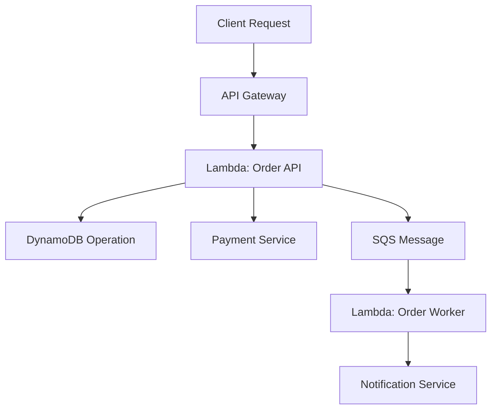
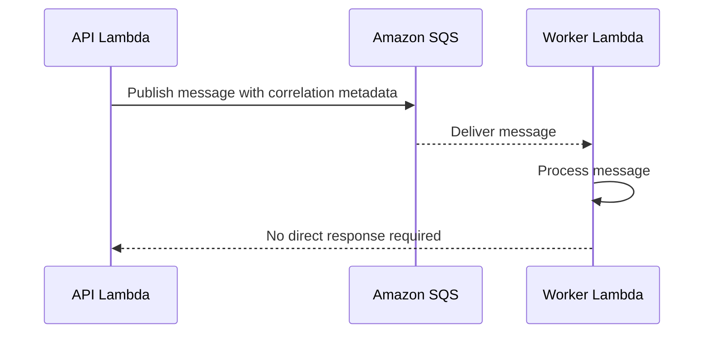

# 02- AWS X-Ray and Distributed Tracing

## Overview

Distributed tracing helps engineers understand how a request travels across multiple services, where latency accumulates, and which component causes a failure. In AWS Lambda architectures, a single business operation may involve API Gateway, Lambda functions, Amazon SQS, DynamoDB, external APIs, and Step Functions. Logs and metrics from individual components are useful, but they may not reveal the complete execution path.

AWS X-Ray provides distributed tracing capabilities for supported AWS services and instrumented applications. OpenTelemetry provides vendor-neutral APIs, SDKs, and instrumentation that can export telemetry to compatible backends.

For production systems, tracing should complement—not replace—structured logging, metrics, correlation identifiers, and business-level monitoring.

## Distributed Tracing Fundamentals

### Traces, spans, and context propagation

A **trace** represents a distributed operation. A **span** represents an individual operation within that trace, such as an HTTP request, a database query, or a downstream service call.

A trace can contain multiple spans connected through parent-child relationships or other supported span relationships.

| Concept | Purpose | Example |
|---|---|---|
| Trace | Represents a complete distributed operation | Processing an order request |
| Span | Represents one operation within the trace | Calling a payment provider |
| Trace ID | Identifies a trace | Correlates operations across services |
| Span ID | Identifies an individual span | Identifies a database query operation |
| Parent span | Represents the operation that initiated another span | An API handler calling a service |
| Context propagation | Carries trace context across service boundaries | HTTP trace headers |
| Sampling | Determines which operations are recorded | Recording a percentage of requests |

A typical request path looks like this:



The synchronous calls can often be represented as a connected trace when the integrations and instrumentation support propagation. Asynchronous boundaries require additional care: the producer and consumer may execute at different times, and trace relationships depend on the event source and instrumentation.

Do not assume every asynchronous operation will automatically appear as a single continuous trace.

### Why tracing matters

Distributed tracing is particularly useful when:

- API latency increases but Lambda duration alone does not explain the delay.
- A downstream dependency is slow or intermittently failing.
- Requests cross multiple independently deployed services.
- An error occurs only in a subset of distributed workflows.
- Engineers need to distinguish application execution time from downstream latency.

Tracing is less useful when an application has a simple execution path and logs and metrics already provide sufficient diagnostic information. Instrumentation should be proportional to operational complexity.

## AWS X-Ray Architecture

AWS X-Ray collects trace information from supported integrations and instrumented applications. Trace data can be inspected through the AWS console and APIs to analyze service relationships, latency, and errors.

A typical Lambda tracing architecture includes:

- Lambda tracing configuration.
- Supported AWS service instrumentation.
- Application instrumentation where required.
- Trace context propagation across supported boundaries.
- IAM permissions and telemetry configuration.
- Trace analysis through the X-Ray console or compatible tooling.

### Active and passive tracing

Lambda supports different tracing modes. The exact behavior depends on the integration and invocation path.

| Mode | Behavior | Considerations |
|---|---|---|
| Active tracing | Lambda participates in tracing and can emit trace data according to the configured tracing behavior | Requires appropriate configuration and permissions |
| Pass-through tracing | Lambda can participate in an existing trace context without independently initiating the same tracing behavior as active tracing | Depends on supported invocation paths and incoming trace context |

For new deployments, validate the current behavior of the specific integration and runtime rather than assuming that tracing configuration has identical effects across API Gateway, direct invocation, and event-source mappings.

## Enabling X-Ray Tracing for Lambda

### Configure tracing through AWS CLI

The following command modifies the function configuration to enable active tracing.

```bash
aws lambda update-function-configuration \
  --function-name orders-api \
  --tracing-config Mode=Active
```

This is a **write operation**. Replace `orders-api` with the intended function name and verify that the caller has permission to update the configuration.

Inspect the deployed setting:

```bash
aws lambda get-function-configuration \
  --function-name orders-api \
  --query '{
    FunctionName:FunctionName,
    TracingConfig:TracingConfig,
    State:State,
    LastUpdateStatus:LastUpdateStatus
  }' \
  --output json
```

This is a read-only operation. Confirm that the configuration update completed successfully before testing the function.

### IAM permissions

The Lambda execution role needs the appropriate permissions to publish trace data. AWS provides the managed policy `AWSXRayDaemonWriteAccess` for common X-Ray write permissions.

For production environments:

- Review the permissions granted by the managed policy.
- Use a suitably scoped policy when organizational requirements call for tighter control.
- Keep execution-role permissions separate from deployment permissions.
- Confirm that service control policies and permissions boundaries do not block required actions.

Enabling active tracing without the necessary permissions can result in incomplete telemetry.

### Verify trace collection

After invoking the function through the intended entry point:

1. Confirm that the invocation completed.
2. Inspect the relevant trace view in the X-Ray console.
3. Verify that expected service interactions appear.
4. Check for missing segments, downstream spans, or propagation gaps.
5. Compare trace duration with Lambda duration and application logs.

Trace visibility may not be immediate. Sampling, ingestion delays, instrumentation configuration, and unsupported integration paths can affect the observed results.

## Instrumenting Python Applications

AWS Lambda supports several tracing approaches for Python applications. The appropriate choice depends on the libraries used, the desired instrumentation depth, and the telemetry backend.

Common options include:

- AWS X-Ray SDK and supported integrations.
- OpenTelemetry Python APIs and SDKs.
- AWS Distro for OpenTelemetry (ADOT), where appropriate for the runtime and deployment model.
- Instrumentation supplied by supported libraries and frameworks.

Check current compatibility and maintenance guidance before adopting a library. Instrumentation APIs and distribution recommendations evolve over time.

### Instrumentation design

For a Python Lambda application, useful spans may represent:

- An incoming API operation.
- A call to DynamoDB or another AWS service.
- An outbound HTTP request.
- A database operation.
- A significant business-processing stage.

Avoid creating a span for every trivial function call. Excessive spans increase telemetry volume and make traces harder to interpret.

### Example using OpenTelemetry APIs

The following example illustrates manual span creation using the OpenTelemetry API. It assumes the required OpenTelemetry API and SDK are installed and a tracer provider has been configured by the application or deployment environment.

```python
from typing import Any

from opentelemetry import trace

tracer = trace.get_tracer(__name__)


def process_order(order_id: str) -> dict[str, Any]:
    with tracer.start_as_current_span("process_order") as span:
        span.set_attribute("app.operation", "process_order")

        if not order_id:
            span.set_attribute("app.outcome", "invalid_input")
            raise ValueError("order_id is required")

        # Invoke the actual order-processing logic here.
        result = {
            "order_id": order_id,
            "status": "accepted",
        }

        span.set_attribute("app.outcome", "success")
        return result
```

This example creates a span but does not configure an exporter, collector, or backend. Creating spans alone does not guarantee that trace data will be exported.

For production use:

- Configure the SDK and exporter according to the chosen deployment model.
- Ensure the provider is initialized correctly.
- Configure context propagation for supported libraries and service boundaries.
- Test both successful and failed operations.
- Avoid attaching secrets, access tokens, or sensitive business payloads as span attributes.

### Framework and client instrumentation

For FastAPI, Django, HTTP clients, and database libraries, use compatible instrumentation packages where they provide reliable automatic spans.

Automatic instrumentation can reduce manual work, but it may introduce:

- Additional dependencies and package size.
- Startup overhead.
- Additional spans and telemetry cost.
- Compatibility concerns across library versions.
- Duplicate spans when automatic and manual instrumentation overlap.

Start with critical request and dependency boundaries, then expand instrumentation based on operational evidence.

## Trace Context Propagation

### Synchronous requests

HTTP-based systems commonly propagate trace context through request headers. OpenTelemetry commonly uses W3C Trace Context headers, including `traceparent`, when the relevant propagator and instrumentation are configured.

AWS X-Ray also has its own trace-header format. Compatibility and translation between formats depend on the services and instrumentation involved.

Do not manually invent or overwrite trace headers without understanding the active tracing system. Incorrect propagation can fragment traces or associate operations incorrectly.

### Asynchronous processing

Queues and event buses introduce a temporal boundary between producer and consumer.

For example:



The producer's invocation can finish before the consumer begins processing. To preserve useful diagnostic context:

- Include a stable business correlation ID in message metadata where appropriate.
- Use supported trace-context propagation mechanisms for the selected integration.
- Record message identifiers in logs when safe and operationally useful.
- Distinguish correlation from authorization.
- Avoid assuming that the original HTTP trace automatically continues through every queue and consumer.

Correlation IDs are useful even when a continuous distributed trace is unavailable.

## Sampling and Trace Volume

Tracing every request may be unnecessary or expensive for high-volume systems. Sampling controls how much trace data is collected.

Sampling strategies can include fixed-rate or rule-based approaches, depending on the tracing technology and configuration.

| Strategy | Benefit | Trade-off |
|---|---|---|
| Low fixed sampling rate | Reduces telemetry volume | May miss rare failures |
| Higher sampling rate | Improves visibility | Increases ingestion and storage costs |
| Rule-based sampling | Prioritizes selected traffic or conditions where supported | Requires careful configuration |
| Targeted diagnostic sampling | Helps investigate a specific issue | Must be controlled and time-bounded |

Sampling behavior differs between X-Ray and OpenTelemetry configurations. Verify whether sampling occurs in the application, an agent or collector, or a managed service.

A trace-based error investigation can be incomplete if the relevant request was not sampled. Always retain metrics and logs that provide broad visibility even when tracing is sampled.

## Tracing and Observability Integration

Tracing is most useful when combined with logs and metrics.

| Signal | Primary question |
|---|---|
| Metrics | Is the service healthy, and how is behavior changing over time? |
| Logs | What happened during a specific operation? |
| Traces | Where did time go, and how did the operation cross service boundaries? |
| Business metrics | Did the business operation achieve its intended outcome? |

A practical investigation sequence is:

1. Use metrics or an alert to identify the affected time window and workload.
2. Inspect representative traces to locate the slow or failing component.
3. Use trace and correlation identifiers to find related application logs.
4. Inspect downstream metrics and logs to verify the suspected cause.
5. Confirm the business impact and validate the corrective action.

Do not treat a trace as definitive proof of business success. A span may represent a completed network call while the overall workflow later fails.

## Security and Privacy

Trace data can contain operational details and, if poorly instrumented, sensitive information.

Apply these practices:

- Avoid attaching request bodies or complete message payloads to spans.
- Do not record credentials, authorization headers, secret values, or session tokens.
- Restrict access to trace data through IAM and organizational controls.
- Review third-party exporters and telemetry destinations.
- Set retention and sampling policies appropriate to the workload.
- Use bounded, meaningful span attributes.
- Avoid high-cardinality identifiers as metric dimensions.
- Review trace content before enabling instrumentation broadly in production.

A trace ID is an observability identifier, not an access token. Never use it as proof that a caller is authorized to access a resource.

## Performance and Cost Considerations

Tracing introduces instrumentation, processing, and telemetry costs. The impact depends on the selected SDK, exporter, extensions, sampling strategy, and workload.

Consider the following:

- Instrumentation can increase initialization time and execution duration.
- Additional dependencies can increase deployment package size.
- Extensions and collectors can consume execution-environment resources.
- Higher sampling rates increase telemetry volume.
- Trace retention and export destinations affect total cost.
- Automatic instrumentation can generate many spans for chatty dependencies.

Benchmark the application with tracing disabled and enabled under representative workloads. Compare latency percentiles, cold-start behavior, memory use, and telemetry volume.

For latency-sensitive APIs, keep critical-path instrumentation useful but bounded. For asynchronous batch processing, consider whether per-record spans provide enough diagnostic value to justify their volume.

## Troubleshooting Distributed Tracing

Use a consistent diagnostic sequence: identify the missing or unexpected trace, verify configuration and permissions, inspect propagation across boundaries, and validate the telemetry pipeline.

| Symptom | Possible causes | Verification and corrective action |
|---|---|---|
| No traces appear | Tracing disabled, missing permissions, or no trace data sampled | Inspect Lambda tracing configuration, execution-role permissions, and sampling |
| Lambda appears but downstream services are missing | Missing instrumentation or unsupported propagation | Inspect each integration and instrument critical client calls |
| A trace is split into separate traces | Context headers are missing, overwritten, or incompatible | Verify propagator configuration and boundary behavior |
| Trace duration differs from application latency | Missing spans, asynchronous work, or different measurement boundaries | Compare trace timestamps with Lambda duration and application logs |
| Python spans are created but not exported | Missing provider, processor, exporter, or collector configuration | Verify SDK initialization and exporter delivery |
| Trace volume or cost increases sharply | Sampling changes or excessive automatic spans | Review sampling, instrumentation, and span volume |
| Errors are absent from trace views | The failure occurred outside the recorded trace or the relevant request was not sampled | Correlate logs, metrics, and business identifiers with available traces |

### Inspect Lambda tracing configuration

```bash
aws lambda get-function-configuration \
  --function-name orders-api \
  --query 'TracingConfig' \
  --output json
```

This read-only command confirms the configured tracing mode. It does not prove that traces are being exported successfully or that every downstream operation is instrumented.

### Inspect execution-role policies

```bash
aws iam list-attached-role-policies \
  --role-name orders-api-execution-role \
  --output table
```

This is a read-only inspection command for attached managed policies. Inline policies and effective permissions must be reviewed separately. Replace the role name with the function's actual execution role.

## Production Readiness Checklist

### Configuration and instrumentation

- [ ] The tracing strategy is documented and appropriate for the workload.
- [ ] Lambda tracing configuration matches the intended deployment.
- [ ] Required execution-role permissions are present.
- [ ] Python instrumentation libraries are compatible with the selected runtime.
- [ ] Exporters and telemetry destinations are configured and verified.
- [ ] Important downstream dependencies are instrumented where practical.
- [ ] Trace context propagation is tested across relevant service boundaries.

### Operational visibility

- [ ] Trace data can be correlated with structured logs and application metrics.
- [ ] Sampling behavior and trace gaps are understood.
- [ ] Trace data is useful for diagnosing latency and failures.
- [ ] Missing telemetry can be detected for critical workloads.
- [ ] Operators have documented investigation procedures.

### Security and cost

- [ ] Sensitive data is excluded from spans and attributes.
- [ ] Trace access is appropriately restricted.
- [ ] Sampling and retention meet operational and cost requirements.
- [ ] Instrumentation overhead has been benchmarked.
- [ ] Telemetry export and extension costs have been evaluated.

## Key Takeaways

- Distributed tracing reveals latency and failure paths across service boundaries that individual Lambda metrics and logs may not explain.
- AWS X-Ray and OpenTelemetry provide different but potentially complementary approaches; verify compatibility, instrumentation, propagation, and export configuration.
- Asynchronous processing requires deliberate correlation and trace-context handling because the producer and consumer may execute at different times.
- Sampling, instrumentation overhead, telemetry security, and cost must be designed alongside tracing functionality.
- Use traces together with structured logs, metrics, and business-level signals to investigate production incidents reliably.