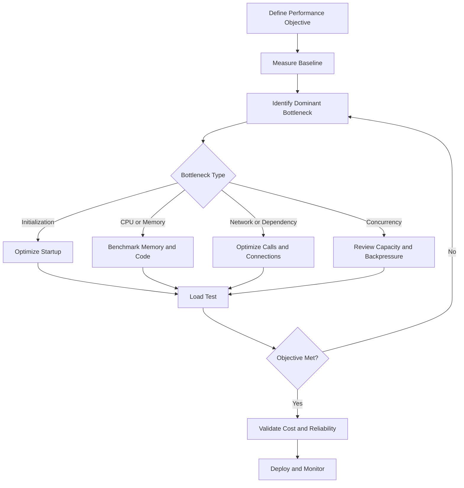

# 03- Performance Optimization

## Overview

AWS Lambda performance optimization focuses on reducing execution latency, improving throughput, controlling resource consumption, and minimizing cost without compromising correctness or reliability.

Lambda automatically scales execution environments based on incoming demand, but application performance still depends on initialization work, memory allocation, dependency loading, downstream latency, concurrency, networking, and event-processing configuration.

For backend engineers, optimization should begin with measurement rather than configuration changes. Increasing memory, enabling provisioned concurrency, or rewriting application code may improve performance, but each introduces trade-offs that must be validated against workload requirements.

The primary objectives are:

- Reduce end-to-end request latency and execution duration.
- Improve cold-start behavior where startup latency matters.
- Increase throughput without overwhelming downstream dependencies.
- Reduce cost per successful business operation.
- Maintain predictable performance under bursts and failures.

## Performance Model

Lambda performance is influenced by several interacting components.

| Component | Performance impact | Optimization approach |
|---|---|---|
| Initialization | Adds startup latency when an execution environment initializes | Reduce initialization work and unnecessary imports |
| Runtime execution | Determines application processing time | Profile code and improve algorithms |
| Memory allocation | Affects available memory and CPU allocation | Benchmark memory configurations |
| Dependency calls | Adds network, database, and service latency | Reuse clients, reduce round trips, and tune timeouts |
| Concurrency | Determines how much work can execute simultaneously | Plan capacity and protect downstream services |
| Networking | Can affect connection establishment and service reachability | Optimize connection reuse and validate network configuration |
| Event processing | Batching and polling influence throughput and latency | Tune event source mappings |
| Telemetry | Logging, tracing, and extensions add overhead | Measure instrumentation cost and control telemetry volume |

A function's execution duration is only one part of end-to-end latency. For an API-backed Lambda function, the caller may also experience latency from API Gateway, authentication, network transfer, downstream services, and response serialization.

## Establish a Performance Baseline

Before optimizing, define the workload and collect representative measurements.

### Important measurements

- Average and percentile end-to-end latency.
- Lambda duration, including p95 and p99 where relevant.
- Cold-start frequency and initialization duration where observable.
- Memory utilization and out-of-memory failures.
- Invocation volume, errors, and throttles.
- Concurrent execution levels.
- Downstream service latency and failure rates.
- Queue age and backlog for asynchronous workloads.
- Cost per successful business operation.

Use representative inputs and traffic patterns. A function tested with a single small event may behave very differently under large payloads, concurrent requests, or slow dependencies.

### A practical optimization workflow



Change one significant variable at a time where practical. Otherwise, it becomes difficult to determine which change caused an improvement or regression.

## Optimize Memory and CPU Allocation

### How memory affects performance

Lambda memory configuration determines the memory available to the execution environment and influences the CPU allocation. Increasing memory can improve CPU-bound workloads, JSON processing, compression, encryption, and other computational tasks.

It does not guarantee faster execution. A function dominated by database latency or an external API call may gain little from additional CPU capacity.

### Benchmark memory settings

Compare multiple memory configurations using the same representative workload. Record duration, memory usage, errors, and estimated cost.

A useful comparison is:

| Configuration | Duration | Memory usage | Cost per successful operation |
|---|---:|---:|---:|
| Lower memory | Measure | Measure | Calculate |
| Medium memory | Measure | Measure | Calculate |
| Higher memory | Measure | Measure | Calculate |

Do not choose the lowest memory configuration automatically. A higher-memory configuration may finish substantially faster, reduce concurrency pressure, and produce a similar or lower cost per operation.

### Inspect memory configuration

```bash
aws lambda get-function-configuration \
  --function-name orders-api \
  --query '{
    MemorySize:MemorySize,
    Timeout:Timeout,
    EphemeralStorage:EphemeralStorage
  }' \
  --output json
```

This is a read-only command.

To change memory allocation:

```bash
aws lambda update-function-configuration \
  --function-name orders-api \
  --memory-size 1024
```

This is a write operation. Replace the function name and memory value with the tested configuration. Wait for the configuration update to complete and verify the result before benchmarking.

## Reduce Cold-Start Latency

### What causes cold starts?

A cold start occurs when Lambda needs to initialize an execution environment before running the handler. Initialization can include runtime startup, module imports, dependency loading, extension startup, and application initialization.

Cold starts are affected by runtime, package size, initialization work, networking configuration, and other implementation details. Their impact varies across workloads.

### Reduce initialization work

For Python applications:

- Remove unused dependencies.
- Avoid expensive work at module import time.
- Keep deployment packages appropriately sized.
- Initialize reusable clients outside the handler when safe.
- Avoid unnecessary configuration lookups during every initialization.
- Profile imports and application startup.
- Review extension overhead.

Example:

```python
import json
import os

import boto3

TABLE_NAME = os.environ["ORDERS_TABLE"]
dynamodb = boto3.resource("dynamodb")
table = dynamodb.Table(TABLE_NAME)


def lambda_handler(event, context):
    order_id = event["order_id"]

    response = table.get_item(
        Key={"order_id": order_id}
    )

    return {
        "statusCode": 200,
        "body": json.dumps(response.get("Item")),
    }
```

The DynamoDB resource and table reference are initialized outside the handler, allowing reuse within a warm execution environment.

This pattern reduces repeated client initialization, but it does not eliminate cold starts. The example also assumes the incoming event contains a valid `order_id` and that the function has permission to read the table.

### Execution-environment reuse

Lambda may reuse an execution environment across multiple invocations. Global objects can therefore be reused for SDK clients, connection pools, immutable configuration, and other safe resources.

However:

- Do not store request-specific data in mutable global variables.
- Do not assume that the next invocation will use the same environment.
- Refresh or validate cached credentials and configuration according to their lifecycle.
- Handle stale or broken connections.
- Avoid using in-memory state as the only source of business truth.

Reuse is an optimization, not a durability guarantee.

## Provisioned Concurrency and SnapStart

Different features address different startup requirements.

| Feature | Primary purpose | Main trade-off |
|---|---|---|
| Provisioned concurrency | Keeps a configured number of execution environments initialized and ready | Adds ongoing capacity cost |
| Lambda SnapStart | Reduces initialization latency by restoring supported initialized execution environments from snapshots | Requires supported runtime and compatible initialization behavior |
| Initialization optimization | Reduces the work required to start an environment | Requires application changes and profiling |

### Provisioned concurrency

Provisioned concurrency is useful for latency-sensitive APIs with predictable traffic or strict startup-latency requirements.

Consider it when:

- Cold-start latency violates an established service objective.
- Traffic patterns justify keeping environments ready.
- The function receives enough traffic to make the cost worthwhile.

Review utilization, scaling behavior, alias configuration, and cost. Provisioned concurrency does not eliminate application execution time or downstream latency, and insufficient provisioned capacity can still result in requests using other execution paths or experiencing throttling, depending on configuration and available capacity.

### SnapStart

SnapStart is available only for supported Lambda runtimes and configurations. It uses snapshots of initialized execution environments to reduce startup work.

Before adopting it:

- Verify runtime and feature compatibility.
- Review initialization and restore lifecycle behavior.
- Ensure initialization does not rely on unsafe assumptions about unique state, timestamps, or connections being valid after restoration.
- Validate behavior for credentials, random values, network connections, and other state that may need refresh after restore.
- Measure cold-start improvement against the existing baseline.

Do not assume SnapStart and provisioned concurrency are interchangeable or universally combinable. Verify the current feature compatibility and configuration restrictions for the selected runtime and deployment model.

## Optimize Python Code and Dependencies

### Profile before rewriting

Identify whether time is spent in CPU-intensive processing, serialization, database queries, network calls, or framework initialization.

For CPU-bound code:

- Reduce unnecessary loops and repeated computations.
- Use efficient algorithms and data structures.
- Avoid repeated parsing of unchanged configuration.
- Process large payloads incrementally when possible.
- Use appropriate libraries for computationally intensive operations.

For I/O-bound code:

- Reduce unnecessary sequential network calls.
- Reuse supported clients and connections.
- Set realistic connection and read timeouts.
- Avoid retrying failures that cannot succeed.
- Use concurrency only when it improves throughput without violating downstream limits.

### Minimize dependency overhead

Large dependency trees can increase deployment size and initialization time.

Practical improvements include:

- Remove packages that are not used.
- Avoid importing entire frameworks when a smaller component is sufficient.
- Pin and review dependency versions.
- Package dependencies for the correct runtime and architecture.
- Measure import-time behavior after changes.

Do not replace well-maintained libraries with custom implementations solely to reduce package size without evaluating security, correctness, and maintenance costs.

## Optimize Network and Dependency Latency

### Reuse clients and connections

Creating a new SDK client or database connection for every operation can add overhead and increase pressure on downstream services.

Where supported, reuse clients outside the handler and configure connection pools appropriately. Connection reuse depends on the library, runtime lifecycle, network conditions, and whether connections remain valid.

For database-backed workloads:

- Use connection pooling or a suitable database proxy where appropriate.
- Bound connection counts.
- Configure connect, read, and operation timeouts.
- Monitor connection saturation and query latency.
- Avoid opening multiple connections unnecessarily within one invocation.

A Lambda function that scales rapidly can create many concurrent database connections. Optimizing each invocation independently is insufficient if aggregate concurrency overwhelms the database.

### Reduce unnecessary round trips

Suppose a request requires three independent downstream calls. Sequential execution makes total dependency latency approximately the sum of their durations, plus application overhead.

If the calls are genuinely independent, bounded parallel execution may reduce latency toward the duration of the slowest call. However, it can increase simultaneous connections, request volume, and resource consumption.

Use parallelism only when:

- The operations are independent.
- The downstream service can handle the increased concurrency.
- Cancellation and partial failure behavior are understood.
- The overall request timeout leaves sufficient margin.

### Set timeout budgets

Timeouts should be coordinated across the caller, Lambda, and downstream dependencies.

For example, if an API request has a strict overall deadline, the Lambda handler must reserve time for validation, dependency calls, and response construction. A downstream request should not consume the entire remaining execution time if the application needs to return a controlled response.

A useful rule is to set dependency timeouts below the remaining Lambda execution budget and to avoid retries that cannot finish within that budget.

## Optimize Concurrency and Throughput

### Understand concurrency

Concurrency represents the number of executions running at the same time.

A rough steady-state estimate is:

\[
\text{Concurrency} \approx
\text{Requests per second} \times
\text{Average duration in seconds}
\]

For example, 100 requests per second with an average duration of 0.2 seconds implies approximately 20 concurrent executions under steady-state conditions.

Actual capacity requirements can be higher due to bursts, tail latency, retries, and workload variability.

### Reserved concurrency

Reserved concurrency allocates concurrency capacity for a function and limits its maximum concurrent executions. It can protect critical workloads from account-level competition and prevent one function from consuming too much concurrency.

However, setting it too low can throttle valid traffic. Setting it too high can expose downstream services to excessive load.

Use load tests and dependency capacity estimates to choose limits. Monitor throttles, latency, queue age, and downstream health after changes.

### Backpressure and downstream protection

High Lambda concurrency does not always mean higher system throughput. If a database or external API cannot handle the resulting load, increased concurrency may cause more failures and retries.

Protect downstream services with:

- Reserved concurrency where appropriate.
- Queue-based buffering for asynchronous workloads.
- Controlled event-source mapping concurrency.
- Connection pooling and bounded parallelism.
- Retry limits and exponential backoff.
- Circuit breakers or load shedding when justified.

For SQS-driven functions, throughput depends on batch size, event-source mapping configuration, message processing duration, and downstream capacity. Optimize the complete pipeline rather than the Lambda function in isolation.

## Optimize Event Processing

### Batching

Batching allows supported event sources to deliver multiple records in one invocation. It can reduce per-invocation overhead and improve throughput for workloads such as SQS message processing.

The trade-offs include:

- Larger batches may increase processing duration.
- A failed batch can cause repeated work unless partial batch failure reporting is configured correctly.
- Large batches may increase memory usage.
- Batch size and batching window influence processing latency.

Use realistic load tests to determine the appropriate batch configuration.

### Partial batch responses

For supported event sources, partial batch responses allow the handler to identify failed records without forcing every record in the batch to be retried.

This can improve throughput when failures are isolated to a small subset of records. The handler must return the expected response format, and the event source mapping must enable the relevant feature.

Incorrect implementation can cause failed records to be lost from the retry path or successful records to be processed repeatedly.

### Event-source polling and concurrency

For queue and stream integrations, tune event-source mapping settings according to source-specific capabilities. Settings differ across SQS, Kinesis, DynamoDB Streams, and other sources.

Evaluate:

- Maximum concurrency and scaling behavior.
- Batch size and batching window.
- Ordering and checkpoint semantics.
- Retry and failure destinations.
- Partial batch failure support.
- Downstream capacity and recovery time.

Do not assume that configuration options available for one event source also apply to another.

## Ephemeral Storage and Large Payloads

Lambda provides configurable ephemeral storage for temporary files. Increase it when the workload genuinely requires additional scratch space, such as decompression, file transformation, or intermediate artifacts.

Performance considerations include:

- Avoid writing temporary files when streaming is practical.
- Remove temporary artifacts when they are no longer needed.
- Account for storage requirements when processing large files concurrently.
- Avoid assuming that ephemeral storage persists reliably across invocations.
- Use S3 or another durable storage service for persistent artifacts.

For large files, consider an architecture that streams or processes objects in chunks rather than loading entire objects into memory.

## Observability for Performance Tuning

Use CloudWatch metrics, structured logs, and tracing to locate bottlenecks.

| Signal | What it helps identify |
|---|---|
| Lambda duration percentiles | Execution latency and regressions |
| Maximum memory used | Memory pressure and potential sizing issues |
| Initialization duration where available | Startup overhead |
| Throttles | Concurrency or capacity constraints |
| Downstream latency | Dependency bottlenecks |
| Queue age | Processing capacity falling behind incoming work |
| Business success rate | Whether technical improvements preserve outcomes |

Use AWS X-Ray or supported OpenTelemetry instrumentation when you need to understand latency across service boundaries.

Be aware that tracing is often sampled. Missing a trace does not prove that an operation did not occur.

## Performance Testing

### Benchmark methodology

A reliable benchmark should:

1. Use representative event payloads.
2. Run enough invocations to observe latency distributions.
3. Include cold and warm behavior where relevant.
4. Measure downstream latency and failures.
5. Test realistic concurrency and burst patterns.
6. Compare memory configurations and code changes.
7. Record cost alongside latency and throughput.
8. Repeat tests to account for variability.

### Compare changes systematically

Maintain a record of the baseline and each optimization.

| Experiment | Latency change | Throughput change | Cost change | Decision |
|---|---|---|---|---|
| Reduce import overhead | Measure | Measure | Measure | Keep only if beneficial |
| Increase memory | Measure | Measure | Measure | Evaluate cost per operation |
| Enable provisioned concurrency | Measure | Measure | Measure | Compare against latency objective |
| Increase batch size | Measure | Measure | Measure | Validate failure handling and backlog |
| Reuse downstream clients | Measure | Measure | Measure | Verify connection lifecycle and correctness |

Avoid drawing conclusions from a single invocation or a small number of samples.

## Cost Optimization

Lambda cost depends on factors including invocation count, execution duration, configured memory, architecture, and applicable pricing rules. Other services—such as CloudWatch, X-Ray, SQS, NAT gateways, and databases—can contribute significantly to total workload cost.

### Optimize cost per successful operation

A useful engineering metric is:

\[
\text{Cost per success} =
\frac{\text{Total workload cost}}
{\text{Successful business operations}}
\]

This is often more informative than cost per invocation because failed retries and downstream processing may increase spending without producing successful outcomes.

Review:

- Memory and duration together.
- Retry frequency and failed processing.
- Provisioned concurrency utilization.
- Logging and tracing volume.
- Networking and data transfer costs.
- Downstream service consumption.
- Architecture and runtime trade-offs.

Do not optimize Lambda billing in isolation if doing so increases database costs, failure rates, or user-visible latency.

## Common Performance Mistakes

| Mistake | Why it fails | Better approach |
|---|---|---|
| Increasing memory without measuring | May not improve an I/O-bound workload | Profile and benchmark representative traffic |
| Assuming warm environments are guaranteed | Lambda may create or retire environments at any time | Make startup efficient and reuse state only as an optimization |
| Initializing expensive clients inside every handler invocation | Repeats avoidable setup work | Reuse clients where safe |
| Increasing concurrency without checking dependencies | Can overload databases and external APIs | Set limits based on downstream capacity |
| Using provisioned concurrency without utilization analysis | Can increase cost without meaningful latency improvement | Compare measured latency benefits with ongoing cost |
| Increasing batch size without failure testing | Can increase retry cost and processing latency | Test partial failures and batch behavior |
| Optimizing average latency only | Can hide unacceptable p95 and p99 behavior | Monitor latency distributions |
| Removing observability to reduce overhead | Makes regressions and incidents harder to diagnose | Measure instrumentation overhead and tune it deliberately |
| Assuming faster execution always means lower cost | Resource allocation and other service costs also matter | Evaluate cost per successful operation |
| Running load tests against production dependencies without safeguards | Can cause outages or unexpected spending | Use isolated environments and controlled test limits |

## Production Performance Checklist

### Application

- [ ] A baseline exists for latency, throughput, memory, and error rate.
- [ ] Initialization work and imports have been reviewed.
- [ ] SDK clients and connections are reused safely.
- [ ] Algorithms and serialization paths have been profiled.
- [ ] Large payloads and temporary storage requirements are understood.

### Capacity and reliability

- [ ] Concurrency requirements have been estimated and load-tested.
- [ ] Downstream capacity has been validated.
- [ ] Timeouts and retry policies are coordinated.
- [ ] Event-source batch and concurrency settings are tested.
- [ ] Backpressure and failure recovery are documented.

### Cost and observability

- [ ] Memory configurations have been benchmarked.
- [ ] Cost per successful operation is understood.
- [ ] Latency percentiles and relevant bottleneck signals are monitored.
- [ ] Logging and tracing overhead has been measured.
- [ ] Provisioned concurrency or SnapStart is enabled only when justified and supported.
- [ ] Performance regressions can be detected after deployment.

## Key Takeaways

- Measure the complete workload before optimizing; Lambda duration alone does not explain end-to-end latency or business success.
- Memory, initialization, dependency latency, concurrency, and event-source configuration interact and must be evaluated together.
- Reuse clients safely, minimize unnecessary work, and protect downstream dependencies from excessive concurrency.
- Provisioned concurrency, SnapStart, batching, and other optimizations require workload-specific compatibility, performance, and cost validation.
- Optimize for reliable throughput and cost per successful operation while preserving observability and failure-handling guarantees.