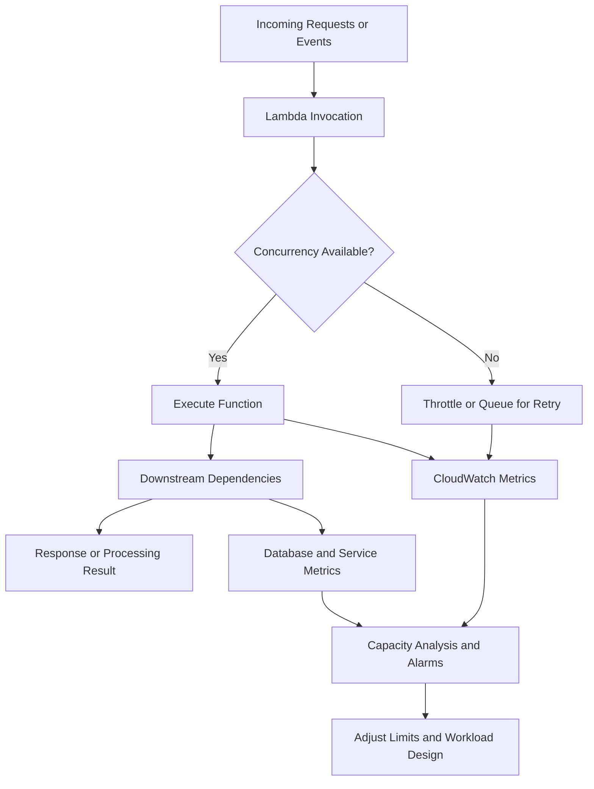
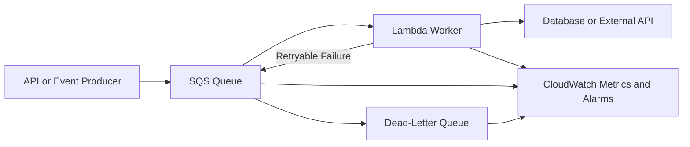

# 04- Concurrency and Capacity Management

## Overview

AWS Lambda concurrency and capacity management determine how many function invocations can execute simultaneously, how quickly a workload can scale, and how effectively the application protects downstream dependencies under load.

Lambda automatically manages execution environments, but automatic scaling does not eliminate capacity constraints. Account quotas, function-level concurrency limits, event-source configuration, downstream service capacity, and burst traffic can all affect application availability.

For production backend systems, concurrency is a distributed-systems concern rather than simply a Lambda configuration setting. Increasing concurrency may improve throughput, but it can also exhaust database connections, overload external APIs, increase retry volume, and amplify an incident.

The primary objectives are to:

- Provide sufficient execution capacity for expected traffic.
- Prevent one function from consuming capacity needed by other workloads.
- Protect databases and downstream services from overload.
- Control throttling, queue backlogs, and retry amplification.
- Balance latency, throughput, reliability, and cost.

## Understanding Lambda Concurrency

Concurrency is the number of function invocations executing at the same time.

For example, if 50 invocations are running simultaneously, the function is using approximately 50 concurrent executions. A new invocation may use an existing available execution environment or require another environment, depending on runtime and service behavior.

Lambda creates and manages execution environments automatically, subject to scaling behavior and applicable quotas.

### Relationship between request rate, duration, and concurrency

For a reasonably steady workload, Little's Law provides a useful approximation:

\[
\text{Concurrency} \approx
\text{Arrival rate} \times \text{Average processing time}
\]

If a function receives 200 requests per second and each invocation takes an average of 0.25 seconds:

\[
200 \times 0.25 = 50
\]

The workload requires approximately 50 concurrent executions under those assumptions.

This is an estimate, not a capacity guarantee. Traffic bursts, long-tail latency, retries, and uneven request distribution can increase actual concurrency requirements.

### Why duration affects concurrency

Consider two implementations handling the same 200 requests per second.

| Average duration | Approximate concurrency |
|---|---:|
| 1 second | 200 |
| 500 milliseconds | 100 |
| 250 milliseconds | 50 |
| 100 milliseconds | 20 |

Reducing execution duration can reduce required concurrency, but only if the optimization genuinely reduces the time an invocation remains active. A function waiting on a slow database query continues to consume an execution environment even when it uses little CPU.

## Lambda Concurrency Architecture



The behavior when capacity is unavailable depends on the invocation model:

- Synchronous invocations can receive throttling errors.
- Asynchronous invocations are subject to Lambda's asynchronous queue and retry behavior.
- Event source mappings generally poll or retrieve records and invoke Lambda according to source-specific behavior. Messages or records may remain available for later processing, subject to source retention, retry, and checkpoint semantics.

These models are not interchangeable. Capacity planning must account for how each invocation path responds to throttling and failures.

## Account-Level Concurrency

Lambda concurrency quotas apply at the AWS account and Region level. Functions in the same account and Region can compete for available concurrency unless capacity is reserved or otherwise managed.

The available quota and allocation behavior depend on the account's current configuration and AWS service limits.

### Inspect account concurrency

```bash
aws lambda get-account-settings \
  --query 'AccountLimit.{
    ConcurrentExecutions:ConcurrentExecutions,
    UnreservedConcurrentExecutions:UnreservedConcurrentExecutions
  }' \
  --output table
```

This is a read-only command.

The result provides the account's configured concurrency limit and the current unreserved concurrency capacity reported by Lambda. It does not guarantee that every function can immediately scale to that capacity.

### Inspect current function concurrency

CloudWatch's `ConcurrentExecutions` metric reports concurrent executions. Its `Maximum` statistic is particularly useful when evaluating peaks over an interval.

Use the Lambda console or CloudWatch to review concurrency at both account and function levels.

For operational investigations, correlate concurrency with:

- `Invocations`
- `Throttles`
- `Duration`
- `Errors`
- Downstream latency and connection counts
- Queue age and backlog for asynchronous workloads

A concurrency spike without increased successful throughput may indicate that invocations are spending more time waiting on dependencies.

## Reserved Concurrency

Reserved concurrency allocates a portion of the account's concurrency capacity to a function and establishes its maximum concurrency.

It provides two important controls:

1. **Capacity reservation:** The reserved amount is available to that function rather than being consumed by unrelated functions.
2. **Concurrency limit:** The function cannot exceed the configured reserved concurrency.

Reserved concurrency does not pre-initialize execution environments. It is therefore not a cold-start optimization.

### When to use reserved concurrency

Use it when:

- A critical API needs protection from noisy workloads.
- A function must not overwhelm a database or external service.
- A background worker needs a strict upper bound.
- Shared account capacity must be allocated across workloads.
- A misbehaving function could consume excessive concurrency.

Avoid setting the limit arbitrarily low. An undersized limit can cause throttling, increased queue age, and longer completion times.

### Configure reserved concurrency

The following example reserves up to 50 concurrent executions for a function:

```bash
aws lambda put-function-concurrency \
  --function-name orders-api \
  --reserved-concurrent-executions 50
```

This is a write operation. Replace the function name and value with your tested configuration.

Verify the setting:

```bash
aws lambda get-function-concurrency \
  --function-name orders-api
```

The response includes the configured reserved concurrency.

To remove the reservation and return the function to unreserved concurrency allocation:

```bash
aws lambda delete-function-concurrency \
  --function-name orders-api
```

This is also a write operation. Removing reserved concurrency does not create additional account quota; it changes how capacity is allocated.

### Reserved concurrency trade-offs

| Benefit | Trade-off |
|---|---|
| Protects a critical function from unrelated workloads | Reduces concurrency available to other unreserved functions |
| Limits downstream connection pressure | Can throttle legitimate traffic if undersized |
| Provides predictable concurrency boundaries | Does not guarantee low latency |
| Helps contain runaway workloads | Does not automatically control concurrency across multiple independent downstream clients |

## Unreserved Concurrency

Functions without reserved concurrency generally use the account's shared concurrency capacity.

This provides flexibility for workloads with variable demand, but it introduces competition between functions.

For example, a batch-processing function may consume a large portion of shared capacity during a backlog recovery. If an interactive API also relies on that capacity, the API may experience throttling.

Use reserved concurrency selectively for workloads with explicit isolation requirements. Avoid reserving capacity for every function without considering the account's total capacity and allocation constraints.

## Provisioned Concurrency

Provisioned concurrency prepares execution environments in advance to reduce initialization latency.

It is useful for latency-sensitive workloads where cold starts materially affect service-level objectives.

Provisioned concurrency differs from reserved concurrency:

| Property | Reserved concurrency | Provisioned concurrency |
|---|---|---|
| Reserves concurrency capacity | Yes | Associated with configured provisioned capacity |
| Limits function concurrency | Yes | Does not replace the need to understand other concurrency limits |
| Pre-initializes execution environments | No | Yes |
| Primary objective | Capacity isolation and limiting | Startup-latency reduction |
| Additional ongoing cost | No separate provisioned-environment charge | Yes, based on applicable provisioned concurrency pricing |

Provisioned concurrency is configured for a published version or alias, not simply as a general cold-start toggle for arbitrary unqualified invocations.

When considering both reserved and provisioned concurrency, verify the current AWS allocation and compatibility rules. Provisioned concurrency requires sufficient account capacity and appropriate configuration.

Use it when measured startup latency justifies the cost. It does not eliminate application execution time, dependency latency, or every possible source of throttling.

## Capacity Planning for Production Workloads

Capacity planning should begin with demand, execution duration, downstream constraints, and failure behavior.

### Estimate concurrency

Suppose an API receives 600 requests per second, with an average Lambda duration of 150 milliseconds.

\[
600 \times 0.15 = 90
\]

The estimated steady-state concurrency is 90.

A production design should also consider:

- Traffic bursts above the average request rate.
- p95 and p99 execution durations.
- Deployment and scaling behavior.
- Retry traffic.
- Other functions sharing the account quota.
- Downstream capacity and failure recovery.

Do not simply multiply average concurrency by an arbitrary safety factor and treat the result as a guarantee. Validate capacity with representative load tests and monitor actual traffic.

### Plan for peak and degraded conditions

A function may take significantly longer when a dependency slows down. Since concurrency is proportional to processing time, latency degradation can cause concurrency to rise even when incoming traffic remains constant.

For example, a database slowdown can produce this sequence:

1. Database queries take longer.
2. Lambda invocations remain active longer.
3. Concurrent executions increase.
4. Database connections accumulate.
5. More requests time out or fail.
6. Retries increase traffic and worsen the overload.

Breaking this feedback loop requires timeout control, bounded concurrency, appropriate retries, and downstream protection.

## Protecting Downstream Dependencies

Lambda can scale faster than many databases or third-party services can safely accept connections or requests.

The correct concurrency limit should therefore consider the entire dependency chain.

### Example: Lambda and PostgreSQL

Assume a PostgreSQL instance can safely support 300 application connections after reserving capacity for administration and other services.

If multiple Lambda functions create connections independently, their aggregate connection demand can exceed the database limit even when each function appears healthy.

A rough connection-demand estimate is:

\[
\text{Potential connections}
\approx
\text{Concurrent invocations}
\times
\text{Connections per invocation}
\]

This is an upper-bound style estimate rather than a guarantee of actual connections. Real usage depends on application behavior, connection pooling, and library lifecycle.

Recommended controls include:

- Set reserved concurrency based on database capacity.
- Reuse database connections where safe.
- Use Amazon RDS Proxy where appropriate.
- Keep connection pools small and bounded.
- Set connection and query timeouts.
- Monitor connection saturation and query latency.
- Avoid retries that immediately recreate excessive connection demand.

For RDS Proxy suitability, review the database engine, authentication requirements, connection behavior, and current service limitations before adopting it.

### Example: external API rate limits

If a third-party API permits only a limited request rate, increasing Lambda concurrency can cause rate-limit failures.

Use a queue to absorb bursts, configure controlled worker concurrency, and implement backoff for throttling responses. A queue does not itself enforce a third-party rate limit; the worker design must regulate the actual request rate.

## Event Source Mapping Concurrency

Event source mappings connect supported sources, such as SQS queues and stream-based services, to Lambda functions. Their concurrency behavior depends on the source and event source mapping configuration.

Do not confuse event source mapping concurrency with direct invocation concurrency.

### SQS and Lambda

An SQS event source mapping polls messages and invokes the function with batches of records.

Important configuration considerations include:

- Batch size and batching window.
- Maximum concurrency where supported.
- Visibility timeout.
- Function timeout.
- Partial batch response configuration.
- Dead-letter queue or redrive policy.
- Queue backlog and message age.

For SQS standard queues, processing is designed for at-least-once delivery. Duplicate processing is possible, so handlers must be idempotent.

For FIFO queues, ordering and concurrency constraints differ. Ensure the function's processing design respects message group ordering and the event source mapping's behavior.

### Control SQS worker concurrency

Maximum concurrency on an SQS event source mapping can limit how many concurrent Lambda invocations that mapping uses.

It is useful when protecting downstream systems or controlling the rate at which a backlog is processed.

Check that the configured maximum concurrency is compatible with the function's reserved concurrency and any other event source mappings invoking the same function. Otherwise, one mapping or the function-level limit can constrain other workloads.

Example inspection command:

```bash
aws lambda list-event-source-mappings \
  --function-name order-worker \
  --query 'EventSourceMappings[].{
    UUID:UUID,
    State:State,
    BatchSize:BatchSize,
    MaximumConcurrency:ScalingConfig.MaximumConcurrency
  }' \
  --output table
```

This is a read-only command. Fields returned depend on the event source mapping and its supported configuration.

### Kinesis and DynamoDB Streams

Stream-based event source mappings use source-specific polling, batching, and checkpoint behavior. Concurrency and ordering are affected by shard or partition structure, parallelization settings, and the event source mapping configuration.

For these workloads:

- Understand the source's ordering guarantees.
- Monitor iterator age or equivalent lag indicators.
- Tune batch size and parallelization carefully.
- Handle partial batch failures where supported.
- Avoid assuming that increasing concurrency always increases useful throughput.

A slow or repeatedly failing record can delay progress according to the source's checkpointing and retry behavior.

## Synchronous and Asynchronous Invocation Capacity

Different invocation modes respond differently when Lambda cannot immediately execute work.

| Invocation model | Capacity behavior | Operational concern |
|---|---|---|
| Synchronous | Caller waits for the response; throttling or invocation errors may be returned | Client retry behavior can amplify load |
| Asynchronous Lambda invocation | Lambda queues the event internally and processes it asynchronously | Queueing, retry policies, event age, and failure destinations matter |
| SQS event source mapping | Lambda polls messages and processes batches | Backlog, visibility timeout, redrive behavior, and concurrency limits matter |
| Stream event source mapping | Lambda polls records and tracks progress according to source semantics | Checkpointing, ordering, retries, and stream lag matter |

Do not assume that a successful invocation API response means the handler completed successfully. For asynchronous invocation, the response generally confirms that Lambda accepted the event for asynchronous processing, not that business processing succeeded.

## Throttling and Recovery

Throttling occurs when a function cannot obtain the required concurrency capacity or exceeds applicable invocation limits.

The recovery strategy depends on the invocation path:

- Synchronous callers should use bounded retries and backoff where appropriate.
- Asynchronous invocations should be monitored for event age, retries, and failed-event destinations.
- SQS workers should be monitored for queue depth, oldest-message age, and dead-letter volume.
- Stream consumers should be monitored for processing lag and checkpoint progress.

Repeated retries without backoff or capacity control can worsen an overload.

### Diagnose throttling

Inspect recent function metrics and configuration:

```bash
aws cloudwatch get-metric-statistics \
  --namespace AWS/Lambda \
  --metric-name Throttles \
  --dimensions Name=FunctionName,Value=orders-api \
  --start-time 2026-10-11T00:00:00Z \
  --end-time 2026-10-11T01:00:00Z \
  --period 60 \
  --statistics Sum
```

This is a read-only command. Replace the timestamps with the incident window in UTC and use the appropriate function dimension.

Inspect function concurrency configuration:

```bash
aws lambda get-function-concurrency \
  --function-name orders-api
```

Inspect account-level capacity:

```bash
aws lambda get-account-settings \
  --output json
```

Correlate throttles with invocation rate, duration, reserved concurrency, account-level unreserved capacity, event source mapping settings, and downstream health. A throttling metric identifies a symptom; it does not by itself establish the root cause.

## Capacity Management for Bursty Workloads

A bursty workload can create sudden concurrency demand that exceeds available capacity or downstream limits.

A common design is to decouple request acceptance from expensive processing.



This architecture allows work to accumulate temporarily rather than requiring every request to be processed immediately. It also provides a mechanism for controlling worker concurrency.

However, queue-based processing introduces eventual completion rather than immediate completion. The application must define how callers learn about processing status, how long queued work may wait, and how failed messages are recovered.

For latency-sensitive operations that require an immediate response, asynchronous decoupling may not be appropriate for the entire request path.

## Monitoring and Alerting

Concurrency should be monitored alongside workload outcomes.

| Signal | Operational meaning |
|---|---|
| `ConcurrentExecutions` | Current or peak concurrent activity |
| `UnreservedConcurrentExecutions` | Account-level shared capacity in use |
| `Throttles` | Invocations constrained by capacity or limits |
| `Invocations` | Incoming execution demand |
| `Duration` | Execution time and possible latency growth |
| `Errors` | Handler failures |
| SQS `ApproximateAgeOfOldestMessage` | How long the oldest message has been waiting |
| Stream iterator age | Lag in processing stream records |
| Database connection utilization | Whether the dependency is approaching capacity |

Create alarms based on service-level objectives and expected workload behavior rather than applying identical thresholds to every function.

Useful alerts include sustained throttling, concurrency approaching configured limits, increasing queue age, growing stream lag, elevated error rates, and downstream saturation.

A high concurrency value is not automatically an incident. It becomes concerning when it indicates insufficient headroom, unexpected demand, rising errors, or excessive downstream pressure.

## Operational Capacity Review

Perform a capacity review before major traffic increases and after meaningful architectural changes.

### Review checklist

- [ ] Estimate steady-state and peak concurrency from representative traffic.
- [ ] Confirm account concurrency quotas and current allocation.
- [ ] Review reserved concurrency for critical and resource-intensive functions.
- [ ] Validate provisioned concurrency where startup latency is a concern.
- [ ] Load-test with realistic payloads, latency, and burst patterns.
- [ ] Estimate aggregate database connections and external API request rates.
- [ ] Review SQS visibility timeout, batching, redrive policy, and mapping concurrency.
- [ ] Review stream lag, checkpoint behavior, and source-specific concurrency settings.
- [ ] Configure alarms for throttling, errors, queue age, and dependency saturation.
- [ ] Verify retry and backoff behavior during overload.
- [ ] Document scaling limits, incident actions, and rollback procedures.
- [ ] Reassess capacity and cost after traffic patterns change.

## Key Takeaways

- Lambda concurrency is driven by request arrival rate and processing duration; estimate it mathematically, then validate it with real workload measurements.
- Reserved concurrency isolates and limits function capacity, while provisioned concurrency prepares environments to reduce startup latency.
- Lambda can scale faster than databases and external services can safely handle; design concurrency limits around downstream capacity.
- Synchronous invocations, asynchronous invocations, queues, and streams have different throttling, retry, ordering, and recovery semantics.
- Monitor concurrency together with throttles, latency, errors, queue age, and dependency health to distinguish healthy scaling from an overload condition.