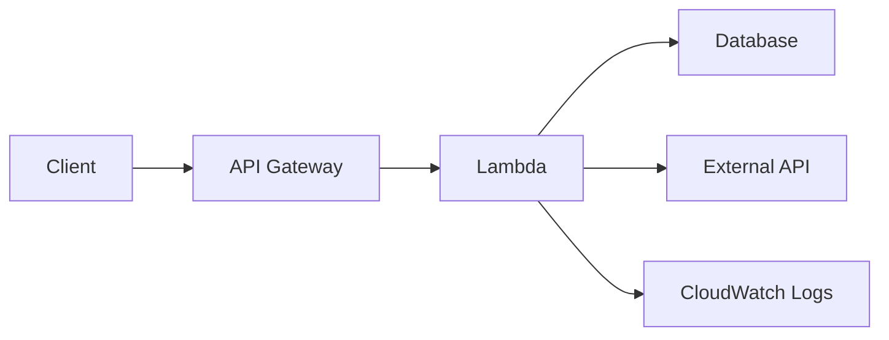
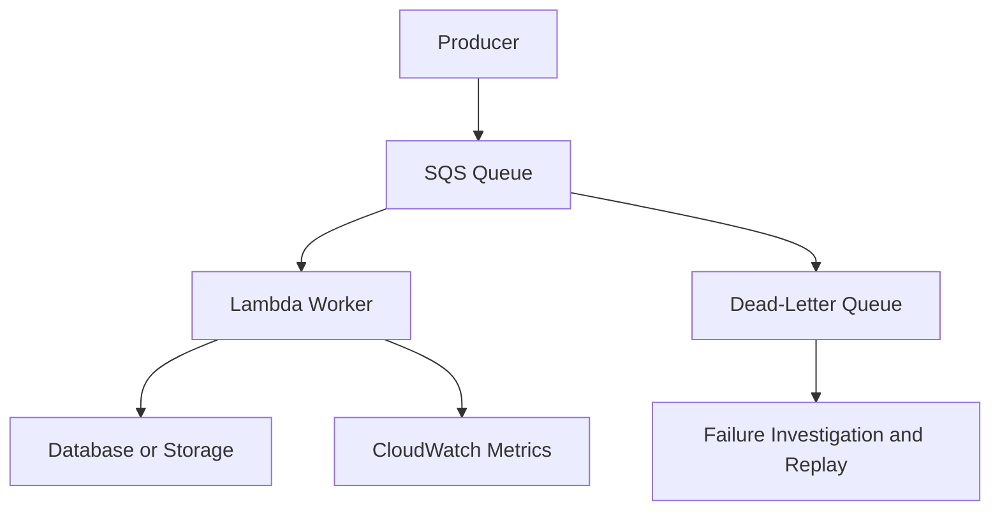
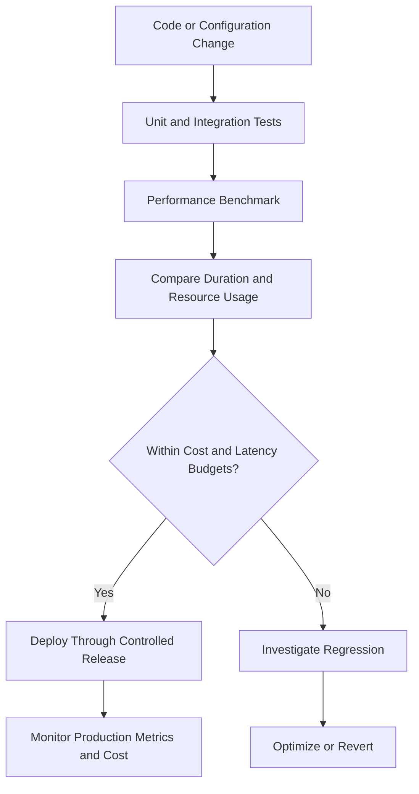

# 05- Cost Optimization

## Overview

AWS Lambda cost optimization involves reducing the cost of executing workloads without compromising latency, reliability, security, or maintainability.

Lambda uses a pay-per-use model, but the total cost of a serverless application extends beyond function invocations. Depending on the architecture, costs can include execution duration, allocated memory, provisioned concurrency, ephemeral storage beyond the included allocation, data transfer, logging, tracing, event sources, networking, and downstream services.

The primary optimization objective is not to minimize the cost of an individual invocation. It is to minimize the cost of delivering a successful business operation within the required service-level objectives.

For example, increasing memory may shorten execution duration enough to reduce total compute cost. Conversely, reducing memory too aggressively can increase latency, timeouts, retries, and overall cost.

A production cost optimization strategy should therefore combine:

- Cost measurement and workload attribution.
- Memory and execution-duration optimization.
- Invocation and retry reduction.
- Concurrency and capacity management.
- Architecture and event-processing optimization.
- Observability cost controls.
- Automated cost monitoring and regression prevention.

## Understanding Lambda Pricing

Lambda pricing depends on the execution model, configured resources, and features used. Pricing differs by Region and can change, so verify current rates before making financial decisions.

### Main cost components

| Cost component | What drives cost | Optimization approach |
|---|---|---|
| Requests | Number of function invocations | Eliminate unnecessary invocations and duplicate work |
| Compute duration | Allocated memory and billable execution time | Benchmark memory settings and reduce unnecessary work |
| Provisioned concurrency | Configured provisioned capacity and time allocated | Match capacity to latency requirements and demand patterns |
| Provisioned concurrency execution | Execution under provisioned concurrency, according to applicable pricing | Optimize duration and validate the full pricing model |
| Ephemeral storage | Configured storage above the included allocation and execution duration | Allocate only the storage required |
| CloudWatch Logs | Ingestion, storage, and applicable query charges | Reduce noisy logs and apply retention policies |
| AWS X-Ray and observability integrations | Traces, ingestion, and related usage | Sample strategically while preserving diagnostic coverage |
| Networking and data transfer | Traffic patterns and connected services | Reduce unnecessary cross-service and cross-Region transfers |
| Event sources and dependencies | Queue requests, database capacity, NAT gateways, and other services | Optimize the complete architecture, not only Lambda |

The exact billing treatment of execution environments, initialization, provisioned concurrency, and other features depends on the current Lambda pricing model and configuration. Do not assume that every invocation or environment incurs identical charges.

## Request and Compute Costs

### Request charges

Lambda request charges depend on the number of invocations, subject to applicable pricing tiers and any eligible free usage.

Common causes of unnecessary invocation costs include:

- Duplicate event delivery.
- Recursive invocation loops.
- Polling-based designs that generate excessive work.
- Overly broad event triggers.
- Processing records individually when batching is supported and appropriate.
- Repeated retries of permanent failures.

The goal is not simply to reduce invocation count. Batching or combining operations can increase execution duration and failure scope, so measure the effect on total cost and reliability.

### Compute charges

For standard on-demand execution, compute charges are generally based on allocated memory and billable execution duration, subject to the applicable pricing rules.

A simplified model is:

\[
\text{Compute usage}
\propto
\text{Allocated memory}
\times
\text{Billable duration}
\]

This is a usage relationship, not a complete billing formula. Actual cost depends on the current pricing model, architecture, Region, applicable discounts, and additional features.

A function configured with more memory may cost more per unit of execution time but finish substantially faster. A lower-memory function may run long enough to cost more overall.

## Memory and Duration Optimization

Lambda memory allocation affects available CPU resources as well as memory capacity. This makes memory configuration a performance and cost decision.

### Example

Consider a workload with two candidate configurations:

| Configuration | Allocated memory | Average duration | Relative compute usage |
|---|---:|---:|---:|
| A | 256 MB | 800 ms | 204.8 MB-seconds |
| B | 512 MB | 300 ms | 153.6 MB-seconds |

Using the simplified memory-duration calculation:

- Configuration A: \(256 \times 0.8 = 204.8\) MB-seconds.
- Configuration B: \(512 \times 0.3 = 153.6\) MB-seconds.

Configuration B uses approximately 25% less memory-duration despite allocating twice the memory.

This example excludes request charges, initialization effects, billing granularity, and other cost components. Validate the actual result using current pricing and representative measurements.

### Optimization procedure

1. Establish a baseline for duration, errors, memory usage, and cost.
2. Select representative payloads and realistic dependency behavior.
3. Test several memory allocations.
4. Measure p50, p95, and p99 duration, not only the average.
5. Check maximum memory utilization and timeout behavior.
6. Compare cost per successful business operation.
7. Select the configuration that meets latency and reliability objectives at an acceptable cost.

Avoid optimizing only for minimum compute usage. A configuration that barely meets the latency objective under normal traffic may fail under larger payloads or slower dependencies.

## Use AWS Lambda Power Tuning

AWS Lambda Power Tuning is an open-source tool that helps compare Lambda memory configurations by executing representative workloads and measuring performance and cost.

It is useful for compute-intensive functions, serialization workloads, data transformation, image processing, and other workloads where memory allocation materially affects runtime.

Before using a tuning tool:

- Verify the tool's current deployment and permission requirements.
- Use representative inputs and safe test data.
- Account for downstream service charges.
- Avoid benchmarking against production dependencies in ways that create load or modify business data.
- Test multiple runs to reduce the influence of transient latency.
- Treat results as workload-specific rather than universally optimal.

For I/O-bound functions, increasing memory may provide limited benefit if execution time is dominated by remote service latency.

## Reduce Execution Duration

Reducing duration can improve cost, latency, and concurrency requirements simultaneously.

### Python optimization

For Python Lambda functions, investigate:

- Unnecessary dependency imports.
- Expensive initialization code.
- Repeated client construction.
- Inefficient serialization and deserialization.
- Excessive database queries.
- N+1 query patterns.
- Unnecessary network calls.
- CPU-heavy loops that could use more efficient algorithms or libraries.
- Large payloads copied repeatedly in memory.

Reuse SDK clients and other safe reusable resources outside the handler when execution-environment reuse is appropriate.

```python
import json

import boto3

dynamodb = boto3.resource("dynamodb")
table = dynamodb.Table("orders")


def lambda_handler(event, context):
    order_id = event["order_id"]

    response = table.get_item(
        Key={"order_id": order_id},
        ConsistentRead=False,
    )

    item = response.get("Item")

    if item is None:
        return {
            "statusCode": 404,
            "body": json.dumps({"error": "Order not found"}),
        }

    return {
        "statusCode": 200,
        "body": json.dumps(item, default=str),
    }
```

This example illustrates client reuse. A production implementation must also address input validation, authorization, response serialization, exception handling, and any API Gateway integration requirements.

Do not store request-specific data in global mutable variables. Execution environments may be reused across invocations, and invocation-specific state can leak between requests if the application is designed incorrectly.

### Reduce dependency latency

When execution duration is dominated by remote calls:

- Reuse HTTP connections where the client library supports it safely.
- Set connection and read timeouts.
- Avoid sequential calls when independent operations can safely run concurrently.
- Reduce unnecessary calls to Secrets Manager, Parameter Store, and databases.
- Cache stable data when the consistency requirements permit it.
- Use appropriate database indexes and query plans.
- Avoid retries that repeat expensive operations unnecessarily.

Concurrency can reduce wall-clock duration for independent I/O operations, but it can also increase pressure on downstream services. Benchmark under realistic dependency limits.

## Optimize Cold Starts and Initialization

Cold starts can increase latency and, depending on the applicable pricing model and execution path, affect cost.

Common contributors include:

- Large deployment packages.
- Heavy dependency imports.
- Initialization-time network calls.
- Expensive framework startup.
- VPC networking and dependency setup.
- Initialization that performs work unrelated to the current invocation.

Recommended approaches include:

- Remove unused dependencies.
- Avoid unnecessary work at module import time.
- Reuse clients and connections safely.
- Keep initialization deterministic and lightweight.
- Evaluate provisioned concurrency for strict latency requirements.
- Evaluate SnapStart where the runtime and function configuration support it.

Do not introduce provisioned concurrency solely to reduce latency without estimating its ongoing cost. For workloads with infrequent or unpredictable traffic, the additional capacity charge may outweigh the benefit.

SnapStart and provisioned concurrency have different execution and billing behavior. Verify runtime support, compatibility constraints, deployment configuration, and current pricing before comparing them.

## Control Invocation Volume

Reducing unnecessary work can be more effective than optimizing the execution of work that should never have occurred.

### Narrow event filters

For event-driven workloads, configure event filters and resource notifications so that functions process only relevant events.

Examples include:

- S3 notifications filtered by object prefix or suffix.
- EventBridge rules restricted to relevant event attributes.
- SQS consumers that process only the intended message types.
- DynamoDB Streams consumers that ignore irrelevant record changes.

Filtering should happen as early as the source and integration support. Filtering inside the handler may still incur invocation and initialization costs.

Ensure that filters do not accidentally exclude business-critical events.

### Prevent recursive invocations

A function that writes to the same S3 bucket or triggers a workflow that invokes it again can create an invocation loop.

For example:

```text
S3 object created
    -> Lambda processes object
        -> Lambda writes output to the same triggering prefix
            -> S3 object created
                -> Lambda runs again
```

Prevent this by using separate input and output prefixes or buckets, narrowly scoped notifications, and explicit recursion controls where supported.

Monitor invocation spikes and establish operational controls to disable or contain a faulty event path.

### Use batching appropriately

Batching records from SQS or supported stream sources can reduce invocation overhead.

However, larger batches can increase:

- Processing duration.
- Memory consumption.
- Failure recovery complexity.
- Retry amplification if partial batch responses are not configured correctly.
- Time spent processing records that may later be retried.

Tune batch size using measured throughput, latency, failure rate, and cost per successful record.

## Optimize Asynchronous Processing

Asynchronous architectures can reduce request-path latency and absorb bursts, but queues and retries introduce additional cost.

### SQS and Lambda

A queue-backed worker can improve cost efficiency when multiple records can be processed efficiently per invocation.

Recommended practices:

- Select an appropriate batch size.
- Configure visibility timeout based on processing duration and retry behavior.
- Use partial batch responses where supported and correctly configured.
- Make record processing idempotent.
- Configure redrive policies and dead-letter queues.
- Monitor queue age and backlog.
- Set worker concurrency according to downstream capacity.

A large queue backlog can cause a prolonged period of elevated compute usage. Increasing concurrency may drain the backlog faster but can overload downstream services or increase throttling and retries.

The appropriate strategy balances backlog recovery time, service capacity, and processing cost.

### Avoid retry amplification

Retries can turn a temporary dependency failure into a cost and availability incident.

For example, if a database is unavailable and every invocation immediately retries several times, the system may produce additional requests while the dependency is already overloaded.

Use bounded retries, exponential backoff where appropriate, and jitter for application-managed retry loops. Respect the retry semantics of the invocation model and event source.

Permanent failures should be isolated rather than retried indefinitely. Use dead-letter queues or failure destinations where supported, and establish a safe replay procedure.

## Concurrency and Capacity Cost Controls

Concurrency affects the rate at which Lambda consumes compute resources and the pressure it places on downstream services.

Reserved concurrency is useful for bounding a function's maximum concurrent executions. It can prevent an unexpectedly expensive or misbehaving workload from consuming excessive shared capacity.

Provisioned concurrency reduces initialization latency by keeping execution environments ready, but introduces an additional cost component.

Use concurrency controls deliberately:

- Reserve capacity for critical functions when isolation is required.
- Limit workers when protecting a database or external API.
- Avoid unnecessarily high provisioned concurrency during low-demand periods.
- Evaluate scheduled scaling of provisioned concurrency for predictable traffic patterns.
- Review account-level quotas and shared capacity.
- Test the impact of concurrency limits on throttling and queue age.

A concurrency limit is not itself a direct cost reduction guarantee. It can reduce the rate of spending, but if work accumulates and continues to retry, the workload may still generate substantial cost.

For more detail on capacity isolation and downstream protection, refer to the concurrency and capacity management documentation in this operations folder.

## Logging, Metrics, and Tracing Costs

Observability is essential for operating production Lambda workloads, but excessive telemetry can create significant charges.

### CloudWatch Logs

Potential cost drivers include:

- Logging full request and response payloads.
- Repeated debug messages.
- Large stack traces generated by retry loops.
- Logging sensitive or high-cardinality data unnecessarily.
- Retaining logs indefinitely.
- Processing large log volumes through queries and subscriptions.

Recommended practices:

- Use structured logs with stable field names.
- Log essential lifecycle events and meaningful failures.
- Avoid logging secrets, credentials, tokens, or sensitive payloads.
- Configure appropriate log retention.
- Use sampling or conditional diagnostic logging when appropriate.
- Monitor ingestion and storage volume.

Retention policies should reflect audit, security, and incident-investigation requirements. Do not shorten retention merely to reduce cost when regulatory or operational obligations require longer preservation.

### Tracing

Distributed tracing helps identify latency and dependency failures, especially in multi-service architectures.

Use tracing where it materially improves diagnosis. Evaluate sampling rates, trace volume, retention, and applicable ingestion costs.

During incidents, diagnostic coverage may need to increase temporarily. Make sure operational procedures support that change without creating uncontrolled telemetry volume.

### Cost-aware observability

Monitor cost and operational value together.

| Approach | Benefit | Risk |
|---|---|---|
| Log every payload | Detailed debugging context | High ingestion cost and potential data exposure |
| Log structured metadata | Easier filtering and lower payload volume | Requires consistent instrumentation |
| Sample traces | Lower trace volume | May miss rare failures |
| Retain logs indefinitely | Long historical availability | Increasing storage costs |
| Apply retention by log group | Predictable storage lifecycle | Must align with audit and compliance requirements |

## Ephemeral Storage and Deployment Artifacts

Lambda provides configurable ephemeral storage in `/tmp`. Storage allocation affects the function's available temporary workspace, and charges may apply to storage configured above the included allocation under the applicable pricing rules.

Use only the storage required by the workload.

Examples of temporary-storage use cases include:

- Downloading and transforming files.
- Extracting archives.
- Image and document processing.
- Intermediate artifacts for data pipelines.

Measure peak temporary disk usage and account for concurrent files, retries, and cleanup behavior.

Increasing ephemeral storage without a workload requirement can increase costs. Conversely, allocating too little may cause failures and repeated processing.

### Optimize deployment packages

Large deployment packages and unnecessary dependencies can increase deployment complexity and initialization overhead.

Recommended actions:

- Remove unused libraries.
- Avoid bundling dependencies already provided by the selected runtime when doing so is compatible with your versioning and security requirements.
- Package dependencies deterministically in CI/CD.
- Scan dependencies for vulnerabilities.
- Use Lambda layers only when shared dependency management provides a real benefit.
- Compare ZIP packages and container images based on package size, deployment workflow, and operational requirements.

Layers do not automatically reduce runtime cost. They primarily affect packaging and dependency management, and their use may add versioning and operational complexity.

## Architecture-Level Cost Optimization

Lambda cost should be evaluated as part of the complete request or event-processing path.

### Synchronous API architecture



For synchronous APIs, focus on:

- Request volume and execution duration.
- Database query efficiency.
- Connection management.
- Payload size and serialization overhead.
- Retry behavior in clients and gateways.
- Logging and tracing volume.

Avoid moving every operation to asynchronous processing solely to reduce Lambda cost. If the business operation requires an immediate result, asynchronous decoupling may complicate the application without providing sufficient benefit.

### Event-driven processing architecture



For event-driven workloads, focus on:

- Batching efficiency.
- Queue request volume.
- Worker duration and memory.
- Backlog and message age.
- Duplicate processing.
- Retry volume.
- Dead-letter queue handling.
- Downstream capacity.

The cheapest architecture is not necessarily the one with the lowest Lambda compute usage. Include the costs of queues, storage, data transfer, networking, logging, and downstream services in the comparison.

## Lambda Versus Containers: Cost Trade-Offs

Lambda and container-based compute services have different billing and operational models.

| Consideration | Lambda | ECS/Fargate or similar container workloads |
|---|---|---|
| Billing model | Primarily usage-based, with feature-specific charges | Based on provisioned task resources and runtime, according to the selected service |
| Idle workloads | Often cost-efficient for intermittent workloads | Continuously running capacity can incur cost even when idle |
| Steady high utilization | May be competitive or more expensive depending on workload and configuration | Can be cost-effective with stable, well-utilized capacity |
| Scaling | Managed invocation scaling within applicable limits | Depends on service and autoscaling configuration |
| Operational overhead | Less infrastructure management | More control over runtime and workload placement, with additional operational responsibilities |
| Long-running processes | Subject to Lambda execution limits | Better suited to workloads requiring persistent processes or longer execution |

Do not use invocation count alone to decide between Lambda and containers.

Compare representative workload duration, allocated resources, utilization, request patterns, network and logging charges, operational effort, and reliability requirements.

A migration from Lambda to containers should be justified by workload characteristics and total cost of ownership, not by a general assumption that one compute model is always cheaper.

## Cost Monitoring with AWS Tools

### AWS Cost Explorer

Use Cost Explorer to analyze Lambda spending by service, Region, usage type, and available dimensions.

Useful investigations include:

- Comparing daily or monthly Lambda cost.
- Identifying unexpected growth in usage.
- Reviewing the effect of a deployment.
- Comparing spending across Regions.
- Correlating cost changes with traffic changes.

Cost Explorer data may not be available immediately after usage occurs. For near-real-time operational signals, use service metrics and appropriate monitoring rather than relying solely on billing reports.

### AWS Budgets

Create budgets and alerts for expected spending. Budgets can notify stakeholders when actual or forecasted spending crosses configured thresholds.

Budgets are monitoring and notification mechanisms, not guaranteed real-time spending caps.

### Cost and Usage Reports

AWS Cost and Usage Reports provide detailed billing and usage data for deeper analysis. They can support allocation and reporting across functions, environments, teams, and usage types when combined with appropriate tagging and cost-allocation practices.

For detailed cost analysis, distinguish direct Lambda charges from related services such as CloudWatch, SQS, data transfer, NAT gateways, and databases.

## Inspect Lambda Configuration

Use AWS CLI commands to inspect function configuration before making changes.

### Inspect memory, timeout, and ephemeral storage

```bash
aws lambda get-function-configuration \
  --function-name orders-api \
  --query '{
    FunctionName:FunctionName,
    MemorySize:MemorySize,
    Timeout:Timeout,
    EphemeralStorage:EphemeralStorage,
    PackageType:PackageType,
    Architectures:Architectures
  }' \
  --output json
```

This is a read-only command.

Review the results alongside actual workload measurements. A configured memory value alone does not reveal whether the function is cost-efficient.

### Inspect provisioned concurrency

```bash
aws lambda list-provisioned-concurrency-configs \
  --function-name orders-api
```

This is a read-only command. Use the output to review provisioned capacity and its configuration status.

### Inspect invocation and duration metrics

For an initial investigation, retrieve invocation totals:

```bash
aws cloudwatch get-metric-statistics \
  --namespace AWS/Lambda \
  --metric-name Invocations \
  --dimensions Name=FunctionName,Value=orders-api \
  --start-time 2026-10-10T00:00:00Z \
  --end-time 2026-10-11T00:00:00Z \
  --period 3600 \
  --statistics Sum
```

Retrieve average duration for the same period:

```bash
aws cloudwatch get-metric-statistics \
  --namespace AWS/Lambda \
  --metric-name Duration \
  --dimensions Name=FunctionName,Value=orders-api \
  --start-time 2026-10-10T00:00:00Z \
  --end-time 2026-10-11T00:00:00Z \
  --period 3600 \
  --statistics Average
```

These commands are read-only. Replace the timestamps with the desired UTC interval.

For accurate performance analysis, use suitable percentile statistics and inspect the distribution of execution durations. An average can conceal a small number of expensive, slow invocations.

## Automated Cost Regression Detection

Cost optimization should be part of the engineering lifecycle rather than a one-time activity.

A practical workflow is:



In CI/CD, benchmark representative workloads where practical and track meaningful changes in:

- Execution duration.
- Memory utilization.
- Error and retry rates.
- Invocation volume.
- Cost per successful operation.

Exact billing calculations may not be available during a normal unit-test run. Use benchmarks for regression detection and reconcile estimates with actual billing data.

Production traffic can differ from test workloads, so use both pre-deployment measurements and post-deployment monitoring.

## Common Cost Optimization Mistakes

### Optimizing only for minimum memory

Lower memory can increase execution duration, timeout probability, and concurrency requirements.

**Better approach:** benchmark multiple configurations and compare total cost, latency, and reliability.

### Ignoring retries

Repeated failures may generate additional executions and repeated downstream requests.

**Better approach:** classify failures, bound retries, apply appropriate backoff, and route permanent failures to a controlled recovery path.

### Overusing provisioned concurrency

Provisioned concurrency can incur ongoing charges even when traffic is low.

**Better approach:** estimate demand patterns, measure cold-start impact, and configure capacity according to latency requirements.

### Logging complete payloads

Large logs increase ingestion and storage costs and can expose sensitive information.

**Better approach:** log structured metadata, correlation identifiers, and essential diagnostic details.

### Increasing batch size without testing failure behavior

Large batches can reduce invocation overhead but increase the amount of work affected by a failure.

**Better approach:** measure throughput and cost per successful record while testing partial batch failures and retry behavior.

### Ignoring related AWS services

A lower Lambda bill may hide higher costs from networking, storage, queues, databases, or observability services.

**Better approach:** evaluate end-to-end cost per successful request or business transaction.

### Treating budgets as spending limits

A budget alert does not automatically stop all spending when its threshold is reached.

**Better approach:** combine alerts with ownership, incident procedures, resource controls, and service-specific safeguards.

## Production Cost Optimization Checklist

### Measurement

- [ ] Establish baseline invocation volume, duration, error rate, and cost.
- [ ] Track cost per successful request or processed record.
- [ ] Identify the highest-cost functions and related AWS services.
- [ ] Separate normal traffic growth from inefficient execution.
- [ ] Review current pricing, quotas, and feature-specific billing rules.

### Compute and execution

- [ ] Benchmark multiple memory configurations.
- [ ] Investigate slow dependencies and expensive initialization.
- [ ] Remove unnecessary dependencies and work.
- [ ] Evaluate ephemeral storage allocation.
- [ ] Compare provisioned concurrency cost with its latency benefit.
- [ ] Consider alternative compute services for sustained or long-running workloads.

### Events and reliability

- [ ] Filter irrelevant events at the source where supported.
- [ ] Prevent recursive invocation loops.
- [ ] Tune batching and concurrency using realistic workloads.
- [ ] Make event processing idempotent.
- [ ] Configure retries, dead-letter handling, and failure destinations appropriately.
- [ ] Monitor backlog and retry amplification.

### Observability and governance

- [ ] Set appropriate CloudWatch log retention.
- [ ] Avoid logging sensitive or unnecessarily large payloads.
- [ ] Review tracing and telemetry volume.
- [ ] Configure cost budgets and notifications.
- [ ] Attribute costs to applications and environments where possible.
- [ ] Include cost and performance checks in CI/CD.
- [ ] Review cost regressions after significant deployments.

## Key Takeaways

- Optimize Lambda for cost per successful business operation while preserving latency, reliability, and security requirements.
- Benchmark memory and execution duration together; more memory can reduce total compute cost when it substantially shortens execution time.
- Reduce unnecessary invocations, retries, and repeated work before relying on resource reductions alone.
- Include observability, networking, event sources, and downstream services when evaluating the total cost of a serverless architecture.
- Combine cost budgets, operational metrics, representative performance tests, and post-deployment monitoring to detect and prevent cost regressions.